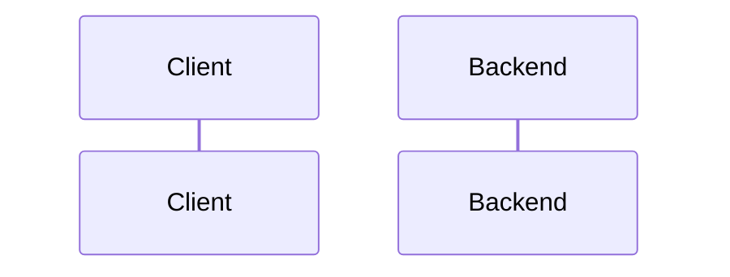

# {{TITLE}}

Spec status: draft · {{DATE}}
Design status: pending
Type: bug · Bug ID: {{BUG_ID}} · Priority: P? · Effort: ? · Folder: `.docs/works/{{FOLDER}}/`

<!--
This file holds the whole task: Spec, Impact, then Design. Maximum 800 lines.
Delete these comments when done. Follow "How to write" in CLAUDE.md.
- /bugfix writes sections 1 and 2, then stops for the author. Do not change any code, not even a test. Do not write section 3 yet.
- After the author's /approve, write section 3.
- Priority and effort use the scales in .docs/Bugs Report.md §2:
  P1 thesis path · P2 security or data loss · P3 users see it · P4 minor.
  XS under 30 min · S under 2 h · M half a day · L more than a day.
- A new bug gets the next free ID in its group (T thesis path, S security, B other).
-->

## 1. Spec

### Problem

<!-- One paragraph: what goes wrong, where (file and function). -->

### Reproduce

1.

**Expected:**
**Actual:**
**Evidence:** <!-- command output, curl response, DB rows. Say which data (seed, humans_v1, test users). -->

### Root cause

<!-- file:function and why it happens. "Not found yet" is allowed, with what you checked. -->

### Scope

**In scope:**
-

**Out of scope:**
-

### Done when

| # | Check | Expected result |
|---|---|---|
| DW1 | The reproduce steps above | The expected result |
| DW2 | A test that fails before the fix | Fails before, passes after |
| DW3 | `bash .claude/hooks/verify.sh` | All checks PASS |

### Open questions

1.

## 2. Impact

<!--
- Who sees the bug. Does it change thesis numbers or block a phase?
- The code areas the fix touches, and other bugs that touch the same code.
- Thesis link: phase, RQ or hypothesis. Frozen values touched (super-plan §7).
-->

## 3. Design

<!-- Written after the author approves sections 1 and 2. Then set "Design status: draft · <date>" at the top. -->

### Approach

<!-- The fix in a few short paragraphs. Name the real files and functions you reuse. -->

**Rejected options:**

| Option | Why not |
|---|---|
| | |

### Workflow and sequence diagrams

<!-- A Mermaid sequenceDiagram of the flow after the fix (and before it, if that helps). -->

### Failure modes

<!-- Think about: two fast requests, the 10 s feed cache and v:user, blocked users, soft-deleted rows,
     pending community posts, banned users, empty and very large input, time (asOf), bad existing rows. -->

| # | What can go wrong | How we notice | How we resolve it |
|---|---|---|---|
| F1 | | | |

### Code files

| File | New or changed | Purpose |
|---|---|---|
| | | |

### Data, schema and cache changes

<!-- Migrations (and what happens to existing rows), cache keys and the version they bump. "None" is valid. -->
