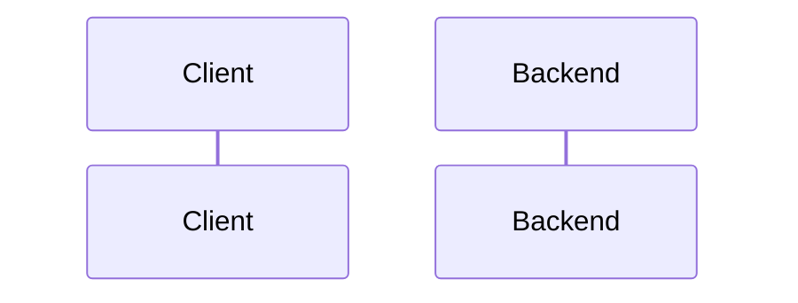

# Design: {{TITLE}}

Status: draft · {{DATE}}
Spec: [spec.md](spec.md) · Folder: `.docs/works/{{FOLDER}}/`

<!--
Written by the designer agent from the approved spec (delete the comments when done).
- Design what the spec asks, nothing more. Spec problems go under Risks as "Spec issue".
- Signatures, not implementations: TypeScript types and function signatures, Prisma model changes, SQL.
- Name the real files and functions you reuse.
-->

## 1. Approach

<!-- The chosen approach in a few short paragraphs. -->

### Rejected options

| Option | Why not |
|---|---|
| | |

## 2. Modules and files

| File | New or changed | What it does |
|---|---|---|
| | | |

<!-- Signatures below. Add a Mermaid classDiagram when there are three or more classes. -->

## 3. Sequence diagrams

<!-- One diagram per main flow (a request through the backend, or a data pipeline). -->

## 4. Data and schema changes

<!-- Prisma models and migrations (and what happens to existing rows), cache keys and the version
     they bump (CLAUDE.md "Caching"), files written (columns, sort order). "None" is a valid answer. -->

## 5. Test cases

<!-- Each test covers at least one "Done when" row, and every row has a test.
     Type: unit (src/**/*.spec.ts), IT (test/it, real Postgres schema it_test), or script. -->

| ID | Covers | Type | Setup and input | Expected |
|---|---|---|---|---|
| TC1 | DW1 | | | |

## 6. Failure modes

<!-- Think about: two fast requests, the 10 s feed cache and v:user, blocked users, soft-deleted rows,
     pending community posts, banned users, empty and very large input, time (asOf), a database
     that already has bad rows. -->

| # | What can go wrong | How we notice | What the code does |
|---|---|---|---|
| F1 | | | |

## 7. Risks

<!-- Including "Spec issue:" items and anything not verified. -->

## Review notes

<!-- The gate-reviewer agent writes here before the author reviews. -->
