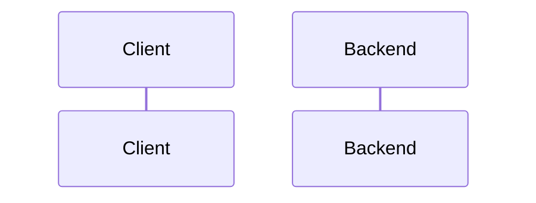

# {{TITLE}}

Spec status: draft · {{DATE}}
Design status: pending
Type: feature · Folder: `.docs/works/{{FOLDER}}/`

<!--
This file holds the whole task: Spec, Impact, then Design. Maximum 800 lines.
Delete these comments when done. Follow "How to write" in CLAUDE.md.
- /task writes sections 1 and 2, then stops for the author. Do not write section 3 yet.
- After the author's /approve, write section 3.
- Evidence is concrete: file and function names, command output, numbers with their source.
  Write "not checked" when you did not check something.
-->

## 1. Spec

### Problem

<!-- What is missing or wrong today, and where in the code. The evidence. Say what and why, not how. -->

### Scope

**In scope:**
-

**Out of scope:**
-

### Done when

<!-- Each row is a check someone can run, and the result it must give. -->

| # | Check | Expected result |
|---|---|---|
| DW1 | | |

### Open questions

1.

## 2. Impact

<!--
- Who or what it affects: users, thesis results, later phases. What happens if we do nothing.
- The code areas and modules it touches, and other bugs or tasks that touch the same code.
- Thesis link: phase, RQ or hypothesis. Frozen values touched (super-plan §7). Does it change a number reported in the thesis?
-->

## 3. Design

<!-- Written after the author approves sections 1 and 2. Then set "Design status: draft · <date>" at the top. -->

### Approach

<!-- The chosen approach in a few short paragraphs. Name the real files and functions you reuse. -->

**Rejected options:**

| Option | Why not |
|---|---|
| | |

### Workflow and sequence diagrams

<!-- One Mermaid sequenceDiagram per main flow (a request through the backend, or a data pipeline). -->

### Failure modes

<!-- Think about: two fast requests, the 10 s feed cache and v:user, blocked users, soft-deleted rows,
     pending community posts, banned users, empty and very large input, time (asOf), bad existing rows. -->

| # | What can go wrong | How we notice | How we resolve it |
|---|---|---|---|
| F1 | | | |

### Code files

<!-- Every file this work creates or changes, and what it is for. Signatures only, no full code. -->

| File | New or changed | Purpose |
|---|---|---|
| | | |

### Data, schema and cache changes

<!-- Prisma models and migrations (and what happens to existing rows), cache keys and the version
     they bump (CLAUDE.md "Caching"). "None" is a valid answer. -->
