# Diagrams of the thesis

This file lists every diagram of the thesis: its figure number, where it is used, the file name to save, the tool, the size, and the Mermaid script. Today there are 15: 11 in Chapter 4 and 4 in Appendix C (the fields of the database tables). The scripts are the same as in `drafts/04-system-analysis-and-design.md`. They were checked against the code (see "Checked" in each entry). The number in a title (Figure 4.1) is a working name: in the PDF, figure numbers run through the whole thesis and follow by themselves.

## How to make a diagram

1. Open the Mermaid web editor, <https://mermaid.live>, and paste the script. Or open draw.io, then Arrange → Insert → Advanced → Mermaid, and paste the script there. Then tidy the result by hand.
2. Export the image. From draw.io: File → Export as → PDF (a PDF stays sharp at every size). From mermaid.live: PNG or SVG. A PNG must be at least 1,850 px wide, which is 300 dpi at the 15.5 cm text width. Use a PDF whenever the tool can give one.
3. Save it in `.docs/Thesis-Report/images/` with the name of the entry: `images/fig4-<n>-<name>.pdf`, or `.png`.
4. Keep the source next to the image: the `.mmd` file is already there. If you redraw the figure in draw.io, also save `images/fig4-<n>-<name>.drawio`.
5. The five ERD scripts (Figure 4.11 and Appendix C) start with a `config` block: theme `neutral`, layout `elk` (a layout that packs the tables closer). mermaid.live reads it, so keep it when you paste.
6. Build: `latexmk -pdf main.tex` in `.docs/Thesis-Report/`. Do not edit the `.tex`. The macro `\thesisdiagram` (in `main.tex`) shows `images/<name>.pdf` if it exists, else `images/<name>.png`, else a box with the text "Figure to be drawn". The first time you add an image, plain `latexmk` says "up-to-date" and does not see it, so run `latexmk -g -pdf main.tex` once (`-g` forces a full build). Later changes of the same file are seen by themselves.

The macro shows the figure at the text width, and never taller than 80% of the page text height. Each figure keeps its caption and label in `chapters/system-analysis-and-design.tex`.

**One style for all figures.** Use one font in every diagram (a sans-serif font such as Arial or Helvetica, 10 pt in the final size) and few colours: black lines, white or light grey fill, and one accent colour (for example blue) for the new parts of the thesis, such as the ranking package. In mermaid.live, use the same theme for all sequence diagrams (the theme `neutral` is grey and prints well).

**Checked scripts.** On 2026-11-20 all 11 scripts were parsed and drawn with Mermaid 11.16.0, with no error. If mermaid.live shows a syntax error, the text was probably changed when you copied it: copy the script again from this file.

## Figure 4.1. Use case overview

- **Used in:** Chapter 4, Section 4.2 (Use cases), `\label{fig:design-usecase}` in `chapters/system-analysis-and-design.tex`.
- **File to save:** `images/fig4-1-usecase.pdf` (or `images/fig4-1-usecase.png`). Source: `images/fig4-1-usecase.mmd`.
- **Tool:** draw.io (stick-figure actors). Mermaid has no use case type, so the script is a flowchart.
- **Size:** Full text width (15.5 cm). It is wide: if the ovals get too small, put the actors above and below the "Breadit" box instead of left and right. Keep it on one page.
- **Checked against the code:** 2026-11-19.
- The actors stay outside the "Breadit" box. The use cases are the ovals inside it.
- In draw.io, draw the actors as stick figures. `«include»` is a dashed arrow from Sign up to Verify email. `is a` (the Community owner or moderator is a User) can be the UML generalization arrow (a closed, empty arrowhead).

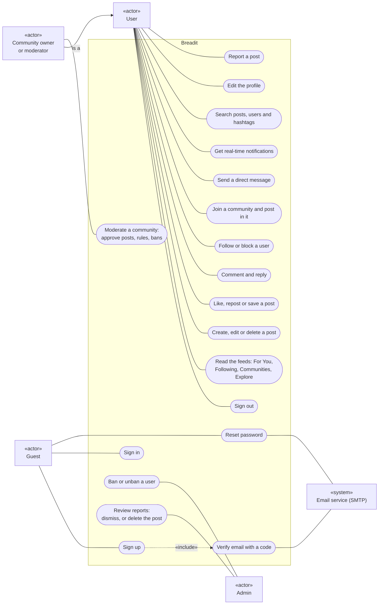

## Figure 4.2. Sign up with email verification

- **Used in:** Chapter 4, Section 4.3 (Activity diagrams), `\label{fig:design-signup}` in `chapters/system-analysis-and-design.tex`.
- **File to save:** `images/fig4-2-signup.pdf` (or `images/fig4-2-signup.png`). Source: `images/fig4-2-signup.mmd`.
- **Tool:** draw.io (an activity diagram: round start and end, diamonds for decisions).
- **Size:** Full text width, portrait. About 14 nodes in a column: it needs 14 to 18 cm of height. If it is taller, put the "verify" part in a second column.
- **Checked against the code:** 2026-11-25 (changed: the limit of 5 code tries for each email, task `p10-security-fixes`).
- The two loops (400 or 409 back to the form, and "ask for a new code" back to the code step) must be easy to follow.

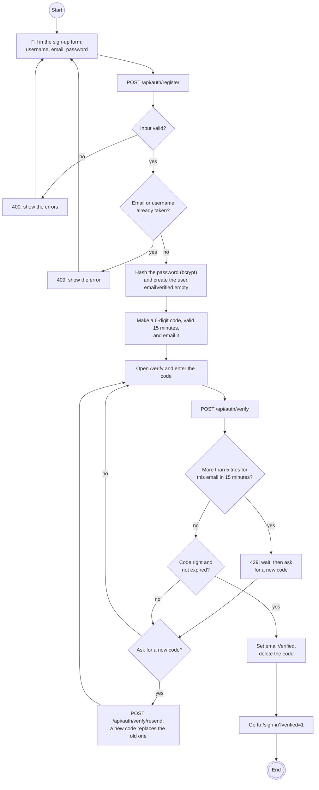

## Figure 4.3. Publish a post

- **Used in:** Chapter 4, Section 4.3 (Activity diagrams), `\label{fig:design-publish}` in `chapters/system-analysis-and-design.tex`.
- **File to save:** `images/fig4-3-publish-post.pdf` (or `images/fig4-3-publish-post.png`). Source: `images/fig4-3-publish-post.mmd`.
- **Tool:** draw.io (an activity diagram).
- **Size:** Full text width, portrait. It is the tallest activity diagram: up to 20 cm. The macro never makes an image taller than 80% of the page text height. If it is still too small to read, draw the checks in a first column and the saves and notifications in a second one.
- **Checked against the code:** 2026-11-20 (no change).

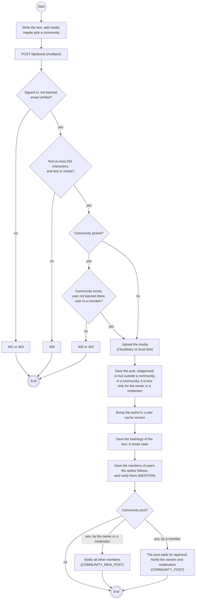

## Figure 4.4. Get one page of a feed

- **Used in:** Chapter 4, Section 4.3 (Activity diagrams), `\label{fig:design-feedpage}` in `chapters/system-analysis-and-design.tex`.
- **File to save:** `images/fig4-4-feed-page.pdf` (or `images/fig4-4-feed-page.png`). Source: `images/fig4-4-feed-page.mmd`.
- **Tool:** draw.io (an activity diagram).
- **Size:** Full text width, portrait, up to 20 cm tall. Draw the two branches (`algo` set, `algo` not set) side by side, and join them at "Store the page for 10 s".
- **Checked against the code:** 2026-11-19 (line numbers refreshed on 2026-11-20).
- The text says the figure is the place where the ranking plugs in. You can colour the box "FeedService.rank at time t" with the accent colour.
- Known small gap (draft note 6): "no blocked peers" is true for every mode except a profile feed. The text of the chapter says only "These queries leave out deleted posts and blocked users".

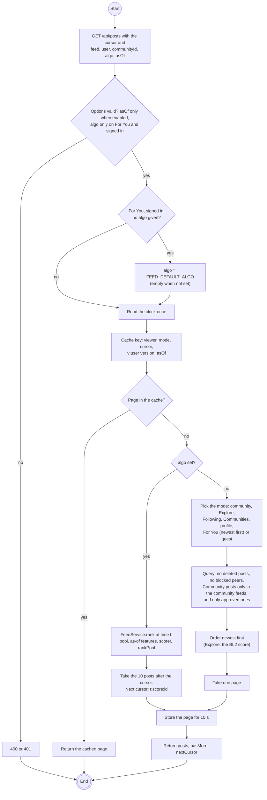

## Figure 4.5. Sign in, a signed-in request and sign out

- **Used in:** Chapter 4, Section 4.4 (Sequence diagrams), `\label{fig:design-session}` in `chapters/system-analysis-and-design.tex`.
- **File to save:** `images/fig4-5-auth-session.pdf` (or `images/fig4-5-auth-session.png`). Source: `images/fig4-5-auth-session.mmd`.
- **Tool:** Mermaid web editor (mermaid.live). A sequence diagram needs no redraw.
- **Size:** Full text width. Seven participants and about 20 messages: it is tall (up to 20 cm). Check that the text is still readable at 15.5 cm width (about 7 pt or more).
- **Checked against the code:** 2026-11-25 (changed: `readSession` reads the blacklist and the password version in one `MGET`; the token holds `pwv`; task `p10-security-fixes`).
- Changed on 2026-11-20: the step "verifyJwt" is now "readSession: verifyJwt", because `JwtAuthGuard` calls `readSession` (`auth/session.ts`).

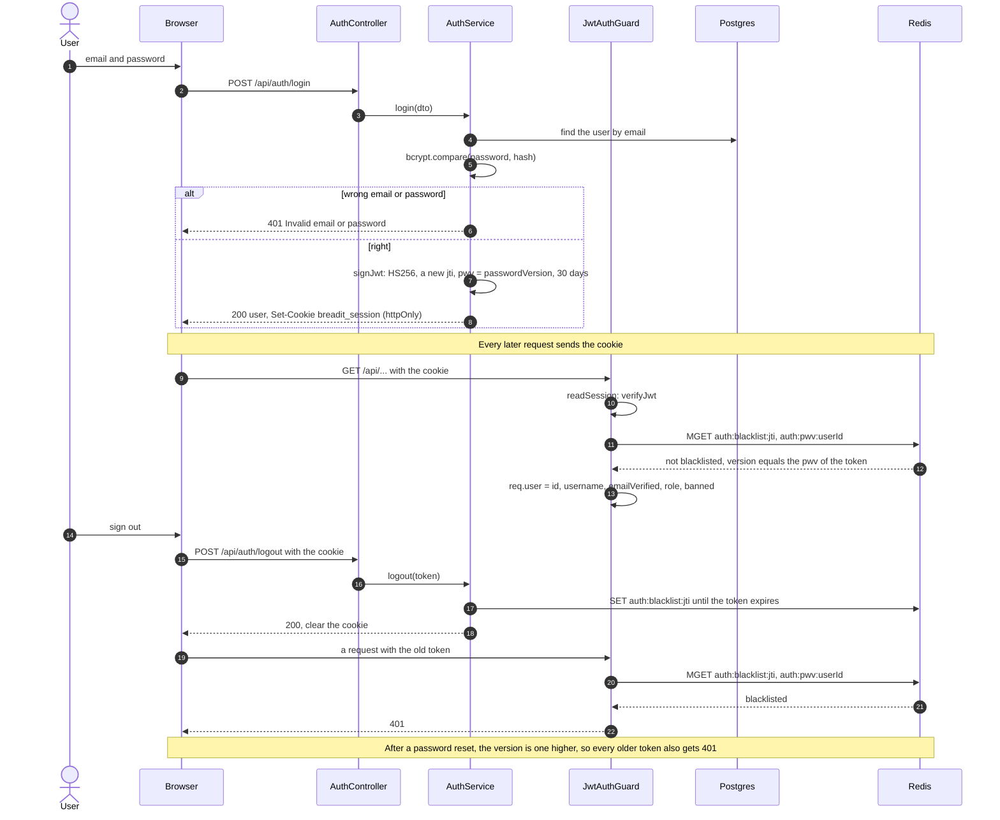

## Figure 4.6. Like a post, with the notification saved and pushed

- **Used in:** Chapter 4, Section 4.4 (Sequence diagrams), `\label{fig:design-like}` in `chapters/system-analysis-and-design.tex`.
- **File to save:** `images/fig4-6-like-notification.pdf` (or `images/fig4-6-like-notification.png`). Source: `images/fig4-6-like-notification.mmd`.
- **Tool:** Mermaid web editor (mermaid.live).
- **Size:** Full text width. Seven participants with long names. Up to 20 cm tall.
- **Checked against the code:** 2026-11-20 (changed: `canSeePost`).
- Changed on 2026-11-20: a new step `canSeePost`, and the 404 branch also covers a post that waits for approval (`posts/visibility.ts`, finding R2).

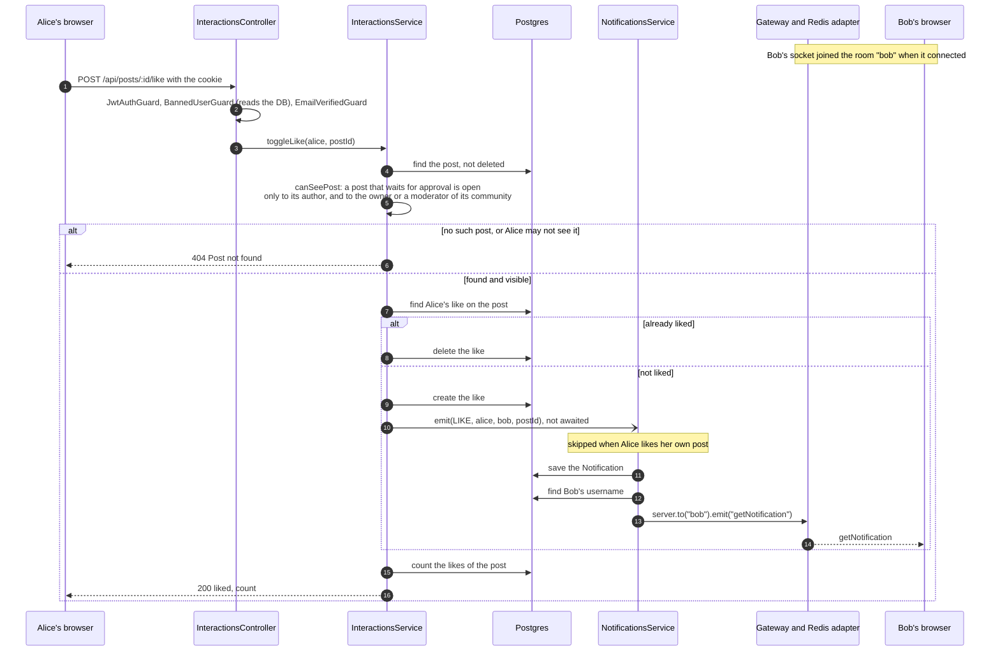

## Figure 4.7. A direct message in real time

- **Used in:** Chapter 4, Section 4.4 (Sequence diagrams), `\label{fig:design-dm}` in `chapters/system-analysis-and-design.tex`.
- **File to save:** `images/fig4-7-direct-message.pdf` (or `images/fig4-7-direct-message.png`). Source: `images/fig4-7-direct-message.mmd`.
- **Tool:** Mermaid web editor (mermaid.live).
- **Size:** Full text width, up to 18 cm tall.
- **Checked against the code:** 2026-11-25 (changed: the socket uses `readSession`, task `p10-security-fixes`).

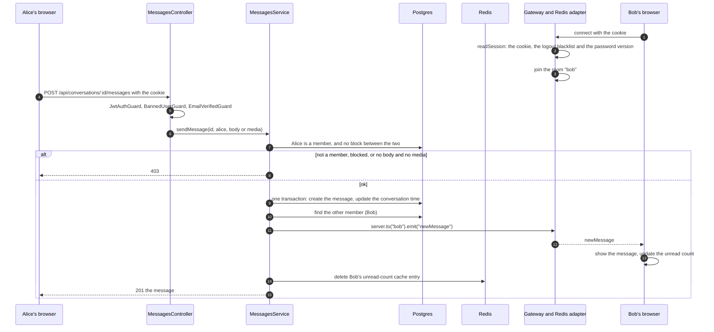

## Figure 4.8. The For You feed with algo=social

- **Used in:** Chapter 4, Section 4.4 (Sequence diagrams), `\label{fig:design-social}` in `chapters/system-analysis-and-design.tex`.
- **File to save:** `images/fig4-8-foryou-social.pdf` (or `images/fig4-8-foryou-social.png`). Source: `images/fig4-8-foryou-social.mmd`.
- **Tool:** Mermaid web editor (mermaid.live).
- **Size:** Full text width, up to 18 cm tall. Some messages are long: if they are cut, add line breaks with ` `.
- **Checked against the code:** 2026-11-19 (line numbers refreshed on 2026-11-20).
- The same diagram is in Guidance Manual 08, section 4. If you change this one, change that one too.

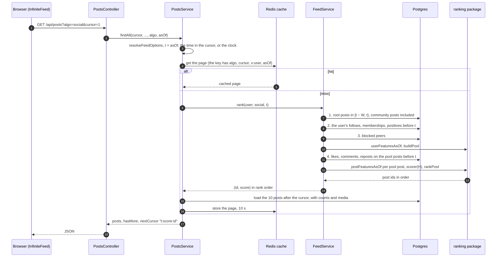

## Figure 4.9. The components of the platform

- **Used in:** Chapter 4, Section 4.5 (Architecture and modules), `\label{fig:design-components}` in `chapters/system-analysis-and-design.tex`.
- **File to save:** `images/fig4-9-components.pdf` (or `images/fig4-9-components.png`). Source: `images/fig4-9-components.mmd`.
- **Tool:** draw.io (an architecture diagram: boxes in groups, cylinders for data stores).
- **Size:** Full text width, landscape-like (about 15.5 by 10 cm). The script is a left-to-right flowchart. Browser on the left, the three data services on the right.
- **Checked against the code:** 2026-11-19.
- The same parts are in Guidance Manual 12, section 1.

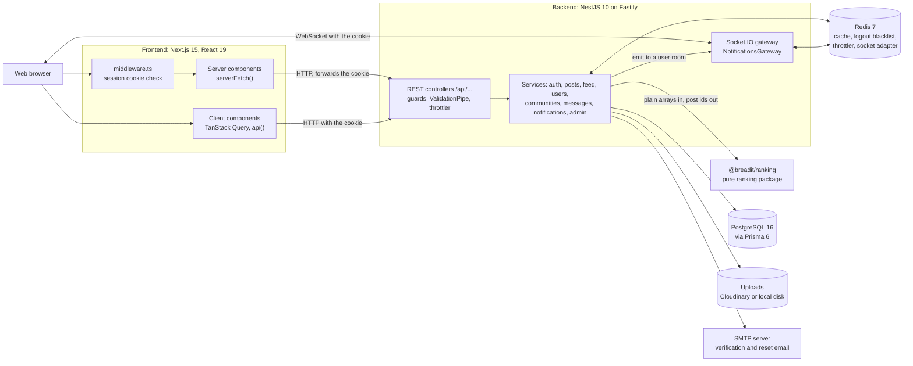

## Figure 4.10. The boundary of the ranking package

- **Used in:** Chapter 4, Section 4.5 (Architecture and modules), `\label{fig:design-boundary}` in `chapters/system-analysis-and-design.tex`.
- **File to save:** `images/fig4-10-ranking-boundary.pdf` (or `images/fig4-10-ranking-boundary.png`). Source: `images/fig4-10-ranking-boundary.mmd`.
- **Tool:** draw.io (an architecture diagram).
- **Size:** Full text width, about 15.5 by 8 cm.
- **Checked against the code:** 2026-11-19.
- This is the figure of the main design rule of the thesis. Use the accent colour for the `@breadit/ranking` box, and a dashed line for `eval/`.
- The same diagram is in Guidance Manual 08, section 1.

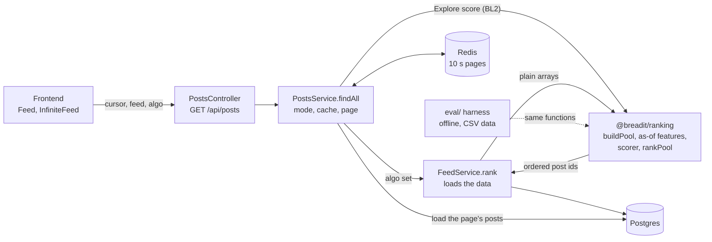

## Figure 4.11. The ERD of the database

- **Used in:** Chapter 4, Section 4.6 (Database design), `\label{fig:design-erd}` in `chapters/system-analysis-and-design.tex`.
- **File to save:** `images/fig4-11-erd.pdf` (or `images/fig4-11-erd.png`). Source: `images/fig4-11-erd.mmd`.
- **Tool:** mermaid.live (the script sets layout `elk` and direction `LR`, left to right).
- **Size:** Full text width. 23 tables and 39 lines, names only, no fields. Measured on 2026-11-25 with Mermaid 11.12.0: 1,339 × 1,748 px, so the text is about 5 pt at the page size. With the fields, the same ERD was 2,636 px wide (text about 1.5 pt): this is why the fields moved to Appendix C.
- **Checked against the code:** 2026-11-25 (from `schema.prisma`; new column `User.passwordVersion`, task `p10-security-fixes`).
- The caption is already in the `.tex`: 23 of the 25 models; `Account` and `Session` are left out, because no code reads them. `VerificationToken` has no foreign key, so it stands alone.
- How to read a line: `User ||--o{ Post : "userId"` means one user has zero or more posts, and each post has exactly one user, through `Post.userId`. `|o` means the foreign key may be empty.

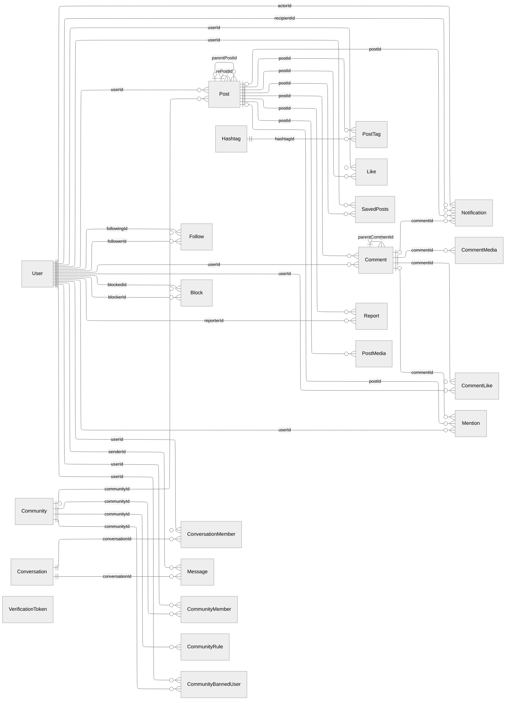

## Appendix C. The fields of the database tables

Four figures, one per group of tables. Each table shows its keys (PK, FK, UK), its enum and Boolean fields and its `DateTime` fields except `updatedAt`. Each foreign key line is drawn once, in the figure of the table that holds the key; a table of another group that the line reaches is drawn as a box with its name only. Together the four figures hold the 23 tables and the 39 lines of Figure 4.11. Measured on 2026-11-25 with Mermaid 11.12.0, the text is 6 to 8 pt at the page size.

## Figure C.1. The tables of users, the social graph and messages

- **Used in:** Appendix C, `\label{fig:app-erd-users}` in `chapters/appendix.tex`.
- **File to save:** `images/figC-1-erd-users.pdf` (or `images/figC-1-erd-users.png`). Source: `images/figC-1-erd-users.mmd`.
- **Tool:** mermaid.live (the script sets theme `neutral` and layout `elk`).
- **Content:** users, the social graph and messages (8 tables, 12 lines; `Post` and `Comment` drawn as names only).
- **Checked against the code:** 2026-11-25 (from `schema.prisma`).

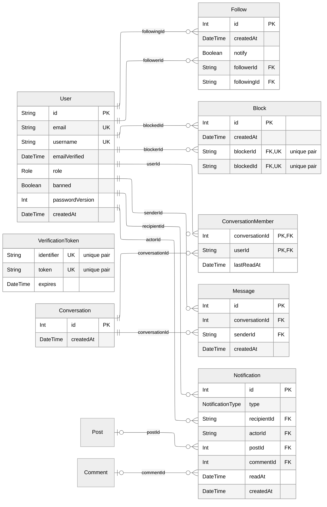

## Figure C.2. The tables of posts

- **Used in:** Appendix C, `\label{fig:app-erd-posts}` in `chapters/appendix.tex`.
- **File to save:** `images/figC-2-erd-posts.pdf` (or `images/figC-2-erd-posts.png`). Source: `images/figC-2-erd-posts.mmd`.
- **Tool:** mermaid.live (the script sets theme `neutral` and layout `elk`).
- **Content:** posts (7 tables, 13 lines; `User` and `Community` drawn as names only).
- **Checked against the code:** 2026-11-25 (from `schema.prisma`).

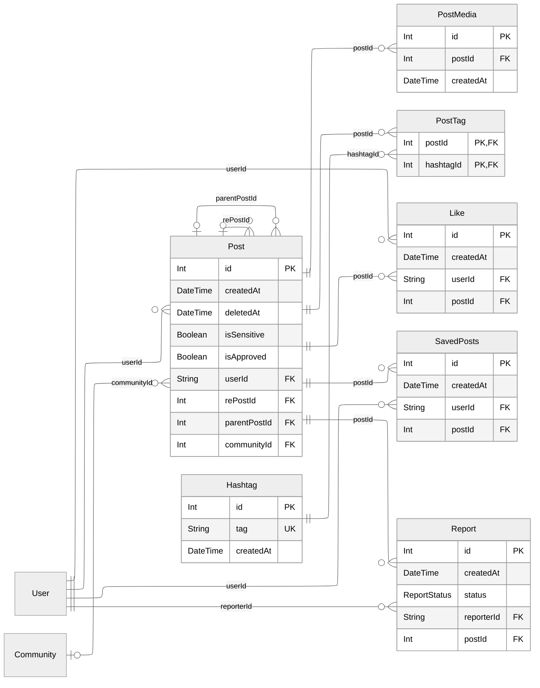

## Figure C.3. The tables of comments

- **Used in:** Appendix C, `\label{fig:app-erd-comments}` in `chapters/appendix.tex`.
- **File to save:** `images/figC-3-erd-comments.pdf` (or `images/figC-3-erd-comments.png`). Source: `images/figC-3-erd-comments.mmd`.
- **Tool:** mermaid.live (the script sets theme `neutral` and layout `elk`).
- **Content:** comments (4 tables, 9 lines; `User` and `Post` drawn as names only).
- **Checked against the code:** 2026-11-25 (from `schema.prisma`).

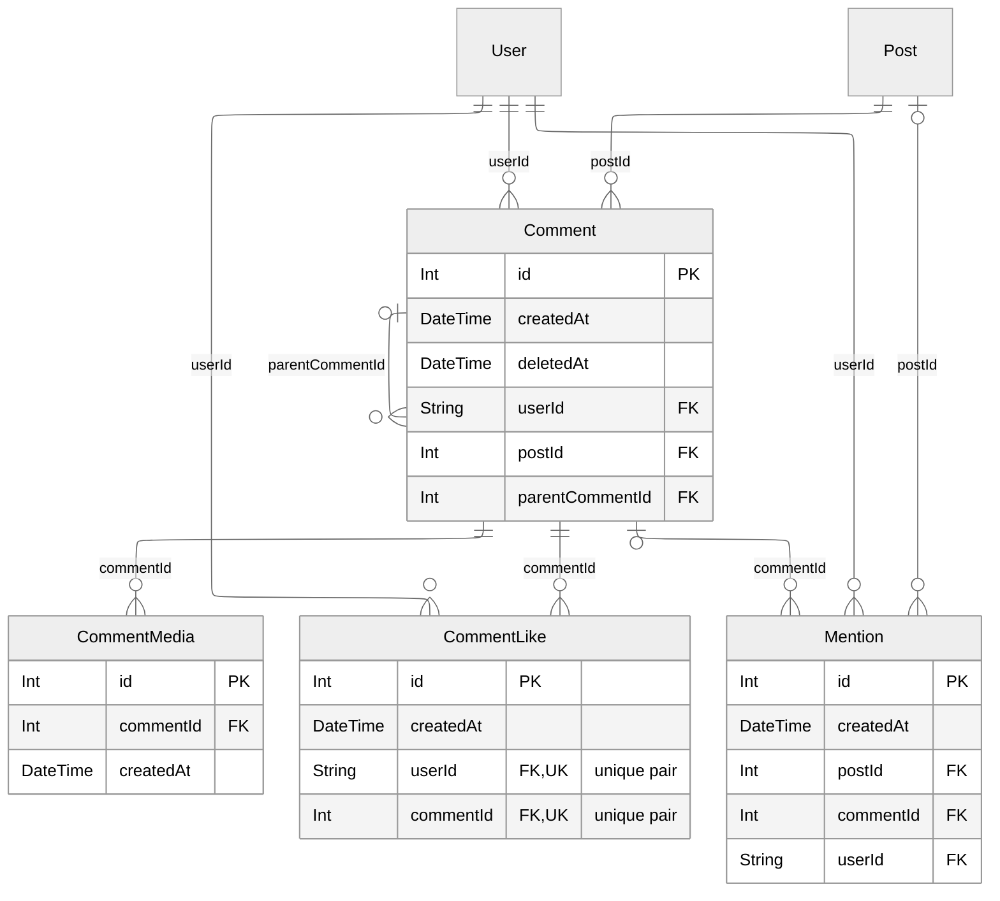

## Figure C.4. The tables of communities

- **Used in:** Appendix C, `\label{fig:app-erd-communities}` in `chapters/appendix.tex`.
- **File to save:** `images/figC-4-erd-communities.pdf` (or `images/figC-4-erd-communities.png`). Source: `images/figC-4-erd-communities.mmd`.
- **Tool:** mermaid.live (the script sets theme `neutral` and layout `elk`).
- **Content:** communities (4 tables, 5 lines; `User` drawn as a name only).
- **Checked against the code:** 2026-11-25 (from `schema.prisma`).

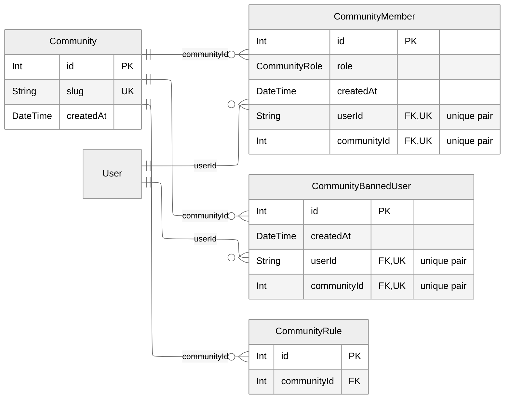
