# Chapter 4. System Analysis and Design

> **Text written on 2026-11-20; the diagrams are still to be drawn.** The text of Sections 4.1–4.6 is below, checked against the code and `apps/backend/prisma/schema.prisma` on 2026-11-20. The same text is in `chapters/system-analysis-and-design.tex`, with a placeholder for each figure. Each figure below is a Mermaid script, checked on 2026-11-19 (Figures 4.3 to 4.8 again on 2026-11-20, see note 3). The author turns each one into an image: paste it into the Mermaid web editor (mermaid.live) and export it, or into draw.io (Arrange → Insert → Advanced → Mermaid) and redraw it there. Save the image in `images/` as `fig4-<n>-<name>.pdf` (the names are in the LaTeX placeholders), with the script next to it as a `.mmd` file (the `.mmd` files are already there). The file `diagrams.md` has the how-to and the list of all 11 figures. Remove this box before the final version. Budget: about 14 pages (see `Report Architecture.md`).

This chapter designs the platform of contribution C1 (the architecture) and contribution C3 (the real-time layer), and shows where the ranking of C2 plugs in. Section 4.1 lists the requirements. Section 4.2 gives the use cases. Sections 4.3 and 4.4 show the main flows as activity diagrams and sequence diagrams. Section 4.5 shows the architecture, and Section 4.6 the database. Chapter 3 defines the ranking method, so this chapter only shows where the method is called. Chapter 5 describes how the design is built. Every route, guard and field named here was checked against the code.

## 4.1 Requirements (about 2 pages)

A requirement says what the platform must do (functional, FR) or how well it must do it (non-functional, NFR). The table below lists the functional requirements by module. The feed requirements FR20 to FR23 are the ones that the ranking of Chapter 3 touches.

**Table. Functional requirements by module.**

| ID | Module | Requirement |
|---|---|---|
| FR1 | Accounts | A guest can sign up with a username (3 to 30 letters, digits or `_`), an email and a password (at least 6 characters). Username and email are unique. |
| FR2 | Accounts | The system emails a 6-digit code, valid for 15 minutes, to verify the email. The user can ask for a new code. Until the email is verified, the main writes (post, comment, like, save, repost, upload, send a message, create a community) are refused. |
| FR3 | Accounts | A user can sign in and sign out. A session lasts 30 days, and signing out ends it at once. A user can reset a forgotten password with an emailed link that is valid for 1 hour. |
| FR4 | Posts | A user can publish a post with text of up to 255 characters and up to 10 images or videos. A post needs text or media. |
| FR5 | Posts | The author can edit the text and the media of a post, and delete it. A deleted post is hidden, not removed (soft delete). |
| FR6 | Posts | Hashtags (`#tag`) and mentions (`@username`) are read from the text when the post is saved. A mention counts only for a user whom the author follows, and it notifies that user. |
| FR7 | Posts | A user can report a post with a reason of up to 500 characters. |
| FR8 | Interactions | A user can like, save and repost a post (plain or with a quote). Each action is a toggle. |
| FR9 | Interactions | A user can comment on a post, reply to a comment, edit or delete own comments, and like a comment. |
| FR10 | Social graph | A user can follow and unfollow, and block and unblock, another user. A block removes the follows in both directions and hides each user from the other in feeds, search, notifications and messages. |
| FR11 | Social graph | A user has a profile (name, bio, location, job, website, avatar, cover) with the tabs posts, replies, media and likes, the lists of followers and following, saved posts, and recommendations of people to follow. |
| FR12 | Communities | A user can create a community (a name and a unique slug) and becomes its owner. A user can join and leave a community. An owner cannot leave. |
| FR13 | Communities | A post in a community needs membership. The post of a member waits for approval. The post of an owner or a moderator is approved at once. Only approved posts are shown. |
| FR14 | Communities | Owners and moderators approve or remove posts, edit the rules and the settings, and ban users from the community. The owner promotes moderators, transfers the ownership and deletes the community. |
| FR15 | Messages | Two users can chat one to one, with text of up to 1,000 characters or a media link. The system keeps the unread counts and the read marks. A blocked pair cannot message each other. |
| FR16 | Notifications | The system notifies a user of a like, a reply, a repost, a follow, a mention, a report (admins) and the posts of a community. The user sees the list and marks one or all as read. An action on your own item does not notify. |
| FR17 | Search | One search call returns users, posts, hashtags and communities (up to 5 of each). The platform lists the 5 trending hashtags and the posts of a hashtag. |
| FR18 | Admin | An admin can list and search users, and ban and unban them. A banned user cannot write. If the user is online, the browser signs out at once. |
| FR19 | Admin | An admin sees the open reports and can dismiss a report or delete the reported post. |
| FR20 | Feed | The system offers these feeds, in pages of 10 posts with a cursor: For You, Following, Communities, Explore, a profile and a community. |
| FR21 | Feed | A signed-in user can choose the ranking of For You with the option `algo`: `chrono`, `engagement` or `social` (the methods BL0, BL2 and H of Chapter 3). One configuration value sets the default. |
| FR22 | Feed | Explore ranks the newest 400 posts of the last 7 days (community posts left out) by the engagement score, and keeps at most 3 posts per author in the candidate list. |
| FR23 | Feed | No feed shows a deleted post or a post that waits for approval. The feeds of Home, Following, Communities, Explore and a community also leave out blocked users. |

The non-functional requirements are in the next table. A finding such as S1 or T6 comes from the bug review of the app: the letter is the class (S for security, T for the thesis path) and the number is the item. Three of the requirements matter most for the thesis: the push of real-time events (NFR4), the reproducibility of the ranking (NFR5), and the rule that speed is judged only by the measurements of experiment E7 (NFR6).

**Table. Non-functional requirements.**

| ID | Area | Requirement |
|---|---|---|
| NFR1 | Security: sessions | The session is a signed token (HS256) in an httpOnly cookie, with `sameSite=lax` and `secure` in production. Passwords are stored as bcrypt hashes. Signing out puts the token id in a Redis blacklist. A password reset ends every session made before it: the token holds the password version of the user, and a token with another version is refused, on a request and on a socket connection. |
| NFR2 | Security: access | Each route lists its guards: signed in, not banned (read from the database, because a token can be 30 days old), email verified, and the admin role. A socket gets its user from the cookie and never from the client (before this was fixed, a client could join the room of any user by sending a username: finding S1). A logged-out token cannot open a socket, and the public routes treat it as a guest (finding S5). The two HTTP guards, `JwtAuthGuard` and `OptionalJwtAuthGuard`, share one function, `readSession`, that checks the logout blacklist. |
| NFR3 | Security: input and abuse | A global validation pipe drops every field that no rule names. Text sizes are limited (a post 255 characters, a comment and a message 1,000). A Redis rate limiter allows by default 1,000 requests per minute for each route and IP address, and 5 to 10 for the sign-up, sign-in, verify and reset routes. The six-digit email code is also limited for each email: after 5 tries in 15 minutes, more tries are refused until the 15 minutes end, even with the right code. |
| NFR4 | Real-time push | Notifications, direct messages, read marks, typing signals and bans reach an online user over a WebSocket, without a page reload. A notification is saved before it is pushed, so an offline user sees it later. With more than one backend process, the event still reaches the user. No delivery time target is set. |
| NFR5 | Reproducibility of the ranking | The live feed is a pure function of the stored data and one time *t*: no clock and no randomness inside the ranking. The app and the evaluation call the same code, and a parity test checks that the live order equals the evaluation order. Every result of the evaluation is rebuilt by one command and compared by hash (Section 3.8). |
| NFR6 | Performance | No speed target is set. The cost of one feed page is measured only in experiment E7 (Section 3.9). |
| NFR7 | Data integrity | Posts and comments are soft-deleted. A write that changes several rows (a message and its conversation time, a block and the removed follows) runs in one database transaction. Unique keys protect memberships, blocks and community bans. Likes, saves and follows have no unique key yet, so two fast requests can make a duplicate row (finding T6, open; future work in Chapter 9). |

## 4.2 Use cases (about 3 pages)

The platform has four actors. A **Guest** is not signed in. A **User** is signed in. A **Community owner or moderator** is a User who has the role OWNER or MOD in one community. An **Admin** has the role ADMIN. The email service (SMTP) is a system actor that sends the codes. Figure 4.1 shows the use cases of each actor.

**Figure 4.1. Use case overview.**

Mermaid has no use case type, so this is a flowchart in UML form: the actors are outside the "Breadit" box, and the use cases are the ovals inside it. In draw.io, the actors can become stick figures.

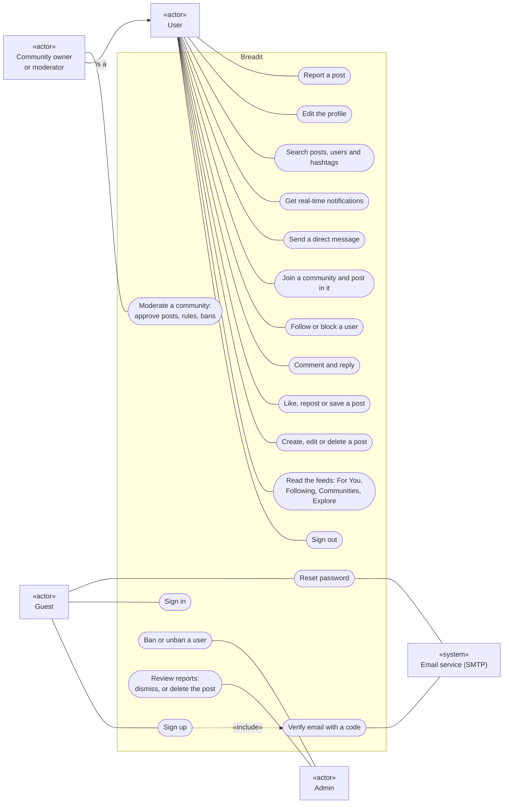

Checked against: every use case has a route (`api/auth`, `api/posts`, `api/users`, `api/communities`, `api/conversations`, `api/notifications`, `api/search`, `api/hashtags`, `api/admin`). The web app sends a guest to `/sign-in` for every page except sign-up, verify, sign-in, forgot-password and reset (`apps/frontend/src/middleware.ts`, `PUBLIC_PATHS`). So the Guest has only the three use cases above, even though the API also has guest reads (`OptionalJwtAuthGuard`). The admin routes need `RolesGuard` with the `ADMIN` role.

The web app sends a guest to the sign-in page for every page except sign-up, verify, sign-in, forgot password and reset. So the Guest has only three use cases in the figure. Some API routes also accept a guest (they use `OptionalJwtAuthGuard`), but the web app does not use them for guests, so we leave them out. The admin routes need the role ADMIN.

We specify four use cases in detail (the four tables below). They are the ones the thesis relies on: the For You feed with the option `algo` (C2), a direct message (C3), joining a community and posting in it (a post in a community needs membership, which the community term of the score assumes), and banning a user (the admin control, and a second real-time event). The other use cases follow the same pattern: a chain of guards, one service call, and often a notification.

**Table. Use case: read the For You feed with the option `algo`.**

| | |
|---|---|
| **Actor** | User (signed in). |
| **Covers** | FR20, FR21, FR23, NFR5. |
| **Precondition** | The user is signed in and not banned. The user has opened For You and chosen Chronological, Engagement or Social. |
| **Main flow** | 1. The user opens `/?algo=social`. 2. The server component `Feed` calls `GET /api/posts?cursor=1&algo=social` and forwards the session cookie. 3. The backend checks the options and reads the clock once. 4. The backend looks for the page in the Redis cache. The key holds the viewer, the mode, the cursor, the `v:user` version and `asOf`. 5. On a miss, `FeedService.rank` loads the data, calls the ranking package and returns the pool as (post id, score) in rank order. 6. The backend takes the 10 posts after the cursor, loads them with their counts and media, stores the page for 10 seconds, and returns `posts`, `hasMore` and `nextCursor` (`t:score:id`). 7. `InfiniteFeed` shows the posts. When the user scrolls, it asks for the next page with `nextCursor`. The pool is ranked again at the same time *t*. |
| **Alternative flows** | A1. The page is in the cache: step 4 returns it. A2. `algo` is unknown, or is sent together with `feed`, `user` or `communityId`: 400. A3. A guest sends `algo`: 401. A4. No `algo` is sent: the default of `FEED_DEFAULT_ALGO` applies. It is empty today, so For You is the old feed: you and your followees, no community posts, newest first. A5. The cursor is older than 24 hours: 400, and the feed must start again from page 1. A6. The pool is empty: an empty page, with `hasMore` false. A7. The request fails (for example 429): the feed keeps the posts already on the screen, and shows an error only when it is empty. |

**Table. Use case: send a direct message.**

| | |
|---|---|
| **Actor** | User (Alice, the sender). Bob is the receiver. |
| **Covers** | FR15, NFR4. |
| **Precondition** | Alice is signed in, not banned and email verified. A conversation with Bob exists. It is made by `POST /api/conversations` with `targetUserId`, which refuses yourself and a blocked pair. |
| **Main flow** | 1. When Bob's page loads, his browser opens the socket with the cookie. The gateway checks the cookie, the logout blacklist and the password version, and joins the socket to the room named after Bob's username. 2. Alice sends `POST /api/conversations/:id/messages` with `body` (up to 1,000 characters) or `mediaUrl`. 3. The guards `JwtAuthGuard`, `BannedUserGuard` and `EmailVerifiedGuard` pass. 4. The service checks that Alice is a member and that there is no block between the two members. 5. The service saves the message and updates the conversation time in one transaction. 6. The service pushes `newMessage` to Bob's room. 7. Bob's browser shows the message and updates his unread count. The service deletes Bob's cached unread count for the conversation and answers 201 with the message. 8. When Bob reads the conversation, his browser sends `PATCH /api/conversations/:id/read`. This sets `lastReadAt` and pushes `messageRead` to Alice. |
| **Alternative flows** | A1. Alice is not a member, a block exists, or the message has neither body nor media: 403. A body over 1,000 characters: 400. A2. Bob is offline: no push arrives. The message is in the database, and Bob sees it and his unread count when he opens the app. A3. Alice has no valid session, is banned or is not verified: 401 or 403. A4. Bob's socket is on another backend process: the Redis adapter carries the event to it. |

**Table. Use case: join a community and post in it.**

| | |
|---|---|
| **Actor** | User. The owner or moderator who approves the post is the second actor. |
| **Covers** | FR6, FR12, FR13, FR14. |
| **Precondition** | The user is signed in, not banned and email verified. The community exists, and the user is not banned from it. |
| **Main flow** | 1. The user opens the community page and presses Join: `POST /api/communities/:id/join`. The service adds a `CommunityMember` row with the role MEMBER and updates the caches of the user (`graph:communities` and `v:user`). 2. The page shows the compose box, because the user is a member. 3. The user writes the post and sends `POST /api/posts` with `communityId`. 4. The service checks the text, that the community exists, that the user is not banned there and that the user is a member. 5. The service saves the post with `isApproved` false, because the user is a member and not an owner or a moderator. 6. The service reads the hashtags and the mentions, and notifies the owners and the moderators (COMMUNITY_POST). 7. An owner or a moderator approves the post: `POST /api/communities/:id/posts/:postId/moderate` with the action APPROVE. The post joins the community feed, and the other members get COMMUNITY_NEW_POST. |
| **Alternative flows** | A1. The user is banned from the community: 403, at join and at post. A2. The user is not a member: 403 "Join the community to post in it". A3. The user is the owner or a moderator: the post is approved at once, and every other member gets COMMUNITY_NEW_POST. Steps 6 and 7 do not happen. A4. A moderator removes the post (the action REMOVE): the post is soft-deleted. A5. The user presses Join again: the same route is a toggle, and the user leaves. An owner cannot leave (403). |

**Table. Use case: ban a user.**

| | |
|---|---|
| **Actor** | Admin. The banned user is affected. |
| **Covers** | FR18, NFR2, NFR4. |
| **Precondition** | The admin is signed in, and the token holds the role ADMIN. |
| **Main flow** | 1. The admin opens the admin console (`/admin-console/users`) and finds the user with `GET /api/admin/users?q=`. 2. The admin presses Ban: `POST /api/admin/users/:id/ban`. 3. `JwtAuthGuard` and `RolesGuard` (role ADMIN) pass. 4. The service checks that the user exists and sets `banned` to true. 5. The service pushes `accountBanned` to the room of the user. 6. The browser of the banned user calls the sign-out route and goes to `/sign-in?banned=true`. 7. From now on, `BannedUserGuard` refuses the writes of the user, even with an old token, because it reads `banned` from the database. |
| **Alternative flows** | A1. The caller is not an admin: 403. There is no cookie: 401. The web app also sends a non-admin away from the console. A2. The user does not exist: 404. A3. The user is offline: no push is sent. The old token still works for reading, but the writes are refused (step 7), and the pages show "Your account has been suspended". A4. Unban: `POST /api/admin/users/:id/unban` sets `banned` to false. No event is sent. A5. The user is the admin's own account or another admin: 400, and nothing changes. |

## 4.3 Activity diagrams (about 2 pages)

Three activity diagrams show the flows that have decisions: sign up, publish a post, and get one page of a feed. The other flows are simple chains, and the use cases above describe them.

Figure 4.2 shows the sign-up. The form needs a username of 3 to 30 letters, digits or underscores, a valid email and a password of at least 6 characters. A wrong input gives 400. A username or an email that is already in use gives 409. Then the backend hashes the password with bcrypt and creates the user with `emailVerified` empty.

Next, the backend makes a 6-digit code that is valid for 15 minutes, saves it in the `VerificationToken` table and sends it by email. If the email cannot be sent, the error is only logged: the user exists and can ask for a new code, which replaces the old one. The resend route gives the same answer whether or not the email is known, so it does not tell who has an account.

After the right code, the backend sets `emailVerified`, deletes the code, and the user goes to the sign-in page. An unverified user can sign in, but `EmailVerifiedGuard` refuses the main writes. The register and verify routes allow 10 requests per minute, and the resend route allows 5.

**Figure 4.2. Sign up with email verification.**

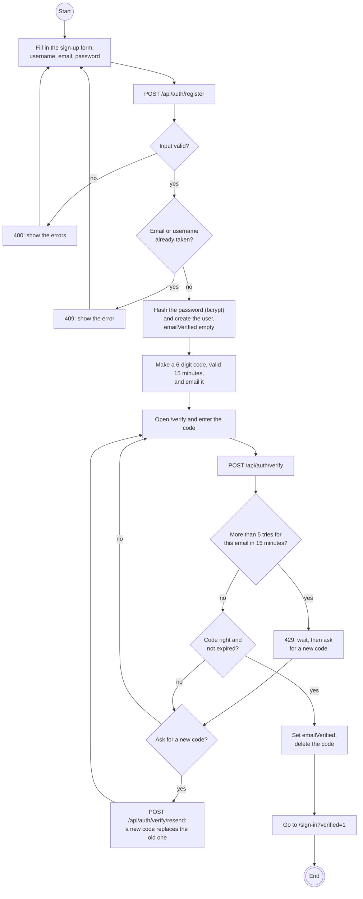

Checked against: `auth.controller.ts` (`register`, `verify`, `verify/resend`), `auth.service.ts` (`register`, `createVerificationCode`, `consumeVerificationCode`, `verifyEmail`), `dto/register.dto.ts` (username 3–30 characters of letters, digits or `_`; a valid email; password at least 6 characters), and the pages `sign-up`, `verify` and `sign-in`.

Figure 4.3 shows how a post is published. Three guards run first: signed in, not banned (read from the database) and email verified. Then the service checks the text (at most 255 characters, and text or media). For a community post, it also checks that the community exists, that the user is not banned there and that the user is a member.

Only then are the files uploaded (to Cloudinary or to the local disk) and the post saved. The field `isApproved` is true outside a community. In a community, it is true only for the owner or a moderator, so the post of a member waits for approval. The service then raises the `v:user` version of the author, so the new post shows at once in the author's own feeds.

When the post has text, the service saves its hashtags in lower case and its mentions. A mention is saved only for a user whom the author follows, and that user gets a MENTION notification. For a community post, the other members are notified when an owner or a moderator posts (COMMUNITY_NEW_POST), and the owners and the moderators are notified when a member posts (COMMUNITY_POST).

**Figure 4.3. Publish a post.**

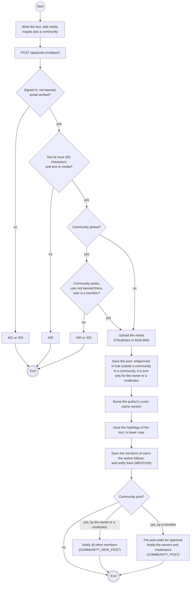

Checked against (again on 2026-11-20, no change): `posts.controller.ts` (`@Post()` with `JwtAuthGuard`, `BannedUserGuard`, `EmailVerifiedGuard`), `posts.service.ts` `create` (`assertPostText`, the community, ban and membership checks, `isApproved`, `incrNumber('v:user')`, hashtags, mentions, the community notifications), `common/limits.ts` (`POST_DESC_MAX = 255`). A mention is saved only for a user the author follows. Hashtags and mentions are read only when the post has text. The approval of a pending post (`CommunitiesService.moderatePost`) is not in this figure.

Figure 4.4 shows how one page of a feed is made. It is the place where the ranking plugs in. The request has a cursor and the options `feed`, `user`, `communityId`, `algo` and the test-only `asOf`. The backend first checks the options. `algo` is allowed only on For You and only for a signed-in user, and `asOf` only when a test flag is on. A wrong option gives 400 or 401. A signed-in user on For You with no `algo` gets the default of the configuration.

Then the clock is read once, and the cache key is built from the viewer, the mode, the cursor, the `v:user` version and `asOf`. A cache hit returns the page. On a miss, an `algo` feed asks `FeedService.rank` for the ranked pool at time *t* and takes the 10 posts after the cursor. The other modes run one database query: community, Explore, Following, Communities, profile, For You (newest first) or guest.

These queries leave out deleted posts and blocked users, and community posts appear only in the community feeds and only when approved. Explore scores its 400 newest candidates with the engagement score of the ranking package. Every page is stored for 10 seconds.

**Figure 4.4. Get one page of a feed.**

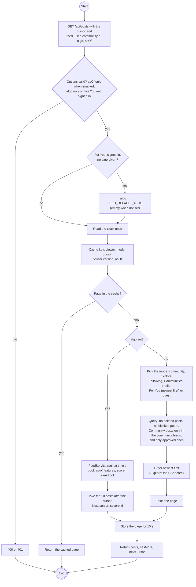

Checked against (line numbers of 2026-11-20): `feed/feed.options.ts` (`resolveFeedOptions`), `posts.service.ts` `findAll` (lines 187–433: the clock read once, the cache key, the `algo` branch, the mode branches) and `algoPage` (lines 152–185).

## 4.4 Sequence diagrams (about 3 pages)

Four sequence diagrams show the order of the calls between the components: the session, a notification, a direct message and the social feed. The first three are the pattern of the real-time platform. The last one is the new part of the thesis.

Figure 4.5 shows the session. At sign-in, the backend finds the user by email and compares the password with the bcrypt hash. A wrong email or password gives 401. Otherwise it signs a token with HS256, a new `jti` (a unique token id) and a life of 30 days, and sets it in the httpOnly cookie `breadit_session`. The token holds the id, the username, the email, the `emailVerified` date, the role and the `banned` flag. Sign-in does not refuse a banned or an unverified user; the guards stop their writes later.

On every later request, `JwtAuthGuard` verifies the token, asks Redis whether `auth:blacklist:<jti>` exists, checks that the password version in the token (claim `pwv`) is the user's current one, and fills `req.user`. At sign-out, the backend stores that key in Redis for the rest of the token's life, so the list cleans itself. A request with the old token then gets 401. A password reset adds 1 to the user's password version, so every token made before it gets 401 in the same way.

**Figure 4.5. Sign in, a signed-in request, sign out.**

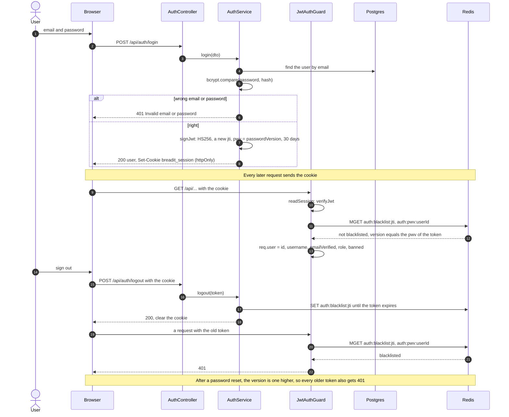

Checked against (again on 2026-11-20): `auth.controller.ts` (`login`, `logout`), `auth.service.ts` (`signJwt`, `setSessionCookie`, `login`, `logout`, `BLACKLIST_PREFIX`), `jwt.guard.ts` and `session.ts` (`readSession`: the token check and the blacklist read, shared with `OptionalJwtAuthGuard`; a Redis error gives 401). Sign-in does not refuse a banned or unverified user; `BannedUserGuard` and `EmailVerifiedGuard` stop their writes later.

Figure 4.6 shows the pattern of every notification: a guard chain, a service call, the change in the database, and then `NotificationsService.emit`. Alice likes Bob's post. The post must exist, must not be deleted, and Alice must be allowed to see it (a post that waits for approval is open only to its author and the community owner and mods), or the answer is 404. A like is a toggle: a second call deletes the like and sends nothing. A new like calls `emit` without waiting for it, so the answer to Alice does not depend on the push. `emit` skips a like of your own post, saves a `Notification` row, finds the username of Bob, and sends `getNotification` to the room of that username. The room is the address of the user, and the Redis adapter makes it work with more than one backend process. The service reads the like count after the change and returns it.

**Figure 4.6. Like a post, with the notification saved and pushed.**

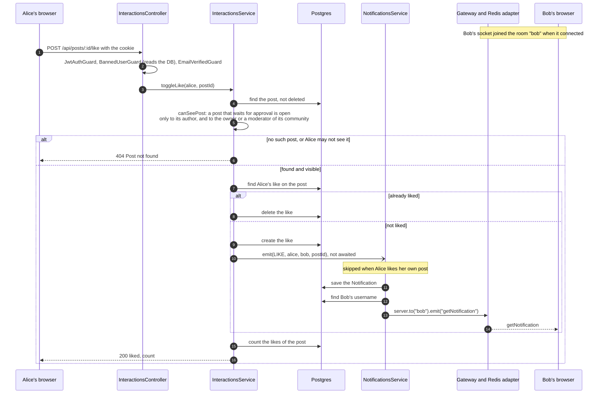

Checked against (again on 2026-11-20): `interactions.controller.ts` lines 33–38, `interactions.service.ts` (`assertPostLive`, `toggleLike`), `posts/visibility.ts` (`canSeePost`: a pending post gives 404 to everybody except its author, the community owner and the moderators), `notifications.service.ts` `emit` (lines 17–43). Saves and reposts use the same `assertPostLive`.

Figure 4.7 shows a direct message. When Bob's page loads, his socket connects with the cookie. The gateway checks the cookie, the blacklist and the password version, and joins the socket to the room named after Bob. The server decides this, and the name that the client sends is ignored (finding S1). When Alice sends a message, the guards run, and the service checks that Alice is a member of the conversation and that no block exists between the two. If not, the answer is 403. Otherwise the service writes the message and the conversation time in one transaction. Then it pushes `newMessage` to the room of Bob, deletes the cached unread count of Bob for this conversation, and answers 201 with the message. Typing signals use the rooms `conversation:<id>`, and a socket can join such a room only if it is a member.

**Figure 4.7. A direct message in real time.**

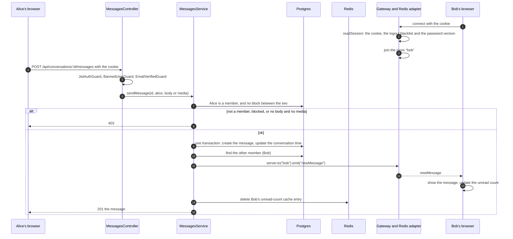

Checked against (again on 2026-11-20, no change): `messages.controller.ts` lines 27–28 (`api/conversations`, `JwtAuthGuard`, `BannedUserGuard`) and 83–91 (`EmailVerifiedGuard`, `sendMessage`), `messages.service.ts` `sendMessage` (lines 277–327, `assertMember`, `assertConversationNotBlocked`), `notifications.gateway.ts` (`authenticate` checks the cookie and the blacklist; `handleConnection` joins the username room).

Figure 4.8 shows the new part of the thesis inside the platform. On a cache miss, `PostsService` asks `FeedService.rank` to rank the pool for the user at time *t*. The time *t* is `asOf`, the time inside the cursor (page 2 and later), or the clock. `FeedService` loads plain data from Postgres in four steps: the root posts of the window [*t* − *W*, *t*), with community posts included; the follows, the memberships and the earlier positives of the user; the blocked peers; and, once the pool is built, the likes, comments and reposts on the pool posts. All events are taken before *t*. Between the loads, it calls the ranking package, which returns the post ids in order.

`PostsService` takes the 10 posts after the cursor, loads them with their counts and media, and stores the page for 10 seconds. The cursor `t:score:id` holds *t*, so page 2 is ranked at the same time as page 1, and no post repeats or is skipped. Sections 3.5 and 3.2 define the pool and the score.

**Figure 4.8. "For You" with `algo=social`.**

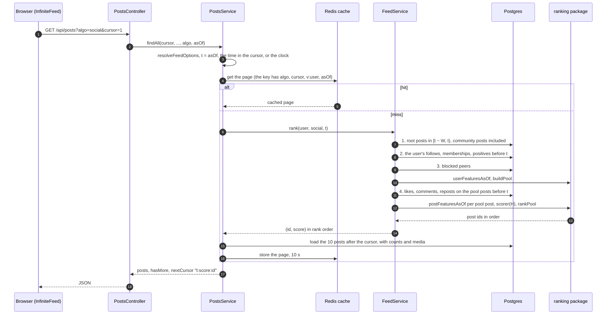

Checked against (line numbers of 2026-11-20): `posts.service.ts` lines 152–225 (`algoPage`, `findAll`), `feed/feed.service.ts` `rank` (lines 53–158, the four loads and the package calls). The same diagram is in Guidance Manual 08 §4.

## 4.5 Architecture and modules (about 1.5 pages)

Figure 4.9 shows the components of the platform.

**Figure 4.9. The components.**

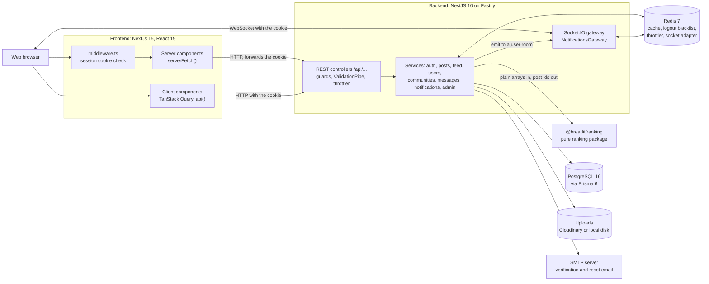

Checked against: CLAUDE.md "Architecture"; `apps/frontend/src/middleware.ts`, `src/lib/session.ts`, `src/lib/api.ts`; `notifications.gateway.ts`; `cache.service.ts`; `uploads/`; `AuthService.sendMail`. The same parts are in Guidance Manual 12 §1.

**Frontend.** The frontend is a Next.js 15 app with React 19. It has no database and no API routes of its own: all data comes from the backend over `/api/...`. A middleware only checks that the session cookie exists, and sends the user to the sign-in page if it does not. The backend does the real check. Server components fetch data with `serverFetch()`, which calls the backend by its internal address and forwards the cookie. Client components use TanStack Query and `api()`, which calls the backend from the browser with the cookie. One Socket.IO connection is shared by the whole page.

**Backend.** The backend is NestJS 10 on Fastify. It has 13 controllers with 72 REST routes, all under `/api/...`, and one Socket.IO gateway in the same process. A request passes the rate limiter, the validation pipe, the guards written on the route, the controller and the service. One filter turns every error into the same JSON shape. The services work on PostgreSQL through Prisma 6, and push events through the gateway.

**Data services.** PostgreSQL 16 is the system of record. Redis 7 has four jobs: the JSON cache, the logout blacklist, the store of the rate limiter and the adapter of Socket.IO. Uploaded files go to Cloudinary when it is configured, and to the local disk if not. Emails go out through an SMTP server.

**Real-time layer.** The gateway gives each socket the user of its cookie, and puts it in a room named after the username. A service sends an event to a user with `server.to(username).emit(...)`. The table below lists the events. A notification is saved before it is pushed, so an offline user finds it later in the list. The feed is not pushed: it is ranked when the user opens or reloads it.

**Table. The events from the server to the browser.**

| Event | Sent by | To the room | When |
|---|---|---|---|
| `getNotification` | `NotificationsService.emit` | the username of the recipient | a like, reply, repost, follow, mention, report or community post |
| `newMessage` | `MessagesService` | the username of the other member | a direct message is sent |
| `messageRead` | `MessagesService.markRead` | the username of the other member | the reader opens the conversation |
| `userTyping`, `userStopTyping` | the gateway | `conversation:<id>` | a member types or stops |
| `accountBanned` | `AdminService` | the username of the banned user | an admin bans the account |

**Cache.** Read-heavy endpoints keep their JSON answer in Redis under a key such as `feed:<viewer>:<mode>:...`. One part of the key is a version number, for example `v:user`. A write raises the version, so later reads build a new key and miss the cache. The old entries are never deleted, and they expire. We chose versions because one write can change many cached pages whose keys are not known in advance. Feed pages live 10 seconds. The likes and comments of other users do not raise your version, so your feed can be up to 10 seconds old. This is the price of a simple cache. The cost experiment E7 runs with the cache off, to measure the ranking work.

**Rules for every listing.** Post, user, search, notification and message listings leave out blocked users in either direction. A soft-deleted post (`deletedAt`) is never shown. A community post is shown only when it is approved. Hashtags and mentions are read when a post is saved, so reading never parses text.

Figure 4.10 shows the one boundary that C2 adds. The backend loads plain arrays from PostgreSQL, calls five functions of the package (`userFeaturesAsOf`, `postFeaturesAsOf`, `buildPool`, `scorer` and `rankPool`) and gets back post ids in order. The package is pure: it has no Nest, Prisma, Redis, clock or randomness, and the time *t* is an argument. The Explore feed calls `computeExploreScoreFixed` of the same package; this is the method BL2. The offline evaluation in `eval/` calls the same functions with data from CSV files.

**Figure 4.10. The ranking package boundary.**

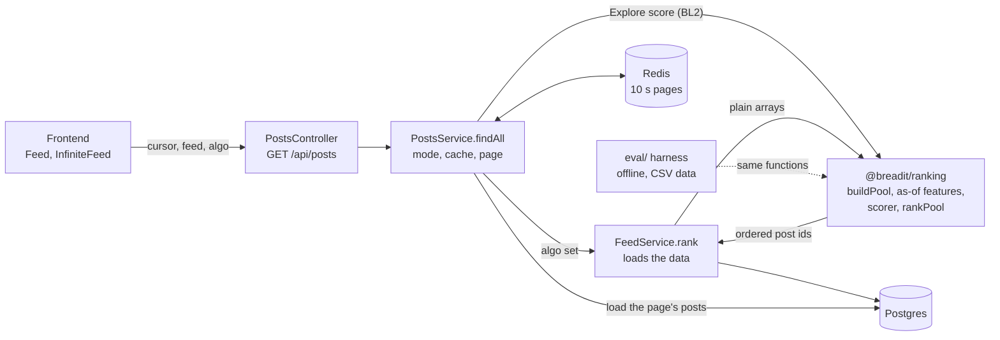

Checked against: `posts.controller.ts` (`@Controller('api/posts')`), `posts.service.ts` (`findAll`, the `feedService.rank` call, Explore with `computeExploreScoreFixed`), `feed/feed.service.ts`, `apps/frontend/src/components/Feed.tsx` and `InfiniteFeed.tsx`. The same diagram is in Guidance Manual 08 §1.

This is the main design rule of the thesis: all ranking logic lives in the package, and never in the backend. We keep the score out of SQL and out of the services, because two copies of one rule could drift apart. With one copy, a number measured offline describes the live feed, and a parity test checks that the live order equals the order of the evaluation (Section 3.8).

## 4.6 Database design (about 2.5 pages)

The database is PostgreSQL 16, used through Prisma 6. The schema has 25 models. Figure 4.11 shows 23 of them. `Account` and `Session` are left out, because no code reads them. Each line of the figure is one foreign key, named by its field. For example, the line from `User` to `Post` named `userId` means that one user has zero or more posts, and each post has exactly one user, through `Post.userId`. A line that may be empty on one side means that the foreign key can be empty: a post may have no community.

**Figure 4.11. The ERD.** Caption in the LaTeX: the ERD of the database: 23 of the 25 models (`Account` and `Session` are left out, because no code reads them). Each table shows its keys (PK, FK, UK), its enum and Boolean fields and its dates (without `updatedAt`); the other fields are in `schema.prisma`.

The script was made from `apps/backend/prisma/schema.prisma` on 2026-11-19, with a one-off script that is not in the repo.
- **Tables:** 23 of the 25 models. `Account` and `Session` are left out, because no code reads them (Bugs Report R4); the caption should say so.
- **Fields:** each table shows its keys (PK, FK, UK), its enum and Boolean fields, and its `DateTime` fields except `updatedAt`. The other fields are in the schema; the caption should say so.
- **Relations:** each line is one foreign key, named by its field. There are 39 lines: the 41 relations of the schema, without the 2 of `Account` and `Session`.

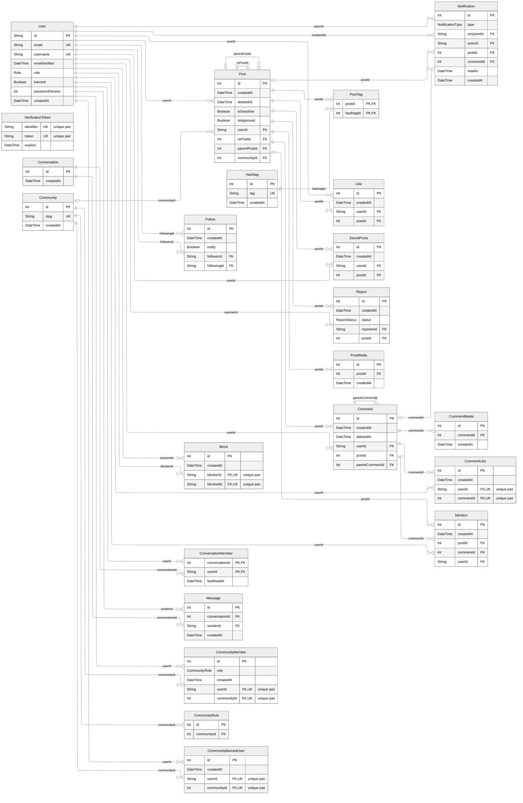

How to read a line: `User ||--o{ Post : "userId"` means one user has zero or more posts, and each post has exactly one user, through `Post.userId`. `|o` means the foreign key may be empty. For example, a post may have no community.

The next table lists the main entities and the rules the design keeps. Three rules matter most for the feed. A deleted post keeps its row with `deletedAt` set, and every read filters it. A post in a community is shown only when `isApproved` is true. A post in a community needs a membership row of the author. In this schema, `User.followers` means the accounts that this user follows, so a count of followers must use `followingId` of the `Follow` table.

**Table. The main entities and the rules of the design.**

| Entity | What it holds | Rule |
|---|---|---|
| `User` | account and profile; `role` (USER or ADMIN); `banned`; `emailVerified` | email and username are unique; the password is a bcrypt hash; `emailVerified` is empty until the code is entered |
| `Post` | text (up to 255 characters); `deletedAt`; `isApproved`; `communityId`; `rePostId` | soft delete; one table for originals and reposts (a plain repost has `rePostId` and no text, a quote has both); `parentPostId` is a leftover, so a root post has both fields empty |
| `Like`, `SavedPosts` | a user and a post | a toggle: the second call deletes the row; no unique key yet (finding T6) |
| `Comment` | text (up to 1,000 characters); `parentCommentId`; `deletedAt` | replies form a thread through `parentCommentId`; soft delete; `CommentLike` has a unique key (user, comment) |
| `Follow` | `followerId`, `followingId`, `notify` | unfollow deletes the row; the service refuses a follow of yourself; no unique key yet |
| `Community`, `CommunityMember`, `CommunityBannedUser`, `CommunityRule` | a unique slug; one member row per user and community, with the role MEMBER, MOD or OWNER | the pair (user, community) is unique in members and in bans; a community ban deletes the membership |
| `Conversation`, `ConversationMember`, `Message` | two members with `lastReadAt`; messages with text (up to 1,000 characters) or `mediaUrl` | the key of a member is (conversation, user); the unread count comes from `lastReadAt` |
| `Notification` | a type (9 values); recipient; actor; optional post and comment; `readAt` | saved before it is pushed; never made for an action on your own item |
| `Block` | `blockerId`, `blockedId` | the pair is unique; both directions count; blocking deletes the follows between the two in one transaction |
| other models | `Hashtag`, `PostTag`, `Mention`, `Report`, `PostMedia`, `CommentMedia`, `VerificationToken` | hashtags and mentions are made when the post is saved; a report is OPEN or CLOSED |

---

## Notes for the author

1. **Diagram tools** (decided 2026-11-19): the author draws the diagrams by hand: draw.io, or the Mermaid web editor with the scripts above. Each image goes in `images/` as PDF (or PNG at 300 dpi or more), with its editable source next to it (see `Report Architecture.md`, "Diagrams").
2. **Main flows only.** A diagram that does not support a sentence in the text is cut. The ERD is large. It stays one complete figure (author, 2026-11-25): arrange the tables by hand in a grid by group to fit one page (see `diagrams.md`, Figure 4.11; a landscape page gives no more room).
3. **Checked again on 2026-11-20, after `p9-bug-quick-wins` and `p10-demo-fixes`.** Figures 4.3, 4.5, 4.6 and 4.7 were compared with the code (and 4.4 and 4.8, which use `posts.service.ts`). Two scripts changed:
   - **Figure 4.5.** The token check and the blacklist read are now in one function, `readSession` (`auth/session.ts`), that `JwtAuthGuard` and `OptionalJwtAuthGuard` both call (fix S5). The step "verifyJwt" is now "readSession: verifyJwt". The flow is the same: a logged-out token gives 401.
   - **Figure 4.6.** `InteractionsService.assertPostLive` now calls `canSeePost` (`posts/visibility.ts`, fix R2). A post that waits for approval gives 404 to everybody except its author, the community owner and the moderators. The figure has a new step and the 404 branch says so. Saves, reposts and comments use the same rule.
   - **Figures 4.3 and 4.7** are unchanged. The approval of a pending post (`CommunitiesService.moderatePost`: it keeps `updatedAt` and bumps `v:user` of the approver and the author) is in no figure. The new `cache.del` in `getMessages` (B10) is a read path, and no figure shows it.
   - The paragraph before Figure 4.6 now also says that Alice must be allowed to see the post (2026-11-20).
4. **Other facts checked on 2026-11-19:**
   - The pre-thesis ERD (`docs/Pre-thesis/output/ERD_Breadit.dbml`) has drifted from the schema. It has 23 tables, and its `CommunityRule` has a `createdAt` that the schema does not have and lacks `description`. Use Figure 4.11, not the pre-thesis files.
   - Relations are named by the foreign key (`followerId`, `followingId`), not by the list names. In this schema `User.followers` means "the accounts this user follows" (CLAUDE.md).
   - The pre-thesis use case diagram (`docs/Pre-thesis/UseCaseDiagram1.png`) shows use cases that do not exist ("Config system", "Analytic and monitor system"). Figure 4.1 replaces it.
   - The pre-thesis sequence diagrams (`docs/Pre-thesis/uc*_sequence.mmd`) were not checked against today's code. Figures 4.5–4.8 replace the ones Chapter 4 needs.
5. **Text and LaTeX, 2026-11-20.** The text is in `chapters/system-analysis-and-design.tex`. Figures and tables are numbered through the whole thesis (`main.tex` removes the chapter prefix), so "Figure 4.1" here is only a working name. The text uses `\ref`, so the numbers follow by themselves. The placeholders wait for these files in `images/`: `fig4-1-usecase`, `fig4-2-signup`, `fig4-3-publish-post`, `fig4-4-feed-page`, `fig4-5-auth-session`, `fig4-6-like-notification`, `fig4-7-direct-message`, `fig4-8-foryou-social`, `fig4-9-components`, `fig4-10-ranking-boundary`, `fig4-11-erd`. Each figure uses the macro `\thesisdiagram{<name>}{\textwidth}` (in `main.tex`): when `images/<name>.pdf` (or `.png`) exists, LaTeX shows it, and if not it shows the placeholder. So just save the image and rebuild; do not edit the `.tex`. `diagrams.md` lists every figure with its file name, tool and script, and `images/<name>.mmd` holds the same script. With the placeholders, the chapter has about 15 pages (the last one is 60% full). Real images are taller than the 5 cm placeholders, so expect about 17 to 18 pages. If that is too long, cut first: the use case table "ban a user", the last paragraph of 4.3, and the rows FR7, FR9 and FR19 of the requirements table.
6. **Outline against today's code (2026-11-20).** When this note was written, the scripts were unchanged (Figures 4.5 and 4.6 changed later the same day, see note 3). Small differences, none of them wrong enough to redraw:
   - Figure 4.4 says "no blocked peers" for every mode. The profile mode (`user=`) does not filter blocked users, and the guest feed has no viewer. The text says only "These queries leave out deleted posts and blocked users", so check the figure again if you want it exact.
   - Figure 4.3 does not show the check of `rePostId` (404 when the post to repost is missing) that `PostsService.create` runs before the community checks. The web app reposts through `POST /api/posts/:id/repost`, not through this field.
   - Joining a community (`POST /api/communities/:id/join`) needs only `JwtAuthGuard` and `BannedUserGuard`. Only the post in it needs a verified email (use case "join a community and post in it").
   - The pre-thesis requirement files are out of date: they say the rate limit is 120 per minute, that Explore sorts by likes, and that a non-member can post into a community. Today: 1,000 per minute per route and IP (set by `THROTTLE_LIMIT`), the engagement score, and membership needed (D1). The text uses today's values.
   - The requirements table says "up to 10 images or videos" because the multipart limit is `files: 10` (`app.setup.ts`).
   - Open findings named in the text (T6 is the only one left; R6 was fixed by `p10-security-fixes` on 2026-11-25, and the ban use case now says so in alternative A5): if a later task fixes T6, change NFR7. The S5 HTTP part was fixed by `p9-bug-quick-wins` on 2026-11-20, and NFR2 now says so.
