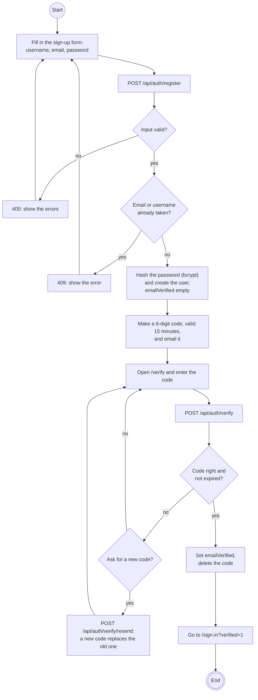
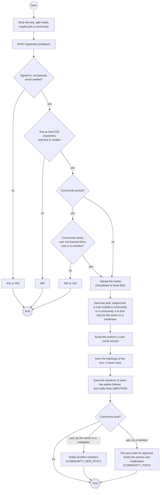
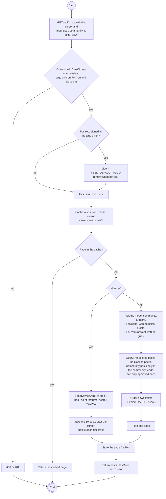
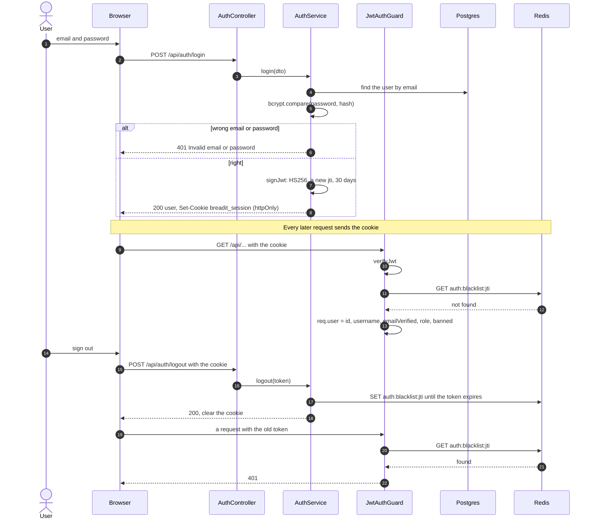
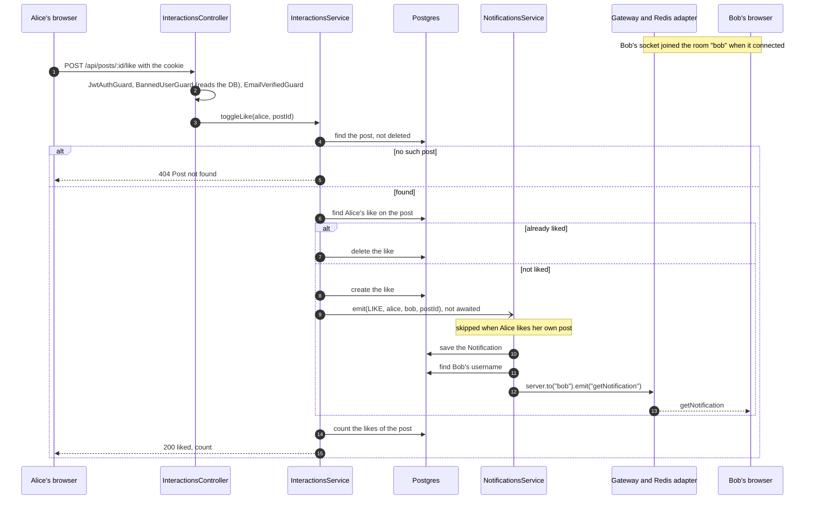
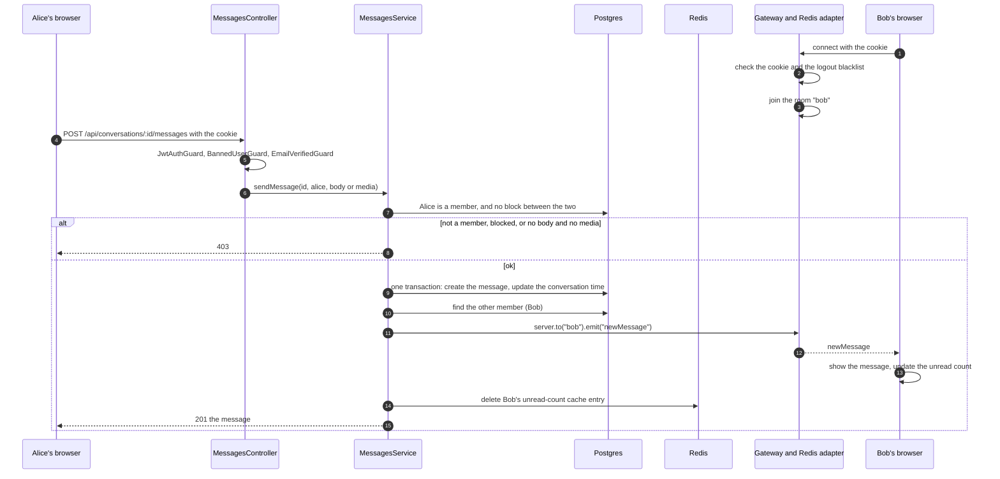
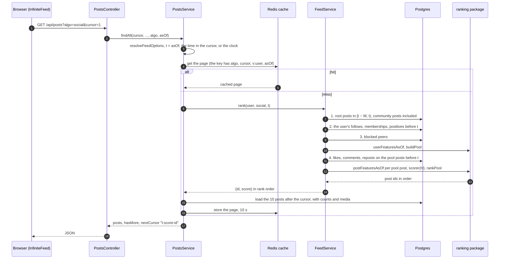
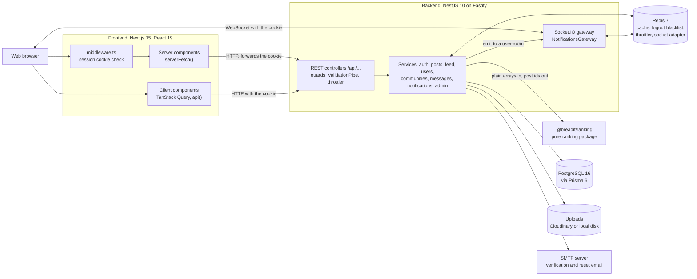
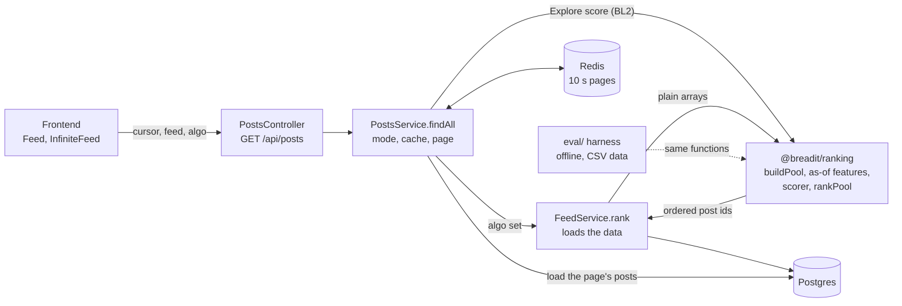

# Chapter 4. System Analysis and Design

> **Outline with diagram scripts, 2026-11-19.** The text is not written yet. Budget: about 14 pages (see `Report Architecture.md`). Each figure below is a Mermaid script, checked against the code and `apps/backend/prisma/schema.prisma` on 2026-11-19. The author turns each one into an image: paste it into the Mermaid web editor (mermaid.live) and export it, or into draw.io (Arrange → Insert → Advanced → Mermaid) and redraw it there. Save the image in `images/`, with the script next to it as a `.mmd` file. Remove this box before the final version.

This chapter designs the platform (contributions C1 and C3) and shows where the ranking of C2 plugs in. Chapter 3 gives the ranking method; Chapter 5 describes how the design is built.

## 4.1 Requirements (about 2 pages)

- Functional requirements by module (posts, interactions, follows, communities, messages, notifications, search, admin, feed), as one table.
- Non-functional requirements: security (auth, the S1 and S5 fixes), real-time push, reproducibility of the ranking (Class D), performance as measured in E7 only.
- Sources: pre-thesis `Non-Functional-Requirements.md` and Chapter 3 of the pre-thesis report; `.docs/Bugs Report.md` (system inventory).

## 4.2 Use cases (about 3 pages)

- One overview use case diagram with the actors Guest, User, Community owner or moderator, and Admin (Figure 4.1).
- Three or four use case specifications as tables (actor, precondition, main flow, alternative flows): read the "For You" feed (with the `algo` option), send a direct message, join a community and post in it, ban a user.

**Figure 4.1. Use case overview.**

Mermaid has no use case type, so this is a flowchart in UML form: the actors are outside the "Breadit" box, and the use cases are the ovals inside it. In draw.io, the actors can become stick figures.

Checked against: every use case has a route (`api/auth`, `api/posts`, `api/users`, `api/communities`, `api/conversations`, `api/notifications`, `api/search`, `api/hashtags`, `api/admin`). The web app sends a guest to `/sign-in` for every page except sign-up, verify, sign-in, forgot-password and reset (`apps/frontend/src/middleware.ts`, `PUBLIC_PATHS`). So the Guest has only the three use cases above, even though the API also has guest reads (`OptionalJwtAuthGuard`). The admin routes need `RolesGuard` with the `ADMIN` role.

## 4.3 Activity diagrams (about 2 pages)

**Figure 4.2. Sign up with email verification.**

Checked against: `auth.controller.ts` (`register`, `verify`, `verify/resend`), `auth.service.ts` (`register`, `createVerificationCode`, `consumeVerificationCode`, `verifyEmail`), `dto/register.dto.ts` (username 3–30 characters of letters, digits or `_`; a valid email; password at least 6 characters), and the pages `sign-up`, `verify` and `sign-in`.
- If the email cannot be sent, the error is only logged; the user is still created and can ask for a new code.
- An unverified user can sign in, but `EmailVerifiedGuard` refuses every write.
- Throttle: 10 requests per minute for register and verify, 5 for resend.

**Figure 4.3. Publish a post.**

Checked against: `posts.controller.ts` (`@Post()` with `JwtAuthGuard`, `BannedUserGuard`, `EmailVerifiedGuard`), `posts.service.ts` `create` (`assertPostText`, the community, ban and membership checks, `isApproved`, `incrNumber('v:user')`, hashtags, mentions, the community notifications), `common/limits.ts` (`POST_DESC_MAX = 255`). A mention is saved only for a user the author follows. Hashtags and mentions are read only when the post has text.

**Figure 4.4. Get one page of a feed.**

Checked against: `feed/feed.options.ts` (`resolveFeedOptions`), `posts.service.ts` `findAll` (lines 186–300: the clock read once, the cache key, the `algo` branch, the mode branches) and `algoPage` (lines 150–184).

## 4.4 Sequence diagrams (about 3 pages)

**Figure 4.5. Sign in, a signed-in request, sign out.**

Checked against: `auth.controller.ts` (`login`, `logout`), `auth.service.ts` (`signJwt`, `setSessionCookie`, `login`, `logout`, `BLACKLIST_PREFIX`), `jwt.guard.ts`. Sign-in does not refuse a banned or unverified user; `BannedUserGuard` and `EmailVerifiedGuard` stop their writes later.

**Figure 4.6. Like a post, with the notification saved and pushed.**

Checked against: `interactions.controller.ts` lines 33–38, `interactions.service.ts` (`assertPostLive`, `toggleLike`), `notifications.service.ts` `emit` (lines 17–43).

**Figure 4.7. A direct message in real time.**

Checked against: `messages.controller.ts` lines 27–28 (`api/conversations`, `JwtAuthGuard`, `BannedUserGuard`) and 83–91 (`EmailVerifiedGuard`, `sendMessage`), `messages.service.ts` `sendMessage` (lines 275–325, `assertMember`, `assertConversationNotBlocked`), `notifications.gateway.ts` (`handleConnection` joins the username room).

**Figure 4.8. "For You" with `algo=social`.**

Checked against: `posts.service.ts` lines 150–222 (`algoPage`, `findAll`), `feed/feed.service.ts` `rank` (lines 53–158, the four loads and the package calls). The same diagram is in Guidance Manual 08 §4.

## 4.5 Architecture and modules (about 1.5 pages)

**Figure 4.9. The components.**

Checked against: CLAUDE.md "Architecture"; `apps/frontend/src/middleware.ts`, `src/lib/session.ts`, `src/lib/api.ts`; `notifications.gateway.ts`; `cache.service.ts`; `uploads/`; `AuthService.sendMail`. The same parts are in Guidance Manual 12 §1.

**Figure 4.10. The ranking package boundary.**

Checked against: `posts.controller.ts` (`@Controller('api/posts')`), `posts.service.ts` (`findAll`, the `feedService.rank` call, Explore with `computeExploreScoreFixed`), `feed/feed.service.ts`, `apps/frontend/src/components/Feed.tsx` and `InfiniteFeed.tsx`. The same diagram is in Guidance Manual 08 §1.

## 4.6 Database design (about 2.5 pages)

- One ERD on one page (Figure 4.11).
- A short table of the main entities (User, Post, Like, Comment, Follow, Community, CommunityMember, Conversation, Message, Notification, Block) and the rules the design keeps: soft delete, approved community posts, membership for community posts.

**Figure 4.11. The ERD.**

The script was made from `apps/backend/prisma/schema.prisma` on 2026-11-19, with a one-off script that is not in the repo.
- **Tables:** 23 of the 25 models. `Account` and `Session` are left out, because no code reads them (Bugs Report R4); the caption should say so.
- **Fields:** each table shows its keys (PK, FK, UK), its enum and Boolean fields, and its `DateTime` fields except `updatedAt`. The other fields are in the schema; the caption should say so.
- **Relations:** each line is one foreign key, named by its field. There are 39 lines: the 41 relations of the schema, without the 2 of `Account` and `Session`.

```mermaid
erDiagram
    User {
        String id PK
        String email UK
        String username UK
        DateTime emailVerified
        Role role
        Boolean banned
        DateTime createdAt
    }
    VerificationToken {
        String identifier UK "unique pair"
        String token UK "unique pair"
        DateTime expires
    }
    Post {
        Int id PK
        DateTime createdAt
        DateTime deletedAt
        Boolean isSensitive
        Boolean isApproved
        String userId FK
        Int rePostId FK
        Int parentPostId FK
        Int communityId FK
    }
    Hashtag {
        Int id PK
        String tag UK
        DateTime createdAt
    }
    PostTag {
        Int postId PK, FK
        Int hashtagId PK, FK
    }
    Like {
        Int id PK
        DateTime createdAt
        String userId FK
        Int postId FK
    }
    SavedPosts {
        Int id PK
        DateTime createdAt
        String userId FK
        Int postId FK
    }
    Notification {
        Int id PK
        NotificationType type
        String recipientId FK
        String actorId FK
        Int postId FK
        Int commentId FK
        DateTime readAt
        DateTime createdAt
    }
    Follow {
        Int id PK
        DateTime createdAt
        Boolean notify
        String followerId FK
        String followingId FK
    }
    Block {
        Int id PK
        DateTime createdAt
        String blockerId FK, UK "unique pair"
        String blockedId FK, UK "unique pair"
    }
    Report {
        Int id PK
        DateTime createdAt
        ReportStatus status
        String reporterId FK
        Int postId FK
    }
    Conversation {
        Int id PK
        DateTime createdAt
    }
    ConversationMember {
        Int conversationId PK, FK
        String userId PK, FK
        DateTime lastReadAt
    }
    Message {
        Int id PK
        Int conversationId FK
        String senderId FK
        DateTime createdAt
    }
    PostMedia {
        Int id PK
        Int postId FK
        DateTime createdAt
    }
    Community {
        Int id PK
        String slug UK
        DateTime createdAt
    }
    CommunityMember {
        Int id PK
        CommunityRole role
        DateTime createdAt
        String userId FK, UK "unique pair"
        Int communityId FK, UK "unique pair"
    }
    CommunityRule {
        Int id PK
        Int communityId FK
    }
    CommunityBannedUser {
        Int id PK
        DateTime createdAt
        String userId FK, UK "unique pair"
        Int communityId FK, UK "unique pair"
    }
    Comment {
        Int id PK
        DateTime createdAt
        DateTime deletedAt
        String userId FK
        Int postId FK
        Int parentCommentId FK
    }
    CommentMedia {
        Int id PK
        Int commentId FK
        DateTime createdAt
    }
    CommentLike {
        Int id PK
        DateTime createdAt
        String userId FK, UK "unique pair"
        Int commentId FK, UK "unique pair"
    }
    Mention {
        Int id PK
        DateTime createdAt
        Int postId FK
        Int commentId FK
        String userId FK
    }
    User ||--o{ Post : "userId"
    Post |o--o{ Post : "rePostId"
    Post |o--o{ Post : "parentPostId"
    Community |o--o{ Post : "communityId"
    Post ||--o{ PostTag : "postId"
    Hashtag ||--o{ PostTag : "hashtagId"
    User ||--o{ Like : "userId"
    Post ||--o{ Like : "postId"
    User ||--o{ SavedPosts : "userId"
    Post ||--o{ SavedPosts : "postId"
    User ||--o{ Notification : "recipientId"
    User ||--o{ Notification : "actorId"
    Post |o--o{ Notification : "postId"
    Comment |o--o{ Notification : "commentId"
    User ||--o{ Follow : "followerId"
    User ||--o{ Follow : "followingId"
    User ||--o{ Block : "blockerId"
    User ||--o{ Block : "blockedId"
    User ||--o{ Report : "reporterId"
    Post ||--o{ Report : "postId"
    Conversation ||--o{ ConversationMember : "conversationId"
    User ||--o{ ConversationMember : "userId"
    Conversation ||--o{ Message : "conversationId"
    User ||--o{ Message : "senderId"
    Post ||--o{ PostMedia : "postId"
    User ||--o{ CommunityMember : "userId"
    Community ||--o{ CommunityMember : "communityId"
    Community ||--o{ CommunityRule : "communityId"
    User ||--o{ CommunityBannedUser : "userId"
    Community ||--o{ CommunityBannedUser : "communityId"
    User ||--o{ Comment : "userId"
    Post ||--o{ Comment : "postId"
    Comment |o--o{ Comment : "parentCommentId"
    Comment ||--o{ CommentMedia : "commentId"
    User ||--o{ CommentLike : "userId"
    Comment ||--o{ CommentLike : "commentId"
    Post |o--o{ Mention : "postId"
    Comment |o--o{ Mention : "commentId"
    User ||--o{ Mention : "userId"
```

How to read a line: `User ||--o{ Post : "userId"` means one user has zero or more posts, and each post has exactly one user, through `Post.userId`. `|o` means the foreign key may be empty. For example, a post may have no community.

---

## Notes for the author

1. **Diagram tools** (decided 2026-11-19): the author draws the diagrams by hand: draw.io, or the Mermaid web editor with the scripts above. Each image goes in `images/` as PDF (or PNG at 300 dpi or more), with its editable source next to it (see `Report Architecture.md`, "Diagrams").
2. **Main flows only.** A diagram that does not support a sentence in the text is cut. The ERD is large; if it does not fit one page, put it on a landscape page or cut the field lists down to the keys.
3. **Check again after `p9-bug-quick-wins`.** That task may change routes and guards (for example B2, R1). If it does, update Figures 4.3, 4.5, 4.6 and 4.7.
4. **Other facts checked on 2026-11-19:**
   - The pre-thesis ERD (`docs/Pre-thesis/output/ERD_Breadit.dbml`) has drifted from the schema. It has 23 tables, and its `CommunityRule` has a `createdAt` that the schema does not have and lacks `description`. Use Figure 4.11, not the pre-thesis files.
   - Relations are named by the foreign key (`followerId`, `followingId`), not by the list names. In this schema `User.followers` means "the accounts this user follows" (CLAUDE.md).
   - The pre-thesis use case diagram (`docs/Pre-thesis/UseCaseDiagram1.png`) shows use cases that do not exist ("Config system", "Analytic and monitor system"). Figure 4.1 replaces it.
   - The pre-thesis sequence diagrams (`docs/Pre-thesis/uc*_sequence.mmd`) were not checked against today's code. Figures 4.5–4.8 replace the ones Chapter 4 needs.
