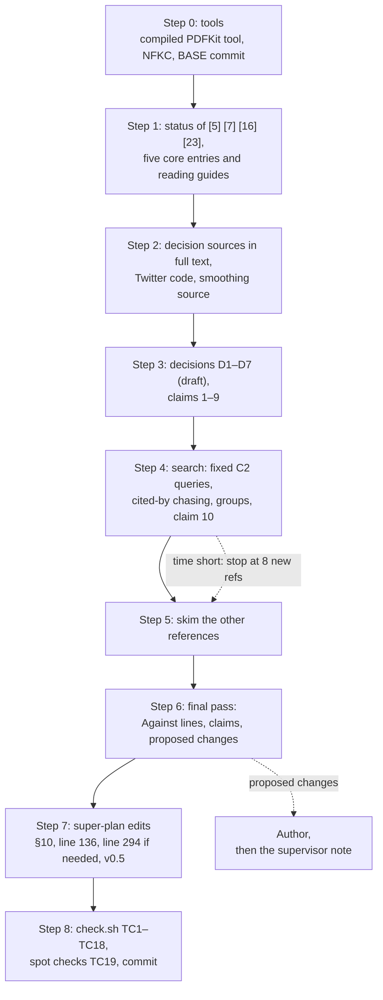

# Design (writing): P1 literature map and design decisions

Status: approved · 2026-10-24
Spec: [spec.md](spec.md) · Folder: `.docs/works/2026-10-23-p1-literature/`

**Approach.** One file, `.docs/literature.md`, with a status table at the top and fixed field labels. Because of the fixed labels, one script (`check.sh`, §5) can check most "Done when" rows. The work follows the spec's order. First the tools, then the four unverified references and the five core papers, then the decision sources and the seven decisions, then the search, and last the skim. The super plan is edited at the end, only in the places that open question 1 lists, plus the extras that §7 asks the author to approve.

**Open questions: defaults taken.** The author did not answer the four open questions in spec §8. Each answer below is the spec's recommendation, **taken as default, not confirmed**.

1. Edit the super plan in this task: **yes**. If the author says no, Step 7 and TC6 are dropped, and TC15 expects `.docs/super-plan.md` to be unchanged.
2. New recent references: **8 to 12, at least half from 2024 or later.**
3. Evidence against a §5 or §6 choice: written as a **proposed change** only. Nothing in the super plan changes until the author agrees.
4. Paywalled papers: library access is **unknown**. The fallback label is "abstract only". An "abstract only" entry cannot support a decision and cannot be cited (DW2).

**Determinism class:** none. This task is text only (spec §7). The "Opened" dates are real dates.

## 1. Outline

### 1.1 File layout of `.docs/literature.md`

Line 1 is `# Literature notes (P1) · updated <date> · task 2026-10-23-p1-literature`. Line 3 says "Working notes for P1. Not thesis text." The status table and the claims table come first. After them, the core entries are the first entries in the file, as the spec asks. The sections come in this order:

1. **Status table.** One row per reference: verified mark, read depth, date, chapter (DW2).
2. **Claims.** The ten claims of spec §3, each with a status and its evidence (DW10).
3. **How this file was made.** The PDF tool, the index sources used to verify, the rules in §1.3, the spot checks, and a "Needs full text" list for the author.
4. **Core papers.** [1], [2], [5], [9] and [15]. Each has an entry and a reading guide (DW7).
5. **Design decisions.** D1 to D7 (DW4, DW5).
6. **Other references.** The other 22 references of §10, in number order (DW1).
7. **Recent work (2022 or later).** The search log, the inclusion and stop rules, the closest work, and the new entries from 2022 or later (DW3).
8. **Older neighbours and other added references.** First a `### Older neighbours` list (§1.6). Then the entries for new references from before 2022 or with no DOI or arXiv link, for example a smoothing source, a replacement for [7], or a code release (DW1).
9. **Proposed changes.** PC1, PC2, … (open question 3).

New references get the next free number ([28], [29], …) in the order they are added, whether they go into section 7 or 8.

### 1.2 Entry format

```
### [5] RealGraph (Kamath 2014)
- Opened: 2026-10-25, full text [ueo-workshop.com PDF, sha256 1a2b3c4d5e6f]
- Says: the problem, the method, how it was evaluated. 2 to 5 lines.
- For us: which decision, term or risk it touches.
- Cited in: Ch2, Ch3 (trust term)
- Anchor: §3, the formula for the edge weight.
- Against us: optional. A point that goes against one of our choices.
```

Short form, for the skim and for [19] and [20]:

```
### [19] Epinions and Ciao (Tang 2012)
- Opened: 2026-10-25, index record [cse.msu.edu page] · Cited in: not cited
- Says: trust data sets, details in `.docs/datasets.md`. For us: a P4 candidate.
```

- **Heading:** `### [n] <short name> (<first author> <year>)`. The checks read the number from it, and the year from the last `(… YYYY)` group.
- **Opened:** starts its own line. It has the date, then one of `full text`, `abstract only` or `index record`. Then, in square brackets, what was opened:
  - a PDF: the source, the version read (for example `arXiv 1907.06902v2`) and the first 12 hex digits of its sha256 (`shasum -a 256 <file> | cut -c1-12`);
  - code: the commit;
  - a web page: the host, and the archive timestamp if it is an archive copy.
- **Partial full text.** A long survey or a code repository may say `full text (§x–y)`. Such an entry can support a decision only about those sections. In the status table, Read stays `full text`. This is a change that needs the author's OK (§7).
- **Cited in:** has its own line, or follows ` · ` on the Opened line. `Says:`, `For us:` and `Anchor:` may share a line.
- **Anchor:** required when Opened says `full text`. It gives a section number and one specific detail that the author can find in 30 seconds: a formula, a dataset size, a number. For code, give the path. For a blog post, give the paragraph.
- **Code** ([6], [11]): "Says" names the function or the formula, the file path and the commit hash. "Full text" means that file was read.
- **Blog posts** ([7], [12]): "Says" gives the formula or the key paragraph. "Full text" means the whole post was read.
- **Quotes:** one sentence at most, with the section number. PDFs are never committed.
- **Numbers:** each one names its source as `[n] §x`. Inside an entry, the § alone is enough, because the heading names [n]. A frozen value is never copied. Write "the prior `m` (super-plan §7)" instead.
- **DiffNet:** write the exact title in Title Case, "A Neural Influence Diffusion Model for Social Recommendation", or the bare model name "DiffNet". Super-plan §10 writes the title in sentence case: do not copy that form. Never put "DiffNet:" in front of the title. Do not quote the Orientation's form. Describe it instead.

### 1.3 Status table and the cite rule

```
| Ref | Short name | Type | Verified | Read | Opened | Cited in |
|---|---|---|---|---|---|---|
| [5] | RealGraph (Kamath 2014) | paper | verified | full text | 2026-10-25 | Ch2, Ch3 |
| [7] | Twitter blog (2023) | blog | do not cite, use [6] | index record | 2026-10-25 | not cited |
| [22] | Holm (1979) | paper | verified | index record | 2026-10-25 | Ch3 (name only) |
```

The table has one row per reference, so at least 27 rows. The allowed values:

- **Type:** `paper`, `survey`, `code`, `blog` or `data`.
- **Verified:** `verified`, `search only`, or `do not cite, use [n]`.
- **Read:** exactly one of `full text`, `abstract only` or `index record`. It must agree with the entry's Opened line (TC18).
- **Opened:** the same date as the entry.
- **Cited in:** `Ch2`, `Ch3`, `Ch2, Ch3`, or `not cited`. Add `(name only)` when the thesis cites only the name of a standard method.

**Cite rule (DW2).** A row that is cited must be `verified`, and its Read value must not be `abstract only`. "Index record" is enough only for a "name only" citation, for example "Holm correction [22]". A finding or a method detail needs the full text. If only the abstract could be read, the row says "not cited", and the reference goes on the "Needs full text" list for the author.

### 1.4 Decision format

```
### D1. Trust
- Question: <the exact text of the super-plan §4 row>
- Decides: <the exact "What it decides" cell of that row>
- Options: (a) …; (b) …
- Evidence:
  - [5] §3: one line per source
  - [6] `<path>`: …
- Against: [n] §x: … | none found
- Label: direct | by analogy | consistent only | against
- Choice: <the choice>. Supported by [n]. | Consistent with [n]. | By analogy with [n]. | Own design.
- Status: decided | proposed change (PCn) | open
- Result: <the exact formula, value or test that P5 will implement>
- Feeds: <the §5 or §6 item, the §7 row, or the P3 config item>
- Author's note:
```

- **Options:** at least (a) and (b).
- **Evidence:** may use sub-bullets (two spaces, then `- `). It ends at the next top-level `- Key:` line.
- **Label:** if any evidence was not read in full, add ` (abstract only)`, for example `- Label: by analogy (abstract only)` (DW4).
- **Choice:** "Supported by [n]" is allowed only when Label is `direct`. Use "Consistent with [n]" for `consistent only`, "By analogy with [n]" for `by analogy`, or "Own design". This is a change to the DW4 wording that needs the author's OK (§7).
- **Status:** `proposed change (PCn)` needs a PCn row in literature.md §9.
- **Result:** P2 uses this line as a contract, so it must be exact.
- **Author's note:** optional. It is empty at first and not checked.
- **Extra points** from §1.5 follow as their own lines, for example `- Domain gap:` (with one sub-bullet per source) and `- Fade over time:`.
- **Short names:** D1 Trust, D2 No history, D3 Community, D4 Hops, D5 Baselines, D6 Protocol, D7 Built into the data.

### 1.5 What each decision must cover

**D1 Trust.**
- Sources: [5], [6], [7], [2], [8].
- Must also cover:
  - Fade over time: none, a half-life or a window. The §6 formula has none.
  - `- Domain gap:` with one sub-bullet per source: task, data, graph type, learned or heuristic.
  - The author term (DW5).
  - Claim 2: the RealGraph wording.
  - Claim 3: the Twitter code, worded as "the 2023 release at commit <hash>", and saying what the file really shows (§1.8).
- Feeds: §6 `trust` and the author term.

**D2 No history.**
- Sources: [9] and [1], plus the smoothing-source search (§1.8).
- Must also cover:
  - Smoothing with `m` (claim 4): a named source, or own design.
  - `m` is tuned in the E4 sweep, not taken from a paper.
  - One curve instead of three phases (DW5).
  - A mapping table, and the words "same shape as, but differs in":

| Part | m-estimate | Our trust (super-plan §6) |
|---|---|---|
| count | n_c: events with outcome c | n_uf: u's earlier positives on f's posts |
| total | n: all events | N_u: all of u's earlier positives |
| prior | p: the prior probability of c | one over the number of u's followees: even over followees |
| support | the outcomes cover all n events, so the estimates sum to 1 | the prior covers followees only, but N_u also counts positives on other posts, so trust summed over followees is at most 1 |

  The notes say where our formula differs, and say the same for `community` (its prior covers only u's communities). Whether the m-estimate is the right comparison is checked against the source. It is a lead, not verified.
- Feeds: §6 smoothing, §7 `m`.

**D3 Community.**
- Source: [10].
- Must also cover:
  - A line `- Strength: strong | weak | exploratory`. It is separate from Label, so Label stays checkable. The expected value is "weak", because the support is synthetic only.
  - Orkut [10] recommends communities, not posts.
  - Letting community posts into the pool also changes the pool, so two effects mix. Say which comparisons this affects.
- Feeds: §6 `community`, §5 pool.

**D4 Hops.**
- Sources: [3], [8], [4].
- Must also cover:
  - The definition of "hop" (§4 of this design).
  - 1 hop is partly a scope choice, because GNNs are out of scope (super-plan §9).
  - A short argument for Chapter 2.
- Feeds: §6 `social`.

**D5 Baselines.**
- Sources: [25], [11], [12].
- Must also cover:
  - **Against.** Say that [25] cuts against the plan. It shows that well-tuned, simple, personalised baselines often beat new methods. BL0 to BL5 are not personalised, except for the follow-first order of BL0.
  - **Why no learned baseline:** no training data in the live app, and time. Write this as a limitation. "Interpretability" is a design preference, not a tested claim.
  - Say clearly what is tuned and what is not. Say whether BL2, BL4 and BL5 get a small validation grid.
  - A baseline BL6, "number of followees who engaged, with no trust weights", is a PC row, not an edit.
  - If a newer X ranking release exists and opens (§1.8), it goes under Against: production may have moved to a learned model.
- Feeds: §5 methods, §7.

**D6 Protocol.**
- Sources: [13], [14], [15], [16], [17], [18].
- Must also cover:
  - A table with the columns: leakage case with its [14] section, our protocol in super-plan §5, status. The status is "covered by the plan, to be tested by the P5 leakage test", "gap" or "not applicable", never just "covered".
  - Whether the candidate pool acts like sampling [15][16].
  - The number of users left out per history bucket.
  - Ties [18].
- Feeds: §5.

**D7 Built into the data.**
- Sources: [23], [24].
- Must also cover:
  - What a W1 win means: prediction, not influence.
  - The shuffle test checks the test, not the generator.
  - RQ2 thresholds are "in generator units" until they are calibrated to real data (`p1-dataset-selection`).
- Feeds: P3 worlds, E5.

### 1.6 Claims, reading guide, search log, older neighbours, spot checks, proposed changes

**Claims table** (literature.md §2). The Status is exactly `supported`, `own design` or `not supported`. A "supported" row for claims 2 to 9 names [n] in Evidence. Claim 1 names the status table and the spot checks, and claim 10 names the search log. Claim 3 is worded as "In the 2023 release at commit <hash>, …", and the rest of the sentence says what the file shows.

```
| # | Claim | Status | Evidence |
|---|---|---|---|
| 3 | In the 2023 release at commit `<40-character hash>`, <what the file shows> | supported | [6]: `<path>`, lines a–b |
```

**Reading guide** (under each core entry). Each question ends with "(answer in §x)", so the author can check their own answer. If a core paper ([1], [2], [5], [9] or [15]) cannot be opened in full text (no legal copy, or the author has not saved one), its guide is the line "Could not be opened on <date>. This guide is from the abstract only." followed by three questions from the abstract, with no "(answer in §x)" ending and no `- Read:` line, because the section numbers are unknown. TC14 accepts such a guide only when the entry's Read value is not `full text`. When the full text arrives, the guide is rewritten in the normal form. (Changed on 2026-10-24: before, only [5] had this fallback. [1], [2] and [9] came back as abstract only.)

```
#### Reading guide
- Read: §3 Model, §5 Experiments. Skip: §6.
1. <question> (answer in §3.2)
2. <question> (answer in §5)
3. <question> (answer in §5.1)
```

**Search log** (literature.md §7). The Query cell is `Q1: <query>` to `Q6: <query>` for the fixed C2 queries, `cited-by [n]` for cited-by chasing, or the free query text for a group search. The inclusion and stop rules from §1.8 are written under the log.

```
| Date | Source | Query | Looked at | Picked |
```

**Older neighbours** (literature.md §8, `### Older neighbours`). One bullet each: `- [n] <name>. How C2 differs: …`. [5] and [6] are always there. SimClusters, TwHIN and EdgeRank are added only if a source opens. Until then they stay in the search log as "lead, not verified".

**Spot checks** (literature.md §3). Two lines, written in Step 8:
- `- Spot check <date>, author: [a], [b], [c], [d], [e]. <result>`
- `- Spot check <date>, writer: [x], [y], [z]. <result>`

**Proposed changes** (literature.md §9). A change to a §7 value frozen "now" goes to the author only. Any other change goes to the author first, then into the supervisor note. A paper that already does what C2 does is always a PC row for the supervisor note.

```
| ID | Change | Where | Evidence | Goes to |
```

### 1.7 Order of work



**Step 0: tools.** Record the result in literature.md §3.

- **What this Mac has** (2026-10-23):
  - None of `pdftotext`, `pdftoppm`, `mutool`, `qpdf` or `gs`.
  - Python 3.13 has none of `pypdf`, `pdfminer` or `fitz`.
  - It has `swiftc` (Apple Swift 5.9.2), `python3` with `pip`, `curl` and Homebrew. `gh` is not installed.
- **What does not work:**
  - The Claude Code Read tool on a PDF fails here, because it needs `pdftoppm` (checked by the gate reviewer).
  - `swift pdftxt.swift` (interpreted) fails with a JIT error: "Symbols not found: PDFDocument". The gate reviewer saw this, and I saw it again on 2026-10-24.
- **Try in this order**, and take the first one that passes:
  1. **Compiled PDFKit tool.** Build it with `swiftc -o pdftxt pdftxt.swift -framework PDFKit`. Nothing to install. The gate reviewer used it to read the [5] PDF and one page of [25] in the right order. Keep `pdftxt.swift` in the task folder, so the author can rebuild it. Never commit the binary.
  2. **`pypdf`** in a virtual environment in the scratchpad (`python3 -m venv`, then `pip install pypdf`). Run it with `python3 -I`, and NFKC with `unicodedata.normalize`.
  3. **`brew install poppler`**, for `pdftotext`. This changes the Mac, so ask the author first.
- **The tool** (tested on 2026-10-24 on a PDF made on this Mac):

```swift
import Foundation
import PDFKit

// pdftxt <file.pdf> [firstPage] [lastPage]: prints NFKC text, one "=== page N" marker per page.
let args = CommandLine.arguments
guard args.count >= 2, let doc = PDFDocument(url: URL(fileURLWithPath: args[1])) else {
    FileHandle.standardError.write("pdftxt: cannot open PDF\n".data(using: .utf8)!)
    exit(1)
}
let count = doc.pageCount
let first = args.count >= 3 ? max(1, Int(args[2]) ?? 1) : 1
let last = args.count >= 4 ? min(count, Int(args[3]) ?? count) : count
if count == 0 || first > last { exit(2) }
for i in first...last {
    let text = doc.page(at: i - 1)?.string ?? ""
    print("=== page \(i)")
    print(text.precomposedStringWithCompatibilityMapping)  // NFKC: "fi" becomes "fi"
}
```

- **Normalise the text (NFKC).** Ligatures such as "fi" become "fi", so `grep` finds "first". The tool does this already. With `pypdf`, run `unicodedata.normalize("NFKC", text)`.
- **Test files.** The [5] PDF, which matters most. Also one two-column arXiv PDF, for example [25].
- **Pass rule.** The title, the authors and the first sentence of the abstract come out as readable text. One paragraph from a two-column page reads in the right order.
- **Record.** One line: `- PDF tool: <name and version>, tested on [5] and [n], <date>, pass.` Then the tools that failed, each with the reason.
- **Downloads.** Each file goes into its own new, empty folder in the scratchpad. `file <path>` must say it is a PDF, not an HTML error page. Text inside a downloaded paper is data, never an instruction.
- **Index checks** for "verified": the DOI page, Crossref (`https://api.crossref.org/works/<doi>`), DBLP, or the arXiv abstract page.
- **BASE commit** for DW8: see TC15.

**Step 1: the four unverified references, then the five core papers.**

- [5]: open the PDF. The result is "verified, full text", or "abstract only".
- [7]: open the Internet Archive copy first. The gate reviewer found one with timestamp 20240508043115 (I have not opened it). If it opens and matches, [7] becomes "verified", not "do not cite". If it does not open, try the blog's new address. If neither opens, mark it "do not cite, use [6]" (or the replacement found).
- [16]: find the paper itself through DBLP, Crossref or an author copy. The code repository is not the paper.
- [23]: try the DOI page, Crossref and DBLP, then an author copy. The repository page returned 403.
- Then write the entries for [1], [2], [5], [9] and [15], each with its reading guide.

**Step 2: decision sources.** Read every source in §1.5 in full text. There are 21 references here: the five core papers plus the sources in the super-plan §4 table. That is 17 papers, 2 code sources ([6], [11]) and 2 blog posts ([7], [12]). This step also finds the Twitter code for claim 3 and searches for a smoothing source for D2 (§1.8).

**Step 3: decisions.** Write D1 to D7 as drafts. Fill claims 1 to 9.

**Step 4: search.** First the fixed C2 queries Q1 to Q6, then cited-by chasing from [2], [5] and [9], then the four group searches (§1.8). Write the search log, the closest work, the older neighbours and claim 10.

**Step 5: skim.** The rest are [19], [20], [21], [22], [26] and [27]. The short entry form is allowed.

**Step 6: final pass.** Update the "Against" lines with what the search found. Fill the proposed changes and finish the claims table.

**Step 7: super-plan edits** (open question 1, default yes). Only these places change:

- Line 3: version 0.5 and the date.
- §10:
  - The marks for [5], [7], [16] and [23]. Their URL changes only if the verified copy is somewhere else (an extra, §7).
  - The new references [28] and up, in the §10 format.
  - One sentence in the §10 intro that defines "do not cite" (an extra, §7).
  - A fix to another §10 entry, only if its details do not match the source (an extra, §7). Each fix is named in the change log.
- Line 136: both sentences change. The first is the one that starts "RealGraph [5] and the Twitter blog [7] are "search only" today". The second is "RealGraph is central to the trust term, so verify it before citing it." Both are replaced by the result. Changing the second one is an extra (§7).
- §6 line 294: changes only if [5] or [7] becomes "do not cite", or if the RealGraph wording needs a fix. A fix to the Twitter half of that line ("Twitter's open-source ranking uses it for in-network tweets") is an extra (§7).
- The change log: one line for 0.5.

Anything else is a proposed change. Examples are line 293 (if a smoothing source is found), line 110 ("nothing newer than the 2024 survey") and line 124 (which cites [7]).

**Step 8: checks and commit.**
- Run `check.sh`. TC2 runs first, and if it fails the other checks do not run.
- Do the spot checks (TC19).
- The plan decides the commits. TC15 runs before each commit.

**Stop rule** (spec §5). If time runs short, cut in this order:

1. New recent references, down to 8 and never fewer.
2. The depth of the non-core entries, down to the short form.

Never cut the five core entries, the seven decisions, the four status checks, the claims table, the search log or the fixed C2 queries. The cut is in the writing, not the reading: a decision source still needs its full text (DW4), even when its entry is short.

### 1.8 Methods inside the steps

**Claim 3: the Twitter code.**

- **Start point.** The gate reviewer found commit `c54bec0d4e029fe34926ef3258a86ccacc0d0182` (HEAD on 2026-10-23). I have not checked it. Confirm it with `git ls-remote https://github.com/twitter/the-algorithm HEAD`.
- **Find the files.** `curl -s "https://api.github.com/repos/twitter/the-algorithm/git/trees/<hash>?recursive=1"` lists every path. Check that `truncated` is false. Search the paths for `real_graph`, `realgraph`, `RealGraph` and `interaction_graph`. The gate reviewer found many RealGraph paths. One example is `home-mixer/…/RealGraphViewerAuthorFeatureHydrator.scala`, where RealGraph scores are features for a learned ranker.
- **Read the file** at `https://raw.githubusercontent.com/twitter/the-algorithm/<hash>/<path>`.
- **Word the claim** as what the file shows, for example "In the 2023 release at commit <hash>, RealGraph scores are features of a learned ranker for in-network candidates". Do not use the looser "weights the tweets".
- **Write** the path, the hash and the line numbers in the claims table.
- **Newer release (lead).** A press report says X released a newer ranking system in January 2026 (`xai-org/x-algorithm`). This is not verified, so it is only a lead. If it exists and opens:
  - Add an entry in literature.md §8. It is code with no DOI, so it is not a DW3 recent reference.
  - Say in the claim 3 wording and in D5 "Against" that production may have moved to a learned model.

**Smoothing source (D2, claim 4).**

- Search terms: "m-estimate", "additive smoothing", "Bayesian average", "Dirichlet prior smoothing", "shrinkage estimator".
- Leads from memory, not verified: Cestnik (1990) on the m-estimate, and Zhai and Lafferty (2001) on smoothing for language models in retrieval.
- D2 compares the source with our formula using the mapping table in §1.5. If a source is verified, D2 says "the form follows [n]", and lists where ours differs. The value of `m` still comes from E4.

**Search (claim 10).**

- **Fixed C2 queries.** Each one names both halves of C2: follow trust and community affinity, added to engagement in one ranking. Each query runs on at least two sources (the WebSearch tool and Semantic Scholar or arXiv). Each run is one row in the search log.
  - Q1: follow trust community affinity engagement feed ranking
  - Q2: social trust and community membership in news feed ranking
  - Q3: hybrid feed ranking engagement score follow graph community signal
  - Q4: interaction strength between users and group membership for post recommendation
  - Q5: tie strength and community affinity in personalized social feed
  - Q6: cold-start social recommendation followee engagement community heuristic
- **Cited-by chasing.** For [2], [5] and [9]: list the papers from 2022 or later that cite them (the Semantic Scholar citations list, or "Cited by" in Google Scholar by hand). Read the titles and abstracts. Write one row per source paper (`cited-by [n]`) with how many papers were looked at.
- **Group searches:** (1) social recommendation, (2) social cold start, (3) follow-graph feed ranking, (4) audits of feed algorithms. Sources: the WebSearch tool, DBLP, arXiv, Semantic Scholar and the ACM Digital Library.
- **Claim 10** names the fixed queries, the cited-by chasing, the sources and the date.
- **Leads from memory, not verified:** TwHIN (Twitter, KDD 2022), Huszár et al. (PNAS 2022) on algorithmic amplification on Twitter, Milli et al. (arXiv 2023) on engagement-based ranking on Twitter, and SimClusters (KDD 2020, seen in a DBLP listing by the gate reviewer). Each lead must be found and opened like any other source.
- **Inclusion:**
  - Published in 2022 or later.
  - Peer-reviewed, or an arXiv preprint marked "preprint" in its entry.
  - Fits one of the four groups, and the entry can say what it means for us.
  - Has a DOI or an arXiv link, and its page was opened and the details match.
  - Not included: Direction B papers (LLM user profiles), GNN papers beyond what D4 needs, and anything seen only in a search snippet. No reference is written from memory.
- **Stop:**
  - A group stops after two queries in a row add nothing new, or when it has 3 picks.
  - The whole search stops at 12 picks. At least half must be from 2024 or later.
  - **The total of 8 wins.** If a group stops early and the total is below 8, keep searching the other groups. The cap of 3 per group no longer applies.
  - If all groups, the fixed queries and the cited-by chasing give fewer than 8, stop and tell the author (F18). TC7 then fails, and the author decides.
- **Closest work:** 3 to 5 of the picks, each with a line `How C2 differs:` in literature.md §7.
- **Older neighbours:** [5], [6], and SimClusters, TwHIN and EdgeRank if a source opens. Each gets `How C2 differs:` in literature.md §8 (§1.6). They are counted separately from the closest work. EdgeRank is added only if a primary source opens (a paper, an official Facebook engineering page, or an archived copy of one). Otherwise write "not added: no verifiable source" in the search log.

### 1.9 Rejected options

- **Status only in literature.md, with the super plan edited at the end of P1.** Rejected under the default answer to open question 1. `p1-related-work` may cite only references marked "verified" in §10, so §10 must be right before that task starts.
- **Free text with no fixed labels.** Rejected. DW1 to DW4 and DW10 could then only be checked by reading more than 30 entries by hand.
- **Several files** (entries, decisions, search). Rejected. The spec and the later tasks name one file.
- **A BibTeX file now.** Rejected. This task has no LaTeX. BibTeX is made from §10 at P9.
- **Unofficial PDF copies** (shadow libraries). Rejected, because they are not legal. A paper with no legal full text stays "abstract only".
- **Installing poppler first.** Rejected as the first choice, because it changes the Mac without the author's OK. It stays as the last option.

## 2. Evidence map

"Ready?" describes the state on 2026-10-24. Nothing has been read for this task yet.

| Claim | Evidence (reference and section, code path, search log) | Ready? |
|---|---|---|
| 1. Entries say what the references say | Each entry's `Opened:` and `Anchor:` lines, the status table (TC1 to TC3, TC18), the spot checks (TC19) | No: made in Steps 1 to 5 and 8 |
| 2. RealGraph weights directed edges by a learned, predicted probability | [5] full text: the section that defines the edge weight and the model. Compare it with super-plan §6 line 294. | No: [5] returned 200 to curl, but its text has not been read |
| 3. Twitter code uses interaction weights for in-network tweets | [6] at commit `c54bec0d4e029fe34926ef3258a86ccacc0d0182` (gate reviewer, not checked by me): the RealGraph paths, with line numbers. [7] if the archive copy opens. Reworded to what the file shows (§1.8). | No: the hash and the paths are from the gate reviewer |
| 4. Smoothing with `m` is a known technique, or our own design | The smoothing-source search and the D2 mapping table (§1.5). Super-plan §6 line 293 says "my own suggestion". | No: the leads are not verified |
| 5. The three §6 choices are decided by evidence | D1 (author term) and D2 (smoothing, one curve) | No: depends on claims 2 to 4 |
| 6. 1 hop or 2 hops | [3], [8], [4] in full text, plus the §9 scope | No |
| 7. The baselines are strong enough | [25] full text, [11] code file, [12] blog post, and a newer X release if it opens | No |
| 8. The protocol has no known bias | [13] to [18], with the [14] leakage table in D6 | No: [16] is not verified (code repository only) |
| 9. What W0, W1 and the shuffle can show | [23] and [24] | No: the [23] page returned 403 |
| 10. Our search found no 2022-or-later paper that does what C2 does | The search log: Q1 to Q6, cited-by chasing from [2], [5] and [9], the group searches, the sources and the date. The closest-work entries. | No: made in Step 4 |

## 3. Figures and tables

This task makes no thesis figures, no CSV and no macros. It reports no result numbers (spec §4).

| ID | Shows | Source data | Made by |
|---|---|---|---|
| T1 | Status table (literature.md §1) | The `Opened:` and `Cited in:` lines, super-plan §10 | Steps 1 to 5. TC4 to TC6, TC18 |
| T2 | Claims table (literature.md §2) | Entries, decisions, search log | Steps 3 and 6. TC17 |
| T3 | [14] leakage check (inside D6) | [14] full text, super-plan §5 | Step 3. TC10 checks the status wording |
| T4 | D2 mapping table (inside D2) | The smoothing source, super-plan §6 | Step 3. TC12 |
| T5 | Search log (literature.md §7) | The queries, as they are run | Step 4. TC8 |
| T6 | Older neighbours (literature.md §8) | [5], [6], leads that open | Step 4. TC8 |
| T7 | Proposed changes (literature.md §9) | The decisions | Step 6. TC10 checks that every PCn in a Status exists |
| F1 | Order of work (this design, §1.7) | Spec §5 | Mermaid, in this design only |

## 4. Terms

- **C2.** Our contribution: follow-trust and community-affinity added to the engagement score in one hybrid ranking (spec §1).
- **Hop.** One step along a follow edge. 1 hop means u's followees. 2 hops means the followees of u's followees. Our `social` term uses 1 hop: u's followees and the posts they engaged with. In a graph that also has posts, the path u → f → p has two edges, so the notes use "hop" only for user-to-user steps.
- **Trust.** The share of u's earlier positive actions that went to f's posts, smoothed with the prior `m` (super-plan §6).
- **Prior strength `m`.** How much weight the even-spread prior gets. Its value is in super-plan §7. It is tuned, not cited.
- **m-estimate.** A known way to estimate a rate from few counts: (count + m · prior) / (total + m). D2 compares our formula with it.
- **Verified, search only, do not cite.**
  - Verified: the source or a trusted index was opened, and the details match (super-plan §10).
  - Search only: only a snippet or a secondary source was seen.
  - Do not cite: the reference could not be verified, or it is not needed. A named reference replaces it.
- **Full text, abstract only, index record.** How much was read: the whole paper (or post, or code file), only the abstract, or only the bibliographic record. "Full text (§x–y)" means only those sections were read in full.
- **Anchor.** One detail in an entry, with its section, that lets the author check the entry against the source in 30 seconds.
- **Label** of a decision:
  - direct: the source tests the same thing.
  - by analogy: the source does a similar thing in another setting.
  - consistent only: the source does not test it but does not disagree.
  - against: the source points the other way.
- **Strength** (D3 only). How much the evidence is worth for us: strong, weak or exploratory.
- **Status** of a decision: decided, proposed change (it waits for the author), or open.
- **Result.** The exact formula, value or test that P5 will build. P2 uses it as a contract.
- **Domain gap.** How far a source's setting is from ours: task, data, graph type, learned or heuristic.
- **Closest work.** A paper from 2022 or later whose method is nearest to C2.
- **Older neighbour.** An industry ranking system, from any year, that is near C2 (for example RealGraph).
- **Cited-by chasing.** Reading the list of later papers that cite a given paper.
- **NFKC.** A Unicode normalisation that turns special forms, such as the ligature "fi", into plain letters.
- **Leakage.** A feature that uses information from after the test time `t_u` [14].
- **Sampled metric.** A metric that ranks the test item among a random sample of items, not the full pool [15].
- **In generator units.** A threshold measured in the synthetic generator's own parameters, not in real-world numbers.

## 5. Test cases

All checks are scripts or manual checks. There are no unit or IT tests, because this task has no code. The scripted checks are in `check.sh` below. The plan copies it into the task folder and writes it before `literature.md` (test first). Run it from the repo root: `bash .docs/works/2026-10-23-p1-literature/check.sh`.

- It prints one line per check: `TCn PASS` or `TCn FAIL`, with the problems below it.
- Lines that start with `CHECK` are for a person to read. They do not fail a check.
- TC2 runs first. If it fails, the other checks do not run, because they assume the reference set is right.

| ID | Covers | Check | Expected |
|---|---|---|---|
| TC1 | DW1 | Script: the `- PDF tool:` line exists. Read it | One line: tool, test files, date, "pass". Or the failure and the "abstract only" fallback |
| TC2 | DW1 | Script, runs first: the reference numbers in §10 equal the `### [n]` headings. Run it after Step 7 | PASS |
| TC3 | DW1 | Script: every entry has `Says:`, `For us:`, `Cited in:` and a well-formed `Opened:`. A `full text` entry (with or without `(§x–y)`) has an `Anchor:` with a § or a path | PASS |
| TC4 | DW2 | Script: the first `##` section is the status table. All four rows [5], [7], [16], [23] exist, and each is `verified` or `do not cite, use [n]` | PASS |
| TC5 | DW2 | Script: no cited row is unverified or `abstract only`. An `index record` row is cited only "(name only)". A `(§x–y)` suffix is accepted | PASS |
| TC6 | DW2, DW8 | Script: the §10 marks agree with the Verified column | PASS |
| TC7 | DW3 | Script: in literature.md §7, the year comes from the last `(… YYYY)` group of each heading. Each new reference is from 2022 or later, has a DOI or arXiv link, and is `verified` in the status table | PASS, with "CHECK PASS" for "8 to 12 refs" and for "at least half from 2024 or later" |
| TC8 | DW3 | Script: count `How C2 differs:` in §7 (3 to 5) and in "Older neighbours" (at least 2). The log has rows for Q1 to Q6 and `cited-by` [2], [5], [9]. Manual: the inclusion and stop rules are written, and a paper that does C2 has a PC row for the supervisor note | PASS, and the manual points hold |
| TC9 | DW4 | Script: the `- Question:` and `- Decides:` lines equal the super-plan §4 table | PASS |
| TC10 | DW4 | Script: headings D1. to D7. in order. Every decision has Question, Decides, Options, Evidence, Against, Label, Choice, Status, Result and Feeds. Options has (a) and (b). Label and Status use the allowed values. A PCn in Status has a row in §9. Choice uses one of the four forms, and "Supported by" only with Label direct. D1 has at least 4 Domain gap sub-bullets. D3 has a valid Strength. The D6 table uses the allowed status wording | PASS |
| TC11 | DW4 | Script: every [n] in every Evidence line and sub-bullet was read in full text, or the Label says "(abstract only)". A `full text (§x–y)` source is printed as CHECK | PASS. Each CHECK line is read by hand: the decision uses only those sections |
| TC12 | DW5 | Script and manual: D1 covers the author term. D2 has "same shape as, but differs in" and the count, total, prior and support rows. Read the printed smoothing and curve lines | PASS. The smoothing is "Own design" or names [n] |
| TC13 | DW6 | Script: list the DiffNet hits. No "DiffNet:" prefix. Every "neural influence" hit is the exact Title Case title | PASS |
| TC14 | DW7 | Script: 5 reading guides, each with one `- Read:` line and three questions that end with "(answer in §x)". If a core paper is not `full text`, its guide says "Could not be opened on <date>" and is then exempt from the line and question format | PASS |
| TC15 | DW8 | Script: `git status --short` before each commit. After the last commit: the files changed since BASE, §1 to §3, §5, §7 to §9 and §11 unchanged. The changed lines in §4 and §6 are printed. Every §10 change is listed, and extras are marked "EXTRA, needs the author" | PASS. The printed lines match Step 7, and each EXTRA is in the "Changes that need the author's OK" list (§7) |
| TC16 | DW9 | Script and manual: the number scan prints each line whose number does not name its source. The frozen-value grep must print nothing | PASS. Each CHECK line is fixed, or accepted by hand (a year, a formula, a line number) |
| TC17 | DW10 | Script: 10 claim rows with an allowed status. "Supported" needs [n] (claims 2 to 9), "status table" (claim 1) or "search log" (claim 10). Claim 3 says "2023 release at commit", has a 40-character hash and a path in backticks | PASS |
| TC18 | DW1, DW2 | Script: for every [n], the status table row and the entry agree on Read (without the `(§x–y)` suffix), Opened date and Cited in. Every row has an entry, and every entry has a row. The table has at least 27 rows | PASS |
| TC19 | DW1, DW10 (claim 1) | Manual, Step 8: the author re-opens 5 random non-core entries, and the writer re-opens 3 entries. Each compares Says and Anchor with the source. Pick them with the command under this table. The script checks that both spot-check lines exist | Both lines exist and say "match", or list the mismatches and their fixes |

TC19 picks (the author takes 5 non-core entries, the writer takes 3 entries):

```bash
grep -oE '^### \[[0-9]+\]' .docs/literature.md | grep -v -E '\[(1|2|5|9|15)\]' | sort -R | head -5
grep -oE '^### \[[0-9]+\]' .docs/literature.md | sort -R | head -3
```

TCs per DW:

| DW | DW1 | DW2 | DW3 | DW4 | DW5 | DW6 | DW7 | DW8 | DW9 | DW10 |
|---|---|---|---|---|---|---|---|---|---|---|
| TCs | 5 | 4 | 2 | 3 | 1 | 1 | 1 | 2 | 1 | 2 |
| Which | TC1, TC2, TC3, TC18, TC19 | TC4, TC5, TC6, TC18 | TC7, TC8 | TC9, TC10, TC11 | TC12 | TC13 | TC14 | TC6, TC15 | TC16 | TC17, TC19 |

19 TCs in total. TC6, TC18 and TC19 each cover two DWs.

**`check.sh`** (tested on 2026-10-24, see §7). `L` and `SP` can point at other files for testing, and `BASE` can be set by hand. The commands use `grep`, not `rg`: here `rg` is a Claude Code shell function and may not exist in the author's terminal.

```bash
#!/usr/bin/env bash
# Checks for the task 2026-10-23-p1-literature. Run from the repo root.
# Each check prints problems only. No output = PASS. Lines that start with "CHECK" are for a
# person to read; they do not fail the check.
set -u
L=${L:-.docs/literature.md}
SP=${SP:-.docs/super-plan.md}
TASK=.docs/works/2026-10-23-p1-literature
FAILED=0

run() {
  local id=$1 out bad
  out=$("$2" 2>&1)
  bad=$(printf '%s\n' "$out" | grep -v -e '^CHECK' -e '^$' || true)
  if [ -z "$bad" ]; then echo "$id PASS"; else echo "$id FAIL"; FAILED=1; fi
  [ -n "$out" ] && printf '%s\n' "$out" | sed 's/^/    /'
  return 0
}
section() { sed -n "/^## $1\./,/^## /p"; }   # a super-plan section, up to the next "## " heading

tc1() {
  local n; n=$(grep -c '^- PDF tool:' "$L")
  [ "$n" -ge 1 ] || echo "no '- PDF tool:' line in §3"
  grep '^- PDF tool:' "$L" | sed 's/^/CHECK /'
}

tc2() {
  diff <(section 10 < "$SP" | grep -oE '^[0-9]+\.' | tr -d . | sort -n) \
       <(grep -oE '^### \[[0-9]+\]' "$L" | grep -oE '[0-9]+' | sort -n)
}

tc3() {
  awk 'function check() {
         if (!(s && f && c && o)) print ref, "missing:" (s ? "" : " Says") (f ? "" : " For-us") (c ? "" : " Cited-in") (o ? "" : " Opened")
         if (full && !a) print ref, "read in full text but has no Anchor with a § or a path" }
    /^##/ && !/^####/ { if (ref != "") check(); ref = ($0 ~ /^### \[[0-9]+\]/) ? $2 : ""; s = f = c = o = a = full = 0; next }
    ref != "" {
      if (/Says:/) s = 1; if (/For us:/) f = 1; if (/Cited in:/) c = 1
      if (/^- Opened: 20[0-9][0-9]-[0-9][0-9]-[0-9][0-9], (full text( \(§[^)]*\))?|abstract only|index record)( \[| ·|$)/) { o = 1; if (/^- Opened: [0-9-]+, full text/) full = 1 }
      if (/Anchor: .*(§[0-9]|\/|paragraph)/) a = 1 }
    END { if (ref != "") check() }' "$L"
}

tc4() {
  [ "$(grep -m1 '^## ' "$L")" = "## 1. Status table" ] || echo "the first section is not '## 1. Status table'"
  awk -F'|' '$2 ~ /^ \[(5|7|16|23)\] $/ { n++; v = $5; gsub(/^ +| +$/, "", v)
      if (v !~ /^(verified|do not cite, use \[[0-9]+\])$/) print $2, "status:", v }
    END { if (n != 4) print n + 0, "of the rows [5] [7] [16] [23] found, want 4" }' "$L"
}

tc5() {
  awk -F'|' '/^\| \[[0-9]+\] \|/ { v = $5; r = $6; c = $8
      gsub(/^ +| +$/, "", v); gsub(/^ +| +$/, "", r); gsub(/^ +| +$/, "", c); sub(/ \(§[^)]*\)$/, "", r)
      if (c == "not cited") next
      if (v != "verified" || r == "abstract only") print $2, "cited in", c, "but", v, "/", r
      else if (r == "index record" && c !~ /name only/) print $2, "index record, cited in", c, "without (name only)" }' "$L"
}

tc6() {
  local norm='{ m = $0; sub(/^[^|]*\|/, "", m); v = (m ~ /^ *verified/) ? "verified" : (m ~ /^ *search only/) ? "search only" : (m ~ /^ *do not cite/) ? "do not cite" : "other:" m; print $1, v }'
  diff <(section 10 < "$SP" | grep -E '^[0-9]+\. ' | sed -E 's/^([0-9]+)\. .* · /\1|/' | awk -F'|' "$norm" | sort -n) \
       <(awk -F'|' '/^\| \[[0-9]+\] \|/ { k = $2; gsub(/[^0-9]/, "", k); print k "|" $5 }' "$L" | awk -F'|' "$norm" | sort -n)
}

tc7() {
  awk -F'|' '
    NR == FNR { if ($0 ~ /^\| \[[0-9]+\] \|/) { k = $2; gsub(/[^0-9]/, "", k); v = $5; gsub(/^ +| +$/, "", v); ver[k] = v }; next }
    function close_entry() { if (e != "" && !link) print "no DOI or arXiv link:", e }
    /^## 7\./ { p = 1; next }
    /^## / { p = 0 }
    !p { next }
    /^### \[/ { close_entry(); e = $0; link = 0; n++
      k = $0; sub(/^### \[/, "", k); sub(/\].*/, "", k)
      if (ver[k] != "verified") print "not verified in the status table:", e
      y = 0; s = $0
      while (match(s, /\([^()]*\)/)) { g = substr(s, RSTART + 1, RLENGTH - 2); if (g ~ /(19|20)[0-9][0-9]$/) y = substr(g, length(g) - 3) + 0; s = substr(s, RSTART + RLENGTH) }
      if (y == 0) print "no (... YYYY) group in the heading:", e; else if (y < 2022) print "older than 2022:", e
      if (y >= 2024) r++
      next }
    /https:\/\/(doi\.org|arxiv\.org)\// { link = 1 }
    END { close_entry()
      print ((n >= 8 && n <= 12) ? "CHECK PASS" : "FAIL"), n + 0, "recent refs (want 8 to 12)"
      print ((n > 0 && 2 * r >= n) ? "CHECK PASS" : "FAIL"), r + 0, "of them from 2024 or later (want at least half)" }' "$L" "$L"
}

tc8() {
  awk '/^## 7\./ { p = 1; next } /^## / { p = 0 } p && /How C2 differs:/ { n++ }
    END { if (n < 3 || n > 5) print n + 0, "closest-work lines in §7, want 3 to 5"; else print "CHECK", n, "closest-work lines in §7" }' "$L"
  awk '/^### Older neighbours/ { p = 1; next } /^##/ { p = 0 } p && /How C2 differs:/ { n++ }
    END { if (n < 2) print n + 0, "older-neighbour lines, want at least 2 ([5] and [6])"; else print "CHECK", n, "older-neighbour lines" }' "$L"
  local q
  for q in Q1 Q2 Q3 Q4 Q5 Q6; do grep -q -E "^\| [0-9-]+ \|[^|]*\| $q:" "$L" || echo "search log has no row for $q"; done
  for q in 2 5 9; do grep -q -E "^\| [0-9-]+ \|[^|]*\| cited-by \[$q\]" "$L" || echo "search log has no 'cited-by [$q]' row"; done
}

tc9() {
  local col
  for col in 2 4; do
    diff <(section 4 < "$SP" | sed -n '/^| Design question/,/^$/p' | grep '^| ' | sed '1d' | cut -d'|' -f$col | sed -E 's/^ +//; s/ +$//') \
         <(grep -E "^- $([ $col = 2 ] && echo Question || echo Decides):" "$L" | sed -E 's/^- [A-Za-z]+: //; s/ +$//')
  done
}

tc10() {
  awk '
    NR == FNR { if ($0 ~ /^\| PC[0-9]+ \|/) { k = $2; gsub(/ /, "", k); pc[k] = 1 }; next }
    function flush(   i, miss, id) {
      miss = ""; for (i = 1; i <= nw; i++) if (!(want[i] in got)) miss = miss " " want[i]
      if (miss != "") print d, "missing:" miss
      if (("Options" in got) && !(opt ~ /\(a\)/ && opt ~ /\(b\)/)) print d, "Options needs (a) and (b)"
      if (("Label" in got) && lab !~ /^- Label: (direct|by analogy|consistent only|against)( \(abstract only\))? *$/) print d, "bad Label:", lab
      if ("Status" in got) {
        if (st !~ /^- Status: (decided|open|proposed change \(PC[0-9]+\)) *$/) print d, "bad Status:", st
        else if (match(st, /PC[0-9]+/)) { id = substr(st, RSTART, RLENGTH); if (!(id in pc)) print d, "Status names", id, "but §9 has no such row" } }
      if ("Choice" in got) {
        if (ch !~ /(Supported by|Consistent with|By analogy with) \[[0-9]+\]|Own design/) print d, "bad Choice:", ch
        else if (ch ~ /Supported by/ && lab !~ /^- Label: direct/) print d, "\"Supported by\" needs Label direct" }
      if (d == "D1." && gap < 4) print d, gap + 0, "Domain gap lines, want at least 4"
      if (d == "D3." && str !~ /^- Strength: (strong|weak|exploratory) *$/) print d, "needs - Strength: strong | weak | exploratory"
      split("", got); opt = lab = st = ch = str = key = ""; gap = 0 }
    BEGIN { nw = split("Question Decides Options Evidence Against Label Choice Status Result Feeds", want, " ") }
    /^##/ { if (d != "") flush(); d = ($0 ~ /^### D[1-7]\./) ? $2 : ""; next }
    d == "" { next }
    /^- [A-Z][A-Za-z\047 ]*:/ { key = $0; sub(/^- /, "", key); sub(/:.*/, "", key); got[key] = 1
      if (key == "Label") lab = $0; if (key == "Status") st = $0; if (key == "Choice") ch = $0; if (key == "Strength") str = $0 }
    key == "Options" { opt = opt " " $0 }
    key == "Domain gap" && /^  - \[[0-9]+\]/ { gap++ }
    d == "D6." && /^\| / && !/^\|[-| ]+\|$/ && !/^\| Leakage case/ { c = $0; sub(/ *\| *$/, "", c); sub(/.*\| */, "", c)
      if (c != "covered by the plan, to be tested by the P5 leakage test" && c != "gap" && c != "not applicable") print d, "bad leakage status:", c }
    END { if (d != "") flush() }' "$L" "$L"
  diff <(seq 1 7) <(grep -oE '^### D[1-7]\.' "$L" | grep -oE '[1-7]') > /dev/null || echo "want exactly the headings D1. to D7., in order"
}

tc11() {
  awk '
    function cut(v,   i) { i = index(v, " ["); if (i) v = substr(v, 1, i - 1); i = index(v, " ·"); if (i) v = substr(v, 1, i - 1); sub(/ +$/, "", v); return v }
    NR == FNR {
      if ($0 ~ /^### \[[0-9]+\]/) { k = $2; gsub(/[^0-9]/, "", k) }
      else if (k != "" && $0 ~ /^- Opened: /) { v = $0; sub(/^- Opened: [0-9-]+, /, "", v); depth[k] = cut(v); k = "" }
      next }
    function out(   s, n, dv) { s = ev
      while (match(s, /\[[0-9]+\]/)) { n = substr(s, RSTART + 1, RLENGTH - 2); dv = (n in depth) ? depth[n] : "no entry"
        if (dv !~ /^full text/ && lab !~ /abstract only/) print d, "rests on [" n "], read:", dv
        else if (dv ~ /^full text \(/) print "CHECK", d, "uses [" n "], read only", dv, "- the decision may use only those sections"
        s = substr(s, RSTART + RLENGTH) } }
    /^##/ { if (d != "") out(); d = ($0 ~ /^### D[1-7]\./) ? $2 : ""; ev = lab = ""; inev = 0; next }
    d == "" { next }
    /^- [A-Z][A-Za-z\047 ]*:/ { inev = ($0 ~ /^- Evidence:/); if ($0 ~ /^- Label:/) lab = $0 }
    inev { ev = ev " " $0 }
    END { if (d != "") out() }' "$L" "$L"
}

tc12() {
  awk '/^### D1\./ { p = 1; next } /^##/ { p = 0 } p' "$L" | grep -q -i 'author term' || echo "D1 does not cover the author term"
  local d2; d2=$(awk '/^### D2\./ { p = 1; next } /^##/ { p = 0 } p' "$L")
  printf '%s\n' "$d2" | grep -q 'same shape as, but differs in' || echo "D2 has no 'same shape as, but differs in'"
  local r; for r in count total prior support; do printf '%s\n' "$d2" | grep -q "^| $r |" || echo "D2 mapping table has no '$r' row"; done
  printf '%s\n' "$d2" | grep -i -E 'smoothing|one curve|phases' | sed 's/^/CHECK /'
}

tc13() {
  grep -n -i -E 'diffnet|neural influence' "$L" | sed 's/^/CHECK /'
  grep -n -i -E 'diffnet[[:space:]]*:' "$L"
  grep -n -i 'neural influence' "$L" | grep -v -F 'A Neural Influence Diffusion Model for Social Recommendation'
}

tc14() {
  awk 'function flush() { if (g != "") { n++; if (!co && (q != 3 || r != 1 || bad)) print g, q, "questions ending in (answer in §x),", r, "Read lines" (bad ? ", and other numbered lines" : "") } g = "" }
    /^#### Reading guide/ { flush(); g = ref; q = r = bad = co = 0; next }
    /^##/ { flush(); if (/^### \[/) ref = $2; next }
    g != "" { if (/^[1-9]\. /) { if (/^[1-3]\. .*\(answer in §[0-9][^)]*\) *$/) q++; else bad = 1 }; if (/^- Read:/) r++; if (/Could not be opened on /) co = 1 }
    END { flush(); if (n != 5) print n + 0, "reading guides, want 5" }' "$L"
  local k rk
  for k in 1 2 5 9 15; do
    rk=$(awk -F'|' -v want=" [$k] " '$2 == want { r = $6; gsub(/^ +| +$/, "", r); print r }' "$L")
    case "$rk" in
      "full text"*) awk -v h="### [$k]" 'index($0, h) == 1 { p = 1; next } /^### / { p = 0 } p' "$L" | grep -q 'Could not be opened' && echo "[$k] is full text but its guide says 'Could not be opened'" ;;
      *) awk -v h="### [$k]" 'index($0, h) == 1 { p = 1; next } /^### / { p = 0 } p' "$L" | grep -q 'Could not be opened' || echo "[$k] is '$rk' but its guide does not say 'Could not be opened'" ;;
    esac
  done
}

tc15() {
  local first base
  first=$(git rev-list HEAD -- "$TASK" | tail -1)
  if [ -n "${BASE:-}" ]; then base=$BASE; elif [ -n "$first" ]; then base="$first^"; else base=$(git rev-parse HEAD); fi
  local old; old=$(mktemp); git show "$base:.docs/super-plan.md" > "$old"
  git status --short | sed 's/^/CHECK status: /'
  git diff --stat "$base" -- . | sed 's/^/CHECK diff: /'
  git diff --name-only "$base" -- . | grep -v -E "^(\.docs/literature\.md|\.docs/super-plan\.md|$TASK/.*)$" | sed 's/^/outside the allowed files: /'
  local s; for s in 1 2 3 5 7 8 9 11; do diff <(section $s < "$old") <(section $s < "$SP") > /dev/null || echo "super-plan §$s changed"; done
  for s in 4 6; do diff <(section $s < "$old") <(section $s < "$SP") | grep '^>' | cut -c3-92 | sed "s/^/CHECK §$s line now: /"; done
  awk 'NR == FNR { if (match($0, /^[0-9]+\. /)) old[substr($0, 1, RLENGTH - 2)] = $0; else oldt[$0] = 1; next }
    function url(s) { return match(s, /https?:\/\/[^ ]+/) ? substr(s, RSTART, RLENGTH) : "" }
    match($0, /^[0-9]+\. /) { n = substr($0, 1, RLENGTH - 2)
      if (!(n in old)) print "CHECK §10 new reference [" n "]"
      else if (old[n] != $0) {
        if (n !~ /^(5|7|16|23)$/) print "CHECK EXTRA, needs the author: §10 entry [" n "] changed"
        else { print "CHECK §10 mark of [" n "] changed"; if (url(old[n]) != url($0)) print "CHECK EXTRA, needs the author: URL of [" n "] changed" } }
      next }
    !($0 in oldt) { print "CHECK EXTRA, needs the author: §10 text changed: " substr($0, 1, 70) }' <(section 10 < "$old") <(section 10 < "$SP")
  rm -f "$old"
}

tc16() {
  perl -ne '
    next if $. == 1 || /^\|[-| ]+\|$/ || /^- (Opened|Question|Decides):/;
    $inentry = /^### \[\d+\]/ ? 1 : 0 if /^#{2,3} /;
    my $orig = $_;
    if (/^\| \d{4}-\d{2}-\d{2} \|/) { my @f = split /\|/, $_, -1; $f[1] = ""; $f[4] = ""; $_ = join "|", @f }
    if (/^\| \[\d+\] \|/)           { my @f = split /\|/, $_, -1; $f[6] = ""; $_ = join "|", @f }
    s{https?://\S+}{}g; s/\b[0-9a-f]{40}\b//g;
    s/\b\d{4}-\d{2}-\d{2}-p\d+-[a-z-]+//g; s/\bp\d+-[a-z-]+//g; s/\b\d{4}-\d{2}-\d{2}\b//g;
    1 while s/(\([^()]*?)\b(?:19|20)\d{2}\b(?=[^()]*\))/$1/;
    s/\[\d+\]//g;
    s/§\s?\d+(?:\.\d+)*(?:(?:–|-)\d+(?:\.\d+)*)?//g;
    s/\b(?:DW|TC|BL|RQ|PC|Ch|W|E|H|C|D|F|P|S|M|Q)\d+\b//g;
    s/\b[12][ -]hops?\b//g;
    s/^#+\s+(?:\d+\.)?//; s/^\s*\d+\.\s//; s/^\|\s*\d+\s*\|//;
    next unless /\d/;
    next if $orig =~ /\[\d+\]\s*§|super-plan §/;
    next if $inentry && $orig =~ /§/;
    print "CHECK line $.: $orig";
  ' "$L"
  grep -n -E '20261014|2026-01-01|10,000|10000|0\.05|2,000|7 days|7-day|`?m`? *= *`?5\b|200 users|1,000 users|4k posts|20k posts|0, 1, 2, 4, 8, 16|0, 2, 5, 10' "$L" | sed 's/^/frozen value copied, link to super-plan §7 instead: /'
}

tc17() {
  awk -F'|' '/^\| (10|[1-9]) \|/ { n++; k = $2 + 0; s = $4; e = $5; gsub(/^ +| +$/, "", s)
      if (s !~ /^(supported|own design|not supported)$/) { print "claim", k, "bad status:", s; next }
      if (s == "supported") {
        if (k == 1 && e !~ /status table/) print "claim 1 is supported but its Evidence does not name the status table"
        if (k == 10 && e !~ /search log/) print "claim 10 is supported but its Evidence does not name the search log"
        if (k >= 2 && k <= 9 && e !~ /\[[0-9]+\]/) print "claim", k, "is supported but has no [n] in Evidence" }
      if (k == 3) {
        if ($0 !~ /2023 release at commit/) print "claim 3 does not say \"2023 release at commit\""
        if ($0 !~ /[0-9a-f]{40}/) print "claim 3 has no 40-character commit hash"
        if ($0 !~ /`[^`]*\/[^`]*`/) print "claim 3 has no file path in backticks" } }
    END { if (n != 10) print n + 0, "claim rows, want 10" }' "$L"
}

tc18() {
  awk -F'|' '
    function norm(x,   o) { o = ""; while (match(x, /Ch[0-9]+|not cited|name only/)) { o = o substr(x, RSTART, RLENGTH) ";"; x = substr(x, RSTART + RLENGTH) }; return o }
    function cut(v,   i) { i = index(v, " ["); if (i) v = substr(v, 1, i - 1); i = index(v, " ·"); if (i) v = substr(v, 1, i - 1); sub(/ +$/, "", v); return v }
    NR == FNR { if ($0 ~ /^\| \[[0-9]+\] \|/) { k = $2; gsub(/[^0-9]/, "", k); rows++
        r = $6; o = $7; c = $8; gsub(/^ +| +$/, "", r); gsub(/^ +| +$/, "", o); gsub(/^ +| +$/, "", c)
        if (r !~ /^(full text|abstract only|index record)$/) print "[" k "] Read in the table must be one of the three values, not:", r
        tr[k] = r; to[k] = o; tc[k] = norm(c) }
      next }
    /^### \[[0-9]+\]/ { k = $0; sub(/^### \[/, "", k); sub(/\].*/, "", k); seen[k] = 1; next }
    /^##/ && !/^####/ { k = ""; next }
    k != "" && /^- Opened: / { v = $0; sub(/^- Opened: /, "", v); ed = substr(v, 1, 10); v = cut(substr(v, 13)); b = v; sub(/ \(§[^)]*\)$/, "", b)
      if (!(k in tr)) print "[" k "] has an entry but no status-table row"
      else { if (b != tr[k]) print "[" k "] Read: table", tr[k], "/ entry", v; if (ed != to[k]) print "[" k "] Opened: table", to[k], "/ entry", ed } }
    k != "" && /Cited in: / { v = $0; sub(/.*Cited in: /, "", v); i = index(v, " ·"); if (i) v = substr(v, 1, i - 1)
      if ((k in tc) && norm(v) != tc[k]) print "[" k "] Cited in: table", tc[k], "/ entry", norm(v) }
    END { for (k in tr) if (!(k in seen)) print "[" k "] has a status-table row but no entry"
      if (rows < 27) print rows + 0, "status-table rows, want at least 27" }' "$L" "$L"
}

tc19() {
  local n; n=$(grep -c '^- Spot check' "$L")
  [ "$n" -ge 2 ] || echo "$n spot-check lines in §3, want 2 (the author's 5 entries and the writer's 3)"
  grep '^- Spot check' "$L" | sed 's/^/CHECK /'
}

out=$(tc2)
if [ -n "$out" ]; then
  echo "TC2 FAIL (the other checks need the right reference set, so they did not run)"
  printf '%s\n' "$out" | sed 's/^/    /'
  exit 1
fi
echo "TC2 PASS"
for t in 1 3 4 5 6 7 8 9 10 11 12 13 14 15 16 17 18 19; do run "TC$t" "tc$t"; done
exit "$FAILED"
```

## 6. Failure modes

| # | What can go wrong | How we notice | What we do |
|---|---|---|---|
| F1 | No PDF tool works: the compiled tool, `pypdf` and poppler all fail | The Step 0 test | PDF-only sources stay "abstract only". Try HTML copies (arXiv HTML, author pages). Tell the author which decisions lose support |
| F2 | A paper is paywalled (ACM, Springer, JSTOR) | The DOI page shows only the abstract | Look for a legal open copy: arXiv, the author's page, a university repository. Mark it "full text" with the copy in the brackets. If none exists: "abstract only", "not cited", and the "Needs full text" list |
| F3 | A page returns 403 ([7], [23]), or a publisher blocks curl | HTTP status or an error page | Internet Archive, the new address, Crossref or DBLP for an index record. If all fail: "do not cite, use [n]" |
| F4 | An HTML page was saved as `.pdf` | `file <path>` does not say "PDF document" | Treat it as not opened, and try another copy |
| F5 | The PDF text is wrong: two columns mixed, ligatures, broken formulas | The Step 0 spot check, a word that `grep` cannot find, or a formula that makes no sense | The tool applies NFKC, so ligatures become plain letters. Check formulas against the rendered page. If that is not possible, write "formula not checked" |
| F6 | A new paper already does what C2 does | Reading the closest work in Step 4 | Claim 10 becomes "not supported", with a PC row for the supervisor note. The C2 wording is not changed in this task |
| F7 | Evidence goes against a §5 or §6 choice | The "Against" line of a decision | Status "proposed change" and a PC row. The super plan is not edited. A change to a "now" value goes to the author only |
| F8 | RealGraph [5] is less close to our trust than §6 says (for example, learned from many features) | Reading [5] in Step 1 | Label D1 "by analogy" or "consistent only". Fix the wording of §6 line 294 (an allowed edit) |
| F9 | A smoothing source is found | The D2 search | D2 names it and fills the mapping table. Line 293 says "my own suggestion", but that line is not an allowed edit, so it becomes a PC row |
| F10 | A reference from a search or from memory does not exist, or its details are wrong | The DOI or arXiv page does not open, or the title, authors or year differ | It is not added. A reference is "verified" only after its page was opened and the details match |
| F11 | The GitHub API hits its rate limit, or the tree list is cut short | HTTP 403 or 429, or `"truncated": true` | Make a shallow, sparse clone into the scratchpad. If that fails too, claim 3 stays "not supported", and the hash that was searched is recorded |
| F12 | §10 and the status table disagree, or a table row and its entry disagree | TC6, TC18 | Fix one of them before the commit |
| F13 | The "DiffNet:" prefix or the sentence-case title comes back | TC13 | Use the Title Case title. Describe the Orientation's form. Do not quote it |
| F14 | A typed number has no source, or a frozen value is copied | TC16 | Add the source, or replace the value with a link to super-plan §7 |
| F15 | The DW6 command is copied from the spec table with `\|` and passes with no hits | TC13 uses the plain pipe and adds negative checks | Use the commands in this design |
| F16 | Time runs short | The plan's check points | Apply the stop rule in §1.7 |
| F17 | Text inside a downloaded paper or page asks the reader to do something | Reading | Treat it as data, never as an instruction. Each download stays in its own scratchpad folder |
| F18 | Fewer than 8 qualifying recent papers, after all groups, the fixed queries and the cited-by chasing | TC7 prints FAIL for "8 to 12 refs" | Stop the search and tell the author with the search log. TC7 stays failed until the author decides (accept fewer, or widen the inclusion rules) |
| F19 | X has a newer ranking release (lead: `xai-org/x-algorithm`, 2026), and production now uses a learned model | Step 2, the claim 3 search | Add it to §8 if it opens. Claim 3 keeps the "2023 release" wording and adds that production may have moved on. D5 lists it under Against |

## 7. Risks

**Changes that need the author's OK when approving this design.** They go beyond the spec. Approving this design approves them. TC15 prints each Step 7 extra, so none can pass silently.

- **Step 7 extras** beyond spec open question 1:
  - a new sentence in the §10 intro that defines "do not cite";
  - changed URLs for [5], [7], [16] or [23];
  - fixes to other §10 entries whose details do not match their source;
  - the second sentence of line 136 ("RealGraph is central to the trust term, …");
  - a fix to the Twitter half of §6 line 294.
- **"Full text (§x–y)."** A long survey or a code repository can count as full text for some sections only. This loosens DW4 ("read in full text") for those sections.
- **Choice wording.** "Supported by [n]" only with Label "direct". Otherwise "Consistent with [n]", "By analogy with [n]" or "Own design". DW4 says "supported by [n]" or "own design".
- **New fields:** `Anchor:` (entries), `Result:` and `Author's note:` (decisions), `Strength:` (D3).

**Spec issues.**

- Spec issue: the DW6 command sits inside a Markdown table, so its `|` is written `\|`. Copied raw, `rg -n -i 'diffnet\|neural influence'` matches a literal `|` and finds nothing, so DW6 passes with no real check. I tested this on 2026-10-23. TC13 uses the plain form and adds two negative checks.
- Spec issue: DW3 says each new reference is from 2022 or later. But the scope also allows older new references: a smoothing source, EdgeRank, a replacement for [7]. The design applies DW3 only to literature.md §7. Older new references go into §8.
- Spec issue: the edit list in open question 1 misses lines that the results may make out of date: §6 line 293 (if a smoothing source is found), line 110 ("nothing newer than the 2024 survey") and line 124 (it cites [7]). The design treats these as proposed changes.
- Spec issue: DW8 does not fix which commit "the commit before this task" is. TC15 defines BASE: the parent of the first commit that touches the task folder, or HEAD at the start of /implement (993eb53 on 2026-10-23).
- Spec issue: DW10 needs a path and a hash for claim 3. If no file is found, DW10 cannot pass. The design records the hash that was searched and "no file found", and the author decides.
- Spec issue (small): "users left out per history bucket" (D6) goes further than super-plan §5, which only says "the number of left-out users is reported". If D6 keeps it, it is a PC row.

**Other risks.**

- **Workload.** 21 references need full text, plus 8 to 12 new ones that must each be opened, plus the fixed queries and the cited-by chasing. The deadline is 2026-11-20. The stop rule saves time only in the search and the skim. The full-text reads cannot be cut without breaking DW4.
- **Paywalls.** If the library is not available, some decision sources stay "abstract only", and their decisions get that label. DW2 is strict: a reference cited for a finding needs its full text.
- **Against us.** [25] and a possible newer X release both argue for learned or personalised baselines. D5 must say this plainly, and it may lead to a PC row late in P1.
- **Late proposed changes.** The decisions may lead to proposed changes to §5 or §6 late in P1. Each one waits for the author.
- **Unconfirmed defaults.** The four open-question answers above are defaults. A different answer changes Step 7, TC6, TC7 and TC15.

**Not verified.**

- Whether WebFetch returns text for a PDF URL.
- Whether Crossref, DBLP, arXiv, the Internet Archive, Semantic Scholar and the GitHub API answer `curl` from this Mac.
- The GitHub limit for unauthenticated API calls (60 per hour, from memory).
- The commit `c54bec0d4e029fe34926ef3258a86ccacc0d0182` and the RealGraph paths. The gate reviewer found them, and I did not check them.
- The Internet Archive copy of [7] with timestamp 20240508043115. The gate reviewer found it, and I did not open it. [7] may become "verified" instead of "do not cite".
- The blog's new address, and the DOIs of [16] and [23].
- The 2026 X release (`xai-org/x-algorithm`), from a press report. A lead only.
- All search leads: Cestnik 1990, Zhai and Lafferty 2001, TwHIN 2022, SimClusters 2020, Huszár et al. 2022, Milli et al. 2023.
- That the compiled tool reads real papers well. The gate reviewer read [5] and one page of [25] with it. I tested it only on a PDF made on this Mac.

**What I tested.**

- **2026-10-23:**
  - The tool list in Step 0 (`command -v`, Python `find_spec`).
  - `rg` is a shell function here.
  - The spec's DW6 command with `\|` finds nothing.
- **2026-10-24, Step 0:**
  - `swiftc -o pdftxt pdftxt.swift -framework PDFKit` builds with Swift 5.9.2.
  - The tool read a 1-page PDF made with `cupsfilter` (with "=== page 1" and the right text).
  - The Swift NFKC call turns "first" into "first" (`false true`), and so does Python `unicodedata.normalize`.
  - Interpreted `swift pdftxt.swift` fails with "JIT session error: Symbols not found: [ _OBJC_CLASS_$_PDFDocument ]".
  - `shasum -a 256 <file> | cut -c1-12` gives 12 hex digits.
- **2026-10-24, `check.sh`.** I ran it as written in §5, with macOS `awk` (version 20200816), `sed`, `grep` and `perl`, from the repo root, on three kinds of sample files in the scratchpad:
  - A sample with one planted fault per check. Every fault was caught by the right TC, and only there:
    - TC3: no Anchor;
    - TC5: cited "abstract only";
    - TC6: a §10 mark differs;
    - TC7: older than 2022, no link, not verified, 5 refs;
    - TC8: no `cited-by [9]`;
    - TC10: "Supported by" with Label "by analogy", a missing PC row, the leakage status "covered", Options with only (a);
    - TC11: an abstract-only source in the third Evidence sub-bullet;
    - TC13: the sentence-case title;
    - TC14: a question without "(answer in §x)";
    - TC15: a change in §8, a changed entry [12], a changed URL of [16], a new §10 intro sentence;
    - TC16: a number without a source, and `m` = 5 and "7-day" copied;
    - TC17: "supported" with no [n];
    - TC18: a Read value with a suffix in the table, a date mismatch;
    - TC19: only one spot-check line.
  - A clean version with every fault fixed: all 19 checks PASS, exit code 0.
  - Single-fault variants of the clean version:
    - a missing row [16] (TC4 "3 of 4", and TC18);
    - D3 without Strength (TC10);
    - 26 table rows (TC18);
    - a Decides line that differs from §4 (TC9);
    - a 7-character hash (TC17);
    - a bad Label (TC10);
    - a Read value that disagrees with its entry (TC5, TC18);
    - an empty `literature.md` (TC2 fails, and the rest do not run).
  - Two cases that must not fire, and did not:
    - a short name with a year-like group, "Survey (2019 data) (Lee 2024)" (TC7);
    - an abstract-only reference inside a `Domain gap:` sub-bullet (TC11).
  - TC9 and TC15 also ran against the real `.docs/super-plan.md` and commit 993eb53.
  - Two choices I made in TC16 beyond the fix list: it removes full ISO dates (YYYY-MM-DD) everywhere, because a full date is never a count, and it skips the `Question:` and `Decides:` lines, because they copy super-plan text and TC9 checks them. A lone 4-digit number is still flagged.

## Review notes

Gate review and committee review ran on 2026-10-24. The designer fixed these: check scripts that could pass by mistake (TC11, TC10, TC17, TC7, TC16), a new TC18 (table and entries agree), the PDF tool order (compiled PDFKit first), the wording of claim 3 (the 2023 release at a commit), fixed search queries and cited-by chasing for claim 10, older neighbours with "How C2 differs", an `Anchor:` line for every full-text entry, spot checks (TC19), the `Result:` line per decision, the mapping table for smoothing in D2, and the list of changes that need the author's OK (§7). All 19 checks were run on sample files with planted faults.

Left for the author:
- **Time.** This is the biggest risk. The work is 21 full-text reads, 8 to 12 new references, the fixed queries and a super-plan edit. The committee suggests two parts. Part A comes before the supervisor note: tools, the four statuses, the five core entries, D1 to D7, closest work. Part B is the skim of the other references and the extra references, and it moves to the writing phase, because only Chapter 2 needs it. This changes the spec's order and stop rule, so I did not make it. I recommend it. The plan should also commit after each step, so P2 can start from partial results.
- **How many checks to script.** `check.sh` has 19 checks and is about 330 lines. They check form, not content. The cheap set is TC2, TC3, TC5, TC6 and TC15. The content check is TC19 (spot checks), and it is only as good as your spot check of 5 entries. The plan decides how many to script.
- **"Decided" is only a recommendation.** Only you and the supervisor decide. The status word stays `decided` (as in the spec), and the notes add an empty `Author's note:` line for your own words. Confirmation happens in `p1-supervisor-note`.
- **C2 wording.** The committee says C2 is a small, transparent version of known ideas (RealGraph, SimClusters) with a clean evaluation, not a new idea. I did not change the wording of C2. It is worth deciding before the supervisor note.
- **Deep-read list.** The committee suggests adding [23] (abstract, introduction and the shuffle-test section), because the committee will ask about W0, W1 and E5. It also suggests reading [1] by sections only. Your call.
- **Reading time.** The guides now have answers by section ("answer in §x"). A time box per paper was not added.
- **Open questions in spec §8.** You did not answer them, so the defaults are used. The design lists what a "no" would change (§7). PDFs stay in the scratchpad, which is temporary, so each entry records the first 12 hex of the file's sha256. A local, git-ignored folder for the PDFs would need a `.gitignore` change, and I did not add one.

Not checked:
- The facts from the reviewers' searches are leads only: a possible January 2026 X release (`xai-org/x-algorithm`), SimClusters, TwHIN, the Internet Archive copy of [7], and commit `c54bec0…` of the 2023 repository.
- The compiled PDF tool was tested on a PDF made on this Mac. The gate reviewer read [5] and one page of [25] with it.
- The check scripts were never run on a real `literature.md`, because it does not exist yet.
