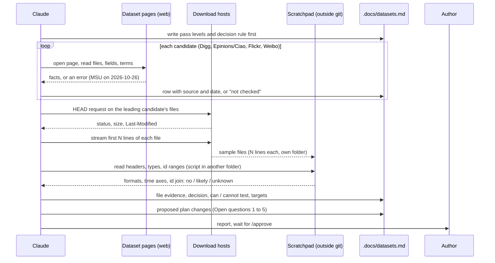
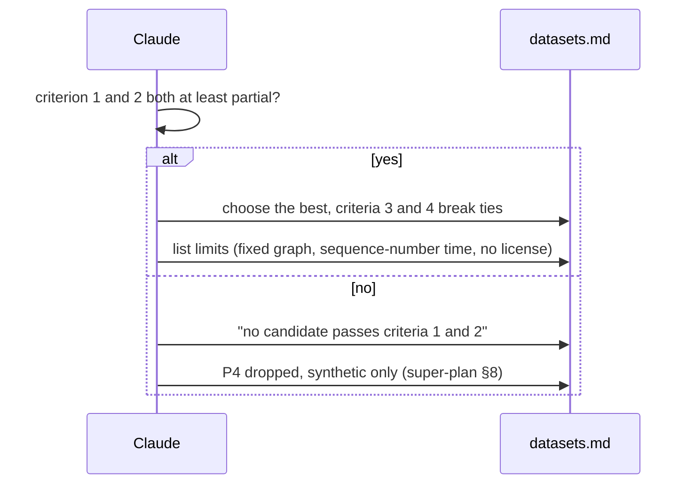

# P1 dataset selection

Spec status: approved · 2026-10-26
Design status: approved · 2026-10-26
Type: feature · Folder: `.docs/works/2026-10-26-p1-dataset-selection/`

## 1. Spec

### Problem

P3 (generator) and P4 (adapter) need to know which public dataset we use, and which numbers the generator must copy from real data. Today `.docs/datasets.md` does not exist. The super-plan (P1 Step 2) only lists four candidates and says "none of their details are verified yet". `.docs/literature.md` [19] and [20] say the same.

Without this decision:
- P4 cannot start, and the P3 config has no real numbers to calibrate to (activity skew, follower and followee counts, interactions per user).
- RQ2 thresholds stay "in generator units" (`.docs/literature.md` D6).
- The first risk in super-plan §8 stays open: all results come from data we made ourselves.

**What was checked on 2026-10-26** (web pages only, no file downloaded):

| Candidate | Social graph | Interactions | Communities | Practical |
|---|---|---|---|---|
| Flickr, WWW 2009 (Cha, Mislove, Gummadi), `socialnetworks.mpi-sws.org/data-www2009.html` | Directed links, each line has two user ids and a date. File `flickr-growth.txt.gz`, 147 MB. | Favorite markings: user, photo, time. Time is a sequence number that keeps the order, not a real time. Photo file has owner and upload time. 135 MB (subset) or 346 MB (all). | Not on this page. | No license text. Asks to cite the paper. Anonymized "best effort". Files re-uploaded in 2012 after a timestamp error. |
| Flickr groups, IMC 2007 (Mislove et al.), `.../data-imc2007.html` | Directed links, no dates stated. 76 MB. | None. | Group memberships, user id and group id. 27 MB. No dates stated. | Same copyright line, asks to cite. |
| Digg 2009 (Lerman), `isi.edu/people-lerman/research/downloads/` | Friendship links exist. Direction and dates are not stated. | Votes on 3,553 front-page stories, with voter id and vote time. | None. | No license text. The download link was not confirmed to work. |
| Epinions and Ciao (Tang) | Trust links; direction and dates not checked. | Ratings with time points (Epinions). | None known. | The MSU server refused the connection on 2026-10-26. The archived page was seen on 2026-10-24 ([19]). |
| Weibo retweet sets | Not checked in detail. A search found Weiboscope (HKU, a sample of posts), a rumor set on IEEE DataPort, and cascade sets with no download link. | Retweets with times, in some sets. | None known. | No single set was found that has a follower graph, retweets and times together. |

Two facts matter most. First, the Flickr WWW 2009 data looks like the only candidate with a directed, dated follow graph and timestamped positive actions on items with a known owner. Digg's graph timestamps are unknown. Second, communities come from a different Flickr crawl (IMC 2007). Whether its user ids match the WWW 2009 ids is not checked. Super-plan §8 already says no public dataset has all three parts together.

Not checked: whether the Flickr download links still work, the real file formats (we read only the page text), and the size of the data after we cut it to a laptop-size slice.

### Scope

**In scope:**
- Check each candidate against the four criteria in super-plan P1 Step 2 (social graph, interactions, communities, practical). Each cell has a source and a date. Where a fact is not found, write "not checked".
- Add candidates the plan did not list if the checks show a gap, at most two (for example a Last.fm or Douban style set with groups). Only if time allows; the four listed ones come first.
- For the best candidate, open the real files (headers and a small sample, not the full data) to confirm the formats and the id rules. This includes whether the Flickr WWW 2009 and IMC 2007 user ids can be joined.
- Write `.docs/datasets.md` with: the candidate table, the decision, what the chosen set can and cannot test (follow term, author term, community term, cold-start buckets, H1, H2), and the limits.
- Give calibration targets for the P3 generator: activity skew, followers and followees per user, interactions per user, plus the share of users with 0–4 earlier positives. Each target has its source and the way it was computed.
- Add each dataset we use to super-plan §10 as "verified" (super-plan §10 rule), with the page we opened.
- Say what the choice means for the plan: stays a stretch (P4), or becomes co-primary for RQ1 (see Open question 1).

**Out of scope:**
- Downloading the full data, writing the adapter (P4), or any code. The adapter belongs to `p4-dataset-adapter`.
- Changing the super-plan, its §7 frozen values, or its phase text. Proposed changes are listed in the Open questions and the author decides.
- Running any ranking on the data.
- The generator config (P3). This task only gives it targets.
- Reading papers in full (author's decision: scanning for the idea is enough).

### Done when

| # | Check | Expected result |
|---|---|---|
| DW1 | Open `.docs/datasets.md` and read the candidate table | At least the 4 listed candidates (Digg, Epinions/Ciao, Flickr, Weibo) have a row. Each of the 4 criteria has a value and a source URL with a date for every row. "Not checked" is allowed, a blank is not. |
| DW2 | Read the decision section | One chosen dataset, or the sentence "no candidate passes criteria 1 and 2", as the super-plan requires. The reason names the criterion that decided it. |
| DW3 | Read "What it can and cannot test" | Each of H1, H2, the follow term, the author term and the community term is marked testable, partly testable or not testable on the chosen data, with the reason. |
| DW4 | Read the calibration targets | Each target has a number, the way it was computed, and the file it came from. Targets that need the full file and were not computed are marked "not computed". |
| DW5 | `grep -n "datasets.md" .docs/super-plan.md .docs/literature.md` and read the lines | The "does not exist yet" notes in `.docs/literature.md` ([19], [20], D6) are updated or listed as a follow-up for the author. |
| DW6 | Read super-plan §10 | Every dataset we use is listed and marked "verified" only after we opened the source. Others stay "search only". |
| DW7 | `git status` | Only `.docs/datasets.md` and files under this task folder (and the §10 / literature notes if the author approves) changed. No code, no `docs/`, no `Latex/`. Raw data is not in git. |
| DW8 | Read the Result section at the end of the task | It says if a dataset file was opened, which ones, and its SHA-256 if one was downloaded. |

### Open questions

1. **Real data as co-primary (author's wish, 2026-10-24).** The author does not like synthetic data as the main evidence. The super-plan 0.7 keeps synthetic as the main source and the public set as a stretch. If the chosen set has a dated follow graph and dated positives (Flickr WWW 2009 looks like it), I will recommend making it co-primary for RQ1 and the follow term, and keeping synthetic for W0, the influence sweep and the community term. This would change super-plan §1, P3, P4 and §8. Do you want me to write this as a proposed change in `datasets.md`, for you to decide?
2. **Community term on real data.** Flickr groups come from another crawl. If the ids do not join, the community term cannot be tested on real data. Is it fine to say that plainly and keep the community term synthetic-only?
3. **Time on Flickr favorites.** The favorite time is a sequence number, not a clock time. The protocol (§5) needs times to apply the window W and the cut time T. Is it OK to treat the sequence number as the time axis and let `datasets.md` propose how (and whether it changes any frozen value)? Any frozen value would be changed only by you.
4. **Positive actions.** Flickr has favorites only; the protocol counts like, comment and repost. Treating favorite = like is my proposal. OK?
5. **Terms of use.** No candidate page has a license text. I will record "no license stated, cite the paper, anonymized" and keep raw files out of git. Is that enough for your university, or should we ask the supervisor?

## 2. Impact

**Who and what it affects**
- **P3** (`p3-synthetic-generator`): gets calibration targets for `synthetic-v1.json`. Without them, the config says "chosen" for every value.
- **P4** (`p4-dataset-adapter`): the chosen set, its file formats and its limits. If no candidate passes, P4 is dropped now and not at the P5 gate (super-plan §8, cut order 1).
- **P1 later tasks:** `p1-supervisor-note` adds the data choice from `datasets.md`. `p1-related-work` may cite the dataset papers.
- **P2** (blueprint): the data contracts must hold the real-data case. The canonical CSV format needs to fit the chosen set.
- **P5/P7:** whether E1–E4 have a real-data column, and whether the pool window W is overridden (super-plan §5 allows this for public data).

**If we do nothing:** P3 invents its numbers, P4 stays a guess, the committee can say the result is built into our own data (super-plan §8), and the supervisor note cannot name the data.

**Code areas.** None. This task writes documents only. It does not touch `apps/`, `packages/`, `docs/` or `Latex/`. Other bugs in the Bugs Report are not related. T6 (duplicate likes and follows) matters later only for the live app, not for public data.

**Thesis link.** Phase P1, Step 2. It supports RQ1 and RQ2 (the evidence type), H1 and H2 (what can be tested), and the first risk in §8.

**Frozen values (§7) touched.** None are changed here. These may be affected later and are not changed by this task: dataset sizes S and M (P3), window W (a public set can override it, §5), cut time T (depends on the time axis of the chosen set), and the synthetic world parameters (calibration). Proposed changes go into Open questions 1 and 3. Only the author changes them.

**Does it change a number in the thesis?** No number exists yet. It decides which dataset the numbers will come from.

**Risks of the task itself**
- A source page may be down (MSU was on 2026-10-26). Use the archived copy and say so.
- Opening the 346 MB favorites file costs time. Read only the first lines or a small slice, and say it in the Result.
- Deadline 2026-11-20: the task should take short work, not a full literature study.

## 3. Design

### Approach

This task writes no code. Its product is one document, `.docs/datasets.md`. The design is the method that makes the document trustworthy: what we check, in what order, how we decide, and what we write down when a fact is missing.

**Step A: fix the rules before looking at the data.** `datasets.md` starts with the pass levels, so the decision is not bent to fit the favorite candidate.

| Criterion | Pass | Partial | Fail |
|---|---|---|---|
| 1 Social graph | Directed follows with dates, and the dates are on the same time axis as the interactions | Directed follows, but no dates, or dates that cannot be aligned with the interactions. The graph is treated as fixed, so future follows can leak into the past (super-plan P4 text). | Undirected, or no graph |
| 2 Interactions | Dated positive actions on items whose author is a user in the same graph | Positive actions, but the author is unknown or outside the graph, or the times are only an order | No positive actions |
| 3 Communities | Memberships for the same users (the ids join) | Memberships exist but the join is unproven, or they come from another crawl | None |
| 4 Practical | Download works, size fits a laptop slice, terms allow thesis use or are at least not forbidding | Works, but no license text (we record this and cite the paper) | Link dead, or terms forbid use |

**Decision rule.** Criteria 1 and 2 decide. A set with "fail" on either is out (super-plan P1 Step 2). Among the rest, pick the one with the most "pass" on 1 and 2. Criterion 3 and 4 break ties. If no set has at least "partial" on both 1 and 2, write "no candidate passes criteria 1 and 2", and P4 is dropped. A "partial" on criterion 1 is allowed, because the super-plan already accepts a fixed graph as a stated limitation.

**Step B: web check of every row.** Reuse the 2026-10-26 table from the Spec. Fill the gaps: open the Digg download link and the archived Epinions/Ciao page, and look at the Weibo candidates one by one. For each cell, write the page we opened and the date. Search snippets count as "search only", never as a fact (super-plan §10 rule).

**Step C: small file check, only for the leading candidate** (expected: Flickr WWW 2009). Stream the first lines of each file, with no full download. The goals are narrow:
1. Confirm columns, separators, and value types (is a "date" a real date? is the favorite time a plain integer?).
2. Check whether the link dates and the favorite times can sit on one axis. This is the most important check, because the page says links have dates and favorites have a sequence number. If the two cannot be aligned, criterion 1 is "partial".
3. Check the id rules: are ids numeric, how big, is the photo owner an id from the links file. For the Flickr groups file (IMC 2007), compare id format and range with the WWW 2009 files. A sample cannot prove that two id sets join. The result has three values: "no" (formats or ranges differ), "likely" (same format and overlapping range), "unknown". The proof is left to P4.
4. Check the `Last-Modified` header of each file (the 2012 timestamp fix) with a HEAD request.

The sample is the head of a file, so it is not random. It is used only for formats and id rules. No distribution number comes from it.

**Step D: calibration targets.** Targets come from numbers printed on the dataset page or in the dataset paper, each with its source. A mean that we compute from two printed totals (for example links divided by users) is marked "mean over all users, not over active users". Skew, follower and followee distributions, and the share of users with 0–4 earlier positives need the full file, so they are marked "not computed, P4 computes them". This follows DW4.

**Step E: write `datasets.md`, then update the notes.** Order of the sections: decision first, then the rules, the table, the file evidence, what the set can and cannot test, the targets, proposed plan changes, sources. Then add the used datasets to super-plan §10, refresh the "does not exist yet" notes in `.docs/literature.md`, and add a super-plan change-log line.

**What we can test on Flickr, as a first reading** (to be confirmed by Step C; `datasets.md` holds the final version):
- Follow term and author term: testable if criterion 1 is at least partial. The owner of a photo plays `author(p)`.
- Community term: testable only if the group ids join.
- Cold-start buckets: testable, because a favorite is a positive action, but the bucket sizes are unknown until P4.
- H1: partly testable (follow-based part only). H2: partly testable (social density can be read from the graph, but the world has no controlled influence).
- Causal influence is not testable on any observational set. This matches D6 (a win is prediction, not influence).

**Rejected options:**

| Option | Why not |
|---|---|
| Download the full Flickr files now and compute all targets | 150 to 500 MB, hours of work, and the adapter (P4) needs the same work again. The decision does not need it. The Spec leaves it out. |
| Decide from the web pages only, open no file | Cheap, but the two biggest risks (two time axes, ids that do not join) show up only in the files. A wrong choice would cost a week in P4. |
| Score candidates with a weighted number | The weights would be our own guess, and it hides which criterion decided. A pass/partial/fail table is easier to defend to the supervisor. |
| Search many more candidates (Yelp, Last.fm, Douban, Gowalla, Reddit) | Time. The Spec allows at most two extra, and only if the four listed fail. |

### Workflow and sequence diagrams

Main flow: from the rules to the document.

Decision flow for the leading candidate:

### Failure modes

| # | What can go wrong | How we notice | How we resolve it |
|---|---|---|---|
| F1 | A source page is down (MSU refused the connection on 2026-10-26). | The fetch returns an error. | Try the archived copy (Internet Archive). Write the snapshot date in the cell. If there is no copy, write "not checked: host down on <date>". |
| F2 | A download link is dead, redirects, or needs a login. | The HEAD request returns a status other than 200, or an HTML page instead of a gzip file. | Criterion 4 becomes "fail" for that file. Record the status. If it is the leading candidate, go to the next one in the decision rule. |
| F3 | The sample is the head of the file, so it is biased (files may be sorted by user id or by time). | The ids or times in the sample look sorted. | Use the sample only for formats and id rules. Never compute skew or means from it. Distribution targets say "not computed". |
| F4 | Two time axes: link dates are real dates, favorite times are a sequence number. We cannot tell if a follow came before a favorite. | In the sample, the link date has a date format and the favorite time is a plain integer. Photo upload time type is checked too. | If no rule aligns them, criterion 1 is "partial". `datasets.md` says the graph is treated as fixed and that future follows can leak into the past (the same limit the super-plan states for Digg). A proposed alignment rule goes to the author, not into a frozen value. |
| F5 | The two Flickr crawls (WWW 2009 and IMC 2007) use different ids, but a small sample cannot prove it. | Id formats or ranges differ, or they look the same but overlap is unproven. | Report "no", "likely" or "unknown", never "joins". The community term on real data is "not testable" unless the answer is "likely" and P4 confirms it. |
| F6 | Old files with the broken timestamp order (downloaded between 2010-05-17 and 2012-01-02). | `Last-Modified` is older than 2012-01-02. | Say so, and do not use the file. Record the header value. |
| F7 | The gzip stream breaks or the pipe closes early, so the sample is cut in the middle of a line. | The last line has fewer columns. | Fix N lines, drop an incomplete last line, and write N in the evidence. Re-run once. If it fails again, record "not opened" for that file. |
| F8 | Downloaded files are untrusted data. | — | Keep each in its own empty folder in the scratchpad. Scripts live in a different folder. Read as text only. Run Python with `-I`. Nothing from the files is executed or imported. |
| F9 | No license text, but we want to use the data. | The page has only a copyright line and a citation request. | Record the exact words and the date. Do not write "allowed". Open question 5 goes to the author and the supervisor. Raw files never enter git. |
| F10 | A number differs between sources (the page says 11,267,320 photos, the paper said 11,195,144; a third-party summary gave 11.2M). | Two sources disagree. | Use the dataset page first. Write both numbers and the source of each. |
| F11 | A search snippet is treated as a fact. | A cell has no "page opened" date. | Mark such cells "search only". Super-plan §10 gets "verified" only for sources we opened. |
| F12 | A cell is left blank, or the task grows (many extra candidates, full papers). | DW1 fails, or the task runs past a day or two. | A blank becomes "not checked". Extra candidates only if the four fail, at most two, at most three searches each. The papers are scanned for the idea only (author's decision). |
| F13 | Our reading of the pass levels is bent toward the favorite. | The rules were written after the data was seen. | The pass levels and the decision rule are written into `datasets.md` before Step B. The commit order shows it. |
| F14 | The chosen set is real, but nobody can test the community term or influence on it. | Step C says "unknown" or "no" for the join. | `datasets.md` says it plainly. The proposal (Open question 2) keeps those parts on synthetic data. |

### Code files

No application code is created or changed. No file in `apps/`, `packages/`, `docs/` or `Latex/` is touched.

| File | New or changed | Purpose |
|---|---|---|
| `.docs/datasets.md` | New | The output: rules, candidate table, decision, file evidence, what can and cannot be tested, calibration targets, proposed plan changes, sources. Target length: about 200 lines. |
| `.docs/super-plan.md` | Changed (§10 and change log only) | Add the datasets we used as references 45 and up. Mark "verified" only for what we opened. Add change-log line 0.8. Phase text, §5, §7 and §1 are not changed. |
| `.docs/literature.md` | Changed (notes only) | Replace "does not exist yet" in entries [19], [20] and in D6 with a pointer to `datasets.md`. Add entries for new datasets if they are cited. |
| `.docs/works/2026-10-26-p1-dataset-selection/plan.md` | New (next step) | The ordered steps. Its Result section holds the files opened and the SHA-256 values (DW8). |
| Scratchpad: sample folders and one small script | Not in the repo | Raw samples (N lines each) and a script that prints formats and id ranges. Not committed. |

### Data, schema and cache changes

None. No Prisma model, no migration, no cache key. No raw data enters the repo. If a sample file is saved in the scratchpad, its SHA-256 and line count go into the Result of `plan.md`.

### Open questions from the design

These come from the Design work. They do not change the approved Spec.

6. **Time axis (extends Open question 3).** Link dates are real dates but favorite times are a sequence number. The question is not only how to use the sequence number, but whether follows and favorites can be put on one axis at all. Step C answers this from the sample. If the answer is no, I propose to call criterion 1 "partial" and treat the follow graph as fixed, with the leak stated as a limitation. Is that acceptable for the thesis?
7. **Super-plan edits.** The Spec allows adding datasets to §10 but says phase text changes are only proposals. I plan to edit §10 and the change log only, and put every other change in `datasets.md` as a proposal. OK?
