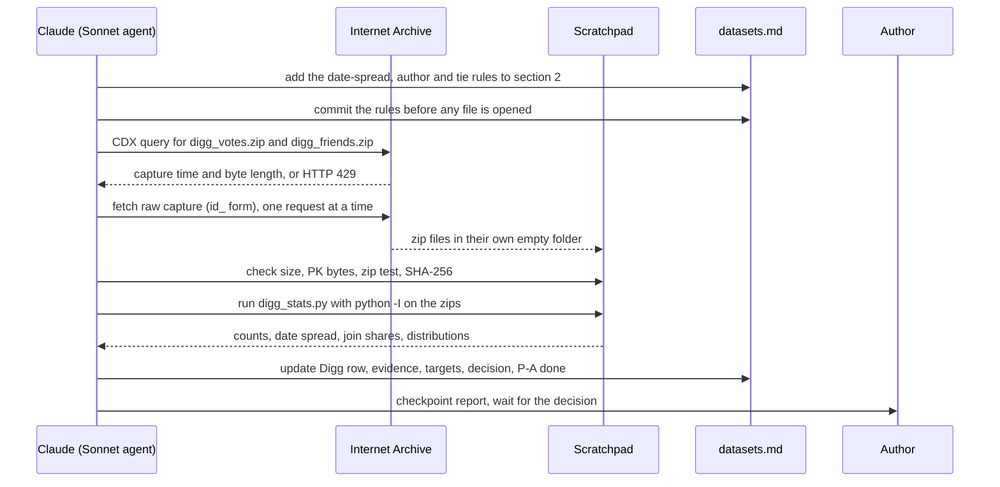
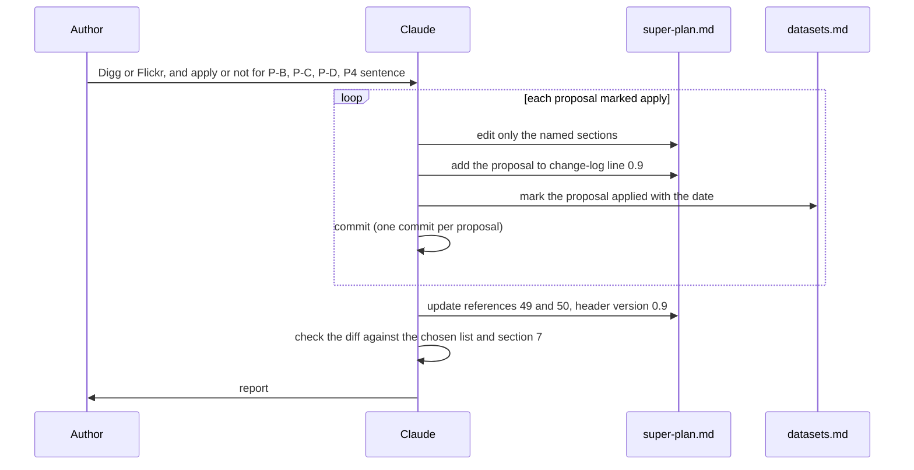

# P1 Digg archive check and plan proposals

Spec status: approved · 2026-10-27
Design status: approved · 2026-10-27
Type: feature · Folder: `.docs/works/2026-10-27-p1-digg-archive-check/`

## 1. Spec

### Problem

The task `p1-dataset-selection` chose Flickr WWW 2009 (`.docs/datasets.md` §1). The reason was a rule, not a measurement: Digg 2009 is stronger on criteria 1 and 2 on paper, but its live download links are dead, so design F2 says "take the next set". The Digg files were never opened.

What `datasets.md` §3 says about Digg, all from an Internet Archive copy of the page (snapshot 20221130205157, read on 2026-10-26):
- `digg_friends`: directed, `friend_date` is a Unix time, 1,731,658 links of 71,367 users.
- `digg_votes`: 3,018,197 votes on 3,553 stories by 139,409 voters, `vote_date` is a Unix time, "the first vote is from the story's submitter".
- Terms: "made available to the community for research purposes only", cite Hogg and Lerman (2012).
- The Internet Archive index lists both zips (2013-08-26). Together they are 22,554,684 and 15,012,753 bytes (37.6 MB). Which size belongs to which file: not stated. Not downloaded, not opened.

Why it matters. Flickr is only "partial" on criterion 1: follow dates are calendar days and favorites have only an order, so the graph is treated as fixed and a later follow can leak into the past. If the Digg zips match their page, Digg passes criteria 1 and 2, and the leak goes away. Then the decision, proposal P-B (real data as co-primary) and the P4 text all change. The super-plan P4 text says the Digg graph "may have no timestamps (not confirmed)". The archived page says it has them, so that sentence is probably wrong.

What we do not know yet (all "not checked"):
- Whether the two zips can still be fetched from the Internet Archive and open as zip files. The index query on 2026-10-27 returned HTTP 429 (too many requests), so even the index was not re-read today.
- Whether `friend_date` is a real spread of dates, or the crawl day for old links. Flickr's sample showed the second case (all links had one date).
- Whether the story submitter (first voter) is a user in the friend table.
- Whether the real counts match the page numbers.
- Whether Digg has enough users with few votes to fill the history bucket 0–4. Digg covers only 3,553 front-page stories in one month, so the pool is small and every story is already popular.

### Scope

**In scope:**
- Fetch the two Digg zips from the Internet Archive. Check size against the index, record the SHA-256. They are small (37.6 MB), so the whole files are read, not a sample.
- Compare the real counts (votes, stories, voters, friend links, users) with the numbers on the page.
- Answer for criterion 1: direction of a link, the range and spread of `friend_date`, and whether it is on the same clock as `vote_date`.
- Answer for criterion 2: the vote date range, the author of a story (first voter), and how many authors and voters are in the friend table.
- Compute from the full files what Flickr could not give: followee and follower distributions, votes per voter, activity skew, and the share of voters by number of votes. These are targets for P3 (`datasets.md` §6, rows now "not computed").
- Re-run the decision rule of `datasets.md` §2 on the new evidence and update `datasets.md`: the Digg row, §1 decision, §4 evidence, §5 what can be tested, §6 targets, §7 proposals (mark P-A as done).
- **Stage 2, after a checkpoint.** At the author's request (2026-10-27), the four proposals of `datasets.md` §7 are closed in this one task. Stage 1 above is P-A. Then the work stops and reports (the checkpoint). The author decides Digg or Flickr and which of P-B, P-C and P-D to apply. Stage 2 then applies only what the author decided:
  - **P-B** (real data co-primary for RQ1 and the follow term): super-plan §1 (the Data decision), P3, P4 and §8.
  - **P-C** (window W and the age term on real data): super-plan §5 (pool, BL2t) and the notes in §7. It may be unnecessary if Digg wins, because Digg has real Unix times.
  - **P-D** (targets for the generator): a note in super-plan P3 that points to `datasets.md` §6.
  - **P4 text:** the corrected sentence about the Digg graph timestamps.
  - A change-log line 0.9 in the super-plan, and the header version. Every edit says which proposal it applies.

**Out of scope:**
- The adapter (P4), any code in `apps/` or `packages/`, and any ranking run.
- Any super-plan edit before the checkpoint, and any edit the author did not choose at the checkpoint. A number in §7 that is already set (seed, epoch, K, buckets, resamples) is not changed. Values marked "freeze at P3/P5" stay unset.
- Opening the Flickr files again, or downloading any Flickr full file.
- Other candidates (for example the Twitter 2010 set on the same Lerman page), unless Digg fails.
- Reading the Hogg and Lerman paper in full (author's decision: scanning for the idea is enough).
- Bypassing a block. If the Internet Archive keeps answering 429 or 403, wait and retry a few times at a slow rate, then stop and report.

### Done when

| # | Check | Expected result |
|---|---|---|
| DW1 | Read the Digg part of `datasets.md` §4 (file evidence) | Both zips: the Internet Archive URL, the date, the byte size, the SHA-256, and the file names inside. If a zip could not be fetched or opened, it says "not opened" with the reason and the decision stays as it was. |
| DW2 | Read the count table in §4 | For votes, stories, voters, friend links and users: the page number, the number counted from the file, and the reason for any difference. |
| DW3 | Read the criterion 1 answer for Digg | One of pass, partial, fail by the rules of §2, with: the link direction, the minimum and maximum `friend_date`, the number of distinct days, and the share of links on the most common day. A single crawl day gives "partial", not "pass". |
| DW4 | Read the criterion 2 answer for Digg | The vote date range, the share of stories whose first voter is in the friend table, and the share of voters in the friend table. The author is the first voter, and the answer says that this is read from the first vote, not from a field. |
| DW5 | Read the time-axis answer | "Same clock": yes or no, with the ranges of `friend_date` and `vote_date` side by side. |
| DW6 | Read the new targets in §6 | Followee and follower distributions, votes per voter and activity skew, each with a number, the way it was computed, and the file. The share of voters with 0–4 votes is given for all votes, and is marked as not yet cut by the time T (P2 sets the rule). |
| DW7 | Read §1 Decision of `datasets.md` | The decision rule of §2 is applied again, Digg against Flickr, and the winner is named with the deciding criterion. Both sets stay in the table. P-A is marked done. |
| DW8 | Read §7 of `datasets.md` at the checkpoint | A corrected P4 sentence for Digg is written, and P-B, P-C and P-D are updated to the new decision. Each says which super-plan section it would change. At this point the super-plan has no new edit. |
| DW9 | After Stage 1, `git status` and `git diff --stat` | Only `.docs/datasets.md` and files in this task folder changed. No raw data in git. No change in `apps/`, `packages/`, `docs/`, `Latex/` or the super-plan. |
| DW10 | Read the checkpoint report | It names the winner (Digg or Flickr), the deciding criterion, and lists P-B, P-C, P-D and the P4 sentence, each with "apply" or "do not apply" written by the author. |
| DW11 | `git diff` of `.docs/super-plan.md` after Stage 2 | Only the sections of the proposals the author chose changed. Each changed place can be traced to a proposal in the change log (line 0.9). No value marked "freeze at P3/P5" got a number. No already-set value in §7 changed. |
| DW12 | Read super-plan P4 and §1 | They say what the author decided, in simple English. The sentence "may have no timestamps (not confirmed)" is gone or corrected. `datasets.md` §7 marks each proposal as applied or not applied, with the date. |

### Open questions

1. **Source of the data.** The original host is dead. The only copy is on the Internet Archive (2013-08-26). Is an archive copy acceptable as the dataset source for the thesis, if we record the archive URL and the SHA-256, cite Hogg and Lerman (2012), and say that the original host is gone?
2. **Switch to Digg?** If Digg passes criteria 1 and 2 and Flickr stays "partial", the rule in `datasets.md` §2 picks Digg. But Digg is small (3,553 stories, one month, only stories that reached the front page), so the pool is small and biased to popular items. Do you want me to apply the rule as written, and write the pool limit as a stated limitation? Or keep Flickr and report Digg as a second real set?
3. **Download size.** The first task only read samples. Here I download both whole zips (37.6 MB) into the scratchpad, outside git. OK?
4. **Super-plan edits.** You asked to close P-A to P-D in this one task, so Stage 2 may edit the super-plan. The plan is: edit only after the checkpoint, only what you choose there, and add change-log line 0.9. Is that right? Or do you want to see the exact new text first, in `datasets.md` §7, before any edit?
5. **Checkpoint.** The work stops after Stage 1 and waits for your decision (DW10). Because of this stop, the Sonnet agent does Stage 1 only, and Stage 2 is a second, short run. OK?

## 2. Impact

**Who and what it affects**
- **P4** (`p4-dataset-adapter`): which dataset the adapter converts, and its file format. If Digg is chosen, Flickr becomes optional.
- **P3** (`p3-synthetic-generator`): the calibration targets in `datasets.md` §6. Digg is small enough to compute the distributions that Flickr left as "not computed".
- **`p1-supervisor-note`** (next in P1): it states the data choice, the license question and the proposals P-B to P-D. It should wait for this result, so the supervisor sees one stable choice.
- **Q1 of the last task** (real data co-primary): it was met only in a weak form on Flickr because of the future-follow leak. Digg may remove that condition.
- **P2** (blueprint): the data contracts and the rule for the cut time T. Digg has only about one month of votes, so T and the window W (super-plan §5 allows a public set to override W) need a look.

**If we do nothing:** the supervisor note names Flickr, with a known leak, on the basis of a rule about a dead link and not on a look at the files. If Digg is good, we lose the better real dataset. If it is not, we have no proof either way.

**Code areas.** None. This task writes documents only. It does not touch `apps/`, `packages/`, `docs/` or `Latex/`. No bug in the Bugs Report is related.

**Thesis link.** Phase P1, Step 2. It supports RQ1 and H1 (what real data can test), RQ2 and H2 (social density from the graph), and the first risk in super-plan §8 (results built into our own data).

**Super-plan sections that Stage 2 may edit** (only as the author chooses): §1 (Data decision), P3, P4, §5 (pool and BL2t, for real data), §8 (risks and cut order), the P1 status paragraph, and the change log. Open item 6 of §11 stays with P2 and P5.

**Frozen values (§7) touched.** None is set or changed by Stage 1. Stage 2 may edit the wording of §5 and the notes of two rows ("Window W / pool cap N_max", "Baseline grids") only if the author chooses P-C, and it sets no number there. These may be affected later and are not changed here: window W and pool cap N_max (a public set can override W), cut time T (Digg's time range is short), dataset sizes S and M, and the synthetic world parameters (calibration). Any change is the author's.

**Does it change a number in the thesis?** No number exists yet. It decides which real dataset the numbers come from, and gives the generator real targets.

**Risks of the task itself**
- The Internet Archive answered HTTP 429 on 2026-10-27. The zips may not be reachable today. Then the result is "not opened" and the decision stays as it is.
- A zip may be damaged, or its columns may differ from the page.
- `friend_date` may be the crawl day for old links (as in the Flickr sample), which gives "partial" on criterion 1 and removes the reason for switching.
- Digg stories are only front-page stories. Every story is already popular, so a popularity baseline may look too strong and the pool is not like a normal feed. This is a limitation to state, not a reason to hide Digg.
- The submitter being the first voter is read from the page text. If the data does not show it, the author term cannot be tested on Digg.
- Time: the data is small, so the task should be short. It must not grow into the adapter.

## 3. Design

### Approach

No application code. The product is an updated `.docs/datasets.md` (Stage 1), then, after the author's decision, edits of `.docs/super-plan.md` (Stage 2). One small script reads the Digg zips.

**Stage 1, step A: two more rules, written first.** The pass levels in `datasets.md` §2 stay as they are. Two points are not exact there, so before any Digg file is opened we add them to §2 and commit them (same idea as F13 of the last task). The numbers are our own choice, not from a source, and §2 says so:
- **Criterion 1, spread of dates.** "Dated" means a real spread: the most common UTC day holds at most 50% of the links. If more than 50% of links share one day, the date is the crawl day and criterion 1 is "partial".
- **Criterion 2, author known.** The author of a story is its first voter. Share of stories whose first voter is in the friend table: at least 80% is "pass", from 20% up to 80% is "partial", below 20% is "fail".
- **Ties.** If two votes of a story have the same `vote_date`, the file order breaks the tie. The share of stories with a tie at the first vote is reported. Above 10%, the author answer is "unclear" and criterion 2 is at most "partial".

**Step B: fetch.** Ask the Internet Archive index (CDX) for the capture of each zip, then fetch the raw capture (the `id_` form of the URL, which gives the file bytes without the Archive banner). One request at a time. On HTTP 429 wait for `Retry-After`, or 60, 120, then 300 seconds. After three tries stop and write "not opened" (F1). Check the size against the index and the first two bytes (`PK`).

**Step C: check without extracting.** Test the zip, list the members with their sizes, and read each member as text through Python `zipfile` streaming. Nothing is extracted to disk and no path from inside the zip is used (F5). Record SHA-256 of each zip.

**Step D: analyse with `digg_stats.py`.** One Python script, standard library only, run with `-I`. It reads the two members and prints plain numbers. The list is the Spec's DW2 to DW6:
1. Counts: rows, distinct voters, stories, friend links, distinct users (as `user_id`, as `friend_id`), duplicate pairs, self-links.
2. Links: the `mutual` share, the min and max `friend_date`, number of distinct UTC days, the share on the most common day, and the share of links dated before the first vote, inside the vote window, and after the last vote. The last number is the future-follow leak.
3. Votes: min and max `vote_date`, votes per day, ties at the first vote.
4. Join: share of stories whose first voter is a user in the friend table, share of voters in the friend table (as `user_id` and as `friend_id`).
5. Targets: followees and followers per user (mean, median, 90th and 99th percentile, max, share with 1), votes per voter (same list), share of all votes cast by the top 20% of voters, and the share of voters with 1, 2–4, 5–19, 20 or more votes in total.

The script is kept in the task folder, so P4 can reuse it and the numbers can be recomputed. It never writes data files.

**Step E: update `datasets.md`.** Digg row in §3, §4 evidence, §5, §6 targets (the rows that were "not computed" for Flickr get Digg numbers, with the file name), §1 Decision by the rules of §2, and P-A marked done in §7. If a zip could not be opened, §1 stays as it is and the row says "not opened". Commit.

**Checkpoint.** Stop and report (Spec DW10). The author answers, for each of P-B, P-C, P-D and the P4 sentence: apply or do not apply, and Digg or Flickr as the main real set.

**Stage 2: apply what was chosen.** One commit per proposal. Each edit is plain text in the super-plan and says in the change log which proposal it applies:
- **P-B** (real data co-primary): the "Data" decision at the top, the P3 and P4 text, and §8 (the risks and the cut order, where P4 is the first cut today).
- **P-C** (W and age on real data): §5 "Candidate pool" and the BL2t lines, and the notes of the two §7 rows that are still unset. It may be dropped if Digg wins, because Digg has real Unix times. No number is set.
- **P-D** (targets): P3 already says "calibrate to the targets in `.docs/datasets.md`". The edit only names the targets (followees, followers, activity skew, votes per user). It copies no number.
- **P4 sentence:** the Digg graph has timestamps (if the check confirms it), so "may have no timestamps (not confirmed)" is replaced with the checked fact.
- **§10:** references [49] and [50] are updated to say what was opened. This is a mark change by the §10 rule, not a phase change (open question 6).
- Header version 0.9 and change-log line 0.9. `datasets.md` §7 marks each proposal as applied or not, with the date.

**Rejected options:**

| Option | Why not |
|---|---|
| Read only a sample of the zips, as for Flickr | A zip keeps its member list at the end, so a "head" does not work. The files are small (37.6 MB), and the full counts decide criteria 1 and 2. |
| Extract the zips to disk and open them with a tool | The zip comes from a copy we cannot fully trust. Reading members as text without extraction avoids bad paths and zip bombs. |
| Two separate tasks (P-A, then the plan edits) | The author asked for one task. The checkpoint gives the same safety: nothing in the super-plan changes before the author decides. |
| Apply P-B to P-D right after the evidence, with no stop | The choice of Digg or Flickr changes the text of all three. Writing them before the choice would mean writing them twice. |
| Judge the date spread by eye | It would be bent toward the favorite. The 50% rule is committed before the data is opened. |

### Workflow and sequence diagrams

Stage 1, from the rules to the checkpoint.

Stage 2, after the author's decision.

### Failure modes

| # | What can go wrong | How we notice | How we resolve it |
|---|---|---|---|
| F1 | The Internet Archive answers 429 or 403 (it answered 429 on 2026-10-27). | HTTP status other than 200. | Wait for `Retry-After`, or 60, 120, 300 seconds, one request at a time. After three tries stop. The row says "not opened: archive blocked on <date>", `datasets.md` §1 stays as it is, and the report says so. We do not look for another host or a mirror. |
| F2 | The answer is an HTML page or a redirect, not a zip (the live host did this). | The first two bytes are not `PK`, or the content type is HTML. | Treat as not fetched. One retry. Then "not opened". |
| F3 | The capture is not the original file (an Archive banner, or a different size). | The size differs from the CDX length. | Use the raw `id_` form. If the size still differs, re-fetch once, then record both sizes and mark the file "size differs, not trusted" until the zip test passes. |
| F4 | The zip is damaged or truncated. | The zip test fails. | Fetch once more. If it fails again, "not opened". |
| F5 | Zip content is untrusted data (bad member paths, huge members). | The member list shows `..`, an absolute path, or a size far above the page numbers. | Nothing is extracted. Members are read as text through `zipfile` streaming, with a line limit equal to twice the page row count. A larger member stops the read and is reported. |
| F6 | The columns differ from the page, or a header is missing. | The first row does not match `vote_date, voter_id, story_id` and `mutual, friend_date, user_id, friend_id`. | Print the first rows in the evidence. If the order is unclear, say so and do not guess. The page order is used only when the types fit (Unix times, integer ids). |
| F7 | `friend_date` is one crawl day (as in Flickr). | More than 50% of the links on one day. | Criterion 1 is "partial" by the rule. Digg then does not beat Flickr on criterion 1. The reason is written in §1. |
| F8 | The author is not clear: ties at the first vote, or the first voter is not in the friend table. | The tie share is above 10%, or the join share is below 80%. | Criterion 2 follows the thresholds, never above "partial" for ties. The author term is then "not testable" or "partly testable" on Digg. |
| F9 | Votes and friends use different id spaces (the anonymization differs). | The join shares are near 0. | Criterion 2 is "fail" or "partial" by the share. The report says that the two tables cannot be joined. |
| F10 | The `mutual` flag changes the meaning of a link. | A large share has `mutual = 1`. | Report the share. Count a mutual link as one link in each direction in the degree numbers, and say it in the evidence. |
| F11 | Days are cut at the wrong time zone. | Counts differ if the zone changes. | Use UTC only, and write it. |
| F12 | The two sets disagree on the dates and the winner is unclear (Digg wins on 1 and 2 but has a small pool). | Digg passes 1 and 2, with 3,553 stories in one month. | Apply the rule as written (author's answer to open question 2) and write the pool limit in §5 of `datasets.md`: small, one month, only front-page stories, so popular items. Flickr stays in the table. |
| F13 | The decision is bent after seeing the numbers. | The rules in §2 have a later commit than the analysis. | The rules are committed first. The `git log` shows it. |
| F14 | Stage 2 starts before the author decides, or edits more than was chosen. | The super-plan has a diff before the checkpoint, or a changed place is not in the chosen list. | The plan has a STOP step. After Stage 2, the diff is compared with the chosen list. One commit per proposal makes a wrong edit easy to undo. |
| F15 | A frozen value is changed. | The diff touches an already-set row of §7, or a row marked "freeze at P3/P5" gets a number. | Stage 2 edits wording only. A number copied into docs is not allowed (rule: frozen values are read from §7). Diff check DW11. |
| F16 | Digg wins, and P-C is not needed, but a text is edited anyway. | A §5 edit that the author did not choose. | P-C is applied only on the author's "apply". The default for a Digg win is "do not apply". |
| F17 | The raw zip or an output enters git. | `git status` shows a data file. | The zips stay in the scratchpad. Only `digg_stats.py` and text files are added. |

### Code files

No application code is changed. No file in `apps/`, `packages/`, `docs/` or `Latex/` is touched.

| File | New or changed | Purpose |
|---|---|---|
| `.docs/datasets.md` | Changed | Rules added to §2 first. Then the Digg row (§3), evidence and counts (§4), what can be tested (§5), targets (§6), the decision (§1), and the proposals marked done or applied (§7). |
| `.docs/works/2026-10-27-p1-digg-archive-check/digg_stats.py` | New | Reads the two zips by path with `zipfile`, prints the numbers of Stage 1 step D. Standard library only. Takes the two zip paths as arguments. Keeps nothing on disk. |
| `.docs/super-plan.md` | Changed in Stage 2 only | The chosen edits of P-B, P-C, P-D and the P4 sentence, references [49] and [50], header version and change-log line 0.9. |
| `.docs/literature.md` | Changed in Stage 2, only if needed | The pointer lines for [19] and [20] stay. Edit only if the Digg result makes them wrong. |
| `.docs/works/2026-10-27-p1-digg-archive-check/plan.md` | New (next step) | The steps, with a STOP before Stage 2. The Result section holds the zip hashes. |
| Scratchpad: zips in their own empty folder | Not in the repo | The two fetched zips. SHA-256 and size go into `datasets.md` and the Result. |

### Data, schema and cache changes

None. No Prisma model, no migration, no cache key. No raw data enters git. The only new tracked non-text file is none: `digg_stats.py` is text.

### Open questions from the design

These come from the Design work. They do not change the approved Spec.

6. **Super-plan §10 marks.** Stage 2 updates [49] and [50] (what was opened). This is a mark change, not a phase change. It follows the §10 rule ("verified" only after we opened the source). I put it in Stage 2 so Stage 1 leaves the super-plan untouched (DW9). OK?
7. **P-D is almost already in the super-plan.** P3 says "Calibrate its parameters to the targets in `.docs/datasets.md` where they exist". So P-D shrinks to naming the targets. Do you want it applied that way, or dropped as not needed?
8. **Thresholds.** The 50% (date spread) and 80%/20% (author known) are my choice, not from a source. They are written into §2 before the data is opened. Do you accept them, or do you want other numbers?
