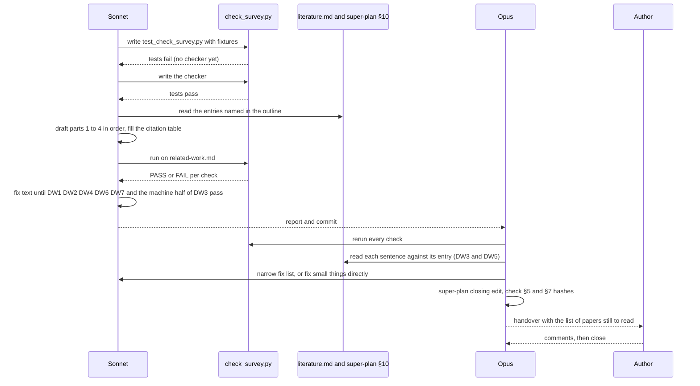
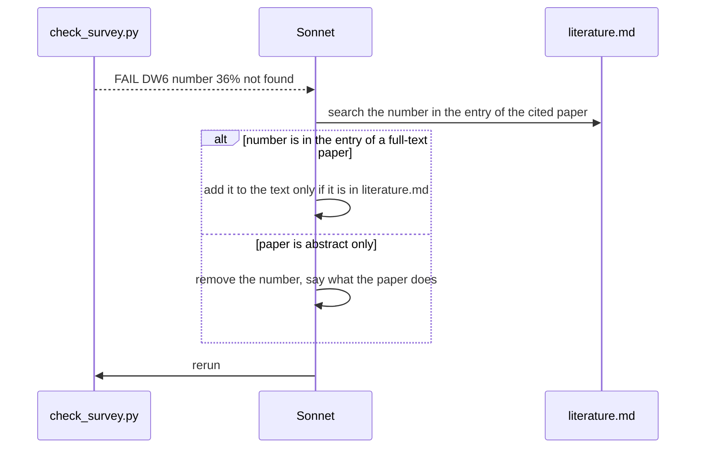

# P1 Step 5: related-work survey for Chapter 2

Spec status: approved · 2026-10-27
Design status: approved · 2026-10-27
Type: feature · Folder: `.docs/works/2026-10-27-p1-related-work/`

## 1. Spec

### Problem

P1 Step 5 of the super-plan (§4) asks for a 3–4 page survey. The Orientation lists it as a month-1 output ("Survey 3–4 trang") and says it becomes the core of Chapter 2. It does not exist yet.

What exists today:
- `.docs/literature.md` has 44 references, decisions D1 to D7, 10 claims and a search log. It says "Working notes for P1. Not thesis text."
- `Latex/chapters/literature_review.tex` (pre-thesis, about 2,060 words) covers the platform stack, feed ranking heuristics, comment sorting, real-time protocols, trending and a comparison of platforms. It has nothing on social recommendation, on follow trust or community signals, or on offline evaluation. P9 plans to keep the platform part shorter and add those three topics.
- The status table of `literature.md` §1 shows `[1]`, `[2]` and `[9]` (the core social-recommendation papers) as "abstract only" and "not cited", because its rule 75 says a cited row must not be "abstract only". Super-plan §4 says the full texts of `[1]`, `[2]`, `[8]`, `[9]`, `[16]`, `[21]`, `[23]` and `[28]` are still missing. The author decided on 2026-10-24 that a scan is enough for `[1]` and `[2]` (memory: reading depth). So the survey cannot follow rule 75 as written. This is Open question 1.

If we do nothing: Chapter 2 starts from zero in P9, in the last two weeks, and the supervisor sees no survey with the note (the Orientation expects one in month 1).

### Scope

**In scope:**
- One new file, `.docs/related-work.md`, in English, about 1,500 to 2,200 words (3–4 pages at about 500 words a page). The reference list and the citation table at the end do not count.
- Four parts: (1) social recommendation, from SoRec to graph models, with the cold-start link; (2) feed ranking in industry, which means the follow graph and engagement in RealGraph and the Twitter and X releases, and community signals in Orkut, SimClusters and TwHIN; (3) recent work (2022 or later) and what C2 adds; (4) offline evaluation of recommenders (split, leakage, sampled metrics, baselines, simulation).
- The 1-hop argument of D4 and the baseline argument of D5, written as survey text (they are listed in `literature.md` as "Chapter 2 argument").
- A citation table at the end of the file: for each reference used, its number, how it was read (from `literature.md` §1) and what the survey says about it. This is how the author and Claude check the depth rule.
- References numbered as in super-plan §10. Conversion to `bibliography.bib` is P9.
- At closing: update the P1 status paragraph of the super-plan (Step 5 done) and add a change-log line.

**Out of scope:**
- LaTeX (`Latex/` is not edited; P9 moves the text into `.docs/latex/`).
- New literature search. The search of 2026-10-24 stands, and the survey names its date.
- Reading full texts of `[1]`, `[2]`, `[9]`. The author does that when they want to (they are "core papers" in super-plan §4). The survey uses the abstract level for them.
- The platform-technology part of Chapter 2 (frontend, backend, database, real-time). That is reuse in P9.
- Dataset papers (`[45]` to `[50]`) and the Digg license. They belong to Chapter 3.
- Changing `literature.md`, `datasets.md` or any frozen value.
- Any code.

### Done when

| # | Check | Expected result |
|---|---|---|
| DW1 | `wc -w` on the body of `.docs/related-work.md` (from the first heading to the line "Citation table") | between 1,500 and 2,200 words |
| DW2 | A script lists every `[n]` cited in the body and looks each one up in super-plan §10 | every `n` is marked "verified"; none is "search only" or "do not cite" (so `[47]` and `[50]` do not appear) |
| DW3 | The citation table has one row per cited reference, with the read depth copied from `literature.md` §1. The reviewer compares each sentence with its row. | for a reference read at "abstract only" or "index record" the text says no result, number or judgment beyond what the abstract states, and uses "the abstract says" or similar. `[21]`, `[23]`, `[28]`, `[22]` appear by name only. |
| DW4 | grep for absolute claims ("no one", "nobody", "first", "never", "novel") and for the search sentence | no absolute claim. The gap sentence says the search of 2026-10-24 (abstracts only) found no paper that adds follow trust and community affinity to engagement in one feed ranking, and that this is not proof (claim 10). |
| DW5 | Headings and content check | the four parts exist. For each of `[5]`, `[7]`, `[33]`, `[31]`, `[32]` there is one sentence on how C2 differs (taken from `literature.md`). The D4 (1 hop) and D5 (baselines) arguments are present. |
| DW6 | A script pulls every number from the body and searches for it in `literature.md` | each number is found there (for example 84 and 2,151 for `[4]`, 0.5284 and 0.7630 for `[13]`, 89.5% for `[14]`). A number not found is removed or checked in the source. |
| DW7 | Readability check by script and by the author | no sentence over 35 words, and the author can read it without a dictionary for most sentences (CLAUDE.md "How to write") |
| DW8 | `git diff --stat` for the task commits | only `.docs/related-work.md`, the task folder, and (at closing) the P1 status line and change log in `.docs/super-plan.md`. `literature.md`, `datasets.md`, `Latex/` and `docs/` are untouched. |

### Open questions

Decided by the author on 2026-10-27 in chat: follow the recommendation of all four.

1. **Citing abstract-only papers.** Recommendation: yes, for background statements only. The survey says what the paper is and what its abstract says, with "the abstract says", and gives no number or result from it. Chapter 2 then cites `[1]`, `[2]`, `[9]` and the recent works `[31]` to `[42]` that way. This follows the author's earlier decision (scan is enough) and super-plan §10 ("do not cite a finding from it"). It changes rule 75 of `literature.md`, which I would restate in the closing note, not edit in place. Other option: the author reads `[1]`, `[2]` and `[9]` first. That costs days and the survey waits.
2. **Which recent works.** Recommendation: describe the five nearest (`[31]`, `[32]`, `[33]`, `[39]`, `[40]`) in one sentence each, and put `[34]` to `[38]`, `[41]`, `[42]`, `[43]`, `[44]` in group sentences, to keep the length. Other option: all 14 in the survey, which needs about 500 more words.
3. **Language and format.** Recommendation: English Markdown now, reference numbers as in §10, LaTeX in P9. The pre-thesis report is in English. Other option: Vietnamese first and translate later (more work, and the supervisor note is already in English).
4. **Stale super-plan text.** At closing I must edit the P1 status paragraph anyway. Fold in the other three stale places (§1 H1 names the synthetic W2 middle cell as primary test; P1 Step 4 says "if P4 works"; P8 says "if P4 is in")? Recommendation: yes, as one small edit with one change-log line (0.10). Other option: leave them for a later tidy task.

## 2. Impact

**Who and what it affects.**
- Thesis: it becomes Chapter 2 in P9. Chapter 2 is where the committee checks that the problem is real, that C2 is new, and that the evaluation protocol is not naive. If we skip it now, P9 carries the whole load in the last two weeks before 2026-11-20.
- Supervisor: the Orientation lists the survey as a month-1 output next to the RQ confirmation. The note already sent or about to be sent does not include it. The survey can go to the supervisor after the note.
- P2 to P8: no code or number depends on it. Writing it may expose a design question (for example, the wording of the trust term against `[5]`). Such a question goes into `literature.md` §9 style notes in the Result, not into a quiet change.
- The author: the committee will ask about `[1]`, `[2]`, `[5]`, `[9]`, `[15]`. The survey does not replace reading them. The Result will list what the author should still read.

**Code and files.** No code. One new file in `.docs/`. At closing, one edit in `.docs/super-plan.md` (the P1 status paragraph, the "Step 5" line if needed, the change log; the three stale places if Open question 4 is yes). The pre-thesis `Latex/chapters/literature_review.tex` is read for overlap only.

**Other tasks on the same files.** `p1-literature`, `p1-dataset-selection` and `p1-digg-archive-check` are done. No open task touches `.docs/super-plan.md`. No bug in `.docs/Bugs Report.md` touches the survey, except the LightFM sentence (Bugs Report §7), which is fixed in the new Chapter 8 text and is not part of this survey.

**Thesis link.** Phase P1 Step 5. It supports RQ1 and RQ2 (why social signals should help, and why cold start is the case to measure), C2 (what is new), and the protocol in §5 (why leave-last-out with a global cut time). Frozen values (super-plan §7): none touched. It changes no number reported in the thesis.

**Risk.** The main risk is a sentence that claims more than the source gave. The citation table (DW3) and the number check (DW6) are there for that. A second risk is length: 3–4 pages is short for 14 recent works plus four parts, so Open question 2 matters.

## 3. Design

### Approach

This is a writing task, so the "code" is a text file plus a small checker. The idea: the text is written from an **outline that fixes, for each paragraph, which references it may use and how much it may say about each**. A script then checks the parts that a machine can check (DW1, DW2, DW4, DW6, DW7 and half of DW3). Claude checks the rest by reading (the other half of DW3, and DW5).

**1. The ceiling rule (Open question 1, decided).** How much the survey may say about a reference depends on how it was read. The depth is the "Read" column of `literature.md` §1.

| Depth | What the survey may say |
|---|---|
| full text | The method, and numbers that `literature.md` records for that paper. Name the section when it helps. |
| abstract only | The authors, year, venue, the aim and the method, as the abstract states them, with the words "the abstract says" or "according to its abstract". No number (a year is fine). No result, no "better than", no judgment. |
| index record | The name only, in a list. No description. |

Two sentences in the Spec read a little differently: DW3 says "no result … beyond what the abstract states" and Open question 1 says "no number or result". The Design takes the stricter reading, which is the author's decision. So for an abstract-only paper the survey says what the paper does, never what it found. This also means the survey says nothing on the 36% of `[31]`, the "up to 3-fold" of `[9]`, or the results of `[42]`.

**2. Layout of `.docs/related-work.md`.**

```
# Related work                       (title, one line: what this file is, date, status "draft")
## 1. Social recommendation
## 2. Feed ranking and communities in industry
## 3. Recent work and what C2 adds
## 4. Offline evaluation of recommenders
## Citation table                    (the body ends here. DW1 counts everything above this line)
## References                        (only the references cited, copied from super-plan §10, numbers kept)
```

The body has no part called "Introduction". The title block says in one sentence what C2 is (a hybrid score: engagement plus follow trust plus community affinity, tested offline), because every part ends by saying how C2 relates to what it described.

**3. The outline.** Target is about 1,900 words, inside the 1,500 to 2,200 of DW1. Word budgets are guides. Sources are the entries of `literature.md` (§4 core papers, §6 and §8 other references, §7 recent work). Sonnet reads these entries only, and uses no outside facts.

| Para | Content | Refs and depth | Words |
|---|---|---|---|
| 1.1 | What social recommendation is: use of a social network next to ratings. Reviews sort methods into memory-based and model-based. | `[1]` abstract only | 110 |
| 1.2 | SoRec: probabilistic matrix factorization that uses the social network and the rating records together. SocialMF named. | `[2]` abstract only, `[8]` index (name only) | 110 |
| 1.3 | Cold start: a study of users who have bought nothing yet but share side information such as Facebook friends and page likes. | `[9]` abstract only | 90 |
| 1.4 | Graph models: DiffNet mixes a user's embedding with the average of trusted users for K steps. K = 2 beats K = 1 on Yelp and Flickr (HR@10 by 2.50% and 2.96%). The GNN survey: 84 of 2,151 papers, oversmoothing known for GCN and graph attention encoders. | `[3]`, `[4]` full text | 140 |
| 1.5 | Position (D4): C2 uses 1 hop and counts, no embeddings. Two hops and learned diffusion are a named limitation and future work. | D4, own design | 80 |
| 2.1 | RealGraph: a weight per one-way tie, the probability of a future interaction, logistic regression on edge and user features, AUC per feature group, a small survey called preliminary. | `[5]` full text | 120 |
| 2.2 | The Twitter release of 2023 reads the RealGraph scores of followed users (top 1000) and attaches pair features to each candidate. The blog calls Real Graph the most important component for In-Network ranking. The newer release has no RealGraph file and ranks with a transformer. The ranker weights are not in the files. | `[6]`, `[7]`, `[30]` full text | 140 |
| 2.3 | Hand-made scores: Reddit hot and Hacker News. One sentence, with a pointer to the platform chapter (no copy of the old text). | `[11]`, `[12]` full text | 50 |
| 2.4 | Communities: Orkut compares association rules and LDA to recommend communities (492,104 users, 118,002 communities, one withheld community plus 1,000 random ones per user). SimClusters and TwHIN named by what their abstracts say they build. | `[10]` full text, `[43]`, `[44]` abstract only | 140 |
| 2.5 | Position: C2 is "in the spirit of" RealGraph, a simple smoothed count, no learned model. It adds a community term. | claim 2 | 60 |
| 3.1 | How the search was done: date 2026-10-24, the six fixed queries on WebSearch and OpenAlex, cited-by lists of `[2]`, `[5]`, `[9]`. Twelve recent papers found. They rest on abstracts. | claim 10 | 80 |
| 3.2 | The five nearest, one sentence each, each with "how C2 differs" from `literature.md`: `[33]` (interaction strength plus group participation, rating prediction), `[31]` (two-stage cold-start items), `[32]` (platform design proposal), `[39]` (re-weights followed accounts), `[40]` (engagement value model plus debiasing terms). | `[31]`, `[32]`, `[33]`, `[39]`, `[40]` abstract only | 190 |
| 3.3 | The rest, in group sentences: community recommendation `[34]`; cold-start users reported apart `[38]`; trust `[35]`, `[37]`; effects of ranking algorithms `[36]`, `[41]`, `[42]`. | abstract only, no results | 110 |
| 3.4 | The gap, with the hedge of claim 10: in this search, by the abstracts, no paper adds follow trust and community affinity to engagement in one feed ranking. This is not proof. The search can miss papers. | claim 10 | 90 |
| 4.1 | Splits: the ranking of models changes with the split, Kendall's tau 0.5284 to 0.7630. Global temporal split is the default advice. Future data in training changes accuracy by as much as 89.5%. | `[13]`, `[14]` full text | 120 |
| 4.2 | Metrics: sampled metrics can disagree with exact ones, only AUC stays consistent, so we rank the full pool. | `[15]` full text | 70 |
| 4.3 | Baselines: of 18 neural methods 7 could be reproduced, and in 6 of the 7 the neural method did not consistently beat simple tuned baselines. Our baselines are tuned with a small grid and there is a count baseline (D5). No learned baseline, named as limit. | `[25]` full text | 110 |
| 4.4 | Simulation: repeated training on data that a recommender helped create makes users more alike. Our worlds have no feedback loop. | `[24]` full text | 70 |
| 4.5 | Position (D6): leave-last-out with one global cut time, full ranking, features as of the test time (our rule). | D6, own design | 60 |

The sum is about 1,940 words. If the count passes 2,200, cut 3.3 first, then 2.3.

**4. The checker, `check_survey.py`.** A stdlib Python script in the task folder (not in the repo's code folders). It takes three paths (the survey, `super-plan.md`, `literature.md`) and prints PASS or FAIL for each check, plus lists for the reviewer. It never edits a file.

| Check | What it does |
|---|---|
| DW1 | Counts words between the first `## 1.` heading and the `## Citation table` heading. Pass: 1,500 to 2,200. |
| DW2 | Finds every `[n]` (also `[3, 4]`) in the body. Reads super-plan §10: the word after " · " on line n. Pass: all "verified". Fail on any other word, or on a number missing from §10. |
| DW3 (machine half) | Reads the Read column of `literature.md` §1. For each sentence that cites a reference at "abstract only": it must contain "abstract", and must have no number other than a four-digit year. For "index record": the sentence must be a name-only list (flag it for the reviewer). A cited number missing from the §1 table is a fail (this also stops `[45]` to `[50]`). Also compares the citation table: every cited `n` has one row, and the depth in the row equals the depth in §1. |
| DW4 | Searches for "no one", "nobody", "first", "never", "novel", "unique" (whole words). Pass: none. Also checks that the gap sentence contains "2026-10-24" and "not proof". |
| DW6 | Takes every number of the body (digits with commas, points and a percent sign) and searches the text of `literature.md`. Pass: each is found. It prints the ones not found. |
| DW7 | Splits sentences on ". " and "? ". Pass: none over 35 words. Prints the longest five. |
| Refs | Each line of `## References` must equal the line of §10 for that number, text before the " · verified" part. |

The test file `test_check_survey.py` has hand-written fixtures (short survey texts with one planted fault each) and is written first. Each check must fail on its fixture and pass on a clean one.

**5. Roles.** Sonnet writes the tests, the checker and the first draft of the survey, following the outline, in the order of the plan. Opus (Claude) reruns the checker, reads every sentence against the entry in `literature.md` (DW3 and DW5), and edits wording. The author reads at the end. Claude hands over a list of what the author should still read before the committee (`[1]`, `[2]`, `[9]`, `[5]`, `[15]`), as the super-plan says.

**6. Closing edit of the super-plan.** One commit. It changes: the header version (0.10), the P1 status paragraph (Step 4 note written, Step 5 survey written, with the date), H1 in §1 (it names the synthetic W2 middle cell as primary test: change it to say the primary test is on Digg and the W2 cell is the second test), P1 Step 4 ("if P4 works" becomes "Digg 2009"), P8 ("if P4 is in" becomes "Digg 2009 results"), and one change-log line. The exact new wording of H1 is a question for the plan (it touches the hypothesis text, so the plan shows it before it is applied, and the checks in §5 and §7 stay byte-identical, as in the last task).

**Rejected options:**

| Option | Why not |
|---|---|
| Write the survey as LaTeX now | P9 moves text into `.docs/latex/` anyway. Writing LaTeX now makes the author's review harder and doubles the work. |
| Grow `literature.md` into the survey | `literature.md` is working notes, sorted by reference and by decision. A survey is sorted by topic and argues a position. Mixing them hurts both. |
| An annotated bibliography (one paragraph per paper) | It is easier to write, but it does not say where C2 stands. The committee reads Chapter 2 for that. |
| A new literature search first | The search of 2026-10-24 has its log. Out of scope in the Spec, and time is short. |
| Opus writes the whole text with no outline and no checker | It is faster to start, but the risks in this task (a sentence stronger than its source, a mistyped number) are exactly what an outline and a script catch. |
| Describe all 14 recent works | Open question 2 decided against it: about 500 more words. |

### Workflow and sequence diagrams



Second flow: what happens when a check fails.



### Failure modes

| # | What can go wrong | How we notice | How we resolve it |
|---|---|---|---|
| F1 | A sentence says more than the source gave (a result of an abstract-only paper, a judgment) | DW3 machine half (digits or no "abstract" in a sentence that cites an abstract-only paper), then Claude reads every such sentence | Rewrite to the aim or method form, or drop the sentence |
| F2 | A number is mistyped or comes from memory | DW6 | Copy the number from `literature.md` or remove it |
| F3 | A reference is cited that is "search only" or "do not cite" (`[47]`, `[50]`), or a number is not in §10 | DW2 | Remove the citation. If the fact matters, name the need in the Result |
| F4 | An absolute claim about the field ("no one has done this") | DW4 | Use the fixed hedge of claim 10 (search date, abstracts, not proof) |
| F5 | The text is too long (14 recent papers) or too short | DW1 | Cut 3.3 then 2.3, or add to 4.3 and 4.4 from existing entries |
| F6 | Text copied from the old `literature_review.tex` | Claude compares part 2.3 with `Latex/chapters/literature_review.tex` (section "Web Curation and Social Feed Ranking Algorithms") | One sentence and a pointer only, no copy |
| F7 | Reference line differs from §10 (DiffNet title, a wrong venue) | the Refs check | Copy the line from §10 |
| F8 | Sonnet adds a fact from its own memory (EdgeRank, Facebook news feed, details of a model) | Every sentence must have at least one `[n]`, or be marked as our own design. The checker flags sentences with no citation. Claude reviews them | Remove the sentence, or find the entry that supports it |
| F9 | The closing edit of the super-plan changes §5 or §7, or a "freeze at" line | SHA-256 of §5 and §7 before and after, and `git diff` of the commit | Revert that hunk. Only the author changes frozen values |
| F10 | A rule in `literature.md` (rule 75: a cited row must not be "abstract only") now disagrees with practice | Claude notes it | Do not edit `literature.md`. Say it in the Result: for Chapter 2, abstract-only papers are cited at aim and method level |
| F11 | The supervisor answers the note later and changes the data choice, so part 4 or the Digg lines of the super-plan change | The survey has no dataset content, so it does not depend on the answer | Only the super-plan lines in the closing edit may need another edit later |
| F12 | The checker is wrong (false pass) | `test_check_survey.py` has a planted fault for each check, and Claude reruns it | Fix the checker first, then the text |

### Code files

| File | New or changed | Purpose |
|---|---|---|
| `.docs/related-work.md` | New | The survey (Chapter 2 core). Body, citation table, references |
| `.docs/works/2026-10-27-p1-related-work/check_survey.py` | New | `main(survey_path, superplan_path, literature_path)`, prints PASS or FAIL for DW1, DW2, DW3 (machine half), DW4, DW6, DW7 and Refs. Stdlib only. Run with `python3 -I` |
| `.docs/works/2026-10-27-p1-related-work/test_check_survey.py` | New | Fixtures with one planted fault per check, and a clean one. `python3 -I -m unittest` |
| `.docs/super-plan.md` | Changed at closing | Header version 0.10, P1 status paragraph, H1 in §1, P1 Step 4, P8, change log. §5 and §7 stay byte-identical |
| `.docs/works/2026-10-27-p1-related-work/plan.md` | New (next step) | The ordered steps |

Not changed: `literature.md`, `datasets.md`, `supervisor-note.md`, `Latex/`, `docs/`, any code.

### Data, schema and cache changes

None. No database, no Prisma model, no cache key, no migration.
