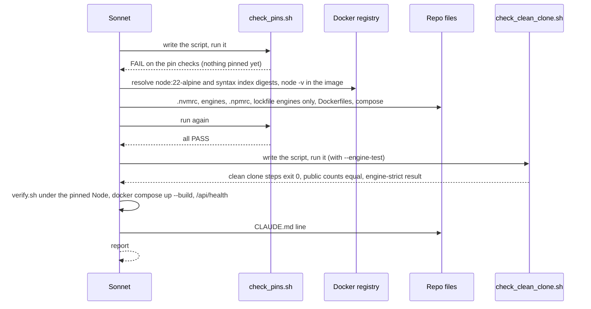
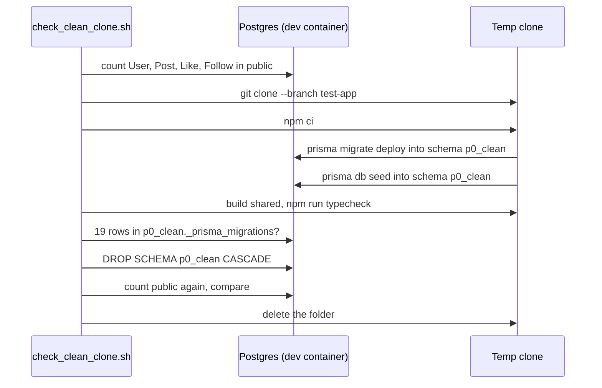

# P0 baseline freeze: pin Node and Docker images

Spec status: approved · 2026-10-28
Design status: approved · 2026-10-28
Type: feature · Folder: `.docs/works/2026-10-28-p0-baseline-freeze/`

## 1. Spec

### Problem

Super-plan §2 says every Class D number must come out the same on every run, and that the Node version goes into the manifest, because `Math.log2` and `Math.pow` can differ between engines. Today nothing pins the environment. P0 (super-plan §4) is the task that fixes this. It is task 2 in the blueprint (`.docs/implementation-plan.md` §5), and it must be done before P3 writes the first manifest.

What exists today (checked on 2026-10-28):
- **No Node pin.** There is no `.nvmrc`. No `package.json` (root, `apps/backend`, `apps/frontend`, `packages/shared`) has an `engines` field or a `packageManager` field. There is no `.npmrc`.
- **Two Node versions.** The author's Mac runs Node v22.14.0 with npm 10.9.2. Both Dockerfiles use `node:20-alpine` in all three stages. nvm on the Mac has v22.14.0 and v24.14.1 installed, but no Node 20.
- **Node 20 is past its end of life.** The Node.js release schedule (`nodejs/Release`, `schedule.json`, read 2026-10-28) gives v20 end of life 2026-04-30, v22 end of life 2027-04-30, v24 end of life 2028-04-30. The super-plan says "Pin Node 20, the same as the Docker image". That was written before anyone checked the date. This is Open question 1.
- **Images pinned by tag only.** `docker-compose.yml` uses `postgres:16-alpine` and `redis:7-alpine`. `apps/backend/Dockerfile` and `apps/frontend/Dockerfile` use `node:20-alpine`. A tag can point to a new image at any time. The local Docker has `postgres:16-alpine` (digest `sha256:721873c3…80ea`) and `redis:7-alpine` (digest `sha256:858f009f…3499`), both pulled about 5 weeks ago. No `node` image is pulled locally.
- **Lockfile.** `package-lock.json` exists, `lockfileVersion` 3. Prisma is `^6.2.1`, Next `15.1.0`, Nest core `^10.4.15`, TypeScript `^5`.
- **The "clean clone" check has never been run.** P0's "Done when" asks that a clean clone passes `npm ci`, `prisma migrate deploy`, the seed and `npm run typecheck`. Migrate and seed need a database. Run against the dev database, they would change the dev data in schema `public` (19 migrations; the seed adds users, posts, likes and follows).

### Scope

**In scope:**
- One Node version for local runs and for Docker, pinned with `.nvmrc` and `engines`.
- The three base images (`node`, `postgres`, `redis`) pinned by digest in both Dockerfiles and in `docker-compose.yml`.
- A clean-clone check that runs `npm ci`, `prisma migrate deploy`, the seed and `npm run typecheck` on the pinned Node, without touching the dev data.
- The backend unit and integration tests and the full stack build (`docker compose up --build`) on the pinned versions.
- Docs: the Node version in `CLAUDE.md` "Commands" (one line), the P0 text and status in the super-plan, and a change-log line.

**Out of scope:**
- Updating dependencies or fixing the 66 `npm audit` findings (Bugs Report R3).
- `eval/`, `packages/ranking` and the manifest writer. P0 only fixes the versions they will record (P3).
- Fast-forwarding `main` to `test-app` or pushing. The super-plan says these need the author's OK (open item 4). They are not part of this task.
- CI (there is no `.github/` folder).
- Any change to app behavior.

### Done when

| # | Check | Expected result |
|---|---|---|
| DW1 | Read `.nvmrc`, then run `node -v` inside the pinned Node image | `.nvmrc` holds one exact version (`vX.Y.Z`) and it equals the image's `node -v` |
| DW2 | Read the `engines` field of the root `package.json` | It names the chosen Node major (and npm if the design picks one). With a Node of another major, `npm ci` stops or warns as Open question 3 decides |
| DW3 | grep every `FROM` line of both Dockerfiles and every `image:` line of `docker-compose.yml` | Each has a tag **and** `@sha256:<64 hex>`. No unpinned base image is left |
| DW4 | Clean clone: a fresh `git clone` of `test-app` into a temp folder, on the pinned Node, with its own database schema | `npm ci`, `prisma migrate deploy` (19 migrations), the seed and `npm run typecheck` each exit with code 0 |
| DW5 | Dev data check, before and after DW4 | Row counts of `User`, `Post`, `Like` and `Follow` in schema `public` are unchanged. The schema used by DW4 is removed at the end |
| DW6 | `bash .claude/hooks/verify.sh` on the pinned Node, with db and redis up | Every check passes: shared build, frontend typecheck and lint, backend build, unit tests, integration tests |
| DW7 | `docker compose up --build` with the pinned images | The backend and app images build. The backend runs `prisma migrate deploy` and `/api/health` answers 200 |
| DW8 | `git diff --stat` of the task commits | Only `.nvmrc`, the `package.json` files that get `engines`, `package-lock.json` (if `engines` changes it), `.npmrc` (if Open question 3 adds it), both Dockerfiles, `docker-compose.yml`, `CLAUDE.md`, `.docs/super-plan.md` and the task folder |

### Open questions

1. **Node 22 instead of Node 20.** Recommendation: pin Node 22 everywhere, and move both Dockerfiles from `node:20-alpine` to `node:22-alpine`. Node 20 has been past end of life since 2026-04-30, the Mac already runs 22.14.0, and Node 22 is supported until 2027-04-30, well after the defense. This changes the P0 text of the super-plan, not a frozen value. Other option: keep Node 20 as written, install it with nvm, and leave the Dockerfiles on 20.
2. **Exact version or major only.** Recommendation: `.nvmrc` holds the exact version that is inside the pinned Docker image, so local runs and Docker use the same engine to the patch. `engines` gives the major only (`>=22 <23`), so a small patch drift warns instead of blocking. Other option: major only in `.nvmrc` too, which is simpler but lets local and Docker drift.
3. **Should a wrong Node stop `npm ci`?** By default `engines` only warns. Recommendation: add `.npmrc` with `engine-strict=true` if `npm ci` still passes with it (some dependency may declare a narrow `engines` range, not checked). If it fails, keep the warning only and say so in the Result. Other option: warning only, no `.npmrc`.
4. **Which Postgres and Redis digests.** Recommendation: pin the digests already in local use (`postgres:16-alpine` `sha256:721873c3…80ea`, `redis:7-alpine` `sha256:858f009f…3499`), because the dev volume was made with them. Other option: pull the newest `16-alpine` and `7-alpine` today and pin those.

## 2. Impact

**Who and what it affects.**
- **Thesis numbers.** Every Class D number (P3 to P8) will record the Node version in its manifest. Pinning now, before any number exists, is the cheapest moment. If we skip it, a later Node change can change a hash, and P8 (`thesis:repro`) fails on a clean clone.
- **The live app.** If Open question 1 is yes, the backend and frontend images move from Node 20 to Node 22. The app's code does not change. The risk is in the image: Prisma's engine on Alpine and native modules like `sharp` and `bcrypt`. DW6 and DW7 are there to catch that.
- **The author.** Local runs must use the pinned version (`nvm use`). One line in `CLAUDE.md` says so.
- **The dev database.** Untouched. DW4 runs in its own schema, and DW5 checks the counts.

**Code areas.** `apps/backend/Dockerfile`, `apps/frontend/Dockerfile`, `docker-compose.yml`, the root `package.json` (and maybe the workspace ones), `package-lock.json`, new `.nvmrc` and maybe `.npmrc`. No TypeScript source, no Prisma schema, no migration.

**Other tasks and bugs on the same files.** No open task. Bugs Report R3 (dependency audit) touches `package-lock.json` but is out of scope. The blueprint task 5 (`p5-ranking-package`) will edit the backend Dockerfile again, to build `@breadit/ranking`. P0 goes first, so task 5 starts from pinned images.

**Thesis link.** Super-plan §2 (determinism contract: pinned environment, Node version in the manifest), P0 in §4, blueprint task 2. No RQ or hypothesis. Frozen values (§7): none touched. The Node major is not a §7 value; it is P0 text. No number reported in the thesis changes, because none exists yet.

**Risk.**
- Node 22 inside Alpine may need a different Prisma binary target or a rebuilt native module. DW7 (the full Docker build and health check) shows it at once. If it fails, the fallback is Open question 1's other option.
- A digest-pinned image does not get security fixes by itself. That is the point of a freeze. The Result notes the date of the digests, so a later task can bump them on purpose.

## 3. Design

### Approach

The author approved the Spec on 2026-10-28 without choosing another option, so this design follows the recommendation of all four open questions: Node 22, exact version in `.nvmrc` and major in `engines`, `engine-strict` if `npm ci` passes with it, and the local Postgres and Redis digests. If that is wrong, say so at the design review.

The work is small: one new file, a few changed lines in five files, and two docs. The checks are the real work. So the design builds two small check scripts first (they fail today), then makes the pins, then runs the scripts until they pass. This is "tests first" for a configuration task.

**1. Choose the exact images (one time, by hand, recorded).**
- **Node.** Resolve the multi-arch index digest of `node:22-alpine` today with `docker buildx imagetools inspect`. Pin the **index** digest, not a single-platform one, so the build works on an Intel and an ARM machine (F8). Run `node -v` and `npm -v` inside that image. The `node -v` value is the exact version for `.nvmrc`.
- **Postgres and Redis.** Take the repo digests already in local use: `postgres:16-alpine@sha256:721873c34ceb9f8d8fc265984940dc982404c105f19ad51be9fdc5970a6080ea` and `redis:7-alpine@sha256:858f009f9709ce576febc734aa78b8f6d624b82571f9ddb6bda4377c833b3499` (`docker images --digests`, 2026-10-28). The dev volume was made with them.
- **Dockerfile syntax image.** Both Dockerfiles start with `# syntax=docker/dockerfile:1.7`. That line also pulls an image (the BuildKit front end). Pin it by its index digest too, so the build parser cannot change under us.
- Each pinned line keeps its tag for humans: `node:22-alpine@sha256:<64 hex>`. The commit message records the date the digests were taken.

**2. Pin Node.**
- `.nvmrc` (new, repo root): one line, the exact `node -v` of the pinned image, for example `v22.x.y`.
- Root `package.json`: `"engines": { "node": ">=22 <23" }`. Only the root, because npm reads it for the whole workspace install; the workspace `package.json` files stay as they are.
- `.npmrc` (new, repo root): `engine-strict=true`, kept only if `npm ci` passes with it (Open question 3). Whether npm enforces the **root** project's `engines` under `engine-strict` is not verified. The clean-clone script tests it with Node v24.14.1 (already installed in nvm). If npm does not stop, the Result says "warn only" and `.nvmrc` plus the check script stay the real pin (F5).
- `package-lock.json`: npm copies the root `engines` into `packages[""]`. Refresh the lockfile with `npm install --package-lock-only --legacy-peer-deps` (the flag from CLAUDE.md). The diff must touch only that `engines` block. Anything else is reverted, and the task stops (F3).

**3. Pin the images.** In `apps/backend/Dockerfile` and `apps/frontend/Dockerfile`, all three stages (`deps`, `builder`, `runner`) change from `node:20-alpine` to the same `node:22-alpine@sha256:…` line. The full reference is written on each `FROM`, not through an `ARG`, so a plain grep can check it. In `docker-compose.yml`, `db` and `redis` get their digests. Nothing else in these files changes.

**4. Check script for the pins: `check_pins.sh`** (task folder, bash, read-only). It prints one PASS or FAIL line per check and exits 0 only if all pass.

| Check | Rule |
|---|---|
| nvmrc | `.nvmrc` exists and is exactly one line `v<major>.<minor>.<patch>` |
| engines | the root `package.json` has `engines.node`, and the major of `.nvmrc` is inside it |
| from-pinned | every `FROM` line of both Dockerfiles and every `# syntax=` line has `@sha256:` and 64 hex characters |
| from-same | the six Node `FROM` lines carry the same reference |
| compose-pinned | every `image:` line of `docker-compose.yml` has `@sha256:` and 64 hex characters |
| image-node | `docker run --rm <node ref> node -v` equals `.nvmrc` (skipped with `--no-docker`) |
| local-node | `node -v` in the current shell equals `.nvmrc` |

Run before the change, every check must fail, because there is no `.nvmrc`, no `engines` and no digest yet. This shows the script really sees the problem.

**5. Check script for the clean clone: `check_clean_clone.sh`** (task folder, bash). It covers DW4 and DW5.
1. Stop if `node -v` is not the `.nvmrc` version, or if db is not up.
2. Count the rows of `User`, `Post`, `Like` and `Follow` in schema `public`, through `docker compose exec db psql` (read-only `SELECT count(*)`).
3. `git clone --branch test-app` of the local repo into a new folder in `$TMPDIR`. A clean clone has no `node_modules`, no `dist` and no `.env`.
4. In the clone, with `DATABASE_URL` set to the dev Postgres with `?schema=p0_clean` (the same way `apps/backend/test/it/env.ts` uses `it_test`): `npm ci`; `npx prisma migrate deploy --schema=apps/backend/prisma/schema.prisma`; `npx prisma db seed --schema=apps/backend/prisma/schema.prisma` (the seed command lives in the root `package.json`); `npm run build -w @breadit/shared` (the frontend types need `dist`, CLAUDE.md); `npm run typecheck`. Each step's exit code is printed.
5. Check that `_prisma_migrations` in `p0_clean` has 19 finished rows.
6. `DROP SCHEMA p0_clean CASCADE`. The script refuses to run if the schema name is `public` or `it_test` (F6).
7. Count the `public` rows again and compare with step 2.
8. Delete the clone folder.
9. With `--engine-test`: in a second fresh clone, run `npm ci` under Node v24.14.1 (`nvm exec 24.14.1`) and report whether it stopped with `EBADENGINE`. This answers F5 and does not touch the database.

**6. The full checks.**
- DW6: `bash .claude/hooks/verify.sh` under the pinned Node, with `docker compose up db redis -d`.
- DW7: `docker compose up --build -d`. Wait for the backend health check, then `curl` `/api/health` (200). The `db` and `redis` containers are recreated because their image line changed. Their data is in the named volumes `postgres_data` and uploads, so nothing is lost. Never `down -v` (the Bash hook refuses it anyway) (F7).

**7. Docs.**
- `CLAUDE.md` "Commands": one line at the top of the block, `nvm use   # Node version from .nvmrc (Node 22, pinned in P0)`.
- `.docs/super-plan.md`, P0 only: "Pin Node 20" becomes Node 22 with the reason (end of life 2026-04-30), the "Done when" says Node 22, a P0 status paragraph with the pinned versions and the digest date, and a change-log line (0.13). §5, §6 and §7 stay byte-identical. The §3 tooling line is a dated snapshot ("checked on 2026-10-22") and stays.

**Rejected options:**

| Option | Why not |
|---|---|
| Keep Node 20 as the super-plan says | Past end of life since 2026-04-30, not installed on the Mac, and every result would be made on an unsupported runtime |
| Node 24 | Active LTS, but no part of the stack has been run on it. The Mac and the tests already run on 22, so 22 is the smaller step |
| `.nvmrc` with the major only (`22`) | Local runs could use 22.14.0 while Docker uses a later 22. The manifest records the version, so a drift would show as a changed hash later |
| Pin a single-platform digest | It breaks the build on a machine of the other CPU type |
| One `ARG NODE_IMAGE` per Dockerfile | Fewer repeats, but a grep can no longer check the `FROM` lines, and the Dockerfiles get harder to read |
| Run the clean-clone check on schema `public` | It would add seed rows to the dev data |
| A CI pipeline for the clean clone | There is no CI. A script the author can run is enough for the thesis |
| `volta` or `packageManager` with Corepack | A new tool for the author. nvm is already installed and reads `.nvmrc` |

### Workflow and sequence diagrams

The task:

The clean-clone check:

### Failure modes

| # | What can go wrong | How we notice | How we resolve it |
|---|---|---|---|
| F1 | Prisma's engine does not load on the Node 22 Alpine image (OpenSSL version) | DW7: `prisma generate` or `migrate deploy` fails in the build or at start | Stop and report. Adding a `binaryTargets` entry is a schema change, so it goes to the author first. Fallback: Node 20 (Open question 1, other option) |
| F2 | `sharp` has no prebuilt binary for the new image | DW7 build fails, or the avatar IT test fails | Same as F1: stop and report |
| F3 | Refreshing the lockfile changes resolved versions, not only the root `engines` | `git diff package-lock.json` shows more than the `engines` block | Revert the lockfile and stop. A version change is out of scope (Bugs Report R3) |
| F4 | `engine-strict=true` makes `npm ci` fail because some dependency declares a narrow `engines` range | `npm ci` stops with `EBADENGINE` on the pinned Node | Remove `.npmrc`, keep the warning only, write it in the Result (Open question 3) |
| F5 | npm does not enforce the root project's `engines` | `--engine-test` run on Node 24 does not stop | Keep `.npmrc` only if it still helps for dependencies, write "root engines warn only" in the Result. `check_pins.sh` `local-node` is then the guard |
| F6 | The clean-clone check writes into `public` or `it_test` | Step 2 and step 7 counts differ | The script uses only `p0_clean`, refuses `public` and `it_test`, and drops `p0_clean` at the end. If counts differ, stop and report |
| F7 | `docker compose up --build` recreates `db` and loses data | Row counts after DW7 | Named volumes keep the data. Never `down -v` (the Bash hook refuses it). Count `public` rows after DW7 too |
| F8 | A single-platform digest is pinned by mistake | `imagetools inspect` shows a manifest, not an index | Use the index digest. `check_pins.sh` cannot see the difference, so the plan has a manual check |
| F9 | The author's shell or the IDE still runs Node 22.14.0 | `check_pins.sh` `local-node` fails | `nvm install` (reads `.nvmrc`), then `nvm use`. The CLAUDE.md line says so |
| F10 | No network (registry, nvm download, npm) | The step fails with a network error | Retry later. Nothing is half-changed: the pins are one commit after the checks pass |
| F11 | The husky pre-commit hook runs the typecheck on a Node that is not pinned | Commit fails or passes on the wrong Node | The implementer commits from a shell after `nvm use`. Not a correctness risk: the typecheck does not depend on the Node patch |
| F12 | The seed needs a variable that a clean clone has no `.env` for | Seed step fails | The script passes `DATABASE_URL` explicitly. `seed.ts` reads only `SEED_*` values with defaults besides that (checked: its one `process.env[name]` is inside `envInt`) |

### Code files

| File | New or changed | Purpose |
|---|---|---|
| `.nvmrc` | New | The exact Node version, equal to `node -v` in the pinned image |
| `.npmrc` | New, only if F4 does not happen | `engine-strict=true` |
| `package.json` (root) | Changed | `"engines": { "node": ">=22 <23" }` |
| `package-lock.json` | Changed | Only the root `engines` copy in `packages[""]` |
| `apps/backend/Dockerfile` | Changed | `# syntax=` line and three `FROM` lines pinned to `node:22-alpine@sha256:…` |
| `apps/frontend/Dockerfile` | Changed | Same as the backend Dockerfile |
| `docker-compose.yml` | Changed | `db` and `redis` images pinned by digest |
| `CLAUDE.md` | Changed | One line in "Commands" about `nvm use` |
| `.docs/super-plan.md` | Changed at closing | P0 text (Node 22 and why), P0 status, change log 0.13 |
| `.docs/works/2026-10-28-p0-baseline-freeze/check_pins.sh` | New | Static and image checks of §4, DW1 to DW3 |
| `.docs/works/2026-10-28-p0-baseline-freeze/check_clean_clone.sh` | New | Clean clone in schema `p0_clean`, dev counts before and after, optional engine test, DW4 and DW5 |
| `.docs/works/2026-10-28-p0-baseline-freeze/plan.md` | New (next step) | The ordered steps |

Not changed: any TypeScript source, `schema.prisma`, migrations, `.env`, the workspace `package.json` files, `.claude/`.

### Data, schema and cache changes

None. No Prisma model, migration or cache key. The clean-clone check makes a temporary schema `p0_clean` in the dev Postgres and drops it. The `db` and `redis` containers are recreated with the same images by digest; their volumes stay.

