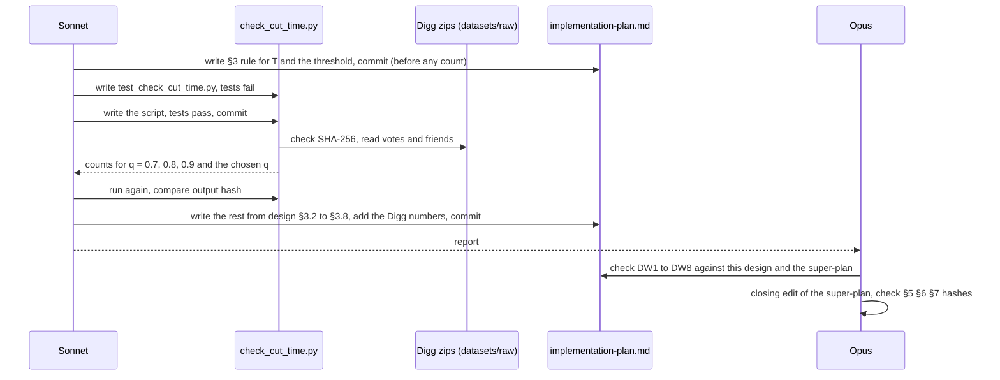
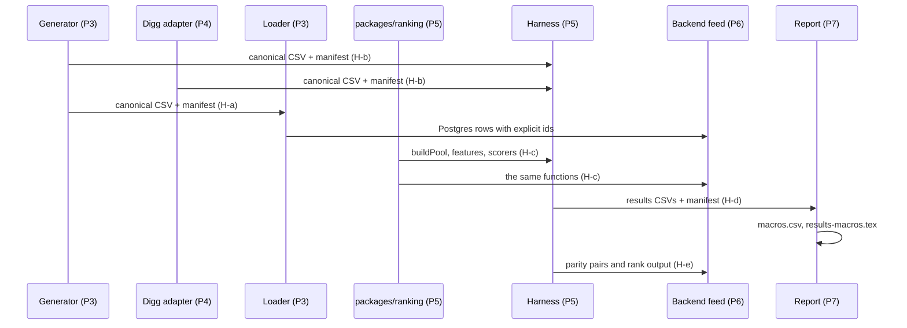

# Implementation blueprint

Spec status: approved · 2026-10-28
Design status: approved · 2026-10-28
Type: feature · Folder: `.docs/works/2026-10-28-p2-implementation-blueprint/`

## 1. Spec

### Problem

Super-plan P2 (§4) asks for one file, `.docs/implementation-plan.md`, that says how the pieces of P3–P10 fit together in the code. It does not exist. P1 is written, so P2 is the next phase.

Without it, each later task invents its own hand-offs. Four hand-offs are shared by two or more tasks: generator → loader, generator and Digg adapter → harness, `packages/ranking` → backend, harness → report → macros. If two tasks disagree on one of them (an ID type, a timestamp unit, a column order), the hashes of §2 break late, close to the deadline.

What exists today (checked on 2026-10-28):
- **Code.** `packages/` holds only `shared`. There is no `packages/ranking`, no `eval/` and no `apps/backend/src/ranking/`. The root `workspaces` list is `["apps/*", "packages/*"]`, so a top-level `eval/` is not a workspace yet (super-plan §3).
- **The scorer to move.** `computeExploreScoreFixed` and `applyExploreDiversity` are plain functions at the top of `apps/backend/src/posts/posts.service.ts` (lines 56 and 62). The Explore branch of `findAll` calls `Date.now()` twice (lines 275 and 288, Bugs Report T4). `getFolloweesIds` and `getCommunityIds` are private methods of `PostsService` (lines 106 and 121).
- **Data.** `Post` has `isApproved` and `deletedAt`. `User.id` is a `cuid()` string, `Post.id` is an autoincrement integer. Event tables have `createdAt` (super-plan §3).
- **Decisions left to P2.** Open item 6 of the super-plan: (a) the rule that sets the cut time T, which must keep enough test users with 0–4 earlier interactions; (c) which comparisons are in the Holm family. H1 also says P2 checks that Digg at time T keeps enough users with 0–4 earlier interactions. Change log 0.9 says P2 checks that the Digg pool at T is not too small (P-C was not applied).
- **Digg files.** The two zips are only in the scratchpad of an earlier session, `/private/tmp/claude-502/-Users-hung-Desktop-Breadit/dbae39ae-9426-486a-b125-37e0e1436fde/scratchpad/digg-zips/`. Both zips are there (22,547,243 and 15,007,610 bytes, the sizes in `.docs/datasets.md` §3). A temp folder can be cleared at any time. The SHA-256 of both zips is in `.docs/datasets.md` §4.
- **Time.** Today is 2026-10-28. The deadline is 2026-11-20: 23 days for P3 to P10. The super-plan has no dates by design (version 0.2).

### Scope

**In scope:**
- One new file, `.docs/implementation-plan.md`, with the four parts of super-plan P2:
  - **Module map.** Folders and packages (`eval/`, `packages/ranking`, the backend module, the frontend toggle) and which may import which.
  - **Data contracts.** Only what two or more tasks share: the canonical CSV files and their columns, types, ID rules and sort order; `manifest.json`; the signatures of `buildPool`, the as-of feature functions and the scorers; the results CSVs; the macro names.
  - **Measurement plan.** E1 to E8: input data, methods, metrics, output file, thesis table or figure. One table RQ → hypothesis → experiment → table → chapter, with both co-primary tests of H1.
  - **Task list.** Every task folder for P3 to P10, with scope, order, dependencies, a day budget and the cut order of §8.
- The two open decisions of open item 6: the rule for the cut time T, and the Holm family.
- A check on the real Digg files of the T rule: how many Digg users get a test item, how many of them are in the history buckets 0 and 1–4, and how many stories are in the pool at T. A small stdlib script in the task folder, like the P1 tasks.
- Getting both Digg zips back to a stable place outside git, and checking their SHA-256 against `.docs/datasets.md` §4.
- At closing: the P2 status in the super-plan, its Tasks column (§4), open item 6 (a and c), and one change-log line.

**Out of scope:**
- Any code in `eval/`, `packages/ranking`, the backend or the frontend. That starts in P3.
- Changing a frozen value of §7, §5 or §6. The blueprint points to §7 for values and does not copy them.
- The P0 baseline freeze itself (Open question 2 decides where it goes).
- The D1 product decision (Bugs Report §4). The blueprint states which answer its contracts assume (Open question 5).
- `literature.md`, `datasets.md`, `related-work.md`, `supervisor-note.md`, `Latex/`, `docs/`.

### Done when

| # | Check | Expected result |
|---|---|---|
| DW1 | Headings of `.docs/implementation-plan.md` | The four parts exist: module map, data contracts, measurement plan, task list. The file is at most 400 lines (`wc -l`). |
| DW2 | Hand-off table in the file | Each of the four hand-offs (generator → loader, generator and adapter → harness, `packages/ranking` → backend, harness → report → macros) points to one contract in the file. Each contract names columns or signatures, types, units and sort order. |
| DW3 | Measurement table | One row for each of H0, H1 test 1 (W2 middle cell), H1 test 2 (Digg), H2, and for each of E1 to E8. Each row names its output file and its chapter (super-plan P9 chapter map). |
| DW4 | Task list | Every phase P0 and P3 to P10 has at least one task row. Each row has scope, depends-on and a day budget. The day budgets end on or before 2026-11-20 with at least 2 days spare. Each cut of §8 points to the task it removes. |
| DW5 | Cut time T | The rule for T is written in the file, for synthetic data and for Digg. The Digg check script prints, for that rule: users with a test item, test users in bucket 0 and in bucket 1–4, stories in the pool at T. The numbers are in the file and are stable over two runs. |
| DW6 | Digg zips | Both zips are in a folder outside git and outside `/tmp`. `shasum -a 256` matches `.docs/datasets.md` §4. `git status` does not list them. |
| DW7 | Holm family | The file lists the comparisons in the family (method × K × bucket, which methods). Super-plan open item 6(c) points to it. |
| DW8 | Frozen values | `.docs/super-plan.md` §5, §6 and §7 are byte-identical before and after the task (SHA-256 of each section). The blueprint copies no number from §7: a grep of the §7 values that are numbers finds them only in sentences that cite §7. |
| DW9 | Git | `git diff --stat` of the task commits lists only `.docs/implementation-plan.md`, the task folder, `.docs/super-plan.md` and, if Open question 4 needs it, `.gitignore`. |

### Open questions

Decided by the author on 2026-10-28 in chat: follow the recommendation of all six. The supervisor has not answered the P1 note yet.

Done the same day for question 4: both zips copied to `datasets/raw/digg2009/`, `datasets/raw/` added to `.gitignore`. `shasum -a 256` gives `55bba035…afda1` (votes) and `4d5d3189…3bba` (friends), equal to `.docs/datasets.md` §4.

1. **The supervisor has not answered the P1 note yet (★).** The super-plan says to wait before the next phase depends on P1. Recommendation: start P2 now. It is a document, and 23 days are left. The parts that depend on the answer (Digg as co-primary, the Digg license) are marked in the blueprint, and only the P4 rows change if the answer changes. Other option: wait for the answer.
2. **P0 is not done.** There is no `.nvmrc`, and the Docker images are pinned by tag, not by digest. Recommendation: P0 becomes the first row of the task list, done right after P2 (about half a day), before P3 writes the first manifest. Other option: do P0 before this task.
3. **A day budget in the task list.** Version 0.2 removed week numbers from the super-plan. Recommendation: put a day budget and an end date per task in the blueprint only, not in the super-plan, so the 23 days are visible and the cut order has a trigger date. Other option: order only, no dates.
4. **Where the Digg zips live.** Recommendation: `datasets/raw/digg2009/`, with `datasets/raw/` added to `.gitignore`. Copy them from the temp folder now, before it is cleared. If it is gone, fetch them again from the Internet Archive URLs in super-plan §10 [49]. Other option: a folder outside the repo, given by an env variable.
5. **D1 (can a non-member post into a community?).** The synthetic contract for posts depends on it. Recommendation: require membership, as the Bugs Report recommends. The author decides; the blueprint states the assumption.
6. **How many Digg test users in bucket 0–4 count as "enough" for H1 test 2.** It must be fixed before the script counts them, so the number cannot bend the decision. Recommendation: at least 100 test users in bucket 0–4. Below that, H1 test 2 is reported as underpowered, not dropped. Other option: 200.

## 2. Impact

**Who and what it affects.**
- Every later phase. Each P3 to P10 task starts from its row in the task list and links to the contract it implements (super-plan P2). If P2 is skipped, mismatches show up at the hand-offs, most likely in P5, when the harness reads the generator and adapter output.
- The supervisor and the deadline. The task list with day budgets shows early whether 23 days are enough, and which cut of §8 comes first.
- H1 test 2. If the Digg check (DW5) finds too few test users in bucket 0–4, the Digg test of H1 is weak. Better to know now than in P7.

**Code and files.** No application code. One new file in `.docs/`. One check script in the task folder (stdlib Python, run with `python3 -I`, not part of the main pipeline, super-plan §9). Possibly one line in `.gitignore`. At closing, an edit of `.docs/super-plan.md` outside §5, §6 and §7.

**Other tasks and bugs on the same code.** No open task. The blueprint must place the open bugs that super-plan P6 names: T4 (`Date.now()` in Explore), T3 (feed cache), B6 (community ban cache), R2 (`isApproved` in the pool), T6 (count distinct followees), N6 (throttle limit for E7). It assigns each to a task row; it fixes none of them.

**Stale text found.** Super-plan P5 names the `leakage-auditor` and `designer` agents, which no longer exist (the harness has no agents). `.claude/README.md` already lists `packages/ranking/**` in `determinism.md`. The phase table says "E1–E7", but P7 has E8. `.docs/datasets.md` §5 still says the primary H1 test stays on W2, while super-plan 0.11 makes Digg co-primary. The blueprint follows super-plan 0.11. The closing edit can fix the super-plan lines; `datasets.md` is not edited.

**Thesis link.** Phase P2. It feeds RQ1, RQ2, H0, H1 (both tests) and H2 through the measurement plan, and Chapters 3 to 5 through the output files. Frozen values (§7): none changed. The cut time T row of §7 says "the rule is set in P2", so this task fills it in; the value of T stays for P5. No number reported in the thesis changes.

**Risk.** The main risk is a blueprint that is too long or too detailed and becomes a second super-plan. The rule of P2 limits it: only what two or more tasks share goes in, and DW1 caps the length. A second risk is that the Digg check needs choices that belong to P4 (the 1,670 undated links, the 7,299 repeated votes). The script picks one simple choice for each, says it, and P4 decides for real.

## 3. Design

### Approach

This is a document task. The "code" is the blueprint plus one check script. The design below holds every decision the blueprint must state, so writing the blueprint is mostly copying these decisions in order and checking them. Sonnet writes the script, its tests and the first draft. Opus checks the draft against this section and the super-plan.

The order matters for one reason: the rule for T and the threshold of 100 (Open question 6) are written and committed **before** the script reads the real Digg files. So the Digg counts cannot bend the rule (same idea as the rules-first order of `.docs/datasets.md` §2).

#### 3.1 Layout of `.docs/implementation-plan.md`

```
# Implementation blueprint          (version 1.0, date, status, links to super-plan and this task)
## 1. Module map                    (§3.2 below)
## 2. Data contracts                (§3.3 below, with the hand-off table of DW2)
## 3. Cut time T and Holm family    (§3.4 and §3.5 below, with the Digg numbers)
## 4. Measurement plan              (§3.6 below)
## 5. Task list                     (§3.7 below)
## 6. Assumptions and open points   (D1, supervisor, P4 choices)
## Change log
```

Rule of P2: something goes in only if two or more tasks share it. Detail that one task owns stays in that task's `design.md`. Values of super-plan §7 are cited as "§7, <row name>", never copied (DW8). The cap is 400 lines (DW1).

#### 3.2 Module map

| Module | Owner task | May import | What it holds |
|---|---|---|---|
| `packages/ranking` (`@breadit/ranking`) | `p5-ranking-package` | nothing outside the Node standard library | Types, `buildPool`, as-of feature functions, every scorer, `rankPool`, and `computeExploreScoreFixed` moved from `posts.service.ts`. Pure: no Nest, Prisma, Redis, clock or randomness. Builds to `dist/` with `tsc`, like `@breadit/shared`. |
| `eval/` (`@breadit/eval`, added to the root `workspaces`) | `p3-synthetic-generator` creates it | `@breadit/ranking`; `@prisma/client` in `src/loader/` only | `src/rng.ts`, `src/canonical/` (CSV and manifest), `src/generator/`, `src/loader/`, `src/adapters/digg.ts`, `src/harness/`, `src/metrics.ts`, `src/stats.ts`, `src/report/`, `config/` |
| Backend feed module `apps/backend/src/feed/` | `p6-social-feed` | `@breadit/ranking`, `PrismaService`, `BlockService` | A thin service that loads data and calls `buildPool` and a scorer. `PostsService.findAll` calls it when `algo` is set. Explore imports `computeExploreScoreFixed` from `@breadit/ranking` (done in `p5-ranking-package`). |
| Frontend toggle | `p6-social-feed` | the API only | `algo` in `app/(board)/page.tsx`, `Feed.tsx`, `InfiniteFeed.tsx` |

Rules: nothing imports `eval`. The harness never touches Postgres, Redis or HTTP (super-plan §2); only the loader writes to Postgres. `getFolloweesIds` and `getCommunityIds` stay in `PostsService` and are made reachable for the feed module (P6 decides how). The determinism rule and hook already cover `packages/ranking/**` and `eval/**`.

#### 3.3 Data contracts

**Hand-off table (DW2).**

| Hand-off | From → to | Contract |
|---|---|---|
| H-a | generator → loader | canonical dataset (below) + manifest |
| H-b | generator and Digg adapter → harness | the same canonical dataset + manifest |
| H-c | `packages/ranking` → backend and harness | the TypeScript signatures (below) |
| H-d | harness → report → macros | results CSVs, `macros.csv`, `results-macros.tex` (below) |
| H-e | harness → P6 parity test | the `rank` command and the parity sample (below) |

**Canonical dataset.** One folder per dataset, `eval/data/<datasetId>/`, not in git (it is rebuilt; its hashes are in the manifest). Files follow super-plan §2 (CSV, UTF-8, LF, header row, fixed column order, sorted rows). Every id is a non-negative integer. Every time is integer seconds from the dataset's epoch, named in the manifest: the §7 base epoch for synthetic data, the Unix epoch for Digg.

| File | Columns | Sort order | Notes |
|---|---|---|---|
| `users.csv` | `user_id, joined_at` | `user_id` | |
| `follows.csv` | `follower_id, followee_id, created_at` | `follower_id, followee_id` | no self-link, no duplicate pair |
| `communities.csv` | `community_id, created_at` | `community_id` | header only for Digg |
| `memberships.csv` | `user_id, community_id, joined_at` | `user_id, community_id` | header only for Digg |
| `posts.csv` | `post_id, author_id, community_id, created_at` | `post_id` | `community_id` empty when none. Every post is approved and not deleted. A community post's author is a member at `created_at` (D1 assumption) |
| `interactions.csv` | `event_id, user_id, post_id, type, created_at` | `created_at, event_id` | `type` is `like`, `comment` or `repost`. All are positives. Only additions: no unlike, unfollow or leave (super-plan §3). `event_id` breaks ties in time |

Dataset ids: `syn-<world>-<size>` with world `W0`, `W1`, `W2L`, `W2M`, `W2H` and size `S`, `M` (§7), and `digg2009`.

**Manifest.** `manifest.json` in each output folder: `schemaVersion`, `datasetId` or `runId`, `source` (synthetic: config path and SHA-256; Digg: each raw zip with URL and SHA-256), `masterSeed` when used, `epoch`, `node` (`process.version`), and `files` (name → `rows`, `sha256`). Keys sorted, two-space JSON, LF. P8 merges all of them into `.docs/results/manifest.json` and compares.

**PRNG.** `eval/src/rng.ts`: `rng(masterSeed, stage)` as in super-plan §2. Stage names are fixed: `users`, `follows`, `communities`, `posts`, `interactions` (P3), `bootstrap`, `permutation` (P5), `parity` (P6), `shuffle` (P7). A new stage gets a new name; names are never reused.

**User ids across the two worlds.** The app uses string user ids, the CSVs use integers. One rule for both sides: a user id inside `packages/ranking` is a string, `u` plus the integer padded to 10 digits (`u0000000042`). The loader writes the same string as `User.id`, so the live app and the harness sort users the same way (plain `<` on strings, never `localeCompare`). Post ids stay integers (`Post.id` is an autoincrement integer; the loader sets it explicitly).

**`packages/ranking` signatures (H-c).** Signatures only; P5 writes the code.

```ts
type UserId = string;  type PostId = number;  type Sec = number;   // integer seconds
interface AsOf { t: Sec; beforeEventId?: number }
// An event e is visible at asOf iff e.t < asOf.t, or e.t === asOf.t and e.id < asOf.beforeEventId.
// The harness passes the test event's id; the live app passes no id (strictly before t).

interface Post { id: PostId; authorId: UserId; communityId: number | null; createdAt: Sec; isApproved: boolean; deleted: boolean }
interface Positive { id: number; userId: UserId; postId: PostId; type: 'like' | 'comment' | 'repost'; t: Sec }

interface PoolParams { windowSec: number; maxPosts: number }          // values from §7
function buildPool(a: { user: UserId; asOf: AsOf; candidates: readonly Post[];
  blocked: ReadonlySet<UserId>; earlierPositives: ReadonlySet<PostId> }, p: PoolParams): Post[];

interface UserFeatures { followees: UserId[]; communities: number[];      // distinct, sorted
  nByAuthor: ReadonlyMap<UserId, number>; nByCommunity: ReadonlyMap<number, number>; nTotal: number }
interface PostFeatures { likes: number; comments: number; reposts: number; createdAt: Sec;
  engagedBy: UserId[] }                                                   // distinct, sorted
type MethodId = 'BL0'|'BL1'|'BL2'|'BL2t'|'BL3'|'BL4'|'BL5'|'BL6'|'H'|'H-follow'|'H-comm'
  |'H-noauthor'|'H-noengager';
interface ScoreContext { user: UserId; asOf: AsOf; uf: UserFeatures; params: Readonly<Record<string, number>> }
type Scorer = (ctx: ScoreContext, post: Post, pf: PostFeatures) => number;   // scoreFixed, an integer
function scorer(method: MethodId): Scorer;
function rankPool(pool: readonly Post[], score: (p: Post) => number): PostId[]; // (scoreFixed desc, postId desc)
```

The harness builds `UserFeatures` and `PostFeatures` from the canonical files with the `AsOf` rule. The live app builds them from Prisma. Both call the same `buildPool`, `scorer` and `rankPool`, so only the loading differs. The live query loads every candidate in the window, with no row limit below `maxPosts` plus the user's earlier positives, so `buildPool` sees the same set as the harness (F12). The E4 `m` sweep is a parameter (`params.m`), not a method id.

**Results files (H-d).** Written by the harness into `.docs/results/<runId>/`, Class D, metrics with 6 decimals.

| File | Columns | One row per |
|---|---|---|
| `per_user.csv` | `dataset, split, method, user_id, bucket, n_history, n_followees, test_post_id, rank` | method × kept user. `rank` is 1-based in the full pool |
| `summary.csv` | `dataset, split, method, k, bucket, n_users, recall, ndcg` | method × K × bucket, plus bucket `0-4` and `all` |
| `coverage.csv` | `dataset, split, method, k, coverage` | method × K |
| `leftout.csv` | `dataset, split, bucket, n_test_users, n_left_out` | bucket |
| `tuning.csv` | `dataset, method, param, value, val_ndcg10, chosen` | grid point |
| `compare.csv` | `dataset, family, method, ref, k, bucket, n, mean_diff, ci_low, ci_high, p_raw, p_holm` | comparison (§3.5) |
| `density.csv` | `dataset, density_bin, method, ref, n, mean_diff, ci_low, ci_high` | density bin (E3) |

E7 timing goes to `latency.csv` with the same row rules, but it is Class R: its hash is recorded, never compared.

**Macros (H-d).** The report reads only the CSVs above. It writes `macros.csv` (`name, value, file, row_key`) and `results-macros.tex`. A macro name is letters only (LaTeX does not allow digits): experiment, dataset, metric, K in words, what. Example: `\eTwoDiggNdcgTenGain`. Every macro traces to one CSV cell through `macros.csv`.

**Parity sample (H-e).** `eval rank --dataset <id> --method <m> --user <u> --asof <t> --top <n>` prints post ids in order. The 100 (user, `asOf`) pairs of the P6 test are drawn with the `parity` stream from users and times of `syn-W2M-M`, and written to a committed CSV, so P6 and the harness use the same pairs.

#### 3.4 Cut time T

**The rule.** For each dataset, sort all positive events by `(t, event_id)`. Let `n` be their number. T is the time of the event at rank `ceil(q · n)`. A test item must have `t > T`; a validation item has `t ≤ T`. `q` is 0.8. If the Digg check finds fewer than 100 kept test users in bucket 0–4 at `q` = 0.8, `q` becomes 0.7. If that also has fewer than 100, `q` stays 0.8 and H1 test 2 is reported as underpowered (Open question 6). One `q` for every dataset. The value of T itself is computed by the harness and frozen in P5 (§7 row "Cut time T").

This is the global temporal split of [13] with the split point set by a share of events, not by a calendar date. It works the same on synthetic data (base epoch) and on Digg (36 days with small tails), and a share is easier to state than a date. "Kept" means the test post is in the user's pool.

**What the Digg check counts.** For `q` in 0.7, 0.8 and 0.9 (0.9 is printed only to show the trend): `n`, T (UTC), users with a test item, and by bucket (0, 1–4, 5–19, ≥20, and the union 0–4): test users, kept, left out, and kept users with at least one followee at `t_u`. Also the pool size at T (stories created in the window before T) and the median pool size over kept test users. Window and pool cap are passed as arguments from §7.

**Digg choices in the check (P4 decides for real).** A repeated (voter, story) row keeps its earliest vote. The first vote of a story is its author's post, not a positive; the story's `created_at` is that vote time. Links with `friend_date` 0 are dropped. Self-links are dropped. A follow counts at `t_u` if `friend_date < t_u`. Votes are `like`. Events are numbered by sorting on `(t, voter_id, story_id)`.

**Synthetic data.** The same rule. P3 must report the same bucket table for `syn-W2M-M`. Target for the P3 spec: at least 100 kept test users in bucket 0–4 at size M; below that, P3 changes a "chosen" (not calibrated) parameter before any ranking run. This is a proposal for the P3 spec, not a frozen value.

#### 3.5 Holm family and the reading of H1

Two families **per dataset**, each corrected with Holm on its own. The two co-primary tests of H1 (`syn-W2M-M` and `digg2009`) are in different datasets, so they are separate families and each is reported on its own (super-plan §1).

| Family | Comparisons | Size per dataset |
|---|---|---|
| F1, confirmatory | H − BL2 × K (5, 10, 20) × group (0, 1–4, 0–4, 5–19, ≥20) | 15 |
| F2, secondary | H − each of BL0, BL1, BL2t, BL3, BL4, BL5, BL6 × K × group (0–4, 5–19, ≥20, all) | 84 |

Only `syn-W2M-M` and `digg2009` get F1. F2 runs on the same two datasets. Everything else (W0, W1, W2L, W2H, ablations, E6, E8, the density bins) is reported with bootstrap confidence intervals and no p-value. Holm is valid when tests overlap (0–4 contains 0 and 1–4), so the overlap does not break it.

**Reading of H1 (for the author to confirm).** H1 passes on a dataset when, for F1 row (NDCG@10, group 0–4), the Holm-adjusted p of the randomization test is below 0.05 **and** the lower end of the bootstrap 95% interval is above 0. The super-plan says "the paired 95% confidence interval of the difference is above 0 after Holm correction". Holm adjusts p-values, not intervals, so this is the closest standard reading.

**H0.** In `syn-W0-M`, the bootstrap 95% interval of H − BL2 (NDCG@10, all users) must not lie above 0. It is a gate, not a family member: if it fails, stop (super-plan §1).

#### 3.6 Measurement plan

Methods are tuned per dataset on its own validation items (super-plan §5). On Digg the community term is always 0, so β has no effect and the tie rule picks the smallest β.

| Row | Question | Data | Methods | Output | Thesis | Chapter |
|---|---|---|---|---|---|---|
| Baseline ★ | baseline table for the supervisor | `syn-W0-S`, `syn-W1-S`, `syn-W2M-S`, validation | BL0–BL5 | `summary.csv` | — | — |
| H0 / E5 | does the hybrid win where it must not? | `syn-W0-M` | H, BL2 | `compare.csv` (no family) | gate | 5 |
| H1 test 1 / E2 | cold-start gain, synthetic | `syn-W2M-M` | H, BL2 | `compare.csv` F1 | table | 5 |
| H1 test 2 / E2 | cold-start gain, real | `digg2009` | H, BL2 | `compare.csv` F1 | table | 5 |
| H2 / E3 | gain against social density | `syn-W2L-M`, `syn-W2M-M`, `syn-W2H-M`, `digg2009` | H, BL2 | `density.csv` | figure | 5, 6 |
| E1 | all methods | `syn-W2M-M`, `digg2009` (W0, W1 in E5) | all, tuned | `summary.csv`, `coverage.csv`, `compare.csv` F2 | table | 5 |
| E4 | which term matters | `syn-W2M-M`; `digg2009` without H-comm | H, H-follow, H-comm, H-noauthor, H-noengager, H with each `m` of §7 | `summary.csv` | table | 5 |
| E5 | built into the data? | `syn-W0-M`, `syn-W1-M`, the three W2 cells; shuffle on `syn-W2M-M` | H, BL2 | `summary.csv`, `compare.csv` (no family) | table | 5, 6 |
| E6 | do ties matter? | `syn-W2M-M`, `digg2009` | all | `summary.csv` with reversed tie-break | table | 5 |
| E7 | cost (Class R) | live app with `syn-W2M-M` loaded | `chrono`, `engagement`, `social` | `latency.csv`, query count | table | 5 |
| E8 | does pool size matter? | `syn-W2M-M` | H, BL2, best validation baseline, K = 10 | `summary.csv` with the larger pool of §7 | table | 5 |

`leftout.csv` and `tuning.csv` come with every run and feed Chapter 3 (protocol) and the appendix.

#### 3.7 Task list and day budget

Today is 2026-10-28. A day budget counts the three approvals. One task runs at a time; thesis writing (P9) runs next to the code tasks, by the author, outside tasks.

| # | Task | Phase | Depends on | Scope (short) | Days | Ends | Bugs placed here |
|---|---|---|---|---|---|---|---|
| 1 | `p2-implementation-blueprint` | P2 | P1 | this task | 2 | 10-29 | — |
| 2 | `p0-baseline-freeze` | P0 | — | `.nvmrc`, `engines`, image digests, clean clone check | 0.5 | 10-30 | — |
| 3 | `p3-synthetic-generator` | P3 | 1, 2, D1 | `eval/` workspace, `rng.ts`, canonical writer, config, worlds, bucket table (§3.4) | 2.5 | 11-01 | — |
| 4 | `p4-digg-adapter` | P4 | 3 (canonical writer) | adapter, the real Digg choices, the same bucket table | 2 | 11-03 | — |
| 5 | `p5-ranking-package` | P5 | 1 | `packages/ranking`, move `computeExploreScoreFixed`, backend imports it, Dockerfile build order | 3 | 11-06 | T4 (score takes `asOf`) |
| 6 | `p5-eval-harness` | P5 ★ | 3, 4, 5 | harness, metrics, stats, scipy cross-check, golden, leakage and double-run tests, baseline table | 2 | 11-08 | — |
| 7 | `p3-postgres-loader` | P3 | 3 | loader with explicit ids, `--rebase-to` | 1 | 11-09 | — |
| 8 | `p6-social-feed` | P6 | 5, 7 | feed module, `algo`, `asOf` flag, parity test, frontend toggle, D1 product rule | 2 | 11-11 | T3, B6, R2, T6 (distinct followees) |
| 9 | `p7-offline-experiments` | P7 ★ | 6 | E1–E6, E8, report and macros | 2 | 11-13 | — |
| 10 | `p7-cost-benchmark` | P7 | 8 | E7, throttle limit as env variable | 1 | 11-14 | N6, T3 (cache state) |
| 11 | `p8-repro` | P8 | 9, 10 | `npm run thesis:repro`, tag proposal | 1 | 11-15 | — |
| 12 | Writing, Chapters 5 and 6 | P9 ★ | 9 | from macros only | 2 | 11-17 | — |
| 13 | `p10-defense-package` | P10 | 12 | slides, demo script, final checks | 1 | 11-18 | — |

Spare: 11-19 and 11-20 (DW4). Chapters 1 to 4 and 7 to 8 are written by the author between 10-30 and 11-15, next to the tasks.

**Cut triggers** (super-plan §8 order, each tied to a date):

| Cut | Removes | Trigger |
|---|---|---|
| 1 shuffle | the shuffle part of E5 in task 9 | task 6 not done on 11-09 |
| 2 E8 | E8 in task 9 | task 6 not done on 11-09 |
| 3 finer E4 | H-noauthor, H-noengager, `m` sweep in task 9 | task 9 not started on 11-12 |
| 4 E7 smaller | `engagement` row in task 10 | task 10 not started on 11-14 |
| 5 toggle | frontend part of task 8 | task 8 not started on 11-10 |
| 6 Digg | task 4, H1 test 2 | only if task 4 fails its gate |

The supervisor checkpoints (★) are sends, not stops: the next task starts, and an answer that changes the plan comes back as a change to the blueprint.

#### 3.8 Assumptions and open points written in the blueprint

- **D1:** a community post needs membership (author's decision 2026-10-28). The generator follows it. The product rule in the backend is placed in task 8.
- **Supervisor:** no answer yet. Rows that depend on the answer are marked: task 4, H1 test 2, the Digg rows of E1 to E6.
- **P4 choices:** the Digg check uses the simple choices of §3.4. P4 decides them for real, reruns the bucket table, and states any change.

#### 3.9 The check script

`check_cut_time.py` in the task folder, standard library only, run with `python3 -I`. It reuses `rows_of` from `.docs/works/2026-10-27-p1-digg-archive-check/digg_stats.py` (the safe zip reader: one member, streaming, row and column limits) by adding that folder to `sys.path` by its full path. It never writes a file.

```
check_cut_time.py <digg_votes.zip> <digg_friends.zip> --password <pw>
                  --window-days <W from §7> --max-posts <N_max from §7> [--q 0.7,0.8,0.9]
```

- Before reading, it checks the SHA-256 of both zips against two constants copied from `.docs/datasets.md` §4 and stops (exit 2) on a mismatch.
- Core functions take plain lists, so tests use small fixtures and no zip: `dedupe_votes(rows)`, `stories(rows)`, `positives(rows, authors)`, `follows(rows)`, `cut_time(positives, q)`, `test_items(positives, T)`, `bucket(n)`, `in_pool(user, t_u, test_story, stories, own, earlier, W, N_max)`, `report(...)`.
- Pool check per user uses sorted story times and `bisect`, so it does not scan all stories per user.
- Output: `key = value` lines, sorted, like `digg_stats.py`. The last lines give the chosen `q` by the rule of §3.4.

`test_check_cut_time.py` is written first. Fixtures: the author's vote is not a positive; a repeated vote is kept once; T at `ceil(q · n)`; an event at exactly T is validation, not test; the as-of tie by event id; bucket edges 0, 1, 4, 5, 19, 20; window edge and the user's own story left out; undated link dropped; a follow at exactly `t_u` does not count; the `q` fallback rule (100 kept, 99 kept).

**Rejected options:**

| Option | Why not |
|---|---|
| T as a fixed calendar date per dataset | Two datasets need two dates, and a date is easier to bend toward a result. A share of events is one rule for both. |
| T as "last D days are test" | On Digg the last three days are small tails (`.docs/datasets.md` §4), so a short D gives few test users and a long D cuts history. |
| One Holm family with all 99 comparisons per dataset | It costs power exactly where H1 is decided. The confirmatory family stays small (15). |
| Integer user ids in `packages/ranking` | The app's `User.id` is a string. Two id types would need a mapping in every call and would sort differently from the live app. |
| A results database (SQLite) instead of CSVs | Super-plan §2 asks for canonical CSV with hashes. A database file is not byte-stable. |
| Write the blueprint with no Digg check | H1 test 2 and change log 0.9 both ask P2 to check the Digg pool. Without numbers, "enough users" is a guess. |
| Read the real Digg counts first, then pick T | The numbers would steer the rule. The rule and the threshold are committed first. |

### Workflow and sequence diagrams

The task itself:



The pipeline the blueprint describes (hand-offs H-a to H-e):



### Failure modes

| # | What can go wrong | How we notice | How we resolve it |
|---|---|---|---|
| F1 | The blueprint grows into a second super-plan | `wc -l` over 400 (DW1) | Move detail that one task owns into that task's later `design.md` |
| F2 | A §7 number is copied and later drifts | DW8 grep | Replace it with "§7, <row name>" |
| F3 | The Digg counts steer the T rule | Git order: the rule and threshold commit comes before the script's first real run | The plan puts that commit first. The script prints only counts, never a ranking metric |
| F4 | P4 later makes other Digg choices and the counts change | P4 reruns the same bucket table | If kept 0–4 falls below 100, H1 test 2 is reported as underpowered. `q` is not changed again after P5 freezes T |
| F5 | Wrong or changed zip | SHA-256 check at start of the script | Stop with exit 2. Fetch again from the URLs in super-plan §10 [49] |
| F6 | User ids sort differently in the app and the harness | P6 parity test | One padded-string rule (§3.3) for both |
| F7 | The backend image cannot find `@breadit/ranking` (it builds to `dist/`, like `shared`) | `docker compose up --build` fails | Placed in task 5: Dockerfile copies and builds the package before the backend. `verify.sh` builds it next to `shared` |
| F8 | H1 loses power in a big family | — | F1 is kept at 15 comparisons; others go to F2 |
| F9 | The day budget slips | A task ends after its date | The cut triggers of §3.7 apply on their dates |
| F10 | The supervisor changes the data choice | Answer arrives | Only the marked rows change. A blueprint change-log line records it |
| F11 | `Math.log10`, `Math.pow` or `Math.log2` differ between Node versions | Hash differs on another machine | Node is pinned in task 2, and the manifest records it |
| F12 | The live query loads fewer candidates than the harness pool | Parity test fails | The live query has no row limit below `maxPosts` plus earlier positives (§3.3) |
| F13 | Python is slow or runs out of memory on 3 million rows | Run time | One pass per file, `bisect` for pools. `digg_stats.py` already read both files in full on this laptop |
| F14 | `rows_of` in the P1 folder changes | Import error or test failure | The P1 task is closed. If the import breaks, copy the function and say so in the Result |

### Code files

| File | New or changed | Purpose |
|---|---|---|
| `.docs/implementation-plan.md` | New | The blueprint, layout of §3.1 |
| `.docs/works/2026-10-28-p2-implementation-blueprint/check_cut_time.py` | New | The Digg check of §3.9 |
| `.docs/works/2026-10-28-p2-implementation-blueprint/test_check_cut_time.py` | New | Fixtures for each rule of §3.4, written first. `python3 -I -m unittest` |
| `.docs/super-plan.md` | Changed at closing | P2 status, Tasks column of §4 (from the task list), "E1–E7" → "E1–E8" in the phase table, the P5 sentence on the `leakage-auditor` and `designer` agents, open item 6 (a) and (c) point to the blueprint, header version 0.12, change-log line. §5, §6 and §7 stay byte-identical |
| `.gitignore` | Changed (already, 2026-10-28) | `datasets/raw/` |
| `.docs/works/2026-10-28-p2-implementation-blueprint/plan.md` | New (next step) | The ordered steps |

Not changed: any code, `literature.md`, `datasets.md`, `related-work.md`, `supervisor-note.md`, `Latex/`, `docs/`.

### Data, schema and cache changes

None in this task. No Prisma model, migration or cache key. The blueprint describes later changes (the `eval/` workspace in the root `package.json`, P3; the `algo` cache key, P6) but does not make them.

