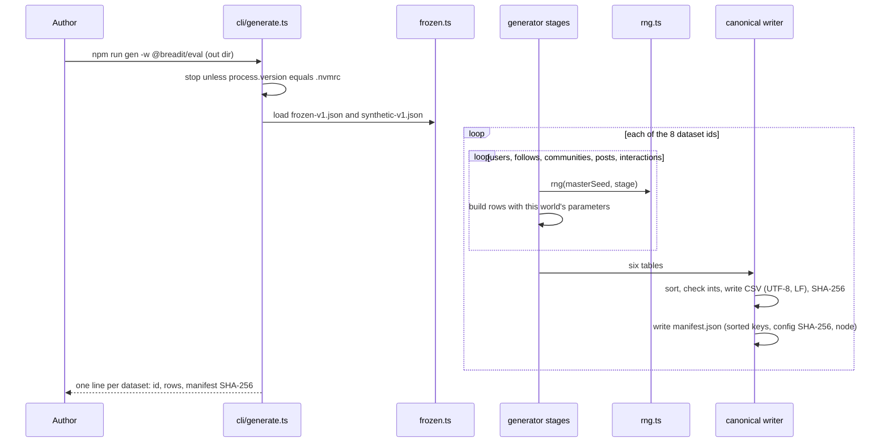
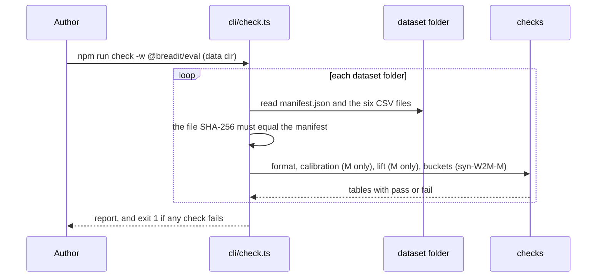

# Seeded synthetic generator and eval workspace

Spec status: approved · 2026-11-02
Design status: approved · 2026-11-02
Type: feature · Folder: `.docs/works/2026-11-02-p3-synthetic-generator/`

## 1. Spec

### Problem

The thesis needs synthetic data for three things that Digg cannot give: the null world W0, the influence sweep W2 and the community term (super-plan "Data", P3). It is also one of the two co-primary tests of H1 (`syn-W2M-M`). None of it exists yet. This is task 3 in the blueprint (`.docs/implementation-plan.md` §5). Tasks 4, 6 and 7 need its `eval/` workspace, its canonical writer or its datasets. Its planned end date was 2026-11-01.

What exists today (checked on 2026-11-02):
- **No `eval/` folder.** The root `package.json` has `"workspaces": ["apps/*", "packages/*"]`. Nothing writes canonical CSV or a manifest.
- **The only PRNG is `mulberry32` in `apps/backend/prisma/seed.ts`.** Super-plan §2 forbids reusing it (32 bits of state). The blueprint §2.4 fixes the replacement: `rng(masterSeed, stage)`, sfc32 seeded from `sha256("<masterSeed>:<stage>")`.
- **The determinism rule and hook already cover `eval/**`** (`.claude/rules/determinism.md`, `post-edit.cjs`).
- **The contracts are written.** Blueprint §2.2 (six canonical files, columns, sort order, id rules), §2.3 (manifest keys), §2.4 (stage names `users`, `follows`, `communities`, `posts`, `interactions`), §3.1–§3.2 (cut time rule, buckets, "kept") and §3.6 (P3 prints the bucket table for `syn-W2M-M`).
- **Calibration targets** are in `.docs/datasets.md` §6a (Digg, computed from the full files): votes per voter, activity skew of the top 20%, followees of users with a list, followers, votes per story. §6a itself says to calibrate votes per user, the activity skew and the followees of users with a list, and to mark the others as chosen.
- **Scale gap.** Digg has 849 votes per story on average. Size M has 1,000 users and 20,000 posts (super-plan §7, row "Dataset sizes"). At about 22 votes per user that is about 1 vote per post. So votes per story cannot be calibrated. It is a chosen value.
- **D1 is decided but the Bugs Report still lists it as open.** Blueprint §6: "A community post needs membership (author's decision, 2026-10-28)". `.docs/Bugs Report.md` §4 still says "Open decision".
- **Docker.** Both Dockerfiles copy the root `package-lock.json` and only the `package.json` of `apps/backend`, `apps/frontend` and `packages/shared`, then run `npm ci --workspace=...`. Whether `npm ci` still passes when the lockfile lists a new `eval` workspace whose `package.json` is not copied: not checked.

### Scope

**In scope:**
- The `eval/` workspace (`@breadit/eval`), added to the root `workspaces`, with its own test command. `eval/data/` is ignored by git (blueprint §2.2).
- `eval/src/rng.ts` as in super-plan §2 and blueprint §2.4.
- The canonical writer and the manifest writer (`eval/src/canonical/`), as in blueprint §2.2 and §2.3. Task 4 (Digg adapter) will reuse them.
- `eval/config/synthetic-v1.json`. Every parameter is marked "calibrated" (with the `.docs/datasets.md` §6a row it matches) or "chosen".
- The generator with five stages, each with its own stream: users (hidden interests, Pareto activity), follow graph, communities and memberships, posts, interactions. It never runs a ranking, so there is no feedback loop [24].
- The worlds W0, W1, W2L, W2M, W2H (super-plan P3) and the sizes S and M (§7). The datasets that blueprint §4 uses: `syn-W0-S`, `syn-W1-S`, `syn-W2M-S`, `syn-W0-M`, `syn-W1-M`, `syn-W2L-M`, `syn-W2M-M`, `syn-W2H-M` (Open question 1).
- D1 in the data: a community post's author is a member at the post's `created_at` (blueprint §2.2).
- Two printed checks: a calibration table (generated value next to the Digg target) and the bucket table of blueprint §3.6 for `syn-W2M-M`.
- Docs: Bugs Report D1 marked decided, the P3 status in the super-plan with a change-log line, and one line in `CLAUDE.md` "Commands" for the generator.

**Out of scope:**
- The Postgres loader and `--rebase-to` (task 7, `p3-postgres-loader`).
- The Digg adapter (task 4). This task only builds the writer it will use.
- `packages/ranking`, `buildPool`, the scorers, the harness, metrics and statistics (P5).
- Freezing the value of the cut time T (P5, §7 row "Cut time T").
- Any change to `apps/backend`, `apps/frontend` or the database.
- Size L (cut in super-plan 0.2).

### Done when

| # | Check | Expected result |
|---|---|---|
| DW1 | `npm ci` at the root, then the `@breadit/eval` test command | Both exit 0 |
| DW2 | RNG tests: two processes draw 1,000 values from `rng(masterSeed, "users")`; also compare the stream `users` with `follows` | The two processes give equal values. The two stages give different values. A committed known-answer vector matches |
| DW3 | Generate the eight datasets twice, into two empty folders | Every `manifest.json` pair is byte-identical (same SHA-256) |
| DW4 | A format check over every generated folder | Header and column order as in blueprint §2.2, UTF-8, LF, rows sorted, integer ids and times, no self-follow, no repeated follow pair, every interaction on an existing post and not before it, no interaction on one's own post, every community post's author a member at `created_at` |
| DW5 | The calibration table for each size M dataset | Each value marked "calibrated" in the config is within the tolerance of Open question 3 of its `.docs/datasets.md` §6a target |
| DW6 | The bucket table for `syn-W2M-M`, with the rule of blueprint §3.1–§3.2 and `q` = 0.8 | At least 100 kept test users in bucket 0–4 (Open question 4) |
| DW7 | A social-lift number per size M world: how much more likely a user acts on a post when a followee acted on it before | W0 is the lowest. W2L < W2M < W2H. So the influence knob does what its name says |
| DW8 | grep `eval/src` for `Date.now`, `Math.random`, `new Date()`, `performance.now`, `localeCompare`, `.sort()` | No match, or only lines with `// harness-allow: <reason>` |
| DW9 | `bash .claude/hooks/verify.sh` with db and redis up, and `docker compose build` | Both pass. The app images still build with the new lockfile |
| DW10 | `git diff --stat` of the task commits | Only `eval/`, the root `package.json`, `package-lock.json`, `.gitignore`, `CLAUDE.md`, `.docs/super-plan.md`, `.docs/Bugs Report.md` and this task folder (plus the Dockerfiles only if DW9 needs them) |

### Open questions

1. **Which datasets.** Recommendation: the eight that blueprint §4 uses. `syn-W2L-S` and `syn-W2H-S` are not used by any experiment. Other option: all ten (5 worlds × 2 sizes), which costs little but adds two unused rows to the manifest.
2. **"Kept" before `buildPool` exists.** DW6 needs the pool rule of blueprint §3.2, but `buildPool` comes in P5. Recommendation: a small count in `eval/` that follows §3.2 word for word, used only for this check. P5 then adds a test that its harness prints the same table. Other option: adapt `check_cut_time.py` (the P2 Digg script) to read canonical CSV.
3. **Calibration tolerance.** Recommendation: within 10% of the target for means and medians, and within 5 percentage points for the activity skew. Calibrated: votes per user (mean, median), activity skew, followees of users with at least one followee (mean). Chosen: followers, two-way share, votes per story, the like/comment/repost mix, the time span, community sizes. Other option: no tolerance, only print the table.
4. **The 100 threshold for P3.** Blueprint §3.6 proposes at least 100 kept test users in bucket 0–4 at size M, as for Digg. Below that, a "chosen" parameter changes before any ranking run. Recommendation: accept it.
5. **How the P3 values are frozen.** §7 freezes at P3 the rows "Dataset sizes", "Synthetic world parameters" and "Primary W2 cell for H1". §7 says the author runs `/freeze`, but that command does not exist (only `/task`, `/bugfix`, `/approve`). Recommendation: approving this plan freezes `synthetic-v1.json`. The last step writes its SHA-256 into the §7 row "Synthetic world parameters" and adds a change-log line. Other option: a separate freeze step by the author after the checks pass.

## 2. Impact

**Who and what it affects.**
- **Later tasks.** Task 4 reuses the canonical and manifest writers. Tasks 6 and 9 read the eight datasets. Task 7 loads `syn-W2M-M` into Postgres. P5 adds the streams `bootstrap` and `permutation` to the same `rng.ts`. A mistake in the writer or the RNG reaches every number in Chapter 5.
- **Thesis results.** Every synthetic number comes from these files: the H0 gate and E5 (`syn-W0-M`, `syn-W1-M`), H1 test 1 (`syn-W2M-M`), H2 (the three W2 cells), E4, E6, E7 and E8. The baseline table for the supervisor (★) uses the three S datasets.
- **The live app.** No code change. The only shared files are the root `package.json` and `package-lock.json`. DW9 checks that the Docker builds still pass.
- **If we do nothing.** P4 to P7 cannot start, and H0, H2 and the community term cannot be tested at all.

**Schedule.** The budget is 2.5 days. Starting on 2026-11-02, it ends about 2026-11-04 instead of 11-01, so the plan moves about 3 days. There are 2 spare days (11-19, 11-20). The cut triggers of blueprint §5 apply as written. The first two fire if task 6 is not done on 11-09.

**Code areas.** New: `eval/` (package, `src/rng.ts`, `src/canonical/`, `src/generator/`, `config/synthetic-v1.json`, tests). Changed: root `package.json`, `package-lock.json`, `.gitignore`, `CLAUDE.md`. No backend, frontend, Prisma schema or migration.

**Other tasks and bugs on the same files.** No open task. No bug from the Bugs Report is placed here (blueprint §5). D1 is only a doc update here; the product rule in the backend is task 8. Task 5 will edit the backend Dockerfile; if DW9 shows that Docker needs `eval/package.json`, that change is made here and task 5 builds on it.

**Thesis link.** Super-plan P3, §2 (determinism), §5 (protocol, through the bucket table), §7. RQ1 (H1 test 1), RQ2 (H2), H0. Frozen values: this task sets the §7 rows "Synthetic world parameters" (the config) and uses "Master seed", "Base epoch", "Dataset sizes", "History buckets" and "Primary W2 cell for H1" as they are. No existing frozen value changes. No number in the thesis exists yet.

## 3. Design

### Approach

The author approved the Spec on 2026-11-02 without choosing another option. So this design follows the recommendation of all five open questions: the eight datasets of blueprint §4, a bucket count inside `eval/` for DW6, the tolerance of 10% (5 points for the skew), the threshold of 100, and the plan approval freezes `synthetic-v1.json`.

**A plain TypeScript package with no dependencies.** `eval/` is an ES module package (`"type": "module"`). Node v22.23.4 (`.nvmrc`) runs `.ts` files directly by stripping the types, and `node --test` runs the tests. This was checked on 2026-11-02: a `.ts` test passes on v22.23.4 and fails on v22.14.0 with `ERR_UNKNOWN_FILE_EXTENSION`. So there is no build step, no Jest and no `tsx`. `tsc --noEmit` (TypeScript 5.7.2, already in the root `node_modules`) checks the types. Type stripping does not allow `enum`, `namespace` or constructor parameter properties, so the code does not use them. The only imports are `node:crypto`, `node:fs`, `node:path`, `node:test` and `node:assert`.

**One source for the frozen values.** `eval/config/frozen-v1.json` holds the §7 values that eval code reads: master seed, base epoch, dataset sizes, history buckets, window W and pool cap N_max. A test reads the §7 table of `.docs/super-plan.md` and fails if any of them differs. So the number lives in §7, and the code cannot drift from it. `synthetic-v1.json` holds only the world parameters.

**The generator.** One command builds the eight datasets. Each dataset runs the five stages of super-plan P3 in order. Each stage takes `rng(masterSeed, <stage>)` with the stage names of blueprint §2.4. The streams are the same for every dataset, and only the parameters differ. So `syn-W1-M` and `syn-W2M-M` have the same users, follows, communities and posts, and they differ only in the interactions. This makes the worlds a controlled comparison: a world differs from another only where its knobs differ.

The model, stage by stage:
1. **Users.** Ids `1..N`. Each user has an activity weight from a Pareto law, a posting weight, a hidden interest over Z topics (one main topic plus a spread), and `joined_at`. Most users join before the activity span. A chosen share joins during it, which makes real cold-start users.
2. **Follows.** A chosen share of users has a followee list. The list length has the calibrated mean. A followee is drawn with weight `popularity × (1 − h + h × similarity)`, where `h` is the homophily of the world (0 in W0). A chosen share of links is returned (two-way). Most links are dated before the activity span, and the rest inside it, after both users joined.
3. **Communities.** One community per topic. Memberships are drawn with the same homophily rule, so in W0 they are random and in W1 and W2 they follow interests. `joined_at` is after the user joined.
4. **Posts.** The author is drawn by posting weight, and the time is uniform in the activity span after the author joined. A chosen share of posts goes to a community where the author is a member at `created_at` (D1). The topic is the community's topic, or else one drawn from the author's interests. Post ids follow `(created_at, author_id, draw order)`, so a higher id means a newer post.
5. **Interactions.** Each user gets a number of actions from the activity weights. The total is the calibrated mean × N. Action times are uniform in the span, after the user joined. All actions are processed in `(t, user_id, k)` order. At each action the user picks one post from the candidates: created in `[t − W_gen, t)`, not their own, not already acted on. The pick is one draw over the weights, summed in post id order:

```
weight(u, p, t) = interest(u, topic p) · fresh(p, t) · (1 + π · actions on p before t)
                · (1 + γ_s · S(u, p, t)) · (1 + γ_c · [u is a member of community(p) at t])
fresh(p, t)     = 1 / (1 + age hours / τ)
S(u, p, t)      = [u follows author(p) at t] + number of followees of u who acted on p before t
```

`γ_s` and `γ_c` are the influence knobs: 0 in W0 and W1, and low, middle and high in W2L, W2M and W2H. The popularity term `π` is in every world. It is not social, and it gives BL2 and BL3 something real to find. The type (like, comment, repost) is drawn from a fixed mix. The interaction time is strictly after the post's `created_at`, because the pool rule uses `created_at < t_u`. The generator never ranks a feed, so there is no feedback loop [24].

Weights use only `+ − × /`, which are exact and the same on every engine. `Math.pow` is used only to draw the Pareto weights in stage 1, and the manifest records the Node version (super-plan §2).

**Parameters.** The config marks each one. "Calibrated" values point to a `.docs/datasets.md` §6a row. The values below are the starting values; the calibration step of the plan may move them before the freeze.

| Parameter | Kind | Start value | Reason |
|---|---|---|---|
| Activity Pareto shape α | calibrated | 1.125 | For a Pareto law the top 20% share is `0.2^(1 − 1/α)`; 1.125 gives the 83.64% skew. Then median/mean ≈ 0.21, which also fits the median 4 against the mean 21.65 |
| Interactions per user (mean) | calibrated | 21.65 | Votes per voter, §6a. The total is fixed, so the mean is met by construction |
| Followees per user with a list (mean) | calibrated | 24.26 | §6a. Capped at N − 1 |
| Share of users with a list | chosen | 0.5 | Near the 51.19% of Digg voters with a list (`.docs/datasets.md` §4) |
| Two-way share | chosen | 0.5 | Near the 51.18% `mutual` rows (§6a) |
| Topics Z = communities | chosen | 20 | |
| Memberships per user | chosen | 30% none, the rest 1 to 4 | The community term needs members |
| Community post share | chosen | 0.3 | |
| Activity span / time before it | chosen | 70 days / 180 days | At size M, 70 days gives about 2,000 posts per 7 days. So the window W decides the pool, and the cap N_max is only a safety limit (§7). With 35 days the cap would cut the pool to about 3.5 days |
| Late joiners | chosen | 0.2 | Real cold-start users |
| Candidate window W_gen / freshness τ | chosen | 7 days / 24 hours | Most actions fall on posts younger than the window, so test posts stay in the pool |
| Popularity π | chosen | 1 | |
| Homophily h | chosen | W0: 0; W1, W2: 0.7 (middle) | §7 "at the middle homophily" |
| Influence γ_s, γ_c | chosen | W0, W1: 0; W2L 0.5, W2M 2, W2H 8 | Three cells, §7 |
| Type mix like/comment/repost | chosen | 0.75 / 0.15 / 0.10 | |

**Checks read only the canonical files.** `eval/src/checks/` reads a dataset folder, not the generator's memory. So the checks also work on the Digg output of task 4. There are four checks, printed by one `check` command:
- **format** (DW4): the rules of blueprint §2.2 plus the D1 rule.
- **calibration** (DW5): votes per user (mean, median), activity skew and followees of users with a list. As in Digg, they are counted over users with at least one action. Each is printed next to its target with pass or fail.
- **lift** (DW7): it streams the events in time order and keeps, per user, the set of "exposed" posts (author followed, or a followee acted before). Lift = the share of actions on exposed posts ÷ the mean share of exposed posts among the candidates at that moment. The candidates use the window W of §7, not `W_gen`.
- **buckets** (DW6): the rule of blueprint §3.1–§3.2 with `q` = 0.8. It ports the logic of `check_cut_time.py` (`cut_time`, `test_items`, `history_count`, `bucket`, `in_pool`) to TypeScript, and prints the same columns as blueprint §3.7 plus the median pool size.

The output of `check` over the eight datasets is committed as `check_output.txt` in this task folder, with the SHA-256 of each manifest. It is the evidence for the Result.

**Rejected options:**

| Option | Why not |
|---|---|
| Jest with `ts-jest`, like the backend | Adds dependencies and a transform step. The pinned Node runs `.ts` tests natively |
| Reuse `check_cut_time.py` for the bucket table | It reads the Digg zip format. The harness (P5) is TypeScript, so P5 can compare its own table against a TS check line by line |
| Separate streams per world or size (for example `users:W2M`) | Blueprint §2.4 fixes the stage names. Shared streams also make the worlds a controlled comparison |
| Users pick posts from a ranked feed | That is a feedback loop [24]. Super-plan P3 forbids it |
| `Math.exp` freshness and `Math.pow` popularity | `Math.exp` and `Math.pow` may differ between engines. The forms above use only basic arithmetic |
| Seed, epoch and sizes typed into the generator | The values could drift from §7. The `frozen-v1.json` test makes §7 the only source |

### Workflow and sequence diagrams

Generate:



Check:



### Failure modes

| # | What can go wrong | How we notice | How we resolve it |
|---|---|---|---|
| F1 | Wrong Node. The default shell has v22.14.0, and `nvm use` gives v22.23.4 | `.ts` files fail to load on 22.14. A newer 22.x could change `Math.pow` and a hash | Both commands stop unless `process.version` equals `.nvmrc`. `engine-strict` already stops `npm ci` on another major |
| F2 | A float sum in a different order gives another pick | DW3 (two runs) | Weights are summed in post id order. Every `.sort` has a compare function. Ties break by id |
| F3 | `frozen-v1.json` differs from super-plan §7 | `frozen.test.ts` fails | Fix the JSON. Only the author changes §7 |
| F4 | `npm ci` in Docker fails, because the lockfile lists `eval` and the Dockerfiles do not copy `eval/package.json` (not checked) | DW9 | Add `COPY eval/package.json ./eval/` next to the `packages/shared` line in both Dockerfiles |
| F5 | A calibrated value is outside the tolerance | DW5 fails in `check` | Change the parameter in `synthetic-v1.json` (stage 1 or 2), and generate and check again. This happens before the freeze and before any ranking run |
| F6 | Fewer than 100 kept test users in bucket 0–4 for `syn-W2M-M` | DW6 fails | Raise a chosen value (late joiners, or a shorter τ so test posts stay in the pool) before any ranking run (blueprint §3.6) |
| F7 | The pool cap N_max cuts the pool, so many test users are "left out" | `check` prints the left-out count and the median pool size | The 70-day span keeps about 2,000 posts per 7 days. If it still cuts, lengthen the span (chosen) |
| F8 | Lift in W0 is above 1 because popular posts are both exposed and picked more | DW7 prints it | Expected. DW7 asks only for the order (W0 lowest, W2L < W2M < W2H). The report says why W0 is not exactly 1 |
| F9 | An action has no candidate (early in the span, or a very active user has acted on every candidate) | The generator counts skipped actions | The action is dropped and the count goes into the `check` report. Calibration counts the real rows, so DW5 sees the effect |
| F10 | Old files stay in a dataset folder | A stale file has no line in the manifest | The generator deletes `eval/data/<id>/` and writes it fresh. It refuses any output path outside the given out dir. `check` fails on a file that is not in the manifest |
| F11 | A forbidden pattern (`Math.random`, `Date.now`, `.sort()`) | The post-edit hook and DW8 | Remove it. `// harness-allow:` only with a real reason |
| F12 | An interaction at the same second as its post | The format check | The time is drawn strictly after `created_at`. The format check asks for `>` |
| F13 | A user id in CSV is a string or padded | The format check: ids must be plain integers | Strings like `u0000000042` are the loader's job (blueprint §2.5, task 7) |

Blocked users, soft deletes, pending posts, banned users and caches do not exist in canonical data. Every post is approved and not deleted (blueprint §2.2).

### Code files

| File | New or changed | Purpose |
|---|---|---|
| `eval/package.json` | new | `@breadit/eval`, `"type": "module"`, scripts `test`, `typecheck`, `gen`, `check`. devDependencies `typescript ^5` and `@types/node ^20`, the same ranges as the backend |
| `eval/tsconfig.json` | new | `noEmit`, `strict`, `module` and `moduleResolution` `nodenext`, `allowImportingTsExtensions`, `verbatimModuleSyntax` |
| `eval/config/frozen-v1.json` | new | The §7 values that eval reads |
| `eval/config/synthetic-v1.json` | new | World parameters, each with `kind` (`calibrated` or `chosen`) and, when calibrated, `target` (the §6a row) |
| `eval/src/frozen.ts` | new | `loadFrozen(): Frozen`, `checkNode(): void` (the `.nvmrc` check of F1) |
| `eval/src/rng.ts` | new | `rng(masterSeed: number, stage: StageName): Rng` with `next(): number` (uint32), `float(): number` in [0, 1), `int(n: number): number` (no modulo bias). sfc32, state from the first 16 bytes of `sha256("<masterSeed>:<stage>")`, first 12 outputs dropped |
| `eval/src/canonical/schema.ts` | new | The six tables of blueprint §2.2: columns, sort keys, which columns may be empty |
| `eval/src/canonical/csv.ts` | new | `writeTable(dir, table, rows): FileEntry` (`{ rows, sha256 }`), `readTable(dir, table): Row[]` |
| `eval/src/canonical/manifest.ts` | new | `writeManifest(dir, m: Manifest): void`, `readManifest(dir): Manifest`, keys as in blueprint §2.3 |
| `eval/src/generator/config.ts` | new | Types for `synthetic-v1.json`, `loadConfig(path)`, and the parameter set of one world |
| `eval/src/generator/users.ts`, `follows.ts`, `communities.ts`, `posts.ts`, `interactions.ts` | new | One stage each, `(rng, params, earlier stages) => rows` |
| `eval/src/generator/generate.ts` | new | `datasetIds(): DatasetId[]` (the eight), `generateDataset(id, outDir): Manifest` |
| `eval/src/checks/format.ts`, `calibration.ts`, `lift.ts`, `buckets.ts` | new | The four checks; each returns a table and a pass flag |
| `eval/src/cli/generate.ts`, `eval/src/cli/check.ts` | new | Command lines for `gen` and `check` |
| `eval/src/**/*.test.ts` | new | `rng` (DW2, with a known-answer vector checked once against a separate Python sfc32), `frozen` (F3), `csv` and `manifest` (sorting, LF, keys), each stage on a tiny config, `generate` (two runs on one S dataset give the same manifest), each check on a hand-made fixture. The bucket fixture reproduces the cases of `test_check_cut_time.py` |
| `package.json` (root) | changed | Add `"eval"` to `workspaces` |
| `package-lock.json` | changed | The new workspace link |
| `.gitignore` | changed | `eval/data/` and `eval/node_modules/` |
| `apps/backend/Dockerfile`, `apps/frontend/Dockerfile` | changed only if F4 happens | `COPY eval/package.json ./eval/` |
| `CLAUDE.md` | changed | One line in "Commands": `gen`, `check` and `test` for `@breadit/eval`, and `nvm use` first |
| `.docs/super-plan.md` | changed | P3 status paragraph, §7 row "Synthetic world parameters" with the SHA-256 of `synthetic-v1.json`, and a change-log line |
| `.docs/Bugs Report.md` | changed | D1 decided on 2026-10-28 (membership required) and moved out of "Open decision" |
| `check_output.txt` (this folder) | new | The committed output of `check` over the eight datasets |

### Data, schema and cache changes

None in Postgres or Redis. The app is not touched. New files go only to `eval/data/<datasetId>/` (git-ignored, rebuilt from the seed): six CSV files and one `manifest.json` per dataset.

## 4. Amendment 1 (2026-11-02)

Agreed by the author in chat on 2026-11-02: fix the three problems below with the recommended changes. This section changes DW5 and DW6 and parts of section 3. Where it differs from sections 1 to 3, this section wins.

### Why

Steps 1 to 9 passed every DW, but `syn-W2M-M` (checked on 2026-11-02, before the freeze) had three problems that DW5 did not catch, because DW5 checked only the mean, the median, the skew and the followee mean:
- **One user made 35.8% of all actions** (user 868, 7,754 of 21,648, on 38.8% of all posts). The cause was calibration round 1, which moved the Pareto shape to 0.875 (below 1) to meet the median and the skew with 1,000 users. Digg's top voter has about 0.35%.
- **Bucket 0 was empty.** Every user had at least 2 actions, so no test user had zero history. Family F1 (blueprint §3.3) tests the group 0 on its own. Digg has 27.80% of voters with exactly one vote (§6a).
- **99.8% of users had a followee**, because returned links gave a list to almost everyone. Digg: 51.19% of voters have a list (`.docs/datasets.md` §4). H2 needs users who follow nobody.

### Changed Spec

- **DW5** (replaces the row). The calibration table for each size M dataset. Calibrated values and tolerances: votes per user mean and median (10%); the 90th and 99th percentiles of votes per user (25%, because a tail percentile is noisy with 1,000 users); the four shares of users with 1, 2–4, 5–19 and 20 or more actions (5 points each); the activity skew (5 points); the mean followees of users with at least one followee (10%); the share of users with at least one followee (5 points, target 51.19% from `.docs/datasets.md` §4). Plus one limit: no user has more than `maxUserActionShare` of all actions.
- **DW6** (adds a line). Bucket 0 has at least one kept test user, and the table prints its count.

### Changed Design

**Activity (stages 1 and 5).** The Pareto activity weight and the proportional split (`allocate` in stage 5) go away. Stage 1 draws each user's action count directly:
- one bin by the four calibrated shares (1; 2–4; 5–19; 20 or more);
- inside the bins 2–4 and 5–19, a count `k` with weight `1/k` (chosen; Digg gives no finer shape);
- in the bin 20 or more, `floor(20 · Pareto(α_tail))`, capped at `floor(maxUserActionShare · mean · N)`.

Every user has at least one action, as every Digg voter does. The total is no longer fixed, so the mean is met within the tolerance, not by construction. Stage 5 uses these counts instead of `allocate`. A count is drawn from the `users` stream, so the RNG streams keep their names.

Start values: `α_tail` = 1.06 (calibrated). With the bin means (1, about 2.77, about 10.24) and the cap, it gives a tail mean of about 91, so the overall mean is about 21.65. It also gives a 90th percentile of about 38 and a 99th of about 330, against Digg's 45 and 287. `maxUserActionShare` = 0.05 (chosen). The calibration step may move `α_tail`.

**Follows (stage 2).** A link is returned only when the followee also has a list. So users without a list follow nobody, and their share stays near `followListShare`. `followListShare` is now calibrated, with the target 51.19%. `followeesMean` is the mean length of the forward list. Returns add about one quarter on top, so its start value is 19.4 (calibrated against the measured mean of 24.26).

**Span.** `spanDays` goes from 70 to 80 (chosen), so the 7-day window at T has about 2,000 posts or fewer, and the cap N_max does not bind (F7).

**Config.** `activityParetoAlpha` is replaced by `activityTailAlpha`, `activityBinShares` (four calibrated values with their §6a row) and `maxUserActionShare`. Each target sits in its parameter's `targets`, so the checks still hold no Digg number.

**Checks.** `calibration.ts` measures the new values. `run.ts` adds the bucket 0 line of DW6 and the share limit of DW5.

**New failure modes.**

| # | What can go wrong | How we notice | How we resolve it |
|---|---|---|---|
| F14 | The cap lets several users sit at 5% each | The calibration table prints the top user's share and the number of users at the cap | Expected for 1 to 4 users at size M. If more, raise `α_tail` (a lighter tail) and check the mean again |
| F15 | The tail percentiles miss the 25% tolerance while the mean passes | DW5 | Move `α_tail` only. If the mean and the 99th percentile cannot both pass, stop and report: the tail law is wrong for 1,000 users |
| F16 | Bucket 0 is still empty, because users with one action act before T | DW6 | Raise `lateJoinerShare` (chosen) |
