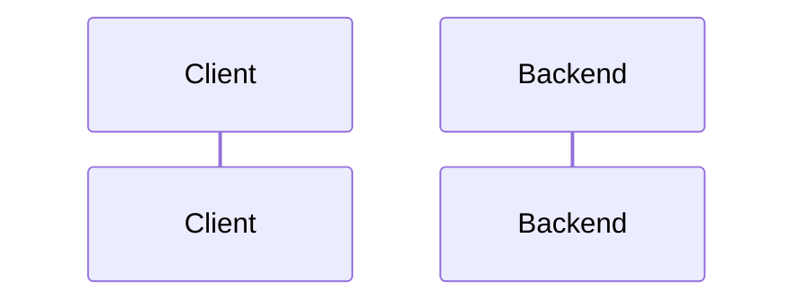

# Seeded synthetic generator and eval workspace

Spec status: draft · 2026-11-02
Design status: pending
Type: feature · Folder: `.docs/works/2026-11-02-p3-synthetic-generator/`

## 1. Spec

### Problem

The thesis needs synthetic data for three things that Digg cannot give: the null world W0, the influence sweep W2 and the community term (super-plan "Data", P3). It is also one of the two co-primary tests of H1 (`syn-W2M-M`). None of it exists yet. This is task 3 in the blueprint (`.docs/implementation-plan.md` §5). Tasks 4, 6 and 7 need its `eval/` workspace, its canonical writer or its datasets. Its planned end date was 2026-11-01.

What exists today (checked on 2026-11-02):
- **No `eval/` folder.** The root `package.json` has `"workspaces": ["apps/*", "packages/*"]`. Nothing writes canonical CSV or a manifest.
- **The only PRNG is `mulberry32` in `apps/backend/prisma/seed.ts`.** Super-plan §2 forbids reusing it (32 bits of state). The blueprint §2.4 fixes the replacement: `rng(masterSeed, stage)`, sfc32 seeded from `sha256("<masterSeed>:<stage>")`.
- **The determinism rule and hook already cover `eval/**`** (`.claude/rules/determinism.md`, `post-edit.cjs`).
- **The contracts are written.** Blueprint §2.2 (six canonical files, columns, sort order, id rules), §2.3 (manifest keys), §2.4 (stage names `users`, `follows`, `communities`, `posts`, `interactions`), §3.1–§3.2 (cut time rule, buckets, "kept") and §3.6 (P3 prints the bucket table for `syn-W2M-M`).
- **Calibration targets** are in `.docs/datasets.md` §6a (Digg, computed from the full files): votes per voter, activity skew of the top 20%, followees of users with a list, followers, votes per story. §6a itself says to calibrate votes per user, the activity skew and the followees of users with a list, and to mark the others as chosen.
- **Scale gap.** Digg has 849 votes per story on average. Size M has 1,000 users and 20,000 posts (super-plan §7, row "Dataset sizes"). At about 22 votes per user that is about 1 vote per post. So votes per story cannot be calibrated. It is a chosen value.
- **D1 is decided but the Bugs Report still lists it as open.** Blueprint §6: "A community post needs membership (author's decision, 2026-10-28)". `.docs/Bugs Report.md` §4 still says "Open decision".
- **Docker.** Both Dockerfiles copy the root `package-lock.json` and only the `package.json` of `apps/backend`, `apps/frontend` and `packages/shared`, then run `npm ci --workspace=...`. Whether `npm ci` still passes when the lockfile lists a new `eval` workspace whose `package.json` is not copied: not checked.

### Scope

**In scope:**
- The `eval/` workspace (`@breadit/eval`), added to the root `workspaces`, with its own test command. `eval/data/` is ignored by git (blueprint §2.2).
- `eval/src/rng.ts` as in super-plan §2 and blueprint §2.4.
- The canonical writer and the manifest writer (`eval/src/canonical/`), as in blueprint §2.2 and §2.3. Task 4 (Digg adapter) will reuse them.
- `eval/config/synthetic-v1.json`. Every parameter is marked "calibrated" (with the `.docs/datasets.md` §6a row it matches) or "chosen".
- The generator with five stages, each with its own stream: users (hidden interests, Pareto activity), follow graph, communities and memberships, posts, interactions. It never runs a ranking, so there is no feedback loop [24].
- The worlds W0, W1, W2L, W2M, W2H (super-plan P3) and the sizes S and M (§7). The datasets that blueprint §4 uses: `syn-W0-S`, `syn-W1-S`, `syn-W2M-S`, `syn-W0-M`, `syn-W1-M`, `syn-W2L-M`, `syn-W2M-M`, `syn-W2H-M` (Open question 1).
- D1 in the data: a community post's author is a member at the post's `created_at` (blueprint §2.2).
- Two printed checks: a calibration table (generated value next to the Digg target) and the bucket table of blueprint §3.6 for `syn-W2M-M`.
- Docs: Bugs Report D1 marked decided, the P3 status in the super-plan with a change-log line, and one line in `CLAUDE.md` "Commands" for the generator.

**Out of scope:**
- The Postgres loader and `--rebase-to` (task 7, `p3-postgres-loader`).
- The Digg adapter (task 4). This task only builds the writer it will use.
- `packages/ranking`, `buildPool`, the scorers, the harness, metrics and statistics (P5).
- Freezing the value of the cut time T (P5, §7 row "Cut time T").
- Any change to `apps/backend`, `apps/frontend` or the database.
- Size L (cut in super-plan 0.2).

### Done when

| # | Check | Expected result |
|---|---|---|
| DW1 | `npm ci` at the root, then the `@breadit/eval` test command | Both exit 0 |
| DW2 | RNG tests: two processes draw 1,000 values from `rng(masterSeed, "users")`; also compare the stream `users` with `follows` | The two processes give equal values. The two stages give different values. A committed known-answer vector matches |
| DW3 | Generate the eight datasets twice, into two empty folders | Every `manifest.json` pair is byte-identical (same SHA-256) |
| DW4 | A format check over every generated folder | Header and column order as in blueprint §2.2, UTF-8, LF, rows sorted, integer ids and times, no self-follow, no repeated follow pair, every interaction on an existing post and not before it, no interaction on one's own post, every community post's author a member at `created_at` |
| DW5 | The calibration table for each size M dataset | Each value marked "calibrated" in the config is within the tolerance of Open question 3 of its `.docs/datasets.md` §6a target |
| DW6 | The bucket table for `syn-W2M-M`, with the rule of blueprint §3.1–§3.2 and `q` = 0.8 | At least 100 kept test users in bucket 0–4 (Open question 4) |
| DW7 | A social-lift number per size M world: how much more likely a user acts on a post when a followee acted on it before | W0 is the lowest. W2L < W2M < W2H. So the influence knob does what its name says |
| DW8 | grep `eval/src` for `Date.now`, `Math.random`, `new Date()`, `performance.now`, `localeCompare`, `.sort()` | No match, or only lines with `// harness-allow: <reason>` |
| DW9 | `bash .claude/hooks/verify.sh` with db and redis up, and `docker compose build` | Both pass. The app images still build with the new lockfile |
| DW10 | `git diff --stat` of the task commits | Only `eval/`, the root `package.json`, `package-lock.json`, `.gitignore`, `CLAUDE.md`, `.docs/super-plan.md`, `.docs/Bugs Report.md` and this task folder (plus the Dockerfiles only if DW9 needs them) |

### Open questions

1. **Which datasets.** Recommendation: the eight that blueprint §4 uses. `syn-W2L-S` and `syn-W2H-S` are not used by any experiment. Other option: all ten (5 worlds × 2 sizes), which costs little but adds two unused rows to the manifest.
2. **"Kept" before `buildPool` exists.** DW6 needs the pool rule of blueprint §3.2, but `buildPool` comes in P5. Recommendation: a small count in `eval/` that follows §3.2 word for word, used only for this check. P5 then adds a test that its harness prints the same table. Other option: adapt `check_cut_time.py` (the P2 Digg script) to read canonical CSV.
3. **Calibration tolerance.** Recommendation: within 10% of the target for means and medians, and within 5 percentage points for the activity skew. Calibrated: votes per user (mean, median), activity skew, followees of users with at least one followee (mean). Chosen: followers, two-way share, votes per story, the like/comment/repost mix, the time span, community sizes. Other option: no tolerance, only print the table.
4. **The 100 threshold for P3.** Blueprint §3.6 proposes at least 100 kept test users in bucket 0–4 at size M, as for Digg. Below that, a "chosen" parameter changes before any ranking run. Recommendation: accept it.
5. **How the P3 values are frozen.** §7 freezes at P3 the rows "Dataset sizes", "Synthetic world parameters" and "Primary W2 cell for H1". §7 says the author runs `/freeze`, but that command does not exist (only `/task`, `/bugfix`, `/approve`). Recommendation: approving this plan freezes `synthetic-v1.json`. The last step writes its SHA-256 into the §7 row "Synthetic world parameters" and adds a change-log line. Other option: a separate freeze step by the author after the checks pass.

## 2. Impact

**Who and what it affects.**
- **Later tasks.** Task 4 reuses the canonical and manifest writers. Tasks 6 and 9 read the eight datasets. Task 7 loads `syn-W2M-M` into Postgres. P5 adds the streams `bootstrap` and `permutation` to the same `rng.ts`. A mistake in the writer or the RNG reaches every number in Chapter 5.
- **Thesis results.** Every synthetic number comes from these files: the H0 gate and E5 (`syn-W0-M`, `syn-W1-M`), H1 test 1 (`syn-W2M-M`), H2 (the three W2 cells), E4, E6, E7 and E8. The baseline table for the supervisor (★) uses the three S datasets.
- **The live app.** No code change. The only shared files are the root `package.json` and `package-lock.json`. DW9 checks that the Docker builds still pass.
- **If we do nothing.** P4 to P7 cannot start, and H0, H2 and the community term cannot be tested at all.

**Schedule.** The budget is 2.5 days. Starting on 2026-11-02, it ends about 2026-11-04 instead of 11-01, so the plan moves about 3 days. There are 2 spare days (11-19, 11-20). The cut triggers of blueprint §5 apply as written. The first two fire if task 6 is not done on 11-09.

**Code areas.** New: `eval/` (package, `src/rng.ts`, `src/canonical/`, `src/generator/`, `config/synthetic-v1.json`, tests). Changed: root `package.json`, `package-lock.json`, `.gitignore`, `CLAUDE.md`. No backend, frontend, Prisma schema or migration.

**Other tasks and bugs on the same files.** No open task. No bug from the Bugs Report is placed here (blueprint §5). D1 is only a doc update here; the product rule in the backend is task 8. Task 5 will edit the backend Dockerfile; if DW9 shows that Docker needs `eval/package.json`, that change is made here and task 5 builds on it.

**Thesis link.** Super-plan P3, §2 (determinism), §5 (protocol, through the bucket table), §7. RQ1 (H1 test 1), RQ2 (H2), H0. Frozen values: this task sets the §7 rows "Synthetic world parameters" (the config) and uses "Master seed", "Base epoch", "Dataset sizes", "History buckets" and "Primary W2 cell for H1" as they are. No existing frozen value changes. No number in the thesis exists yet.

## 3. Design

### Approach

**Rejected options:**

| Option | Why not |
|---|---|
| | |

### Workflow and sequence diagrams

### Failure modes

| # | What can go wrong | How we notice | How we resolve it |
|---|---|---|---|
| F1 | | | |

### Code files

| File | New or changed | Purpose |
|---|---|---|
| | | |

### Data, schema and cache changes
