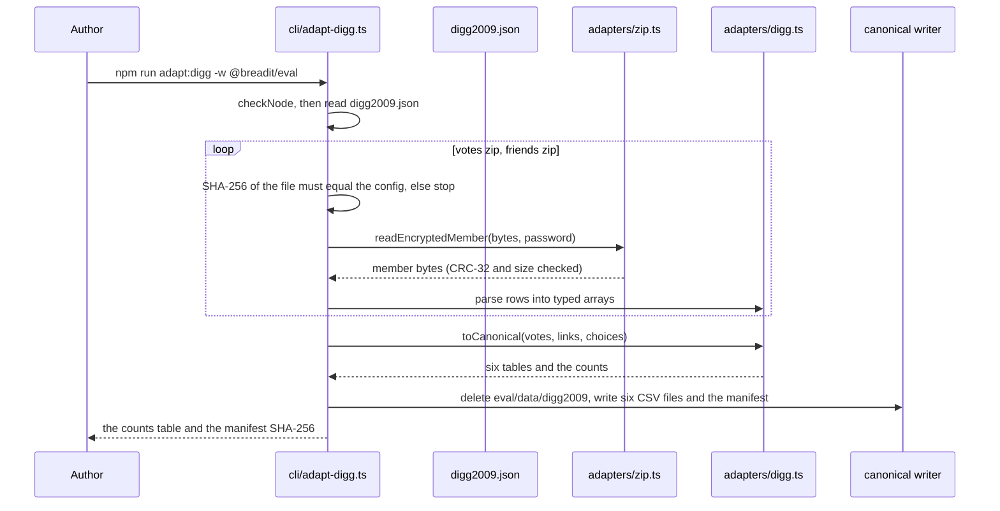
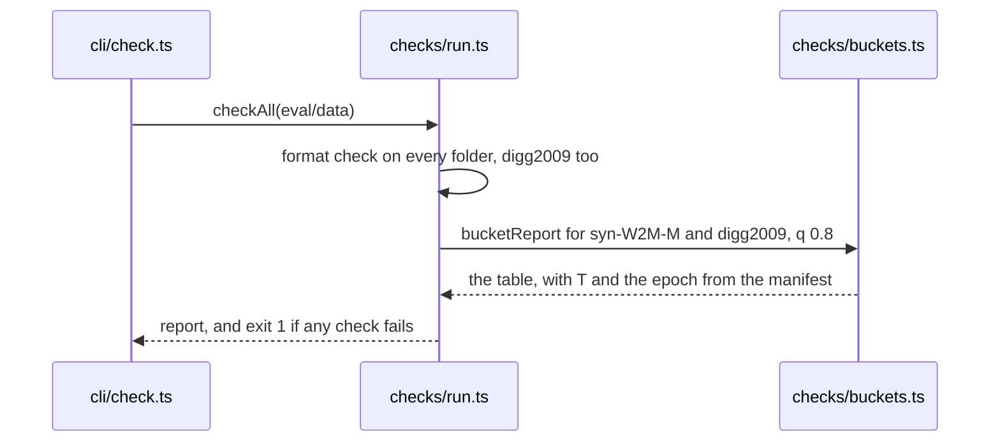

# Digg 2009 adapter to the canonical format

Spec status: approved · 2026-11-02
Design status: draft · 2026-11-02
Type: feature · Folder: `.docs/works/2026-11-02-p4-digg-adapter/`

## 1. Spec

### Problem

Digg 2009 is the real dataset and a co-primary test for H1 (super-plan "Data", P4). The harness (P5) reads only the canonical format of blueprint §2.2, so Digg must be converted to it. This is task 4 in the blueprint (`.docs/implementation-plan.md` §5): "adapter, the real Digg choices, the same bucket table", 2 days, planned end 2026-11-03. Its gate (super-plan P4): Digg must be converted before the P5 baseline table, or P4 is dropped and "no public dataset" becomes a limitation.

What exists today (checked on 2026-11-02):
- **The raw files are on disk.** `datasets/raw/digg2009/digg_votes.zip` and `digg_friends.zip` (git-ignored). Their SHA-256 equal the values in `.docs/datasets.md` §4 (`55bba035…aafda1` and `4d5d3189…59c3bba`).
- **Each zip has one member, deflated (method 8) and encrypted (traditional ZipCrypto, flag bit 1).** The Digg page gives the password. Node has `zlib` for deflate, but no zip reader and no ZipCrypto. The P1 and P2 scripts read the zips in memory with Python's `zipfile` and never extracted a file.
- **The file format** (`.docs/datasets.md` §4): no header row, every value in quotes. Votes are `vote_date, voter_id, story_id` with bare CR line ends. Friends are `mutual, friend_date, user_id, friend_id` with CR LF.
- **The P3 tools exist.** `eval/src/canonical/` (`writeTable`, `writeManifest`, `loadDataset`) and `eval/src/checks/` (`checkFormat`, `bucketReport`). `check` (`eval/src/checks/run.ts`, `checkAll`) runs the format check on every dataset folder, but runs the bucket table only for `syn-W2M-M`.
- **The P2 Digg choices** (`.docs/works/2026-10-28-p2-implementation-blueprint/check_cut_time.py`, used for blueprint §3.7):
  - a repeated (voter, story) pair keeps its earliest vote (7,299 rows dropped);
  - a story's author and `created_at` come from its first vote (ties to the smaller voter id; 0 ties exist);
  - the author's vote is the post, not a positive;
  - every other vote is a `like`, numbered in `(t, voter_id, story_id)` order;
  - follow links with date 0 (1,670) and self-links (5) are dropped;
  - links are directed `user_id → friend_id`, with no reverse added for `mutual` = 1;
  - a follow counts at `t_u` when its date is before `t_u`.
  The blueprint (§6, "P4 choices") says this task decides these for real, runs the bucket table again, and states any change.
- **One text conflict.** Super-plan P4 says "the adapter uses only links dated at or before the test time T". The blueprint contract (§2.6, `AsOf`) and the P2 count use "dated before `t_u`" instead, and `t_u` > T for every test item. Open question 3.
- **`.docs/datasets.md` §4** still says "The zips stay in the scratchpad". They are now in `datasets/raw/digg2009/`.

### Scope

**In scope:**
- An adapter in `eval/` that reads the two zips in memory, checks their SHA-256 first, and writes `eval/data/digg2009/` in the canonical format with a `manifest.json` (blueprint §2.2, §2.3). `communities.csv` and `memberships.csv` hold the header only.
- The Digg choices, decided by Open questions 1 to 5 and listed in the manifest `source` and in this task's Result.
- A count table printed by the adapter: rows read, rows dropped by each rule, and users, stories, follows and positives written.
- `check` runs the bucket table for `digg2009` too, with the same rule as for `syn-W2M-M` (blueprint §3.1–§3.2, `q` = 0.8).
- A comparison with blueprint §3.7. With the P2 choices, the TS bucket table must give the P2 numbers. This also cross-checks `bucketReport` against the Python script.
- Docs: the P4 status in the super-plan with a change-log line (plus the P4 sentence of Open question 3), one line in `.docs/datasets.md` §4 for the new zip location, and the adapter command in the `CLAUDE.md` eval line.

**Out of scope:**
- Flickr and any other dataset.
- Downloading. The zips are already on disk; the adapter never uses the network.
- Freezing the value of the cut time T (P5, §7 row "Cut time T"). This task only prints it.
- The harness, the scorers and the pool code of `packages/ranking` (P5).
- Calibration and lift on Digg. They are synthetic-only checks; Digg is the target, not the subject.
- The license question. It is in the supervisor note and waits for the answer.

### Done when

| # | Check | Expected result |
|---|---|---|
| DW1 | Run the adapter with a zip whose SHA-256 differs (a copy with one byte changed) | It stops before reading a row, names the file and both hashes, and writes nothing |
| DW2 | Run the adapter twice into two empty folders | The two `manifest.json` files are byte-identical, and so is every CSV |
| DW3 | `check` on the output | Format passes for `digg2009` (blueprint §2.2 rules, no self-follow, no repeated follow pair, every like strictly after its story's `created_at`, no like on one's own story) |
| DW4 | The adapter's count table | With the P2 choices: 3,018,197 vote rows read, 7,299 repeats dropped, 3,553 stories, 3,007,345 positives; 1,731,658 link rows read, 1,670 with date 0 and 5 self-links dropped, 1,729,983 follows. Any other choice states its own expected numbers in the Design |
| DW5 | `check` bucket table for `digg2009` at `q` = 0.8 | With the P2 choices it equals blueprint §3.7 exactly: T = 1246068297, 68,120 test users, and every row of the table (for example bucket 0–4: 22,028 test users, 20,644 kept, 1,384 left out, 9,400 kept with a followee). It passes the threshold of 100 |
| DW6 | Read `eval/data/digg2009/manifest.json` | `datasetId` `digg2009`; `source` names both zips with their Internet Archive URL and SHA-256 and the choices made; `epoch` is the Unix epoch; `node` is the pinned version |
| DW7 | List the files the adapter wrote, and `git status` | Only `eval/data/digg2009/` (six CSV files and the manifest). No extracted member anywhere on disk. No change under `datasets/` |
| DW8 | `bash .claude/hooks/verify.sh` with db and redis up | Every check passes, including `eval verify` and its grep test for forbidden patterns |
| DW9 | `git diff --stat` of the task commits | Only `eval/`, `CLAUDE.md`, `.docs/super-plan.md`, `.docs/datasets.md` and this task folder |

### Open questions

1. **Follow links with date 0 (1,670, 0.10%).** Recommendation: drop them, as P2 did. Their date is unknown, so keeping them could leak a future follow into the past. Other option: keep them as "old" (date 0, visible at every `t_u`).
2. **`mutual` = 1 rows (51.18%).** Recommendation: no reverse link, as P2 did. The page gives one direction per row, and a reverse row's date is unknown. Many `mutual` rows have no reverse row in the file (`.docs/datasets.md` §6a). Other option: add the reverse with the same date, which raises the mean followees from 6.19 to 8.05 over all users.
3. **Which follows count for a test item.** Recommendation: the blueprint rule. The adapter keeps every dated link with its date. The harness counts a link when its date is before `t_u` (`AsOf`, blueprint §2.6), as P2 did. A link dated between T and `t_u` is still before the test event, so it is no leak. The super-plan P4 sentence "uses only links dated at or before the test time T" becomes "uses a link only when it is dated before the test time of the item (`AsOf`)". This changes super-plan text, not a frozen value. Other option: the adapter drops every link dated after T. That is stricter, but it differs from the synthetic data and from blueprint §3.7.
4. **Ids.** Recommendation: keep Digg's own `voter_id`/`user_id` and `story_id` as `user_id` and `post_id`, so any row can be traced to the raw file. `event_id` is the rank in `(t, voter_id, story_id)` order, starting at 1. Other option: renumber users and stories from 1.
5. **`users.csv` and `joined_at`.** Digg has no join date. Recommendation: `users.csv` holds every id that votes or appears in a kept follow link. `joined_at` is the earliest time the id appears (its first vote, or the date of its first kept link on either side). No harness signature in blueprint §2.6 reads `joined_at`. Other option: `joined_at` = 0 for all.

## 2. Impact

**Who and what it affects.**
- **Thesis results.** H1 test 2 (the real-data test), the Digg rows of E1 to E6, and H2 on real data all read `digg2009` (blueprint §4). A wrong choice here changes these numbers. The Digg limits stay as stated in super-plan P4: one month, 3,553 front-page stories, about 41% of voters without follows, no communities.
- **Later tasks.** Task 6 (`p5-eval-harness`) reads `digg2009`. P5 freezes T from it. P8 (`thesis:repro`) runs this adapter from the raw zips, so the zips must stay in `datasets/raw/digg2009/` with these hashes.
- **The live app.** None. No backend, frontend, schema or database change.
- **If we do nothing.** H1 has only its synthetic test. The cut order (super-plan §8) drops Digg only if this task fails its gate.

**Supervisor (†).** The blueprint marks this task † because the supervisor has not answered the P1 note (data choice, license). The plan says the work starts anyway. If the answer drops Digg, only this task's output and the Digg rows change.

**Schedule.** 2 days. Starting 2026-11-02 afternoon, it ends about 2026-11-04, one day after the plan. Task 5 (`p5-ranking-package`) does not depend on it and can start next.

**Code areas.** New: the adapter, a small in-memory zip reader (deflate plus ZipCrypto, or another way decided in the Design), and their tests in `eval/src/`. Changed: `eval/src/checks/run.ts` (bucket table for `digg2009`), `eval/package.json` (one script). Docs: `CLAUDE.md`, `.docs/super-plan.md`, `.docs/datasets.md`.

**Other tasks and bugs on the same files.** `eval/` was built by `p3-synthetic-generator` (closed). No bug in the Bugs Report touches it.

**Thesis link.** Super-plan P4, §2 (determinism: the adapter output is Class D), §5 (protocol, through the bucket table). RQ1 (H1 test 2), RQ2 (H2 on Digg). Frozen values: none changed. The cut-time rule (`q` = 0.8, blueprint §3.1) is used as it is; the value of T is printed, not frozen.

## 3. Design

### Approach

The author approved the Spec on 2026-11-02 without choosing another option, so this design follows the recommendation of all five open questions. These are the P2 choices: drop links with date 0, no reverse for `mutual`, follows counted by the `AsOf` rule (before `t_u`), Digg's own ids, and `joined_at` from the first appearance. So DW4 and DW5 expect exactly the P2 numbers.

**Read the zips in memory, in TypeScript, with no new dependency.** Checked on 2026-11-02:
- Both local headers have flag 1 (encrypted, no data descriptor) and method 8 (deflate). The CRC-32 and both sizes are in the local header, and there is no zip64.
- The pinned Node has `zlib.inflateRawSync` and `zlib.crc32`.

So the reader is small:
1. Find the end-of-central-directory record and the one central entry.
2. Read the local header.
3. Decrypt with traditional ZipCrypto: three 32-bit keys updated with a CRC-32 table, then a 12-byte header whose last byte must equal the high byte of the CRC-32.
4. Inflate, and compare the CRC-32 and the size of the output with the header.

It supports only this case. A second member, another method, bit 3 (data descriptor) or zip64 stops it with a clear message. The SHA-256 check runs first, so only the two known files ever reach the reader. Nothing is written to disk until the canonical output.

**One config file for the source.** `eval/config/digg2009.json` holds, for each zip, the file name, the Internet Archive URL, the capture time, the SHA-256, the member name and the member size. It also holds the published password, the page URL, the citation, and the choices. A test reads the zip table of `.docs/datasets.md` §4 and fails if a URL, SHA-256, member name or member size differs. This works like the `frozen-v1.json` test of P3: the doc stays the source, and the code cannot drift from it.

**Parse strictly, then transform with pure functions.** The two members are about 85.6 MB and 61.2 MB. The parser scans the bytes once:
- each line has exactly 3 (votes) or 4 (friends) fields, each a double-quoted non-negative integer;
- a line ends with CR, LF or CR LF;
- one empty last line is allowed;
- anything else stops with the member name and line number.

Rows go into typed arrays (`Int32Array`, `Float64Array`), not one object per row, to keep memory low. Then `toCanonical(votes, links, choices)` builds the six tables with the P2 rules:
1. **Repeats.** A repeated (voter, story) pair keeps its earliest vote.
2. **Stories.** Each story's author and `created_at` come from its first vote (ties to the smaller voter id). The author's vote is the post, not a positive.
3. **Likes.** Every other vote is a `like`. `event_id` is the 1-based rank in `(t, voter_id, story_id)` order.
4. **Follows.** A link with date 0 or a self-link is dropped. A pair keeps its earliest date (the file has none repeated). There is no reverse link.
5. **Users.** `users.csv` is every voter, plus every id in a kept link. `joined_at` is the earliest of the id's first vote and the dates of its kept links, on either side.
6. **Communities.** `communities.csv` and `memberships.csv` hold the header only.

The tables go through the P3 `writeTable` and `writeManifest`, so sort order, LF and hashes follow blueprint §2.2 and §2.3 without new code.

**Manifest `source`:**
- `kind: "digg"`;
- for each zip: name, URL, capture time, SHA-256, member;
- the choices, by name;
- the counts table of DW4.

`epoch` is `{ iso: "1970-01-01T00:00:00Z", seconds: 0 }`. There is no `masterSeed`, because the adapter draws no random number.

**`check`.** `checkAll` in `run.ts` runs the bucket table for every dataset id in a fixed list: `syn-W2M-M` and `digg2009`. `bucketVerdict` already takes the epoch from the manifest. Calibration and lift stay synthetic-only, because the existing `sizeM` test is false for Digg.

**Rejected options:**

| Option | Why not |
|---|---|
| An npm zip library (for example `adm-zip`, `unzipper`) | A new dependency for one fixed case. Most of them do not decrypt ZipCrypto. The reader above is short and is tested against a zip made by the system `zip -P` |
| Extract with `unzip -P` into a temp folder | It writes the raw CSVs to disk. P1 and P2 never extracted the members, and DW7 asks for no extracted file |
| Run the Python of P2 and convert its output | A second language on the data path. The harness is TS, and DW5 needs the TS bucket code to meet the Python numbers independently |
| Add reverse links for `mutual` rows, or keep links with date 0 | Open questions 1 and 2: the dates are unknown, so they could leak the future |

### Workflow and sequence diagrams

Adapt:

Check (only the new part):

### Failure modes

| # | What can go wrong | How we notice | How we resolve it |
|---|---|---|---|
| F1 | A zip is missing or has another SHA-256 | The check runs before any read | Stop, and name the file, both hashes and the URL from the config. Write nothing and delete nothing (DW1) |
| F2 | Wrong password or a damaged member | The ZipCrypto check byte, or the CRC-32 and size after inflate | Stop with the member name. Never write partial output |
| F3 | A zip shape the reader does not support (bit 3, zip64, more than one member, method other than 8) | Header checks in `zip.ts` | Stop. With the pinned SHA-256 this cannot happen; the check is for a wrong file passed by hand |
| F4 | A bad line (wrong field count, missing quote, non-digit) | The strict parser | Stop with the member and the line number. Do not skip lines quietly |
| F5 | Memory or time with 3 million rows (not checked) | The adapter and `check` crash with an out-of-memory error, or run long | Typed arrays in the parser. The `adapt:digg` and `check` scripts set `--max-old-space-size=4096`. The acceptance notes the run time (not Class D) |
| F6 | The TS bucket table differs from blueprint §3.7 | DW5 | Compare the steps with the P2 script's output in order: positives `n`, T, test users, then each row. Find the rule that differs and fix the code. Never change a choice to force the match |
| F7 | A like at the same second as its story's first vote | The format check (`interaction-not-after-post`) | P2 found no tie at the first vote, so none is expected. If one appears, stop and report: it needs an author decision |
| F8 | An author votes again on their own story | Repeats keep the earliest vote, which is the authored one | Expected. The later rows are counted under "repeats dropped" |
| F9 | Old files stay in `eval/data/digg2009/` | `check` fails on a file not in the manifest | The adapter deletes the folder after the SHA-256 check, then writes it fresh. It refuses an out dir outside the given path |
| F10 | `datasets.md` and `digg2009.json` disagree | The config test | Fix the JSON. The doc is the source |
| F11 | A forbidden pattern (`Date.now`, `.sort()` with no compare) | The post-edit hook and the grep test | Remove it. The capture time is a string in the config, never a clock |

The canonical data has no blocked users, soft deletes, pending posts, bans or caches (blueprint §2.2).

### Code files

| File | New or changed | Purpose |
|---|---|---|
| `eval/config/digg2009.json` | new | Zip names, URLs, capture times, SHA-256, members and their sizes, the password from the page, page URL, citation, choices |
| `eval/src/adapters/zip.ts` | new | `readEncryptedMember(zip: Buffer, password: string): { name: string; data: Buffer }` (ZipCrypto, `inflateRawSync`, `crc32`) |
| `eval/src/adapters/zip.test.ts` and `eval/src/adapters/fixtures/tiny.zip` | new | The reader against a few-hundred-byte zip made once with the system `zip -P` and committed. The test covers the right and wrong password, a changed byte (CRC), and an unsupported shape |
| `eval/src/adapters/digg-parse.ts` | new | `parseVotes(buf): VoteRows`, `parseFriends(buf): LinkRows` (typed arrays), the strict line rules |
| `eval/src/adapters/digg.ts` | new | `loadDiggConfig()`, `toCanonical(votes, links, choices): { tables, counts }`, `adaptDigg(rawDir, outDir): { manifest, counts }` |
| `eval/src/adapters/digg.test.ts` | new | Parser cases (CR, CRLF, quotes, bad lines). The `toCanonical` cases of `test_check_cut_time.py` that apply: repeats keep the earliest, author and `created_at` from the first vote with ties to the smaller voter, the author vote is not a positive, event order `(t, voter, story)`, date 0 and self-links dropped, a pair keeps its earliest date. Also: no reverse for `mutual`, users and `joined_at`. And the config against `.docs/datasets.md` §4 |
| `eval/src/cli/adapt-digg.ts` | new | Command line: raw dir (default `datasets/raw/digg2009`) and out dir (default `eval/data`). Prints the counts and the manifest SHA-256 |
| `eval/src/checks/run.ts` | changed | Bucket table for `syn-W2M-M` and `digg2009` |
| `eval/src/checks/run.test.ts` | changed | A Digg-shaped fixture (`kind: "digg"`, Unix epoch) gets a bucket table and no calibration |
| `eval/package.json` | changed | Script `adapt:digg`. `--max-old-space-size=4096` on `adapt:digg` and `check` |
| `CLAUDE.md` | changed | The eval line names `adapt:digg` and the raw zip folder |
| `.docs/super-plan.md` | changed | The P4 sentence of Open question 3, a P4 status paragraph, the §4 status table, a change-log line |
| `.docs/datasets.md` | changed | §4: one line saying the zips are now kept in `datasets/raw/digg2009/` (git-ignored) |
| `check_output.txt` (this folder) | new | The `check` output for `digg2009` (counts, bucket table, manifest SHA-256) and the double-run result |

### Data, schema and cache changes

None in Postgres or Redis. The app is not touched. The new output is `eval/data/digg2009/`: six CSV files and one manifest, git-ignored and rebuilt from the zips. `datasets/raw/digg2009/` is only read.
