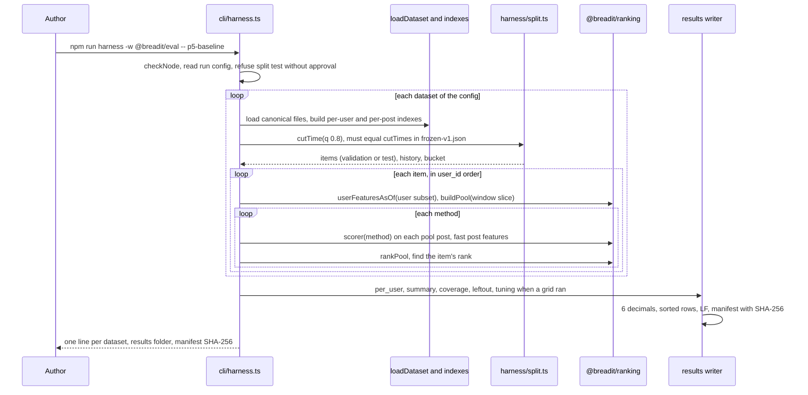
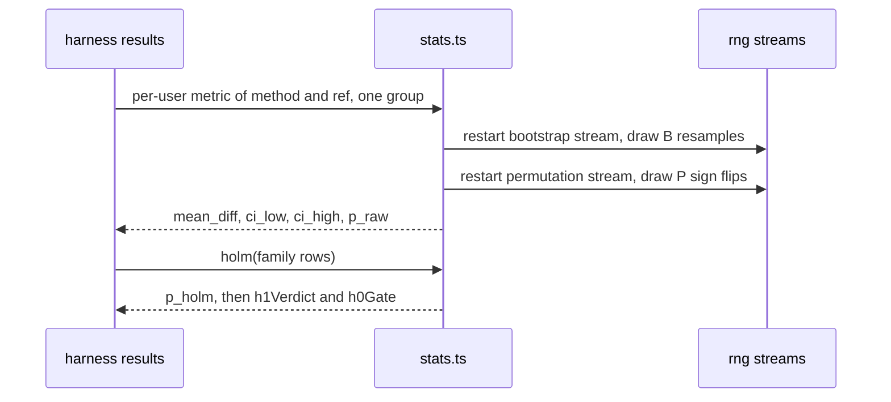

# Evaluation harness, metrics, statistics and the baseline table

Spec status: approved · 2026-11-02
Design status: approved · 2026-11-02
Type: feature · Folder: `.docs/works/2026-11-02-p5-eval-harness/`

## 1. Spec

### Problem

Every number in Chapter 5 comes from one program: the harness. It takes a canonical dataset and a split, finds each user's test or validation item, builds the pool and ranks it with each method. Then it writes metrics and statistics to CSV files that the report turns into tables. Super-plan P5 part 2 asks for it, with three tests that must pass (golden, leakage, double run) and a first output for the supervisor (★): a baseline table on the validation split before tuning starts. This is task 6 in the blueprint (`.docs/implementation-plan.md` §5): "harness, metrics, stats, scipy cross-check, golden, leakage and double-run tests, baseline table", 2 days, planned end 2026-11-08. The four "freeze at P5" rows of super-plan §7 were moved here by task 5 (its Open question 2): the baseline grids, the larger pool (W_L, N_L), the value of T, and the use of `m` and the α/β grid as they are.

What exists today (checked on 2026-11-02):
- **The data.** `eval/data/` holds the eight synthetic datasets (P3) and `digg2009` (P4), with manifests. `loadDataset` (`eval/src/canonical/dataset.ts`) reads any of them. `digg2009/interactions.csv` is 100 MB; the synthetic ones are under 1 MB each.
- **The ranking code.** `@breadit/ranking` (task 5) has `visibleAt`, `userFeaturesAsOf`, `postFeaturesAsOf`, `buildPool`, `scorer` for 13 method ids and `rankPool` (blueprint §2.6). It uses string user ids (`u` plus 10 digits, blueprint §2.5); the canonical files use integers.
- **The split rule exists once.** `eval/src/checks/buckets.ts` has `cutTime`, `testItems`, `historyCount` and `bucketOf` (blueprint §3.1–§3.2). It already gives T = 1246068297 for `digg2009` and T = 21412417 for `syn-W2M-M` at `q` = 0.8 (P3 and P4 `check_output.txt`). There is no validation-item rule in code yet. Super-plan §5: a user's validation item is their last positive before T, on a post they had not touched before.
- **The PRNG streams** `bootstrap` and `permutation` are reserved in `eval/src/rng.ts` for this task (blueprint §2.4).
- **The contracts.** Blueprint §2.7 gives the results files (`per_user.csv`, `summary.csv`, `coverage.csv`, `leftout.csv`, `tuning.csv`, `compare.csv`, `density.csv`) under `.docs/results/<runId>/`. §2.9 gives the `rank` command. §3.3 gives the Holm families F1 and F2, §3.4 the reading of H1 ("for the author to confirm"), §3.5 the H0 gate, §4 the measurement plan. `.docs/results/` does not exist yet.
- **The guard.** `.claude/hooks/pre-bash.cjs` asks the author before any command with `--split test` (super-plan §5: the test split runs once, after tuning is frozen).
- **scipy is not usable on this Mac.** Python 3.13 imports a broken numpy ("exit the numpy source tree"); the Homebrew, 3.14 and system Pythons have no scipy. statsmodels is not installed anywhere. The planned scipy cross-check needs an environment first (Open question 5).
- **Size not checked.** The harness on `digg2009` has about 68,000 test users with a pool of about 800 posts each. Its run time and memory are not known.

### Scope

**In scope:**
- **The harness** in `eval/src/harness/`. It reads one canonical dataset and one split (`validation` or `test`) and does these steps:
  1. Compute T by the blueprint §3.1 rule, reusing `buckets.ts`.
  2. Find each user's item (validation: last positive at or before T; test: last positive after T, both on a post not touched before).
  3. Build the features and the pool at the item's time with `@breadit/ranking`.
  4. Rank the pool with each requested method, and find the item's rank.
- **The results files.** The harness writes `per_user.csv`, `summary.csv`, `coverage.csv`, `leftout.csv` and a manifest with hashes (blueprint §2.7, §2.3).
- **Metrics** (`eval/src/metrics.ts`): Recall@K (= HitRate@K), NDCG@K and Coverage@K for K of §7 (super-plan §5).
- **Statistics** (`eval/src/stats.ts`): paired bootstrap 95% CI and paired randomization test with the seeded `bootstrap` and `permutation` streams, the resample counts of §7, and Holm per family of blueprint §3.3. The code that writes `compare.csv`. One cross-check against scipy on a small fixture, with the fixture result committed.
- **Tuning support.** For each tuned method, a grid run on the validation split writes `tuning.csv` and picks the value with the rule of super-plan §5. It is tested on the golden fixture, and run on real data only in task 9.
- **The `rank` command** of blueprint §2.9, for the P6 parity test.
- **The three P5 tests:** golden, leakage, double run (super-plan P5 "Done when").
- **The baseline table ★:** BL0–BL5 on `syn-W0-S`, `syn-W1-S` and `syn-W2M-S`, validation split, with the production and published parameters. It is written as a short note in this task folder, ready to send.
- **The P5 frozen values,** proposed in Open questions 1 to 3 and written into §7 at the end of the task: the baseline grids, W_L and N_L, and the value of T for each dataset.

**Out of scope:**
- Any run of the test split. The harness supports it, but this task never runs it.
- Tuning runs on real data, E1–E8, `density.csv`, the report, `macros.csv` and `results-macros.tex` (task 9, `p7-offline-experiments`).
- The parity sample CSV of blueprint §2.9 (task 8 draws it with the `parity` stream).
- Any change to `@breadit/ranking`'s formulas, the backend or the frontend.

### Done when

| # | Check | Expected result |
|---|---|---|
| DW1 | **Golden.** A tiny committed dataset (a few users and posts, written by hand) through the harness, all methods, validation and test split | The CSV files equal the committed expected files byte for byte. For at least two users, the expected rank and metrics are worked out by hand in the test |
| DW2 | **Leakage.** For each user of the golden dataset and of a sample from `syn-W2M-S`, change or delete every event after that user's item time (follows, memberships, interactions, later posts), then rank again | The user's `per_user.csv` rows are unchanged for every method |
| DW3 | **Double run.** The baseline-table run twice into two empty folders | Every results file and the manifest are byte-identical |
| DW4 | **Metrics** on hand-made ranks | Recall@K equals HitRate@K; NDCG@K = `1/log2(r+1)` for `r ≤ K`, else 0; Coverage@K as super-plan §5 |
| DW5 | **Statistics** on a small committed fixture | Bootstrap CI, randomization p-value and Holm-adjusted p agree with the scipy reference within the tolerance the Design states. Two runs give identical numbers |
| DW6 | **T and items** on all nine datasets, both splits counted but only validation ranked | T for `digg2009` is 1246068297 and for `syn-W2M-M` 21412417. The test-split kept and left-out counts per bucket equal the P3 and P4 bucket tables |
| DW7 | **Baseline table ★** | `summary.csv`, `coverage.csv` and `leftout.csv` for BL0–BL5 on the three S datasets, validation split, and a one-page note in this task folder with the table and how it was made |
| DW8 | **No test-split run** | No results folder has `split = test`, except the golden fixture's. The hook never asked during the task |
| DW9 | **Size.** Validation run of BL2 and H (frozen `m`, α = β = 1 as a plain setting) on `syn-W2M-M` and on `digg2009` | Both finish. Run time and peak memory are reported (Class R, not compared) |
| DW10 | **`rank` command** for a few (dataset, method, user, `asOf`) cases | The printed order equals the order behind that user's `per_user.csv` rank |
| DW11 | `bash .claude/hooks/verify.sh` with db and redis up | Every check passes, and the eval grep test covers the new files |
| DW12 | `git diff --stat` of the task commits | Only `eval/`, `.docs/results/` (if Open question 4 keeps it), `.gitignore`, `CLAUDE.md`, `.docs/super-plan.md`, `.docs/implementation-plan.md` and this task folder |

### Open questions

1. **Baseline grids (§7, freeze at P5).** Each grid needs 3 to 5 values that include the published or production value. Recommendation:
   - BL2t age weight: 0.0625, 0.125, 0.25, 0.5, 1 per hour;
   - BL4 time divisor: 11,250, 22,500, 45,000, 90,000, 180,000 seconds;
   - BL5 gravity: 1.2, 1.5, 1.8, 2.1, 2.4.

   The first two step by a factor of 2 around the published value, because they scale time. Gravity is an exponent, so it steps evenly. Other option: 3 values each, which is cheaper to tune and less fair to the baselines.
2. **Larger pool for E8 (§7, freeze at P5).** Recommendation: W_L = 14 days, N_L = 4,000, twice W and N_max. At the Digg cut time this roughly doubles the pool (823 stories in 7 days, P4). Other option: W_L = 30 days with no change to N_max, which tests the window alone.
3. **The value of T (§7, freeze at P5).** T comes from the rule of blueprint §3.1 and the data, so it is not chosen. Recommendation: the harness computes it, the task writes the nine values into the §7 row "Cut time T", and from then on the harness checks the computed T against that row and stops if they differ. That protects against a silent change in a dataset.
4. **Where large results go.** Blueprint §2.7 puts every results file in `.docs/results/<runId>/`. For `digg2009`, `per_user.csv` would have about 68,000 users × 13 methods ≈ 900,000 rows (tens of MB) per split. Recommendation: `summary.csv`, `coverage.csv`, `leftout.csv`, `tuning.csv`, `compare.csv`, `density.csv` and the manifest stay in `.docs/results/<runId>/` and are committed. `per_user.csv` is committed only when it is under 5 MB. Otherwise it goes to `eval/results/<runId>/` (git-ignored), and its SHA-256 is still in the committed manifest. This changes the contract of §2.7 a little. Other option: commit every `per_user.csv` with Git LFS.
5. **The scipy cross-check environment.** Recommendation: a Python virtual environment outside the repo with pinned `numpy` and `scipy`, used once. The cross-check script and its output are committed in this task folder with the versions. scipy has no Holm function, so Holm is checked against a worked example by hand from the paper [22]. Other option: skip scipy and check every statistic against hand-computed small cases only.
6. **The reading of H1 (blueprint §3.4, "for the author to confirm").** The `compare.csv` code computes both the Holm-adjusted p and the bootstrap CI. Recommendation: confirm §3.4 as written. H1 passes on a dataset when, for NDCG@10 in group 0–4, the Holm-adjusted p is below 0.05 and the lower end of the 95% CI is above 0. Other option: the CI alone (the super-plan's words), which ignores the Holm step.

## 2. Impact

**Who and what it affects.**
- **Thesis results.** Every table and figure in Chapter 5 comes from these files: the split, the metrics, the statistics and the H1 verdict. A bug here is a wrong thesis. DW1 to DW5 test each layer: hand-checked numbers, no leak, determinism, and an outside reference for the statistics.
- **The supervisor checkpoint ★.** The baseline table is the first number the supervisor sees. It goes out before tuning, as a send, not a stop (blueprint §5).
- **Later tasks.** Task 9 runs E1–E8 through this harness and adds the report and macros. Task 8 uses the `rank` command for the parity test. P8's `thesis:repro` reruns everything and compares the manifests.
- **The live app.** None. No backend, frontend or database change.
- **If we do nothing.** No experiment can run; the thesis has no results.

**Frozen values.** This task proposes and, at the end, writes three §7 rows: the baseline grids, the larger pool and the value of T (Open questions 1–3). It uses `m`, the α/β grid, K, the buckets, the resample counts and the levels as they are. No existing frozen value changes.

**Schedule.** Budget 2 days, planned end 2026-11-08. Starting on 2026-11-02, it should end around 11-04. The cut triggers 1 and 2 (the shuffle part of E5, and E8) fire only if this task is not done on 11-09.

**Code areas.**
- New: `eval/src/harness/`, `eval/src/metrics.ts`, `eval/src/stats.ts`, `eval/src/cli/` (`harness`, `rank`), a golden fixture with expected CSVs, and tests.
- Changed: `eval/package.json` (scripts), `.gitignore` (Open question 4).
- Docs: `CLAUDE.md` (commands), super-plan §7 and P5 status, blueprint §2.7 if Open question 4 changes it.

**Other tasks and bugs on the same files.**
- `eval/src/checks/buckets.ts` is reused, not changed, unless the Design moves its split functions to a shared place.
- No bug in the Bugs Report touches `eval/`.

**Thesis link.**
- **Super-plan:** P5 part 2, §2 (Class D: every file hashed), §5 (the whole protocol), §7.
- **Blueprint:** §2.7, §2.9, §3.3–§3.5, §4.
- **Hypotheses:** RQ1 and H1 (the F1 family and the H1 reading), RQ2 and H2 (through task 9), H0 (the gate code).

## 3. Design

### Approach

The author approved the Spec on 2026-11-02 without choosing another option, so this design follows the recommendation of all six open questions:
1. **Baseline grids:** BL2t 0.0625–1, BL4 11,250–180,000, BL5 1.2–2.4.
2. **Larger pool:** W_L = 14 days, N_L = 4,000.
3. **T:** computed, recorded in §7, then enforced.
4. **Big files:** `per_user.csv` over 5 MB lives in a git-ignored folder, with its hash in the committed manifest.
5. **scipy:** a one-time virtual environment outside the repo.
6. **H1:** the reading of blueprint §3.4 is confirmed.

**Call the shared package wherever possible.** The live feed (task 8) will call `@breadit/ranking`, so the harness calls the same functions. That way parity is true by construction, not by a second copy:
- `userFeaturesAsOf`, with only this user's follows, memberships and positives passed in (the function filters by user anyway, so a subset gives the same result);
- `buildPool`, with only the posts in the window passed in (the function filters by window anyway);
- `scorer(method)` and `rankPool`, unchanged.

**One fast path, checked against the package.** `postFeaturesAsOf` walks every positive of a post. On Digg that is about 850 votes per story, times about 800 posts in a pool, times about 68,000 users, which is far too slow. The harness builds `PostFeatures` itself from per-post indexes:
- **Counts.** Positives sorted by `(t, id)` with running counts per type. A binary search with the `AsOf` rule gives likes, comments and reposts.
- **`engagedBy`.** It holds only this user's followees who acted on the post before the item time. They are found by walking the user's sorted followees, so the list is sorted.

No scorer reads `engagedBy` except through `engagedBy ∩ followees` (BL6, H and its ablations; see `packages/ranking/src/scorers.ts`), so every score is the same. A `reference` mode uses the package's `postFeaturesAsOf` unchanged. A test runs both modes on `syn-W2M-S` and on the golden dataset, and requires byte-identical `per_user.csv` (F3).

**The split.** `eval/src/harness/split.ts` imports `cutTime`, `testItems` and `historyCount` from `eval/src/checks/buckets.ts`, so the T rule exists once. It adds `validationItems`: for each user, the last positive with `t ≤ T`, by `(t, event_id)`.

The canonical files have no repeated (user, post) pair and no positive on one's own post (P3 and P4 format checks), so "a post the user had not touched before" holds for every item. The harness still checks it and stops if it fails.

For each item:
- `asOf = { t: item.t, beforeEventId: item.eventId }`;
- `history = historyCount`, with the bucket from `bucketOf`;
- earlier positives = the posts of the user's visible positives;
- the user id becomes `u` plus 10 digits (blueprint §2.5).

**T is checked against §7.** `frozen-v1.json` gets `cutTimes` (dataset id to T), `poolLarge` (`{ windowDays, poolCap }`) and `baselineGrids`. The existing `frozen.test.ts` reads the matching §7 rows and must agree. The harness computes T, and stops when it differs from `cutTimes[datasetId]`. A dataset with no recorded T can run only with `--record-t`. That flag prints T and writes no results; it is used once, in Step 9 of the plan, to fill the row.

**Runs are configs.** Each run is a committed JSON file, `eval/config/runs/<runId>.json`, with these fields:
- `datasets`;
- `split`;
- `methods`;
- the `params` of each method (a fixed value, or `"grid"` for tuning);
- `pool` (`normal` or `large`);
- `mode`, which is always `fast` except in tests.

`npm run harness -w @breadit/eval -- <runId>` runs it. This task adds one config, `p5-baseline` (Spec DW7). The command reads `split` only from the config file, never from a `--split` flag, so the hook in `pre-bash.cjs` is not needed for it. To keep the "author decides" rule, the harness itself refuses `split: "test"` unless the run config also has `"testApprovedBy": "author"`. Task 9 adds that field when the author agrees.

**Output.** `.docs/results/<runId>/` holds:
- `summary.csv`, `coverage.csv`, `leftout.csv`, and `tuning.csv` when a grid ran (blueprint §2.7 columns);
- `manifest.json` with the run config SHA-256, each input dataset's manifest SHA-256, `node`, and every output file with rows and SHA-256.

`per_user.csv` goes there when it is under 5 MB. Otherwise it goes to `eval/results/<runId>/` (git-ignored), with its hash still in the committed manifest (Spec Open question 4). Every number is printed with 6 decimals. All means sum in `user_id` order.

**Metrics** (`eval/src/metrics.ts`). With the item at 1-based rank `r` in the full pool:
- **Recall@K** (= HitRate@K) is `[r ≤ K]`.
- **NDCG@K** is `1 / log2(r + 1)` when `r ≤ K`, else 0.
- **Coverage@K** is the number of distinct posts in any top-K list of the run, divided by the number of distinct posts in any pool of the run, per method and K (super-plan §5).

Summary groups are each bucket, `0-4` and `all`.

**Statistics** (`eval/src/stats.ts`). For a comparison (method, ref, K, group), `d_i` is method minus ref, per kept user, in `user_id` order.
- **Bootstrap.** B resamples (§7) of n indices each. Each resample's mean is kept, and the CI uses the 2.5th and 97.5th percentiles with linear interpolation (numpy's default).
- **Randomization test.** P sign-flip permutations (§7). The two-sided `p = (1 + #{|mean*| ≥ |mean_obs|}) / (P + 1)`.
- **Common random numbers.** Every comparison restarts its stream: `rng(masterSeed, "bootstrap")` and `rng(masterSeed, "permutation")`. Adding or removing a comparison then changes no other result, and the cost stays linear.
- **Holm.** Within one family (blueprint §3.3): sort by `p_raw` (ties by the comparison key). Then `p_holm_i = max_{j ≤ i} min(1, (m − j + 1) · p_j)`.
- **`h1Verdict(rows)`** follows blueprint §3.4: F1 row, NDCG@10, group 0–4, `p_holm < 0.05` and `ci_low > 0`.
- **`h0Gate(rows)`** follows blueprint §3.5: `ci_low ≤ 0` for H − BL2, NDCG@10, all users, on `syn-W0-M`.

`compare.csv` is written by `writeCompare`. In this task it runs only on the fixture; task 9 runs it on real data.

**Tuning.** For a method with `"grid"` params, the harness runs every grid point on the validation split and writes `tuning.csv`. It picks by NDCG@10 over all kept users, with ties to the smaller value; for H, ties go to the smaller `(α, β)` in that order (super-plan §5). The grids come from `frozen-v1.json`: α/β from §7, the three baseline grids from Spec Open question 1. In this task it is tested on the golden dataset only.

**The `rank` command** (blueprint §2.9): `npm run rank -w @breadit/eval -- --dataset <id> --method <m> --user <u> --asof <t> [--before-event <id>] --top <n>`. The params come from a run config or from flags. It prints post ids in order, using the same code path as the harness.

**The scipy cross-check.** `stats_crosscheck.py` in this task folder runs once, in a virtual environment outside the repo with pinned `numpy` and `scipy`, on `eval/src/stats-fixture.csv`. The fixture has 14 paired values, few enough for an exact permutation test (`2^14` sign patterns). The script writes `stats_reference.json`, with the exact p-value of `scipy.stats.permutation_test` (`permutation_type="samples"`) and the CI of `scipy.stats.bootstrap` (`paired=True`, `method="percentile"`). The TS test passes when:
- our exact enumeration equals scipy's p to `1e-12`;
- our Monte Carlo p is within 3 standard errors of it;
- our CI bounds are within 0.02 of scipy's (both are Monte Carlo, with different generators).

Holm is checked against a worked example by hand from Holm (1979).

**Rejected options:**

| Option | Why not |
|---|---|
| Call `postFeaturesAsOf` everywhere | About 850 × 800 × 68,000 positive checks per method on Digg. The fast path gives the same scores, and the reference mode proves it |
| Change `@breadit/ranking` to export the hybrid's terms for tuning | Out of the Spec's scope (no change to the package). Calling `scorer` per grid point is fast enough at this size |
| Reuse the P3 `check` code for the pool | `check` only counts. The harness must call `buildPool` itself, so the pool that is ranked is the pool the live feed uses |
| A `--split test` flag on the command line | The test split is set by the run config and needs `testApprovedBy` there; the hook still guards any shell command that types it |
| One running RNG stream across comparisons | The result of one comparison would depend on which comparisons came before it |

### Workflow and sequence diagrams

One run:

Statistics (task 9 calls it; this task tests it):

### Failure modes

| # | What can go wrong | How we notice | How we resolve it |
|---|---|---|---|
| F1 | A future event leaks into a feature | DW2 leakage test | Every feature goes through `visibleAt` or a strict `t < asOf.t`. The test mutates or deletes every later event and holds T fixed |
| F2 | T changes because a dataset changed | The harness compares with `cutTimes` | Stop with both values. Only `--record-t` writes a new value, and §7 must agree (`frozen.test.ts`) |
| F3 | The fast post features differ from the package | The reference-mode test (byte-identical `per_user.csv`) | The fast path keeps only what the scorers read. Any difference fails the test, and the fast path is fixed |
| F4 | Digg is too slow or too big | DW9 reports time and memory | Per-user and per-post indexes in typed arrays; `--max-old-space-size=4096` on the harness script. If DW9 needs more than 30 minutes per method set, stop and report before task 9 |
| F5 | A run is not reproducible (float order, Map order) | DW3 double run | Users in `user_id` order, sums in that order, every `.sort` with a compare, 6 decimals |
| F6 | The test split runs by mistake | DW8, the config guard, the hook | `split: "test"` without `testApprovedBy` stops before any work. The golden test runs the test split in memory only |
| F7 | A wrong statistic | DW5 against scipy and the Holm example | Exact enumeration and tolerances as stated. A miss stops the task, not the tolerance |
| F8 | An item on a touched post | The harness check | Stop with the user and post. The format checks of P3 and P4 make it impossible today |
| F9 | `per_user.csv` too big for git | Its size | Over 5 MB, it goes to the git-ignored `eval/results/`; the committed manifest keeps its hash |
| F10 | A missing param for a method | `scorer` throws (task 5) | The run config must list every param a method needs; the harness validates the config before loading data |
| F11 | scipy cannot be installed (no network, broken Python) | Step 3 of the plan | Report it. Then the fallback of Spec Open question 5 needs the author: hand-computed small cases only |

The canonical data has no blocked users, deleted or pending posts, bans or caches. `blocked` is passed as an empty set.

### Code files

| File | New or changed | Purpose |
|---|---|---|
| `eval/src/harness/split.ts` | new | `validationItems(pos, T)`, and re-export of `cutTime`, `testItems`, `historyCount` and `bucketOf` from `checks/buckets.ts` |
| `eval/src/harness/index-data.ts` | new | Per-user arrays (follows, memberships, positives), per-post sorted positives with running type counts, the first positive per (post, user), posts sorted by `(createdAt, id)` |
| `eval/src/harness/post-features.ts` | new | `fastPostFeatures(post, asOf, followees, idx): PostFeatures`, and `referencePostFeatures` (calls `postFeaturesAsOf`) |
| `eval/src/harness/run.ts` | new | `runConfig(config, opts): RunResult` and `rankUser(...)`: items, features, pool, scores, ranks, top-K lists |
| `eval/src/harness/tuning.ts` | new | Grid runs on the validation split, the choice rule, `tuning.csv` rows |
| `eval/src/harness/write.ts` | new | The CSV files of blueprint §2.7 and the run manifest; the 5 MB rule for `per_user.csv` |
| `eval/src/metrics.ts` | new | `recallAt`, `ndcgAt`, `summarize`, `coverage` |
| `eval/src/stats.ts` | new | `pairedBootstrap`, `randomizationTest`, `exactRandomizationTest`, `holm`, `writeCompare`, `h1Verdict`, `h0Gate` |
| `eval/src/cli/harness.ts`, `eval/src/cli/rank.ts` | new | The two commands. Both call `checkNode()` |
| `eval/config/runs/p5-baseline.json` | new | BL0–BL5, the three S datasets, validation split, production and published params |
| `eval/config/frozen-v1.json`, `eval/src/frozen.ts`, `eval/src/frozen.test.ts` | changed | `cutTimes`, `poolLarge`, `baselineGrids`, and their §7 checks |
| `eval/src/harness/fixtures/golden/` and `golden-expected/` | new | The tiny hand-made dataset and its expected CSV files |
| `eval/src/stats-fixture.csv` | new | 14 paired values for the cross-check |
| `eval/src/harness/*.test.ts`, `eval/src/metrics.test.ts`, `eval/src/stats.test.ts` | new | DW1–DW6 and DW10, the reference-mode test, the config guard |
| `eval/package.json` | changed | Scripts `harness` and `rank` (with `--max-old-space-size=4096`) |
| `.gitignore` | changed | `eval/results/` |
| `.docs/results/p5-baseline/` | new | The baseline-table run (DW7) |
| `stats_crosscheck.py`, `stats_reference.json`, `baseline-note.md`, `run_output.txt` (this folder) | new | The scipy reference with its versions, the note for the supervisor ★, the DW6 and DW9 output |
| `CLAUDE.md` | changed | The `harness` and `rank` commands in the eval line |
| `.docs/super-plan.md` | changed | §7 rows "Cut time T", "Larger pool", "Baseline grids"; P5 status; change log |
| `.docs/implementation-plan.md` | changed | §2.7 (the 5 MB rule and `eval/results/`), §3.4 confirmed, task 6 ✅ |

### Data, schema and cache changes

None in Postgres or Redis. New files go to `.docs/results/<runId>/` (committed) and `eval/results/<runId>/` (git-ignored, big `per_user.csv` only).
