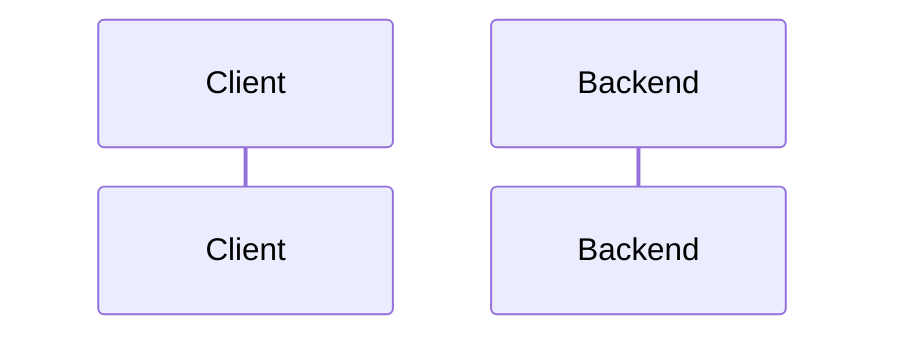

# Shared ranking package (@breadit/ranking)

Spec status: draft · 2026-11-02
Design status: pending
Type: feature · Folder: `.docs/works/2026-11-02-p5-ranking-package/`

## 1. Spec

### Problem

The thesis compares the hybrid score H with seven baselines, on offline data (the harness, task 6) and in the live app (the social feed, task 8). Super-plan P5 part 1 asks for one pure package, `@breadit/ranking`, that both sides call. Then BL2 in the thesis is the production Explore code, and the live feed ranks exactly like the harness (the P6 parity test). This is task 5 in the blueprint (`.docs/implementation-plan.md` §5): "`packages/ranking`, move `computeExploreScoreFixed`, backend imports it, Dockerfile build order", 3 days, planned end 2026-11-06, with bug T4 ("score takes `asOf`") placed here.

What exists today (checked on 2026-11-02):
- **No ranking package.** `packages/` holds only `shared`. The backend depends on no workspace package (super-plan §3 "Tooling").
- **The Explore score is a private function in the backend.** `computeExploreScoreFixed({ likes, comments, reposts, ageHours })` in `apps/backend/src/posts/posts.service.ts` returns `Math.floor((likes + 2·comments + 3·reposts − 0.25·ageHours) · 100)`. `findAll` (Explore branch) uses it on up to 400 posts of the last 7 days, then sorts by `(scoreFixed desc, id desc)` and calls `applyExploreDiversity(scored, 3)`.
- **Explore reads the clock (T4).** `findAll` calls `Date.now()` for the 7-day window and for `ageHours`. Bugs Report T4: the same Explore page gave cursor `699:557`, then `696:557` ten minutes later.
- **No unit test covers the Explore score.** The only Explore test is `apps/backend/test/it/counts.it-spec.ts` ("the explore feed uses the same fixed counts").
- **The backend is CommonJS** (`apps/backend/tsconfig.json`, `module: commonjs`), built by `nest build` and tested with Jest and `ts-jest`. `eval/` is an ES module package that runs `.ts` directly on the pinned Node (P3). Task 6 will import the package from `eval/`, so the package must load from both.
- **The backend Dockerfile** copies only the `package.json` of `apps/backend`, `apps/frontend` and `packages/shared` in its `deps` stage, and builds only the backend in its `builder` stage. A backend that imports a workspace package needs that package copied and built first.
- **The contract is written.** Blueprint §2.6 gives the signatures: `AsOf` and its visibility rule, `Post`, `Positive`, `PoolParams`, `buildPool`, `UserFeatures`, `PostFeatures`, `MethodId`, `ScoreContext`, `Scorer`, `scorer`, `rankPool`. The module map (§1) also puts "as-of feature functions" in the package. The pool, the methods and the hybrid are defined in super-plan §5 and §6. The frozen values used here (score unit, `m`, the α/β grid, W and N_max) are in §7.

### Scope

**In scope:**
- **The package.** A new workspace `packages/ranking` (`@breadit/ranking`), pure TypeScript with no import outside the Node standard library. It builds with `tsc`, like `@breadit/shared`, and is covered by the determinism rule (`.claude/rules/determinism.md`).
- **The contract.** Everything in blueprint §2.6, with exactly those signatures:
  - the `AsOf` visibility rule;
  - pure functions that build `UserFeatures` and `PostFeatures` from plain event arrays at an `AsOf` (the "as-of feature functions" of the module map);
  - `buildPool` (super-plan §5, "Candidate pool");
  - `scorer(method)` for every `MethodId`: BL0–BL6, H, H-follow, H-comm, H-noauthor, H-noengager (super-plan §5 "Methods", §6);
  - `rankPool`.
- **The move.** `computeExploreScoreFixed` moves into the package unchanged. BL2 uses it. The backend Explore imports it from `@breadit/ranking`, and the private copy is deleted. Explore's behavior does not change: same query, same 7-day window, same 400-post cap, same diversity filter. `applyExploreDiversity` stays in the backend (super-plan P5).
- **T4, the part placed here.** Every function in the package takes time as an argument (`AsOf`, or `ageHours` for the moved function). No clock is read in the package. The backend's `Date.now()` in Explore stays until task 8 adds the `asOf` flag.
- **The build order.** The backend Dockerfile copies and builds `packages/ranking` before the backend. `.claude/hooks/verify.sh` builds the package before the backend build and the tests.
- **Docs.** The P5 status in the super-plan (part 1 done), the T4 row in the Bugs Report (partly fixed), and one `CLAUDE.md` line for building the package.

**Out of scope:**
- The harness, metrics, statistics, tuning, the baseline table ★ and the value of T (task 6, `p5-eval-harness`).
- The social feed module, the `algo` option, the `asOf` request flag, the frontend toggle, and T3, B6, R2, T6 (task 8, `p6-social-feed`).
- Any change to Explore's results, the "For You" feed, the cache keys or the database.
- The frontend. It does not import the package.

### Done when

| # | Check | Expected result |
|---|---|---|
| DW1 | `npm ci` at the root, then build `@breadit/ranking` | Both exit 0. `package-lock.json` changes only by the new workspace link |
| DW2 | A golden test of `computeExploreScoreFixed` against the old backend function, on a fixed table of inputs (zero, large, fractional and negative-score ages) | Every value is equal. `grep` finds no `computeExploreScoreFixed` definition left in `apps/backend/src` |
| DW3 | One unit test per `MethodId` on a small hand-made pool, with each expected `scoreFixed` worked out by hand from super-plan §5 and §6 | Every score and every order equals the hand value. The cases include BL0 (followee posts first, newest first), BL4 and BL5 with their published parameters, H at `N_u` = 0 (the prior spreads trust equally), BL6 (every trust weight 1), and the four H ablations |
| DW4 | `buildPool` tests | Window edges (`t_u − W ≤ createdAt < t_u`), own posts and earlier positives out, blocked authors out, deleted or unapproved posts out, only the newest `maxPosts` kept, `createdAt` ties to the larger id |
| DW5 | Cross-check of `buildPool` with the P3 pool rule: on random fixtures from the eval `rng`, compare "the test post is in `buildPool`" with `inPool` of `eval/src/checks/buckets.ts` | Equal for every fixture. This test runs in `eval/` and so also proves that the ES module side can import the package |
| DW6 | `AsOf` and feature tests | An event at `t < asOf.t` is visible; at `t = asOf.t` only with a smaller event id; never after. Follows, memberships and counts after `asOf` do not change `UserFeatures` or `PostFeatures` |
| DW7 | `rankPool` and determinism tests | The order is `(scoreFixed desc, postId desc)`, whatever the input order. Every scorer returns an integer on random fixtures. A grep test finds no `Date.now`, `Math.random`, `new Date()`, `.sort()` without a compare function or `localeCompare` in `packages/ranking/src`, and no import outside `node:` modules |
| DW8 | `bash .claude/hooks/verify.sh` with db and redis up | Every check passes: backend build, backend unit tests (the existing 99 plus the new ones), integration tests (108, with the Explore test), eval verify |
| DW9 | `docker compose build`, then start the stack | Both images build. The backend answers 200 on `/api/health` and on `GET /api/posts?feed=explore` |
| DW10 | `git diff --stat` of the task commits | Only `packages/ranking/`, `apps/backend/src/posts/posts.service.ts` (plus its new unit test), `apps/backend/package.json`, `apps/backend/Dockerfile`, the root `package.json` and `package-lock.json`, the eval cross-check test, `.claude/hooks/verify.sh`, `CLAUDE.md`, `.docs/super-plan.md`, `.docs/Bugs Report.md` and this task folder |

### Open questions

**Decided by the author on 2026-11-02:** the recommendation of each of the four questions below.

1. **Score resolution of BL5 (Hacker News).** The frozen score unit is `floor(score × 100)` (§7). The HN score `(P−1)^0.8 / (T+2)^1.8` is small: for 5 likes at 24 hours it is about 0.01, so ×100 gives 1. Most posts would tie, and the comparison with BL5 would mostly measure the tie-break. BL4 (Reddit "hot") has the same problem in a milder form: with Digg dates, ×100 groups posts in steps of about 7.5 minutes. Recommendation: keep the frozen unit for every method. Define the BL5 score as the natural log of the HN score, `0.8·ln(likes) − gravity·ln(ageHours + 2)` with `P − 1` = likes. The log gives exactly the same order and keeps a 1% step. A post with no like gets the lowest band. BL4 stays as published. Other option: a finer unit (for example ×10⁶) for BL4 and BL5 only, which changes a frozen value and is the author's call.
2. **Where the P5 grids and values are frozen.** §7 freezes at P5 the baseline grids (BL2t, BL4, BL5), the larger pool (W_L, N_L) and the value of T. Recommendation: this task defines the parameters (each scorer takes them through `params`), and task 6 proposes and freezes the values, because tuning and the first test-split run happen there. Other option: propose the grids here.
3. **Package format.** Recommendation: build to CommonJS in `dist/` with `tsc`, like `@breadit/shared`. The backend loads it as it loads any package, and the ES module `eval/` loads it through Node's CommonJS interop (DW5 proves it). Other option: an ES module package, which the CommonJS backend could reach only through `import()`.
4. **T4 split.** Recommendation: as in the scope. The package is clock-free now, and the backend's `Date.now()` in Explore goes in task 8 with the `asOf` flag. T4 stays open in the Bugs Report, marked "score part done". Other option: replace Explore's `Date.now()` with an injectable clock now, which changes Explore code that task 8 rewrites anyway.

## 2. Impact

**Who and what it affects.**
- **The live app.** Explore's scoring code moves to a package. Its results must not change (DW2, and the Explore IT test in DW8). The real risk is the build: the backend gains its first workspace dependency, so the Docker build order, `verify.sh` and Jest's module resolution must all find the built package (DW8, DW9). The frontend is not touched.
- **Thesis results.** Every ranking in the thesis comes from this package: BL0–BL6, H and its ablations, on both datasets and in the live feed. A wrong formula here changes every table in Chapter 5. DW3 and DW5 are there to catch that before task 6 makes any number.
- **Later tasks.** Task 6 (`p5-eval-harness`) calls `buildPool`, the feature functions, `scorer` and `rankPool` from `eval/`. Task 8 (`p6-social-feed`) calls the same functions from the backend. If a signature changes later, both must follow.
- **If we do nothing.** No method can be evaluated, the harness has nothing to call, and BL2 in the thesis would be a copy of the production score, not the production code.

**Schedule.** 3 days. Starting on 2026-11-02, it ends around 2026-11-05, one day before the planned 11-06.

**Code areas.**
- New: `packages/ranking/` (source, tests, `package.json`, `tsconfig.json`).
- Changed: `apps/backend/src/posts/posts.service.ts` (import instead of the private function), `apps/backend/package.json` (the dependency), `apps/backend/Dockerfile`, the root `package.json` and `package-lock.json`, `.claude/hooks/verify.sh`.
- New: one cross-check test in `eval/`.

**Other tasks and bugs on the same files.**
- `posts.service.ts` is also where task 8 adds the `algo` branch, and where T3 (feed cache), B6 and R2 live. Those stay in task 8.
- T4 is partly done here (Open question 4).
- Task 8 will edit the backend Dockerfile again only if the feed module needs it.

**Thesis link.** Super-plan P5 part 1, §2 (determinism: integer scores, total tie-break, no clock), §5 (pool, methods, ties), §6 (the hybrid). RQ1 and RQ2 through every method. Frozen values used as they are: score unit, `m`, the α/β grid, W and N_max. A finer score unit for BL4 or BL5 would change a frozen value (Open question 1). No number in the thesis exists yet.

## 3. Design

### Approach

**Rejected options:**

| Option | Why not |
|---|---|
| | |

### Workflow and sequence diagrams

### Failure modes

| # | What can go wrong | How we notice | How we resolve it |
|---|---|---|---|
| F1 | | | |

### Code files

| File | New or changed | Purpose |
|---|---|---|
| | | |

### Data, schema and cache changes
