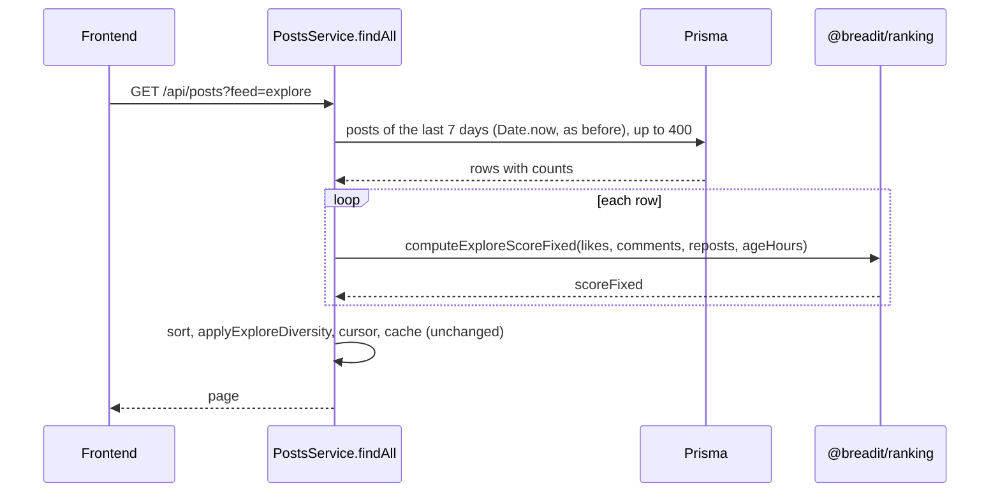
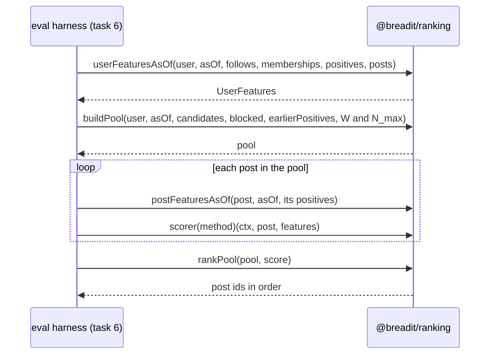

# Shared ranking package (@breadit/ranking)

Spec status: approved · 2026-11-02
Design status: draft · 2026-11-02
Type: feature · Folder: `.docs/works/2026-11-02-p5-ranking-package/`

## 1. Spec

### Problem

The thesis compares the hybrid score H with seven baselines, on offline data (the harness, task 6) and in the live app (the social feed, task 8). Super-plan P5 part 1 asks for one pure package, `@breadit/ranking`, that both sides call. Then BL2 in the thesis is the production Explore code, and the live feed ranks exactly like the harness (the P6 parity test). This is task 5 in the blueprint (`.docs/implementation-plan.md` §5): "`packages/ranking`, move `computeExploreScoreFixed`, backend imports it, Dockerfile build order", 3 days, planned end 2026-11-06, with bug T4 ("score takes `asOf`") placed here.

What exists today (checked on 2026-11-02):
- **No ranking package.** `packages/` holds only `shared`. The backend depends on no workspace package (super-plan §3 "Tooling").
- **The Explore score is a private function in the backend.** `computeExploreScoreFixed({ likes, comments, reposts, ageHours })` in `apps/backend/src/posts/posts.service.ts` returns `Math.floor((likes + 2·comments + 3·reposts − 0.25·ageHours) · 100)`. `findAll` (Explore branch) uses it on up to 400 posts of the last 7 days, then sorts by `(scoreFixed desc, id desc)` and calls `applyExploreDiversity(scored, 3)`.
- **Explore reads the clock (T4).** `findAll` calls `Date.now()` for the 7-day window and for `ageHours`. Bugs Report T4: the same Explore page gave cursor `699:557`, then `696:557` ten minutes later.
- **No unit test covers the Explore score.** The only Explore test is `apps/backend/test/it/counts.it-spec.ts` ("the explore feed uses the same fixed counts").
- **The backend is CommonJS** (`apps/backend/tsconfig.json`, `module: commonjs`), built by `nest build` and tested with Jest and `ts-jest`. `eval/` is an ES module package that runs `.ts` directly on the pinned Node (P3). Task 6 will import the package from `eval/`, so the package must load from both.
- **The backend Dockerfile** copies only the `package.json` of `apps/backend`, `apps/frontend` and `packages/shared` in its `deps` stage, and builds only the backend in its `builder` stage. A backend that imports a workspace package needs that package copied and built first.
- **The contract is written.** Blueprint §2.6 gives the signatures: `AsOf` and its visibility rule, `Post`, `Positive`, `PoolParams`, `buildPool`, `UserFeatures`, `PostFeatures`, `MethodId`, `ScoreContext`, `Scorer`, `scorer`, `rankPool`. The module map (§1) also puts "as-of feature functions" in the package. The pool, the methods and the hybrid are defined in super-plan §5 and §6. The frozen values used here (score unit, `m`, the α/β grid, W and N_max) are in §7.

### Scope

**In scope:**
- **The package.** A new workspace `packages/ranking` (`@breadit/ranking`), pure TypeScript with no import outside the Node standard library. It builds with `tsc`, like `@breadit/shared`, and is covered by the determinism rule (`.claude/rules/determinism.md`).
- **The contract.** Everything in blueprint §2.6, with exactly those signatures:
  - the `AsOf` visibility rule;
  - pure functions that build `UserFeatures` and `PostFeatures` from plain event arrays at an `AsOf` (the "as-of feature functions" of the module map);
  - `buildPool` (super-plan §5, "Candidate pool");
  - `scorer(method)` for every `MethodId`: BL0–BL6, H, H-follow, H-comm, H-noauthor, H-noengager (super-plan §5 "Methods", §6);
  - `rankPool`.
- **The move.** `computeExploreScoreFixed` moves into the package unchanged. BL2 uses it. The backend Explore imports it from `@breadit/ranking`, and the private copy is deleted. Explore's behavior does not change: same query, same 7-day window, same 400-post cap, same diversity filter. `applyExploreDiversity` stays in the backend (super-plan P5).
- **T4, the part placed here.** Every function in the package takes time as an argument (`AsOf`, or `ageHours` for the moved function). No clock is read in the package. The backend's `Date.now()` in Explore stays until task 8 adds the `asOf` flag.
- **The build order.** The backend Dockerfile copies and builds `packages/ranking` before the backend. `.claude/hooks/verify.sh` builds the package before the backend build and the tests.
- **Docs.** The P5 status in the super-plan (part 1 done), the T4 row in the Bugs Report (partly fixed), and one `CLAUDE.md` line for building the package.

**Out of scope:**
- The harness, metrics, statistics, tuning, the baseline table ★ and the value of T (task 6, `p5-eval-harness`).
- The social feed module, the `algo` option, the `asOf` request flag, the frontend toggle, and T3, B6, R2, T6 (task 8, `p6-social-feed`).
- Any change to Explore's results, the "For You" feed, the cache keys or the database.
- The frontend. It does not import the package.

### Done when

| # | Check | Expected result |
|---|---|---|
| DW1 | `npm ci` at the root, then build `@breadit/ranking` | Both exit 0. `package-lock.json` changes only by the new workspace link |
| DW2 | A golden test of `computeExploreScoreFixed` against the old backend function, on a fixed table of inputs (zero, large, fractional and negative-score ages) | Every value is equal. `grep` finds no `computeExploreScoreFixed` definition left in `apps/backend/src` |
| DW3 | One unit test per `MethodId` on a small hand-made pool, with each expected `scoreFixed` worked out by hand from super-plan §5 and §6 | Every score and every order equals the hand value. The cases include BL0 (followee posts first, newest first), BL4 and BL5 with their published parameters, H at `N_u` = 0 (the prior spreads trust equally), BL6 (every trust weight 1), and the four H ablations |
| DW4 | `buildPool` tests | Window edges (`t_u − W ≤ createdAt < t_u`), own posts and earlier positives out, blocked authors out, deleted or unapproved posts out, only the newest `maxPosts` kept, `createdAt` ties to the larger id |
| DW5 | Cross-check of `buildPool` with the P3 pool rule: on random fixtures from the eval `rng`, compare "the test post is in `buildPool`" with `inPool` of `eval/src/checks/buckets.ts` | Equal for every fixture. This test runs in `eval/` and so also proves that the ES module side can import the package |
| DW6 | `AsOf` and feature tests | An event at `t < asOf.t` is visible; at `t = asOf.t` only with a smaller event id; never after. Follows, memberships and counts after `asOf` do not change `UserFeatures` or `PostFeatures` |
| DW7 | `rankPool` and determinism tests | The order is `(scoreFixed desc, postId desc)`, whatever the input order. Every scorer returns an integer on random fixtures. A grep test finds no `Date.now`, `Math.random`, `new Date()`, `.sort()` without a compare function or `localeCompare` in `packages/ranking/src`, and no import outside `node:` modules |
| DW8 | `bash .claude/hooks/verify.sh` with db and redis up | Every check passes: backend build, backend unit tests (the existing 99 plus the new ones), integration tests (108, with the Explore test), eval verify |
| DW9 | `docker compose build`, then start the stack | Both images build. The backend answers 200 on `/api/health` and on `GET /api/posts?feed=explore` |
| DW10 | `git diff --stat` of the task commits | Only `packages/ranking/`, `apps/backend/src/posts/posts.service.ts` (plus its new unit test), `apps/backend/package.json`, `apps/backend/Dockerfile`, the root `package.json` and `package-lock.json`, the eval cross-check test, `.claude/hooks/verify.sh`, `CLAUDE.md`, `.docs/super-plan.md`, `.docs/Bugs Report.md` and this task folder |

### Open questions

**Decided by the author on 2026-11-02:** the recommendation of each of the four questions below.

1. **Score resolution of BL5 (Hacker News).** The frozen score unit is `floor(score × 100)` (§7). The HN score `(P−1)^0.8 / (T+2)^1.8` is small: for 5 likes at 24 hours it is about 0.01, so ×100 gives 1. Most posts would tie, and the comparison with BL5 would mostly measure the tie-break. BL4 (Reddit "hot") has the same problem in a milder form: with Digg dates, ×100 groups posts in steps of about 7.5 minutes. Recommendation: keep the frozen unit for every method. Define the BL5 score as the natural log of the HN score, `0.8·ln(likes) − gravity·ln(ageHours + 2)` with `P − 1` = likes. The log gives exactly the same order and keeps a 1% step. A post with no like gets the lowest band. BL4 stays as published. Other option: a finer unit (for example ×10⁶) for BL4 and BL5 only, which changes a frozen value and is the author's call.
2. **Where the P5 grids and values are frozen.** §7 freezes at P5 the baseline grids (BL2t, BL4, BL5), the larger pool (W_L, N_L) and the value of T. Recommendation: this task defines the parameters (each scorer takes them through `params`), and task 6 proposes and freezes the values, because tuning and the first test-split run happen there. Other option: propose the grids here.
3. **Package format.** Recommendation: build to CommonJS in `dist/` with `tsc`, like `@breadit/shared`. The backend loads it as it loads any package, and the ES module `eval/` loads it through Node's CommonJS interop (DW5 proves it). Other option: an ES module package, which the CommonJS backend could reach only through `import()`.
4. **T4 split.** Recommendation: as in the scope. The package is clock-free now, and the backend's `Date.now()` in Explore goes in task 8 with the `asOf` flag. T4 stays open in the Bugs Report, marked "score part done". Other option: replace Explore's `Date.now()` with an injectable clock now, which changes Explore code that task 8 rewrites anyway.

## 2. Impact

**Who and what it affects.**
- **The live app.** Explore's scoring code moves to a package. Its results must not change (DW2, and the Explore IT test in DW8). The real risk is the build: the backend gains its first workspace dependency, so the Docker build order, `verify.sh` and Jest's module resolution must all find the built package (DW8, DW9). The frontend is not touched.
- **Thesis results.** Every ranking in the thesis comes from this package: BL0–BL6, H and its ablations, on both datasets and in the live feed. A wrong formula here changes every table in Chapter 5. DW3 and DW5 are there to catch that before task 6 makes any number.
- **Later tasks.** Task 6 (`p5-eval-harness`) calls `buildPool`, the feature functions, `scorer` and `rankPool` from `eval/`. Task 8 (`p6-social-feed`) calls the same functions from the backend. If a signature changes later, both must follow.
- **If we do nothing.** No method can be evaluated, the harness has nothing to call, and BL2 in the thesis would be a copy of the production score, not the production code.

**Schedule.** 3 days. Starting on 2026-11-02, it ends around 2026-11-05, one day before the planned 11-06.

**Code areas.**
- New: `packages/ranking/` (source, tests, `package.json`, `tsconfig.json`).
- Changed: `apps/backend/src/posts/posts.service.ts` (import instead of the private function), `apps/backend/package.json` (the dependency), `apps/backend/Dockerfile`, the root `package.json` and `package-lock.json`, `.claude/hooks/verify.sh`.
- New: one cross-check test in `eval/`.

**Other tasks and bugs on the same files.**
- `posts.service.ts` is also where task 8 adds the `algo` branch, and where T3 (feed cache), B6 and R2 live. Those stay in task 8.
- T4 is partly done here (Open question 4).
- Task 8 will edit the backend Dockerfile again only if the feed module needs it.

**Thesis link.** Super-plan P5 part 1, §2 (determinism: integer scores, total tie-break, no clock), §5 (pool, methods, ties), §6 (the hybrid). RQ1 and RQ2 through every method. Frozen values used as they are: score unit, `m`, the α/β grid, W and N_max. A finer score unit for BL4 or BL5 would change a frozen value (Open question 1). No number in the thesis exists yet.

## 3. Design

### Approach

The author decided the four open questions on 2026-11-02, each by its recommendation:
1. BL5 is scored as the natural log of the HN formula, with the frozen score unit.
2. The grids, the larger pool and T are frozen in task 6.
3. The package is CommonJS, built by `tsc`.
4. The package is clock-free now, and Explore's `Date.now()` goes in task 8.

**A CommonJS package, tested with the backend's tools.** `packages/ranking` copies `packages/shared`:
- `"main": "dist/index.js"` and `"types": "dist/index.d.ts"`;
- `tsc` with `module: commonjs`, `target: ES2021`, `strict: true`;
- `src/index.ts` re-exports by name (`export { … } from "./pool"`), never with `export *`.

Unit tests use Jest with `ts-jest` on the source, the same versions as the backend (`jest ^29.7.0`, `ts-jest ^29.4.15`, `@types/jest ^29.5.14`), so the lockfile gains no new package.

Checked on 2026-11-02 on Node v22.23.4: a `.ts` ES module imports named functions from a `tsc`-built CommonJS package (`import { buildPool, K } from "pkg"` printed the right values). So `eval/` can use the package with no wrapper.

**The backend change is one import.** In `posts.service.ts` the private `computeExploreScoreFixed` is deleted, and `import { computeExploreScoreFixed } from '@breadit/ranking'` takes its place. The function moves unchanged: same input object, same formula, same `Math.floor(score * 100)`. Everything else in Explore stays as it is:
- the 7-day window and `Date.now()`;
- `CANDIDATE_TAKE`;
- the sort and `applyExploreDiversity`;
- the cursor and the cache key.

`apps/backend/package.json` gets `"@breadit/ranking": "0.1.0"` in `dependencies`. npm links the workspace, and Jest and `nest build` resolve it from `node_modules` like any package. That is why the package must be built first (F1).

**Time is always an argument.** No file in the package reads a clock or a random source. The `AsOf` rule of blueprint §2.6 is one function, `visibleAt(e, asOf)`. It is used for positives (with the event id) and, through `t < asOf.t`, for follows and memberships, which have no event id. Post age is `(asOf.t − createdAt) / 3600` hours.

**Feature builders (the module map's "as-of feature functions").** Two pure functions take plain arrays, so the harness (from CSV) and the feed module (from Prisma) only differ in how they load the arrays:
- `userFeaturesAsOf` gives `UserFeatures`:
  - followees and communities with a date before `asOf.t`, distinct and sorted;
  - `nByAuthor` and `nByCommunity` count the user's visible positives by the post's author and community;
  - `nTotal` is the user's total of visible positives.
- `postFeaturesAsOf` gives `PostFeatures`: visible likes, comments and reposts, and `engagedBy`, the users with a visible positive on the post, distinct and sorted.

**`buildPool` (super-plan §5).**
1. Keep a candidate only if all of these hold:
   - it is not deleted and is approved;
   - `t − windowSec ≤ createdAt < asOf.t`;
   - its author is not blocked and is not the user;
   - its id is not in `earlierPositives`.
2. Sort by `(createdAt desc, id desc)`.
3. Keep the first `maxPosts`.

The caller passes only root posts (the `Post` contract has no parent field). This is the same rule as `inPool` in `eval/src/checks/buckets.ts`, which DW5 checks.

**Scorers.** Notation:
- `age` is `ageHours`;
- `eng(w) = likes + 2·comments + 3·reposts − w·age` is the engagement score with age weight `w`;
- `F(x) = floor(x · 100)` is the frozen score unit.

Each scorer returns one integer:

| Method | `scoreFixed` | Params |
|---|---|---|
| BL0 | `[author ∈ followees] · 2^32 + createdAt` (followee posts first, then newest first) | — |
| BL1 | `createdAt` | — |
| BL2 | `computeExploreScoreFixed({ likes, comments, reposts, ageHours: age })`, the moved production code | — |
| BL2t | `F(eng(ageWeight))` | `ageWeight` |
| BL3 | `F(likes)` | — |
| BL4 | `F(sign · log10(max(likes, 1)) + (createdAt − asOf.t) / divisor)`, `sign` = 1 if likes > 0, else 0 | `divisor` |
| BL5 | likes = 0: the lowest band `−2^31`; else `F(0.8 · ln(likes) − gravity · ln(age + 2))` | `gravity` |
| BL6 | `F(eng(0.25) + α · ([author ∈ followees] + |engagedBy ∩ followees|))` | `alpha` |
| H | `F(eng(0.25) + α · social + β · community)` (super-plan §6) | `alpha`, `beta`, `m` |
| H-follow, H-comm | H with β = 0, and H with α = 0 | as H |
| H-noauthor, H-noengager | H without the author term, and H without the engager sum | as H |

Notes on the table:
- **BL2 and BL2t.** BL2t at `ageWeight` = 0.25 must give BL2's values (a test).
- **BL4.** The Reddit epoch is replaced by `asOf.t`. That adds the same constant to every post in the pool, so the order is the published one. It also keeps the numbers small and needs no epoch for synthetic data.
- **BL5.** `P − 1` is likes, as the Spec decided.
- **H.** `trust(f) = (nByAuthor[f] + m / |F_u|) / (nTotal + m)`. `social` is `[author ∈ followees] · trust(author)` plus the sum of `trust(f)` over `f` in `engagedBy ∩ followees`, summed in `engagedBy` order. `community` is `(nByCommunity[c] + m · [c ∈ communities] / |M_u|) / (nTotal + m)`, and 0 for a post with no community.
- **Zero cases.** With `|F_u|` = 0 the prior part of `trust` is 0, and likewise for `|M_u|` = 0. With `nTotal + m` = 0 (E4 runs `m` = 0) a term is 0, not 0/0.

`scorer(method)` throws on an unknown method or a missing param, so a typo cannot fall back to a default. `rankPool` sorts by `(scoreFixed desc, postId desc)`.

**Build order.**
- **Backend Dockerfile.** The `deps` stage copies `packages/ranking/package.json`. The `builder` stage copies `packages/ranking/` and builds it before the backend. The `runner` stage copies `packages/ranking/package.json` and `dist/` to the same paths, so the `node_modules/@breadit/ranking` link copied from `deps` points at them.
- **`verify.sh`.** It gets two steps after "shared build": "ranking build" and "ranking tests". That way the backend build, its tests and `eval verify` see a built package.
- **The frontend Dockerfile is not changed.** In P3, `npm ci` passed with a workspace it does not copy. DW9 checks it again.

**Rejected options:**

| Option | Why not |
|---|---|
| An ES module package | The backend is CommonJS. Jest's module system does not load ES modules without an experimental flag (Spec Open question 3) |
| `node --test` with type stripping for the package's tests | The package's `.ts` files would need `.ts` import extensions and ES module syntax under a CommonJS `package.json`. Jest with `ts-jest` already runs the backend's tests, with no new dependency |
| Point Jest and Nest at the package's `src` through path aliases | Two ways to load the same code: the tests would pass on source while Docker runs `dist`. Building first is what Docker does |
| Make BL0 a two-key sort | Every method must go through the same `rankPool` (super-plan §5, "all methods rank the same pool"). One integer with `2^32` keeps BL0 inside that rule |
| Move `applyExploreDiversity` too | It is a page-level filter, not part of the evaluation (super-plan P5) |

### Workflow and sequence diagrams

Live Explore after the change (only the score call moves):

Offline ranking of one test user (how task 6 will call the package; DW5 uses the pool part):

### Failure modes

| # | What can go wrong | How we notice | How we resolve it |
|---|---|---|---|
| F1 | The backend build or Jest cannot find `@breadit/ranking`, because it is not built | `nest build` or `ts-jest` fails with "Cannot find module" | `verify.sh` and the Dockerfile build the package first. `CLAUDE.md` names the build command |
| F2 | The Docker runner image has the link but no `dist/` | The backend container exits on start, so DW9 fails | The runner copies `packages/ranking/package.json` and `dist/` to the same paths |
| F3 | Explore results change | DW2 (golden test against the old function) and the Explore IT test | The function moves byte-for-byte; the old function's text is pasted into the golden test as the reference |
| F4 | `eval/` cannot import a named export | DW5 fails to load | Explicit `export { … } from` in `index.ts` (the form checked on 2026-11-02) |
| F5 | 0/0 at `m` = 0 with no history, or no followee or community | A scorer test returns `NaN` | Defined as 0 (Approach, notes under the scorer table). A test runs every method at `m` = 0 with an empty history |
| F6 | `ln(0)` in BL5 | `-Infinity` | Likes = 0 gets the fixed lowest band `−2^31` |
| F7 | BL0 overflows a safe integer | A test with a large `createdAt` | `2^32 + createdAt` stays far below `2^53` for any Unix second before the year 2106 |
| F8 | A typo in a method name or param falls back to a default | Silent wrong numbers | `scorer` throws on an unknown method and on a missing param |
| F9 | A float sum in a different order | A double-run in task 6 | `engagedBy` and `followees` are sorted; sums run in that order (super-plan §2) |
| F10 | A post created at exactly `asOf.t`, or a follow at exactly `asOf.t` | `buildPool` and feature tests | Both are excluded: the rule is strictly before `t` for items without an event id |
| F11 | The lockfile pulls new packages | `git diff package-lock.json` | devDependencies use the backend's exact ranges; anything more is reverted and reported |
| F12 | Blocked users, deleted or unapproved posts | `buildPool` tests | Filtered in `buildPool` from the fields of `Post` and the `blocked` set. Explore keeps its own Prisma filters |

The cache (`v:user`, the 10-second feed cache) and the database are not touched: Explore's query and cache key stay the same.

### Code files

| File | New or changed | Purpose |
|---|---|---|
| `packages/ranking/package.json`, `tsconfig.json`, `jest.config.js` | new | `@breadit/ranking` 0.1.0, scripts `build` (`tsc`) and `test` (Jest) |
| `packages/ranking/src/types.ts` | new | The types of blueprint §2.6 |
| `packages/ranking/src/asof.ts` | new | `visibleAt(e: { id: number; t: Sec }, asOf: AsOf): boolean`, `ageHours(createdAt: Sec, asOf: AsOf): number` |
| `packages/ranking/src/features.ts` | new | `userFeaturesAsOf(user, asOf, data: { follows; memberships; positives; postInfo }): UserFeatures`, `postFeaturesAsOf(postId, asOf, positives: readonly Positive[]): PostFeatures` |
| `packages/ranking/src/pool.ts` | new | `buildPool` as in blueprint §2.6 |
| `packages/ranking/src/explore.ts` | new | `computeExploreScoreFixed` (moved, unchanged) |
| `packages/ranking/src/scorers.ts` | new | `scorer(method: MethodId): Scorer` for the 12 method ids |
| `packages/ranking/src/rank.ts` | new | `rankPool` |
| `packages/ranking/src/index.ts` | new | Named re-exports only |
| `packages/ranking/src/*.spec.ts` | new | DW2 (golden), DW3 (one case per method), DW4, DW6, DW7 (including the grep for forbidden patterns and for imports outside `node:`) |
| `eval/src/checks/pool-crosscheck.test.ts`, `eval/package.json` | new, changed | DW5: `buildPool` against `inPool` on random fixtures from `rng`. `@breadit/ranking` becomes a dependency of `eval` (allowed by the module map) |
| `apps/backend/src/posts/posts.service.ts` | changed | Delete the private `computeExploreScoreFixed`, import it from `@breadit/ranking` |
| `apps/backend/package.json` | changed | Dependency `@breadit/ranking` |
| `apps/backend/Dockerfile` | changed | Copy and build the package (Approach, "Build order") |
| `package.json` (root), `package-lock.json` | changed | `packages/*` already covers the new folder; the lockfile gains the link and the backend and eval dependencies |
| `.claude/hooks/verify.sh` | changed | Steps "ranking build" and "ranking tests" after "shared build" |
| `CLAUDE.md` | changed | Overview line for `packages/ranking`, and its build before the backend |
| `.docs/implementation-plan.md` | changed | §2.6: the two feature-builder signatures, so tasks 6 and 8 use the same ones |
| `.docs/super-plan.md`, `.docs/Bugs Report.md` | changed | P5 part 1 status, change-log line; T4 "score part done (task 5); `Date.now()` in Explore goes in task 8" |

**Note for DW10 (a gap in the Spec).** The DW10 list does not name two files this design changes: `eval/package.json`, because the cross-check test of DW5 imports the package, and `.docs/implementation-plan.md`, for the feature-builder signatures. The plan's DW10 check accepts the Spec list plus these two.

### Data, schema and cache changes

None. No Prisma model, no migration, no cache key or version change. Explore's query and cache key are the same as before.
