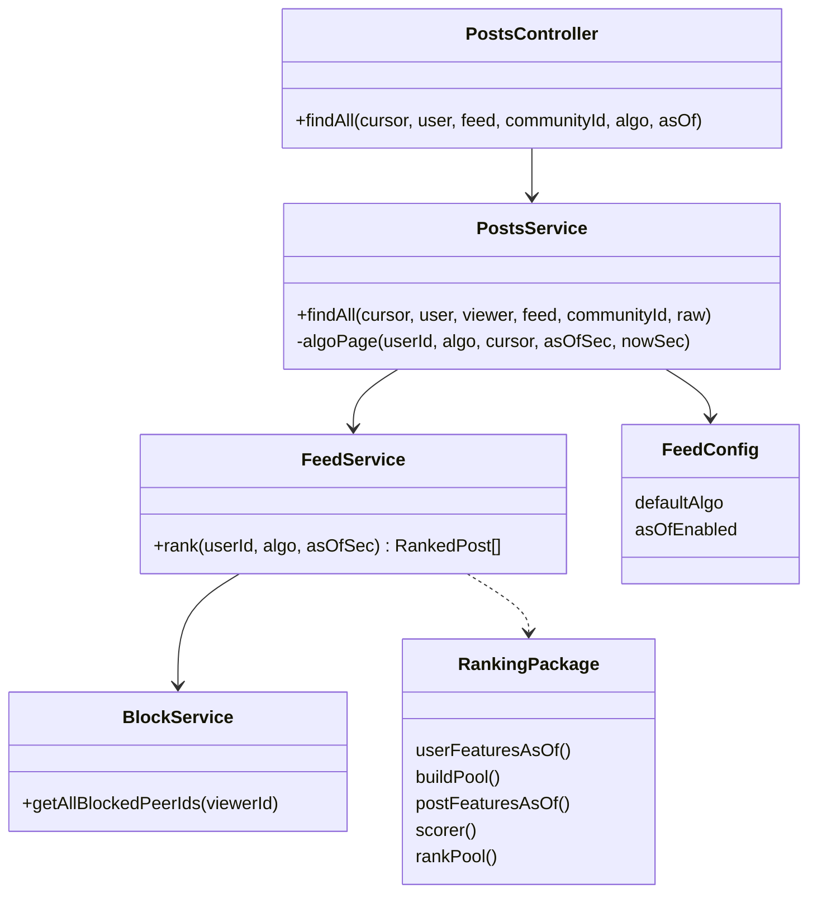
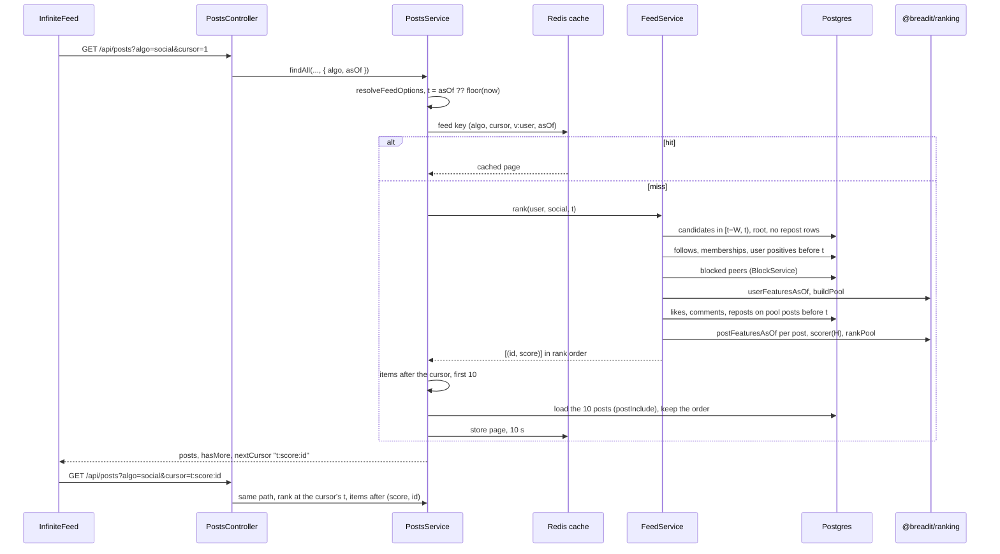
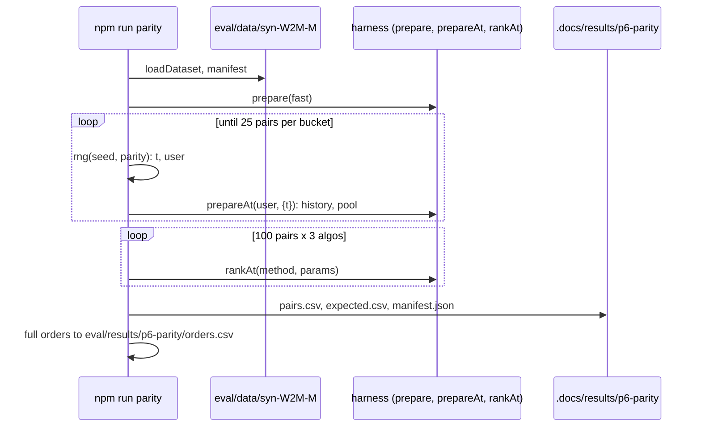
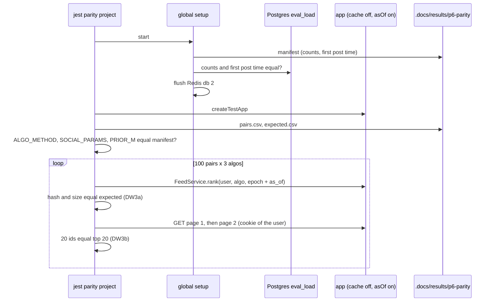

# Social feed in the app

Spec status: approved · 2026-11-10
Design status: approved · 2026-11-10
Type: feature · Folder: `.docs/works/2026-11-10-p6-social-feed/`

## 1. Spec

### Problem

The thesis method runs only offline today. The live "For You" feed cannot use it, and nothing shows that the app ranks the way the harness measures. Super-plan P6 asks for both: an `algo` option on the feed, and a parity test where "the live endpoint returns the same order as the harness" for 100 sampled (user, `asOf`) pairs of `syn-W2M-M` loaded into Postgres.

Evidence from the code (2026-11-10):
- **No feed module and no `algo`.** `apps/backend/src/feed/` does not exist. `PostsController.findAll` reads only `cursor`, `user`, `feed` and `communityId` (`posts.controller.ts`). The backend imports only `computeExploreScoreFixed` from `@breadit/ranking`. `buildPool`, the feature builders, `scorer` and `rankPool` are used only by `eval/`.
- **For You leaves out community posts.** The logged-in branch of `PostsService.findAll` filters `communityId: null` and shows only the user and their followees, newest first. So the community term cannot work in the live app.
- **Explore reads the clock twice** in `findAll`: `Date.now()` for the 7-day window and again for the age. The same request gives a different page later (Bugs Report T4, the part still open).
- **No parity sample.** Blueprint §2.9 asks for 100 pairs drawn with the `parity` stream and written to a committed CSV. The stream name is reserved in `eval/src/rng.ts`, but no command uses it and no CSV exists (`.docs/results/` holds only `p5-baseline/`).
- **Bugs placed here** (blueprint §5, task 8):
  - **D1.** `PostsService.create` checks only the community ban. A non-member can still submit a community post, which then waits for approval. The author decided on 2026-10-28 that a community post needs membership (Bugs Report §4). The community page shows the compose box (`Share`) to everyone (`app/(board)/c/[slug]/page.tsx`).
  - **B6.** `CommunitiesService.banUser` and `deleteCommunity` do not clear `graph:communities` and do not bump `v:user`. `join` (which also handles leave) does both. The new feed reads the community list.
  - **T3.** Creating or deleting a post does not bump the author's `v:user`, so the author's own post can be missing from For You for up to 10 s.
  - **R2.** Pending community posts must stay out of the pool. `buildPool` already drops posts with `isApproved = false`, so the live loading must pass the real flag.
  - **T6.** `Follow` has no unique key, so the same follow can be in the table twice. Followees must be counted once.

Three facts from the harness `rank` command (method BL1, user `u0000000042`, `syn-W2M-M`, 2026-11-10):
- At `asOf` 21,000,000 and 21,412,417 (T of the M datasets) the pool holds 1,836 and 1,967 posts. This is close to the cap N_max of §7. So the live query must load the whole window and let `buildPool` apply the cap (blueprint §2.6).
- At `asOf` 5,000,000 the pool is empty. The parity pairs must use times inside the data.
- One `rank` call takes about 0.34 s.

### Scope

**In scope:**
- **Feed module** `apps/backend/src/feed/` (blueprint §1). It loads plain arrays from Prisma and calls `userFeaturesAsOf`, `postFeaturesAsOf`, `buildPool`, `scorer` and `rankPool` of `@breadit/ranking`. It has no ranking logic of its own. It loads the same kinds of data as the harness:
  - candidates: root posts in the window W, community posts included, repost rows (`rePostId` set) left out (blueprint §2.5);
  - positives: `Like` rows, `Comment` rows and repost rows, each with user, post and time;
  - the user's follows and memberships with their times, and the blocked peers (`BlockService.getAllBlockedPeerIds`);
  - W, N_max and `m` as in §7. A test checks that they equal `eval/config/frozen-v1.json`.
- **`algo` on `GET /api/posts`**, for the logged-in For You feed only. It goes through the controller into `findAll` and into the cache key.

  | `algo` | Method of `@breadit/ranking` | Params |
  |---|---|---|
  | `chrono` | BL0 (Open question 1) | none |
  | `engagement` | BL2 | none |
  | `social` | H | α and β (Open question 2), `m` from §7 |

  An unknown value, or `algo` together with `feed`, `user` or `communityId`, gives 400. A guest with `algo` gets 401.
- **Paging.** Pages of 10 with `{ posts, hasMore, nextCursor }`, like today. Page 2 continues page 1 with no repeat and no gap when no row changed in between.
- **Default `algo` from an env variable** (for example `FEED_DEFAULT_ALGO`). When it is not set, For You without `algo` behaves exactly as today. When it is set, For You without `algo` uses that value. Task 11 (P8) sets it after P7 (super-plan P7, "Default feed rule").
- **Test-only `asOf`** (Unix seconds) on `GET /api/posts`, turned on by an env flag (for example `FEED_ASOF_ENABLED`). With the flag off, `asOf` gives 400. With `NODE_ENV=production` and the flag on, the backend refuses to start. When given, `asOf` replaces the clock for the `algo` feeds and for Explore.
- **Explore's clock (T4).** Explore reads the time once per request, or takes it from `asOf`. Nothing else in Explore changes: the same 400 candidates, the same score, the same author cap.
- **Parity sample.** A new eval command draws 100 (user, `asOf`) pairs from `syn-W2M-M` with the `parity` stream. It writes them to a committed CSV with the harness order of each pair for each `algo` (blueprint §2.9).
- **Parity test.** It runs the backend on the loaded `syn-W2M-M` (schema `eval_load`) with `REDIS_HTTP_CACHE_ENABLED=false` and compares the live order with the committed harness order (DW3, Open question 4).
- **Bugs:** D1 (the backend rule, and no compose box for non-members), B6, T3 (bump on post create and delete), R2 (the pool part), T6 (distinct followees).
- **Frontend toggle.** On the For You tab, three choices that set `?algo=`. `app/(board)/page.tsx` adds `algo` to its whitelist, and `Feed.tsx` and `InfiniteFeed.tsx` pass it on and add it to the query key.
- **Docs** (DW11).

**Out of scope:**
- **Tuning α and β.** That is P7 (task 9). This task uses placeholder values (Open question 2).
- **Speed.** No cache of the ranked list, no counts in SQL, no indexes. E7 (task 10) measures the cost first. Any later speed-up must keep the parity test green.
- **R2 for interactions.** Liking, saving, reposting or commenting on a pending post by id stays possible. It is not on the feed path (Open question 3).
- **The T6 schema migration.** No unique keys. Duplicate `Like` rows still count twice, in the new feed and in Explore, as today (super-plan §9).
- **Explanations** (the `reasons` field, cut in v0.2), **E7** and the throttle limit (N6, task 10), **the demo script** (task 13).
- **Changes to** For You when the env variable is not set, Explore's ranking, and the Following, Communities, profile and community feeds.
- **Any change to `packages/ranking`.** Its signatures are the contract H-c (blueprint §2.6). If the design needs a change, it goes to Open questions.

### Done when

Checks with Postgres need `docker compose up db redis -d`. The parity checks also need `syn-W2M-M` generated and loaded into `eval_load` (`npm run gen` and `npm run load` of `@breadit/eval`).

| # | Check | Expected result |
|---|---|---|
| DW1 | `.claude/hooks/verify.sh` | Every check passes, with the new unit and IT tests of DW4 to DW9. The test of W, N_max and `m` against `frozen-v1.json` passes |
| DW2 | Run the parity sample command twice | Byte-identical outputs. 100 pairs, each with a user of `syn-W2M-M` and a time where that user's pool is not empty. The command prints how many pairs fall in each history bucket of §7, and no bucket is empty |
| DW3 | Run the parity test | For 100 of 100 pairs and each of the three `algo` values: (a) the full ranked order from the feed module equals the harness order; (b) the first two pages of `GET /api/posts?algo=…&asOf=…` equal the harness top 20 (this covers the largest K of §7). So 300 of 300 for (a) and 300 of 300 for (b) |
| DW4 | IT: For You with the env variable not set | Same posts and order as today's rule (own and followee posts, newest first, no community posts). The existing feed IT tests pass unchanged |
| DW5 | IT: the `algo` feeds on a small fixture | A blocked author's post, the user's own post, a deleted post, a pending community post and a repost row are not in the feed. An approved community post is. A followee followed twice counts once. With the env variable set to `social`, For You without `algo` gives the same page as `algo=social` |
| DW6 | IT: input rules | Unknown `algo` → 400. `algo` with `feed`, `user` or `communityId` → 400. Guest with `algo` → 401. `asOf` with the flag off → 400. The backend does not start with the flag on and `NODE_ENV=production` |
| DW7 | IT: paging | At a fixed `asOf`, walking every page of `algo=social` gives each pool post once, in the full ranked order. Without `asOf`, page 2 asked 2 s after page 1 has no repeat and no gap |
| DW8 | IT: Explore with `asOf` (T4) | Two calls with the same `asOf` give byte-identical pages and cursors. A post created more than 7 days before `asOf` is not in Explore |
| DW9 | Tests for B6, T3 and D1 | B6: a ban clears the target's `graph:communities` and bumps their `v:user`. Deleting a community does the same for every former member. T3: creating and deleting a post bump the author's `v:user`. D1: a non-member's community post gets 403. A member's still gets 201, pending for a plain member as today |
| DW10 | Frontend: `npm run typecheck`, `npm run lint`, then Chrome | No errors. On For You, each toggle choice changes `algo` in the URL and the feed order. On a community page, a non-member sees no compose box and a member does |
| DW11 | Read the updated docs | `docs/System_Architecture.md` marks the feed module, `algo`, the default `algo`, the `asOf` flag, the toggle and the parity test ✅, and §6.4 describes the real test. Guidance Manual 08 (en and vi) describes the built code, not a sketch, and the other topics drop their 🔜 for task 8. `CLAUDE.md` no longer calls task 8 planned and lists the parity commands. `README.md` and `.env.example` list the new env variables. The Bugs Report rows of D1, B6, T3, T4 and R2 say what was fixed. Blueprint and super-plan mark task 8 done |

### Open questions

1. **Which method is `chrono`?** My recommendation is (a).
   - **(a) BL0:** followee posts first, newest first, then the rest newest first. The docs call `chrono` "today's order", and super-plan §5 calls BL0 "the production For You". It is still not the same list as today's For You, because the shared pool has community posts and no own posts.
   - **(b) BL1:** plain newest first. Simpler, but no longer close to today's feed.
2. **α and β of `social` before P7 tunes them.** My recommendation is (a). The parity test works for any α and β, so the placeholder does not weaken it.
   - **(a) A committed backend file** with α and β, which the parity test reads too. Placeholder α = β = 1, the smallest non-zero values of the §7 grid. Task 11 (P8) writes the tuned values in it.
   - **(b) Env variables** with the same placeholders. Easy to change, but not in git, so a wrong value would change the live feed without any trace.
3. **R2 for interactions** (`assertPostLive` also refusing pending posts for non-staff). My recommendation: leave it out. It is not on the feed path, and its row stays open in the Bugs Report. The other option is to add it here (effort S).
4. **How deep does the parity test compare?** My recommendation is the split in DW3: the full order at the feed module, and the first two pages over HTTP. The other option is every page over HTTP. A pool has up to N_max posts, so that is about 200 pages per pair and about 60,000 requests in total.

## 2. Impact

**Who needs it.**
- **P6 itself.** The parity test is the proof that Chapter 4 can say "the app runs the method we measured" (super-plan P6, `docs/System_Architecture.md` §6.4).
- **Task 10 (E7)** measures `chrono`, `engagement` and `social` on this code (blueprint §4).
- **Task 11 (P8)** sets the default `algo` through the env variable. **Task 13** shows the three values side by side in the demo.
- If we do nothing, P6 is not done, E7 has nothing to measure, the default feed rule cannot be applied, and the thesis cannot claim the app runs H.

**What users see.**
- **With the env variable not set:** the For You order does not change. New: the toggle, the 403 and the hidden compose box for non-members of a community.
- **With an `algo` feed,** the shared pool rule of super-plan §5 applies: community posts from any community appear; the user's own posts and the posts they already liked, commented or reposted do not; reposts are counted but not shown as items.

**Thesis numbers.** No reported number changes. Class D numbers come only from CSV files (super-plan §2). The parity sample is new committed Class D data with a hash. Frozen values are read, never changed: W and N_max, `m`, the base epoch (to turn pair times into Unix seconds), the master seed (the `parity` stream) and K. α and β are not frozen yet (P7).

**Code areas.**
- **New:** `apps/backend/src/feed/`, an eval command for the parity sample, the parity test and its setup.
- **Changed:** `posts.controller.ts`; `posts.service.ts` (`findAll`, `create`, `remove`); `posts.module.ts`; `communities.service.ts` (`banUser`, `deleteCommunity`); the startup check (file not checked yet); frontend `app/(board)/page.tsx`, `Feed.tsx`, `InfiniteFeed.tsx`, `app/(board)/c/[slug]/page.tsx`.
- **Not changed:** `packages/ranking`, the Prisma schema and migrations.

**Related bugs and tasks.**
- T4 is closed here. T3 is also on task 10's list: E7 must still say whether the cache is on.
- N6 stays with task 10.
- The `randomDataset(SMALL)` helper bug (open point of task 7) is not touched.

**Risks, not checked yet.**
- **Speed.** Each request loads every candidate in the window and their positives. On `syn-W2M-M` that is about 2,000 posts per pool. Not timed in the app. If it is slow, the parity test is slow, not wrong.
- **Time units.** Postgres keeps milliseconds, and the package wants whole seconds. Loaded data has whole seconds, but live data does not. Every time must be rounded down the same way.
- **The IT tests turn the JSON cache off** (`test/it/env.ts`). So B6 and T3 may need unit tests with a fake cache. Not checked which.
- **Jest on `eval_load`.** The parity test reads `eval_load`, not `it_test`. Its setup must never empty that schema. Not checked.

**Schedule.** Task 8 has 2 days and a planned end of 11-11 (blueprint §5). It starts on 11-10, so cut 5 (the toggle) does not trigger. This is the largest code task. If it runs late, the toggle is the first part to drop, by the author's decision.

## 3. Design

**Decisions taken from the Spec.** The four Open questions are designed as recommended: (1) `chrono` is BL0; (2) α and β live in a committed backend file, with the placeholder α = β = 1; (3) R2 for interactions stays out; (4) the parity test compares the full order at the feed module and the first two pages over HTTP. Say so at `/approve` if one should change.

### Approach

**One rank function, no clock inside.** `FeedService.rank(userId, algo, asOfSec)` returns the whole ranked pool as `(id, score)` pairs. It never reads the clock. `PostsService` reads the time once per request (`Math.floor(Date.now() / 1000)`), or takes it from `asOf`. The parity test calls `rank` directly (DW3a), and the HTTP feed pages over its result (DW3b). So both checks run the same code.

**Loading, then the package.** `rank` makes these reads. Every time is turned into whole Unix seconds with `toSec(d) = Math.floor(d.getTime() / 1000)`.
1. Candidates. `Post` rows with `parentPostId: null`, `rePostId: null` and `createdAt` in `[t − W, t)`, community posts included. There is no `take`: the cap is applied only by `buildPool` (blueprint §2.6). `deletedAt` and `isApproved` are selected and passed on as `deleted` and `isApproved`. So `buildPool` itself drops deleted and pending posts (R2), not a SQL filter.
2. The user's data. Follows (`followerId` = user) and memberships, each with `createdAt`. The user's positives before t, read from three tables: `Like`; `Comment` with `deletedAt: null`; `Post` with `rePostId` set and `deletedAt: null`. Each comes with the author and community of the touched post, which give `postInfo`. These rules are the same as `engagementSelect` (`posts/engagement.ts`).
3. Blocked peers: `BlockService.getAllBlockedPeerIds(userId)`.
4. Then the package: `userFeaturesAsOf`, then `buildPool` with `earlierPositives` (the posts of the user's positives) and `POOL_PARAMS`.
5. Positives on the pool posts only, from the same three tables, with `createdAt < t`. They are grouped by post, and `postFeaturesAsOf` runs on each group. The function is the same, and only its input is smaller.
6. `scorer(ALGO_METHOD[algo])` with `methodParams(algo)`, then `rankPool`. The score function records each score in a map as `rankPool` calls it, for the cursor. No score is computed outside the package.

**Follows and memberships come with their times, not from the cached lists.** `getFolloweesIds` and `getCommunityIds` return ids only, so the as-of rule (`t < asOf.t`) cannot be applied to them. They stay in `PostsService` for the other feeds (blueprint §1 lets P6 decide). Super-plan P6 says "reusing `getFolloweesIds`, `getCommunityIds`". The docs step corrects that sentence, with a change-log line. B6 is still fixed, because the Communities feed reads that cache.

**Time is Unix seconds on the live side.** The harness uses seconds from the base epoch (§7). Every score depends on a difference of times (`ageHours`, and `createdAt − asOf.t` in BL4), or rises with `createdAt` (BL0, BL1). So the order is the same on both sides, and only the BL0 score values differ. The parity test therefore compares orders, never scores. A pair's live `asOf` is the manifest epoch plus the canonical `as_of`.

**Paging pins the time.** The first page ranks at t (from `asOf`, or the clock). `nextCursor` is `"<t>:<score>:<id>"` of the last item. The next page ranks again at the same t and returns the items after `(score, id)` in the order `(score desc, id desc)`, which is the order of `rankPool`. Events created after t are not visible at t, so page 2 continues page 1 (DW7). Without `asOf`, a cursor's t must be within the last 24 h and not in the future, or the request gets 400 (cursor expired). With `asOf`, the cursor's t must equal `asOf`.

**Options and config.** One pure function, `resolveFeedOptions`, checks `algo` and `asOf` with the rules of the Spec. It applies the default `algo` and returns `{ algo, asOfSec }`. `readFeedConfig(process.env)` runs once when the app starts (a Nest provider). It throws on an unknown `FEED_DEFAULT_ALGO`, an unknown `FEED_ASOF_ENABLED`, or the flag on with `NODE_ENV=production`. So the backend does not start in those cases. `docker-compose.yml` passes `FEED_DEFAULT_ALGO` to the backend for task 11. It does not pass `FEED_ASOF_ENABLED`.

**Explore (T4).** Explore uses one `nowMs` for both the window and the age: `asOfSec * 1000` when `asOf` is given, else `Date.now()` read once. Nothing else in Explore changes.

**Parity sample (eval).** A new command, `npm run parity -w @breadit/eval -- --param alpha=1 --param beta=1`. It loads `syn-W2M-M` and calls `prepare(…, "fast")`, the same path as `rank` and the harness runs. A harness test already shows that fast mode gives the same scores as the package's `postFeaturesAsOf` (`post-features.test.ts`).
- **Draw.** With `rng(masterSeed, "parity")` it draws (t, user) pairs: t is uniform in `[first post time + W, last event time]`, and the user is uniform over all users. It keeps a pair when the user joined before t, has no pair yet, has a non-empty pool, and their history bucket of §7 is not full yet (quota 25 per bucket, so 100 pairs). After 1,000,000 draws it stops with an error that names the bucket that is short.
- **Expected orders.** For each pair and `algo` it calls `rankAt` with the method and params, and records the pool size, the SHA-256 of the ids joined by `\n`, and the top 20.
- **Output.** Committed: `.docs/results/p6-parity/` (`pairs.csv`, `expected.csv`, `manifest.json`). The full orders go to the git-ignored `eval/results/p6-parity/orders.csv`, for debugging a mismatch.
- **Manifest.** It records the params, the algo-to-method map, the dataset manifest SHA-256, the epoch, the first post time and the row counts, which the parity test checks.

**Parity test (backend).** A third Jest project, `parity` (`npm run test:parity -w @breadit/backend`). It has its own env (schema `eval_load`, Redis database 2, cache off, `asOf` flag on) and a global setup that never writes Postgres.
- **Setup.** It checks that `eval_load` holds `syn-W2M-M` as loaded without `--rebase-to`: the row counts and the first post time equal the parity manifest. Then it flushes Redis database 2.
- **Test.** Before comparing, it checks that the backend's `ALGO_METHOD`, `SOCIAL_PARAMS` and `PRIOR_M` equal the manifest. It reuses `createTestApp`, `cookieFor` and `prisma()` from `test/it/helpers/`.

**Bugs.**
- **D1.** In `PostsService.create`, after the ban check, a non-member gets 403 ("Join the community to post in it"). The community page shows `Share` only when `community.membership` exists. Joining calls `router.refresh()` (`CommunityHeader.tsx`), so the box appears at once.
- **B6.** `banUser` clears the target's `graph:communities` and bumps their `v:user` after the transaction. `deleteCommunity` reads the member ids inside its transaction, then does the same for each of them after it.
- **T3.** `create` and `remove` bump the author's `v:user`.

**Frontend.** `page.tsx` whitelists `algo` (`chrono`, `engagement`, `social`), used only when `feed` is not set. It shows a row of three links under the tabs on For You, with the active one marked. `Feed.tsx` and `InfiniteFeed.tsx` get an `algo` prop, which goes into the request and the query key.

**Rejected options:**

| Option | Why not |
|---|---|
| Reuse the cached `getFolloweesIds` and `getCommunityIds` | They have no times, so the as-of rule cannot run, and the `asOf` path would differ from the live path |
| Commit the full harness orders | About 300 lists of up to N_max ids, a few MB. The hash plus the top 20 proves the same; the full orders go to the git-ignored folder |
| Run `npm run rank` from the backend test | 300 subprocess calls (about 0.34 s each), eval data and Node flags inside Jest. A committed expected file is Class D and simpler |
| Offset cursor (`"<t>:<index>"`) | A post deleted between pages shifts every later page. The `(score, id)` key does not |
| Rank in SQL | Ranking logic outside `@breadit/ranking` breaks the rule of CLAUDE.md, and parity would mean two copies of the score |
| Run parity inside the IT project (`it_test`) | The IT setup empties its schema, and the loader writes only `eval_*` schemas. It would also load 22k rows on every IT run |
| α and β in env variables | Open question 2: not in git, so a wrong value would change the feed without a trace |

### Workflow and sequence diagrams

**Live request with `algo`** (page 1, then page 2):

**Parity sample** (eval, run by hand when α, β, the dataset or the package change):

**Parity test:**

### Failure modes

| # | What can go wrong | How we notice | How we resolve it |
|---|---|---|---|
| F1 | `eval_load` holds another dataset, or a `--rebase-to` copy | Parity global setup | It compares row counts and the first post time with the parity manifest. On a difference it stops with "run `npm run load -w @breadit/eval -- syn-W2M-M`" |
| F2 | Milliseconds in live data round differently from the SQL bounds | Unit test of `toSec` and `windowBounds` | Floor everywhere. Bounds are `gte (t−W)·1000` and `lt t·1000` in ms; for an integer n, `floor(x) ≥ n ⇔ x ≥ n` and `floor(x) < n ⇔ x < n` |
| F3 | Candidates cut below N_max | Parity: pools near N_max (Spec evidence) | No `take` on the candidate query. Only `buildPool` caps |
| F4 | Repost rows enter the pool | IT (DW5) | `rePostId: null` on the candidate query (blueprint §2.5) |
| F5 | Deleted comments or reposts counted | Unit test of the mapping | `deletedAt: null` on `Comment` and repost rows, as in `engagementSelect`. Loaded data has none |
| F6 | A follow stored twice (T6) | IT (DW5) | `userFeaturesAsOf` keeps followees in a set. Duplicate `Like` rows still count twice (Spec, out of scope) |
| F7 | Pending or deleted posts in the feed (R2) | IT (DW5) | Flags are passed to `buildPool`, which drops them |
| F8 | Deletes cannot be replayed: a post deleted after `asOf` is gone in a past view, and an unlike is a hard delete | Not tested (no deletes in loaded data) | Accepted, live only. As-of covers creates. Written in Guidance 08 |
| F9 | A block, delete or unlike between two pages | — | The `(score, id)` cursor still works. The removed post is missing, and nothing repeats |
| F10 | Old, future or forged cursor without `asOf` | IT (DW6) | t outside the last 24 h or in the future gives 400. A malformed cursor gives 400. With `asOf`, the cursor's t must equal it |
| F11 | The 10 s page cache shows a feed that is up to 10 s old | — | Accepted, as today. The key holds algo, cursor (with t), `v:user` and `asOf`. The parity test runs with the cache off (T3). The user's own posts are never in an `algo` feed (`buildPool`) |
| F12 | `asOf` flag on in production | Unit test of `readFeedConfig` | Throws at start, so the backend does not run. Docker Compose does not pass the flag |
| F13 | Typo in `FEED_DEFAULT_ALGO` | Unit test | Throws at start, with no silent fallback to today's feed |
| F14 | A guest, an unknown value, or a mode mix | IT (DW6) | `resolveFeedOptions`: guest + `algo` → 401; unknown `algo`, `algo` with `feed`/`user`/`communityId`, bad `asOf`, `asOf` without `algo` or Explore, `asOf` with the flag off → 400 |
| F15 | Empty pool (new user, quiet week) | IT | `{ posts: [], hasMore: false, nextCursor: null }` |
| F16 | Backend map or params differ from the parity sample | Parity test, first check | It stops with "parity sample made with other params: run `npm run parity`" |
| F17 | Slow ranking (2,000 posts plus their positives per request) | Parity run time, E7 later | Positives load for pool posts only, grouped by post. No other speed-up here (Spec). The parity test gets a longer timeout |
| F18 | The throttler (1,000 per minute per route) stops the parity HTTP calls | 429 in the parity test | 600 calls in one run. Setup flushes Redis db 2, so the counters start at 0 |
| F19 | A scorer throws (missing param) | Unit test of `methodParams` | `social` always gets `alpha`, `beta`, `m`. The other two need none |
| F20 | A non-member who was banned posts into the community | IT (D1) | The ban check stays first (403 "banned"), then the membership check (403 "join") |
| F21 | Community deleted: the former members' caches stay stale | Unit test (B6) | Member ids are read inside the transaction, then each is cleared after it |
| F22 | A banned user's posts appear in an `algo` feed | — | Same as every feed today. Not changed here |
| F23 | Jest shares `process.env` between IT files | Not verified | Files that set `FEED_DEFAULT_ALGO` or the flag set it before `createTestApp` and restore it in `afterAll` |

### Code files

Backend, new folder `apps/backend/src/feed/`:

| File | New or changed | Purpose |
|---|---|---|
| `feed/feed.config.ts` | new | `type FeedAlgo = 'chrono' \| 'engagement' \| 'social'`; `FEED_ALGOS`; `interface FeedConfig { defaultAlgo: FeedAlgo \| null; asOfEnabled: boolean }`; `readFeedConfig(env: NodeJS.ProcessEnv): FeedConfig` (throws, F12, F13); token `FEED_CONFIG` |
| `feed/feed.constants.ts` | new | `ALGO_METHOD: Record<FeedAlgo, MethodId>` (BL0, BL2, H); `POOL_PARAMS: PoolParams` and `PRIOR_M` (§7 values); `SOCIAL_PARAMS = { alpha, beta }` (placeholder until task 11); `methodParams(algo): Record<string, number>` |
| `feed/feed.mapping.ts` | new | `toSec(d: Date): Sec`; `windowBounds(t, windowSec): { gte: Date; lt: Date }`; row-to-`Post`, row-to-`Positive` and row-to-`Follow`/`Membership` mappers; `groupByPost(positives): Map<PostId, Positive[]>` |
| `feed/feed.cursor.ts` | new | `parseAlgoCursor(raw, nowSec, asOfSec \| null): { t; after: { score; id } \| null }` (throws 400); `makeAlgoCursor(t, item)`; `pageAfter(items, after, limit)` |
| `feed/feed.options.ts` | new | `resolveFeedOptions(raw: { algo?; asOf?; feed?; user?; communityId? }, viewerId, cfg): { algo: FeedAlgo \| null; asOfSec: number \| null }` (400 and 401, F14) |
| `feed/feed.service.ts` | new | `interface RankedPost { id: PostId; score: number }`; `rank(userId: UserId, algo: FeedAlgo, asOfSec: Sec): Promise<RankedPost[]>`. Uses `PrismaService` and `BlockService`, no clock |
| `feed/feed.module.ts` | new | Imports `BlockModule`; provides `FeedService` and `FEED_CONFIG` (`useFactory: () => readFeedConfig(process.env)`); exports both |
| `feed/*.spec.ts` | new | Unit tests: `feed.config`, `feed.constants` (W, N_max and `m` equal `eval/config/frozen-v1.json`, read with `fs`; α and β are in the §7 grid), `feed.mapping`, `feed.cursor`, `feed.options`, `feed.service` (mocked Prisma on a tiny fixture: same result as calling the package by hand; no `take`; the `rePostId` and `deletedAt` filters) |
| `posts/posts.controller.ts` | changed | Reads `@Query('algo')` and `@Query('asOf')` and passes them to `findAll` |
| `posts/posts.service.ts` | changed | Injects `FeedService` and `FEED_CONFIG`. `findAll(..., raw: { algo?: string; asOf?: string } = {})` calls `resolveFeedOptions`; a new `algo` branch (`algoPage`) comes before the other modes; Explore uses one `nowMs`; the cache key gets `asOf`. `create`: D1 check and T3 bump. `remove`: T3 bump |
| `posts/posts.module.ts` | changed | Imports `FeedModule` |
| `posts/posts.service.spec.ts` | new | Unit: T3 bumps on `create` (text only, mocked Prisma) and `remove` |
| `communities/communities.service.ts` | changed | B6 in `banUser` and `deleteCommunity` |
| `communities/communities.service.spec.ts` | new | Unit (fake cache, because `del` does nothing when the cache is off): B6 for ban and delete |
| `test/it/env.ts` | changed | `FEED_ASOF_ENABLED=true`; removes `FEED_DEFAULT_ALGO` so a value in the shell cannot leak in |
| `test/it/feed-algo.it-spec.ts` | new | DW4 (today's For You unchanged), DW5 (fixture rules), DW7 (paging at a fixed `asOf`, and without `asOf` 2 s apart), F15 |
| `test/it/feed-options.it-spec.ts` | new | DW6 (input rules; a second app with the flag off for the 400) |
| `test/it/feed-default.it-spec.ts` | new | DW5: with `FEED_DEFAULT_ALGO=social`, For You without `algo` equals `algo=social` |
| `test/it/explore-asof.it-spec.ts` | new | DW8 |
| `test/it/community-post.it-spec.ts` | new | DW9 D1: non-member 403, banned 403, member 201 pending, owner 201 approved |
| `test/parity/env.ts` | new | `eval_load` URL (override `PARITY_DATABASE_URL`), Redis db 2, cache off, flag on, the same stubs as `test/it/env.ts` |
| `test/parity/global-setup.ts` | new | F1 checks, flush Redis db 2. No migrate, no truncate |
| `test/parity/parity.parity-spec.ts` | new | DW3 (a) and (b), F16 first |
| `jest.config.js`, `package.json` | changed | Project `parity` (`testMatch` `test/parity/**/*.parity-spec.ts`); script `test:parity` |
| `docker-compose.yml` | changed | Backend env `FEED_DEFAULT_ALGO: ${FEED_DEFAULT_ALGO:-}` |

Eval:

| File | New or changed | Purpose |
|---|---|---|
| `eval/src/parity/sample.ts` | new | `drawParityPairs(prep: Prepared, data: Dataset, o: { n; perBucket; maxDraws }): ParityPair[]`, with `ParityPair { pair; user; asOf; bucket; nHistory; nFollowees; nCommunities; poolSize }` |
| `eval/src/parity/expected.ts` | new | `PARITY_ALGOS` (algo → method); `expectedOrders(prep, pairs, params): ExpectedRow[]`; `orderSha256(ids: readonly number[]): string` (ids joined by `\n`, no final newline) |
| `eval/src/parity/write.ts` | new | `pairs.csv` (`pair, user_id, as_of, as_of_unix, bucket, n_history, n_followees, n_communities, pool_size`), `expected.csv` (`pair, algo, method, pool_size, order_sha256, top20`), `manifest.json` (`canonicalJson`), and `orders.csv` in `eval/results/p6-parity/`. Reuses `csvText`, `writeCsvText`, `sha256Hex` |
| `eval/src/cli/parity.ts` | new | `checkNode()`, args `--dataset` (default `syn-W2M-M`), `--param alpha=`, `--param beta=` (required; `m` from `frozen-v1.json`), `--out`. Prints the pairs per bucket |
| `eval/src/parity/*.test.ts` | new | Two draws are equal; quotas met; each pool is non-empty; one pair per user; `expectedOrders` equals `rankAt`; the hash rule; byte-identical files from two writes |
| `eval/package.json` | changed | Script `parity` |

Frontend:

| File | New or changed | Purpose |
|---|---|---|
| `app/(board)/page.tsx` | changed | `algo` whitelist, only when `feed` is not set; a row of three links on For You |
| `components/Feed.tsx` | changed | `algo` prop, into the request and the `key` |
| `components/InfiniteFeed.tsx` | changed | `algo` prop, into `fetchPosts` and the `queryKey` |
| `app/(board)/c/[slug]/page.tsx` | changed | `Share` only for members (D1) |

Docs (DW11): `docs/System_Architecture.md`; Guidance Manual 08 in en and vi, plus 04, 05, 07, 09 and 10 where they mark task 8 🔜 (both languages); `CLAUDE.md`; `README.md`; `.env.example`; `.docs/Bugs Report.md` (D1, B6, T3, T4, R2 rows, and §6); `.docs/implementation-plan.md` (§1, §5, change log); `.docs/super-plan.md` (P6 status, the P6 "reusing" sentence, §4 row, change log).

### Data, schema and cache changes

- **Schema:** none. No migration.
- **Feed cache key:** `feed:<viewer>:<mode>:<user>:<communityId>:<cursor>:<v:user>:<asOf>`. `mode` is `algo-<algo>` for the `algo` feeds, with the default `algo` already applied, so it shares entries with the explicit value. `asOf` is empty when absent. Old keys without the last part expire within 10 s. TTL unchanged.
- **Version bumps (`v:user`):** the author on post create and delete (T3); the target of a community ban; every former member of a deleted community (B6). `graph:communities` is deleted for the same users as the B6 bumps.
- **New env variables:** `FEED_DEFAULT_ALGO` (unset = today's For You), `FEED_ASOF_ENABLED` (test only).
- **New committed data:** `.docs/results/p6-parity/` (`pairs.csv`, `expected.csv`, `manifest.json`), Class D. Git-ignored: `eval/results/p6-parity/orders.csv`.
- **Redis database 2** is used only by the parity test.
