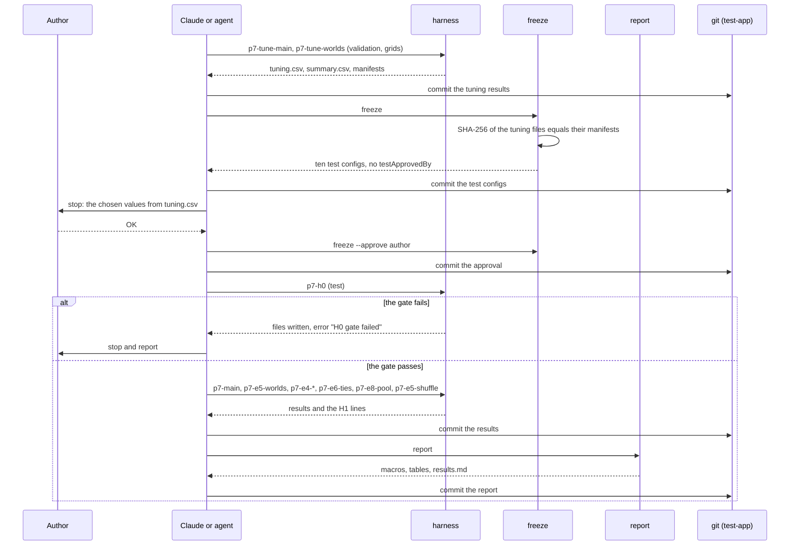
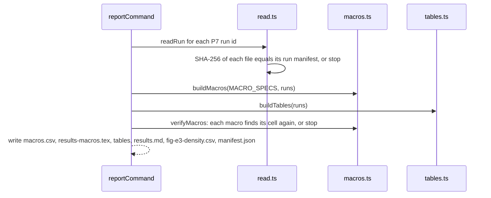

# P7 offline experiments E1–E6, E8, report and macros

Spec status: approved · 2026-11-11
Design status: approved · 2026-11-11
Type: feature · Folder: `.docs/works/2026-11-11-p7-offline-experiments/`

## 1. Spec

### Problem

The thesis has no result yet. P5 built the harness and P6 built the live feed, but the only results are `.docs/results/p5-baseline/` (validation split, BL0–BL5 untuned, size S) and `.docs/results/p6-parity/`. Chapters 5 and 6 need the experiments E1–E6 and E8 (super-plan P7, blueprint §4), run once on the test split after tuning is frozen.

This task is task 9 in `.docs/implementation-plan.md` §5: phase P7 ★, depends on task 6, 2 days, planned end 11-13, no bug placed here. It implements the blueprint rows "H0 / E5", "H1 test 1 / E2", "H1 test 2 / E2", "H2 / E3", E1, E4, E5, E6 and E8 of §4, with the files of §2.7, the macros of §2.8, the families of §3.3, the H1 reading of §3.4 and the H0 gate of §3.5.

What is missing today (checked in the code on 2026-11-11):

- **Statistics are not wired in.** `compareRow`, `applyHolm`, `h1Verdict`, `h0Gate` and `writeCompare` in `eval/src/stats.ts` are tested (scipy cross-check in P5), but only `stats.test.ts` calls them. `harnessCommand` (`eval/src/harness/commands.ts`) writes `per_user.csv`, `summary.csv`, `coverage.csv`, `leftout.csv`, `tuning.csv` and the manifest, and no `compare.csv`.
- **No `density.csv`** (E3). Blueprint §2.7 names its columns, but no code writes it, and no doc says which measure of density to use or where the bins start.
- **No reversed tie-break** (E6). `rankPool` sorts by `(score desc, id desc)` only (`packages/ranking/src/rank.ts:13`). The live feed calls the same function (`apps/backend/src/feed/feed.service.ts:152`).
- **No timestamp shuffle** (E5). `eval/src/rng.ts` has the stream name `shuffle` and nothing else. No doc says what is shuffled: `.docs/literature.md` (claim 9, D7) calls it "our own test", and [23] was not read.
- **The `m` sweep does not fit in one run.** A run config cannot list one method twice (`validateConfig` in `eval/src/harness/config.ts`), so H with four values of `m` (super-plan §7) needs more than one run or a change.
- **Tuning never ran on real data.** P5 tested it only on the golden fixture (P5 design, "Tuning support"). The test split never ran: a test config needs `"testApprovedBy"` and plain numbers, not `"grid"` (`validateConfig`).
- **No report.** `eval/src/report/` does not exist (`docs/System_Architecture.md` marks it 🔜). Nothing writes `macros.csv`, `results-macros.tex` or tables.

Why now: P7 ★ makes every number of Chapters 5 and 6. Its verdicts (H1 on both co-primary tests, the H0 gate) decide the default feed rule that P8 applies (super-plan P7, "Default feed rule"). Cut trigger 3 of the blueprint (finer E4) fires if this task has not started on 11-12.

### Scope

**In scope:**
- **Tuning on the validation split.** Each dataset on its own validation items (super-plan §5): α and β of H on `syn-W0-M`, `syn-W1-M`, `syn-W2L-M`, `syn-W2M-M`, `syn-W2H-M` and `digg2009`; the parameter of BL2t, BL4 and BL5 and the α of BL6 on `syn-W2M-M` and `digg2009`. Output: `tuning.csv`.
- **Freeze, then a stop.** Test configs with the chosen numbers are written and committed before any test-split run. The author reviews `tuning.csv` and adds `"testApprovedBy": "author"` (Open question 7).
- **Test-split runs** for the blueprint §4 rows: H0 gate, E1, E2 (H1 tests 1 and 2), E3, E4, E5, E6, E8. The H0 gate runs first. If it fails, the task stops and reports, and no other test result is used (super-plan §1).
- **`compare.csv`** with family F1, F2 or none (blueprint §3.3), the Holm correction, the H1 verdict for `syn-W2M-M` and `digg2009`, and the H0 gate.
- **`density.csv`** for E3 (Open question 4).
- **A reversed tie-break** for E6. The default order, and so the live feed, stays the same.
- **The timestamp shuffle** for E5 (Open question 5).
- **The report** (blueprint §2.8): `macros.csv`, `results-macros.tex`, one table file per Chapter 5 table, and the E3 figure data (Open question 6 for the format).
- **A double run** of every P7 run and of the report.
- **The supervisor note ★**: the verdicts, the main tables and the default feed rule question (super-plan §11, item 7).
- **Docs** in step with the code (CLAUDE.md): `docs/System_Architecture.md`, the Guidance Manual answers marked "(after P7)" in English and Vietnamese, the super-plan P7 status and change log, the blueprint task row.

**Out of scope:**
- E7, the cost benchmark (task 10, `p7-cost-benchmark`).
- The Hive side check (task 9b, `p7-hive-check`).
- Changing the default `algo` or writing the tuned α and β into `apps/backend/src/feed/feed.constants.ts` (P8, task 11).
- `npm run thesis:repro` (task 11).
- Writing the thesis chapters (the author, P9, in `.docs/Thesis-Report/`).
- Any change to a frozen value of super-plan §7, to `eval/config/synthetic-v1.json` or to the datasets.
- Tuning again after any test result is seen.

### Done when

| # | Check | Expected result |
|---|---|---|
| DW1 | Read the committed `tuning.csv` of the tuning run and check each (dataset, tuned method) | Exactly one row with `chosen` = 1, and it follows the §5 rule: the highest `val_ndcg10`, ties to the smaller value or (α, β) pair. 0 violations |
| DW2 | Compare the params in the test configs with the chosen rows of `tuning.csv`, and read `git log` | Every param equals its chosen value. The commit that adds the test configs comes before the first commit with a `split` = `test` result |
| DW3 | H0 gate: the `compare.csv` row (`syn-W0-M`, H, BL2, K 10, `all`) | The gate result (pass or fail) and `ci_low` are printed and written in the run log. On a fail, the task stops before any other test result is used |
| DW4 | Count the rows of `compare.csv` for `syn-W2M-M` and `digg2009` | F1 has 15 rows and F2 has 84 rows for each dataset (blueprint §3.3). Every F1 and F2 row has `p_raw` and `p_holm`. Every row of family none has both empty |
| DW5 | H1 verdict on `syn-W2M-M` and `digg2009` | One line per dataset, pass or fail, by the rule of blueprint §3.4 on the F1 row (H − BL2, NDCG@10, group 0–4). A fail is reported as it is |
| DW6 | Read `density.csv` | Rows for `syn-W2L-M`, `syn-W2M-M`, `syn-W2H-M` and `digg2009`, one per bin. For each dataset, `n` summed over the bins equals the kept test users in `leftout.csv` (group `all`) |
| DW7 | List the results folders of E4, E5, E6 and E8 | Each has `summary.csv` and a manifest. E6 holds every E1 method with the reversed tie-break. E5 has the compare rows (family none) of its rows in blueprint §4 |
| DW8 | `npm run test -w @breadit/ranking`, and `npm run test:parity -w @breadit/backend` (db and redis up, `syn-W2M-M` in `eval_load`) | Both pass. Parity gives 300 of 300 full orders and 300 of 300 first two pages, as in P6 |
| DW9 | Run every P7 run and the report again into empty folders | Every file and every manifest is byte-identical to the committed ones |
| DW10 | For each row of `macros.csv`, find its CSV cell by `file` and `row_key` | 0 mismatches between the macro value and the cell (after the rounding rule of the Design). Every name matches `^[A-Za-z]+$`. `results-macros.tex` has one `\newcommand` per row |
| DW11 | `npm run verify -w @breadit/eval` | Passes, with the golden, leakage and double-run tests of P5 unchanged |
| DW12 | Read `run_output.txt` in the task folder | Each run has its command, run time and peak memory (Class R, not compared) |
| DW13 | Read `results-note.md` in the task folder | It has the H0 gate, both H1 verdicts, the main tables and the question of super-plan §11, item 7 |
| DW14 | Read the docs named in Scope | The 🔜 of the report and of task 9 are ✅. Every "(after P7)" answer for E1, E4, E5, E6, Q22 and coverage is written, in `en/` and `vi/` with the same content |
| DW15 | `git diff --stat` of the task commits | Only `eval/`, `packages/ranking/` (the tie-break and its test), `.docs/results/`, `docs/`, `.docs/super-plan.md`, `.docs/implementation-plan.md`, `CLAUDE.md` (if a command changes) and this task folder |

### Open questions

1. **Which α and β does the H0 gate use?** The blueprint tunes each dataset on its own validation items (§4). On `syn-W0-M` the tuning may choose α = β = 0. Then H equals BL2, the interval is [0, 0], and the gate passes without testing anything. Recommendation: the gate uses the α and β chosen on `syn-W2M-M`, so H has a real social term in a world where it must not help. The own-tuned W0 row is reported too, with no family. Other option: the own-tuned values only, as the blueprint reads today.
2. **Do the ablations and the `m` sweep get their own tuning?** Super-plan §5 tunes H, BL2t, BL4, BL5 and BL6, and says nothing about H-follow, H-comm, H-noauthor and H-noengager. Recommendation: each ablation uses the α and β chosen for H on the same dataset, and the `m` sweep (0, 2, 5, 10) uses them too, so a difference comes only from the removed term or the changed `m`. Other option: tune each ablation on its own grid (about 6 to 36 more grid points each).
3. **Does E8 tune again on the larger pool?** Recommendation: no. E8 reuses the values chosen on the normal pool, because it asks whether the pool size changes the result, not the tuning. Other option: tune again on the larger pool.
4. **What is "social density" in E3, and where do the bins start?** H2 names two measures: the number of followees, and friend engagement in the pool. `per_user.csv` already has `n_followees` at the item time. Recommendation: density is `n_followees`, with the bins 0, 1–4, 5–19 and 20 or more (the same edges as the history buckets), fixed before the test run. "Against own history" is the history buckets, already in `summary.csv`. Other option: friend engagement in the pool, which needs a new per-user column. Note that on synthetic data a user with 0 followees can still gain from the community term, so bin 0 is not always "no social signal".
5. **Keep the timestamp shuffle, and what does it shuffle?** It is first in the cut order (super-plan §8). Recommendation: keep it, as the last run of the task. On `syn-W2M-M`, inside each post, shuffle the times of its interactions among its interactions with the `shuffle` stream. Who engaged with which post and when the post got its engagement stay the same, but "a followee engaged before me" becomes random. Then run H and BL2 with the values chosen on `syn-W2M-M`. If the gain of H shrinks, the evaluation reacts to time order. The shuffled dataset needs a T: the rule gives it from the same multiset of times, so it is likely equal to the T of `syn-W2M-M` (not checked). A new key in `cutTimes` of `frozen-v1.json` and in super-plan §7 is the author's change. Other option: cut it now, as the cut order allows.
6. **Report format.** Blueprint §2.8 says LaTeX: `results-macros.tex` and tables. Today the author created the chapter drafts as Markdown in `.docs/Thesis-Report/`. Recommendation: `macros.csv` stays the one source. The report writes the LaTeX files for the final thesis and also one Markdown file with the same tables and macro values, for the drafts. Other option: LaTeX only, as the blueprint says.
7. **Who approves the test split, and when?** Recommendation: a stop inside the task, after tuning. Claude shows the chosen values from `tuning.csv`, the author checks them and writes `"testApprovedBy": "author"` into the test configs (or tells Claude to). Other option: approving the plan also approves the test runs.

## 2. Impact

**Who and what it affects.**
- **The thesis.** Every number of Chapters 5 and 6, the H1 and H2 answers, the H0 gate and the left-out counts in Chapter 3. If we do nothing, the thesis has no result.
- **The supervisor ★.** The results and the default feed rule question are sent with this task. The P1 note has no answer yet (blueprint §6), so the Digg rows (†) may change later. Checkpoints are sends, not stops (blueprint §5), so the task runs them anyway.
- **Later tasks.** Task 11 (P8) applies the default feed rule and writes the chosen α and β into `feed.constants.ts`. `thesis:repro` reruns these configs and compares the manifests. Task 9b runs only if this task closes on 11-13. Task 10 (E7) does not depend on this task.

**Code areas.**
- `eval/src/harness/` (`commands.ts`, `run.ts`, `write.ts`, `config.ts`): wire in the statistics, write `density.csv`, run the test configs.
- `eval/src/stats.ts`: called as it is. Its tested functions are not expected to change.
- `eval/src/report/` (new): the report and the macros.
- `eval/config/runs/` (new configs) and `.docs/results/p7-*/` (new results). A large `per_user.csv` goes to the git-ignored `eval/results/`, with its hash in the committed manifest (P5 rule).
- `packages/ranking/src/rank.ts`: only for the reversed tie-break of E6. The backend feed calls `rankPool`, so the default order must not change. DW8 checks it with the parity test.
- No backend, frontend, Prisma, cache or migration change.
- No open bug is in this code. The blueprint places no bug here, and the only Bugs Report row that names a harness is R7, a root script.

**Thesis link.**
- Phase P7 ★. RQ1 and H1 (E1, E2, E4), RQ2 and H2 (E3), H0 (gate, E5), plus E6 and E8 for robustness.
- Frozen values (super-plan §7): read only. That covers the seed, K, the buckets, the resamples and permutations, the confidence and Holm levels, `m`, the α and β grid, W and N_max, T, W_L and N_L, and the baseline grids. None is changed.
- Two new fixed choices, not in §7 today, must be set before the first test run: the density bins (Open question 4) and the T of the shuffled dataset (Open question 5). The author decides both.
- This task makes the numbers the thesis reports. It changes no number that is already reported.

**Risks.**
- **Time.** The budget is 2 days, ending 11-13, and the scope is large. If time runs short, the cut order of super-plan §8 applies: the shuffle first, then E8, then the finer E4. Cut trigger 3 does not fire, because the task started on 11-11.
- **Digg memory and run time.** In P5, a validation run of two methods on `digg2009` took 77.5 s with a peak of 1.22 GB, and wrote 249,102 per-user rows (`.docs/works/2026-11-02-p5-eval-harness/run_output.txt`). Tuning on Digg has about 57 grid points (H 36, BL6 6, BL2t 5, BL4 5, BL5 5). Today one pass keeps the per-user rows of every point. The heap limit of the harness script is 4096 MB (`eval/package.json`). Not measured, so the Design must keep a Digg run under that limit.
- **β on Digg.** Digg has no communities, so β has no effect there. The 36 H grid points give 6 distinct results, and the tie rule picks the smallest β (blueprint §4). This is expected, not a bug.
- **Looking at test results too early.** The harness refuses a test config without `testApprovedBy`, and a Bash hook asks before a `--split test` command. DW2 checks the commit order.
- **A failed H0 gate** stops the task (super-plan §1). The plan must leave time to look for the bug or the leak.

## 3. Design

### Decisions from the Open questions

The author approved the Spec without changing the Open questions, so this Design follows each recommendation. Approving the Design confirms them.

| OQ | Decision |
|---|---|
| 1 | The H0 gate run uses the α and β chosen on `syn-W2M-M`. The own-tuned W0 row is in the E5 run, with no family |
| 2 | The ablations and the `m` sweep reuse the α and β chosen for H on the same dataset |
| 3 | E8 reuses the values chosen on the normal pool |
| 4 | Density is `n_followees` at the item time, put in bins by `bucketOf` (the history bucket edges of super-plan §7), on NDCG@10 |
| 5 | Kept, as the last run. Inside each post, the users are shuffled across the post's interaction slots. T stays the frozen T of `syn-W2M-M` (see "Shuffle"), so no new frozen value is needed |
| 6 | `macros.csv` is the one source. The report writes the LaTeX files and one Markdown file |
| 7 | A stop after tuning. The test configs get `testApprovedBy` only after the author's OK |

### Approach

**One harness, committed configs.** Every experiment is a run config in `eval/config/runs/`, run by the existing `npm run harness`. Tuning configs run on the validation split with `"grid"` params, through the existing `tuneConfig` and `pickBest`. Test configs hold plain numbers. Six new config keys cover what the experiments need. Every key is optional, so `p5-baseline` and the golden fixture give the same bytes as before:
- `datasetParams`: per dataset, numbers that replace `params`, because each dataset has its own tuned values. `runConfig` already takes per-dataset variants (`RunConfigOptions.variants`). A new `variantsFor(cfg, datasetId)` builds them. A config with a `"grid"` param cannot have `datasetParams`.
- `tieBreak`: `"id-desc"` (default, the production order) or `"id-asc"` (E6). It goes to `rankPool`.
- `shuffle`: `true` runs on the shuffled interactions (E5). The rows carry the dataset label `<id>-shuffled`.
- `compare`: `{ "mode": "families" | "none", "ref": "BL2" }` says which rows go into `compare.csv`.
- `density`: `true` writes `density.csv`. It needs `compare` and H.
- `h0Gate`: `true` checks the H0 gate after the run.

**Statistics.** A new `eval/src/harness/compare.ts` turns the per-user ranks of a run into `compare.csv` rows. It calls the tested functions of `stats.ts` as they are: `compareRow` per comparison, `applyHolm` over the run, `writeCompare`, `h1Verdict` and `h0Gate`. The per-user NDCG@K comes from `ndcgAt` (`metrics.ts`), and the groups from `groupsOf`.
- **families** (only `syn-W2M-M` and `digg2009`, blueprint §3.3). F1 is H − BL2 for each K and the groups 0, 1–4, 0–4, 5–19 and 20+ (15 rows). F2 is H − each of BL0, BL1, BL2t, BL3, BL4, BL5 and BL6, for each K and the groups 0–4, 5–19, 20+ and all (84 rows). Every family row must have n ≥ 1, or the run stops. After Holm, the command prints one line per dataset: `H1 <dataset>: pass|fail`, with `p_holm` and `ci_low` (`h1Verdict`).
- **none.** Every other method against `ref`, for each K and each group, with the bootstrap interval only. A group with no user gets a row with n = 0 and empty numbers.
- **H0 gate.** After the compare rows, `h0Gate` reads the row (`syn-W0-M`, H, BL2, K 10, all) and the command prints `H0 gate: pass|fail`. On a fail, the command still writes every file (for the bug hunt), then stops with an error. So neither a script nor the agent can go on by mistake.

**Density (E3).** For each dataset of a run with `density`, the `n_followees` of each kept user goes into a bin by `bucketOf`. For each bin, the command takes H − ref on NDCG@10 per user and calls `pairedBootstrap`, with no family (blueprint §3.3). The columns are those of blueprint §2.7. K is 10, the H1 metric, because the file has no `k` column. A bin with no user gets n = 0 and empty numbers.

**Reversed tie-break (E6).** `rankPool(pool, score, tieBreak = "id-desc")` in `packages/ranking/src/rank.ts`. With `"id-asc"`, equal scores go by post id ascending. The backend calls it with two arguments and is not changed, so the live order stays the same (DW8).

**Shuffle (E5).** `shuffleWithinPosts(interactions, masterSeed)` in `eval/src/harness/shuffle.ts`. It walks the posts in id order. Inside a post, its interaction rows, sorted by `(created_at, event_id)`, are slots. Each slot keeps its `event_id`, `created_at` and `type`. The post's users go back into the slots in a Fisher–Yates order drawn from `rng(masterSeed, "shuffle")`. As a result:
- every post keeps the same engagers and the same engagement curve, so the post features that BL2 reads are unchanged;
- who engaged first becomes random, so "a followee engaged before me" loses its time order;
- the set of `(created_at, event_id)` pairs is unchanged, so `cutTime` returns the same T. The run uses `cutTimes["syn-W2M-M"]` as `expectedT` and stops if T differs (the existing `resolveT`);
- each user appears in a post as often as before, so no user touches a post twice and no author engages with their own post.

The shuffle runs in memory. No dataset folder is written.

**Tuning memory.** `runDataset` gets an option `keepPerUser` (default true). `tuneDataset` sets it to false, because the choice needs only the summary. The ranks still go to `summarize`. Without this, the Digg tuning pass would keep 57 × 124,551 ≈ 7.1 million per-user rows.

**Freeze.** A new command, `npm run freeze -w @breadit/eval`, reads the two committed tuning folders and checks each file's SHA-256 against its run manifest. It then writes the ten test configs from a fixed table, `TEST_RUNS` (below). The numbers come only from the rows of `tuning.csv` with `chosen` = 1. The E8 baseline is the baseline with the highest validation NDCG@10 (K 10, all) on `syn-W2M-M` in `p7-tune-main/summary.csv`, with ties going to the method order. `freeze --check` rebuilds the configs in memory and compares them with the files, ignoring `testApprovedBy` (DW2). `freeze --approve author` writes the same configs with `"testApprovedBy": "author"`. It runs only after the author's OK.

**Report.** A new `eval/src/report/`, run by `npm run report -w @breadit/eval`. It reads the P7 results folders, checks each file against its run manifest, and writes `.docs/results/p7-report/`:
- `macros.csv` (`name, value, file, row_key, column`) and `results-macros.tex` (one `\newcommand{\<name>}{<value>}` per row);
- `tables/<id>.tex`, one `tabular` (booktabs) per table, with no float around it, so the author adds the caption;
- `results.md`, the same tables in Markdown and the list of macros with their values, for the drafts in `.docs/Thesis-Report/`;
- `fig-e3-density.csv`, the E3 figure data (dataset, bin, mean_diff, ci_low, ci_high) for `syn-W2L-M`, `syn-W2M-M`, `syn-W2H-M` and `digg2009` (DW6 is checked on this file);
- `manifest.json`, with the SHA-256 of every file and of every input run manifest.

A macro value is its cell rounded by `roundDecimal`: 3 decimals, half away from zero, done on the decimal string, not on a float. A p-value under 0.001 is written `<0.001` (`$<0.001$` in LaTeX). Counts stay plain integers. The tables use the same function, so a table and a macro never disagree. After writing, the report reads each macro's cell again and stops on any mismatch (DW10).

**Contract changes for the blueprint.** The docs step writes these into `.docs/implementation-plan.md`:
- §2.7: `density.csv` is on NDCG@10. Rows of family none in `compare.csv` also serve E4, E5 and E8.
- §2.8: `macros.csv` gets a fifth column, `column`, because a row key alone does not name the cell.
- §3.5: the H0 gate uses the α and β chosen on `syn-W2M-M` (OQ1).

**Rejected options:**

| Option | Why not |
|---|---|
| One run config per dataset instead of `datasetParams` | About 20 more configs for the same result. `runConfig` already takes per-dataset variants |
| H twice in one run, with labels, for the `m` sweep | Every writer sorts by `METHOD_ORDER` and would need label support. Three small runs need no change |
| Test configs that read the tuned values from `tuning.csv` at run time | The config would not show the frozen numbers, and DW2 asks for numbers in the configs |
| Test configs written by hand | Copy mistakes. `freeze` writes them and `freeze --check` proves them |
| Reverse the ties in `eval/` after `rankPool` | Ranking logic belongs in `@breadit/ranking` (CLAUDE.md) |
| Shuffle times over the whole dataset | Events would land before their post exists, the pool rule breaks, and BL2's post features change |
| Write the shuffled data as a new dataset folder | It needs a new key in `cutTimes` (a frozen value) and the format check, for no gain |
| A macro for every cell | Thousands of names, while the text cites a few dozen numbers |
| Figures drawn by the report (SVG or pgfplots files) | More code. The author draws the figure from `fig-e3-density.csv` |

### The runs

Tuning, on the validation split, written by hand:

| Run id | Datasets | Methods (grid params) |
|---|---|---|
| `p7-tune-main` | `syn-W2M-M`, `digg2009` | BL0, BL1, BL2, BL2t (ageWeight), BL3, BL4 (divisor), BL5 (gravity), BL6 (alpha), H (alpha, beta; `m` frozen) |
| `p7-tune-worlds` | `syn-W0-M`, `syn-W1-M`, `syn-W2L-M`, `syn-W2H-M` | BL2, H (alpha, beta; `m` frozen) |

Test split, written by `freeze` (`TEST_RUNS`), in run order. The pool is normal unless the row says otherwise:

| Run id | For | Datasets | Methods | Params | Keys |
|---|---|---|---|---|---|
| `p7-h0` | H0 gate | `syn-W0-M` | BL2, H | H: chosen on `syn-W2M-M` | compare none, `h0Gate` |
| `p7-main` | E1, E2, E3 (Digg) | `syn-W2M-M`, `digg2009` | BL0, BL1, BL2, BL2t, BL3, BL4, BL5, BL6, H | each dataset its own (`datasetParams`) | compare families, density |
| `p7-e5-worlds` | E5, E3 (W2 cells) | `syn-W0-M`, `syn-W1-M`, `syn-W2L-M`, `syn-W2M-M`, `syn-W2H-M` | BL2, H | each dataset its own | compare none, density |
| `p7-e4-terms` | E4 | `syn-W2M-M`, `digg2009` | BL2, H, H-follow, H-comm, H-noauthor, H-noengager | H's chosen α and β of the dataset | compare none |
| `p7-e4-m0`, `p7-e4-m2`, `p7-e4-m10` | E4, `m` sweep | `syn-W2M-M`, `digg2009` | BL2, H | H's chosen α and β; `m` = 0, 2 or 10 | compare none |
| `p7-e6-ties` | E6 | `syn-W2M-M`, `digg2009` | the nine of `p7-main` | as `p7-main` | `tieBreak` id-asc |
| `p7-e8-pool` | E8 | `syn-W2M-M` | BL2, H, the best validation baseline | as `p7-main` | pool large, compare none |
| `p7-e5-shuffle` | E5, shuffle | `syn-W2M-M` | BL2, H | chosen on `syn-W2M-M` | `shuffle`, compare none |

The `m` = 5 point of E4 is H in `p7-e4-terms` (frozen `m`). The Digg table of E4 leaves out H-comm, because the community term is 0 on Digg (blueprint §4). The run still computes it, which costs about 10 s. E8 and the shuffle run last, so the cut order of super-plan §8 can drop them without touching anything else.

### Macros and tables

Macro names follow blueprint §2.8, in this order: experiment, dataset, metric, K in words, group, what. Dataset words are `WZero`, `WOne`, `WTwoL`, `WTwoM`, `WTwoH`, `WTwoMShuffled` and `Digg`. Group words are `Zero`, `OneFour`, `ZeroFour`, `FiveNineteen`, `TwentyPlus` and `All`. The "what" words are `Gain` (mean_diff), `CiLow`, `CiHigh`, `PHolm`, `N` and `Value`. Example: `\eTwoDiggNdcgTenZeroFourGain`. A name that is not letters only, or that is used twice, stops the report.

The macro list is a fixed table, `MACRO_SPECS` in `macros.ts`. It holds only the numbers the text is likely to cite, about 70:

| Group | Source cells |
|---|---|
| H1 (E2) | `p7-main/compare.csv`, F1, K 10: group 0–4 (gain, CI, `p_holm`, n), groups 0 and 1–4 (gain); both datasets |
| H0 gate | `p7-h0/compare.csv`, K 10, all: gain and CI |
| E1 | `p7-main/summary.csv`, NDCG@10 all of H and BL2; `p7-main/coverage.csv`, K 10 of H and BL2 |
| Left out | `p7-main/leftout.csv`, group all: test users and left out |
| E3 | `fig-e3-density.csv` sources: gain in bins 0 and 20+, for the three W2 cells and Digg |
| E4 | `p7-e4-*/compare.csv`, K 10, all: gain of each ablation and of each `m` |
| E5 | `p7-e5-worlds` and `p7-e5-shuffle` `compare.csv`, K 10, all: gain and `ci_low` |
| E6, E8 | `summary.csv` of `p7-e6-ties` and `p7-e8-pool`, NDCG@10 all of H and BL2 |

Tables, each in `tables/<id>.tex` and in `results.md`:
- `tuning`: the chosen values per dataset and method (`tuning.csv`, `chosen` = 1).
- `leftout`: test users and left out per group, both main datasets.
- `e1`: per method, NDCG@10, Recall@10 (all users) and Coverage@10, both datasets.
- `e2`: per group, NDCG@10 of H and BL2 and the F1 row (gain, CI, `p_holm`), both datasets.
- `e3`: per dataset and density bin, the gain and its CI.
- `e4`: per variant, NDCG@10 (all and 0–4) and the gain over BL2.
- `e5`: per world, the gain of H over BL2 and its CI (K 10, all), with the H0 gate row and the shuffle row.
- `e6`: per method, NDCG@10 all with the normal and the reversed tie-break.
- `e8`: per method, NDCG@10 (all and 0–4) with the normal and the larger pool.

### Workflow and sequence diagrams

The whole task. The agent stops after the test configs are committed; the author's OK comes before any test run.



One test run inside the harness:

```mermaid
sequenceDiagram
    participant Cmd as harnessCommand
    participant Cfg as config.ts
    participant Run as runConfig / runDataset
    participant Sh as shuffle.ts
    participant Pkg as @breadit/ranking
    participant Cmp as compare.ts
    participant St as stats.ts
    participant W as write.ts
    Cmd->>Cfg: parseRunConfig (new keys checked)
    loop each dataset
        Run->>Run: loadDataset
        opt shuffle
            Run->>Sh: shuffleWithinPosts(interactions, masterSeed)
        end
        Run->>Run: T equals cutTimes[source id], or stop
        Run->>Pkg: buildPool, userFeaturesAsOf, scorer, rankPool(pool, score, tieBreak)
        Run-->>Cmd: per-user ranks, summary, coverage, leftout
    end
    Cmd->>Cmp: compareRows(result, cfg)
    Cmp->>St: compareRow for each spec, then applyHolm
    opt density
        Cmd->>Cmp: densityRows
        Cmp->>St: pairedBootstrap for each bin
    end
    Cmd->>W: writeResults with compare.csv and density.csv as extra files
    Cmd-->>Cmd: H1 lines and the H0 gate line; an error if the gate fails
```

The report:



**Double run (DW9).** Delete the P7 results folders (`.docs/results/p7-*` and `eval/results/p7-*`), run every config and the report again into the default folders, then check two things: `git status` shows no change under `.docs/results/` and `eval/config/runs/`, and each git-ignored `per_user.csv` has the SHA-256 of its manifest. This compares the real files, including the manifests. Runs written with `--out` have no `external` field, so their manifests would differ for a harmless reason.

### Failure modes

| # | What can go wrong | How we notice | How we resolve it |
|---|---|---|---|
| F1 | The H0 gate fails | `p7-h0` prints `H0 gate: fail` and stops with an error | Stop the task. Look for a leak: run the leakage test on `syn-W0-M` and check the as-of features of a few W0 users by hand. Report to the author. No other test result is used (super-plan §1) |
| F2 | Digg tuning runs out of memory (57 grid points) | The harness stops with a heap error | `keepPerUser: false` in tuning. Measured on 2026-11-11 (validation, Class R): 1 method 53 s and 1.23 GB peak, 6 methods 132 s and 1.18 GB. If it still fails, split `p7-tune-main` into two configs by method: each grid point is independent, so the chosen values are the same |
| F3 | Runs are slow on Digg | Run time in `run_output.txt` | About 16 s per extra method on Digg validation (same measurement), so tuning takes about 15–20 min. Accepted. The test split has about half as many users |
| F4 | A test result is seen before the freeze | Commit order (DW2) | Test configs come only from `freeze`. The harness refuses a test config without `testApprovedBy`. The agent stops after committing the test configs |
| F5 | A results file is edited by hand after its run | SHA-256 differs from the run manifest | `freeze` and `report` check every file they read and stop |
| F6 | A family row has no user | `compareRows` finds n = 0 | The run stops and names the row: a family must keep its 15 or 84 rows. Not expected: bucket 0 keeps 59 test users on `syn-W2M-M` and 6,638 on Digg (blueprint §3.6, §3.7) |
| F7 | A density bin or a family-none group has no user | n = 0 | A row with n 0 and empty numbers. DW6 sums n over the bins |
| F8 | The shuffle changes T | `resolveT` stops: T differs from `cutTimes["syn-W2M-M"]` | Cannot happen by construction (the same `(t, id)` pairs). A test checks it on the golden fixture |
| F9 | The shuffle makes a user touch a post twice, or an author engage with their own post | `prepareItem` stops the run | Cannot happen: each post keeps its multiset of users. A test checks it |
| F10 | The tie-break option changes the live feed | `rank.spec.ts` and the parity test (DW8) | The default stays `id-desc`, and the backend call is not changed |
| F11 | Ties in tuning (β on Digg, flat grids) | Equal `val_ndcg10` in `tuning.csv` | `pickBest` takes the smaller value or pair (existing). Expected on Digg |
| F12 | A macro and a table round the same cell differently | DW10 | One `roundDecimal`, on the decimal string, for both |
| F13 | `families` on another dataset, or an F2 baseline missing | `validateConfig` or `compareRows` stops | `families` allows only `syn-W2M-M` and `digg2009`, and F2 needs all seven baselines |
| F14 | The statistics are slow on Digg: 10,000 resamples × up to about 65,000 users per row, 99 family rows | Run time in the run log | Accepted (not measured). Each row restarts its streams, so the order of the rows does not change any result |
| F15 | Wrong Node version | `checkNode` (existing) stops each command | `nvm use` |

### Code files

| File | New or changed | Purpose |
|---|---|---|
| `packages/ranking/src/rank.ts` | changed | `rankPool(pool, score, tieBreak: TieBreak = "id-desc"): PostId[]` |
| `packages/ranking/src/types.ts`, `index.ts` | changed | `export type TieBreak = "id-desc" \| "id-asc"` |
| `packages/ranking/src/rank.spec.ts` | changed | Reversed ties; the default order is unchanged |
| `eval/src/harness/config.ts` | changed | The six optional keys and their checks; `variantsFor(cfg: RunConfig, datasetId: string): Variant[]` |
| `eval/src/harness/run.ts` | changed | `RunParams.tieBreak`; `DatasetRunOptions.keepPerUser` and `label`; `runConfig` applies `shuffle` and `variantsFor`; `scoreItem` passes `tieBreak` to `rankPool` |
| `eval/src/harness/tuning.ts` | changed | `tuneDataset` runs with `keepPerUser: false` |
| `eval/src/harness/shuffle.ts` | new | `shuffleWithinPosts(rows: readonly Interaction[], masterSeed: number): Interaction[]` |
| `eval/src/harness/compare.ts` | new | `compareRows(result: RunResult, cfg: RunConfig, o: StatOpts): CompareRow[]`; `densityRows(run: DatasetRun, ref: string, o: StatOpts): DensityRow[]`; `writeDensity(dir: string, rows: readonly DensityRow[]): FileEntry`; `verdictLines(rows: readonly CompareRow[], cfg: RunConfig): { lines: string[]; gateFailed: boolean }` |
| `eval/src/harness/commands.ts` | changed | After `runConfig`: the compare rows, density, the verdict lines, and the error on a failed gate |
| `eval/src/harness/freeze.ts` | new | `TEST_RUNS`; `buildTestConfigs(input: TuningInput): Record<string, RunConfig>`; `freezeCommand(argv: string[]): string[]` |
| `eval/src/report/read.ts` | new | `readRun(resultsDir: string, runId: string): RunFiles` (rows as string records, SHA-256 checked) |
| `eval/src/report/round.ts` | new | `roundDecimal(cell: string, places: number): string`; `formatP(cell: string): string` |
| `eval/src/report/macros.ts` | new | `MACRO_SPECS`; `macroName(parts: string[]): string`; `buildMacros(runs: RunFilesMap): MacroRow[]`; `macrosTex(rows: readonly MacroRow[]): string`; `verifyMacros(rows, runs): void` |
| `eval/src/report/tables.ts` | new | `buildTables(runs: RunFilesMap): Table[]`; `toLatex(t: Table): string`; `toMarkdown(t: Table): string` |
| `eval/src/report/report.ts` | new | `REPORT_RUNS`; `reportCommand(argv: string[]): string[]`, with `--results-dir` and `--out` for tests |
| `eval/src/cli/freeze.ts`, `eval/src/cli/report.ts` | new | The two commands, each starting with `checkNode` |
| `eval/package.json` | changed | Scripts `freeze` and `report` |
| `eval/src/harness/config.test.ts`, `run.test.ts`, `tuning.test.ts` | changed | The new keys, `datasetParams`, `tieBreak`, the shuffle label, `keepPerUser` |
| `eval/src/harness/shuffle.test.ts`, `compare.test.ts`, `freeze.test.ts`, `eval/src/report/*.test.ts` | new | One test file per new module (the plan lists the cases) |
| `eval/config/runs/p7-*.json` | new | 2 tuning configs written by hand, 10 test configs written by `freeze` |
| `.docs/results/p7-*/` | new | The results of the twelve runs, and `p7-report/` |
| `run_output.txt`, `results-note.md` (task folder) | new | The run log (DW12) and the note for the supervisor (DW13) |
| `docs/System_Architecture.md`, `docs/Guidance-Manual/{en,vi}/` (05, 06, 07, 09, 10) | changed | The report and task 9 marks, the "(after P7)" answers, the two new commands |
| `.docs/super-plan.md`, `.docs/implementation-plan.md`, `CLAUDE.md` | changed | P7 status and change log; the blueprint lines of "Contract changes" and the task row; the `freeze` and `report` commands |

`write.ts` is not changed: `writeResults` already takes `compare.csv` and `density.csv` through `extraFiles`. `stats.ts` is not changed.

### Data, schema and cache changes

None in Prisma, Redis or the backend. `frozen-v1.json` and super-plan §7 are unchanged: the density bins reuse the history bucket edges, and the shuffle reuses the T of `syn-W2M-M`. New committed files are the twelve run configs and the results folders `.docs/results/p7-*/`. Digg `per_user.csv` files go to the git-ignored `eval/results/`, with their hashes in the committed manifests (P5 rule).

### Amendment 1 (2026-11-11, at Stop A, the author's decisions)

**What the tuning showed.** These are validation results only, in `.docs/results/p7-tune-*/` (commits `eeeb467` and `02e735f`).
- **W0.** On `syn-W0-M`, H at α = β = 16 scored NDCG@10 0.020249 against 0.014765 for BL2. β alone (0/16) gave 0.020061, and α alone (16/0) gave 0.015128. The gain grows with history: in bucket 20+, NDCG@10 goes from 0.0207 to 0.0355.
- **Why.** This is a reading of the code. The community term counts `c_u,c`, the user's earlier positives in community c, whether or not the user is a member. A community post has the topic of its community (`eval/src/generator/posts.ts`), and interactions follow topic interest (`interactions.ts`). So the term carries topic interest even in W0. It is not a leak: the P5 leakage test covers every feature.
- **Grid edges.** α = β = 16, the top of the grid, was chosen on all five synthetic worlds, and α = 16 on Digg. BL2t (Digg, top), BL4 (`syn-W2M-M`, top) and BL5 (`syn-W2M-M`, bottom) also sat at an edge. On Digg, H (0.093133) ≈ BL2 (0.093128).

**Decision 1: the H0 gate is on H-follow.** Super-plan §1 and blueprint §3.5 changed (super-plan 0.25, blueprint 1.8). This replaces the OQ1 line above and the §3.5 line of "Contract changes".
- The gate row is (`syn-W0-M`, H-follow, BL2, K 10, all). H-follow uses the α chosen for H on `syn-W2M-M` and the frozen `m`.
- `p7-h0` runs BL2, H and H-follow. H uses the `syn-W2M-M` values and is reported with no family, as the topic signal at those values.
- `h0Gate(rows, method = "H")` in `stats.ts` takes the method as a parameter, with the old default. This is the only change to `stats.ts`. `verdictLines` passes `"H-follow"`.
- The `h0Gate` config key needs H-follow in `methods`, `ref` BL2 and `syn-W0-M` in `datasets`.
- The H0 macros and the H0 row of table `e5` read the H-follow row. Table `e5` also shows H − BL2 on W0, named as the topic signal.

**Decision 2: wider grids.** Super-plan §7 and `frozen-v1.json` changed in the same commit:
- α, β: 0 to 1,024 in powers of 2 (12 values);
- BL2t adds 2 and 4, BL4 adds 360,000 and 720,000, BL5 adds 0.6 and 0.9.

Claude made this change and fixed the three tuning tests that counted grid points (they now read the frozen grids). Then both tuning runs and `freeze` run again, from empty `p7-tune-*` folders. `p7-tune-main` grows from 114 to 177 grid points (H 144, BL6 12, BL2t 7, BL4 7, BL5 7), and `p7-tune-worlds` from 144 to 576.

| # | What can go wrong | How we notice | How we resolve it |
|---|---|---|---|
| F16 | Digg tuning runs out of memory at 177 points | A heap error | The 114-point run peaked at 2.47 GB RSS. A linear guess for 177 points is about 3.2 GB. If it fails, stop and report; splitting by method (F2) is Claude's decision |
| F17 | A new edge is chosen again (1,024, or a new baseline edge) | `tuning.csv` | Report it at the second Stop A. No second widening without the author |
