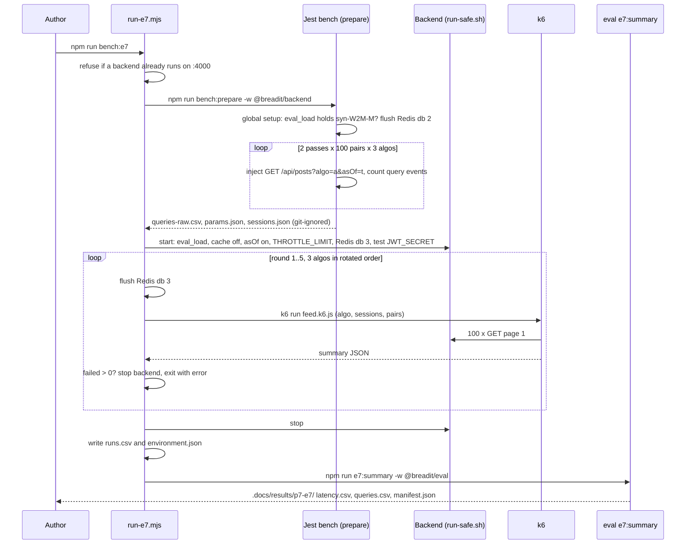

# P7 cost benchmark (E7)

Spec status: approved · 2026-11-12
Design status: approved · 2026-11-12
Type: feature · Folder: `.docs/works/2026-11-12-p7-cost-benchmark/`

## 1. Spec

### Problem

E7 asks what the new feed costs (super-plan P7, Class R): latency and Prisma query count for `algo` = `chrono`, `engagement` and `social`. Nothing measures this today. It is the last open P7 experiment (`.docs/implementation-plan.md` §5, task 10, "▶ next"; §4 row E7), and Chapter 5 needs its table. `docs/System_Architecture.md` (line 393) and the Guidance Manual (`10-defense-qa.md`, the two "(after P7)" answers) already claim "a cheap formula, E7 measures the cost", with no number behind it.

The old numbers cannot be reused. `docs/Pre-thesis/planning/k6_results.json` has 71% failed requests and did not come from the current script (super-plan §3). The likely cause is bug N6: the throttle limit is hard-coded as `{ ttl: 60000, limit: 1000 }` in `apps/backend/src/app.module.ts` (`ThrottlerModule.forRoot`), and it counts per route per IP. A k6 run comes from one IP, so it hits 429 fast. In the bug sweep, `/api/posts` gave 429 after 1,300 calls (`.docs/Bugs Report.md`, N6). The old script `docs/Pre-thesis/planning/k6_perf_test.js` also tests only Explore and search, with no login, and lets 5% of requests fail. It is frozen and stays as it is.

Three more facts shape the run:
- **The data lives in the past.** `syn-W2M-M` in `eval_load` starts at base epoch 1767225600 (2026-01-01, `.docs/results/p6-parity/manifest.json`). Without `asOf`, a feed at today's clock has an empty 7-day window. So E7 needs `FEED_ASOF_ENABLED=true` and a fixed `asOf`, as the parity test does.
- **The page cache hides the ranking.** Feed pages live 10 s in Redis (`PostsService.findAll`, key `feed:...:<v:user>:<asOf>`). With a fixed `asOf`, a repeated request is a Redis read, not a ranking. Bug T3 asks that E7 says whether the cache is on.
- **Login is throttled harder.** `POST /api/auth/login` has `@Throttle({ limit: 10 })` per minute (`apps/backend/src/auth/auth.controller.ts`). Logging in 1,000 users from one IP would take 100 minutes.

### Scope

**In scope:**
- Make the global throttle limit an env variable, with today's value (1,000 per 60 s) as the default. This fixes N6 as the plan says. Document it in `.env.example` and `README.md`.
- A k6 script for E7, outside `docs/Pre-thesis/`, with a fixed user sample, a fixed `asOf`, a fixed seed and a fixed load profile. It calls `GET /api/posts?algo=<a>&asOf=<t>` for the three algos.
- A count of Prisma queries per feed request for each algo. The count is deterministic (Class D), so it is measured once, not 5 times.
- A runner that does 5 k6 runs per algo, drops the first, and refuses a run with `http_req_failed` above 0.
- Results in `.docs/results/p7-e7/`: `latency.csv` (median and a bootstrap 95% CI per algo, from the 4 kept runs), the query counts, and a manifest with the machine, Node, Postgres and k6 versions, the cache state and the dataset hash.
- E7 macros and one table in `npm run report` (`.docs/results/p7-report/`), so Chapter 5 takes the numbers from macros only.
- Docs: E7 marked done in `docs/System_Architecture.md` (line 531), the "(after P7)" marks of E7 removed in `docs/Guidance-Manual/{en,vi}/10-defense-qa.md`, and `08-system-and-feed.md` §5.2 given the numbers (both languages). N6 closed in `.docs/Bugs Report.md`. Status in the super-plan P7 row and the blueprint §5.

**Out of scope:**
- Making the feed faster (the levers of `08-system-and-feed.md` §5.2). This task only measures. Any speed-up is a later task and must keep `npm run test:parity` passing.
- Indexes or any schema change (cut in super-plan v0.2, §9).
- Setting α and β of `social` to the tuned values. That is task 11 (`p8-repro`). See Open question 6.
- Explore, search and the guest feed. E7 names only the three `algo` feeds.
- Load testing for capacity (how many users the server holds). E7 is a cost comparison between algos on one machine.

### Done when

| # | Check | Expected result |
|---|---|---|
| DW1 | `npm run test -w @breadit/backend` | Passes. New unit tests show: with the env variable unset the limit is 1,000 per 60 s; with it set to a number the limit is that number; a bad value stops the app at start (the same rule as `readFeedConfig`). |
| DW2 | Start the backend on `eval_load` with the env variable set to the E7 value, then send 1,300 calls to `/api/posts` from one IP | No 429. With the variable unset, the 1,001st call in a minute gives 429 as today. |
| DW3 | The E7 command (name set in the Design) with db and redis up and `syn-W2M-M` loaded without `--rebase-to` | Writes `.docs/results/p7-e7/` with `latency.csv` (3 algos), the query counts and `manifest.json`. Each of the 15 runs has `http_req_failed` = 0, and the manifest lists all 15 with the first of each algo marked "warm-up". |
| DW4 | Run the query count twice | The same count per algo both times. |
| DW5 | Point the E7 command at a backend with the limit at 1,000 and a load that passes it | The run stops with an error that names `http_req_failed`, and writes no `latency.csv`. |
| DW6 | `npm run report -w @breadit/eval` | `macros.csv` and `results-macros.tex` hold the E7 macros. The numbers of every other macro are unchanged (`git diff` shows only added lines). |
| DW7 | `npm run test:parity -w @breadit/backend` | Still passes (the throttle change must not change the feed). |
| DW8 | `bash .claude/hooks/verify.sh` | Passes. |
| DW9 | `git diff` of the docs listed in Scope | E7 is marked done, the E7 "(after P7)" marks are gone in both languages, and N6 is in the resolved list with its commit. |

### Open questions

1. **Cache on or off.** Recommendation: the main table runs with `REDIS_HTTP_CACHE_ENABLED=false`, because the question is the cost of ranking, and with a fixed `asOf` the cache would serve almost every call. Other option: also add one cache-on row per algo, as the cost a real user sees. That doubles the run time.
2. **Which users.** Recommendation: the 100 users of the parity sample (`.docs/results/p6-parity/pairs.csv`). They are already drawn with a seed and cover the history buckets. Other option: a new seeded sample of all 1,000 users.
3. **How k6 gets sessions.** Login allows 10 per minute per IP. Recommendation: a setup step signs the session tokens with the test `JWT_SECRET`, the same way the backend does (`jose`, HS256), so login is not part of the measured time and the login throttle stays as it is. Other option: log in the 100 users slowly in k6 `setup()` (about 10 minutes per run).
4. **The load profile** (a frozen value, super-plan §7: "set in P7"). Recommendation: one virtual user, a fixed number of requests per run (each sampled user once per algo, in a seeded order), no sleep. One user gives the cost of one request without queueing, which is what the thesis compares. Other option: a second profile with 10 virtual users to show behavior under load. You set this value; it gets a line in the super-plan change log.
5. **The CI.** Recommendation: the bootstrap CI over the 4 kept runs' medians, 10,000 resamples (§7), so a run is the unit. Note: with 4 values the CI is wide. Other option: bootstrap over all requests of the 4 runs, which is narrower but treats requests as independent.
6. **α and β.** `SOCIAL_PARAMS` is still the placeholder 1/1 (`apps/backend/src/feed/feed.constants.ts`); P7 tuning chose 1024/1024 on `syn-W2M-M` (`.docs/results/p7-tune-main/tuning.csv`, line 355), and task 11 writes it. Cost should not depend on α and β: the same queries and the same pool size. Recommendation: run E7 with the placeholder and say so in the manifest. Other option: wait for task 11, which breaks the plan order.
7. **The env variable name.** Recommendation: `THROTTLE_LIMIT` (requests per 60 s per route per IP). The TTL stays 60 s. Tell me if you want the TTL as a variable too.

## 2. Impact

**Who it affects.** Users see no change: the default limit stays 1,000. The thesis gets the E7 table for Chapter 5 and the evidence behind the claim "the hybrid is cheap enough to run per request" (`docs/System_Architecture.md`, line 393). If we do nothing, Chapter 5 has no cost row, two defense answers stay "(after P7)", and N6 stays open.

**Thesis link.** P7, E7, Class R (`.docs/implementation-plan.md` §4, row E7). No RQ or hypothesis: E7 is a cost check, not a test. It does not touch H1, the H0 gate, family F1 or the default feed rule. Frozen values: it sets the k6 load profile (super-plan §7, "set in P7", Open question 4) and uses K, the bootstrap count, W and N_max as they are. No number already reported changes; E7 adds new macros only.

**Code.**
- Backend: `apps/backend/src/app.module.ts` (throttle limit from env) and a small config reader with its test. No change to the feed, the ranking package or the cache. Possibly a way to count Prisma queries per request in test mode only (Design decides; it must be off in production like `FEED_ASOF_ENABLED`).
- New bench script and runner, outside `docs/Pre-thesis/` (the folder is set in the Design).
- `eval/src/report/` (`macros.ts`, `tables.ts`, `read.ts`): read `p7-e7/` and add the E7 macros and table.
- Docs listed in Scope. `.env.example` and `README.md` for the new variable.

**Bugs in the same code.** N6 is fixed here. The T3 note (say if the cache is on) is answered by the manifest. No other open bug touches `app.module.ts` or the feed path (`.docs/Bugs Report.md` §5).

**Other tasks.** Task 11 (`p8-repro`) depends on this one and changes `SOCIAL_PARAMS` and the default `algo`; it must not start before this task closes. Task 11's `npm run thesis:repro` should not rerun E7 (Class R numbers are not byte-identical), but it may check that `p7-e7/` exists. No other open task touches these files.

**Time and cut.** Planned for 1 day, end 11-14. Cut 4 (super-plan §8: E7 with `chrono` and `social` only) triggers only if this task has not started on 11-14, so all three algos are in scope. One full run is about 15 k6 runs of 100 requests each, likely a few minutes (not checked).

**Risks.**
- Class R numbers depend on the machine (a Mac, Postgres and Redis in Docker). The manifest records the machine, and Chapter 5 says the numbers compare algos on one machine, not absolute speed.
- `eval_load` must hold `syn-W2M-M` loaded without `--rebase-to`. Today Docker is down, so whether it is loaded now is not checked. The runner checks it the same way the parity global setup does.
- k6 v1.7.1 is installed at `/opt/homebrew/bin/k6`. It is not pinned in the repo; the manifest records the version.

## 3. Design

### Decisions taken from the Spec

The Spec was approved with its seven open questions unanswered, so this Design takes each recommendation. Say so at the Design review if one is wrong.

1. **Cache off.** The whole E7 run uses `REDIS_HTTP_CACHE_ENABLED=false`. No cache-on row.
2. **Users.** The 100 users of the parity sample, each at its own `asOf` (`.docs/results/p6-parity/pairs.csv`, column `as_of_unix`). So every request sees the same data the parity test checks.
3. **Sessions.** Signed with `cookieFor` (`apps/backend/test/it/helpers/factory.ts`) and a test `JWT_SECRET`. No login call.
4. **Load profile** (frozen value, super-plan §7). One virtual user. Each run sends page 1 of one algo for the 100 users, in `pairs.csv` order, with no sleep. Cache off. Five rounds; round 1 is warm-up. The order has no random part, so the "fixed seed" of super-plan P7 is the seed of the parity sample (`masterSeed` 20261014). **This sets a frozen value; please confirm it when you approve the Design.** The task then writes it into super-plan §7 with a change-log line.
5. **CI.** The 95% bootstrap CI of the median, over the 4 kept run medians, with 10,000 resamples (§7).
6. **α and β.** E7 runs with `SOCIAL_PARAMS` as it is (1/1). The manifest records the params.
7. **Name.** `THROTTLE_LIMIT`, requests per 60 s per route per IP. TTL stays 60 s.

### Approach

**Throttle limit (N6).** A new reader `readThrottleLimit(env)` returns `THROTTLE_LIMIT` as a positive whole number, or 1,000 when it is unset or empty. Any other value throws, so the app does not start, the same rule as `readFeedConfig` (`apps/backend/src/feed/feed.config.ts`). `AppModule` passes it to `ThrottlerModule.forRoot` in place of the literal 1000. `ConfigModule.forRoot()` comes first in the same `imports` array, so `.env` is already loaded, as it is for `REDIS_URL` on the next line. The per-route `@Throttle` limits of `auth.controller.ts` stay as they are.

**Three steps, three places.** The run has three steps, each in the place whose rules fit it:

1. **Prepare (backend, Jest).** A new Jest project `bench` in `apps/backend/jest.config.js`, run by `npm run bench:prepare -w @breadit/backend`. It reuses the parity setup: `test/parity/env.ts` (schema `eval_load`, Redis db 2, cache off, `asOf` on) and `test/parity/global-setup.ts` (it checks that `eval_load` holds `syn-W2M-M` without `--rebase-to`, then flushes Redis db 2). It boots the app with `createTestApp`, with `PrismaService` swapped for a subclass that logs query events. For each of the 100 pairs and each algo it sends page 1 over `inject` and counts the query events between the start and the end of that request. It does the whole pass twice and fails if one count differs (DW4). It writes the counts, the params of each algo, and a session file with one cookie per user.
2. **Run (k6, a Node script).** `scripts/e7/run-e7.mjs`, run by `npm run bench:e7` from the root. It calls the prepare step, starts the backend with `run-safe.sh`, does the 15 k6 runs, stops the backend, and calls the summary step. It never imports app code. Each k6 run writes a summary JSON. The runner reads the median, p95 and failed count of each run and writes one line per run.
3. **Summary (eval, files only).** `npm run e7:summary -w @breadit/eval` reads the raw files and writes `latency.csv`, `queries.csv` and `manifest.json`, with the same CSV writer and manifest rules as the harness. It uses the eval PRNG for the bootstrap, so the CI is the same bytes for the same raw files. `eval/` still never touches Postgres, Redis or HTTP.

The report then reads `p7-e7` like the other twelve runs: `REPORT_RUNS` gets `p7-e7`, `KEY_COLUMNS` gets the two new files, and `MACRO_SPECS` and `buildTables` get the E7 macros and table.

**What the query count counts.** Every SQL statement Prisma sends while one request runs: the guards, the feed queries, and the post details of the page. A `findMany` with a relation `select` (for example `post: TOUCHED` in `FeedService.rank`) can send two statements, and both count. Requests run one at a time over `inject`, so no other request's queries mix in. The count depends on the user (an empty pool returns early), so `queries.csv` gives the mean, min and max per algo, and the raw file keeps each request.

**What the latency measures.** k6 `http_req_duration` of page 1 over localhost, with the backend built by `run-safe.sh` (`node dist/main.js`, no watch). Redis for the throttler is database 3, so the dev counters in database 0 are not touched and the runner can flush it before each round.

**Rounds.** Round r (1 to 5) runs the three algos, starting at a different one each round (r = 1: chrono, engagement, social; r = 2: engagement, social, chrono; …). So a slow minute on the machine does not always hit the same algo. Round 1 is warm-up for all three. The gate is checked on every run, warm-up included: one failed request stops the whole E7 run with an error, and no `latency.csv` is written. DW5 is checked with `--throttle-limit 50`: the 51st call in a minute gets 429, which is the same test as a limit of 1,000 with more load, only faster.

**Rejected options:**

| Option | Why not |
|---|---|
| Count queries in the running backend (a test-only counter route or a log line) | Adds test code to the production app. The Jest override needs no change in `src/`. |
| Count with Postgres `pg_stat_statements` | Not installed in the `db` image; it would need a Docker change. It also counts other clients. |
| The runner signs cookies itself with `jose` | `jose` is installed only in `apps/backend/node_modules`. `cookieFor` already signs exactly what the backend checks. |
| Write the runner in `eval/` | `eval/` must not touch HTTP (CLAUDE.md). |
| Per-request durations into the CI (k6 `--out csv`) | Spec Q5 chose runs as the unit. The k6 summary already gives each run's median and p95. |

### Workflow and sequence diagrams

The report is a separate command, as today: `npm run report -w @breadit/eval` reads `p7-e7` and writes the E7 macros and table.

### Failure modes

| # | What can go wrong | How we notice | How we resolve it |
|---|---|---|---|
| F1 | `eval_load` is empty, another dataset, or loaded with `--rebase-to` | The parity global setup throws in the prepare step with the counts it found | The runner stops before the backend starts. Run `npm run load -w @breadit/eval -- syn-W2M-M` again. |
| F2 | A backend already runs on :4000 (maybe with the cache on or `public`) | `run-safe.sh status` or the port check | The runner refuses to start and says to stop it. It never reuses a running backend: its env is unknown. |
| F3 | A request fails (429, 500, timeout) | k6 summary: `http_req_failed` passes > 0 | Stop the backend, exit with an error naming the round, the algo and the count. Keep the raw k6 summaries for the author. No `latency.csv` (DW5). |
| F4 | The throttle is still hit (variable not read) | F3, with status 429 in the k6 check | Same as F3. Unit tests of `readThrottleLimit` and acceptance DW2 catch it earlier. |
| F5 | A wrong `THROTTLE_LIMIT` (`abc`, `0`, `-5`, `1.5`) | `readThrottleLimit` throws at start | The backend does not start; `run-safe.sh` prints the log lines. |
| F6 | The cookies do not match the backend's secret | k6 gets 401, so F3 | The runner passes the same `JWT_SECRET` to the prepare step and to `run-safe.sh` (one constant in the runner). |
| F7 | A pair returns an empty page (pool 0) | Not an error: 200 with no posts | Counted like any other request; `queries.csv` shows the min. The parity sample stores `pool_size`, so the raw file keeps it. |
| F8 | Query counts differ between the two passes | The prepare test fails with the pair and algo | Stop. A count that moves means something in the request is not fixed (a cache, a lazy load). Find it before any number is written. |
| F9 | The machine is busy (another program, battery saver) | Wide CI, or a round much slower than the others in `runs.csv` | Not caught by code. The manifest records the machine; the author reruns on a quiet machine. Chapter 5 compares algos on one machine only. |
| F10 | k6 or Docker missing | The runner checks `k6 version` and `docker ps` first | It stops with a message before any work. |
| F11 | The raw files are changed after the run | `readRun` checks each CSV against `manifest.json` | The report stops with the file name, as for the other runs. |
| F12 | The session file leaks | It lives in `eval/results/p7-e7/` (git-ignored) | The tokens are signed with the test secret only, which no real backend uses. |

The feed itself does not change, so the 10 s cache, `v:user`, blocking, soft delete and pending posts behave as in the parity test, and `npm run test:parity` stays the check (DW7).

### Code files

| File | New or changed | Purpose |
|---|---|---|
| `apps/backend/src/throttle/throttle.config.ts` | new | `readThrottleLimit(env: NodeJS.ProcessEnv): number`; `THROTTLE_TTL_MS = 60000`; `DEFAULT_THROTTLE_LIMIT = 1000`. |
| `apps/backend/src/throttle/throttle.config.spec.ts` | new | Unit tests: unset and empty give 1,000; `"5000"` gives 5,000; `abc`, `0`, `-1`, `1.5`, `" 7"` throw (DW1). |
| `apps/backend/src/app.module.ts` | changed | `ThrottlerModule.forRoot({ throttlers: [{ ttl: THROTTLE_TTL_MS, limit: readThrottleLimit(process.env) }], … })`. |
| `apps/backend/jest.config.js` | changed | Project `bench`: `test/bench/**/*.bench-spec.ts`, setup files `test/parity/env.ts` and `test/bench/env.ts`, global setup `test/parity/global-setup.ts`. |
| `apps/backend/package.json` | changed | Script `bench:prepare` (`jest --selectProjects bench --runInBand --forceExit`). |
| `apps/backend/test/bench/env.ts` | new | Sets `THROTTLE_LIMIT` high for the 600 inject calls. Reads the output folder from `E7_OUT` (default `eval/results/p7-e7/`). |
| `apps/backend/test/bench/counting-prisma.ts` | new | `class CountingPrisma extends PrismaService`: built with `log: [{ emit: 'event', level: 'query' }]`; `count(): number` and `reset()`. Prisma 6.2.1 has `$on('query', cb)` (`node_modules/.prisma/client/index.d.ts`, line 240). `PrismaService` uses the default generics, so the call needs a type cast. That the events fire in this subclass is not verified; the first test checks that a known request gives a count above 0. |
| `apps/backend/test/bench/prepare.bench-spec.ts` | new | Boots the app with `CountingPrisma`, counts queries per (pair, algo) in two passes and checks they are equal, checks each response is 200, writes `queries-raw.csv` (pair, user_id, as_of_unix, algo, status, posts_on_page, queries), `params.json` (`ALGO_METHOD`, `SOCIAL_PARAMS`, `PRIOR_M`, `POOL_PARAMS`) and `sessions.json` (user id to cookie). |
| `apps/backend/test/it/helpers/app.ts` | changed | `createTestApp(overrides?)`: an optional list of providers to replace before compile. Existing callers pass nothing and do not change. |
| `scripts/e7/feed.k6.js` | new | k6 script. Reads `pairs.csv` and `sessions.json` with `open()`, the algo from `__ENV.ALGO`. One VU, `shared-iterations` with 100 iterations, iteration i calls page 1 for pair i. A check for status 200. `summaryTrendStats` gives min, med, p(95), max. |
| `scripts/e7/run-e7.mjs` | new | The runner of the diagram. Options: `--throttle-limit` (default 1,000,000), `--rounds` (default 5). Writes `runs.csv` (round, algo, warmup, requests, failed, min_ms, median_ms, p95_ms, max_ms) and `environment.json` (OS, CPU model, cores, memory, Node, k6 and Docker image ids of `db` and `redis`, cache off, throttle limit, the load profile) into `eval/results/p7-e7/`. |
| `package.json` (root) | changed | Script `bench:e7`. |
| `eval/src/bench/e7.ts` | new | Pure functions: `summarizeLatency(runs)` (drop warm-up, median of the 4 run medians, bootstrap CI, median of the 4 p95), `summarizeQueries(raw)` (per algo: requests, mean, min, max), `bootstrapMedian(values, opts)` with the stream `rng(masterSeed, "bootstrap-median")`. |
| `eval/src/bench/e7.test.ts` | new | Tests: warm-up dropped; a run with `failed > 0` throws; fewer than 4 kept runs throws; the CI is the same twice; known small inputs give known outputs. |
| `eval/src/cli/e7-summary.ts` | new | Reads `eval/results/p7-e7/` raw files, checks `params.json` against the parity manifest params, writes `.docs/results/p7-e7/` `latency.csv`, `queries.csv`, `runs.csv`, `queries-raw.csv` and `manifest.json` (file hashes, dataset hash, `masterSeed`, resamples, the environment). |
| `eval/package.json` | changed | Script `e7:summary`. |
| `eval/src/report/report.ts`, `macros.ts`, `tables.ts` (and tests) | changed | `p7-e7` in `REPORT_RUNS`; `KEY_COLUMNS` for `latency.csv` (`algo`) and `queries.csv` (`algo`); macros `eSeven<Algo>Median`, `…CiLow`, `…CiHigh`, `…PNinetyFive`, `…QueriesMean` for the three algos (15 macros); table E7. The fixture of `report.test.ts` gets a `p7-e7` folder. |
| `.env.example`, `README.md` | changed | `THROTTLE_LIMIT` with its default and why the benchmark raises it. |
| Docs | changed | `docs/System_Architecture.md` (E7 ✅ at line 531, the line 393 sentence gets the result); `docs/Guidance-Manual/{en,vi}/08-system-and-feed.md` §5.2 and `10-defense-qa.md` (the E7 answers lose "(after P7)"); `.docs/Bugs Report.md` (N6 resolved); `.docs/super-plan.md` (P7 row, §7 load profile, change log); `.docs/implementation-plan.md` §5 (task 10 ✅). |

The cost of the run, roughly: 600 inject calls in the prepare step and 1,500 HTTP calls in k6. Time not checked; the Result section records it.

### Data, schema and cache changes

- **Schema:** none. No migration.
- **Postgres:** read only, schema `eval_load`.
- **Redis:** database 2 for the prepare step (flushed by the parity global setup, the same as the parity test, which runs one at a time with it) and database 3 for the k6 backend (flushed by the runner before each round). Database 0 and 1 are not touched.
- **Cache keys:** none added; no version bump. The page cache is off for the whole run.
- **Files:** git-ignored raw files and sessions in `eval/results/p7-e7/`; committed results in `.docs/results/p7-e7/` and the new lines in `.docs/results/p7-report/`.
