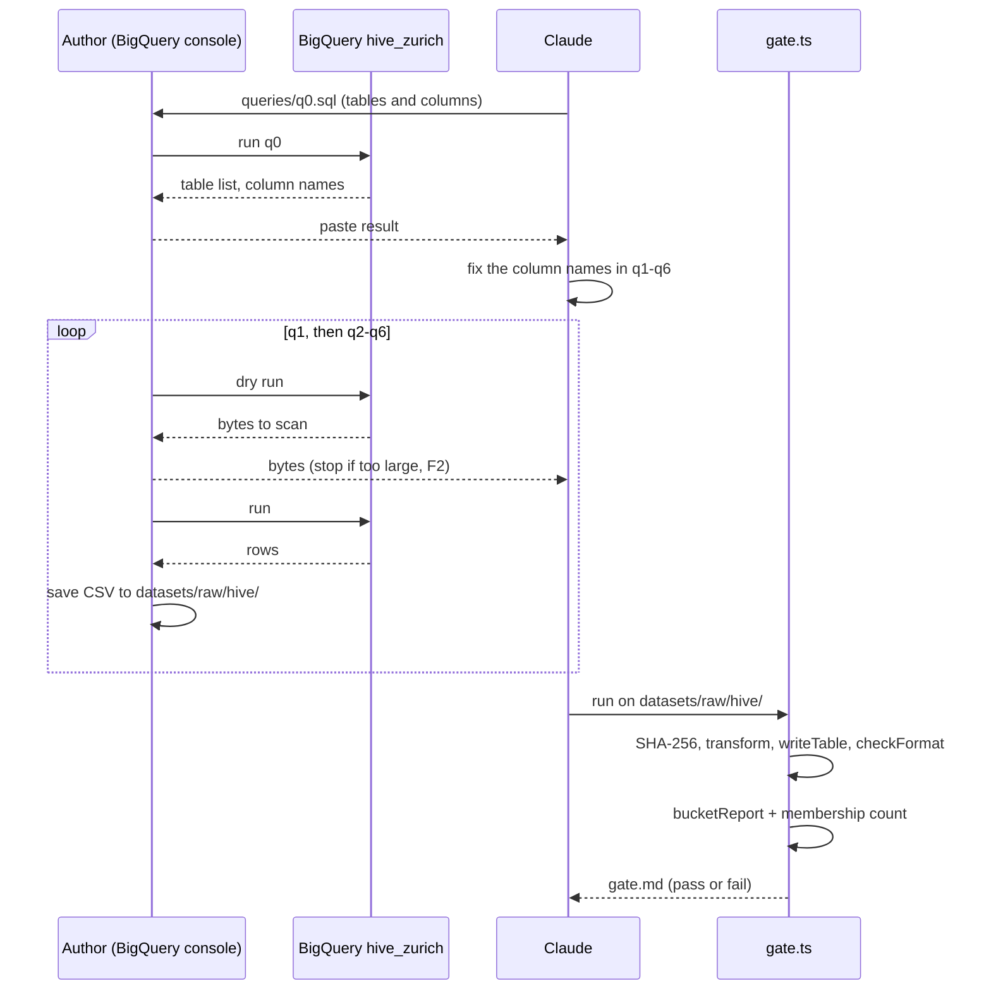
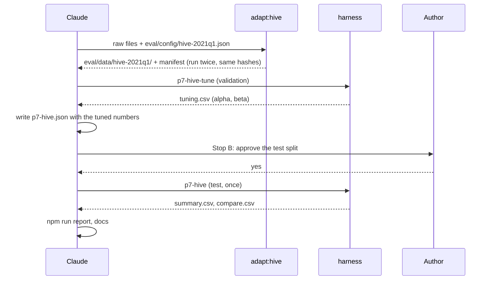

# Hive side check for the community term

Spec status: approved · 2026-11-12
Design status: approved · 2026-11-12
Type: feature · Folder: `.docs/works/2026-11-12-p7-hive-check/`

## 1. Spec

### Problem

The community term of the hybrid score (β, method H-comm) has no test on real data. Digg 2009 has no communities (`communities.csv` and `memberships.csv` are header only, `.docs/implementation-plan.md` §2.2), so P7 ran H-comm only on `syn-W2M-M`. There it gives +0.043 NDCG@10 over BL2 for all users (`.docs/results/p7-report/results.md`, macro `\eFourWTwoMNdcgHCommTenAllGain`). But in the generator a community is a topic, so this gain can be built into the data (super-plan 0.25). Today Chapter 6 can only say "decision Q2: the community term is tested on synthetic data only" (`.docs/datasets.md` §7).

Hive is the only real candidate found with the three things the test needs: posts tagged with a community, votes with a time, and community joins with a time (super-plan P7, "Hive side check"). The data is on BigQuery through SoChainDB. This task runs the gate that decides whether Hive can be used, and stops if it fails.

Facts about the source (README of https://github.com/SOCHAINDB/hive-db, read 2026-11-12):
- BigQuery project `steemit-307308`, dataset `hive_zurich`, tables `block_data_<first>_<last>_<n>` (wildcard `block_data_*`). There are no separate vote or post tables: each operation sits inside `transactions.operations` with a `type` and a `value`.
- A vote is `vote_operation` (`voter`, `weight` from −10000 to 10000). A post is `comment_operation`. A community post has `parent_permlink` like `hive-167922`. A join is `custom_json_operation` with id `community` and the command `subscribe`. Follows are `custom_json` too (`follow`, `what: blog`). The time is the block timestamp.
- It covers 2020-03-27 to 2022-07-04. License CC BY-SA 4.0. The authors ask to cite Nguyen et al., SoChainDB, SIGIR '22, DOI 10.1145/3477495.3531735.
- The README says to query it from your own Google Cloud project with a billing method, and to dry-run first. It gives no column types, no row counts and no data size.
- Not checked: whether the free BigQuery sandbox (no billing) can read this dataset; the exact column names of `author`, `permlink` and the signer of a `custom_json`; how many bytes one query scans.

This machine has no `gcloud` or `bq` command and no Google Cloud config (`which gcloud bq` found nothing on 2026-11-12). The author has no Google Cloud project for this yet (super-plan §11, item 8).

### Scope

The task has two stages. The author decided on 2026-11-12 to test on Hive, so Stage 2 is part of this task and runs as soon as the gate passes, with no second decision. This replaces the "author decides after a pass" note on task 9b (`.docs/implementation-plan.md` §5). The gate stays: with no BigQuery there is no data, and with fewer than 100 kept users the result is noise.

**In scope, Stage 1 (the gate, at most half a day of work):**
- Choose a Hive slice: a time range and a set of communities, small enough for the pool cap `N_max` = 2,000 to make sense (see Open question 3).
- Get BigQuery to run one query on `hive_zurich` (dry run first, then the real query).
- Count, with the frozen rules of `.docs/implementation-plan.md` §3.1 and §3.2 (`q` = 0.8, W = 7 days, `N_max` = 2,000), the kept test users in bucket 0–4 who have at least one community join before their test time.
- Write the result to `gate.md` in the task folder: pass if the count is at least 100, fail otherwise, with the query text, the bytes scanned and the counts.
- If the gate fails or BigQuery cannot run: mark task 9b closed as "gate failed" in the super-plan and the blueprint, and add Hive to future work with what was checked. Decision Q2 stays.

**In scope, Stage 2 (right after a pass; the Design covers both stages):**
- A Hive adapter in `eval/src/adapters/` that writes the canonical dataset (§2.2) with a manifest, from raw files kept out of git.
- The follows of the slice users go into `follows.csv` (Hive `custom_json` `follow`, `what: blog`).
- One run: H-comm, H-follow and H against BL2 (Open question 7, decided). α and β are tuned on validation, then the test split runs once with the author's approval. Bootstrap intervals, no Holm family (§3.3).
- The docs: `.docs/datasets.md`, the super-plan change log (Q2 changes), `docs/Guidance-Manual/{en,vi}/04-data.md`, `docs/System_Architecture.md`, and a line to the supervisor (§11, item 8).

**Out of scope:**
- The other baselines (BL0, BL1, BL2t, BL3 to BL6) and the finer ablations (H-noauthor, H-noengager, the `m` sweep) on Hive.
- Any change to H1, the H0 gate, family F1 or the default feed rule. Hive is side evidence only.
- Crawling the public Hive API. It is too slow (super-plan §8).
- The backend and the frontend. Nothing in `apps/` changes.

### Done when

| # | Check | Expected result |
|---|---|---|
| DW1 | The gate query in `gate.md`, run with dry run in the BigQuery console or `bq query --dry_run` | Prints the bytes it would scan. The real query then returns rows. Both are copied into `gate.md` with the date. If BigQuery cannot run, `gate.md` says why and the gate is "fail". |
| DW2 | The gate count in `gate.md` (kept test users in bucket 0–4 with a join before `t_u`) | A number, with the slice, T and the counts per bucket. "Pass" if it is at least 100, "fail" if not. |
| DW3 | `git diff` of `.docs/super-plan.md` and `.docs/implementation-plan.md` | Gate fail: row 9b and the P7 row say "gate failed", §11 item 8 is closed, the §8 risk says what was found, and the change log has a line. Gate pass: the same files say "gate passed, Stage 2 waits for the author". |
| DW4 | `npm run verify -w @breadit/eval` | Passes, and no file under `eval/` changed in Stage 1 (`git diff --stat eval/` is empty). |
| DW5 | `git status --ignored datasets/raw/` | Any raw Hive file is ignored by git. No account name list is committed. |
| DW6 (Stage 2 only) | `npm run check -w @breadit/eval` and a second adapter run into an empty folder | The check passes, and both runs give the same manifest hashes. |
| DW7 (Stage 2 only) | `npm run harness -w @breadit/eval -- p7-hive` | Writes `.docs/results/p7-hive/` with `summary.csv` and `compare.csv` (H-comm, H-follow and H, each − BL2, no family). |

### Open questions

1. **Google Cloud.** The gate needs a Google Cloud project. Will you open one? The README says it needs billing. The free sandbox may work, but this is not checked. Recommendation: open a project in the sandbox first and try a dry run; add billing only if the sandbox is refused. If you do not want an account at all, the gate fails today and this task only writes the "future work" lines.
2. **Who runs the queries.** Recommendation: I write the SQL, you paste it into the BigQuery console and give me the result (the gate needs only counts). Other option: install the Google Cloud SDK here and you run `gcloud auth login`; then I run `bq` myself.
3. **The slice.** Hive has far more posts per week than Digg, so with W = 7 days and `N_max` = 2,000 the pool would hold only the last hours of posts, and few test users would be kept. Recommendation: the root posts of the 20 largest communities by post count, over 3 months (2021-01-01 to 2021-03-31), with only votes on those posts. W and `N_max` stay as frozen. The exact cut is set in the Design.
4. **What counts as a positive.** Recommendation: a vote with weight > 0 is a `like`, a reply is a `comment`, a reblog is a `repost`. A downvote or a vote with weight 0 is left out. An unsubscribe is left out too, because the contract has only additions (super-plan §3); this is a stated limit.
5. **Bot votes.** About 27% of sampled votes came in the first 5 minutes after a post (super-plan §8). Recommendation: keep them for the gate and report the share; a filter would be a new rule that nobody froze.
6. **New frozen value (Stage 2 only).** A Hive dataset needs its own cut time T. The rule (§3.1) is frozen; the value is new. It goes into super-plan §7, row "Cut time T", which only you change. A new dataset id (`hive-<slice>`) also goes into §2.2 of the blueprint.
7. ✅ **Which methods on Hive.** Decided by the author on 2026-11-12: H-comm, H-follow and H against BL2, with no Holm family. Hive also has follows (`custom_json` `follow`), so it is the only real data with follows and communities together, and this tests the full hybrid on real data. It changes super-plan P7 ("Method", which named H-comm against BL2 only) and the Hive row of the blueprint §4; both get a line in their change log when this task closes. Still side evidence: H1, the H0 gate and the default feed rule do not change.

## 2. Impact

**Who it affects.** The thesis only. Users of the app see no change. If we do nothing, Chapter 6 keeps "the community term is tested on synthetic data only" as a limit, which is already written into the plan. The thesis stands without Hive.

**Thesis link.** RQ1, side evidence for the community term, and for the follow term and the full hybrid on one real dataset. It does not touch H1, the H0 gate, family F1 or the default feed rule. No frozen value changes in Stage 1. Stage 2 adds a new T value (Open question 6) and changes decision Q2 of 2026-10-26. No number already reported changes; Stage 2 adds new numbers with their own macros.

**Code.** Stage 1 touches no code: the SQL and the counts live in the task folder. Stage 2 adds a new adapter next to `eval/src/adapters/digg.ts` and a config `eval/config/hive-*.json`, and reuses the harness, `checks/buckets.ts` (`cutTime`) and the run config format as they are. Methods H, H-follow, H-comm and BL2 already exist (`eval/src/harness/config.ts`; H-comm takes `beta` and `m`). No other open task touches `eval/src/adapters/`. Task 10 (`p7-cost-benchmark`) touches the backend and k6 only.

**Time.** The gate is at most half a day, with a planned end of 11-14 (blueprint §5). Tasks 10 to 13 then move half a day later, into the spare day 11-19. Stage 2 was estimated at 2–3 days, more than the two spare days (11-19, 11-20). So after a pass, tasks 10 to 13 move about 2–3 days later, and something else must be cut. Recommendation: cut 4 of super-plan §8 (E7 with `chrono` and `social` only), and a shorter P10. The cut trigger stays: if the gate is not done on 11-14, it counts as failed.

**Risks.**
- **Account and cost.** The gate cannot start until a Google Cloud project exists. A query over many block tables can scan a lot of data. The dry run shows the bytes before anything is billed.
- **Few cold users with a join.** The sample of October 2026 showed only 2 subscribes in about 100 minutes of blocks. This is exactly what the gate checks.
- **Exposure bias.** Hive users see more posts from the communities they joined, so they vote on them more. A gain of H-comm can look larger than it is. It is stated as a limit, not fixed.
- **Docs.** On a fail, `docs/Guidance-Manual/{en,vi}/04-data.md` gets one sentence that Hive was checked and why it was not used. On a pass, Stage 2 updates it with the data.

## 3. Design

### Approach

**Raw data comes from seven SQL queries, run by the author in the BigQuery console** (Spec Open question 2). The queries live in the task folder (`queries/q0`–`q6`). Q0 reads the table list and the column names. Q1 ranks the communities. Q2–Q6 export the slice as small CSV files of plain strings and integer Unix seconds. The author saves them to `datasets/raw/hive/`, which `.gitignore` already ignores (line 59). Every query is dry-run first, so the bytes are known before anything runs.

**The slice** (Spec Open question 3): the 20 communities with the most root posts from 2021-01-01 00:00:00 to 2021-03-31 23:59:59 UTC. Posts are the root posts of those 20 communities in that range. Interactions are the votes, direct replies and reblogs on those posts in the same range. Memberships are the `subscribe` operations to the 20 communities from the first block in the data (2020-03-27) to the end of the range, so a user who joined in 2020 counts as a member. Follows are the `follow` operations with `what: blog` in the same long range, where both sides are users of the slice. Dataset id: `hive-2021q1`.

**One transform, used by both stages.** `hive-transform.ts` turns the raw rows into the six canonical tables (blueprint §2.2), with the rules in the table below. In Stage 1 it sits in the task folder with its test, so Stage 1 changes no file under `eval/` (DW4). In Stage 2 it moves with `git mv` into `eval/src/adapters/`, unchanged. So there is one copy, never two.

**The gate reuses the eval code; it does not copy it.** `gate.ts` (task folder) reads the raw files, checks their SHA-256 against `sources.json`, calls the transform, writes the six tables with `writeTable` (`eval/src/canonical/csv.ts`) to a scratch folder outside `eval/data/`, runs `checkFormat` (`eval/src/checks/format.ts`), loads it with `loadDataset`, and calls `bucketReport` (`eval/src/checks/buckets.ts`) with `q` = 0.8, W = 7 days, `N_max` = 2,000 from `loadFrozen`. For the gate number it walks the test users again with the exported `testItems`, `earlierEvents`, `buildIndex`, `inPool` and `bucketOf`, and counts the kept users of bucket 0–4 with a membership whose `joined_at < t_u` (the same as-of rule as `userFeatures` in `packages/ranking/src/features.ts`). It writes `gate.md`.

**Stage 2 is the Digg path again.** `eval/src/adapters/hive.ts` (`adaptHive`) works like `adaptDigg`: check the raw SHA-256 values in `eval/config/hive-2021q1.json`, read, transform, then delete the old folder and write `eval/data/hive-2021q1/` with a manifest. A CLI `adapt:hive` calls it. The runs reuse the harness as it is: `p7-hive-tune.json` (validation, `"grid"` for α and β, `m` frozen) and `p7-hive.json` (test, the tuned numbers copied in `datasetParams`, `compare: { mode: "none", ref: "BL2" }`, `testApprovedBy: "author"`). Methods: BL2, H-comm, H-follow, H (Spec Open question 7). `npm run report` gets one more table and its macros.

**Transform rules.** Each rule is counted, and the counts go into `gate.md` and the manifest.

| Raw | Canonical | Rule |
|---|---|---|
| `comment_operation`, `parent_author` = "" and `parent_permlink` in the 20 | `posts.csv` | A post is (author, permlink). An edit sends the operation again: keep the first time. `community_id` is the number in `hive-NNNNNN`. |
| `vote_operation`, weight > 0, on a slice post | `like` | Keep the first positive vote per (voter, post). Weight ≤ 0 is dropped (Spec Open question 4). |
| reply: `comment_operation` whose parent is a slice post | `comment` | First reply per (user, post). Replies to replies are dropped. |
| `custom_json` `reblog` of a slice post | `repost` | First reblog per (user, post). |
| any interaction by the post's author | dropped | The contract has no event on one's own post (`checkFormat`: `own-post`). |
| interaction with `t ≤` the post time (same block) | dropped | The contract needs `t >` `created_at` (`interaction-not-after-post`). |
| `custom_json` `community` `subscribe` to one of the 20 | `memberships.csv` | First subscribe per (user, community). Unsubscribe is dropped (Spec Open question 4). |
| `custom_json` `follow`, `what` = `["blog"]`, both users in the slice | `follows.csv` | First follow per pair. Unfollow and self-follow are dropped. |
| every account seen above | `users.csv` | `joined_at` is the first time the account appears in the raw files (the Digg choice). |
| — | `communities.csv` | The 20 communities, `created_at` the first time each appears. |

**Ids.** Account names are sorted by byte order and numbered from 1. Posts are numbered from 1 in (`created_at`, author, permlink) order. Events are numbered from 1 in (`created_at`, user id, post id, type) order. Times are Unix seconds, as for Digg. The name-to-id map is never written to `eval/data/` or committed (DW5).

**Rejected options:**

| Option | Why not |
|---|---|
| Count the gate in SQL, with no export | The kept rule needs each user's pool (newest 2,000 in 7 days, minus own and touched posts). Writing it again in SQL is a second copy of `inPool`, and a wrong count would decide the gate. |
| Write the adapter in `eval/` first, then run the gate with `npm run check` | Stage 1 must not change `eval/` (DW4), and a failed gate would leave dead code there. |
| Add a Hive entry to `freeze.ts` for the test config | `freeze --check` compares the ten committed P7 configs; one more changes its output and its tests. One test config is copied by hand, and an acceptance check compares it with `tuning.csv`. |
| Install the Google Cloud SDK and run `bq` here | The author chose the console (Spec Open question 2). `gcloud auth login` would also need the author's browser. |

### Workflow and sequence diagrams

Stage 1, the gate:

Stage 2, only on a pass:

### Failure modes

| # | What can go wrong | How we notice | How we resolve it |
|---|---|---|---|
| F1 | The sandbox cannot read `steemit-307308`, or BigQuery asks for billing | Q0 fails with an access or billing error | The author decides at once: add billing, or stop. If no project can run Q0 by 11-14, the gate fails (Spec Scope). |
| F2 | A query would scan a lot of data (the README gives no size) | The dry run shows the bytes | Every query filters `_TABLE_SUFFIX` to the block ranges of its dates (from Q0) and reads only the needed fields. If one dry run is above 200 GB, stop and ask the author before running it. The sandbox gives 1 TB of queries a month for free (not verified for this dataset). |
| F3 | The column names differ from the README (`permlink`, the signer of a `custom_json`) | Q0 output | Q1–Q6 are fixed from Q0 before any of them runs. |
| F4 | A result is too big to save from the console | The console refuses the download | Split the query by month (three files per query), or save to Google Drive. Both not verified. The file names carry the part number, and `sources.json` lists every part. |
| F5 | Edits and changed votes repeat an operation | Duplicates in the raw rows | The transform keeps the first row per key (rules table) and counts the rest. |
| F6 | A vote in the same block as its post, or a self-vote | `checkFormat` would report `interaction-not-after-post` or `own-post` | The transform drops them first and counts them. |
| F7 | A Hive author posts in a community without joining it | `checkFormat` reports `community-non-member` | Hive does not need a join to post, so D1 is not a fact of Hive (Design Open question 1). The gate still runs and reports the number of such posts: this check does not change the bucket count. |
| F8 | Few cold users with a membership | The gate number is below 100 | The gate fails. `gate.md` keeps the counts per bucket. No second slice is tried, because that would be choosing data after seeing the result. |
| F9 | Bot votes | Share of likes within 5 minutes of the post | Reported in `gate.md` and the manifest. Not filtered (Spec Open question 5). |
| F10 | Raw files or the name map reach git | `git status --ignored datasets/raw/` | Raw files stay in `datasets/raw/hive/` (ignored). `gate.ts` writes its scratch tables to the session scratch folder, not to the repo. |
| F11 | Two runs give different tables | The second adapter run gives other hashes | Ids come from byte-order sorts only, no `Map` order and no clock. DW6 runs the adapter twice. |
| F12 | Memory on millions of votes | Node stops with out of memory | Run with `--max-old-space-size=4096`, as `adapt:digg` does. |
| F13 | The pool is full of very fresh posts, so few test posts are kept | `poolAtTWindow` far above 2,000 in `bucketReport` | This is what the gate measures. It is reported; W and `N_max` stay frozen. |
| F14 | The test split is seen before tuning ends | — | `p7-hive.json` is written only from `tuning.csv`, and the test runs once after Stop B (`testApprovedBy`). |

### Code files

Stage 1 (the task folder only):

| File | New or changed | Purpose |
|---|---|---|
| `.docs/works/2026-11-12-p7-hive-check/queries/q0.sql` … `q6.sql` | new | Q0 tables and columns; Q1 top 20 communities; Q2 posts; Q3 votes; Q4 replies and reblogs; Q5 subscribes; Q6 follows. Each with its dates and `_TABLE_SUFFIX` range in a header comment. |
| `.docs/works/2026-11-12-p7-hive-check/hive-transform.ts` | new | `toHiveCanonical(raw: HiveRaw): { tables: CanonicalTables; counts: HiveCounts }`. Strict parse: account names `^[a-z0-9.-]{3,16}$`, communities `^hive-[0-9]+$`, times integers. A bad row stops the run. |
| `.docs/works/2026-11-12-p7-hive-check/hive-transform.test.ts` | new | A small fixture: an edit, a changed vote, a downvote, a self-vote, a same-block vote, a reply to a reply, an unsubscribe, an unfollow, and the id order. |
| `.docs/works/2026-11-12-p7-hive-check/gate.ts` | new | `runGate(rawDir, scratchDir): GateResult`; writes `gate.md`. Imports `writeTable`, `checkFormat`, `loadDataset`, `loadFrozen`, `bucketReport`, `testItems`, `earlierEvents`, `buildIndex`, `inPool`, `bucketOf` from `eval/src/`. |
| `.docs/works/2026-11-12-p7-hive-check/sources.json` | new | Per raw file: query file, query SHA-256, date run, bytes processed, rows, file SHA-256. |
| `.docs/works/2026-11-12-p7-hive-check/gate.md` | new | The verdict, T, the bucket table, the gate number, the drop counts, the 5-minute vote share. |

Stage 2 (only on a pass):

| File | New or changed | Purpose |
|---|---|---|
| `eval/src/adapters/hive-transform.ts`, `.test.ts` | moved | `git mv` from the task folder, unchanged except import paths. |
| `eval/src/adapters/hive.ts`, `hive.test.ts` | new | `loadHiveConfig()`, `adaptHive(rawDir, outDir): { manifest; counts }`, in the order of `adaptDigg` (check hashes, read, transform, then write). |
| `eval/config/hive-2021q1.json` | new | Dataset id, the slice dates, the 20 communities, each raw file with its SHA-256, the query SHA-256 values, the SoChainDB citation and license. |
| `eval/src/cli/adapt-hive.ts`, `eval/package.json` | new, changed | The `adapt:hive` script. |
| `eval/src/checks/format.ts` | changed | Only if Open question D1 is answered "skip": no `community-non-member` for `source.kind` = `"hive"`. |
| `eval/src/checks/run.ts` | changed | `hive-2021q1` in `BUCKET_TABLE_IDS`. |
| `eval/config/runs/p7-hive-tune.json`, `p7-hive.json` | new | The two runs. |
| `eval/src/report/*` | changed | One Hive table and its macros (names start with `\hive`). The existing rows and macros stay byte-identical. |
| `.docs/results/p7-hive-tune/`, `p7-hive/`, `p7-report/` | new, changed | The results. |
| `.docs/datasets.md`, `.docs/super-plan.md`, `.docs/implementation-plan.md`, `docs/Guidance-Manual/{en,vi}/04-data.md`, `docs/System_Architecture.md` | changed | Q2 changes, the new T in §7 (by the author), row 9b, §2.2 dataset id, P7 "Method", the data guide, the directory tree. |

On a fail, only the docs of DW3 and `04-data.md` (both languages) change.

### Data, schema and cache changes

None in the app: no Prisma model, no migration, no cache key, and nothing in `apps/` changes. New git-ignored data: `datasets/raw/hive/` (raw CSVs) and, in Stage 2, `eval/data/hive-2021q1/`. New committed config: `eval/config/hive-2021q1.json` (Stage 2). The cut time T of `hive-2021q1` comes from `cutTime` with `q` = 0.8; the author adds it to super-plan §7 (Spec Open question 6) before the tuning run.

### Open questions (Design)

1. **D1 on Hive.** The canonical contract says a community post's author is a member at `created_at` (blueprint §2.2, from the Breadit rule D1). Hive has no such rule, so `checkFormat` will report `community-non-member` for many posts. Recommendation: skip this one check for `source.kind` = `"hive"`, and write the exception in blueprint §2.2. The ranking does not use it: `userFeatures` reads only the viewer's memberships and the post's community. Other options: drop posts whose author is not a member (loses most posts and bends the data), or add a fake membership at post time (made-up data that changes the authors' own features).
2. **Stop B.** Before the test split, I stop and show you the tuned α and β of `p7-hive-tune` (as Stop A in P7). The test runs once after your yes.
