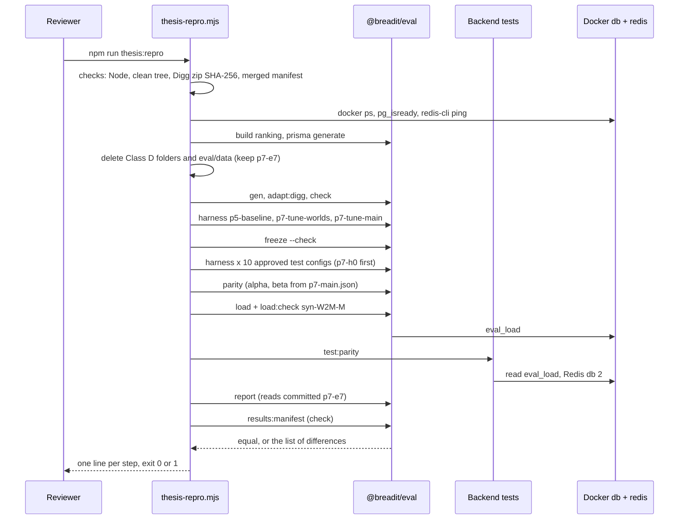

# Repro command and freeze

Spec status: approved · 2026-11-18
Design status: approved · 2026-11-18
Type: feature · Folder: `.docs/works/2026-11-18-p8-repro/`

## 1. Spec

### Problem

P8 of the super-plan has three jobs, and none is done yet (super-plan §4 row P8 ⬜; `.docs/implementation-plan.md` §5 row 11, ▶ next, planned end 11-15).

**1. No single command rebuilds the results.** Today each step is its own command: `gen`, `adapt:digg`, `check`, `harness` for each of the 13 run configs in `eval/config/runs/`, `freeze`, `parity`, `report`. The P7 double run (task 9, `run_output.txt` Step 11) used a script that Sonnet wrote for that run. It was not committed. So a reviewer cannot rebuild the thesis numbers without our notes.

**2. No merged manifest.** The blueprint §2.3 says: "P8 merges all of them into `.docs/results/manifest.json` and compares." That file does not exist. Today there are 16 folders in `.docs/results/`, each with its own `manifest.json`: `p5-baseline`, `p6-parity`, and 14 `p7-*` folders, among them `p7-report` and `p7-e7`. The nine dataset manifests live in `eval/data/<id>/manifest.json`, which is git-ignored. Their SHA-256 values are recorded only inside the run manifests (`source.datasets`, for example in `.docs/results/p7-main/manifest.json`).

**3. The app still runs `social` with placeholder weights.** `apps/backend/src/feed/feed.constants.ts:20` has `SOCIAL_PARAMS = { alpha: 1, beta: 1 }`, and the comment says "placeholder until P7; task 11 writes the tuned values". P7 tuned H on the validation split, and the author approved those values (`eval/config/runs/p7-main.json`, `datasetParams`):

| Dataset | α | β |
|---|---|---|
| `syn-W2M-M` | 1024 | 1024 |
| `digg2009` | 1024 | 0 |

So the live `social` feed is not the method the thesis tested. Two committed results also record α = β = 1: `.docs/results/p6-parity/manifest.json` (`params`) and `.docs/results/p7-e7/manifest.json` (`params`).

**The default feed rule is already decided by P7.** H1 failed on both main tests (super-plan P7 status: `syn-W2M-M` Holm p 0.680, `digg2009` Holm p 0.335). By the rule, For You stays as it is today. `FEED_DEFAULT_ALGO` is empty in `.env.example:20` and not set in `docker-compose.yml` (checked with grep), so no code change is needed. The supervisor has not yet confirmed the rule (super-plan §11 item 7).

**Run time.** The offline runs of the P7 double run took about 8,900 s, about 2.5 hours, with a peak memory of 3.0 GB (`p7-tune-main`). The two slowest runs are `p7-tune-main` (3,967 s) and `p7-main` (2,144 s), both because of `digg2009`. `gen`, `check` and `p5-baseline` times were not checked. `adapt:digg` takes about 7 s (P4 `check_output.txt`).

### Scope

**In scope:**
- `npm run thesis:repro` (root `package.json`). It checks the preconditions first (Node from `.nvmrc`, the two Digg zips with their SHA-256, Docker db and redis up), then it rebuilds every Class D result: the datasets, the Digg conversion, the dataset checks, `p5-baseline`, the two P7 tuning runs, `freeze --check`, the ten approved P7 test runs, the parity orders and the report. It ends by comparing every hash with `.docs/results/manifest.json`, and it fails on any difference, naming the file.
- The live parity check inside the same command: load `syn-W2M-M` into `eval_load`, run `load:check`, then `npm run test:parity -w @breadit/backend`. This is why the super-plan says repro needs Docker db and redis.
- `.docs/results/manifest.json`: a new committed file that holds the SHA-256 of every results manifest and of the nine dataset manifests (blueprint §2.3).
- Write the tuned α and β into `SOCIAL_PARAMS` (values: Open question 1), with a unit test that ties them to the approved run config. Then redraw `.docs/results/p6-parity/` with the new values and pass the parity test again.
- Rerun E7 with the tuned α and β, so its results describe the feed the app really runs (Open question 2), and rebuild the report.
- The default feed: record that For You stays as today (no code change), in the super-plan P8 status and the docs.
- One run of the command on a clean clone of `test-app`, with the Digg zips copied in by hand.
- A proposal for the tag `v2-thesis-experiments`, with its commit, in the Result. The tag is made only after the author's OK. No push.
- Docs: `docs/System_Architecture.md`, the Guidance Manual (en and vi), `CLAUDE.md` "Commands", the super-plan and the blueprint status.

**Out of scope:**
- E7 inside `thesis:repro`. Latency is Class R (super-plan §2), so its hash can never match. The repro uses the committed `p7-e7` files as report inputs and leaves `p7-e7` out of the hash check.
- Any change to the ranking package, the harness, a run config, a frozen value (super-plan §7) or a P7 result number. New tuning.
- Switching the default For You to `social`.
- A fast or partial mode of the command (Open question 3).
- CI, Windows, pushing tags or commits, any change to `main`.
- Writing the thesis chapters (P9) and the defense package (P10).

### Done when

| # | Check | Expected result |
|---|---|---|
| DW1 | On the dev machine, with Docker db and redis up and the Digg zips in `datasets/raw/digg2009/`: `npm run thesis:repro` | Exit code 0. One line per step. The last line says every hash is equal. |
| DW2 | After DW1: `git status --short .docs/results/ eval/config/runs/` | No line. Every committed result and run config is byte-identical. |
| DW3 | `.docs/results/manifest.json` | Lists the 16 results folders and the 9 datasets, each with the SHA-256 of its manifest. `p7-e7` is marked as Class R and left out of the compare. |
| DW4 | A unit test of the compare step: change one byte in a copy of a results file, and remove one file | Both cases fail, and the message names the file. |
| DW5 | `npm run thesis:repro` with a Digg zip renamed, then with Docker db stopped | Each stops within a few seconds, before any long run, with a message that names what is missing. |
| DW6 | On a fresh `git clone` of `test-app` (Digg zips copied in, `npm ci`): `npm run thesis:repro` | Exit code 0, and `git status --short` in the clone shows no change. |
| DW7 | `npm run test -w @breadit/backend` | Passes. A unit test checks that `SOCIAL_PARAMS` equals the H params of the chosen dataset in `eval/config/runs/p7-main.json`. |
| DW8 | `npm run test:parity -w @breadit/backend` after the redraw | 300 of 300 at the feed module and 300 of 300 over HTTP. `.docs/results/p6-parity/manifest.json` has the new α and β. |
| DW9 | E7 rerun (if Open question 2 is yes): `npm run bench:e7` | 15 runs, 0 failed requests. `.docs/results/p7-e7/manifest.json` has the new α and β. `npm run report -w @breadit/eval` changes only E7 lines in `.docs/results/p7-report/`. |
| DW10 | `npm run test:it -w @breadit/backend` | Passes. For You without `algo` behaves as before (`feed-default.it-spec.ts` and the other feed tests). |
| DW11 | `grep -rnE "thesis:repro.*🔜\|\(task 11\)\|task 11 (writes\|ghi)\|placeholder\|giá trị tạm\|Lệnh dự kiến\|Planned command" docs/System_Architecture.md docs/Guidance-Manual/` | No line. In both languages, no doc says `thesis:repro` is planned or that α and β are placeholders. |

### Open questions

1. **Which α and β go into the app?** I recommend the `syn-W2M-M` values, α = 1024 and β = 1024. The app has communities, and on Digg β has no effect (the blueprint §4 says the tie rule then picks the smallest β, which is why Digg got 0). The parity test and the demo also use `syn-W2M-M`. Both datasets agree on α. Note: 1024 is the top of the frozen grid, so the tuning hit its edge. This is a point for Chapter 6, not a change for this task.
2. **Rerun E7 with the tuned values?** I recommend yes. The E7 runs used α = β = 1, so they measured a feed the app will no longer run. With new weights, the posts on page 1 change, so the query count can change a little. The rerun takes about 15 minutes (not timed) and changes the `eSeven*` macros a little. The other option: keep E7 as it is and say in Chapter 5 that it was measured with the placeholder weights.
3. **The run takes about 3 hours.** I propose only the full mode in this task. The clean-clone run (DW6) can run overnight. A fast mode (for example, synthetic only, without the two Digg-heavy runs) would save time for a reviewer, but it costs more design work before the deadline.

## 2. Impact

**Who it affects.** Reviewers and the defense: the thesis can say "one command rebuilds every table, byte for byte". The live app: the `social` option changes its ranking (α and β go from 1 to the tuned values). Logged-in users see this only when they pick `social` with the toggle. For You without `algo` does not change, and neither does Explore. Guests see no change.

**If we do nothing.** The thesis numbers stay valid, because the P7 double run already proved them. But the "one command" claim is lost, and the demo in P10 would show a `social` feed with weights that the thesis never tested.

**Code areas.**
- New: the repro script (place decided in Design), the merged manifest writer and comparer, and their unit test.
- Changed: `apps/backend/src/feed/feed.constants.ts` (`SOCIAL_PARAMS`) and its spec `feed.constants.spec.ts`; root `package.json` (the script).
- Rewritten results: `.docs/results/p6-parity/` (new α and β), `.docs/results/p7-e7/` and `.docs/results/p7-report/` (only if Open question 2 is yes).
- Read only: `eval/src/cli/*` (`generate`, `adapt-digg`, `check`, `harness`, `freeze`, `parity`, `report`, `load`, `load-check`), `apps/backend/test/parity/`, `.claude/hooks/run-safe.sh`, `scripts/e7/run-e7.mjs`.
- The P0 clean-clone script (`.docs/works/2026-10-28-p0-baseline-freeze/check_clean_clone.sh`) shows how a clean clone was checked before. It may be reused.
- No open bug in `.docs/Bugs Report.md` touches this code (grep for P8 and repro gave nothing). The blueprint row 11 places no bug here.

**Shared resources.** The live parity step empties and reloads the schema `eval_load` and uses Redis database 2. The E7 rerun uses Redis database 3. The schema `public` and the dev data are not touched.

**Thesis link.** Phase P8, the last code phase. It supports the claim of Chapter 4 (the repro command) and the rule "every number comes from a CSV" (P9). No RQ or hypothesis changes. No frozen value (super-plan §7) is touched. The α and β written into the app are the approved P7 tuning, not a new choice.

**Numbers in the thesis.** E1–E6 and E8 do not change: their run configs already use the tuned values. The E7 numbers change only if Open question 2 is yes (the `eSeven*` macros). The parity claim "300 of 300" must hold again with the new weights.

**Time.** The planned budget was 1 day, with an end on 11-15, so the task starts 3 days late. Two spare days are left before 2026-11-20. The full repro run takes about 3 hours, and it runs at least twice: on the dev machine (DW1) and on the clean clone (DW6).

## 3. Design

### Decisions taken from the Spec

The author approved the Spec without changing its open questions, so the Design takes the recommended option of each. Say so at the Design review if you want another one.

1. **α and β in the app** are the `syn-W2M-M` values of `eval/config/runs/p7-main.json` (`datasetParams["syn-W2M-M"].H`): α = 1024, β = 1024.
2. **E7 is rerun** with these values, once, in this task (not inside `thesis:repro`).
3. **Full mode only.** `thesis:repro` has no fast mode.

### Approach

The work has two parts. Part A runs once, by hand, in this task: it puts the tuned weights into the app and refreshes the three results that depend on them. Part B is the repro command, which only rebuilds and compares.

**Part A: freeze the app on the tuned weights.**
1. `SOCIAL_PARAMS` in `apps/backend/src/feed/feed.constants.ts` becomes `{ alpha: 1024, beta: 1024 }`. A new unit test in `feed.constants.spec.ts` reads `eval/config/runs/p7-main.json` and checks that `datasetParams["syn-W2M-M"].H` equals `SOCIAL_PARAMS`. So the app can never drift from the approved tuning without a red test.
2. `npm run parity -w @breadit/eval -- --param alpha=1024 --param beta=1024` redraws `.docs/results/p6-parity/`. `drawParityPairs` does not read α or β, so `pairs.csv` should stay byte-identical, and only the `social` rows of `expected.csv` and the manifest `params` should change (not verified until the run). Then `npm run test:parity` must give 300 of 300 twice. The parity spec already checks that `manifest.params` equals `SOCIAL_PARAMS` (`parity.parity-spec.ts:95-98`).
3. `npm run bench:e7` (the runner of `p7-cost-benchmark`, unchanged) rewrites `.docs/results/p7-e7/`. Its prepare step writes `SOCIAL_PARAMS` into `params.json`, so the new manifest records α = β = 1024. Then `npm run report -w @breadit/eval` rebuilds `p7-report/`. Only the E7 lines may change.
4. `npm run results:manifest -w @breadit/eval -- --write` writes the merged manifest `.docs/results/manifest.json` from the final committed state.

**Part B: `npm run thesis:repro`.** The root script runs `scripts/repro/thesis-repro.mjs`. Like `scripts/e7/run-e7.mjs`, it is plain Node with no app imports, and it runs each step as a child process (`spawnSync`). Its steps:

1. **Checks** (a few seconds, nothing is written): Node equals `.nvmrc`; the merged manifest exists; `git status --porcelain -- .docs/results eval/config` is empty; both Digg zips exist with the SHA-256 of `eval/config/digg2009.json`; Docker answers, and the `db` and `redis` containers run and are ready (`pg_isready`, `redis-cli ping`).
2. **Build:** `npm run build -w @breadit/ranking`, then `npx prisma generate --schema=apps/backend/prisma/schema.prisma` (`npm ci` deletes the client, CLAUDE.md "Commands").
3. **Clean:** delete every Class D folder named in the merged manifest (`.docs/results/<id>/` and `eval/results/<id>/`) and `eval/data/`. `p7-e7` and its raw files stay. So everything is rebuilt from empty folders, as in the P7 double run.
4. **Data:** `gen`, `adapt:digg`, `check`.
5. **Runs:** `harness p5-baseline`; `harness p7-tune-worlds`; `harness p7-tune-main`; `freeze --check` (writes nothing); then the ten approved test configs in this order: `p7-h0` (a failed H0 gate throws, so it goes first), `p7-main`, `p7-e5-worlds`, `p7-e4-terms`, `p7-e4-m0`, `p7-e4-m2`, `p7-e4-m10`, `p7-e6-ties`, `p7-e8-pool`, `p7-e5-shuffle`.
6. **Parity:** `parity` with α and β read from `p7-main.json` (the same source as the unit test of Part A), then `load syn-W2M-M`, `load:check syn-W2M-M` and `npm run test:parity -w @breadit/backend`.
7. **Report:** `report`. It reads the committed `p7-e7` files and checks them against their manifest (`readRun` in `eval/src/report/report.ts`).
8. **Compare:** `results:manifest` (check mode). Its exit code is the result of the whole command.

Each step writes its full output to `eval/results/repro/<nn>-<name>.log` (git-ignored). The terminal shows one line per step: `ok`, the step name and its run time. Run time is printed only and never saved (Class R). The command stops at the first step that fails, prints the last 30 lines of that log and its path, and exits 1. The child processes get the shell env without `FEED_DEFAULT_ALGO`, `REDIS_HTTP_CACHE_ENABLED`, `NODE_ENV`, `PARITY_DATABASE_URL` and `PARITY_REDIS_URL`, the same list as `baseEnv()` in `run-e7.mjs`, plus `DATABASE_URL` set to the Docker URL with `?schema=eval_load`.

**The merged manifest** (blueprint §2.3). The logic lives in `@breadit/eval`, because it only reads files and hashes them. It reuses `canonicalJson` (`eval/src/canonical/manifest.ts`) and `sha256Hex` (`eval/src/canonical/csv.ts`). Every manifest in the repo has the same `files` map (name to `rows` and `sha256`, names may hold a `/` as in `tables/e1.tex`). A name listed in `external` lives in `eval/results/<id>/` and not next to the manifest. So one rule covers the datasets, the runs, the parity sample and the report.

```ts
// eval/src/repro/merged.ts
export const CLASS_R: readonly string[];           // ["p7-e7"]
export interface MergedManifest {
  schemaVersion: 1;
  datasets: Record<string, { manifestSha256: string }>;           // eval/data/<id>/manifest.json, the 9 datasets
  results: Record<string, { class: "D" | "R"; manifestSha256: string }>; // .docs/results/<id>/manifest.json, the 16 folders
}
export function buildMerged(root: string): MergedManifest;           // reads what is on disk
export function checkTree(root: string, merged: MergedManifest): string[]; // the differences; empty means equal
export function mergedCommand(argv: string[]): string[];            // [--write] [--root <dir>]; throws with the differences
```

`checkTree` reports, each as one line that names the path from the repo root:
- a dataset or a Class D folder that is missing or not in the merged manifest;
- a manifest whose SHA-256 differs from the merged one;
- a file listed in a manifest that is missing or whose SHA-256 differs (the external ones too);
- a file in a Class D folder that its manifest does not list.

A Class R folder (`p7-e7`) is listed with its hash as a record, but `checkTree` skips it (Spec DW3). The report step already checks its files. The output ends with `equal: <n> files in 16 folders and 9 datasets` or with the list of differences.

**The clean clone** (DW6) is checked by `check_clean_clone.sh` in this task folder, in the style of the P0 script: Node check; `git clone --branch test-app` of this repo into a `mktemp` folder; copy the two Digg zips into it; `npm ci`; `caffeinate -i npm run thesis:repro` (macOS sleep would stop a 3-hour run); `git status --short` in the clone must be empty; the output goes to `clean_clone_output.txt`; the clone is removed at the end.

**The default feed** needs no code. H1 failed, so `FEED_DEFAULT_ALGO` stays empty. The docs and the super-plan say so.

**The tag.** The Result proposes `v2-thesis-experiments` on the commit that passed DW6. The author makes the tag (the Bash hook asks for any `git tag`). Nothing is pushed.

**Rejected options:**

| Option | Why not |
|---|---|
| Rebuild into a separate output folder and compare it with the committed one | `freeze`, `report` and the parity test read fixed paths (`.docs/results/...`), so each would need a new flag. Rebuilding in place from empty folders is what the P7 double run did, and `git` restores the files if a run stops halfway. |
| The orchestrator as a `.ts` command in `@breadit/eval` | `eval` never touches Postgres, Redis or HTTP outside the loader (CLAUDE.md). The orchestrator runs Docker checks and a backend test, so it sits next to the E7 runner in `scripts/`. Only the file-only manifest logic goes into `eval`. |
| A bash script | Steps need JSON (the Digg config, the α and β of `p7-main.json`) and SHA-256 of files. Node does both without extra tools, and the E7 runner already shows the pattern. |
| The Digg weights in the app (α = 1024, β = 0) | β = 0 switches the community term off in an app that has communities. On Digg, β had no effect, and the tie rule chose the smallest value (blueprint §4). |
| Rerun E7 inside `thesis:repro` | Latency is Class R and never byte-equal (Spec, Out of scope). It also needs k6 and port 4000. |
| Import `checks()` from `run-e7.mjs` | That file runs `main()` on import, and its results are committed. Changing it is outside the scope. The repro script copies the few lines it needs (`containerName`, `baseEnv`). |

### Workflow and sequence diagrams

Part A, once in this task:

```mermaid
sequenceDiagram
    participant A as Author / Claude
    participant BE as Backend (feed.constants.ts)
    participant EV as @breadit/eval
    participant DB as Postgres eval_load + Redis
    participant R as .docs/results
    A->>BE: SOCIAL_PARAMS = {1024, 1024}; unit test vs p7-main.json
    A->>EV: parity --param alpha=1024 --param beta=1024
    EV->>R: p6-parity/ (pairs.csv same, social rows of expected.csv new)
    A->>EV: load syn-W2M-M (no --rebase-to)
    EV->>DB: empty and fill eval_load
    A->>BE: test:parity
    BE->>DB: rank 100 pairs x 3 algos, in-process and over HTTP
    BE-->>A: 300/300 and 300/300
    A->>BE: bench:e7 (k6, own backend, Redis db 3)
    BE->>R: p7-e7/ with alpha = beta = 1024
    A->>EV: report
    EV->>R: p7-report/ (only E7 lines change)
    A->>EV: results:manifest --write
    EV->>R: manifest.json (16 folders, 9 datasets)
```

Part B, `npm run thesis:repro`:



### Failure modes

| # | What can go wrong | How we notice | How we resolve it |
|---|---|---|---|
| F1 | Wrong Node version | Check step, before any work | Stop with "run nvm use" (the same text as `checkNode`). |
| F2 | A Digg zip is missing or has another SHA-256 | Check step hashes both zips (37 MB, under a second) | Stop and name the file, its expected SHA-256 and the download page in `.docs/datasets.md` §4 (DW5). |
| F3 | Docker, `db` or `redis` is down | Check step (`docker ps`, `pg_isready`, `redis-cli ping`) | Stop with "docker compose up db redis -d" (DW5). Nothing was written. |
| F4 | Uncommitted changes in `.docs/results/` or `eval/config/` | Check step (`git status --porcelain`) | Stop and list them. The clean step deletes folders, so it never runs over uncommitted work. |
| F5 | A step fails halfway (for example out of memory in `p7-tune-main`, peak 3.0 GB with `--max-old-space-size=4096`) | Non-zero exit code of the child | Stop, print the last 30 log lines and the log path, exit 1. The tree is left as it is, and the message says the committed files come back from git. The check step prints a warning when the machine has under 8 GB of memory. |
| F6 | A rebuilt file differs from the committed one | `results:manifest` check | Each difference is one line with the path and both SHA-256 values; exit 1. `git diff` shows the same change. |
| F7 | A file is in a results folder but not in its manifest, or a git-ignored `per_user.csv` or `orders.csv` is missing | `checkTree` | Named as an extra or missing file. The unit test covers both (DW4). |
| F8 | The test split is run again | By design | The ten configs are the approved ones, unchanged: the command never tunes on test and never writes a config (`freeze --check` only). A pass means identical bytes, so no new test number exists. The pre-bash hook guards `--split test`, which the command never uses. |
| F9 | `SOCIAL_PARAMS` drifts from the approved tuning | Unit test (DW7); the parity spec compares the parity manifest with `SOCIAL_PARAMS`; the repro reads α and β from `p7-main.json` | One source, `p7-main.json`, with three checks on it. A drift fails a test. |
| F10 | Two runs share `eval_load` or Redis database 2 (the dev run and the clean-clone run at the same time, or an E7 run) | `load` empties the schema; `globalSetup` of the parity test finds wrong counts | Run them one after the other. The plan says so, and `check_clean_clone.sh` checks that no `thesis-repro.mjs` process runs before it starts. |
| F11 | The laptop sleeps during the 3-hour run | The run stops or takes much longer | Run it with `caffeinate -i` (macOS). The clean-clone script does this. |
| F12 | The E7 rerun has a failed request, or k6 is missing | The runner's own gates (`checks()`, `http_req_failed` 0) | Stop and report the round, the algo and the status codes. Do not change the limit or the load profile (the same rule as `p7-cost-benchmark` F3). |
| F13 | Large scores with α = 1024 break the cursor `t:score:id` | `parseAlgoCursor` (`feed.cursor.ts:29`) needs safe integers | The harness already ranked with 1024 on both datasets, and the IT feed tests and the parity test page through `social`. A failure there shows it. |
| F14 | The Redis feed cache serves an old `social` page | Pages live 10 s (`feed:...`) | The backend restarts with the new constant, so old pages expire within 10 s. No version bump is needed. |

### Code files

| File | New or changed | Purpose |
|---|---|---|
| `apps/backend/src/feed/feed.constants.ts` | changed | `SOCIAL_PARAMS = { alpha: 1024, beta: 1024 }`; the comment names `p7-main.json` as the source. |
| `apps/backend/src/feed/feed.constants.spec.ts` | changed | New test: `SOCIAL_PARAMS` equals `datasetParams["syn-W2M-M"].H` of `eval/config/runs/p7-main.json` (DW7). |
| `eval/src/repro/merged.ts` | new | `buildMerged`, `checkTree`, `mergedCommand`, `CLASS_R` (signatures above). Reuses `canonicalJson` and `sha256Hex`. |
| `eval/src/repro/merged.test.ts` | new | `node --test` on a small tree in a temp folder: equal tree; one byte changed; file removed; extra file; external file changed; folder missing; a Class R change is ignored; `--write` twice gives the same bytes (DW4). |
| `eval/src/cli/results-manifest.ts` | new | `npm run results:manifest -w @breadit/eval [-- --write]`. `checkNode`, then `mergedCommand`; exit 1 on differences. |
| `eval/package.json` | changed | Script `results:manifest`. |
| `scripts/repro/thesis-repro.mjs` | new | The orchestrator of Part B: `checks()`, `steps(params)`, `runStep(step)` with a log file, `main()`. |
| `package.json` (root) | changed | Script `thesis:repro`: `node scripts/repro/thesis-repro.mjs`. |
| `.docs/results/manifest.json` | new (generated) | The merged manifest (Part A step 4). |
| `.docs/results/p6-parity/`, `p7-e7/`, `p7-report/` | rewritten (generated) | Part A steps 2 and 3. |
| `.docs/works/2026-11-18-p8-repro/check_clean_clone.sh` | new | The DW6 check. Its output goes to `clean_clone_output.txt`. |
| `docs/System_Architecture.md` | changed | `thesis:repro` ✅, the tuned α and β, the tree (`scripts/repro/`, `eval/src/repro/`, `.docs/results/manifest.json`), the status table. |
| `docs/Guidance-Manual/{en,vi}/07-determinism.md`, `08-system-and-feed.md`, `09-glossary.md`, `10-defense-qa.md` | changed | Remove 🔜 and "task 11" from `thesis:repro`; α = β = 1024 instead of the placeholders; the new parity date (DW11). |
| `CLAUDE.md` | changed | "Commands": `thesis:repro` and `results:manifest`. "Feeds and ranking": α and β are the tuned values, no longer placeholders. |
| `.docs/super-plan.md`, `.docs/implementation-plan.md` | changed | P8 status and §4 row; §11 item 4 (the tag proposal); blueprint §5 row 11 and §2.3; a change-log line (no frozen value changes). |

### Data, schema and cache changes

None. No Prisma model, no migration and no cache key changes. The `social` ranking changes because the constant changes, and the 10 s feed pages expire on their own (F14). The schema `eval_load` and Redis databases 2 and 3 are emptied and refilled by steps that already exist. Schema `public` is never touched.
