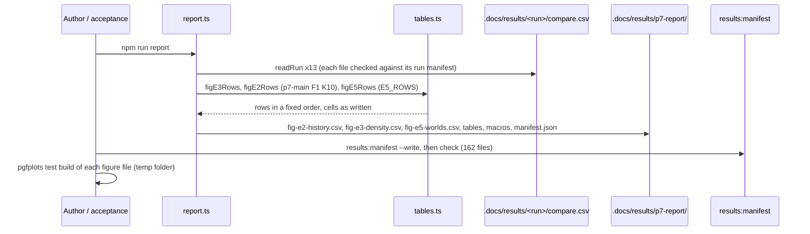

# Figure data for Chapter 6 (E2, E5)

Spec status: approved · 2026-11-19
Design status: approved · 2026-11-19
Type: feature · Folder: `.docs/works/2026-11-19-p9-figure-data/`

## 1. Spec

### Problem

**Chapter 6 needs three figures, and the report writes the data of only one.** The approved order (`.docs/implementation-plan.md` §5, row 17) puts three pgfplots figures in Chapter 6: E2 (the gain by history group, the H1 figure), E3 (the gain by followees) and E5 (the gain by world). Today `npm run report -w @breadit/eval` writes one figure file, `.docs/results/p7-report/fig-e3-density.csv` (16 rows: dataset, bin, n, mean_diff, ci_low, ci_high), from `figE3Rows` in `eval/src/report/tables.ts`. There is no figure file for E2 or E5 (checked: `ls .docs/results/p7-report/`).

**Reading the raw files in LaTeX is fragile.** The E2 numbers sit in `.docs/results/p7-main/compare.csv` among the F1 and F2 rows for K 5, 10 and 20; the E5 numbers are spread over three runs (`p7-e5-worlds`, `p7-h0`, `p7-e5-shuffle`). A pgfplots filter over them would pick rows by text inside LaTeX, which is easy to get wrong and is not checked by any test. The E3 file shows the working pattern: the report picks the rows once, in tested code, and LaTeX only draws.

The cells already exist. The rows of the two new files are the same cells that tables e2 and e5 show today (`e2Table`, `e5Table` in `tables.ts`), at full precision instead of 3 decimals.

### Scope

**In scope:**
- `fig-e2-history.csv` in `.docs/results/p7-report/`: for `syn-W2M-M` and `digg2009`, the F1 row of H − BL2 at K = 10 for each history group 0, 1–4, 0–4, 5–19, 20+ (10 rows), with n, the gain and its 95% interval, from `p7-main/compare.csv`.
- `fig-e5-worlds.csv` in the same folder: one row per row of table e5 (8 rows: the five worlds with their own tuning, the H0 gate row, the topic-signal row, the shuffled row), with a short label that the figure can print, the dataset, n, the gain and its interval.
- The same column layout as `fig-e3-density.csv` where it fits, cells as written in the source CSV (6 decimals), so the three figures can share one pgfplots style.
- Tests, the rebuilt `p7-report/` and its line in the merged manifest `.docs/results/manifest.json`.
- Docs that list the report's outputs: `.docs/implementation-plan.md` §2.8 and the E2 and E5 rows of §4 ("table" → "table, figure"), `docs/System_Architecture.md` (the Report line), `CLAUDE.md` ("Commands", the files of `npm run report`), and Guidance Manual 11 (en and vi), §6 and §9.

**Out of scope:**
- Drawing the figures. That is writing work (row 17), in `.docs/Thesis-Report/`.
- Any change to a results CSV, a table, a macro, the harness, a run config or a frozen value (super-plan §7).
- A figure for any other experiment.
- A full `thesis:repro` run: only the report step changes, and DW4 to DW6 check it (Open question 1).

### Done when

| # | Check | Expected result |
|---|---|---|
| DW1 | `npm run verify -w @breadit/eval` | Typecheck and all tests pass, with new tests: each figure file has the expected rows in a fixed order, and each cell equals the cell of its source CSV. |
| DW2 | `npm run report -w @breadit/eval`, then `git status --short .docs/results/p7-report/` | Two new files (`fig-e2-history.csv`, `fig-e5-worlds.csv`); `manifest.json` changes (two new entries); every other file (`macros.csv`, `results-macros.tex`, `results.md`, `tables/*.tex`, `fig-e3-density.csv`) is byte-identical. |
| DW3 | Read the two files | `fig-e2-history.csv` has 10 rows; the `syn-W2M-M` 0–4 row is n 174, gain 0.023061, interval −0.002358 to 0.051290; the `digg2009` 0–4 row is n 20644, gain 0.000117, interval 0.000015 to 0.000225. `fig-e5-worlds.csv` has 8 rows; the `syn-W2M-M` world row is gain 0.045 at 3 decimals, and the H0 gate row gives 0.001 (−0.004 to 0.006) at 3 decimals, as in table e5. |
| DW4 | Run the report a second time into an empty folder | Byte-identical files. |
| DW5 | `npm run results:manifest -w @breadit/eval -- --write`, then the check mode | Exit 0; in `.docs/results/manifest.json` only the `p7-report` entry changes; the count is 162 files (160 + 2). |
| DW6 | A pgfplots test build of each new file (as for E3 on 2026-11-19, in a temp folder) | Both compile with `pdflatex`, no error. |

### Open questions

1. **A full `thesis:repro` run?** My advice: no. The change is in the report only; the results it reads are the ones the 2026-11-19 run rebuilt and compared, and DW4 and DW5 check the report and the manifest. The next full run (row 31, freeze) will cover it anyway. Other option: run it once more (about 2.5 hours).
2. **The tag.** If `v2-thesis-experiments` is made on `84f667f` as proposed, it stays valid: this task adds two report files and changes no result. Nothing to decide unless you want the tag to include the figure data; then tag this task's closing commit instead.

## 2. Impact

**Who it affects.** The thesis text only: Chapter 6 can draw E2 and E5 from files that a test checks. The app, the backend, the feed and every result number stay as they are. If we do nothing, Chapter 6 either has one figure only, or reads `compare.csv` with filters inside LaTeX that no test checks.

**Code.** `eval/src/report/tables.ts` (two row builders next to `figE3Rows`), `eval/src/report/report.ts` (write the two files; the file list of the report manifest), and the tests in `eval/src/report/report.test.ts` (its `FILES` list names every output file, so it must change; `tables.ts` has no test file of its own, its tests are in `report.test.ts`). `fixture.ts` already writes the F1 rows of `p7-main` and the rows of `p7-e5-worlds`, `p7-h0` and `p7-e5-shuffle` (seen in task `p9-report-macros`), so it should not need a change. No open bug in the Bugs Report touches `eval/src/report/` (checked in task `p9-report-macros`).

**Results.** `.docs/results/p7-report/` gets two files and a new `manifest.json`; the merged manifest gets a new hash for `p7-report` and two more files in its count (160 → 162). `npm run thesis:repro` compares against the merged manifest, so it must be rewritten in this task.

**Thesis link.** Phase P9, row 14 of `.docs/implementation-plan.md` §5; row 17 (Chapters 6 and 7 in LaTeX) depends on it. RQ1 (E2, H1) and the "built into the data" question (E5). No hypothesis, no frozen value. It changes the measurement plan of `.docs/implementation-plan.md` §4 (E2 and E5 also become figures), which the author already approved with row 14.

## 3. Design

### Decisions taken from the Spec

- **Open question 1 (full repro).** Taken as the Spec's advice: no full `thesis:repro` run in this task. The report is checked by DW4 (a second run into an empty folder) and the merged manifest by DW5; the freeze (row 31) runs the full command again.
- **Open question 2 (tag).** Nothing changes: a tag on `84f667f` stays valid, because no result changes here.

### Approach

All the logic goes into `eval/src/report/tables.ts`, next to `figE3Rows`, and `report.ts` only writes the files, as it does for E3 today.

**1. `fig-e2-history.csv`.** A new `figE2Rows(runs): FigRow[]` reuses the `FigRow` interface of E3 (`dataset, bin, n, mean_diff, ci_low, ci_high`). For each dataset of `MAIN` (`syn-W2M-M`, then `digg2009`) and each group of `F1_GROUPS` (0, 1-4, 0-4, 5-19, 20+, the order of `GROUPS` in `eval/src/metrics.ts`), it picks the row `{ dataset, family: "F1", method: "H", ref: "BL2", k: "10", bucket: group }` of `p7-main/compare.csv` with the existing `pick`, and copies `n`, `mean_diff`, `ci_low` and `ci_high` as written (`cellOf`). Here `bin` holds the history group. So the file has the same header as `fig-e3-density.csv` and 10 rows.

**2. `fig-e5-worlds.csv`.** Table e5 builds its rows inline in `e5Table`. A new constant `E5_ROWS` lists the eight rows once, each with a `variant` id for the figure, the `label` the table prints, the run, the dataset and the method:

| variant | label (table e5, unchanged) | run | dataset | method |
|---|---|---|---|---|
| `own-tuning` | own tuning | `p7-e5-worlds` | `syn-W0-M`, `syn-W1-M`, `syn-W2L-M`, `syn-W2M-M`, `syn-W2H-M` (five rows) | H |
| `h0-gate` | H0 gate: H-follow (alpha of syn-W2M-M) | `p7-h0` | `syn-W0-M` | H-follow |
| `topic-signal` | H on W0, values of syn-W2M-M (topic signal) | `p7-h0` | `syn-W0-M` | H |
| `shuffled` | timestamps shuffled | `p7-e5-shuffle` | `syn-W2M-M-shuffled` | H |

`e5Table` maps `E5_ROWS` to its cells as before (same labels, same order), and a new `figE5Rows(runs): FigE5Row[]` maps the same list to `{ dataset, variant, n, mean_diff, ci_low, ci_high }`, picked with `{ dataset, method, ref: "BL2", k: "10", bucket: "all" }` from the run's `compare.csv`. One list for both means the figure and the table cannot drift apart. The header is `dataset, variant, n, mean_diff, ci_low, ci_high`: the second column is the label column in all three figure files (bin, group, variant).

**3. `report.ts`.** Two more entries in the `files` map, written with `csvText`: `fig-e2-history.csv` with the existing `FIG_HEADER`, and `fig-e5-worlds.csv` with a new `FIG_E5_HEADER`. The manifest entries follow from the `files` map, so `p7-report/manifest.json` lists the two files without other code. The comment at the top of `report.ts` names the three figure files. The rows keep a fixed logical order (dataset, then group or variant), like `fig-e3-density.csv`; `csvText` leaves the order to the caller.

**4. Results and manifests.** After the code: `npm run report` (two new files, a new `manifest.json`, every other file byte-identical), then `results:manifest --write` and the check mode (162 files).

**5. Docs.** `.docs/implementation-plan.md` §2.8 ("the report also writes … the figure data of E2, E3 and E5") and the E2 and E5 rows of §4 (Thesis column "table, figure"), version 1.18 with a change log line; `docs/System_Architecture.md`, the Report line; `CLAUDE.md` "Commands" (the files of `npm run report`); Guidance Manual 11 §6 and §9, en and vi (one line naming the figure file). The super-plan is updated by Claude when the task closes.

**Rejected options:**

| Option | Why not |
|---|---|
| pgfplots filters over `compare.csv` in LaTeX | Picks rows by text inside LaTeX, with no test; a change of row order or a new family would silently change the figure. |
| One figure file for all three experiments | The three have different sources and label columns; one file per figure, like E3, keeps each one simple to read and to test. |
| Rebuild `e2Table` from `figE2Rows` | Table e2 also shows the two NDCG levels and the Holm p, so it reads more than the figure needs; a test that checks the figure cells against the table cells (at 3 decimals) is enough and leaves the table code alone. |

### Workflow and sequence diagrams

### Failure modes

| # | What can go wrong | How we notice | How we resolve it |
|---|---|---|---|
| F1 | A source row is missing or appears twice | `pick` throws with the run, the file and the key | The keys are those of table e2 and e5, which already find exactly one row in the fixture and in the real results. |
| F2 | Moving the e5 rows into `E5_ROWS` changes table e5 | The table tests (`.tex` = `results.md` = macros) and DW2 (`tables/e5.tex` byte-identical) | `E5_ROWS` keeps the labels and the order of today's `e5Table`. |
| F3 | A figure cell is rounded | New test: each figure cell equals its source cell as a string | `cellOf` copies the text; no `roundDecimal`. |
| F4 | A label breaks the CSV or pgfplots | `csvText` refuses a comma; the variant ids are kebab-case | Ids `own-tuning`, `h0-gate`, `topic-signal`, `shuffled`; the long labels stay in the table only. |
| F5 | The row order depends on the file order | New test checks the dataset and group (or variant) sequence | The order comes from `MAIN`, `F1_GROUPS` and `E5_ROWS`, never from the CSV. |
| F6 | The merged manifest is not rewritten, so the next repro fails | DW5 | The report output and the merged manifest go in one commit. |
| F7 | Digg's gains (about 0.0001) next to the synthetic ones (0.02 to 0.08) look flat in one figure | Seen when the figure is drawn (row 17) | Not this task: the file keeps all 6 decimals, so the figure can use its own axis or panel for Digg. |
| F8 | Non-determinism | DW4 and the existing "two runs give byte-identical files" test, which iterates `FILES` | No clock or randomness; the fixed order above. |

### Code files

| File | New or changed | Purpose |
|---|---|---|
| `eval/src/report/tables.ts` | changed | `figE2Rows(runs: RunFilesMap): FigRow[]`; `interface FigE5Row { dataset; variant; n; mean_diff; ci_low; ci_high }`; `const E5_ROWS`; `figE5Rows(runs: RunFilesMap): FigE5Row[]`; `e5Table` reads `E5_ROWS`. |
| `eval/src/report/report.ts` | changed | Write `fig-e2-history.csv` (`FIG_HEADER`) and `fig-e5-worlds.csv` (`FIG_E5_HEADER`); the top comment. |
| `eval/src/report/report.test.ts` | changed | `FILES` gets the two files. New tests: fig-e2 (header, 10 rows, dataset and group order, every cell equals its `p7-main/compare.csv` F1 K10 cell, and at 3 decimals equals table e2); fig-e5 (header, 8 rows, variant and dataset order, every cell equals its source `compare.csv` cell, and at 3 decimals equals table e5). |
| `.docs/results/p7-report/` | rewritten (generated) | The two new files and `manifest.json`. |
| `.docs/results/manifest.json` | rewritten (generated) | The new hash of `p7-report/manifest.json`; 162 files. |
| `.docs/implementation-plan.md` | changed | §2.8, §4 rows E2 and E5, version 1.18 and change log. |
| `docs/System_Architecture.md`, `CLAUDE.md` | changed | The Report line and the files of `npm run report`. |
| `docs/Guidance-Manual/en/11-experiments-and-results.md`, `vi/…` | changed | §6 and §9 name the figure file. |

### Data, schema and cache changes

None. No Prisma model, migration, Redis key or app code. The only data written is the generated report folder and the merged manifest (Class D, same results, two more files).
