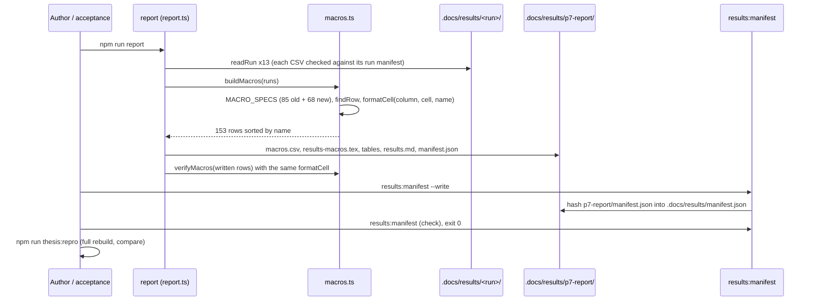

# Report macros for Chapters 5 and 6

Spec status: approved · 2026-11-19
Design status: approved · 2026-11-19
Type: feature · Folder: `.docs/works/2026-11-19-p9-report-macros/`

## 1. Spec

### Problem

**The chapter drafts need numbers that the report does not write.** The drafts of Chapter 5 (`.docs/Thesis-Report/05-experiments-and-results.md`, commit `5df85f9`) and Chapter 6 (`06-discussion.md`, commit `8f28e7e`) use 70 distinct macros. All 70 exist in `.docs/results/p7-report/macros.csv` (checked with a script that looks up every `\name` of the two files). But the drafts also have 11 `[MACRO?: …]` marks: numbers the text needs that have no macro. P9 says "every number in the thesis comes from a CSV" (super-plan §4, P9 "Done when"), so these numbers cannot be typed by hand.

The macro list is a fixed table in `eval/src/report/macros.ts` (`build()`, `MACRO_SPECS`, 86 macros today). It covers only H and BL2 in E1, only group 0–4 (and the gain of groups 0 and 1–4) in E2, no tuning value, and only the H-follow row of `p7-h0`.

**The Digg H1 numbers are hidden by the rounding.** Every macro is rounded to 3 decimals (`formatCell` and `roundDecimal`, `eval/src/report/round.ts`; contract `.docs/implementation-plan.md` §2.8). For `digg2009`, F1, K 10, group 0–4 (`.docs/results/p7-main/compare.csv`), the cells are `mean_diff` 0.000117, `ci_low` 0.000015, `ci_high` 0.000225, `p_holm` 0.335466. The macros print 0.000, 0.000 and 0.000. So the text cannot show that the interval is above 0 and that H1 fails on Digg only because of the Holm p. The same holds for the validation NDCG@10 of H on `syn-W2M-M` at α = β = 512 (0.048086) and at 1024 (0.048342): both print 0.048.

The 11 marks and where the cells are:

| Mark (chapter) | Cell | In a macro today |
|---|---|---|
| Tuned α and β of H on `syn-W2M-M` (5.2) | `p7-tune-main/tuning.csv`, row `chosen` = 1 | no |
| Validation NDCG@10 at 512 and 1024 (5.2) | `p7-tune-main/tuning.csv`, values `512/512` and `1024/1024` | no (and 3 decimals hide the gap) |
| NDCG@10 of BL2t and BL6 on `syn-W2M-M` (5.5) | `p7-main/summary.csv` | no |
| NDCG@10 of BL4 and BL5 on `digg2009` (5.5) | `p7-main/summary.csv` | no |
| Digg gain in group 0–4, more decimals (5.6) | `p7-main/compare.csv` | only at 3 decimals |
| Digg interval in group 0–4, more decimals (5.6) | `p7-main/compare.csv` | only at 3 decimals |
| `syn-W2M-M` gain, interval and Holm p in group 20+ (5.6) | `p7-main/compare.csv` | no |
| `syn-W2M-M` Holm p in group 5–19 (5.6) | `p7-main/compare.csv` | no |
| E5 row "H on W0, values of syn-W2M-M" (5.9) | `p7-h0/compare.csv`, method H, K 10, all | no |
| Largest change of NDCG@10 in E6 (5.10) | none: a maximum over two runs, not one cell | out of scope |
| Tuned age weight of BL2t on `digg2009` (6.1) | `p7-tune-main/tuning.csv`, row `chosen` = 1 | no |

### Scope

**In scope:** new macros in the report, each from one CSV cell, as today:
- **Tuning** (`p7-tune-main/tuning.csv`): the chosen value of H, BL2t, BL4, BL5 and BL6 on `syn-W2M-M` and `digg2009` (10 macros). Plus the validation NDCG@10 of H on `syn-W2M-M` at `512/512` and `1024/1024` (2 macros, full precision).
- **E1** (`p7-main/summary.csv`): NDCG@10, all users, test split, for all nine methods on both datasets. 4 exist, so 14 are new. All nine and not only the four the text needs now, because Table 5.3 is the main table, and the abstract, Chapter 8 and the slides will cite it.
- **E2** (`p7-main/compare.csv`, F1, K 10): gain, interval low and high, Holm p and n for all five groups on both datasets. 14 exist, so 36 are new. The same reason: Table 5.4 is the H1 table.
- **E2 at full precision:** the Digg gain, interval low and interval high in group 0–4 (3 macros). Their names differ from the 3-decimal ones, which stay.
- **E5 topic row** (`p7-h0/compare.csv`, H − BL2 on `syn-W0-M`, K 10, all): gain, interval low and high (3 macros).
- About 68 new macros in all (86 → about 154). The rebuilt `.docs/results/p7-report/` and its line in `.docs/results/manifest.json`.
- Docs: the §2.8 contract (the full-precision exception and the new name words), the super-plan (P9 row and change log), and `docs/System_Architecture.md` and the Guidance Manual (en and vi) only if they describe the changed rule (not checked line by line yet).

**Out of scope:**
- The E6 "largest change" and the "512 to 1,024" percentage. Each is computed from two or more cells, and a macro is one cell. The chapter text will cite the table, or the two tuning cells, instead.
- Any change to a results CSV, the harness, a run config, a frozen value (super-plan §7), the tables, `results.md` tables or the value of an existing macro.
- Filling the `[MACRO?]` marks in the chapters. That is writing work, done after this task, outside tasks (CLAUDE.md).
- The tag `v2-thesis-experiments` (Open question 2).

### Done when

| # | Check | Expected result |
|---|---|---|
| DW1 | `npm run verify -w @breadit/eval` | Typecheck and all tests pass, with new unit tests: each new macro finds its one cell, and the full-precision value equals the cell text. |
| DW2 | `npm run report -w @breadit/eval`, then `git diff --stat .docs/results/p7-report/` | Only `macros.csv`, `results-macros.tex`, `results.md` (its macro list) and `manifest.json` change. `tables/*.tex` and `fig-e3-density.csv` are byte-identical. |
| DW3 | Compare the old and new `macros.csv`: every line of the committed file is still in the new one | No line removed or changed. Only new lines. |
| DW4 | Look up every new name of the Scope in `macros.csv` | Each one exists, and its `file`, `row_key` and `column` name the cell of the table in the Problem. The Digg full-precision values are 0.000117, 0.000015 and 0.000225. |
| DW5 | Run the report a second time from an empty `.docs/results/p7-report/` | Byte-identical files. |
| DW6 | `npm run results:manifest -w @breadit/eval -- --write`, then `npm run results:manifest -w @breadit/eval` | Exit 0. In `.docs/results/manifest.json`, only the `p7-report` entry changes. |
| DW7 | Run the chapter macro check (every `\name` in the two chapters is in `macros.csv`) | All found. Every `[MACRO?]` mark except the E6 one now has a macro name to use. |

### Open questions

1. **How many decimals for the full-precision macros?** My advice: the CSV cell as it is (6 decimals, for example 0.000117). It is exact and needs no new rounding rule. Other options: 4 significant digits (0.0001170), or scientific notation (1.17 × 10⁻⁴). This adds an exception to the 3-decimal rule of §2.8.
2. **When to tag `v2-thesis-experiments`?** It was proposed on `f365f0e`, before this task. This task changes `p7-report` (no result number changes). My advice: tag on the closing commit of this task, after one full `npm run thesis:repro` run (about 2.5 hours), so the tag holds the macros the thesis uses. Other option: tag `f365f0e` now as proposed, and skip the full run here (DW2 to DW6 check the report alone).

## 2. Impact

**Who it affects.** The thesis text only. The app, the backend and the live feed do not change. No result number changes: the new macros read cells that are already committed, and the 86 existing macros keep their values (DW3). If we do nothing, the chapters keep 11 numbers that do not trace to a CSV, or they get typed numbers, which breaks the P9 rule. The Digg H1 sentence would show an interval of "0.000 to 0.000", which reads as if it touches 0.

**Code.** `eval/src/report/macros.ts` (the spec list `build()`, the name words for BL0, BL1, BL2t, BL3, BL4, BL5, BL6, the tuning parameters and the full-precision suffix, and `formatCell`). The tests `eval/src/report/macros.test.ts` and `report.test.ts`, and maybe `fixture.ts` if the fixture lacks the new rows (not checked). `round.ts` should not need a change if Open question 1 keeps the cell as it is. No other open task or open bug touches `eval/src/report/` (the Bugs Report has no report or macro item; checked with grep).

**Results.** `.docs/results/p7-report/` is rewritten by the report (Class D) and the merged manifest `.docs/results/manifest.json` gets a new hash for it. `npm run thesis:repro` compares against that manifest, so the manifest must be rewritten in this task, or the next repro run fails at the compare step.

**Thesis link.** Phase P9 (writing), its "Done when": every number comes from a CSV. It does not touch an RQ, a hypothesis or a frozen value (super-plan §7). It changes the contract of `.docs/implementation-plan.md` §2.8 (Open question 1).

**Docs.** `.docs/implementation-plan.md` §2.8, the super-plan (§4 P9 row: the task name; change log). `docs/Guidance-Manual/en/07-determinism.md` and its `vi/` copy describe the report but give no rounding rule or macro count (grep), so they may not need a change; the Design checks them line by line.

## 3. Design

### Decisions taken from the Spec

- **Open question 1 (decimals).** The Spec was approved with my advice: a full-precision macro holds its cell with all 6 decimals. Canonical metrics already have 6 decimals (super-plan §2), so the value is the cell text itself.
- **Open question 2 (tag).** Taken as the Spec's advice: one full `npm run thesis:repro` run is the last acceptance item, and the tag `v2-thesis-experiments` is proposed on the closing commit of this task. The tag itself still needs the author's OK. Say so at this review if you prefer to tag `f365f0e` now.
- **Count.** The Spec says 86 macros today. The real count is 85 (70 of the P7 runs and 15 of E7, `macros.test.ts` and `macros.csv`). So the report goes from 85 to 153 macros (68 new). Nothing else in the Spec changes.

### Approach

All the logic stays in `eval/src/report/macros.ts`, the one place that lists the macros. `report.ts`, `read.ts`, `tables.ts` and the test fixture do not change: `fixture.ts` already writes every row the new macros need (nine methods in `p7-main/summary.csv`, all F1 groups in `compare.csv`, one `chosen` = 1 row per tuned method in `p7-tune-main/tuning.csv` through `pickBest`, and the H row of `p7-h0/compare.csv`).

**1. New words** in `macros.ts`. `METHOD_WORD` gets BL0 `BLZero`, BL1 `BLOne`, BL2t `BLTwoT`, BL3 `BLThree`, BL4 `BLFour`, BL5 `BLFive`, BL6 `BLSix`. A small `GRID_WORD` names the two tuning points: `512/512` `FiveTwelve`, `1024/1024` `TenTwentyFour`. New name words: `tune` (experiment), `Chosen`, `ValNdcgTen`, `WZeroTopic` and the suffix `Full`.

**2. New specs** in `build()`. Each one is one cell, found by `findRow` as today:

| Group | Name | Run and file, key | Column | New |
|---|---|---|---|---|
| Tuning, chosen value | `tune` + dataset + method + `Chosen`, e.g. `\tuneWTwoMHChosen` | `p7-tune-main/tuning.csv`, `{dataset, method, chosen: "1"}` for H, BL2t, BL4, BL5, BL6 on both main datasets | `value` | 10 |
| Tuning point | `\tuneWTwoMHValNdcgTenFiveTwelveFull`, `\tuneWTwoMHValNdcgTenTenTwentyFourFull` | `p7-tune-main/tuning.csv`, `{dataset: syn-W2M-M, method: H, value}` | `val_ndcg10` | 2 |
| E1 | `eOne` + dataset + `Ndcg` + method + `TenAllValue`, e.g. `\eOneDiggNdcgBLFourTenAllValue` | `sum()` as today, for all nine methods (H and BL2 keep their names) | `ndcg` | 14 |
| E2 | `eTwo` + dataset + `NdcgTen` + group + what, e.g. `\eTwoWTwoMNdcgTenTwentyPlusPHolm` | `cmp()` as today, F1, every group 0, 1–4, 0–4, 5–19, 20+ | gain, CI low, CI high, Holm p, n | 36 |
| E2 full | the E2 name + `Full`, e.g. `\eTwoDiggNdcgTenZeroFourGainFull` | `p7-main/compare.csv`, Digg, F1, K 10, group 0–4 | gain, CI low, CI high | 3 |
| E5 topic row | `\eFiveWZeroTopicNdcgTenAllGain`, `…CiLow`, `…CiHigh` | `p7-h0/compare.csv`, `{syn-W0-M, none, H, BL2, 10, all}` | gain, CI low, CI high | 3 |

The E2 loop is rewritten to build each (dataset, group, column) once. The old E2 names are a subset of the new loop, so they keep their exact names. The `rowKey` written to `macros.csv` comes from `KEY_COLUMNS` as today; for a tuning row it is `dataset|method|param|value`, so `chosen` is only used to find the row.

**3. Formatting.** `formatCell(column, cell)` becomes `formatCell(column, cell, name)`, and `buildMacros` and `verifyMacros` both call it with the macro name, so both sides use one rule:
- a name that ends in `Full`: `roundDecimal(cell, 6)`. For a canonical cell this returns the cell text unchanged (0.000117 stays 0.000117), and it still refuses a cell that is not a decimal number;
- the column `value` (a tuning grid value): `gridValue(cell)`, a new function in `round.ts`. It returns the cell as written, after checking that it is one decimal number or two joined by `/` (`0.0625`, `720000`, `1024/1024`). Rounding it would be wrong: `0.0625` would print 0.063;
- every other column: as today (Holm p by `formatP`, counts as they are, the rest to 3 decimals).

The rule reads the name, so `macros.csv` keeps its five columns (contract §2.8), and the LaTeX source shows which numbers are exact.

**4. Results and manifests.** The author's steps after the code: `npm run report` rewrites `.docs/results/p7-report/` (only `macros.csv`, `results-macros.tex`, `results.md` and `manifest.json` change), then `results:manifest --write` rewrites the `p7-report` entry of `.docs/results/manifest.json`, then the check mode must exit 0. Last, one full `npm run thesis:repro` run.

**5. Docs.** `.docs/implementation-plan.md` §2.8: one paragraph on the `Full` rule, the grid values and the new words, plus a change log line (1.14). Super-plan: §4 P9 row gets the task, and a change log line (0.31). `docs/Guidance-Manual/en/07-determinism.md`, its `vi/` copy and `docs/System_Architecture.md` describe the report but state no rounding rule and no macro count (checked with grep: "3 decimals" appears only in §2.8), so they do not change.

**Rejected options:**

| Option | Why not |
|---|---|
| A sixth column `format` in `macros.csv` | It changes the file contract and the five-column test, and the LaTeX reader would not see it. The `Full` suffix carries the same fact inside the name. |
| 4 significant digits or scientific notation for the Digg row | It needs new rounding code and a LaTeX number format (×10⁻⁴). The 6-decimal cell is exact and already canonical. |
| `verifyMacros` looks each name up in `MACRO_SPECS` to find its format | It ties the check of a written file to the spec list in memory. The name rule is simpler and gives the same result. |

### Workflow and sequence diagrams

### Failure modes

| # | What can go wrong | How we notice | How we resolve it |
|---|---|---|---|
| F1 | A new spec finds 0 or 2 rows (for example two `chosen` = 1 rows) | `findRow` throws with the macro name and the count | `pickBest` writes exactly one chosen row per (dataset, method); the fixture uses it too. A unit test builds every macro from the fixture. |
| F2 | The new E2 loop makes an old name a second time | `macroName` with `used` throws "used twice" | The loop builds each (dataset, group, column) once; the count test (138 + 15) fails on a missing or extra spec. |
| F3 | An old macro changes its name or value, so the chapter text breaks | DW3: every line of the committed `macros.csv` is still in the new one | No old spec changes; only `formatCell` gains two branches that old names never hit (none ends in `Full`, none reads `value`). |
| F4 | A full-precision value is rounded to 3 decimals | Unit test: a `Full` macro equals its cell text; DW4 checks 0.000117, 0.000015, 0.000225 | `formatCell` checks the suffix first. |
| F5 | A grid value is rounded (`0.0625` → 0.063) or `1024/1024` throws | `round.test.ts` cases for `gridValue`; DW4 checks `\tuneDiggBLTwoTChosen` = 4 and `\tuneWTwoMHChosen` = 1024/1024 | The `value` column uses `gridValue`, not `roundDecimal`. |
| F6 | The existing test "the H0 macros read the H-follow row of p7-h0" fails, because the new E5 topic macros also read `p7-h0/compare.csv` | That test filters by file and expects 3 rows | Filter by the name prefix `hZero` instead. The intent stays: the gate macros read H-follow, and `hZeroWZeroNdcgTenAllGain` still does not exist. |
| F7 | A negative value (the topic row's CI low, a cell of -0.000822) breaks LaTeX | `macrosTex` test | `latexValue` already puts a minus sign in math mode. |
| F8 | The tables change by accident | DW2 (`git diff --stat` lists only four files) and the table tests | `tables.ts` is not touched. |
| F9 | The merged manifest is not rewritten, so the next `thesis:repro` fails at its compare step | DW6 | The report output and the merged manifest go in the same commit. |
| F10 | The full repro run fails for a reason outside this task (Docker down, a Digg zip missing, the machine sleeps) | Its precondition checks stop before anything is deleted; the log in `eval/results/repro/` | Fix the environment and run it again (`caffeinate -i`). The tag stays proposed until it passes. |
| F11 | Non-determinism | Double run DW5 and the existing "two runs give byte-identical files" test | No clock or random; the output stays sorted by name with an explicit compare. |

### Code files

| File | New or changed | Purpose |
|---|---|---|
| `eval/src/report/macros.ts` | changed | `METHOD_WORD` (seven baselines), `GRID_WORD`, the specs of the table above in `build()`, `formatCell(column: string, cell: string, name: string): string`, the comment "about 85" → 153. |
| `eval/src/report/round.ts` | changed | `gridValue(cell: string): string`: the cell as written, or an error if it is not one or two decimal numbers joined by `/`. |
| `eval/src/report/round.test.ts` | changed | `gridValue`: accepts `0.0625`, `720000`, `1024/1024`, `32/512`; refuses an empty cell, letters, `1/2/3` and a sign. |
| `eval/src/report/macros.test.ts` | changed | Count 138 + 15. The expected value rule adds `Full` and `value`. Hand picks: the three Digg `Full` macros equal their cells; `\tuneWTwoMHChosen` reads the chosen row; `\eOneDiggNdcgBLFourTenAllValue`; `\eTwoWTwoMNdcgTenTwentyPlusPHolm`; `\eFiveWZeroTopicNdcgTenAllGain` reads the H row of `p7-h0`. The H0 check filters by `hZero` (F6). `verifyMacros` throws when a `Full` macro holds a 3-decimal value. |
| `.docs/results/p7-report/` | rewritten (generated) | `macros.csv`, `results-macros.tex`, `results.md`, `manifest.json`. |
| `.docs/results/manifest.json` | rewritten (generated) | The new hash of `p7-report/manifest.json`. |
| `.docs/implementation-plan.md` | changed | §2.8 paragraph, version 1.14, change log. |
| `.docs/super-plan.md` | changed | §4 P9 row (the task), status date, change log 0.31. |

### Data, schema and cache changes

None. No Prisma model, migration, Redis key or app code changes. The only data written is the generated report folder and the merged manifest (Class D, same results, more macros).
