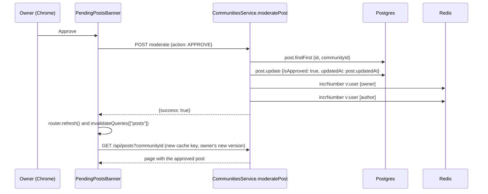
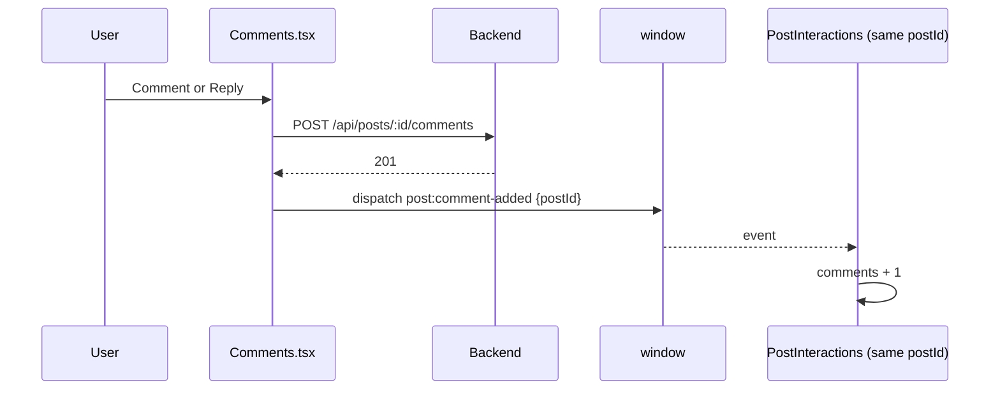

# Demo fixes V1 to V5

Spec status: approved · 2026-11-20
Design status: approved · 2026-11-20
Type: feature · Folder: `.docs/works/2026-11-20-p10-demo-fixes/`

## 1. Spec

### Problem

The demo sweep (task `p10-demo-sweep`, 2026-11-20, record in `.docs/works/2026-11-20-p10-demo-sweep/sweep.md`) found five new bugs on the demo path. They are rows V1–V5 of `.docs/Bugs Report.md` §3.5, and §6 proposes this task for them before row 22 (`p10-demo-script`). The author chose to fix them. What the code does today (checked on 2026-11-20):

| ID | Where | What is wrong today |
|---|---|---|
| **V1** (P3) | `components/ConversationList.tsx` and `components/ChatDrawer.tsx` | Both call `useInfiniteQuery` with the key `["conversations"]`. `ChatDrawer` (always in the `(board)` layout through `ChatDrawerManager`) has no `initialData` and is disabled while closed; `ConversationList` passes the server's `initialData`. On `/messages` the server HTML says "No conversations yet" and the client shows the list, so React throws "Hydration failed" and rebuilds the tree. That the shared key is the cause is likely, not proven. |
| **V2** (P4) | `components/PostInteractions.tsx`, `components/Comments.tsx` | The comment count is local state in `PostInteractions`, set once from props (`useState({ … comments: count.comments })`). A new comment invalidates `["comments", postId]` and `["posts"]`, but nothing updates that local state, so the status page header keeps the old count until a reload. |
| **V3** (P4) | `CommunitiesService.moderatePost` (`communities/communities.service.ts`), `components/Post.tsx` | Approve runs `post.update({ data: { isApproved: true } })`; Prisma's `@updatedAt` then moves `updatedAt`, and `Post.tsx` shows "(edited)" when `updatedAt` is more than 1 s after `createdAt`. An approved post looks edited. |
| **V4** (P4) | `CommunitiesService.moderatePost`, `PostsService.findAll` (feed cache), `app/(board)/c/[slug]/PendingPostsBanner.tsx` | The community feed is cached 10 s under `feed:…:<v:user of the viewer>…`. Approve bumps no `v:user`, and the banner only calls `router.refresh()`, which does not refetch the client feed query. So the owner sees an empty feed after Approve until the cache runs out and the page is reloaded. |
| **V5** (P3) | `app/sign-in/layout.tsx` | It renders its own `<html>` and `<body>` inside the root layout (`app/layout.tsx`). On a client navigation to `/sign-in` (logout, ban) React logs "In HTML, `<html>` cannot be a child of `<body>`" and "You are mounting a new html component". |

### Scope

**In scope:**
- Fix V1–V5 with the behaviour in "Done when".
- Update the docs that name them: `.docs/Bugs Report.md` (V1–V5 move to §5 with their commits, §1 counts, §6), `.docs/implementation-plan.md` §5 (a line for this task, between rows 21 and 22).

**Out of scope:**
- T6 (duplicate follow rows, and its new symptom on the followers pages): it needs the schema migration (future work).
- Other open bugs (B1, S4, S6, B5, R3, R6, N7, N9, B8, R4, R5).
- Any change to the feed ranking, `packages/ranking`, `eval/`, a frozen value or the schema.
- Making other writes (likes, comments) bump feed versions: that is the T3 note and stays as it is.

### Done when

Backend checks are IT tests (`apps/backend/test/it/`); frontend checks are done by hand in Chrome, because the frontend has no tests.

| # | Check | Expected result |
|---|---|---|
| DW1 | V1, Chrome: open `/messages` and `/messages/<id>` with at least one conversation, read the console | no "Hydration failed"; the list shows the conversations; the chat drawer still lists conversations when opened |
| DW2 | V2, Chrome: on a post's status page, add a top-level comment | the header comment count goes up by 1 without a reload |
| DW3 | V3, IT: a member posts in a community, the owner approves | the post's `updatedAt` equals its `createdAt` after the approve; in Chrome the card shows no "(edited)" |
| DW4 | V4, IT and Chrome: the owner reads the community feed (cache on), approves a pending post, reads the feed again at once | the second read has the post; in Chrome the feed shows it right after Approve, without a reload |
| DW5 | V5, Chrome: sign out from the home page (client navigation to `/sign-in`), and open `/sign-in` directly | no "`<html>` cannot be a child of `<body>`" and no "mounting a new html" error; the page title is still "Breadit" |
| DW6 | the editing of a post still marks it | edit a post's text: the card shows "(edited)" |
| DW7 | `bash .claude/hooks/verify.sh` with db and redis up | all green |
| DW8 | `npm run test:parity -w @breadit/backend` | passes |

### Open questions

1. **V3: how to keep `updatedAt` on approve?** Two ways: write `updatedAt: post.updatedAt` in the same `update` (Prisma keeps a value that is given), or mark edits with their own field. My proposal: the first one. No schema change, and "(edited)" keeps its meaning.
2. **V4: whose `v:user` to bump on approve?** The feed cache key holds the viewer's version, so only bumped viewers see the post at once. My proposal: bump the approver and the post author only (the two who act); other members see it within 10 s, the same rule as the T3 note. Bumping every member is one write per member and is not needed for the demo.
3. **V1: fix by key or by seeding?** My proposal: give `ChatDrawer` its own key (`["conversations", "drawer"]`) so the two lists stop sharing one cache entry, and keep the socket updates working for both (they call `setQueryData(["conversations"])` today; the drawer must get the same updates). The other way, seeding the shared key from the layout, touches the server layout.

## 2. Impact

**Who it affects.** The demo and the Chapter 8 screenshots: no console errors on `/messages` and after sign-out, the right comment count, approved posts that do not look edited and show at once.

**Code areas.** Backend: `communities/communities.service.ts` (`moderatePost`) and the cache service it already has or gets (`CacheService.incrNumber('v:user', …)`). Frontend: `ConversationList.tsx`, `ChatDrawer.tsx` (and whatever listens to `newMessage` for the drawer), `PostInteractions.tsx` and `Comments.tsx` (or the status page that holds both), `PendingPostsBanner.tsx`, `app/sign-in/layout.tsx`. Other open bugs in the same code: B1 (`moderatePost` treats any action other than `APPROVE` as remove) is a P10 security item and is not touched here.

**Feed and parity.** The approve path is not on the parity path (the parity data have no pending posts and use `algo` feeds). Bumping `v:user` only changes cache keys. `test:parity` runs with the cache off. DW8 checks it.

**Thesis link.** P10, the demo and Chapter 8. No hypothesis, no frozen value (super-plan §7), no schema and no reported number changes.

**Docs this task updates.** `.docs/Bugs Report.md`, `.docs/implementation-plan.md` §5. `docs/System_Architecture.md` and the Guidance Manual do not name these bugs (to be checked again at the end).

## 3. Design

The open questions are answered by the proposals in the Spec (approved with them): V3 keeps the old `updatedAt` in the same update, V4 bumps the approver's and the author's `v:user`, V1 gives the drawer its own query key.

### Approach

Five small fixes, each where the bug lives. Two are in the backend (V3, V4), four touch the frontend (V1, V2, V4, V5).

**V3: approve keeps `updatedAt`.** In `CommunitiesService.moderatePost`, the `APPROVE` branch writes `data: { isApproved: true, updatedAt: post.updatedAt }`. `post` is already read by `findFirst` just above, so no new query. Prisma sets an `@updatedAt` field only when the update does not give a value, so the given value stays (behaviour of Prisma 6, not verified in its source; the IT test DW3 proves it). The `REMOVE` branch is not touched (B1 is out of scope).

**V4: approve refreshes the feed.** Backend: after the update, `moderatePost` calls `this.cache.incrNumber('v:user', [userId])` for the approver and `[post.userId]` for the author (the service already has `CacheService` and uses `incrNumber` in `leave`, `banUser` and `deleteCommunity`). The feed cache key holds the viewer's version (`PostsService.findAll`, `cacheParts`), so both get a fresh page at once. Frontend: `PendingPostsBanner.handleModerate` also calls `queryClient.invalidateQueries({ queryKey: ["posts"] })` after an approve, so `InfiniteFeed` (key `["posts", …, communityId, …]`) refetches; `router.refresh()` stays for the server parts (the header counts).

**V1: the drawer gets its own key.** `ChatDrawer` uses `queryKey: ["conversations", "drawer"]`. `ConversationList` keeps `["conversations"]` with its `initialData`, so on the server its first render has the data and the HTML matches the client. The drawer has no socket listener today: it fetches when it opens (`enabled: open`), so a separate key changes nothing for it. `ConversationList`'s two `setQueryData(["conversations"], …)` calls keep their exact key.

**V2: the status page count follows new comments.** `Comments.tsx` and the post's `PostInteractions` are siblings on the status page, so they share no state. After a comment or a reply is created, `Comments.tsx` sends a window event `post:comment-added` with `{ postId }` (the app already uses window events, for example `messages:clear-badge`). `PostInteractions` listens and adds 1 to its local `comments` count when the `postId` matches. The existing `invalidateQueries` calls stay.

**V5: one root layout.** `app/sign-in/layout.tsx` returns its children only (`<>{children}</>`) and keeps its `metadata` export, so the title stays "Breadit" and the root `app/layout.tsx` gives the only `<html>` and `<body>`.

**Rejected options:**

| Option | Why not |
|---|---|
| V3: a new `editedAt` field | a schema change and a migration for one label |
| V3: change the "(edited)" rule in `Post.tsx` | the frontend cannot tell an approve from an edit with the fields it has |
| V4: bump every member's `v:user` | one write per member for each approve; others already see the post within 10 s (the T3 rule) |
| V4: only the frontend refetch | the refetch would hit the 10 s backend cache and get the old page |
| V1: seed `["conversations"]` once in the `(board)` layout | touches the server layout and every page for one list |
| V2: lift the count into a shared query or context | a larger change in `Post.tsx` and the status page for one number |
| V2: `router.refresh()` after a comment | `PostInteractions` keeps the count in `useState`, which ignores new props |

### Workflow and sequence diagrams

**V3 and V4: the owner approves a pending post.**

**V2: a new comment on the status page.**

### Failure modes

| # | What can go wrong | How we notice | How we resolve it |
|---|---|---|---|
| F1 | Prisma overwrites `updatedAt` even when it is given | IT test DW3 fails | then write the update with `updateMany` and the same data, or a raw `UPDATE … SET "isApproved" = true`; stop and report before choosing |
| F2 | The approve and the bump are not one transaction, so a crash between them leaves the old cache | — | the cache only lives 10 s, so the page heals by itself; the same order is used in `leave` and `banUser` |
| F3 | The approver is a mod, not the owner, or the author is the approver | IT test with a mod | bump both ids; if they are the same id, one bump is enough (bump the set of ids) |
| F4 | Remove (`action` other than `APPROVE`) should also refresh | not in the Spec | not changed; the removed post simply stays out of the feed |
| F5 | V1 has another cause, and the hydration error stays | Chrome check DW1 | stop and report; look for other differences between the server and client render of `ConversationList` (time formats, `session`) before changing more |
| F6 | The drawer shows an older list after a message arrives while it is open | — | the drawer had no live updates before either; it refetches each time it opens |
| F7 | V2 event counted twice (feed card and status card of the same post on one page) | Chrome check | only the status page has `Comments`; a feed card with the same `postId` on another page is not mounted at the same time; if both are mounted, both are right to grow |
| F8 | A deleted comment does not lower the count | — | out of the Spec (DW2 is about a new comment); the delete uses `confirm()` and the count is right after a reload, as today |
| F9 | `sign-in/layout.tsx` loses its title | Chrome check DW5 (title "Breadit") | keep the `metadata` export in the file |
| F10 | `invalidateQueries(["posts"])` refetches every feed in memory | — | it is what a comment already does today; the cost is one request per mounted feed |

### Code files

| File | New or changed | Purpose |
|---|---|---|
| `apps/backend/src/communities/communities.service.ts` | changed | `moderatePost` APPROVE: keep `updatedAt`; bump `v:user` of the approver and the author |
| `apps/backend/test/it/demo-fixes.it-spec.ts` | new | IT tests for DW3 and DW4 (DW4 with the cache on, as in `quick-wins.it-spec.ts`) |
| `apps/frontend/src/app/(board)/c/[slug]/PendingPostsBanner.tsx` | changed | V4: invalidate `["posts"]` after an approve |
| `apps/frontend/src/components/ChatDrawer.tsx` | changed | V1: key `["conversations", "drawer"]` |
| `apps/frontend/src/components/Comments.tsx` | changed | V2: send `post:comment-added` after a comment or a reply is created |
| `apps/frontend/src/components/PostInteractions.tsx` | changed | V2: listen to `post:comment-added` and add 1 to `comments` for its `postId` |
| `apps/frontend/src/app/sign-in/layout.tsx` | changed | V5: return the children only; keep `metadata` |
| `.docs/Bugs Report.md`, `.docs/implementation-plan.md` | changed | the docs of the Spec's scope |

### Data, schema and cache changes

- No schema change and no migration.
- On approve, `v:user` of the approver and of the author goes up by 1 (it orphans their cached feed pages, as other writes do).
- No new cache key. The frontend query key of the drawer changes to `["conversations", "drawer"]`.
