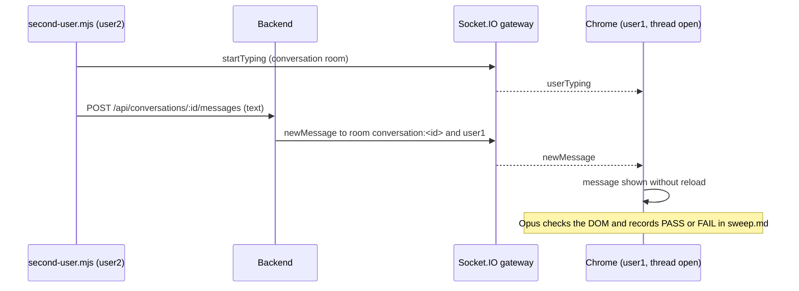
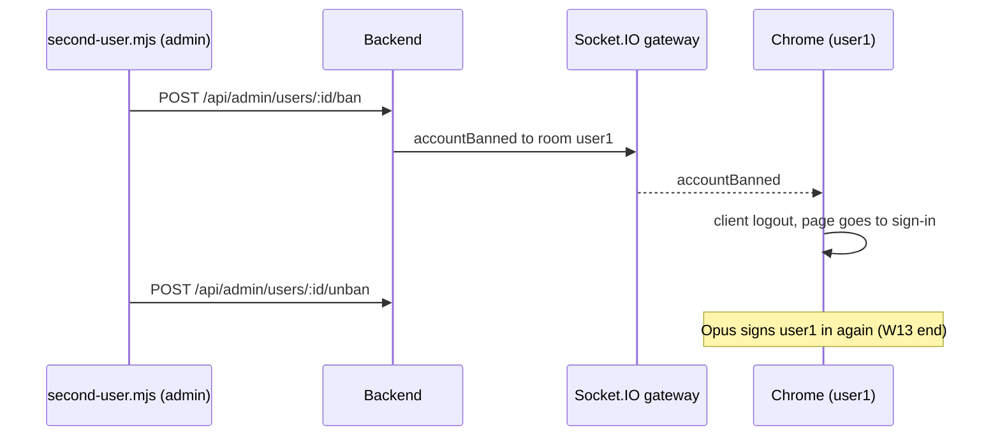

# Demo sweep before the demo script

Spec status: approved · 2026-11-20
Design status: approved · 2026-11-20
Type: feature · Folder: `.docs/works/2026-11-20-p10-demo-sweep/`

## 1. Spec

### Problem

The demo (row 22 `p10-demo-script`) and Chapter 8 (row 23, about eight screenshots) show the app live. Since the last full walk of the UI (the pre-thesis run of 2026-10-21, `.docs/Pre-thesis verify.md`: "all 26 pages render"), the app changed a lot: the `algo` feeds and their toggle (P6), the D1 rule, and today the eleven fixes of `p9-bug-quick-wins`, including a new route (`/compose/post` as a page and an intercepting modal) and a new click handler on every post. Nobody has walked the whole demo path in a browser since then. `.docs/implementation-plan.md` §5 row 21 asks for that walk before the demo script is written: run the two verify scripts again, walk the demo path in Chrome, and add new bugs to the Bugs Report.

What is known today (2026-11-20):
- `scripts/verify-bug-sweep.sh` (which also starts `scripts/verify-socket.cjs`) gave 95 passed, 0 failed this afternoon, in acceptance A6 of `p9-bug-quick-wins`.
- The frontend has 28 pages (`apps/frontend/src/app/**/page.tsx`): 20 in `(board)` (one is the new compose page; the modal is a 29th file), 3 in `admin-console`, and 5 auth pages (`sign-in`, `sign-up`, `verify`, `forgot-password`, `reset`).
- The flows row 22 will show: the three `algo` options of For You side by side (Chronological, Engagement, Social), a live direct message, a live notification, and an admin ban that logs the user out (`accountBanned`).
- In this session, the Chrome extension's mouse clicks did not reach the page (a capture listener on `document` saw no event); clicks sent from JavaScript worked (`p9-bug-quick-wins` Result). Typing into form fields and screenshots worked.

### Scope

**In scope:**
- Run `verify-bug-sweep.sh` (with `verify-socket.cjs`) against a fresh backend from `run-safe.sh`.
- Open every one of the 28 pages in Chrome, as the right kind of user (guest, user, admin, community owner), and check that it renders with no error.
- Walk the main flows of the demo and of Chapter 8: sign in and out, the three `algo` feeds, Explore, Following, Communities, create a post with an image, like, repost, comment and reply, follow, search, a hashtag page, join a community and post in it, approve a pending post, a live direct message with typing, a live notification, block, an admin ban that logs the user out, and the admin report table.
- Write each check and its result to a sweep record in the task folder.
- Add every new problem to `.docs/Bugs Report.md` (§3 with an ID, evidence and priority, and §6 with the phase that handles it).

**Out of scope:**
- Fixing the bugs found (Open question 1).
- The demo data (`syn-W2M-M` loaded with `--rebase-to`) and the demo users with little and long history: that is row 22.
- The P10 security bugs (B1, S4, S6, B5, R3, R6) and the future-work bugs, except to note if one shows on the demo path.
- Real email and Cloudinary (off in `run-safe.sh`), mobile layout, load tests.

### Done when

| # | Check | Expected result |
|---|---|---|
| DW1 | `verify-bug-sweep.sh` against a fresh backend | 95 passed, 0 failed, the socket checks included |
| DW2 | each of the 28 pages in Chrome, as the user kind in the sweep record | renders; no HTTP 500, no crash screen ("Something went wrong"), no console error. A page that fails is a new bug row |
| DW3 | each flow of the scope in Chrome | the expected result written in the sweep record happens; a flow that fails is a new bug row |
| DW4 | For You with `algo` = chrono, engagement and social for one user with follows | three pages that are not all the same order (the toggle works end to end) |
| DW5 | a direct message and a notification between two signed-in users | both arrive live, without a reload |
| DW6 | an admin bans a signed-in user | that user's open page logs out (`accountBanned`) |
| DW7 | the sweep record `sweep.md` in the task folder | one row per page and per flow: what was done, PASS or FAIL, the evidence (URL, status, console, screenshot name) |
| DW8 | `.docs/Bugs Report.md` | each FAIL of DW2–DW6 is a row in §3 (a new ID series, evidence, priority, effort) and is placed in §6; §1 counts are updated. No FAIL → a line in §1 that the sweep found nothing new |
| DW9 | `git diff` of the task | no change under `apps/`, `packages/` or `eval/` |

### Open questions

1. **Fix what the sweep finds, here or later?** My proposal: this task only records. If the sweep finds bugs on the demo path, a short follow-up task (`p10-demo-fixes`, full workflow) fixes them before row 22. That keeps this task free of code, and the author decides which bugs block the demo.
2. **Which data?** My proposal: the dev data in schema `public` (the seed `user1`–`user50`, `admin`, and `human01`–`human50`), with the backend from `run-safe.sh`. It has communities, DMs and images. The demo data (`syn-W2M-M` rebased) is walked again in the rehearsal of row 22.
3. **How to click in Chrome?** Mouse clicks of the extension did not reach the page today. My proposal: drive the pages with clicks sent from JavaScript and with typing and screenshots, and write that in the sweep record. The two flows that need a second user at the same time (DM, notification, ban) use a second session from a small script or curl, not a second browser. The author does one real-mouse pass in the rehearsal of row 22.

## 2. Impact

**Who it affects.** The live demo and the Chapter 8 screenshots. If nobody walks the path before row 22, the demo script may be written around a broken page, and a bug may show in front of the supervisor on 2026-11-30.

**Code areas.** None are changed (DW9). The sweep reads the whole app: every frontend page, the backend routes behind them, and the Socket.IO gateway. Open bugs on the same path that the sweep may meet: R5 (the connect list builds every user in memory), N7 (an unknown profile returns 200 with an empty list), B8 (a comment like says "liked your post"), N9 (follow notifications repeat), and the P10 bugs B5 (the verify banner links to `/verify` with no email) and R6 (an admin can ban themselves). These are already known and are not new rows.

**Data.** The sweep writes test rows into schema `public` (posts, likes, a community, DMs, a ban that is undone at the end). It never touches `eval_load` or Redis database 2, so the parity test and the results are not affected. The ban and the block are undone at the end, so the seed users stay usable for the demo.

**Thesis link.** P10, the demo and Chapter 8. No hypothesis, no frozen value (super-plan §7) and no reported number changes. The sweep record is a source for the Chapter 8 test summary.

**Docs this task updates.** `.docs/Bugs Report.md`, `.docs/implementation-plan.md` §5 row 21. No change to `docs/System_Architecture.md` or the Guidance Manual, because the code does not change.

## 3. Design

The open questions are answered by the proposals in the Spec (approved with them): this task only records, it uses the dev data in schema `public`, and Chrome is driven with JavaScript clicks, typing and screenshots, with a second user from a script.

### Approach

The sweep has three parts, done in this order: the scripts, the pages, the flows. Every check is a row of `sweep.md`, written before the run with its expected result, and filled in during the run. Nothing under `apps/`, `packages/` or `eval/` changes.

**Who does what.** Sonnet writes the two files of this task (the `sweep.md` skeleton with every row and its expected result, and the second-user script) and runs DW1. Opus does the Chrome walk, because the browser tab group belongs to this session, then fills the results and the Bugs Report rows. This is written in the plan so nobody waits for the other.

**Setup.** The backend from `.claude/hooks/run-safe.sh start` (schema `public`, email and Cloudinary off, uploads on local disk, cache on). The frontend dev server on :3000 with `BACKEND_INTERNAL_URL` and `NEXT_PUBLIC_BACKEND_URL` set to `http://localhost:4000` (no `.env` file exists in `apps/frontend`). `next.config.ts` already allows images from `http://localhost:4000/uploads/**`. One Chrome tab from the extension.

**Users.** Guest (no cookie); `user1` as the main viewer in Chrome (the seed gives users follows, likes and posts); `user2` as the second user, from the script; `admin` in Chrome for the admin pages. The community owner is `user1` itself: it creates a community in the sweep, `user2` joins and posts (pending), and `user1` approves. The `human*` users have no password and are not used to sign in.

**Pages (DW2).** The 28 pages, each opened by URL with the right user, then checked with three reads: the HTTP status of the navigation, a DOM check that the crash text ("Something went wrong") is absent and the main content is there, and the console errors since the page load (`read_console_messages`, only errors). Dynamic pages use real ids: `[username]` = `user2`, `status/[postId]` = a post of `user2`, `c/[slug]` = the sweep community, `hashtag/[tag]` = a tag in the seed, `messages/[conversationId]` = the `user1`–`user2` conversation. The auth pages (`sign-in`, `sign-up`, `verify`, `forgot-password`, `reset`) are opened as a guest; `verify` with `?email=` and without.

**Flows (DW3–DW6).** In this order, so each flow builds on the one before:

| # | Flow | Expected result |
|---|---|---|
| W1 | sign in as `user1` in Chrome | home page, For You tab |
| W2 | For You with Chronological, Engagement, Social | three pages; the first ten post ids are not the same in all three (DW4) |
| W3 | Explore, Following, Communities tabs | each loads posts, no error |
| W4 | compose with text, a `#tag`, an `@user2` mention and one image | the post appears on top of the user's profile; the image loads; the tag and mention are links |
| W5 | like, repost, quote repost, save, then undo each | the counts go up and back down |
| W6 | comment, reply, like a comment, delete the reply | the thread shows the right comments and counts |
| W7 | follow and unfollow `user2` from the profile | the button and the follower count change |
| W8 | search a word, open a hashtag page | users, posts and tags are listed |
| W9 | create a community, `user2` joins and posts, `user1` approves | the post moves from the approval queue to the community feed |
| W10 | a direct message from `user2` (script) while `user1` has the thread open | the message appears without a reload, with the typing sign first (DW5) |
| W11 | `user2` likes a post of `user1` (script) | the notification count goes up without a reload, and the list shows it (DW5) |
| W12 | `user1` blocks `user2`, then unblocks | `user2`'s posts and comments are hidden, then back |
| W13 | admin bans `user1` (script) while `user1`'s page is open, then unbans | `user1`'s page goes to sign-in (DW6); after the unban `user1` can sign in again |
| W14 | admin console: users table, reports table | both render; non-admin `user1` is redirected |
| W15 | sign out | sign-in page; the old cookie is a guest on public routes |

**Second user.** A small Node script (`second-user.mjs` in the task folder) signs in `user2` and `admin` through `POST /api/auth/login` once, keeps their cookies in memory, and runs one action per command: `dm`, `typing`, `like`, `join`, `post-in-community`, `ban`, `unban`. It uses `fetch` for HTTP and `socket.io-client` (already a dependency of the repo, used by `verify-socket.cjs`) for the typing event. It prints the HTTP status of each call.

**Bugs.** A FAIL that is not a known open bug gets a new row with the ID series **V** (sweep): V1, V2, … (`D` is taken by the decision D1). Each row has the page or flow, the evidence (URL, status, console text, screenshot name) and a priority from Bugs Report §2. A FAIL that is a known open bug (for example B5, N7, R5) is noted in `sweep.md` with that ID and is not a new row.

**Rejected options:**

| Option | Why not |
|---|---|
| Sonnet does the Chrome walk | the Chrome tab group and its sign-in belong to this session; an agent may not have the browser tools |
| A Playwright test suite for the walk | it is code under `apps/` (DW9 forbids it) and a new dependency, for a one-time check; the demo rehearsal (row 22) repeats the walk by hand |
| A second Chrome profile for `user2` | the extension drives one browser; a script is enough to send a message, a like and a ban |
| Real mouse clicks only | they did not reach the page in this session (Spec); JavaScript clicks test the same handlers, and the author does one real-mouse pass in the rehearsal |
| Fix small bugs during the sweep | Open question 1: this task only records |

### Workflow and sequence diagrams

**W10: a live direct message.**

**W13: a ban that logs the user out.**

Routes checked in the controllers on 2026-11-20: `POST /api/conversations/:id/messages` (`messages.controller.ts`), `POST /api/admin/users/:id/ban` and `/unban` (`admin.controller.ts`).

### Failure modes

| # | What can go wrong | How we notice | How we resolve it |
|---|---|---|---|
| F1 | Extension clicks do not reach the page | URL does not change after a click | use `element.click()` or a dispatched `MouseEvent` from JavaScript; the sweep record says which way each row was clicked |
| F2 | Login is limited to 10 per minute per IP | 429 on login | the script signs in once and keeps the cookies; Chrome signs in `user1` and `admin` once each; wait one minute if a 429 still comes |
| F3 | The first open of a page is slow (dev compile) | a blank page for a few seconds | wait for the dev server's "Compiled" line before the checks; slowness in dev mode is not a bug |
| F4 | The 10 s feed cache hides a new post from another user's feed (T3 note) | the post shows after a reload 10 s later | known behaviour, not a new bug; W4 checks the author's own profile, which the author's `v:user` bump refreshes |
| F5 | The sweep stops while `user1` is banned or `user2` is blocked | the cleanup row in `sweep.md` is not ticked | the last step always runs unban and unblock, even after a FAIL |
| F6 | A notification for oneself is skipped (by design) | no notification | W11 uses `user2` acting on a post of `user1`, never `user1` alone |
| F7 | Console noise that is not an app error (Next dev HMR lines, React DevTools hint, browser extensions) | console has messages | only `error` level counts; a dev-only warning is written in the row but is not a FAIL |
| F8 | The seed data already hold duplicates (T6) or old test rows from earlier sweeps (`sw_*` users) | odd counts | known (T6); the sweep reads its own new rows for the count checks |
| F9 | The `algo` pages are the same order for a user with too little history | W2 FAIL | check `user1`'s follows and likes first; if they are too few, use a seed user with more and write which in the row; a real FAIL only if a user with follows still gets three equal orders |
| F10 | Email is off, so `sign-up` and `verify` cannot finish | no code arrives | open the pages only (DW2); the code flow is already covered by `verify-bug-sweep.sh` (it reads the code from `VerificationToken`) |
| F11 | The sweep writes into `public` while the parity test or repro runs | — | they use `eval_load` and Redis database 2; nothing else runs during the sweep |

### Code files

No file under `apps/`, `packages/` or `eval/` (DW9).

| File | New or changed | Purpose |
|---|---|---|
| `.docs/works/2026-11-20-p10-demo-sweep/sweep.md` | new | the record: setup, users, the 28 page rows, the 15 flow rows (W1–W15), DW1 output, cleanup; each row with its expected result, then PASS or FAIL and evidence |
| `.docs/works/2026-11-20-p10-demo-sweep/second-user.mjs` | new | the second-user script: one login per user, then `dm`, `typing`, `like`, `join`, `post-in-community`, `ban`, `unban`; prints each HTTP status |
| `.docs/Bugs Report.md` | changed | V-series rows in §3, their place in §6, §1 counts |
| `.docs/implementation-plan.md` | changed | §5 row 21 ✅ and a change-log line |

### Data, schema and cache changes

- No schema change, no migration, no cache key.
- Test rows in schema `public`: one community, a few posts (one with an image on local disk), likes, comments, a conversation `user1`–`user2` with messages, notifications. They stay (local data only), like the `sw_*` rows of `verify-bug-sweep.sh`.
- `user1` is banned and unbanned, `user2` is blocked and unblocked; both are undone in the cleanup (F5).
