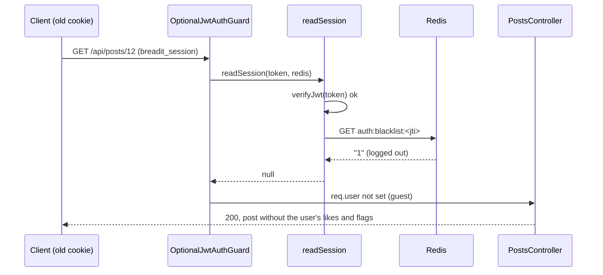
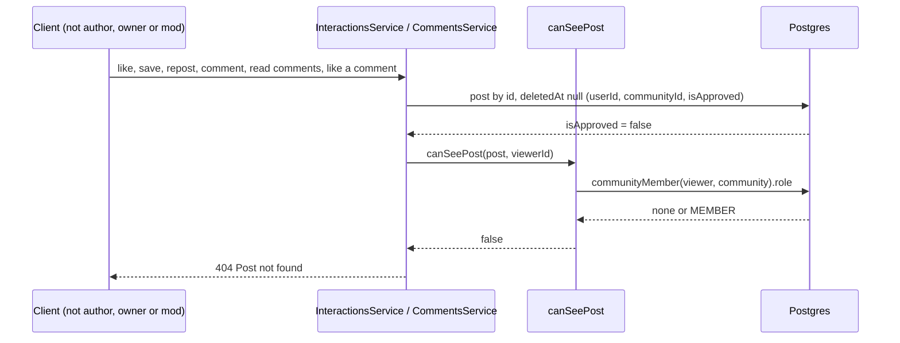

# Bug quick wins before the demo

Spec status: approved · 2026-11-20
Design status: approved · 2026-11-20
Type: feature · Folder: `.docs/works/2026-11-20-p9-bug-quick-wins/`

## 1. Spec

### Problem

The demo (`p10-demo-sweep`, `p10-demo-script`, Chapter 8) walks through the app in Chrome. Eleven open bugs of `.docs/Bugs Report.md` can show up on that path, and one script is still able to break the database. `.docs/implementation-plan.md` §5 row 20 puts them in this task, and Bugs Report §6 lists them under "P9, before the demo". Each one is small (XS or S in the Bugs Report). What the code does today (checked on 2026-11-20):

| ID | Where | What is wrong today |
|---|---|---|
| **R2** (interaction part) | `InteractionsService.assertPostLive` (`interactions/interactions.service.ts`); `CommentsService.create`, `findByPost`, `toggleLike` (`comments/comments.service.ts`) | They check only `deletedAt`. A post that waits for approval (`isApproved=false`) can be liked, saved, reposted and commented on by id, and its comments can be read. `PostsService.findOne` already hides it with `canSeePending` (author, owner, mod). |
| **S5** (HTTP part) | `auth/optional-jwt.guard.ts` | It verifies the token but does not look up `auth:blacklist:<jti>`, as `auth/jwt.guard.ts` does. After logout, the old cookie still gets personal data on public routes (Bugs Report: `GET /api/posts/1` returned `likes:[{id:2001}]`). |
| **N2** | `CommentsService.findByPost` | No block filter: a blocked user's comments and replies are shown to the person who blocked them. |
| **R1** | `CommentsService.commentInclude` | `_count: { select: { replies: true } }` also counts deleted replies. |
| **B7** | `HashtagsService.getTrending` (`hashtags/hashtags.service.ts`) | `postTag.groupBy` counts every tagged post: deleted posts and community posts too. No cache. Bugs Report: music 38 shown, 16 real. |
| **B10** | `MessagesService.getMessages` (`messages/messages.service.ts`) | It sets `lastReadAt` but leaves `dm:unreadCount` (60 s) in the cache, so the list shows the old unread number. `sendMessage` already deletes that key for the other member. |
| **B2** | `communities/dto/community.dto.ts` | `slug` has only `@IsNotEmpty` and `@MaxLength(30)`. Spaces, `/` and capitals are accepted and break `/c/<slug>` links. The form (`CreateCommunityForm.tsx`) keeps only `[a-z0-9_]`, but the API does not check. |
| **B9** | `apps/frontend/src/components/LeftBar.tsx` | The "Explore" item links to `/`, not `/?feed=explore`. |
| **N5** | `components/Post.tsx`, `components/RichText.tsx` | The post text sits inside a link to the status page, and each `@mention` and `#tag` is a link inside it: `<a>` inside `<a>`. Chrome logs a hydration error. |
| **N8** | `app/(board)/@modal/compose/post/page.tsx` | `/compose/post` exists only as an intercepted modal. Opening or reloading the URL gives 404. |
| **R7** | `apps/frontend/package.json` `dev:reset` (called by the root `dev:reset`) | Runs `prisma db push --force-reset`, which skips the migrations and the `*_data_humans_v1*` data. README already says not to use it. |

The "README corrections" of Bugs Report §7 are already done in `README.md` (the `dev:reset` warning, line 88; Explore is the engagement score, line 20). `docs/testcase.md` and `docs/feed_implementation_now.md` are now under `docs/Pre-thesis/`, which is frozen. So for §7 only the Bugs Report marks change.

### Scope

**In scope:**
- Fix the eleven bugs above, each with the behaviour in "Done when".
- Remove or replace `dev:reset` (R7, see Open question 4).
- Update the docs that name these bugs: `.docs/Bugs Report.md` (rows move to §5, §1 counts, §6, §7), Chapter 4 NFR2 in `chapters/system-analysis-and-design.tex` and `drafts/04-system-analysis-and-design.md` (it says the S5 HTTP part is open), and `docs/Guidance-Manual/{en,vi}/09-glossary.md` (the S1/S5 row).

**Out of scope:**
- The P10 security bugs (B1, S4, S6, B5, R3, R6: task `p10-security-fixes`) and the future-work bugs (T6, N3, N7, N9, N10, B8, R4, R5).
- Any schema change or migration.
- Any change to the feed ranking, `packages/ranking`, `eval/` or a frozen value.
- Fixing existing rows in the database (for example a slug that the new rule would refuse).

### Done when

Test levels: unit (`apps/backend/src/**/*.spec.ts`) or IT (`apps/backend/test/it/`, schema `it_test`). The frontend has no tests, so N5, N8 and B9 are checked by hand in Chrome.

| # | Check | Expected result |
|---|---|---|
| DW1 | R2, IT: a user who is not the author, owner or mod likes, saves, reposts, comments on, and reads the comments of a pending post; and likes a comment on it | 404 each time. The author and a mod still get 200/201 |
| DW2 | S5, IT: log in, log out, then call `GET /api/posts/<id>` with the old cookie | answered as a guest: no `likes` of that user, no personal flags |
| DW3 | N2, IT: carol blocks dave; carol reads comments of bob's post where dave commented and replied | dave's comments and replies are not in the answer |
| DW4 | R1, IT: a comment with two replies, one deleted | `_count.replies` is 1 |
| DW5 | B7, IT: tagged posts that are deleted, in a community, or live | `GET /api/hashtags/trending` counts only the live posts outside communities (Open question 3) |
| DW6 | B10, IT: bob sends alice two messages; alice reads the list, then the thread, then the list | the second list shows `unreadCount` 0 |
| DW7 | B2, IT: create a community with slug `Has Space/And Slash`, then with `good_slug-1` | 400, then 201 |
| DW8 | B9, Chrome | the Explore item opens `/?feed=explore` with the Explore tab active |
| DW9 | N5, Chrome: home feed with a post that has a mention and a tag | no "`<a>` cannot be a descendant of `<a>`" and no hydration error in the console; clicking the text still opens the post; clicking the mention opens the profile |
| DW10 | N8, Chrome and curl: open and reload `/compose/post` with a session cookie | 200 and a usable compose box; the in-app modal still works |
| DW11 | R7 | `npm run dev:reset` no longer runs `db push` (removed, or it runs the migrations) |
| DW12 | `bash .claude/hooks/verify.sh` with db and redis up | all green |
| DW13 | `npm run test:parity -w @breadit/backend` | passes (the live order still equals the harness order) |
| DW14 | `scripts/verify-bug-sweep.sh` against a fresh backend | no check that passed before fails now |

### Open questions

1. **R2: who may interact with a pending post?** My proposal: the same people who can see it in `PostsService.findOne` (`canSeePending`: the author, the community owner, the mods). Everyone else gets 404, as if the post did not exist.
2. **B2: the slug rule.** The Bugs Report says `^[a-z0-9-]{3,30}$`, but the form allows `_` and no `-`, and the demo slugs are plain words (`webdev`, `foodlovers`). My proposal: `^[a-z0-9_-]{3,30}$`, so the form and the API agree. The form keeps its own filter. Existing rows are not changed.
3. **B7: which posts count for trending?** My proposal: posts that are not deleted, not in a community, and approved. Quote reposts count, because their tags come from their own text. Cache the result for 60 s, with no version key (a trending list that is up to one minute old is fine).
4. **R7: change or remove `dev:reset`?** `prisma migrate reset --force` is the safe version, but the harness hook refuses `migrate reset`, and README already gives the right commands. My proposal: remove the script from both `package.json` files.

## 2. Impact

**Who it affects.** Every user of the demo: no hydration error on the home feed, the right Explore link, a compose URL that reloads, correct trending and unread numbers, no blocked comments, no actions on hidden posts. Without the fixes, Chapter 8 screenshots and the live demo could show these bugs.

**Code areas.** Backend: `auth/` (one guard), `interactions/`, `comments/`, `hashtags/`, `messages/`, `communities/dto/`. Frontend: `LeftBar.tsx`, `Post.tsx` (and maybe `RichText.tsx`), one route under `app/(board)/`. Root and frontend `package.json`. Other open bugs in the same files: T6 (`interactions.service.ts`, no unique key, schema migration), B8 (comment like notification, future work), B1 and R6 (`p10-security-fixes`). This task does not touch them.

**Feed and parity.** No change to `FeedService`, `PostsService.findAll` or `packages/ranking`. S5 changes `OptionalJwtAuthGuard`, which `GET /api/posts` uses: a request with a blacklisted token becomes a guest request. The parity test logs in fresh users and never logs out, so its order is unchanged (DW13 checks it). The guard adds one Redis read per request that carries a cookie on public routes. E7 (Class R) measured the code before this change and is not run again; its query count is about Postgres queries, so it does not change.

**Thesis link.** P9, before the demo (Chapter 8). No hypothesis, no frozen value (super-plan §7) and no reported number changes: the harness reads events, not the API, and the synthetic data have no pending interactions, deleted tags or blocked comments. Chapter 4 NFR2 and the glossary change because S5 becomes fully fixed.

**Docs this task updates.** `.docs/Bugs Report.md`, Chapter 4 (tex and draft), `docs/Guidance-Manual/{en,vi}/09-glossary.md`, `.docs/implementation-plan.md` §5 row 20. `docs/System_Architecture.md` names none of these bugs, so it does not change (to be checked again at the end).

## 3. Design

The open questions of the Spec are answered by the proposals written there (the author approved the Spec with them): R2 uses `canSeePending`, the slug rule is `^[a-z0-9_-]{3,30}$`, trending counts live, approved posts outside communities with a 60 s cache, and `dev:reset` is removed.

### Approach

Eleven small fixes, each in the place where the bug lives. Two new helpers are shared, so no check is written twice.

**One session check for both guards (S5).** A new function `readSession(token, redis)` in `auth/session.ts` does what `JwtAuthGuard` does today: `verifyJwt`, then a Redis read of `${BLACKLIST_PREFIX}:<jti>` when the token has a `jti`, then the `req.user` object. It returns `null` for a bad, expired or blacklisted token. `JwtAuthGuard` throws 401 on `null`; `OptionalJwtAuthGuard` leaves `req.user` unset and goes on as a guest. `OptionalJwtAuthGuard` gets `RedisService` by injection (`RedisModule` is `@Global`, so no module changes). The socket gateway keeps its own check (it works and `socket.it-spec.ts` covers it).

**One visibility check for a pending post (R2).** `PostsService.canSeePending` moves to a function `canSeePost(prisma, post, viewerId)` in `posts/visibility.ts`: an approved post is visible to all; a pending one only to its author and the community owner and mods (the same rule as today). `PostsService.findOne` calls it instead of the private method. `InteractionsService.assertPostLive` gets the viewer id, selects `isApproved` and `communityId`, and throws 404 when `canSeePost` is false. `CommentsService.create`, `findByPost` and `toggleLike` do the same, through a private `assertPostVisible(postId, viewerId)` (for a comment like, the post is read through the comment).

**Comments (N2, R1).** `CommentsService` gets `BlockService` (`CommentsModule` imports `BlockModule`). `findByPost` reads `getAllBlockedPeerIds(viewer)` once and, when the set is not empty, adds `userId: { notIn: [...] }` to the top-level `where` and to each of the four nested `replies.where`. `commentInclude` counts only live replies: `_count: { select: { replies: { where: { deletedAt: null } }, likes: true } }` (Prisma 6 filtered relation count).

**Trending (B7).** `getTrending` adds `where: { post: { deletedAt: null, communityId: null, isApproved: true } }` to `postTag.groupBy` (the generated `PostTagGroupByArgs.where` is `PostTagWhereInput`, which has the `post` relation filter; checked in `node_modules/.prisma/client/index.d.ts`) and wraps the work in `cache.getOrSetJson('hashtags:trending', ['top5'], 60, loader)`. `HashtagsModule` imports `CacheModule`.

**Unread count (B10).** `getMessages` calls `cache.del('dm:unreadCount', [conversationId, userId])` right after it updates `lastReadAt`, the same call `sendMessage` already makes for the other member.

**Slug (B2).** `CreateCommunityDto.slug` gets `@Matches(/^[a-z0-9_-]{3,30}$/)` with the message "Slug must be 3-30 characters: a-z, 0-9, _ or -". `UpdateCommunityDto` has no slug, so nothing else changes.

**Frontend.**
- **B9:** the Explore item of `LeftBar.tsx` links to `/?feed=explore`; the home page already reads `feed=explore` and marks the tab.
- **N5:** in `Post.tsx`, the `<Link>` around the text becomes a `
` with `cursor-pointer`. A click calls `router.push(href)`; a click with Ctrl or Cmd opens a new tab; Enter does the same as a click; a click that ends a text selection does nothing. The mention and tag links in `RichText.tsx` already call `stopPropagation`, so they open their own page. No `<a>` is left around them.
- **N8:** the modal becomes an intercepting route and the URL gets a real page. `@modal/compose/post/page.tsx` moves to `@modal/(.)compose/post/page.tsx`. A new `(board)/compose/post/page.tsx` shows the same compose box (`Share`) as a normal page; its close button goes to `/`, because `router.back()` would leave the site after a direct load.

**R7.** Remove `dev:reset` from the root `package.json` and from `apps/frontend/package.json`. README already says to use `prisma migrate deploy` and `prisma db seed`.

**Rejected options:**

| Option | Why not |
|---|---|
| S5: copy the blacklist lines into `OptionalJwtAuthGuard` | Two copies of one security rule drift apart; the Bugs Report asks for one shared function |
| S5: also move the socket gateway onto `readSession` | Not needed for the bug, and the gateway reads the cookie from the handshake header, not `req.cookies`; it has its own tests |
| R2: answer 403 for a pending post | 404 is what `findOne` answers; a 403 would tell a stranger that the post exists |
| N2: hide only the blocked user's own comment and keep the replies of others under it | The thread would show replies to a comment that is not there; hiding the subtree is what one `where` per level gives, and it is what the user expects from a block |
| B7: a raw SQL query | The Prisma relation filter does the same with typed code |
| N8: add only `(board)/compose/post/page.tsx` and keep the parallel route | On an in-app click both slots would match, so the feed behind the modal would be replaced by the compose page |
| R7: change the script to `prisma migrate reset --force` | The harness hook refuses `migrate reset`, and README already has the right commands |

### Workflow and sequence diagrams

**S5: a public route with a logged-out cookie.**

**R2: an action on a pending post.**

The other fixes are one call each and need no diagram.

### Failure modes

| # | What can go wrong | How we notice | How we resolve it |
|---|---|---|---|
| F1 | Redis is down when `OptionalJwtAuthGuard` reads the blacklist | the read throws | `readSession` lets the error reach the guard; the optional guard catches it and goes on as a guest (fail closed: no personal data); `JwtAuthGuard` answers 401, as today |
| F2 | A token has no `jti` | `payload.jti` is undefined | no blacklist read, same as `JwtAuthGuard` today; every login token has one (`randomUUID`) |
| F3 | The parity test or E7 depends on the optional guard | DW13 | they log in fresh users and never log out, so `req.user` is the same; the extra Redis read is not a Postgres query, so the E7 query count does not change |
| F4 | A like or save made on a pending post before this fix cannot be undone (the toggle now answers 404) | IT test of R2 | accepted: the row stays, and nothing shows it until the post is approved; the demo data have none |
| F5 | The post is approved later | an action after approval | `canSeePost` reads `isApproved` on every call, so the action then works |
| F6 | A blocked user's comment hides the replies of other users under it | IT test of N2 | chosen on purpose (rejected options); the viewer is the one who blocked |
| F7 | The blocked-peers cache (`graph:blockedPeers`, 60 s) is old right after a block | — | `BlockService` already deletes that key on block and unblock |
| F8 | A blocked user is the post author | — | `findOne` already hides the post for a blocked pair; comments are read only after that |
| F9 | Trending is up to 60 s old, or the cache is off (`REDIS_HTTP_CACHE_ENABLED=false`) | — | 60 s is fine for a top-5 list; with the cache off, `getOrSetJson` calls the loader each time |
| F10 | Two first requests for trending at once | — | `getOrSetJson` has the stampede lock |
| F11 | An existing community slug breaks the new rule | — | only create is checked; old rows and their links stay as they are; the eval loader writes slugs (`c1`) to the database directly, not through the DTO |
| F12 | N5: Ctrl/Cmd-click, middle click, keyboard and text selection on the post text | Chrome check DW9 | Ctrl/Cmd-click and middle click (`onAuxClick`) open a new tab; Enter navigates; a click with a non-empty `window.getSelection()` does nothing |
| F13 | N5: a click on a mention also opens the post | Chrome check | `RichText` links already call `stopPropagation` |
| F14 | N8: the intercepting route does not catch the in-app link | Chrome check DW10: the feed must stay behind the modal | `(.)` matches the same route level; slots are not segments, so `@modal/(.)compose/post` intercepts `/compose/post` from any `(board)` page. Not run yet: if it fails, the Chrome check shows it and the plan step stops |
| F15 | N8: the dev server keeps the old route tree | 404 after the move | restart the frontend before the Chrome check |
| F16 | B10: the cache is off | — | `cache.del` does nothing when the cache is off, and the count is then read fresh |
| F17 | Removing `dev:reset` breaks a script or doc that calls it | grep for the name in the repo (not in `docs/Pre-thesis/`) | README line 88 is the only mention outside the frozen folder; it is rewritten to name the right commands only |

### Code files

| File | New or changed | Purpose |
|---|---|---|
| `apps/backend/src/auth/session.ts` | new | `readSession(token: string, redis: RedisService): Promise<SessionUser \| null>` and the `SessionUser` type |
| `apps/backend/src/auth/jwt.guard.ts` | changed | uses `readSession`; 401 on `null` |
| `apps/backend/src/auth/optional-jwt.guard.ts` | changed | injects `RedisService`, uses `readSession`; guest on `null` or error |
| `apps/backend/src/posts/visibility.ts` | new | `canSeePost(prisma, post: { userId; communityId; isApproved }, viewerId?: string): Promise<boolean>` |
| `apps/backend/src/posts/posts.service.ts` | changed | `findOne` calls `canSeePost`; the private `canSeePending` is removed |
| `apps/backend/src/interactions/interactions.service.ts` | changed | `assertPostLive(postId, viewerId)` also checks `canSeePost` |
| `apps/backend/src/comments/comments.service.ts` | changed | `assertPostVisible` in `create`, `findByPost`, `toggleLike`; block filter in `findByPost`; live reply count in `commentInclude` |
| `apps/backend/src/comments/comments.module.ts` | changed | imports `BlockModule` |
| `apps/backend/src/hashtags/hashtags.service.ts`, `hashtags.module.ts` | changed | filter and 60 s cache in `getTrending`; imports `CacheModule` |
| `apps/backend/src/messages/messages.service.ts` | changed | `getMessages` deletes `dm:unreadCount` for the reader |
| `apps/backend/src/communities/dto/community.dto.ts` | changed | `@Matches` on `slug` |
| `apps/backend/test/it/quick-wins.it-spec.ts` | new | IT tests for DW1–DW7 (R2, S5, N2, R1, B7, B10, B2) |
| `apps/backend/src/auth/session.spec.ts` | new | unit tests of `readSession`: good token, bad token, blacklisted, no `jti`, Redis error |
| `apps/frontend/src/components/LeftBar.tsx` | changed | B9 link |
| `apps/frontend/src/components/Post.tsx` | changed | N5: clickable text without a link |
| `apps/frontend/src/app/(board)/@modal/(.)compose/post/page.tsx` | moved from `@modal/compose/post/page.tsx` | N8: the modal as an intercepting route |
| `apps/frontend/src/app/(board)/compose/post/page.tsx` | new | N8: the full page for a direct load or reload |
| `package.json`, `apps/frontend/package.json` | changed | R7: `dev:reset` removed |
| `README.md` | changed | line 88 no longer names the removed script |
| `.docs/Bugs Report.md`, Chapter 4 (`chapters/system-analysis-and-design.tex`, `drafts/04-system-analysis-and-design.md`), `docs/Guidance-Manual/{en,vi}/09-glossary.md`, `.docs/implementation-plan.md` | changed | the docs of the Spec's scope |

Existing tests that may need a small change: unit specs that build `PostsService`, `CommentsService` or `HashtagsService` by hand (new constructor arguments), and `banned-guard-coverage.spec.ts` (it lists guards per route; no guard changes order).

### Data, schema and cache changes

- No Prisma model change and no migration.
- New cache key `hashtags:trending:top5`, TTL 60 s, no version key (F9).
- `dm:unreadCount:<conversationId>:<userId>` is now also deleted when the reader opens the thread.
- No `v:user` change: none of these fixes changes what a feed page holds.
