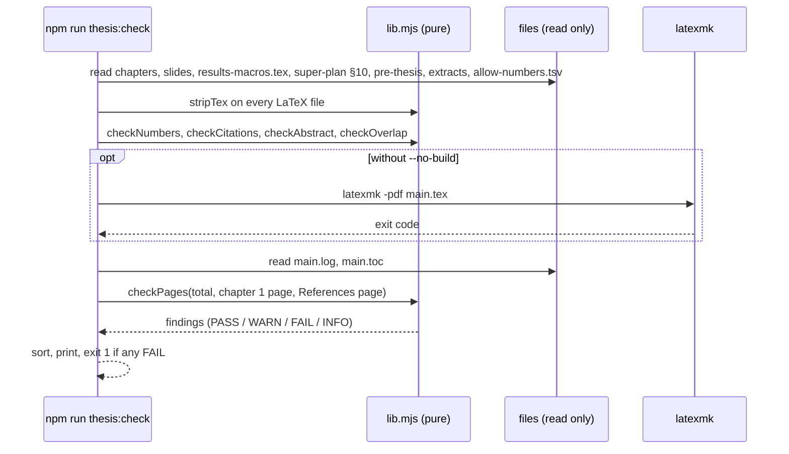

# Final checks of the thesis (re-runnable)

Spec status: approved · 2026-11-23
Design status: approved · 2026-11-23
Type: feature · Folder: `.docs/works/2026-11-23-p10-final-checks/`

## 1. Spec

### Problem

Row 28 of `.docs/implementation-plan.md` §5 and super-plan §4 P10 ("Do") ask for final checks over the thesis and the slides, as **scripts** (super-plan change log 0.33: "the checks as scripts of `p10-final-checks`, not new agents"):

1. every number has a macro;
2. every citation is marked "verified" in super-plan §10;
3. the abstract matches Chapter 6;
4. a local overlap check against the pre-thesis text and the saved paper extracts;
5. the page limit.

Today these checks exist only as one-off commands typed in chat (row 25 on 2026-11-22, the citation check on 2026-11-23). Nobody can run them again with one command, and the text will change after the supervisor's feedback (2026-11-30, row 27). So the checks must be re-runnable: run once now, and again after the feedback and before the freeze (row 31).

What exists, as evidence:
- **Macros.** 172 in `.docs/results/p7-report/results-macros.tex`. Since `p9-missing-macros`, no `\macromissing` is used. The row 25 check of "no typed decimals" was a grep in chat; its rule was not written down.
- **Citations.** The chapters use `\refcite{key}` (macro in `.docs/Thesis-Report/main.tex` line 150); the entries are `\item\label{ref:key}` in `chapters/references.tex` (45 today). Super-plan §10 lists 50 sources with a status ("verified", "search only", and notes such as "abstract only; do not cite a finding from it"). The keys of `references.tex` are not written in §10; the link is by author and year. The check on 2026-11-23 matched them by hand: 45 of 45 verified.
- **Abstract.** `chapters/abstract.tex` uses macros only. Row 27 matched each claim to Chapter 6 by hand (`.docs/works/2026-11-22-p9-ch9-front-back/design.md`, DW3 table).
- **Overlap sources.** The pre-thesis text: `docs/Pre-thesis/Latex/chapters/*.tex` (15 files) and the Markdown files in `docs/Pre-thesis/` (about 24,000 words in the LaTeX). The paper extracts: `.docs/works/2026-10-23-p1-literature/extracts/` (22 files, 124 KB, each with short quotes from a source). The thesis chapters are about 35,000 words. `docs/Pre-thesis/` is read only, never edited.
- **Pages.** The PDF has 97 pages (Chapters 1–9 run from page 1 to about 72). Super-plan §11 item 2: at most 120 pages, target 80–100 (author, 2026-11-19); whether the appendix counts is open (a question for 2026-11-30). Row 28 says "at most 100".
- **Slides.** `.docs/Thesis-Report/slides/progress-2026-11-30.tex` uses the same macros and `\refcite`-free text. Super-plan P10 says the checks cover the slides too.
- **Tools.** Node 22, Python 3.13, Ghostscript (`gs`) and `latexmk` are on this machine; `pdftotext` is not.

### Scope

**In scope:**
- One command (for example `npm run thesis:check`) that runs the five checks on the thesis, and checks 1 and 2 on the slides, and prints one line per check (PASS, FAIL or WARN) with the file and line of each finding. It exits non-zero when a check fails.
- **Check 1, numbers.** Finds numbers in the text of `chapters/*.tex` (and the slides) that look like typed results (for example a decimal like 0.054 or a percentage) outside comments, macros, table inputs from `\resultsdir`, code and URLs. Reviewed exceptions (settings like K = 10, 95\%, 0.25 in a formula) go in a small allow-list file with a reason for each line, so the check stays quiet on them. Also: every `\macroName` used in the text exists in `results-macros.tex`, and no `\macromissing` is used.
- **Check 2, citations.** Every `\refcite` key exists in `references.tex`, every entry is cited, and every entry maps to a §10 item with status "verified". The link from key to §10 number must be written down once (a small mapping file, or the §10 number in a comment on each `\item`). Also it lists the citing sentences of every entry whose §10 note says "do not cite a finding from it", for a person to read (the check cannot judge a finding).
- **Check 3, abstract.** Every macro in `abstract.tex` also appears in `experiments-and-results.tex` (Chapter 6). The claim-by-claim reading stays a manual step, recorded in the Result.
- **Check 4, overlap.** Long runs of the same words (for example 8 words or more in a row, after lower-casing and removing LaTeX commands) between the thesis chapters and (a) the pre-thesis text, (b) the paper extracts. It prints each match with both places. A match inside a marked quotation with a citation is allowed. Everything runs locally; no text is sent anywhere.
- **Check 5, pages.** Builds the PDF (or reads the last build) and reports the total pages and the pages of Chapters 1–9. FAIL above 120 in total; WARN above 100 for Chapters 1–9 (see Open question 1).
- Its unit tests on small made-up inputs.
- **First run now.** Run it on today's thesis and slides, record the output in the task folder, and fix what is clearly wrong in the text (for example a typed number that has a macro). Findings that need the author (a new macro, a reworded paragraph that overlaps the pre-thesis text) are listed, not fixed.
- Docs: `CLAUDE.md` Commands (the new command); `.docs/implementation-plan.md` row 28 and a change-log line, with "run `thesis:check` again after the feedback" added to row 30 or 31.

**Out of scope:**
- Any check of meaning beyond the listed rules (the claims of the abstract, whether a citation supports its sentence): those stay manual.
- Overlap against the internet or any outside service.
- Editing `docs/Pre-thesis/`.
- Fixing the findings that need the author; the second run after the feedback (a later step, see Open question 3).
- The Chapter 4 figures.

### Done when

| # | Check | Expected result |
|---|---|---|
| DW1 | The command, run on today's tree | Prints one line per check (5 for the thesis, 2 for the slides), with file:line for each finding; exit code 0 if no check fails, non-zero if one fails |
| DW2 | Its unit tests | Pass; each check has at least one case that passes and one that fails (a typed decimal, an unknown macro, an uncited entry, a key with no §10 item, a "search only" item, an abstract macro not in Chapter 6, an 8-word overlap, a page count over the limit) |
| DW3 | Check 2 on today's thesis | 45 keys used, 45 defined, 45 verified (the result of the hand check of 2026-11-23) |
| DW4 | Check 4 | Runs on the 15 pre-thesis LaTeX files, the pre-thesis Markdown files and the 22 extracts; reads `docs/Pre-thesis/` only; prints the number of matches per chapter |
| DW5 | The allow-list | Every line has a reason; the check fails on a line with no reason |
| DW6 | Two runs on the same tree | The same output, byte for byte (no clock, sorted findings) |
| DW7 | The first run | Its output is saved in the task folder; each finding is fixed in the text or listed in the Result for the author |
| DW8 | `bash .claude/hooks/verify.sh` | All checks pass |
| DW9 | Docs | `CLAUDE.md` Commands names the command; implementation plan row 28 and its change-log line are updated |

### Open questions

1. **The page limit.** Row 28 and super-plan P10 say "at most 100 pages"; super-plan §11 item 2 says "at most 120, target 80–100", and whether the appendix counts is a question for 2026-11-30. I recommend: FAIL above 120 pages in total, WARN when Chapters 1–9 are above 100. After the supervisor answers, only the two numbers change.
2. **How the citation keys link to §10.** I recommend a comment with the §10 number on each `\item` of `references.tex` (for example `% §10 [5]`), because it sits next to the entry and cannot drift from it. The other option is a separate mapping file.
3. **When the task closes.** I recommend closing it after the first run, and adding "run `thesis:check` again after the feedback" as a line in rows 30 and 31. The other option is to keep row 28 open until after 2026-11-30.
4. **The overlap length.** 8 words in a row is a common threshold for plagiarism tools, but it is my choice, not a rule of the school. The pre-thesis report is the author's own work, so overlap with it is not plagiarism, but the school may still count it as reuse. Is a short note in the Result enough, or should each match be reworded?

## 2. Impact

**Who it affects.** The author, before submission. Without it, the final checks are done by hand at the end, under time pressure, and may miss a typed number, an unverified citation or text copied from the pre-thesis report (super-plan §11 item 5 says the pre-thesis errors are fixed only in the new text, so some reuse is expected).

**Code areas.** New files only: a script folder (for example `scripts/thesis-check/`, like `scripts/demo/`) with its tests, and a root `package.json` script. No change to `apps/`, `packages/` or `eval/`. It reads the LaTeX files, `results-macros.tex`, the super-plan and `docs/Pre-thesis/`, and writes only into the task folder and the LaTeX build folder. No open bug of the Bugs Report touches it.

**Thesis link.** P10, the quality of the whole text. No result, macro or frozen value (super-plan §7) changes. The first run may change sentences in the chapters (typed numbers, reuse), each listed in the Result. `references.tex` may get comments (Open question 2), which do not change the PDF.

**Later tasks.** Row 30 (defense package) and row 31 (freeze) run the same command again.

## 3. Design

### Approach

The author approved the Spec without changing the open questions, so this design follows the recommendations: (1) FAIL above 120 pages in total, WARN when Chapters 1–9 are above 100; (2) a `% §10 [n]` comment on each `\item` of `references.tex`; (3) the task closes after the first run, and rows 30 and 31 get "run `thesis:check` again"; (4) overlap with the pre-thesis text is listed as WARN for the author to judge, not reworded in this task.

**Shape.** A Node script folder like `scripts/demo/`: a thin command file that reads files and prints, and a file of pure functions with `node:test` tests. Node built-ins only (no new dependency). Root `package.json`: `thesis:check` runs `node scripts/thesis-check/check.mjs`; `--no-build` skips the LaTeX build and reads the last one.

**Inputs** (all read only): `.docs/Thesis-Report/chapters/*.tex`, `main.tex`, `slides/progress-2026-11-30.tex`, `.docs/results/p7-report/results-macros.tex`, `.docs/super-plan.md` (§10 only), `docs/Pre-thesis/Latex/chapters/*.tex`, the Markdown files under `docs/Pre-thesis/` (29 files, without `Latex/` and `output/`), the 22 files of `.docs/works/2026-10-23-p1-literature/extracts/`, and the build files `main.log` and `main.toc`.

**Output.** One line per check, then the findings, each `path:line: message`, sorted by path, then line, then message. No time, no absolute path. The end line counts PASS, WARN and FAIL. Exit 1 when any check FAILs, else 0. The first run is saved with `> first-run.txt` in the task folder.

**Before every check: `stripTex(text)`.** It keeps the line numbers (each line maps to the same line): it removes `%` comments (not `\%`), and blanks the arguments of `\url`, `\path`, `\href`, `\label`, `\ref`, `\refcite`, `\input`, `\includegraphics`, `\thesisdiagram` and the bodies of `verbatim`/`lstlisting`. Each check then reads the stripped lines.

**Check 1, numbers (`numbers`).**
- A candidate is a decimal (`\d+\.\d+`, not part of a version like `15.1.6` or a word) or a percentage (`\d+(\.\d+)?\\%`) in a stripped line. Integers are not checked (counts, years, K values and settings are mostly integers; the row 25 rule was "no typed decimals"). Today's tree has 138 candidates (probe of 2026-11-23): versions, settings, numbers quoted from papers, test timings, and maybe typed results.
- **Allow-list** `scripts/thesis-check/allow-numbers.tsv`: one line per reviewed case, four tab-separated fields: `file` (relative to `chapters/` or `slides/`), `number` (as written), `context` (a few words that must be on the same line, so the entry stays valid when lines move), `reason` (not empty). A candidate is allowed when one entry has the same file and number and its context is on the line. An entry with an empty reason → FAIL (DW5). An entry that matches nothing → WARN ("unused allow-list entry"), so the list cannot grow stale.
- **Macros.** Every command in the text that starts with `\eOne…\eEight`, `\tune` or `\hZero` (the three prefixes of `results-macros.tex`: `e`, `tune`, `hZero`) must be defined there → else FAIL. `\macromissing{` used outside the `\providecommand` line → FAIL.
- FAIL for each candidate not allowed.

**Check 2, citations (`citations`).**
- Keys used: `\refcite{k}` in the chapters (and slides, 0 today). Keys defined: `\item\label{ref:k}` in `references.tex`. FAIL: a key used but not defined; a key defined but never used.
- The link to §10: each `\item` line of `references.tex` ends with `% §10 [n]` (added once in this task; a comment, so the PDF does not change). FAIL: an entry with no `§10` number, or a number that is not an item of §10.
- §10 is the text between `## 10.` and the next `## ` heading of `.docs/super-plan.md`; each item is a line `^(\d+)\. `; its status is the text after the last ` · `. FAIL when the status does not start with `verified`.
- INFO list (not a failure): for each entry whose status contains `do not cite a finding`, every stripped sentence of the chapters that cites it, with `path:line`, for a person to read.

**Check 3, abstract (`abstract`).** The set of macro names used in `abstract.tex` minus the set used in `experiments-and-results.tex` → FAIL for each one left. Today: 10 macros, all in Chapter 6 (probe).

**Check 4, overlap (`overlap`).**
- `words(text)`: lower-case, keep `[a-z0-9]+` tokens, each with its source line. LaTeX sources are stripped first and their command names dropped (`\textbf{x}` → `x`); Markdown sources lose `#`, `*`, `` ` ``, `|` and link URLs.
- Shingles of 8 words. A thesis shingle that is also in a source marks those 8 words. Runs of marked words that touch are merged into one match: thesis `path:line`, source `path:line`, length in words, the first 12 words.
- Thesis files: every `chapters/*.tex` except `references.tex` (titles of papers would match the extracts and the pre-thesis bibliography). The appendix stays in: its tables are file and test names, which rarely make 8 words in a row.
- **Pre-thesis matches → WARN** (the author's own earlier text; the author judges). **Extract matches → FAIL**, unless the thesis words lie inside a quotation (`` `` … '' ``) that has a `\refcite` within 200 characters after it → INFO.
- Per thesis chapter: the number of matches and of matched words for each source group (DW4).

**Check 5, pages (`pages`).** Unless `--no-build`: `latexmk -pdf -interaction=nonstopmode main.tex` in `.docs/Thesis-Report/` (the usual place; its build files are git-ignored); a non-zero exit → FAIL. Then from `main.log` the line `Output written on main.pdf (N pages` → total; from `main.toc` the page of `\numberline {1}` and of the `References` entry → Chapters 1–9 = References page − Chapter 1 page (today 74 − 1 = 73). FAIL when total > 120; WARN when Chapters 1–9 > 100. The two limits are constants at the top of `check.mjs`, to change after the supervisor answers.

**Slides.** Checks 1 and 2 run on `slides/progress-2026-11-30.tex` too (its own allow-list lines use the file name `slides/progress-2026-11-30.tex`). The slides are not built by this command.

**First run.** Run it; for each FAIL of check 1, decide: a typed result that has a macro → replace it in the text; a setting, a version, a number quoted from a paper or a test timing → an allow-list line with its reason; a typed result with no macro → listed in the Result for the author (no new macro in this task). Check 4 WARNs → listed in the Result with the chapters and lengths. Save the final output as `first-run.txt`.

**Rejected options:**

| Option | Why not |
|---|---|
| A Python script | The repo's scripts are Node (`scripts/demo/`, `scripts/repro/`), tested with `node:test`; one language is easier to keep |
| Line numbers in the allow-list | Every edit above a line would break the list; a context string survives moved lines |
| A separate key-to-§10 mapping file | It can drift from `references.tex`; a comment on the same line cannot |
| Checking integers too | Counts, years, K and settings are integers; the list would be mostly noise, and the result macros already cover the counts the text cites |
| Overlap by a sentence-similarity score | Not exact and hard to explain; equal word runs are what plagiarism checkers report |
| `pdftotext` for the page count | Not installed; `main.log` and `main.toc` already hold the numbers |

### Workflow and sequence diagrams

### Failure modes

| # | What can go wrong | How we notice | How we resolve it |
|---|---|---|---|
| F1 | `stripTex` misses a command, so a URL or label number counts as a typed number | a FAIL on a line with a URL or label | Unit test with each blanked command; the allow-list is the fallback, with a reason |
| F2 | A version like `15.1.6` or `v3.13` is read as a decimal | FAIL on a version | The candidate rule skips numbers joined to a letter or to a second dot; unit test |
| F3 | A macro name is read with a trailing letter of the next word (`\eOneX{}` vs `\eOneXyz`) | false "undefined macro" | Match the longest `[A-Za-z]+` after the backslash, as TeX does; unit test |
| F4 | §10 has a line that is not an item (a note), or an item that runs over two lines | a wrong or missing status | Parse only lines `^\d+\. ` inside the §10 block; the status is after the last ` · ` on that line (all 50 items are one line today; checked) |
| F5 | The `% §10 [n]` comments are wrong (n points to another source) | not found by the script | Added once by hand, by author and year; the Result lists the 45 pairs for a reader; a unit test checks the parse only |
| F6 | Overlap floods the output (Chapter 4 and 5 may reuse the pre-thesis text a lot) | very long output | Merged runs, one line each with 12 words; a summary table per chapter first |
| F7 | A shared common phrase (8 words of a standard term list) matches | WARN or FAIL noise | Pre-thesis is WARN only; for extracts, the quote rule and the allow-list-like review in the Result; 8 words is long enough that common phrases rarely match (not verified until the first run) |
| F8 | latexmk fails or is slow | FAIL with its exit code; about 30 s | `--no-build` for quick runs; the page check then reads the last build |
| F9 | The build files are from an old build when `--no-build` is used | wrong page count | The pages line says "from the last build"; the default run builds |
| F10 | Output differs between runs (map order, absolute paths) | DW6 fails | Sort every list with a compare function; print paths relative to the repo root |
| F11 | The check reads `docs/Pre-thesis/` and something writes there | — | The script opens files only for reading; no write call outside stdout; a test greps the source for `writeFile` |

### Code files

| File | New or changed | Purpose |
|---|---|---|
| `scripts/thesis-check/lib.mjs` | new | Pure functions: `stripTex(text): string[]`, `numberCandidates(lines, file)`, `parseAllowList(tsv)`, `applyAllowList(candidates, entries)`, `macroUses(lines)`, `parseMacros(tex): Set`, `refKeys(lines)`, `parseReferences(tex): {key, section10, line}[]`, `parseSection10(md): Map<number, string>`, `checkCitations(...)`, `checkAbstract(abstractMacros, chapter6Macros)`, `words(lines, kind)`, `overlaps(thesisWords, sourceWords, n = 8)`, `inQuote(text, offset)`, `parsePages(log, toc)`, `checkPages(pages, limits)`, `formatFindings(findings): string` |
| `scripts/thesis-check/lib.test.mjs` | new | `node:test` cases for each function: one pass and one fail for each check (DW2) |
| `scripts/thesis-check/check.mjs` | new | The command: reads the files, calls `lib.mjs`, runs latexmk unless `--no-build`, prints, sets the exit code; the two page limits as constants |
| `scripts/thesis-check/allow-numbers.tsv` | new | The reviewed numbers, with reasons (filled during the first run) |
| `package.json` (root) | changed | `thesis:check` |
| `.docs/Thesis-Report/chapters/references.tex` | changed | `% §10 [n]` on each of the 45 `\item` lines (comments only) |
| `.docs/Thesis-Report/chapters/*.tex` | changed only if the first run finds a typed result that has a macro | replace it with the macro |
| `CLAUDE.md` | changed | Commands: `npm run thesis:check` (and `--no-build`), its tests |
| `.docs/implementation-plan.md` | changed | row 28 ✅, rows 30 and 31 "run `thesis:check` again", change-log line |
| `.docs/works/2026-11-23-p10-final-checks/first-run.txt` | new | the output of the first run |

`docs/System_Architecture.md` gets one line in its directory tree for `scripts/thesis-check/` (it lists `scripts/demo/`). The Guidance Manual has no topic on the thesis checks, so it does not change.

### Data, schema and cache changes

None. No database, Redis, result or macro changes.
