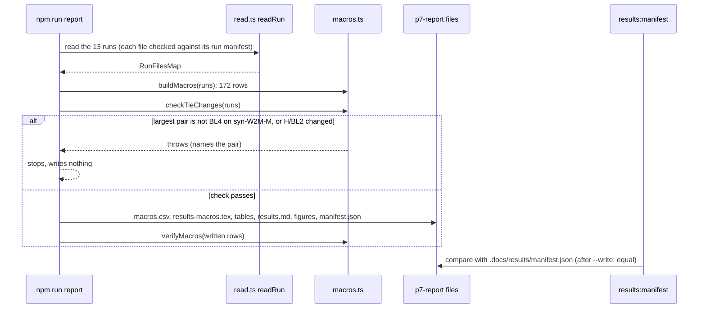

# The two missing macros of Chapter 6

Spec status: approved · 2026-11-23
Design status: approved · 2026-11-23
Type: feature · Folder: `.docs/works/2026-11-23-p9-missing-macros/`

## 1. Spec

### Problem

Chapter 6 (`.docs/Thesis-Report/chapters/experiments-and-results.tex`) still shows two red `\macromissing` marks in the PDF. The thesis rule is that every result number comes from a macro of the report script (`npm run report -w @breadit/eval`, `eval/src/report/macros.ts`), so the text cannot type these two numbers.

1. **E3, line 262.** "The bin 1--4 holds only \macromissing{...} in each synthetic world, so it is not read." The number is the `n` of the rows `density_bin = 1-4`, `method = H`, `ref = BL2` of `p7-e5-worlds/density.csv`. Today it is 1 for each of `syn-W2L-M`, `syn-W2M-M` and `syn-W2H-M` (also shown in the "Users" column of `tables/e3.tex`). `MACRO_SPECS` has E3 macros for the gain of the bins 0 and 20+ only, and none for `n`.
2. **E6, line 345.** "Over all methods and both datasets, NDCG@10 changes by at most \macromissing{...}." This is not one cell. It is the largest |E6 − E1| over 9 methods × 2 datasets, from `p7-e6-ties/summary.csv` against `p7-main/summary.csv` (test split, K 10, bucket `all`, column `ndcg`). `MACRO_SPECS` has E6 macros for H and BL2 only.

Evidence for E6 (computed by hand on 2026-11-23 from the two files, 6 decimals):

| Pair | E1 | E6 | Change |
|---|---|---|---|
| BL4, `syn-W2M-M` (largest) | 0.009075 | 0.007869 | 0.001206 |
| BL4, `digg2009` | 0.196643 | 0.195777 | 0.000866 |
| BL5, `syn-W2M-M` | 0.009389 | 0.009957 | 0.000568 |
| H and BL2, both datasets | | | 0 or 0.000022 |

So the sentence that follows, "Ties do not change any result of this chapter", is true for H and BL2 (and so for H1 to H3), but BL4 on `syn-W2M-M` moves by about 13% of its own value. The new text should say this honestly.

The report's rule (`macros.ts`, header comment): one macro is one cell of a results CSV, and `macros.csv` traces it with `file`, `row_key` and `column`. The E3 number fits that rule. The E6 number does not (see Open question 1).

### Scope

**In scope:**
- New macros in `MACRO_SPECS` for the E3 `n` of bin 1–4 in the three W2 cells, and for the E6 number (form: Open question 1).
- The report tests that count or check the macros (`eval/src/report/macros.test.ts`, today `MACRO_SPECS.length` is 153).
- Run the report again: `macros.csv`, `results-macros.tex` and the `p7-report` manifest change. The merged manifest `.docs/results/manifest.json` is written again so `results:manifest` stays equal.
- Replace the two `\macromissing` marks in Chapter 6 with the new macros, and fix the E6 sentence about ties so it matches the numbers.
- Record the change in `.docs/implementation-plan.md` (a change-log line; it is part of the "every number a macro" point of row 28).

**Out of scope:**
- Any harness run or results file other than `p7-report/` (no number of the experiments changes).
- Appendix B, which reads `compare.csv` directly (a later task).
- The other writer notes on Chapters 3 and 7 (BL4 wording, three limits, the Digg rows at K = 20).
- The `\macromissing` command itself stays defined, in case a later chapter needs it.

### Done when

| # | Check | Expected result |
|---|---|---|
| DW1 | `npm run verify -w @breadit/eval` | passes; the macro count test has the new number |
| DW2 | `grep -c macromissing` on `chapters/*.tex`, outside the comment lines and the `\providecommand` | 0 uses left |
| DW3 | `results-macros.tex` | has the three E3 macros, each `1` today, and the E6 macro(s); every one has a row in `macros.csv` with `file`, `row_key` and `column` |
| DW4 | the 153 old rows of `macros.csv` | the same names and values as before (only new rows added) |
| DW5 | `npm run report -w @breadit/eval` run twice | the same bytes (Class D) |
| DW6 | `npm run results:manifest -w @breadit/eval` | "equal" |
| DW7 | `latexmk -pdf main.tex` in `.docs/Thesis-Report/` | exit 0, no undefined control sequence, no red `[MACRO?` mark in the PDF text |
| DW8 | the E6 paragraph | names the largest change with its method and dataset, and says that H and BL2 do not change (or change only in the fifth decimal) |
| DW9 | `bash .claude/hooks/verify.sh` | all checks pass |

### Open questions

1. **The E6 number is a difference of two cells, not one cell.** I recommend: keep the one-cell rule. Add the E6 NDCG@10 macros for all nine methods (the E1 ones exist already), so the text can say "the largest change is BL4 on `syn-W2M-M`, from \eOne… to \eSix…". A report test then checks that this pair is the largest change, so the sentence cannot go stale. The other option is a new "derived" macro kind (largest |E6 − E1| as one number), traced to two files; that breaks the rule written in `macros.ts` and blueprint 2.8. Which one do you want?
2. Should the E6 sentence "Ties do not change any result of this chapter" become "Ties do not change H or BL2, so H1 to H3 stay as they are; BL4 is the most sensitive"? I recommend yes.

## 2. Impact

**Who it affects.** Only the thesis text and the report outputs. Without it, the PDF the supervisor reads shows two red marks in Chapter 6, and row 28 (`p10-final-checks`, "every number a macro") fails.

**Code areas.** `eval/src/report/macros.ts` (the list `MACRO_SPECS`) and its test file. Maybe `tables.ts` or `report.ts`, not checked yet. No change to the harness, the ranking package, the backend or the frontend. No open bug in the Bugs Report touches `eval/src/report/` (not checked line by line; the report code has no bug ID in §3).

**Results.** No experiment number changes. The report gets new rows; the old 153 macros keep their values (DW4). `.docs/results/p7-report/manifest.json` and the merged `.docs/results/manifest.json` change, so `thesis:repro` compares against the new manifest. No frozen value of super-plan §7 is touched.

**Thesis link.** P9, Chapter 6: E3 (H2) and E6 (ties, a check on H1). The reported conclusions do not change: H2 stays not supported, and E6 still shows that H and BL2 do not depend on the tie-break. The E6 sentence becomes more exact about BL4.

**Docs.** No doc names the macro count (checked with `grep 153` in `docs/Guidance-Manual/`, `docs/System_Architecture.md` and the chapters), so only the comment in `macros.ts` and the test change.

## 3. Design

### Approach

The author approved the Spec without changing the open questions, so this design follows the two recommendations: keep the one-cell rule of `macros.ts`, and rewrite the E6 sentence about ties.

**New macros (19), all one cell each,** added to `build()` in `eval/src/report/macros.ts` with the existing helpers and words:
- **E3, 3 macros.** For `syn-W2L-M`, `syn-W2M-M` and `syn-W2H-M`, run `p7-e5-worlds`, file `density.csv`, key `density_bin = 1-4`, `method = H`, `ref = BL2`, column `n`. Names: `eThreeWTwoLNdcgTenOneFourN`, `eThreeWTwoMNdcgTenOneFourN` and `eThreeWTwoHNdcgTenOneFourN` (the words of the E3 gain macros, with `OneFour` from `GROUP_WORD` and `N` from `WHAT_WORD`). `formatCell` already prints the column `n` as a plain integer.
- **E6, 14 macros.** The `sum("eSix", "p7-e6-ties", d, m)` loop goes from `["H", "BL2"]` to `NINE_METHODS`, for both main datasets, like E1. The 4 macros that exist keep their names and values.
- **E6, 2 `Full` macros.** The pair the text names: BL4 on `syn-W2M-M`, in E1 (`p7-main`) and in E6 (`p7-e6-ties`), with `Full` added to the parts, as done for `eTwoDiggNdcgTenZeroFourGainFull`. Names: `eOneWTwoMNdcgBLFourTenAllValueFull` and `eSixWTwoMNdcgBLFourTenAllValueFull`. Today they are 0.009075 and 0.007869. At 3 decimals (0.009 and 0.008) the change looks like one rounding step, so the text uses the 6-decimal values.

The count goes from 153 to 172 (138 + 19 = 157 of the P7 runs, 15 of E7).

**A check, so the E6 text cannot go stale.** A new pure function in `macros.ts`:

```ts
export interface TieChange { dataset: string; method: string; e1: string; e6: string; changeMicro: number }
export const E6_LARGEST: Readonly<{ dataset: string; method: string }> = { dataset: "syn-W2M-M", method: "BL4" };
/** |E6 - E1| of NDCG@10, test split, bucket all, for the nine methods on both main datasets, largest first (ties by dataset, then method). */
export function tieChanges(runs: RunFilesMap): TieChange[];
/** Throws when the largest change is not `want`, when another pair has the same change, or when H or BL2 differ between E1 and E6 at 3 decimals. */
export function checkTieChanges(runs: RunFilesMap, want = E6_LARGEST): void;
```

The change is counted in whole millionths (`changeMicro`): each 6-decimal cell is turned into an integer before the subtraction, so no float sum decides the order. The sort is total (`changeMicro` desc, then `dataset`, then `method`, with a compare function). `reportCommand` in `report.ts` calls `checkTieChanges(runs)` right after `buildMacros`, before it writes any file, so a report on changed results stops with a message that names the new largest pair.

The second part of the check is the text claim "H and BL2 keep the same values as in E1". It compares `roundDecimal(cell, 3)` of H and BL2 in both runs, on both datasets.

**The test fixture.** `eval/src/report/fixture.ts` draws every cell from a hash of its row, so the E6 and E1 values are unrelated there and the check would fail on the fixture. The fixture changes in one place: for the run `p7-e6-ties`, the rows with `k = 10` and `bucket = all` take the seed of `p7-main` (so they equal E1), except BL4 on `syn-W2M-M`, which is the E1 value minus 0.010000. Then the fixture has the same shape as the real results: one clear largest pair, H and BL2 unchanged.

**Chapter 6 text** (`.docs/Thesis-Report/chapters/experiments-and-results.tex`):
- Line 262 becomes: "The bin 1--4 holds only \eThreeWTwoLNdcgTenOneFourN{}, \eThreeWTwoMNdcgTenOneFourN{} and \eThreeWTwoHNdcgTenOneFourN{} users in the three cells, so it is not read."
- Line 345: the sentence with the mark and the next one become: "Over all methods and both datasets, the largest change is for BL4 on \texttt{syn-W2M-M}: its NDCG@10 goes from \eOneWTwoMNdcgBLFourTenAllValueFull{} to \eSixWTwoMNdcgBLFourTenAllValueFull{}. BL4 is the method most sensitive to ties. $H$ and BL2 do not change, so ties do not change H1 to H3."
- Line 417 ("Ties and a larger pool do not change these results.") stays: "these results" are the hypothesis results above it.
- The `\providecommand{\macromissing}` line and the comment that explains it stay (Spec, out of scope).

**Outputs.** `npm run report` writes `macros.csv`, `results-macros.tex`, `results.md` (its macro list) and `manifest.json` of `p7-report/` again. The tables and the figure files do not change. Then `results:manifest -- --write` writes the merged `.docs/results/manifest.json`. `.docs/implementation-plan.md` gets a change-log line (v1.27).

**Rejected options:**

| Option | Why not |
|---|---|
| A derived macro: the largest \|E6 − E1\| as one number | It breaks the one-cell rule of `macros.ts` and blueprint 2.8: `macros.csv` could not trace it to one `file`, `row_key` and `column`, and `verifyMacros` would need a second kind of row |
| Text only, no new macro ("the bin 1--4 is almost empty", "BL4 moves in the third decimal") | The author asked for the macros, and row 28 checks "every number a macro". "Third decimal" is still a typed result |
| A unit test that reads the committed results in `.docs/results/` instead of the check in `reportCommand` | The tests use the fixture only. A test on real results would not stop `npm run report` or `thesis:repro` when the results change |
| One E3 macro ("1 user in each cell") | It hides that the three counts are separate cells; if one changes, the sentence becomes wrong without any error |

### Workflow and sequence diagrams



### Failure modes

| # | What can go wrong | How we notice | How we resolve it |
|---|---|---|---|
| F1 | A new macro name repeats an old one | `macroName` with `used` throws; the count test fails | Names follow the pattern above; the E6 loop skips nothing that exists (the old 4 come from the same loop) |
| F2 | An old macro changes its value | DW4: compare the old 153 rows of `macros.csv` with the new file | Only `build()` gains lines; `formatCell` does not change |
| F3 | After a rerun of the experiments, another pair becomes the largest change, or H or BL2 change | `checkTieChanges` throws in `reportCommand`, before any file is written | Update `E6_LARGEST` and the Chapter 6 sentence together |
| F4 | Two pairs have the same largest change | `checkTieChanges` throws ("not one largest pair") | The text must then name both; not the case today (0.001206 against 0.000866) |
| F5 | Float error decides the order of two close changes | not visible | The cells are turned into whole millionths before subtracting; the sort has a total order |
| F6 | The fixture change breaks other report tests (tables, macros, figures, double run) | `npm run verify -w @breadit/eval` | Only `p7-e6-ties` rows with K 10 and bucket `all` change; every other test reads its numbers from the fixture, not from typed values. Not verified until the run |
| F7 | `results:manifest` differs after the report | DW6 says "differs" | Run `results:manifest -- --write` once after the report, from a tree that equals its own manifests |
| F8 | A typo in a macro name in the chapter | LaTeX "Undefined control sequence" in the build log | DW7: build, and search the log and the PDF text |
| F9 | The new text overflows a line in the PDF | overfull box warning | Read the build log; reword if needed |

### Code files

| File | New or changed | Purpose |
|---|---|---|
| `eval/src/report/macros.ts` | changed | 19 new specs in `build()`; `TieChange`, `E6_LARGEST`, `tieChanges`, `checkTieChanges`; the count in the comment (172) |
| `eval/src/report/report.ts` | changed | call `checkTieChanges(runs)` after `buildMacros`, before writing |
| `eval/src/report/fixture.ts` | changed | E6 rows at K 10, bucket `all` equal E1, except BL4 on `syn-W2M-M` (minus 0.010000) |
| `eval/src/report/macros.test.ts` | changed | the count 172 (157 + 15); the new names exist with their cells; `tieChanges` order and `changeMicro`; `checkTieChanges` passes on the fixture and throws on a wrong `want`, on a tie and on a changed H |
| `eval/src/report/report.test.ts` | changed only if a test breaks | a report on a fixture where another pair is largest stops before writing |
| `.docs/results/p7-report/macros.csv`, `results-macros.tex`, `results.md`, `manifest.json` | rewritten by the report | the 19 new macros |
| `.docs/results/manifest.json` | rewritten by `results:manifest -- --write` | the new SHA-256 of the p7-report files |
| `.docs/Thesis-Report/chapters/experiments-and-results.tex` | changed | lines 262 and 345 as above |
| `.docs/implementation-plan.md` | changed | change-log line 1.27 |

### Data, schema and cache changes

None. No database, Redis, harness run or experiment result changes. Only the report files of `p7-report/` and the merged manifest are written again.
