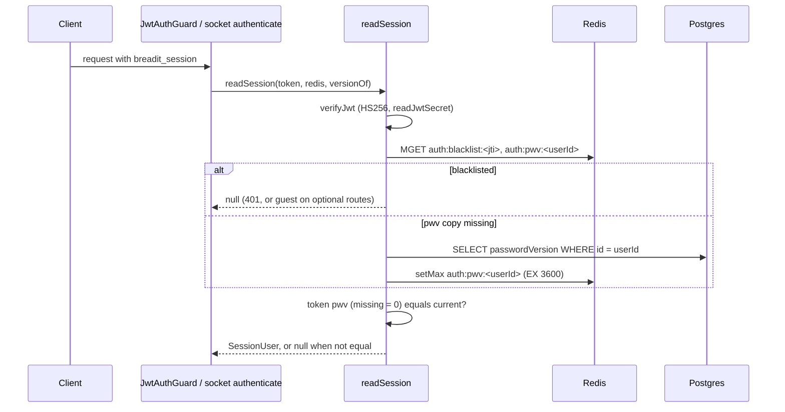
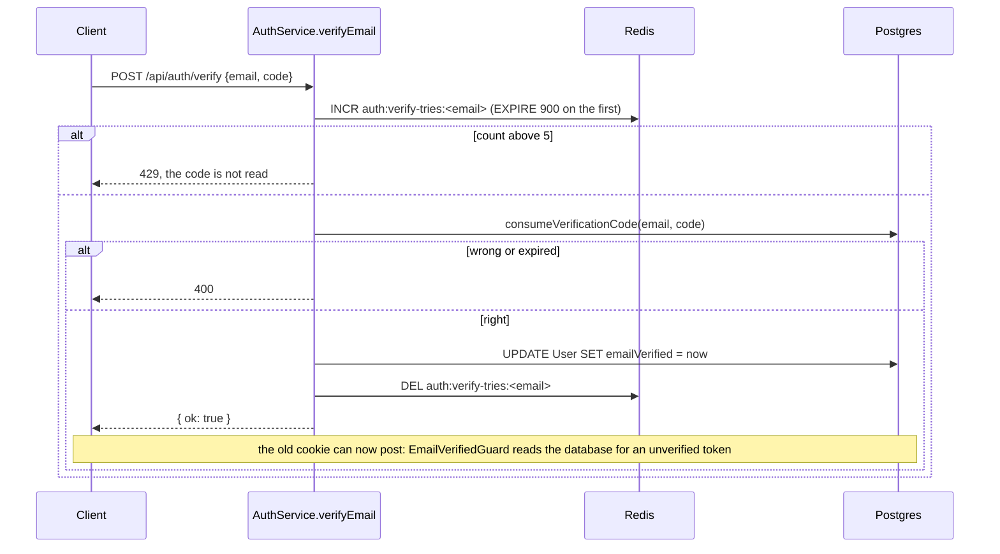

# Security fixes before sharing the app

Spec status: approved · 2026-11-25
Design status: approved · 2026-11-25
Type: feature · Folder: `.docs/works/2026-11-25-p10-security-fixes/`

## 1. Spec

### Problem

Six open items of the Bugs Report make the app unsafe as soon as someone other than the author uses it: B1, S4, S6, B5 and R3 (§3.2, P2) and R6 (§3.3, P3). This is row 29 of `.docs/implementation-plan.md` §5 (`p10-security-fixes`, 1 day, depends on nothing). The row was marked "only for a shared server". The author decided on 2026-11-25 to do it now, so the thesis can say these items are fixed instead of "open" (Chapter 8 §`sec:test-bugs`, Chapter 9).

All six are still in the code today (read on 2026-11-25, not re-run):

- **B1. Moderation takes any action.** `CommunitiesService.moderatePost` approves when `action === 'APPROVE'` and soft-deletes the post in every other case. The controller reads `@Body('action')` with no DTO, so `"APROVE"` or `{}` deletes the post. `promoteMember` reads `@Body('role') role: any`: a role outside `CommunityRole` reaches Prisma, and the run of 2026-10-21 got a 500 for `role: "ADMIN"`.
- **R6. An admin can ban any account.** `AdminService.setBanStatus(id, banned)` checks only that the user exists. An admin can ban their own account or another admin. The run of 2026-10-21 banned its own admin account (200). Chapter 4 says so as a "known gap" (line 224).
- **S4. Any file type is served from the API origin.** `UploadsService.saveToLocalDisk` re-encodes images, but any other file keeps the extension of the client's file name (`path.extname(file.filename)`). `@fastify/static` in `app.setup.ts` serves `/uploads/` with no `X-Content-Type-Options` header. The run of 2026-10-21 uploaded `evil.html` as `video/mp4` and got it back as `text/html` (200). With Cloudinary set, this does not happen.
- **S6. Weak secrets and old sessions.** Four parts:
  1. `getJwtSecret()` in `auth.service.ts` falls back to `'dev-secret-change-in-prod'` when `JWT_SECRET` is missing. `docker-compose.yml` sets `NODE_ENV: production` and `JWT_SECRET: ${JWT_SECRET}`, so an empty `.env` value gives an empty secret (what `jose` does with it: not checked).
  2. `generate6DigitCode()` uses `Math.random`.
  3. The 6-digit email code is limited only by the throttler, per route and IP (`@Throttle` 10 per minute on `POST /api/auth/verify`). Many IPs can try many codes for one email within its 15 minutes.
  4. `resetPassword` changes the hash but does not end older sessions. The run of 2026-10-21 used an old cookie after a reset: `/me` 200. The `User` model has no field that a token could be compared with.
- **B5. Verified users are still blocked.** The banner in `apps/frontend/src/app/(board)/layout.tsx` links to `/verify` with no `email` parameter, and `verify/page.tsx` then shows "No email provided". `EmailVerifiedGuard` reads `emailVerified` from the token (`readSession` in `session.ts`), and the token is not changed by `verifyEmail`. So after verifying, `/api/auth/me` (database) says verified while `POST /api/posts` still gives 403, until the user signs in again.
- **R3. Dependencies.** `npm audit` on 2026-11-25: 54 issues (6 low, 19 moderate, 26 high, 3 critical). The Bugs Report counted 66 on 2026-10-21. Many fixes need a major version: `@nestjs/*` 10 → 12, `fastify` 4 → 5, `@fastify/static`, `nodemailer` 8 → 10, `sharp`, `zod`. Others do not: `next` 15.1.0 → 15.5.x (same major, but `next` is pinned exactly), and the transitive ones `audit fix` can change (`proxy-addr`, `ws`, `engine.io`, `socket.io-parser`, `js-yaml` and more). `nestjs-throttler-storage-redis` is deprecated. `resend` and `uuid` are flagged; the backend `src/` imports neither (R4 already lists `resend` as unused).

### Scope

**In scope:**
- B1: `moderatePost` accepts only `APPROVE` or `REMOVE`, and `promoteMember` only a `CommunityRole` value. Anything else is a 400 and changes nothing.
- R6: a ban of the admin's own account or of another admin is refused with a 400 and changes nothing. Unban stays as it is.
- S4: on local disk, only known image and video types are kept; the stored extension comes from the checked type, not from the client's file name; `/uploads/` answers with `X-Content-Type-Options: nosniff`.
- S6: (1) in production the backend refuses to start when `JWT_SECRET` is missing or too short; (2) the email code uses a crypto random source; (3) wrong code tries are also counted per email; (4) a password reset ends every session made before it (Open question 2).
- B5: the banner link carries the email; a user who just verified can post with the same cookie.
- R3: the safe part (Open question 1), then `npm audit` again; what is left is listed with its reason.
- Text: the Bugs Report, implementation-plan row 29, and the thesis lines that call these six items open (Chapter 4 NFR and line 224, Chapter 8 line 126, Chapter 9 line 71, and their drafts).

**Out of scope:**
- T6, N3, N10, R4 (schema migration), R5, N7, N9, B8: they stay future work.
- Major upgrades of NestJS, Fastify, `nodemailer`, `sharp`, `zod` (Open question 1).
- Ending a session at ban time (`BannedUserGuard` already blocks writes; R6 is only about who can be banned).
- Any change to the ranking, the feed, `packages/ranking`, `eval/` or a frozen value.

### Done when

| # | Check | Expected result |
|---|---|---|
| DW1 | IT test: `POST /api/communities/:id/posts/:postId/moderate` by a mod with `{"action":"APROVE"}`, then with `{}` | 400 both times; the post still has `deletedAt = null` |
| DW2 | IT test: `POST /api/communities/:id/promote/:target` by the owner with `{"role":"ADMIN"}` | 400 (not 500); the member's role is unchanged |
| DW3 | IT test: admin bans their own id, then another admin's id | 400 both times; `banned` stays false; no `accountBanned` event |
| DW4 | IT test: a ban of a normal user by an admin (regression) | 200; `banned = true` |
| DW5 | IT test, local disk: upload a file named `evil.html` with type `video/mp4`, and one with type `text/html` | the first is stored with a video extension (not `.html`); the second gives 400 |
| DW6 | IT test: `GET /uploads/<file>` of an uploaded file | the answer has `X-Content-Type-Options: nosniff` |
| DW7 | Unit test of the start check: `NODE_ENV=production` with `JWT_SECRET` unset, empty, or shorter than the minimum | the backend refuses to start with a clear message; outside production it still starts |
| DW8 | Unit test: the code helper | 6 digits, from `crypto`; the source has no `Math.random` in `auth.service.ts` |
| DW9 | IT test: wrong codes for one email from different `X-Forwarded-For` values (or with the IP limit off) | after the per-email limit, even the right code is refused until the window ends |
| DW10 | IT test: sign in (cookie A), reset the password, call `/api/auth/me` and a write route with cookie A | 401 both; a new sign-in works |
| DW11 | IT test: unverified user signs in (cookie A), verifies, then `POST /api/posts` with cookie A | 201 (it was 403) |
| DW12 | Read the banner in `(board)/layout.tsx` | the link is `/verify?email=<the user's email>`; the page shows the code form, not "No email provided" (checked in Chrome) |
| DW13 | `npm audit` after the R3 step | the count is lower than 54 and no critical issue is left in the backend; every issue left is listed in the Result with its reason (needs a major version, or no fix) |
| DW14 | `verify.sh`, `npm run test:parity -w @breadit/backend`, `npm run typecheck`, `npm run build -w @breadit/backend` | all pass; parity 102/102 as before |
| DW15 | `npm run demo:start`, the checklist steps, `npm run demo:stop` | every step still passes |
| DW16 | `npm run thesis:check` | exit 0, as before; the thesis no longer calls B1, S4, S6, B5, R3 or R6 open |

### Open questions

1. **R3 scope.** I suggest the safe part only: `npm audit fix` without `--force`, and `next` 15.1.0 → the latest 15.5.x. The major upgrades (NestJS 12, Fastify 5 and the rest) are a large change late in the thesis, can break the parity test and the demo, and go to future work. Other option: also take the backend majors (several days, not 1). OK with the safe part?
2. **S6 part 4, ending old sessions after a reset.** I suggest a new nullable column `User.passwordChangedAt` (a real migration). `readSession` refuses a token issued before it. Other option: a Redis key per user with a 30-day life, no migration, but the rule is lost if Redis is emptied. The column also lands in `eval_load` and `eval_demo` the next time they are loaded; the loader does not write it (to check in the Design). OK with the column?
3. **Order of commits.** As you asked, B1 and R6 first (small, about 1 hour), then S4, S6, B5, and R3 last because it touches the lock file. Each group is its own commit, so one can be dropped. OK?

## 2. Impact

**Users.** Today a mod's typo deletes a post (B1), an admin can lock themselves out (R6), a verified user stays blocked until they sign in again (B5), and a stolen cookie stays valid after a password reset (S6). On one local machine these are harmless, which is why the row waited. After this task the app can be shown on a shared server with no known P2 item left.

**Code areas.**
- Backend: `communities/` (controller, a new DTO), `admin/admin.service.ts`, `uploads/uploads.service.ts`, `app.setup.ts`, `main.ts` (start check), `auth/` (`auth.service.ts`, `session.ts`, `email-verified.guard.ts`, maybe `auth.controller.ts`), `prisma/schema.prisma` and one new migration (only if Open question 2 is the column).
- Frontend: `(board)/layout.tsx` (the banner link), and `package.json` for `next`.
- Root `package-lock.json` (R3).
- Tests: new IT tests in `apps/backend/test/it/` (a new file, like `quick-wins.it-spec.ts`) and unit tests next to the changed files.

**Other tasks and bugs on the same code.** `p9-bug-quick-wins` changed `session.ts` (S5, `readSession` checks the blacklist): S6 part 4 adds one more check in the same function, and the S5 tests must still pass. `p10-demo-fixes` changed `moderatePost` (V3, V4): the APPROVE path must keep its `updatedAt` and `v:user` bumps. The demo script removes `NODE_ENV` and `JWT_SECRET` from the backend's environment (`scripts/demo/demo.mjs`), and E7 and the IT tests set their own `JWT_SECRET`, so the production start check does not touch them. Docker (`NODE_ENV: production`) will refuse to start with an empty `JWT_SECRET`; that is the point, and the README already says to fill it.

**Thesis link.** P10, implementation-plan §5 row 29. No result, macro or frozen value (super-plan §7) changes: the feed, the ranking and `eval/` are not touched. The parity test is the check (DW14). If Open question 1 grows to the major upgrades, `thesis:repro` and E7 would need a new thought; with the safe part they do not. The thesis text changes in Chapter 4 (NFR2 or NFR3, line 224), Chapter 8 (line 126: 14 open items become 8) and Chapter 9 (line 71), with their drafts; `thesis:check` runs after (DW16). Docs for the supervisor: `docs/Guidance-Manual/*/12-platform-and-real-time.md` gets one line on the reset ending old sessions, in both languages, if the Design changes the session rule.

**If we do nothing.** The thesis keeps saying six security items are open, and a committee member can ask why known items were left. The app must not leave the author's machine.

## 3. Design

### Answers to the open questions

The author approved the Spec without answering the three questions, so this Design takes the suggested option of each. Say so at the Design review if one is wrong.

1. R3: the safe part only. `npm audit fix` without `--force`, and `next` with `eslint-config-next` from 15.1.0 to 15.5.29 (the latest 15.x on 2026-11-25). No major version.
2. S6 part 4: a database column, as suggested, but a **counter**, not a time: `User.passwordVersion Int @default(0)`. Reason: the token's `iat` has whole seconds. A reset and a new sign-in in the same second cannot be ordered, and an IT test does exactly that. A counter has no clock. It ends the same sessions the time would.
3. Order: five commits, B1 + R6, S4, S6, B5, R3. Each can be dropped alone.

### Approach

**B1 (communities).** Two DTOs in a new `communities/dto/moderation.dto.ts`: `ModeratePostDto { @IsIn(['APPROVE', 'REMOVE']) action }` and `PromoteMemberDto { @IsEnum(CommunityRole) role }`. The controller takes `@Body() dto` in place of `@Body('action')` and `@Body('role') role: any`. The global `ValidationPipe` then answers 400 for `"APROVE"`, `{}` or `"ADMIN"`, before the service runs. In `moderatePost` the `else` becomes `else if (action === 'REMOVE')`, with a `BadRequestException` after it, so a direct call can never delete by mistake. The APPROVE path (V3 `updatedAt`, V4 `v:user` bumps) is not touched. `promoteMember` keeps its 403 for `OWNER`.

**R6 (admin).** `AdminService.setBanStatus(actorId, id, banned)`. The controller passes `req.user!.id` (the `AuthedRequest` type the other controllers use). When `banned` is true: `id === actorId` → 400 "You cannot ban your own account"; the target's `role === 'ADMIN'` → 400 "You cannot ban an admin". Both checks run before the update and before the `accountBanned` push. Unban is unchanged.

**S4 (uploads).** A new pure file `uploads/media-types.ts`:
- `VIDEO_EXT: Record<string, string>` = `video/mp4` → `.mp4`, `video/webm` → `.webm`, `video/quicktime` → `.mov`, `video/ogg` → `.ogv`;
- `mediaKind(mimetype: string): 'image' | 'video' | null` (`image/*` is an image; a type in `VIDEO_EXT` is a video; anything else is `null`).

`UploadsService.saveFile` throws a 400 "Unsupported file type" when `mediaKind` is `null`. It is the one entry of every upload (posts, comments, communities, `/api/uploads`), so one check covers all of them, on disk and on Cloudinary. `saveToLocalDisk` takes the video extension from `VIDEO_EXT[file.mimetype]`, never from `file.filename`. Images are already re-encoded to `.jpg` by `sharp`; a file that claims an image type but `sharp` cannot read becomes a 400, not a 500. `isVideo` uses `mediaKind`. In `app.setup.ts`, `@fastify/static` (7.0.4, which has the option) gets `setHeaders: (res) => res.setHeader('X-Content-Type-Options', 'nosniff')`.

**S6 (auth).** Four parts.
1. A new pure file `auth/auth.config.ts` with `JWT_SECRET_MIN_LENGTH = 32` and `readJwtSecret(env: NodeJS.ProcessEnv): string`. With `NODE_ENV=production`, a missing, empty or shorter secret throws `JWT_SECRET must be set (at least 32 characters) when NODE_ENV=production`. Outside production an empty or missing secret gives the old dev value (today an empty string beats `??`). `getJwtSecret()` calls it. `main.ts` calls it once at the top of `bootstrap()`, so a bad setup stops at start and not at the first login. This is the pattern of `readFeedConfig` (F12 of `p6-social-feed`). The IT secret has 40 characters and the E7 secret 42, so both pass.
2. `generate6DigitCode()` returns `String(randomInt(100000, 1000000))`, with `randomInt` from Node `crypto`.
3. `verifyEmail` counts tries per email in Redis, before it reads the code: `INCR auth:verify-tries:<email>`, and on the first try `EXPIRE 900` (the life of a code). Above `VERIFY_MAX_TRIES = 5` it answers 429 "Too many tries. Wait 15 minutes, then ask for a new code." and does not read the code. A right code deletes the key. `INCR` is atomic, so two fast requests cannot both get the fifth try. The 10 per minute per IP throttle stays.
4. Sessions end on a reset. The token gets a claim `pwv` (the user's `passwordVersion`) at login. `resetPassword` writes the new hash and `passwordVersion: { increment: 1 }` in one update, then writes the new value to Redis. `readSession` refuses a token whose `pwv` (missing = 0) is not the user's current version.

To keep the guards free of a database read on every request (the feed page that E7 measured), `readSession` reads the version from a Redis copy, `auth:pwv:<userId>`, in the same `MGET` as the blacklist key, so the number of round trips stays the same. On a miss it reads the column once and writes the copy with a 1-hour life. Both writes of the copy go through one small Lua script, `setMax`. It writes only a value larger than the stored one and always renews the life, so a slow read of an old value can never overwrite a newer one (F2).

`readSession(token, redis, versionOf)` gets a third argument `versionOf: (userId: string) => Promise<number | null>`. `passwordVersionOf(prisma)` in `session.ts` makes it. `JwtAuthGuard` and `OptionalJwtAuthGuard` inject `PrismaService` (the module is `@Global`). The socket `authenticate` in `notifications.gateway.ts` calls `readSession` too, in place of its own token and blacklist check. It already has `prisma` and `redis`. One rule then covers HTTP and sockets.

**B5 (email verified).** `EmailVerifiedGuard` injects `PrismaService`. A token that says verified passes with no read, as today, since nothing in the verify flow undoes a verification. A token that says unverified is checked against `user.emailVerified` in the database: verified there → pass, and `req.user.emailVerified` is filled for the route; still null → 403 as today. Only unverified users pay the read, and only on write routes. In `(board)/layout.tsx` the banner link becomes `/verify?email=${encodeURIComponent(session.user.email)}` (`session.user.email` exists in `lib/session.ts`, and `/api/auth/me` selects it).

**R3 (dependencies).** At the root: `npm audit fix --legacy-peer-deps`, never `--force`. In `apps/frontend/package.json`: `next` and `eslint-config-next` 15.1.0 → 15.5.29, still exact pins. Then a clean install and `prisma generate` (CLAUDE.md: `npm ci` deletes the client), and `npm audit` again. Every issue left goes into the Result with its reason: it needs a major version (NestJS 12, Fastify 5, `@fastify/static` 10, `nodemailer` 10, `sharp` 0.35, `zod` 4), it has no fix, or it is in an unused package (`resend`, `uuid`: R4). `nestjs-throttler-storage-redis` stays; its replacement is a new package, so it goes in the same list.

**Rejected options:**

| Option | Why not |
|---|---|
| S6.4: read `passwordVersion` from the database in every `readSession` | One more query on every request, also on the feed page E7 measured. The Redis copy costs no round trip (same `MGET`). |
| S6.4: a time `passwordChangedAt` compared with `iat` | `iat` has whole seconds: a sign-in in the same second as the reset cannot be ordered (see the answer to question 2). |
| S6.4: Redis only, no column | The author's question 2 suggested the column. Emptying Redis would bring old sessions back. |
| B5: send a new cookie from `POST /api/auth/verify` | The verify route has no session (the user may verify on another device), so it cannot know whose cookie to replace. The guard reading the database works on every device. |
| S4: check the file's first bytes (magic numbers) | A new library or hand-written tables. With the extension taken from the type and `nosniff`, a fake video cannot run as HTML anyway. |
| R3: `npm audit fix --force` | It installs major versions (NestJS 12, Fastify 5, Next 16), the large change question 1 excludes. |

### Workflow and sequence diagrams

A request with a session (HTTP guard or socket handshake):



A password reset:

```mermaid
sequenceDiagram
    participant C as Client
    participant A as AuthService.resetPassword
    participant P as Postgres
    participant R as Redis
    C->>A: POST /api/auth/reset-password {token, password}
    A->>P: consume the reset token (one use)
    A->>P: UPDATE User SET password, passwordVersion = passwordVersion + 1 RETURNING id, passwordVersion
    A->>R: setMax auth:pwv:<id> = new version (EX 3600)
    A-->>C: { ok: true }
    Note over C,R: every older cookie now fails readSession; a new sign-in gets the new pwv
```

Email verification with the per-email count:



### Failure modes

| # | What can go wrong | How we notice | How we resolve it |
|---|---|---|---|
| F1 | The Redis write after a reset fails, so the copy keeps the old version and old cookies still work | A test with a Redis stub that throws on `setMax`; the error log | `resetPassword` catches the error and then deletes the key, so the next read loads the column. If both fail, Redis is down, and then `readSession` throws and every session is refused anyway (401, today's rule). The copy lives at most 1 hour. |
| F2 | Two fast steps write the copy out of order: a request reads the old version from the database, the reset writes v+1, then the request writes the old value | Unit test of `setMax`: write 2 then 1 → 2 stays | `setMax` writes only a larger value. Versions only grow, so the larger one is always right. |
| F3 | All sessions of today have no `pwv` claim | The S5 tests and every IT test (the factory `cookieFor` has no `pwv`) | A missing claim is 0, and the column starts at 0 for every row. Nobody is logged out by the deploy. A user is logged out only after their own reset. |
| F4 | The user row is gone, so `versionOf` gives `null` | Unit test | `readSession` returns `null` (401, or guest). A token for a user who does not exist is not a session. |
| F5 | Postgres fails during the version read | Unit test with a throwing `versionOf` | The error goes up like a Redis error today: `JwtAuthGuard` 401, `OptionalJwtAuthGuard` guest. |
| F6 | Someone sends 5 wrong codes for another person's email, and the real user must wait | The 429 text | Accepted: at most 15 minutes, then a new code. This is the price of a limit per email, written in the Bugs Report row. |
| F7 | Two fast verify requests for the 5th try | Unit test of the count | `INCR` is atomic: one gets 5, the other 6 → 429. |
| F8 | A file says `image/png` but is text | IT test | `sharp` throws, `saveFile` answers 400, and nothing is written. |
| F9 | Files already on disk with a bad extension (from before the fix) are still served, and `nosniff` does not stop `text/html` | Acceptance lists the files of the local upload folder whose extension is not `.jpg` or in `VIDEO_EXT` | They are listed in the Result for the author to delete. Nothing is deleted by code. The Docker volume is not checked. |
| F10 | Docker starts with an empty `JWT_SECRET` | The backend exits at start with the message of `readJwtSecret` | Wanted. The README already says to fill `JWT_SECRET`. The demo, E7 and the IT tests do not run in production, or set their own secret. |
| F11 | The migration adds a column that `eval_load` lacks: the parity global setup never migrates, and Prisma reads every `User` column | `test:parity` fails at its first `User` read | After the migration, load `syn-W2M-M` into `eval_load` again (the loader runs `migrate deploy`), run `load:check` (6 hashes equal), then `test:parity`. `eval_demo` is loaded fresh at every `demo:start`. The loader does not write `passwordVersion`, and the default 0 is used. Whether `load:check` reads that column: not verified, checked in the acceptance. |
| F12 | Next 15.5 breaks the frontend build, lint or a page | `npm run build`, `lint`, `typecheck`; the demo checklist in Chrome | The R3 commit is separate. If it breaks, keep 15.1.0, write why in the Result, and keep the `audit fix` part. |
| F13 | `audit fix` moves a package that `eval/` or `@breadit/ranking` uses at run time | `git diff` of `package-lock.json`; `verify.sh` (eval verify), `test:parity` | Neither package has a dependency other than `@prisma/client` (eval). A changed `@prisma/client` version is written in the Result, and the author decides at the freeze (row 31) whether `thesis:repro` runs. |
| F14 | B1: the DTO breaks the frontend calls | Read of `CommunityAboutAdmin.tsx` and `PendingPostsBanner.tsx` (they send `{ action }` with `APPROVE` or `REMOVE`); the demo checklist | Same body, so no frontend change. |
| F15 | R6: two admins try to ban each other | IT test DW3 | Both get 400. |
| F16 | An open socket stays connected after a reset | Not tested | Accepted, the same as logout today: the check runs at the handshake. The next connect is refused. |

The feed cache, `v:user`, blocking, soft delete and pending posts are not touched: no cached read changes. The B1 REMOVE path keeps its current behaviour.

### Code files

| File | New or changed | Purpose |
|---|---|---|
| `apps/backend/src/communities/dto/moderation.dto.ts` | new | `ModeratePostDto`, `PromoteMemberDto` (B1) |
| `apps/backend/src/communities/communities.controller.ts` | changed | `moderatePost` and `promoteMember` take the DTOs |
| `apps/backend/src/communities/communities.service.ts` | changed | explicit `REMOVE` branch, else 400 |
| `apps/backend/src/admin/admin.controller.ts` | changed | pass `req.user!.id` to `setBanStatus` |
| `apps/backend/src/admin/admin.service.ts` | changed | `setBanStatus(actorId, id, banned)`: refuse self and admins (R6) |
| `apps/backend/src/uploads/media-types.ts` | new | `VIDEO_EXT`, `mediaKind` (S4) |
| `apps/backend/src/uploads/uploads.service.ts` | changed | type check in `saveFile`, extension from the type, `sharp` error → 400, `isVideo` via `mediaKind` |
| `apps/backend/src/app.setup.ts` | changed | `setHeaders` with `nosniff` on `/uploads/` |
| `apps/backend/src/auth/auth.config.ts` | new | `JWT_SECRET_MIN_LENGTH`, `readJwtSecret(env)` (S6.1) |
| `apps/backend/src/main.ts` | changed | call `readJwtSecret(process.env)` first in `bootstrap()` |
| `apps/backend/src/auth/auth.service.ts` | changed | `getJwtSecret` via `readJwtSecret`; `randomInt` code; per-email tries in `verifyEmail`; `pwv` claim at login; `passwordVersion` increment and `setMax` in `resetPassword`; exported key prefixes `PWV_PREFIX = 'auth:pwv'`, `VERIFY_TRIES_PREFIX = 'auth:verify-tries'` |
| `apps/backend/src/auth/session.ts` | changed | `readSession(token, redis, versionOf)`, `MGET`, `passwordVersionOf(prisma)`, `setMax(redis, key, value, ttlSeconds)` (Lua) |
| `apps/backend/src/auth/jwt.guard.ts`, `optional-jwt.guard.ts` | changed | inject `PrismaService`, pass `passwordVersionOf` |
| `apps/backend/src/notifications/notifications.gateway.ts` | changed | `authenticate` calls `readSession` |
| `apps/backend/src/auth/email-verified.guard.ts` | changed | inject `PrismaService`; database check for an unverified token (B5) |
| `apps/backend/prisma/schema.prisma` | changed | `User.passwordVersion Int @default(0)` |
| `apps/backend/prisma/migrations/2026112…_user_password_version/` | new | made by `prisma migrate dev` |
| `apps/frontend/src/app/(board)/layout.tsx` | changed | banner link with `?email=` (B5) |
| `apps/frontend/package.json`, `package-lock.json` | changed | `next`, `eslint-config-next` 15.5.29; `audit fix` (R3) |
| `apps/backend/src/auth/auth.config.spec.ts`, `media-types.spec.ts`, `session.spec.ts` (extend), `auth.service.spec.ts` (new or extend), `communities.service.spec.ts` (extend) | new / changed | unit tests (DW7, DW8, F1–F5, F7) |
| `apps/backend/test/it/security-fixes.it-spec.ts` | new | IT tests DW1–DW6, DW9–DW11, F8 |
| `.docs/Bugs Report.md` | changed | the six items to Resolved (a new §5.6), counts in §1 and §6, F6 noted |
| `.docs/implementation-plan.md` | changed | row 29 ✅, change log |
| `.docs/Thesis-Report/chapters/system-analysis-and-design.tex`, `test-cases-and-demonstration.tex`, `conclusion.tex`, `drafts/04-…`, `drafts/08-…`, `drafts/09-…` | changed | NFR1 and NFR3 (reset ends sessions, per-email limit), the line-224 gap removed, 14 open items → 8, Chapter 9 line 71 |
| `docs/Guidance-Manual/en/12-platform-and-real-time.md`, `vi/12-…` | changed | `readSession` also checks `pwv`; the reset ends sessions (lines 54, 56, 60, 62, 73 of `en`) |
| `docs/System_Architecture.md` | changed | the Redis row (line 238) names the `pwv` copy and the verify tries |
| `CLAUDE.md` | changed | Auth: `JWT_SECRET` required in production; a reset ends old sessions (`passwordVersion`, `pwv`) |

### Data, schema and cache changes

**Schema.** One migration, made by `prisma migrate dev` (never edited after commit):

```sql
ALTER TABLE "User" ADD COLUMN "passwordVersion" INTEGER NOT NULL DEFAULT 0;
```

Existing rows get 0. No data migration. `public` gets it through `migrate dev`, `it_test` through the IT global setup, `eval_demo` at every `demo:start`, and `eval_load` by a new load of `syn-W2M-M` (F11).

**Redis keys** (database 0 live; 1 in IT; 3 in the demo):
- `auth:pwv:<userId>`: copy of `passwordVersion`, 1-hour life, written only through `setMax`.
- `auth:verify-tries:<email>`: tries of the email code, 15-minute life from the first try, deleted on success.

**Cache versions.** None. No cached read changes, so no `v:user` bump is added or removed.
