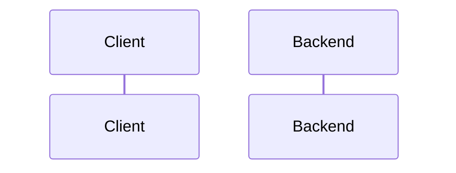

# The supervisor's Orientation metrics in the thesis

Spec status: draft · 2026-11-25
Design status: pending
Type: feature · Folder: `.docs/works/2026-11-25-p9-orientation-metrics/`

## 1. Spec

### Problem

The supervisor's Orientation (`.docs/Thesis_Orientation.md`, step 5) asks for these metrics: Recall@K and NDCG@K at K = 5, 10 and 20, Coverage, and a comparison of Recall@10 between users with 5 or fewer interactions and users with more than 20. The run `p7-main` computes all of them. The thesis shows only part of them:

| Orientation metric | Computed in | In the thesis today |
|---|---|---|
| NDCG@K, K = 5, 10, 20 | `.docs/results/p7-main/summary.csv`, `compare.csv` | yes: NDCG@10 in Chapter 6, all three K in Appendix B |
| Recall@K, K = 5, 10, 20 | `summary.csv` (every method, K and bucket) | Recall@10 only, all users (Table E1) |
| Coverage@K | `coverage.csv` (K = 5, 10, 20) | Coverage@10 only (Table E1) |
| Recall@10, ≤5 against >20 interactions | nowhere in the results | no |

The group comparison exists only as an exploratory script in a discussion note: `.docs/works/2026-11-25-p9-negative-result-note/recall-by-group.py`, with its output `recall-by-group.txt` (written 2026-11-25). Its numbers are not results of the project: `thesis:repro` does not rebuild them, `results:manifest` does not list them, and they are not macros. The thesis rule is that every number comes from a command that gives the same result every time (super-plan, opening rule) and that the text uses macros (implementation-plan §2.8).

Two facts limit how this can be done:
- The report never reads `per_user.csv` (`eval/src/report/read.ts`, lines 5–7: it can be over the size limit and outside git). The group comparison needs per-user ranks, so it cannot come from the CSVs the report reads today. For `p7-main`, `per_user.csv` is 23.8 MB in `eval/results/p7-main/` (git-ignored); its SHA-256 is in `.docs/results/p7-main/manifest.json` (checked on 2026-11-25).
- The frozen history buckets are 0, 1–4, 5–19 and ≥20 (super-plan §7). The Orientation bounds (≤5, >20) are not frozen buckets. H1 was decided on group 0–4. So the new comparison is exploratory: it was chosen after the test run, and it cannot change H1.

The exploratory script found that the bound matters on `syn-W2M-M`: with "≤5" (194 users) the 95% interval of the NDCG@10 gain is 0.0110 to 0.0683, above 0, while group 0–4 (174 users) gives −0.0029 to 0.0511 (`recall-by-group.txt`). The thesis must show this as it is: exploratory, no p-value, not a result about H1.

### Scope

**In scope:**
- A reproducible step that computes the Orientation group comparison for `p7-main`, both datasets: groups "≤5" and ">20" earlier interactions; methods H and BL2; for each group, the user count, the mean Recall@10 and NDCG@10 of H and of BL2, the mean paired difference H − BL2, and its 95% paired bootstrap interval with the frozen resamples, level and master seed (super-plan §7). No p-value and no Holm correction. It reads `per_user.csv` only after checking its SHA-256 against the run manifest. It writes a Class D results file with a manifest under `.docs/results/`.
- The step is part of `npm run thesis:repro` and of `npm run results:manifest`.
- `npm run report` writes a table and macros for the group comparison, and a table of Recall@K and Coverage@K at K = 5, 10 and 20 for every method on both datasets (from `p7-main/summary.csv` and `coverage.csv`, all users).
- The thesis: the group table in Chapter 6 with a short text that says it is exploratory, why the bounds differ from the frozen buckets, and that it does not change H1; the Recall@K and Coverage@K table in Appendix B; the Markdown drafts of the same chapters.
- The docs: the contract lines of implementation-plan §2.7 and §2.8 and its change log; a super-plan change-log line (an exploratory analysis was added; no frozen value changed); `CLAUDE.md` Commands if a new command is added; `docs/System_Architecture.md` and the Guidance Manual evaluation topic (en and vi) if they list the result files or the repro steps.

**Out of scope:**
- Running the test split again for a new purpose, or any change to the config of `p7-main` or of another P7 run.
- Any change to a frozen value: the history buckets, K, the metrics, the bootstrap settings.
- A p-value or a Holm correction for the new groups; any change to the H1 decision, Table E2 or family F1 and F2.
- Committing `per_user.csv`.
- The discussion note `.docs/h1-negative-result-and-hybrid-v2.md` and its script stay as they are (a record of 2026-11-25).

### Done when

| # | Check | Expected result |
|---|---|---|
| DW1 | Run the new step twice on the current `p7-main` results | identical bytes; for each dataset and group, the user counts and the four means equal `recall-by-group.txt` at 4 decimals (194, 184, 23,161 and 22,393 users) |
| DW2 | Change one byte of a copy of `per_user.csv` (or point the step at a file whose hash is not in the manifest) | the step stops with a message that names the file and writes nothing |
| DW3 | Unit tests of the new grouping and the new step (`npm run verify -w @breadit/eval`) | pass; a user with 5 interactions is in "≤5", 20 is in neither group, 21 is in ">20"; the bootstrap is the existing `pairedBootstrap` of `eval/src/stats.ts` |
| DW4 | `npm run report` twice | identical bytes; the new tables and macros exist; every macro that existed before keeps its name and value (compare the old and new `macros.csv`) |
| DW5 | `npm run results:manifest -w @breadit/eval` after the new files are written with `-- --write` | the merged manifest lists the new files and the compare says equal |
| DW6 | The step list of `thesis:repro` | contains the new step after the `harness-p7-main` step and before `report` |
| DW7 | `npm run thesis:check` | exit 0, 0 FAIL; no typed number in the new text; the pages stay under the limits |
| DW8 | Read the new text in the PDF | the group table is labelled exploratory; the text says the bounds come from the Orientation, are not the frozen buckets, have no p-value and do not change H1 |
| DW9 | `bash .claude/hooks/verify.sh` | all checks pass |

### Open questions

1. **Where in the thesis.** I suggest the group table in Chapter 6, as a short subsection right after E2 ("E2 with the Orientation's groups, exploratory"), because it answers a question of the supervisor, and the Recall@K and Coverage@K table in Appendix B, as B.3. Other option: both in Appendix B, with one sentence in Chapter 6.
2. **Which metrics in the group table.** I suggest Recall@10, as the Orientation asks, and NDCG@10, because it links the table to H1. Other option: Recall@10 only.
3. **Which groups.** I suggest only the two Orientation groups ("≤5" and ">20"). Group 0–4 and ≥20 are already in Table E2, and the text points to it. Other option: all four in one table, side by side.
4. **A contract change.** The new results file is a new kind of input for the report (implementation-plan §2.7 and §2.8 say the report reads only the listed CSVs). I suggest a new run folder with its own manifest, read by the report like the thirteen P7 runs, and a dated line in the implementation-plan change log. OK?

## 2. Impact

**Thesis results.** New numbers are added; no existing number changes. H1, Table E2, families F1 and F2, the default feed rule and all frozen values stay as they are. The new group result is reported as exploratory. It shows that on `syn-W2M-M` the outcome for new users depends on where the group bound is drawn (cause 3 of the discussion note: the group is small), which is a fair point for the defense either way.

**Code areas.** `eval/` only: a new step that reads `per_user.csv` (behind a hash check), the report (`eval/src/report/`: the list of runs, tables, macros), the repro step list (`scripts/repro/thesis-repro.mjs`) and the results manifest. `packages/ranking`, the backend and the frontend are not touched, so the parity test and the live feed cannot change. The bootstrap code of `eval/src/stats.ts` is reused, not copied.

**Results and reproduction.** A new folder under `.docs/results/` and new report files; the merged manifest gains them. `thesis:repro` gains one short step (it reads one CSV; seconds, not checked). A clean clone still needs `thesis:repro` (or the `p7-main` harness run) to get `per_user.csv`, as today.

**Thesis text and pages.** Chapter 6 gains about half a page and Appendix B about one page. Today: 99 pages in total, 74 for Chapters 1–9 (`thesis:check`, 2026-11-25); the limits are 120 (FAIL) and 100 (WARN for Chapters 1–9).

**Other tasks.** No open bug is in this code. Row 30 (`p10-defense-package`) can use the new table on a slide. The supervisor note can then point to the thesis table instead of the script.

**Thesis link.** P9 (writing) and the supervisor's Orientation, step 5. No RQ or hypothesis changes.

## 3. Design

<!-- Written after the author approves sections 1 and 2. Then set "Design status: draft · <date>" at the top. -->

### Approach

**Rejected options:**

| Option | Why not |
|---|---|
| | |

### Workflow and sequence diagrams

### Failure modes

| # | What can go wrong | How we notice | How we resolve it |
|---|---|---|---|
| F1 | | | |

### Code files

| File | New or changed | Purpose |
|---|---|---|
| | | |

### Data, schema and cache changes

## Result

Done 2026-11-25 directly by Opus, at the author's request ("không cần mở task, sửa thẳng"): no Design section, no plan.md. The open questions took the suggested answers: the group table in Chapter 6 (a subsection of E2, so the section numbers do not move) and the Recall@K and Coverage@K table in Appendix B as B.3; Recall@10 and NDCG@10; only the two Orientation groups; a new run folder with its own manifest.

**Delivered.**
- `npm run orient -w @breadit/eval` (`eval/src/orient.ts`, `eval/src/cli/orient.ts`): reads `p7-main/per_user.csv` after its SHA-256 check, writes `.docs/results/p9-orient-groups/groups.csv` (8 rows) and `manifest.json`. Groups `0-5` (≤5) and `21+` (>20); Recall@10 and NDCG@10 of H and BL2, the gain and the paired bootstrap interval of `eval/src/stats.ts` with the frozen settings; no p-value. About 60 s.
- The report reads the new run: 216 macros (172 + 44 `orient…`), 12 tables (+ `orient`, `recall-coverage`). The 172 earlier macros keep their names and values (compared with the committed `macros.csv`).
- `thesis:repro` runs `orient` before `report`. `thesis:check` recognises the `orient` prefix (otherwise a typo in those macros would not be caught).
- Thesis: Chapter 6, subsection "The groups of the Orientation (exploratory)" with Table `tab:results-orient`; Appendix B, B.3 with Table `tab:app-recall-coverage`; drafts 06 and 10.
- Docs: implementation-plan §2.7, §2.8 and change log 1.30 (header 1.30); super-plan change log 0.38 (header 0.38); `CLAUDE.md` Commands; Guidance Manual 11 (en, vi); the supervisor note (en, vi) now shows the official numbers of `groups.csv`.

| # | Check | Result |
|---|---|---|
| DW1 | two runs; counts and means equal `recall-by-group.txt` | Pass. `groups.csv` SHA-256 `6dd409ff…` both times; 194, 184, 23,161, 22,393 users; the means equal at 4 decimals. The intervals differ slightly from the script (another random generator). |
| DW2 | a tampered `per_user.csv` stops it | Pass (unit test: the error names the file, the run folder is not created). |
| DW3 | unit tests | Pass. `eval/src/orient.test.ts`, 6 tests (bounds 5, 6, 20, 21; means; one-user interval; errors; two equal runs; hash check). `npm run verify -w @breadit/eval`: 444 of 444. |
| DW4 | report twice; old macros unchanged | Pass. Report manifest `5094b985…` both times; 0 of 172 old macros changed. |
| DW5 | merged manifest | Pass. `--write`, then compare: equal, 166 files in 17 folders and 9 datasets. |
| DW6 | repro step list | Pass. `orient` right before `report`, after the harness runs. |
| DW7 | `thesis:check` | Pass. 7 PASS, 0 FAIL; 160 macro uses, 0 problems; 100 pages, 75 for Chapters 1–9. The new appendix table was too wide (74 pt) and is now resized; the only overfull box left is an old URL in the references. |
| DW8 | the text says exploratory, other bounds, no p-value, H1 unchanged | Pass (Chapter 6 subsection, first paragraph). |
| DW9 | `verify.sh` | Pass, 9 of 9 (ranking 85, backend unit 239, IT 182, eval verify). |

The full `thesis:repro` (about 3 hours) was not run; the new step was run on its own twice and the merged manifest compares equal.

