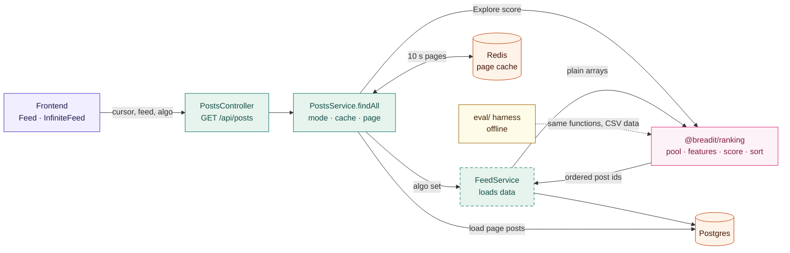
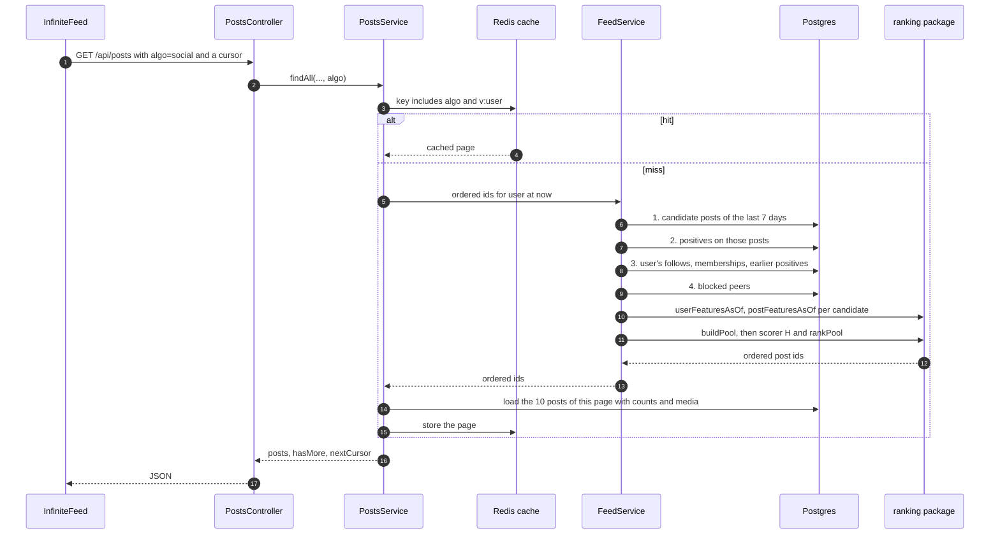

# 08 · The system and the news feed

[Guidance Manual](../Guidance-Manual.md) · English · [Tiếng Việt](../vi/08-system-and-feed.md)

**After reading this you can:** name the components a feed request passes through; explain how the backend gets an ordered list from `@breadit/ranking`; say what the backend must load for the ranking; and list the ways to make the feed better (quality) and cheaper (speed), with the one rule every optimization must keep.

Sources: the code (`apps/backend/src/posts/`, `packages/ranking/src/`, `apps/frontend/src/components/`), super-plan P6 and P7, implementation-plan §1 and §2.6. Diagrams: [System_Architecture.md](../../System_Architecture.md). Terms: [09 Glossary](09-glossary.md).

**Status.** Sections 2 and 3 describe the code as it is on 2026-11-02. Sections 4 to 6 describe task 8 (`p6-social-feed`), which is **not built yet**. Code there is a sketch; task 8's design fixes the real code.

---

## 1. The components on the feed path

The big picture, feed path only. Dashed boxes are planned (task 8). The full diagram is in [System_Architecture.md §3](../../System_Architecture.md).



How to read it: the frontend calls `PostsController`, and `PostsService` checks the Redis cache and picks the feed mode. When `algo` is set, `FeedService` loads data from Postgres into plain arrays, hands them to `@breadit/ranking`, and gets back an ordered list of post ids. The offline evaluation calls the same functions with data from CSV files.

| Component | Where | Its job in the feed |
|---|---|---|
| Home page | `apps/frontend/src/app/(board)/page.tsx` | Shows the tabs (For You, Explore, Following, Communities) and reads `?feed=` from the URL |
| `Feed` | `apps/frontend/src/components/Feed.tsx` | Server component: fetches page 1 with `serverFetch`, forwarding the session cookie |
| `InfiniteFeed` | `apps/frontend/src/components/InfiniteFeed.tsx` | Client component: TanStack Query fetches the next pages with `nextCursor` while you scroll |
| `PostsController` | `apps/backend/src/posts/posts.controller.ts` | `GET /api/posts` with `cursor`, `user`, `feed`, `communityId`; `OptionalJwtAuthGuard` fills `req.user` if logged in |
| `PostsService.findAll` | `apps/backend/src/posts/posts.service.ts` | Picks the feed mode, checks the cache, builds the query, orders, pages |
| `CacheService` | `apps/backend/src/cache/` | Redis JSON cache with version keys (`v:user`) |
| `BlockService` | `apps/backend/src/block/` | Gives the blocked peers, removed from every feed |
| `PrismaService` | `apps/backend/src/prisma/` | The database client |
| `@breadit/ranking` | `packages/ranking/` | Pure functions: pool, features, scores, sort. No database, no clock |
| `FeedService` 🔜 | `apps/backend/src/feed/` (task 8) | Loads data for the ranking, calls `@breadit/ranking`, returns ordered post ids |

## 2. How a feed request works today

1. You open `/` (For You) or `/?feed=explore`. The server component `Feed` calls `GET /api/posts?cursor=1&feed=...` with your cookie.
2. `PostsController.findAll` passes `cursor`, `user`, your id (or none for a guest), `feed` and `communityId` to `PostsService.findAll`.
3. **Cache check.** The key is `feed:<viewer>:<mode>:<profile user>:<communityId>:<cursor>:<v:user>`. A hit returns at once. Pages live **10 seconds**. Follow, block and community changes bump `v:user`, so your next request misses the cache.
4. **Blocked peers** are loaded and excluded in every mode.
5. **Mode → query:**

| Mode | Which posts | Order |
|---|---|---|
| For You (logged in, no `feed`) | yours and your followees', no community posts | newest first |
| `following` | your followees' only | newest first |
| `communities` | approved posts of your communities | newest first |
| `explore` | everyone's, no community posts, last 7 days, at most 400 newest | Explore score, then at most 3 posts per author in a window |
| guest | everyone's, no community posts | newest first |

6. **Pages** have 10 posts. Page 1 is asked with `cursor=1`. Later pages use a token cursor: `(createdAt, id)` for the newest-first modes, `(scoreFixed, id)` for Explore.
7. `InfiniteFeed` asks for the next page with `nextCursor`. Its query key is `["posts", user, feed, communityId]`.

**Explore and the ranking package.** Explore already calls `computeExploreScoreFixed` from `@breadit/ranking` for each of the 400 candidates. This is the first place where the backend "gets a result from the ranking": it passes counts and age, gets back one integer, and sorts by `(scoreFixed desc, id desc)`.

**What is weak today** (and what the thesis changes):
- For You is newest first among followees: not personal, and a new user with no follows sees only their own posts.
- Community posts never enter For You or Explore, so community affinity has nothing to rank.
- Explore reads `Date.now()` for the window and the age, so it cannot be replayed at a past time (Bugs Report T4).

## 3. The contract between the backend and the ranking package

`@breadit/ranking` never reads the database. The backend gives it **plain arrays**, and it gives back **an ordered list of post ids**. This is the whole interface.

| Function | Input | Output |
|---|---|---|
| `userFeaturesAsOf(user, asOf, data)` | the user's follows, memberships and positives, and author/community of the posts they touched | followees, communities, positives by author and by community, total |
| `postFeaturesAsOf(post, asOf, positives)` | one post and the positives on it | likes, comments, reposts, age, who engaged |
| `buildPool(args, { windowSec, maxPosts })` | candidates, blocked peers, the user's earlier positives | the pool: at most N_max posts |
| `scorer(method)` | a method id (`'H'`, `'BL2'`, …) | a function `(ctx, post, pf) → integer score` |
| `rankPool(pool, score)` | the pool and a score function | post ids, ordered by `(score desc, postId desc)` |

Two conversions happen at the border:
- **Time:** Prisma gives `Date` objects; the package wants integer seconds. `asOf.t` is "now" in seconds, with no event id, so only events strictly before now count.
- **Ids:** user ids are strings on both sides (the loader writes `u0000000042`-style ids for loaded datasets). Post ids are integers.

The evaluation (`eval/`) calls exactly the same five functions with data read from CSV files. That is why a number measured offline describes the live feed.

## 4. The planned For You flow with `algo=social` 🔜 (task 8)



**What `FeedService` must load** (step 3 to 6 above):

| Data | From | Used for |
|---|---|---|
| Candidate posts | `Post`: root posts, not deleted, approved, created in the last 7 days, **community posts included** | the pool |
| Positives on candidates | `Like`, comments, reposts on those posts, with user and time | likes, comments, reposts, who engaged |
| The user's follows | `Follow` where the user is the follower, with `createdAt` | followees (counted once, Bugs Report T6) |
| The user's memberships | `CommunityMember`, with `createdAt` | communities |
| The user's earlier positives | the user's likes, comments, reposts, plus author and community of each post | trust, community counts, and removing posts already seen |
| Blocked peers | `BlockService.getAllBlockedPeerIds` | removed from the pool |

The query must not cut the candidates below N_max + the user's earlier positives, so `buildPool` sees the same set as the evaluation would (implementation-plan §2.6).

**Parameters.** α and β come from tuning in P7 and are frozen; m is 5. The `algo` value: `chrono` (today's order), `engagement` (the Explore score on the same pool), `social` (H). The default `algo` comes from an environment variable; when it is not set, For You behaves exactly as today.

**Sketch of the call** (illustrative; names may change in task 8):

```ts
const asOf = { t: Math.floor(Date.now() / 1000) };
const uf = userFeaturesAsOf(userId, asOf, { follows, memberships, positives: myPositives, postInfo });
const pool = buildPool(
  { user: userId, asOf, candidates, blocked, earlierPositives },
  { windowSec: 7 * 24 * 3600, maxPosts: 2000 },
);
const score = scorer('H');
const ctx = { user: userId, asOf, uf, params: { alpha, beta, m: 5 } };
const orderedIds = rankPool(pool, (p) => score(ctx, p, postFeatures.get(p.id)!));
```

## 5. Optimizing the feed: two different goals

"Optimizing the news feed" means two things. Keep them apart, because they are measured differently.

### 5.1 Better ranking (quality)

This is the thesis question, and it is answered **offline**, not by trying things in the app:
1. Tune α and β on the validation split (P7), by NDCG@10.
2. Freeze them, run the test split once, read H1 and H0.
3. If H1 passes on both co-primary tests and H0 passes, the default `algo` becomes `social` (the default feed rule). This is a configuration change, not a code change.

Changing the formula later (a new term, new weights) means a new method id in `@breadit/ranking`, a new offline run, and a new comparison. Never tune on what looks good in the app.

### 5.2 Faster and cheaper (cost)

E7 measures latency and query count for `chrono`, `engagement` and `social` (Class R: median of 4 kept runs with a CI). The levers, roughly from cheap to expensive:

| Lever | Idea | Watch out |
|---|---|---|
| Page cache | already there: 10 s, key includes `algo` and `v:user` | a longer TTL shows stale feeds |
| Graph caches | followees and communities are cached 300 s (`graph:follows`, `graph:communities`), cleared on follow or membership change | a community ban must also clear it (Bugs Report B6) |
| Rank once, page many | keep the ordered id list for a short time and serve pages 2, 3, … from it, instead of ranking again per page | the age term changes scores every second, so a re-rank between pages can move posts; a cursor on `(scoreFixed, id)` like Explore is the other option |
| Counts in SQL | get likes, comments, reposts per candidate with a grouped count instead of loading every like row | the counts must follow the same "strictly before now" rule |
| Only followee engagers | the social term only uses engagers who are followees, so loading just those gives the same scores | must give the same order: check with the parity test |
| Indexes | e.g. `Like(postId)`, `Post(createdAt, id)`, `Follow(followerId)` | needs a schema migration, which v0.2 cut (super-plan §9); future work |

### 5.3 The one rule

**Every optimization must keep the parity test green.** For 100 sampled (user, time) pairs, the live order must equal the evaluation order. If an optimization changes the pool or a feature, the app no longer runs what the thesis measured, and the results stop describing the app.

## 6. What does not change

The guards (`OptionalJwtAuthGuard` first), the block filter, soft delete (`deletedAt`), approved-only community posts, the version-based cache, and the response shape `{ posts, hasMore, nextCursor }`. The frontend needs only the `algo` value in the URL whitelist and in the query key.

## 7. Check yourself

1. Which file decides the feed mode today, and how long does a cached page live?
2. What does the backend give `@breadit/ranking`, and what does it get back?
3. Why are community posts a precondition for the community term?
4. Why does `asOf` in the live app have no event id?
5. You want to load only followee engagers to save time. What test tells you it is safe?
6. Why is the switch to `social` a configuration change and not a code change?
