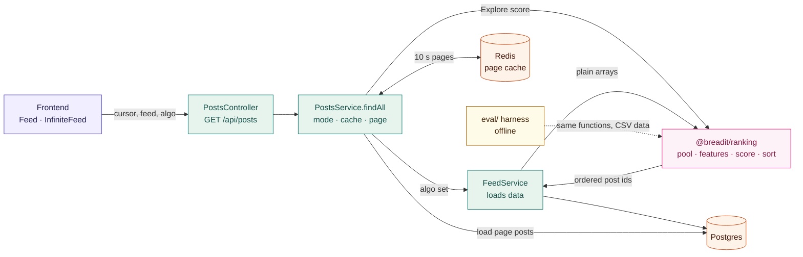
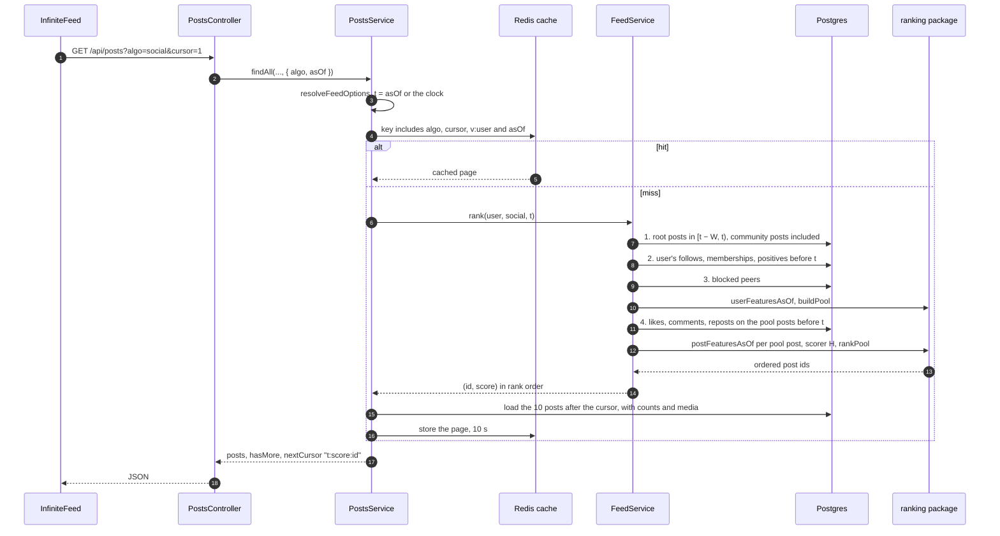

# 08 · The system and the news feed

[Guidance Manual](../Guidance-Manual.md) · English · [Tiếng Việt](../vi/08-system-and-feed.md)

**After reading this you can:** name the components a feed request passes through; explain how the backend gets an ordered list from `@breadit/ranking`; say what the backend must load for the ranking; and list the ways to make the feed better (quality) and cheaper (speed), with the one rule every optimization must keep.

Sources: the code (`apps/backend/src/posts/`, `packages/ranking/src/`, `apps/frontend/src/components/`), super-plan P6 and P7, implementation-plan §1 and §2.6. Diagrams: [System_Architecture.md](../../System_Architecture.md). Terms: [09 Glossary](09-glossary.md).

**Status.** Every section describes the code as it is on 2026-11-18, after task 8 (`p6-social-feed`) built the social feed and task 11 (`p8-repro`) put the tuned α and β in it. The design of task 8 is in `.docs/works/2026-11-10-p6-social-feed/design.md`.

---

## 1. The components on the feed path

The big picture, feed path only. The full diagram is in [System_Architecture.md §3](../../System_Architecture.md).



How to read it: the frontend calls `PostsController`, and `PostsService` checks the Redis cache and picks the feed mode. When `algo` is set, `FeedService` loads data from Postgres into plain arrays, hands them to `@breadit/ranking`, and gets back an ordered list of post ids. The offline evaluation calls the same functions with data from CSV files.

| Component | Where | Its job in the feed |
|---|---|---|
| Home page | `apps/frontend/src/app/(board)/page.tsx` | Shows the tabs (For You, Explore, Following, Communities), reads `?feed=` and `?algo=` from the URL, and on For You shows the toggle "Chronological · Engagement · Social" |
| `Feed` | `apps/frontend/src/components/Feed.tsx` | Server component: fetches page 1 with `serverFetch`, forwarding the session cookie |
| `InfiniteFeed` | `apps/frontend/src/components/InfiniteFeed.tsx` | Client component: TanStack Query fetches the next pages with `nextCursor` while you scroll |
| `PostsController` | `apps/backend/src/posts/posts.controller.ts` | `GET /api/posts` with `cursor`, `user`, `feed`, `communityId`, `algo` and the test-only `asOf`; `OptionalJwtAuthGuard` fills `req.user` if logged in |
| `PostsService.findAll` | `apps/backend/src/posts/posts.service.ts` | Picks the feed mode, checks the cache, builds the query, orders, pages |
| `CacheService` | `apps/backend/src/cache/` | Redis JSON cache with version keys (`v:user`) |
| `BlockService` | `apps/backend/src/block/` | Gives the blocked peers, removed from every feed |
| `PrismaService` | `apps/backend/src/prisma/` | The database client |
| `@breadit/ranking` | `packages/ranking/` | Pure functions: pool, features, scores, sort. No database, no clock |
| `FeedService` | `apps/backend/src/feed/` (task 8) | Loads data for the ranking, calls `@breadit/ranking`, returns the ranked pool as `(id, score)` |

## 2. How a feed request works

1. You open `/` (For You), `/?algo=social` or `/?feed=explore`. The server component `Feed` calls `GET /api/posts?cursor=1&...` with your cookie.
2. `PostsController.findAll` passes `cursor`, `user`, your id (or none for a guest), `feed`, `communityId`, `algo` and `asOf` to `PostsService.findAll`.
3. **Options.** `resolveFeedOptions` checks `algo` and `asOf` (section 4) and applies the default `algo` from `FEED_DEFAULT_ALGO`. Then the clock is read **once** for the whole request.
4. **Cache check.** The key is `feed:<viewer>:<mode>:<profile user>:<communityId>:<cursor>:<v:user>:<asOf>`. A hit returns at once. Pages live **10 seconds**. Follow, block, community and own-post changes bump `v:user`, so your next request misses the cache.
5. **Blocked peers** are loaded and excluded in every mode.
6. **Mode → query:**

| Mode | Which posts | Order |
|---|---|---|
| For You with `algo` (logged in) | the shared pool: root posts of the last 7 days, community posts included (approved only), not yours, not already touched, not blocked | `chrono` = BL0, `engagement` = BL2, `social` = H (section 4) |
| For You without `algo` (logged in, `FEED_DEFAULT_ALGO` unset) | yours and your followees', no community posts | newest first |
| `following` | your followees' only | newest first |
| `communities` | approved posts of your communities | newest first |
| `explore` | everyone's, no community posts, last 7 days, at most 400 newest | Explore score, then at most 3 posts per author in a window |
| guest | everyone's, no community posts | newest first |

7. **Pages** have 10 posts. Page 1 is asked with `cursor=1`. Later pages use a token cursor: `(createdAt, id)` for the newest-first modes, `(scoreFixed, id)` for Explore, `t:score:id` for the `algo` feeds.
8. `InfiniteFeed` asks for the next page with `nextCursor`. Its query key is `["posts", user, feed, communityId, algo]`.

**Explore and the ranking package.** Explore calls `computeExploreScoreFixed` from `@breadit/ranking` for each of the 400 candidates: it passes counts and age, gets back one integer, and sorts by `(scoreFixed desc, id desc)`. Since task 8 it uses one time per request for the window and the age: the clock read once, or `asOf` (Bugs Report T4).

**What was weak before the thesis** (and what changed):
- For You was newest first among followees: not personal, and a new user with no follows saw only their own posts. The `algo` feeds rank a shared pool for everyone; the default stays as before until P7 decides.
- Community posts never entered For You or Explore, so community affinity had nothing to rank. The `algo` feeds now include approved community posts.
- Explore read `Date.now()` twice, so it could not be replayed at a past time. Fixed in task 8 (T4).

## 3. The contract between the backend and the ranking package

`@breadit/ranking` never reads the database. The backend gives it **plain arrays**, and it gives back **an ordered list of post ids**. This is the whole interface.

| Function | Input | Output |
|---|---|---|
| `userFeaturesAsOf(user, asOf, data)` | the user's follows, memberships and positives, and author/community of the posts they touched | followees, communities, positives by author and by community, total |
| `postFeaturesAsOf(post, asOf, positives)` | one post and the positives on it | likes, comments, reposts, age, who engaged |
| `buildPool(args, { windowSec, maxPosts })` | candidates, blocked peers, the user's earlier positives | the pool: at most N_max posts |
| `scorer(method)` | a method id (`'H'`, `'BL2'`, …) | a function `(ctx, post, pf) → integer score` |
| `rankPool(pool, score)` | the pool and a score function | post ids, ordered by `(score desc, postId desc)` |

Two conversions happen at the border:
- **Time:** Prisma gives `Date` objects; the package wants integer seconds. The feed module rounds every time down to whole Unix seconds (`toSec`). `asOf.t` is "now" (or the test `asOf`) in seconds, with no event id, so only events strictly before it count. The harness counts seconds from the base epoch instead. Every score uses a time difference or rises with the post time, so both give the same order; only BL0's score values differ.
- **Ids:** user ids are strings on both sides (the loader writes `u0000000042`-style ids for loaded datasets). Post ids are integers.

The evaluation (`eval/`) calls exactly the same five functions with data read from CSV files. That is why a number measured offline describes the live feed.

## 4. The For You flow with `algo=social` (task 8)



**What `FeedService` loads** (`apps/backend/src/feed/feed.service.ts`):

| Data | From | Used for |
|---|---|---|
| Candidate posts | `Post`: root posts (`parentPostId` and `rePostId` null) created in `[t − W, t)`, **community posts included**, with `isApproved` and `deletedAt`. No row limit | the pool. `buildPool` drops deleted and pending posts (R2) and keeps the newest N_max |
| The user's follows | `Follow` where the user is the follower, with `createdAt` | followees (counted once, Bugs Report T6) |
| The user's memberships | `CommunityMember`, with `createdAt` | communities |
| The user's earlier positives | the user's likes, live comments and live reposts before t, plus author and community of each touched post | trust, community counts, and removing posts already touched |
| Blocked peers | `BlockService.getAllBlockedPeerIds` | removed from the pool |
| Positives on the pool posts | `Like`, live `Comment` rows and live repost rows (`Post` with `rePostId`) on the pool posts, before t | likes, comments, reposts, who engaged |

Follows and memberships are read with their times, not from the cached `getFolloweesIds` / `getCommunityIds`, because the as-of rule needs the times. The candidate query has no row limit, so `buildPool` sees the same set as the evaluation (implementation-plan §2.6). Positives are loaded only for the pool posts, after `buildPool`.

**Parameters** (`feed/feed.constants.ts`). `chrono` = BL0 (followee posts first, then newest first), `engagement` = BL2 (the Explore score on the shared pool), `social` = H. α and β of H are the tuned values of P7 (α = β = 1024): the `syn-W2M-M` values of `eval/config/runs/p7-main.json`, and a unit test checks that they are equal to that file. `m`, W and N_max are the values of super-plan §7, and a unit test checks them against `eval/config/frozen-v1.json`. The default `algo` comes from `FEED_DEFAULT_ALGO`; when it is not set, For You behaves exactly as before.

**The call** (shortened from `FeedService.rank`):

```ts
const asOf = { t: asOfSec };                       // from PostsService: asOf, or the clock read once
const uf = userFeaturesAsOf(userId, asOf, { follows, memberships, positives, postInfo });
const pool = buildPool({ user: userId, asOf, candidates, blocked, earlierPositives }, POOL_PARAMS);
const score = scorer(ALGO_METHOD[algo]);            // BL0, BL2 or H
const ctx = { user: userId, asOf, uf, params: methodParams(algo) };
const order = rankPool(pool, (p) => score(ctx, p, feats.get(p.id)!));
```

**Paging.** The cursor `t:score:id` holds the time t the pool was ranked at and the last item. Page 2 ranks the pool again **at the same t** and returns the items after `(score, id)`. Events after t are not visible at t, so the pages never repeat or skip a post. Without `asOf`, a cursor older than 24 hours gives 400 and the client starts again from page 1.

**Input rules.** `algo` works only on the logged-in For You. An unknown `algo`, or `algo` with `feed`, `user` or `communityId`, gives 400; a guest with `algo` gets 401. `asOf` (Unix seconds) is accepted only when `FEED_ASOF_ENABLED=true`, and the backend refuses to start with that flag in production. A wrong `FEED_DEFAULT_ALGO` also stops the backend at start.

**A limit of `asOf`.** It replays creates only. A post deleted or a like removed after t is already gone from the database (an unlike is a hard delete). The loaded datasets have no deletes, so the parity test is not affected.

## 5. Optimizing the feed: two different goals

"Optimizing the news feed" means two things. Keep them apart, because they are measured differently.

### 5.1 Better ranking (quality)

This is the thesis question, and it is answered **offline**, not by trying things in the app:
1. Tune α and β on the validation split (P7), by NDCG@10.
2. Freeze them, run the test split once, read H1 and H0.
3. If H1 passes on both co-primary tests and H0 passes, the default `algo` becomes `social` (the default feed rule). This is a configuration change, not a code change. H1 failed on both tests, so the default stays as it is (P8): `FEED_DEFAULT_ALGO` is empty, and `social` is available with the toggle.

Changing the formula later (a new term, new weights) means a new method id in `@breadit/ranking`, a new offline run, and a new comparison. Never tune on what looks good in the app.

### 5.2 Faster and cheaper (cost)

E7 measured the cost of page 1 for `chrono`, `engagement` and `social` (task 10, 2026-11-12; run again with the tuned α and β on 2026-11-18). Setup: the 100 parity pairs, one virtual user, the page cache off, one machine (Apple M1, Postgres and Redis in Docker), 5 rounds with the first dropped. The latency is Class R: the median of the 4 kept run medians with a 95% bootstrap interval. The query count is exact.

| `algo` | Median (ms) | 95% interval | p95 (ms) | Prisma queries per request |
|---|---:|---|---:|---:|
| `chrono` | 35.851 | 35.615 to 36.005 | 40.011 | 19.650 |
| `engagement` | 35.879 | 34.634 to 36.289 | 40.447 | 19.630 |
| `social` | 35.836 | 34.906 to 36.102 | 39.766 | 19.700 |

The three feeds cost about the same, and the intervals overlap. They run the same queries (17 to 21 by user, about 19.6 to 19.7 on average), so the formula adds little: the difference between feeds is under 0.1 ms of about 36. The numbers compare the feeds on one machine; they are not absolute speed. Source: `.docs/results/p7-e7/` and table e7 of the report (macros `eSeven*`).

The levers, roughly from cheap to expensive. Task 10 only measured; any speed-up must keep `npm run test:parity` passing:

| Lever | Idea | Watch out |
|---|---|---|
| Page cache | already there: 10 s, key includes `algo` and `v:user` | a longer TTL shows stale feeds |
| Graph caches | followees and communities are cached 300 s (`graph:follows`, `graph:communities`), cleared on follow, membership change, community ban and community delete (B6, task 8) | the `algo` feeds do not use them: they need the follow and membership times |
| Rank once, page many | today each page ranks the pool again at the cursor's t; keeping the ranked list for a short time would serve pages 2, 3, … without that work | the list must be the one ranked at the same t, or the pages stop matching |
| Counts in SQL | get likes, comments, reposts per candidate with a grouped count instead of loading every like row | the counts must follow the same "strictly before now" rule |
| Only followee engagers | the social term only uses engagers who are followees, so loading just those gives the same scores | must give the same order: check with the parity test |
| Indexes | e.g. `Like(postId)`, `Post(createdAt, id)`, `Follow(followerId)` | needs a schema migration, which v0.2 cut (super-plan §9); future work |

### 5.3 The one rule

**Every optimization must keep the parity test green.** For 100 sampled (user, time) pairs, the live order must equal the evaluation order. If an optimization changes the pool or a feature, the app no longer runs what the thesis measured, and the results stop describing the app.

How to run it: `npm run load -w @breadit/eval -- syn-W2M-M` (without `--rebase-to`), then `npm run test:parity -w @breadit/backend`. It compares the full order at `FeedService.rank` and the first two HTTP pages for each pair and each `algo`, against the committed sample in `.docs/results/p6-parity/` (made by `npm run parity -w @breadit/eval`). On 2026-11-18, with α = β = 1024: 300 of 300 and 300 of 300. When α, β, the dataset or the package changes, make the sample again and commit it. `npm run thesis:repro` runs this whole check again (document 07).

## 6. What does not change

The guards (`OptionalJwtAuthGuard` first), the block filter, soft delete (`deletedAt`), approved-only community posts, the version-based cache, and the response shape `{ posts, hasMore, nextCursor }`. The frontend only adds the `algo` value to the URL whitelist, the request and the query key.

## 7. Check yourself

1. Which file decides the feed mode today, and how long does a cached page live?
2. What does the backend give `@breadit/ranking`, and what does it get back?
3. Why are community posts a precondition for the community term?
4. Why does `asOf` in the live app have no event id?
5. You want to load only followee engagers to save time. What test tells you it is safe?
6. Why is the switch to `social` a configuration change and not a code change?
