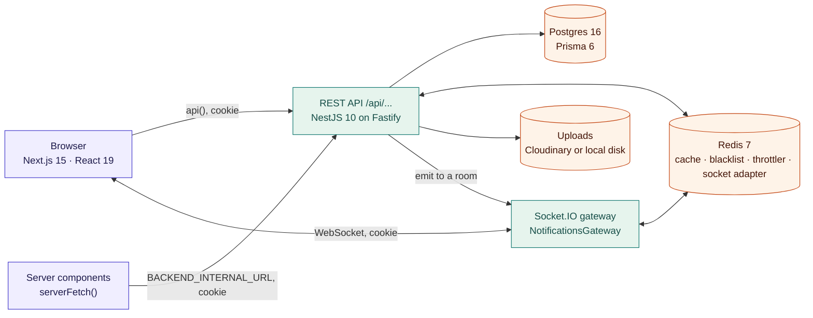
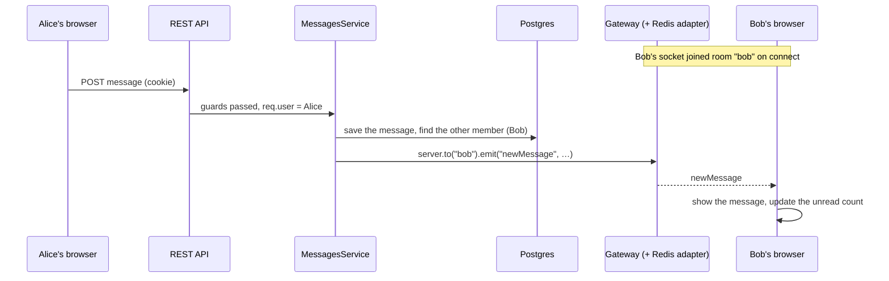

# 12 · The platform and the real-time layer

[Guidance Manual](../Guidance-Manual.md) · English · [Tiếng Việt](../vi/12-platform-and-real-time.md)

**After reading this you can:** draw the whole Breadit system, not only the feed path; follow one request through the guards; explain how a socket is tied to a user and how a direct message reaches the other person at once; say why the cache uses version numbers instead of deleting keys; and say what each kind of test proves. This is the background of thesis Chapters 4, 5 and 8 and of the words "real-time hybrid social networking platform" in the title.

Sources: the code (`apps/backend/src/auth/`, `notifications/`, `messages/`, `admin/`, `cache/`, `block/`, `apps/backend/test/it/`), `CLAUDE.md` ("Architecture"), `.docs/Bugs Report.md` (findings S1, S5 and the system inventory). Diagrams: [System_Architecture.md](../../System_Architecture.md). Terms: [09 Glossary](09-glossary.md). The feed path itself is in [08](08-system-and-feed.md).

**Status.** Every section describes the code on 2026-11-19. The test counts are from `verify.sh` on that day.

---

## 1. The platform in one picture

Breadit is the platform of contribution C1 (the architecture) and C3 (the real-time layer). Both come from the pre-thesis and are kept. The new part of the thesis, C2, sits inside the feed (document 08).

Three things to see in the picture:
- **The frontend has no database.** Every piece of data comes from the backend over `/api/...`. Server components call it with the cookies of the incoming request; client components call it from the browser.
- **The REST API and the gateway are one backend process.** A service that changes data (a new message, a ban) also pushes an event through the gateway.
- **Redis has four jobs**: the JSON cache, the logout blacklist, the rate limiter, and the Socket.IO adapter that shares rooms between backend processes.

**What the platform does.** Posts with images, likes, comments, reposts, saved posts, follows, communities (join, post, moderate), direct messages, notifications, search, hashtags and mentions, blocking, and an admin console. The backend has 13 controllers and 72 REST routes, plus one Socket.IO gateway (Bugs Report, system inventory). This is the "hybrid" of the title: a follow timeline like X and topic communities like Reddit in one site.

## 2. One request through the backend

Take "like a post": `POST /api/posts/:id/like`.

1. **Global steps** (`main.ts`, `app.module.ts`). The rate limiter (`ThrottlerGuard`, counted in Redis) checks the request. The `ValidationPipe` with `whitelist: true` drops every body field that has no `class-validator` decorator in its DTO. Any error becomes one JSON shape through `AllExceptionsFilter`.
2. **Route guards**, in the order written on the route. The like route has `@UseGuards(JwtAuthGuard, BannedUserGuard, EmailVerifiedGuard)` (`interactions.controller.ts`). `JwtAuthGuard` must be first, because it reads the cookie and sets `req.user`; the others read `req.user`:
   - `JwtAuthGuard`: the `breadit_session` cookie must hold a valid HS256 token (library `jose`) whose `jti` is not in the Redis blacklist and whose `pwv` claim is the current password version of the user (a password reset ends every older session);
   - `BannedUserGuard`: reads `banned` from the database again, because the token can be up to 30 days old;
   - `EmailVerifiedGuard`: write actions need a verified email. A token that says "not verified" is checked against the database, so a user who has just entered the code can post with the same cookie (finding B5). A token that says "verified" passes with no read;
   - `RolesGuard` with `@Roles('ADMIN')`: only on admin routes.
3. **The service** does the work in Postgres, bumps the cache versions it changes (Section 4), and may create a notification (Section 3).

Routes that work for guests use `OptionalJwtAuthGuard` instead: no cookie is fine, and `req.user` stays empty. A bad, expired or logged-out token is treated the same way, as a guest (finding S5, HTTP part). Both guards call one function, `readSession` (`auth/session.ts`), which checks the token, the blacklist and the password version (`pwv`).

**Login and logout.** Login sets the `breadit_session` cookie (httpOnly, 30 days). Logout writes the token's `jti` into Redis (`auth:blacklist:<jti>`), so the same token is refused from then on, also by the socket, and treated as a guest on the public routes. Login also puts the password version of the user in the token as the claim `pwv` (a token with no claim counts as 0). A password reset adds 1 to `User.passwordVersion`, so every token made before it is refused, on HTTP and on the socket (finding S6). `readSession` reads the version from a copy in Redis (`auth:pwv:<userId>`, in the same `MGET` as the blacklist key) and from the database only when the copy is missing, so a request costs no extra round trip. Email codes (verify, password reset) are rows of the `VerificationToken` table, sent by SMTP. The 6-digit code comes from `crypto.randomInt`, and the tries are counted for each email (5 in 15 minutes).

## 3. The real-time layer

"Real-time" in this thesis means **push**: the server sends an event to the browser over an open WebSocket, and the page updates without a reload. One gateway does all of it: `apps/backend/src/notifications/notifications.gateway.ts`.

### 3.1 Who a socket is

A socket gets its user from the server, never from the client:

1. The browser opens the socket with its cookies (`components/Socket.tsx`, the singleton in `src/socket.ts`).
2. Before the connection exists, a middleware (`server.use`) runs `authenticate`: it reads `breadit_session` from the handshake, calls `readSession` (the same check as the HTTP guards: the token, the logout blacklist and the password version), and stores `{ id, username }` on `socket.data`. A missing, bad, expired, logged-out or older-than-the-last-reset token is refused.
3. On connect, the server puts the socket into the room named after the **username**. The client still sends `newUser`, but the name it sends is ignored.

This is the fix of finding **S1**. Before it, the client chose its room by sending a username, so anyone could join "bob" and read Bob's messages. **S5** (socket part) added the blacklist check, so a logged-out token cannot connect.

### 3.2 The events

| Event (server → client) | Sent by | To which room | When |
|---|---|---|---|
| `getNotification` | `NotificationsService.emit` | the recipient's username | a like, comment, follow, mention, … |
| `newMessage` | `MessagesService` | the other member's username | a direct message is sent |
| `messageRead` | `MessagesService.markRead` | the other member's username | the reader marks the conversation as read |
| `userTyping`, `userStopTyping` | the gateway | `conversation:<id>` | a member types or stops |
| `accountBanned` | `AdminService` | the banned user's username | an admin bans the account; the browser logs out |

The client sends `joinConversation` and `leaveConversation`, and `startTyping` and `stopTyping`. A socket joins `conversation:<id>` only if the database says it is a member, and it can send typing signals only into a room it has joined. The typing event carries the username from the login, not one the client wrote.

**A notification is saved, then pushed.** `NotificationsService.emit` first writes a `Notification` row, then pushes it. A user who is offline sees it later in the list; a user who is online sees it at once. A notification to yourself is skipped.

### 3.3 One direct message, step by step

**Why the Redis adapter.** With one backend process, a room lives in its memory. With two or more processes, Bob may be connected to a different one than the one that saved the message. The adapter (`@socket.io/redis-adapter`) sends the event through Redis to every process, so it reaches Bob wherever he is connected.

### 3.4 What "real-time" does not cover

- **The feed is not pushed.** The feed is ranked when the user opens or reloads it (document 08). An open feed does not receive new posts.
- **No delivery time is measured.** The thesis shows that the events arrive (Section 6), not how fast. The pre-thesis k6 numbers are not used: they came from an older script and an old rate limit (super-plan §3).

## 4. The cache: versions instead of deletes

Read-heavy endpoints keep their JSON answer in Redis (`src/cache/cache.service.ts`). The key is `prefix:part:part…`, and one part is a **version number**.

- A read path includes the version in its key, for example `cache.getNumber('v:user', [userId])`.
- A write path increases it: `incrNumber('v:user', [userId])`. The next read builds a new key and misses the cache, so it reads fresh data. The old entries are never deleted; they simply expire with their TTL.

Why not delete the keys? One write can change many cached answers (every page of a feed, every filter of a list), and their keys are not known in advance. One version number covers all of them with one Redis command.

Two more parts:
- `getOrSetJson` adds a short lock, so when a popular entry expires, one request rebuilds it and the others wait (no stampede).
- `REDIS_HTTP_CACHE_ENABLED=false` turns the JSON cache off. The E7 benchmark runs with it off, to measure the ranking work and not the cache.

The feed pages live 10 s, and their key includes `algo`, the `v:user` version and the as-of time (document 08).

## 5. Rules every listing follows

- **Blocking.** `BlockService.getAllBlockedPeerIds` gives the users blocked in either direction. Post, user, search, notification and message queries leave them out. A new listing must do the same.
- **Soft delete.** A deleted post keeps its row with `deletedAt` set, and every query filters it.
- **Community posts.** A post in a community needs membership, and only approved posts (`isApproved`) are shown.
- **Parsing on write.** Hashtags are read from the post text when it is saved; mentions from posts and comments. Both create rows (and mention notifications), so reading never parses text.

## 6. The tests and what each one proves

| Level | Where | Count (2026-11-25) | What it proves |
|---|---|---|---|
| Ranking unit tests | `packages/ranking/src/*.spec.ts` | 85 | Each scorer, the pool rule and the as-of features give the hand-checked values. |
| Backend unit tests | `apps/backend/src/**/*.spec.ts` | 239 | Services and guards in isolation, e.g. the tuned α and β equal the approved run config, the gateway rules. |
| Integration tests (IT) | `apps/backend/test/it/` | 182 | The real app on a real Postgres (schema `it_test`) and Redis (database 1): routes, guards, feeds, and the socket (`socket.it-spec.ts`). |
| Parity test | `npm run test:parity` | 102 tests; 300 of 300 orders, twice | The live feed order equals the harness order for 100 sampled (user, time) pairs, at the feed module and over HTTP. |
| Eval tests | `npm run verify -w @breadit/eval` | 434 | The generator, the Digg adapter, the harness (golden, leakage, double run), the statistics and the report. |
| Hook tests | `.claude/hooks/test-hooks.cjs` | 96 (2026-11-19) | The workflow rules: frozen folders, gated code, commits on `test-app`. |

Chapter 8 of the thesis counts **1,064 automatic tests**: the first five rows (102 for the parity test) and 22 tests of the demo helpers, without the hook tests. The counts are copied from Chapter 8.

`bash .claude/hooks/verify.sh` runs all of them except the parity test (which needs a loaded dataset) and the hook tests.

**The socket IT tests** (`socket.it-spec.ts`) are the evidence for C3. They connect real Socket.IO clients to the running app and check: a user who claims another username with `newUser` still does not get that user's message (S1); a user who never sends `newUser` still gets his message (the server joins him); a client cannot push a fake notification; a real follow notification arrives; a non-member gets no typing events and cannot send any; a logged-out token and a missing cookie cannot connect (S5); `accountBanned` reaches the banned user.

`scripts/verify-socket.cjs` makes the same S1 and S5 checks against a running backend by hand (started by `scripts/verify-bug-sweep.sh`).

## 7. Where this goes in the thesis

- **Chapter 4 (System Analysis and Design):** the component picture (Section 1), the request and message sequences (Sections 2 and 3.3), the events (Section 3.2) and the listing rules (Section 5) as design.
- **Chapter 5 (Implementation):** how Sections 1 to 5 are built, with the feed path of document 08 and the new code of C2 (`packages/ranking`, the `algo` option, `eval/`, the repro command).
- **Chapter 8 (Test Cases and Demonstration):** the test table of Section 6 and the socket tests as the evidence that the platform and its real-time layer work.
- **Chapter 1:** the meaning of "real-time" (Section 3) and of "hybrid" (Section 1).

## 8. Check yourself

1. Why must `JwtAuthGuard` come before `BannedUserGuard` on a route, and why does `BannedUserGuard` read the database at all?
2. A client sends `newUser: "bob"`. Which room does its socket end up in, and why?
3. Bob is offline when Alice likes his post. What does he see when he comes back, and where does it come from?
4. With two backend processes, why does Bob still get Alice's message?
5. A write changes every page of a user's feed. How does the cache make sure no old page is served, without deleting any key?
6. Which test would fail if a non-member could read typing events of a conversation?
7. Does "real-time" in the title mean the feed updates by itself? What does it mean?
