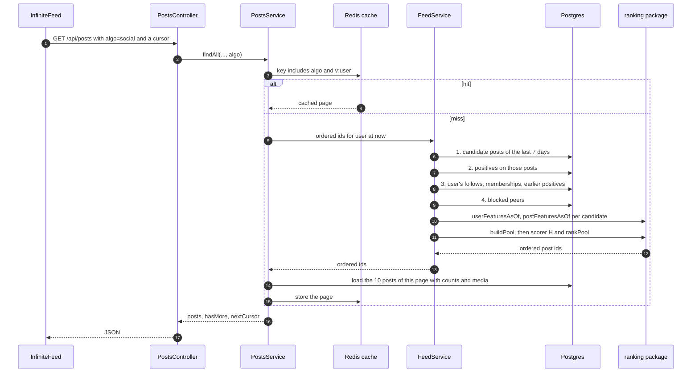

# 08 · Hệ thống và news feed

[Sổ tay hướng dẫn](../Guidance-Manual.md) · [English](../en/08-system-and-feed.md) · Tiếng Việt

**Đọc xong bạn sẽ:** kể được các component mà một request feed đi qua; giải thích backend lấy danh sách đã xếp hạng từ `@breadit/ranking` như thế nào; biết backend phải nạp những dữ liệu gì cho phần ranking; và liệt kê được các cách làm feed tốt hơn (chất lượng) và rẻ hơn (tốc độ), cùng một luật mà mọi tối ưu đều phải giữ.

Nguồn: code (`apps/backend/src/posts/`, `packages/ranking/src/`, `apps/frontend/src/components/`), super-plan P6 và P7, implementation-plan §1 và §2.6. Sơ đồ: [System_Architecture.md](../../System_Architecture.md). Thuật ngữ: [09 Bảng thuật ngữ](09-glossary.md).

**Trạng thái.** Mục 2 và 3 mô tả code như hiện tại, ngày 2026-11-02. Mục 4 tới 6 mô tả task 8 (`p6-social-feed`), **chưa được build**. Code ở đó chỉ là phác thảo; design của task 8 sẽ chốt code thật.

---

## 1. Các component trên đường đi của feed

| Component | Ở đâu | Việc của nó trong feed |
|---|---|---|
| Trang chủ | `apps/frontend/src/app/(board)/page.tsx` | Hiện các tab (For You, Explore, Following, Communities) và đọc `?feed=` trên URL |
| `Feed` | `apps/frontend/src/components/Feed.tsx` | Server component: lấy trang 1 bằng `serverFetch`, chuyển tiếp cookie phiên đăng nhập |
| `InfiniteFeed` | `apps/frontend/src/components/InfiniteFeed.tsx` | Client component: TanStack Query lấy các trang tiếp theo bằng `nextCursor` khi bạn cuộn |
| `PostsController` | `apps/backend/src/posts/posts.controller.ts` | `GET /api/posts` với `cursor`, `user`, `feed`, `communityId`; `OptionalJwtAuthGuard` điền `req.user` nếu đã đăng nhập |
| `PostsService.findAll` | `apps/backend/src/posts/posts.service.ts` | Chọn chế độ feed, kiểm cache, dựng query, sắp xếp, chia trang |
| `CacheService` | `apps/backend/src/cache/` | Cache JSON trên Redis với khoá có version (`v:user`) |
| `BlockService` | `apps/backend/src/block/` | Trả về danh sách người bị block, bị loại khỏi mọi feed |
| `PrismaService` | `apps/backend/src/prisma/` | Client truy cập database |
| `@breadit/ranking` | `packages/ranking/` | Các hàm thuần: pool, feature, điểm, sắp xếp. Không database, không đồng hồ |
| `FeedService` 🔜 | `apps/backend/src/feed/` (task 8) | Nạp dữ liệu cho ranking, gọi `@breadit/ranking`, trả về danh sách post id đã sắp |

## 2. Một request feed hoạt động thế nào hôm nay

1. Bạn mở `/` (For You) hoặc `/?feed=explore`. Server component `Feed` gọi `GET /api/posts?cursor=1&feed=...` kèm cookie của bạn.
2. `PostsController.findAll` chuyển `cursor`, `user`, id của bạn (hoặc không có nếu là khách), `feed` và `communityId` cho `PostsService.findAll`.
3. **Kiểm cache.** Khoá là `feed:<viewer>:<mode>:<profile user>:<communityId>:<cursor>:<v:user>`. Có trong cache thì trả về ngay. Mỗi trang sống **10 giây**. Thao tác follow, block và thay đổi community sẽ tăng `v:user`, nên request kế tiếp của bạn sẽ không trúng cache cũ.
4. **Người bị block** được nạp và loại ra ở mọi chế độ.
5. **Chế độ → query:**

| Chế độ | Những bài nào | Thứ tự |
|---|---|---|
| For You (đã đăng nhập, không có `feed`) | của bạn và của followee, không có bài community | mới nhất trước |
| `following` | chỉ của followee | mới nhất trước |
| `communities` | bài đã duyệt trong các community của bạn | mới nhất trước |
| `explore` | của mọi người, không có bài community, 7 ngày gần nhất, tối đa 400 bài mới nhất | điểm Explore, rồi tối đa 3 bài mỗi tác giả trong một cửa sổ |
| khách | của mọi người, không có bài community | mới nhất trước |

6. **Mỗi trang** có 10 bài. Trang 1 gửi `cursor=1`. Các trang sau dùng token cursor: `(createdAt, id)` với các chế độ mới-nhất-trước, `(scoreFixed, id)` với Explore.
7. `InfiniteFeed` xin trang tiếp theo bằng `nextCursor`. Query key của nó là `["posts", user, feed, communityId]`.

**Explore và package ranking.** Explore đã gọi `computeExploreScoreFixed` từ `@breadit/ranking` cho từng bài trong 400 ứng viên. Đây là chỗ đầu tiên backend "nhận kết quả từ ranking": nó đưa vào số đếm và tuổi bài, nhận lại một số nguyên, rồi sắp theo `(scoreFixed desc, id desc)`.

**Điểm yếu hiện tại** (và thứ thesis thay đổi):
- For You chỉ là mới nhất trước trong số followee: không cá nhân hoá, và user mới chưa follow ai chỉ thấy bài của chính mình.
- Bài community không bao giờ vào For You hay Explore, nên community affinity không có gì để xếp hạng.
- Explore đọc `Date.now()` cho cửa sổ thời gian và tuổi bài, nên không thể tua lại tại một thời điểm trong quá khứ (Bugs Report T4).

## 3. Hợp đồng giữa backend và package ranking

`@breadit/ranking` không bao giờ đọc database. Backend đưa cho nó **các mảng dữ liệu thuần**, và nó trả lại **một danh sách post id đã sắp**. Đó là toàn bộ giao diện.

| Hàm | Đầu vào | Đầu ra |
|---|---|---|
| `userFeaturesAsOf(user, asOf, data)` | follow, membership và positive của user, cùng tác giả/community của các bài họ đã tương tác | followee, community, positive theo tác giả và theo community, tổng |
| `postFeaturesAsOf(post, asOf, positives)` | một bài và các positive trên bài đó | like, comment, repost, tuổi bài, ai đã tương tác |
| `buildPool(args, { windowSec, maxPosts })` | các ứng viên, người bị block, các positive trước đây của user | pool: tối đa N_max bài |
| `scorer(method)` | một method id (`'H'`, `'BL2'`, …) | một hàm `(ctx, post, pf) → điểm số nguyên` |
| `rankPool(pool, score)` | pool và một hàm tính điểm | các post id, sắp theo `(score desc, postId desc)` |

Có hai phép chuyển đổi ở ranh giới:
- **Thời gian:** Prisma trả về đối tượng `Date`; package cần số giây nguyên. `asOf.t` là "bây giờ" tính bằng giây, không có event id, nên chỉ các sự kiện xảy ra hẳn trước bây giờ được tính.
- **Id:** user id là chuỗi ở cả hai phía (loader ghi id dạng `u0000000042` cho các dataset được nạp). Post id là số nguyên.

Phần evaluation (`eval/`) gọi đúng năm hàm này, với dữ liệu đọc từ file CSV. Vì vậy một con số đo offline mô tả đúng feed thật.

## 4. Luồng For You dự kiến với `algo=social` 🔜 (task 8)



**Những gì `FeedService` phải nạp** (bước 3 tới 6 ở trên):

| Dữ liệu | Lấy từ | Dùng cho |
|---|---|---|
| Bài ứng viên | `Post`: bài gốc, chưa xoá, đã duyệt, tạo trong 7 ngày gần nhất, **có cả bài community** | pool |
| Positive trên các ứng viên | `Like`, comment, repost trên các bài đó, kèm user và thời điểm | số like, comment, repost, ai đã tương tác |
| Follow của user | `Follow` với user là người follow, kèm `createdAt` | followee (mỗi người chỉ tính một lần, Bugs Report T6) |
| Membership của user | `CommunityMember`, kèm `createdAt` | community |
| Positive trước đây của user | like, comment, repost của user, cùng tác giả và community của mỗi bài | trust, số đếm community, và loại các bài đã xem |
| Người bị block | `BlockService.getAllBlockedPeerIds` | loại khỏi pool |

Query không được cắt bớt ứng viên xuống dưới N_max cộng số positive trước đây của user, để `buildPool` thấy cùng tập bài như evaluation (implementation-plan §2.6).

**Tham số.** α và β đến từ việc tune ở P7 và được frozen; m bằng 5. Giá trị `algo`: `chrono` (thứ tự hiện tại), `engagement` (điểm Explore trên cùng pool), `social` (H). `algo` mặc định lấy từ một biến môi trường; nếu không đặt thì For You chạy y như hôm nay.

**Phác thảo lời gọi** (minh hoạ; tên có thể đổi trong task 8):

```ts
const asOf = { t: Math.floor(Date.now() / 1000) };
const uf = userFeaturesAsOf(userId, asOf, { follows, memberships, positives: myPositives, postInfo });
const pool = buildPool(
  { user: userId, asOf, candidates, blocked, earlierPositives },
  { windowSec: 7 * 24 * 3600, maxPosts: 2000 },
);
const score = scorer('H');
const ctx = { user: userId, asOf, uf, params: { alpha, beta, m: 5 } };
const orderedIds = rankPool(pool, (p) => score(ctx, p, postFeatures.get(p.id)!));
```

## 5. Tối ưu feed: hai mục tiêu khác nhau

"Tối ưu news feed" có hai nghĩa. Hãy tách chúng ra, vì chúng được đo theo hai cách khác nhau.

### 5.1 Xếp hạng tốt hơn (chất lượng)

Đây là câu hỏi của thesis, và nó được trả lời **offline**, không phải bằng cách thử trên app:
1. Tune α và β trên split validation (P7), theo NDCG@10.
2. Freeze chúng, chạy split test một lần, đọc kết quả H1 và H0.
3. Nếu H1 pass trên cả hai kiểm định chính và H0 pass, `algo` mặc định chuyển thành `social` (luật đổi feed mặc định). Đây là thay đổi cấu hình, không phải thay đổi code.

Đổi công thức về sau (thêm term, đổi trọng số) nghĩa là thêm một method id mới trong `@breadit/ranking`, chạy offline lại, và so sánh lại. Đừng bao giờ tune theo cảm giác "trông đẹp" trên app.

### 5.2 Nhanh hơn và rẻ hơn (chi phí)

E7 đo độ trễ và số query cho `chrono`, `engagement` và `social` (Class R: trung vị của 4 lần chạy được giữ, kèm CI). Các đòn bẩy, xếp gần đúng từ rẻ tới đắt:

| Đòn bẩy | Ý tưởng | Cần lưu ý |
|---|---|---|
| Cache trang | đã có: 10 giây, khoá có `algo` và `v:user` | TTL dài hơn thì feed cũ hơn |
| Cache đồ thị | followee và community được cache 300 giây (`graph:follows`, `graph:communities`), bị xoá khi follow hoặc membership thay đổi | ban khỏi community cũng phải xoá nó (Bugs Report B6) |
| Xếp một lần, phát nhiều trang | giữ danh sách id đã sắp trong thời gian ngắn và phục vụ trang 2, 3, … từ đó, thay vì xếp lại mỗi trang | term tuổi bài làm điểm đổi theo từng giây, nên xếp lại giữa các trang có thể làm bài nhảy chỗ; cách còn lại là cursor theo `(scoreFixed, id)` như Explore |
| Đếm bằng SQL | lấy số like, comment, repost cho mỗi ứng viên bằng truy vấn đếm theo nhóm, thay vì nạp từng dòng like | số đếm phải theo đúng luật "xảy ra hẳn trước bây giờ" |
| Chỉ nạp engager là followee | social term chỉ dùng engager là followee, nên chỉ nạp những người đó vẫn cho cùng điểm | phải cho cùng thứ tự: kiểm bằng parity test |
| Index | ví dụ `Like(postId)`, `Post(createdAt, id)`, `Follow(followerId)` | cần migration schema, mà bản v0.2 đã cắt (super-plan §9); để future work |

### 5.3 Một luật duy nhất

**Mọi tối ưu phải giữ parity test xanh.** Với 100 cặp (user, thời điểm) lấy mẫu, thứ tự trên app phải bằng thứ tự của evaluation. Nếu một tối ưu làm đổi pool hoặc một feature, app không còn chạy đúng thứ mà thesis đã đo, và các kết quả không còn mô tả app nữa.

## 6. Những gì không đổi

Các guard (`OptionalJwtAuthGuard` đứng đầu), bộ lọc block, xoá mềm (`deletedAt`), bài community chỉ tính khi đã duyệt, cache theo version, và dạng response `{ posts, hasMore, nextCursor }`. Frontend chỉ cần thêm giá trị `algo` vào danh sách cho phép trên URL và vào query key.

## 7. Tự kiểm tra

1. File nào quyết định chế độ feed hôm nay, và một trang trong cache sống bao lâu?
2. Backend đưa gì cho `@breadit/ranking`, và nhận lại gì?
3. Vì sao bài community là điều kiện tiên quyết cho community term?
4. Vì sao `asOf` trên app thật không có event id?
5. Bạn muốn chỉ nạp engager là followee để tiết kiệm thời gian. Test nào cho bạn biết làm vậy là an toàn?
6. Vì sao chuyển sang `social` là thay đổi cấu hình chứ không phải thay đổi code?
