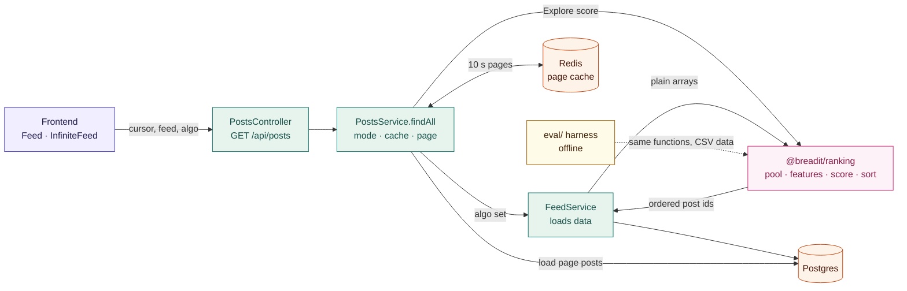
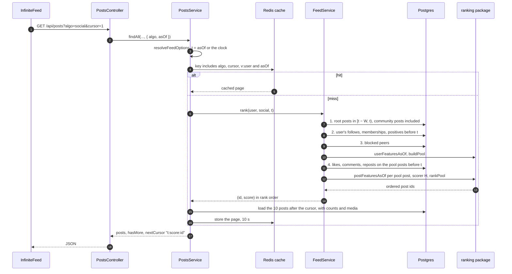

# 08 · Hệ thống và news feed

[Sổ tay hướng dẫn](../Guidance-Manual.md) · [English](../en/08-system-and-feed.md) · Tiếng Việt

**Đọc xong bạn sẽ:** kể được các component mà một request feed đi qua; giải thích backend lấy danh sách đã xếp hạng từ `@breadit/ranking` như thế nào; biết backend phải nạp những dữ liệu gì cho phần ranking; và liệt kê được các cách làm feed tốt hơn (chất lượng) và rẻ hơn (tốc độ), cùng một luật mà mọi tối ưu đều phải giữ.

Nguồn: code (`apps/backend/src/posts/`, `packages/ranking/src/`, `apps/frontend/src/components/`), super-plan P6 và P7, implementation-plan §1 và §2.6. Sơ đồ: [System_Architecture.md](../../System_Architecture.md). Thuật ngữ: [09 Bảng thuật ngữ](09-glossary.md).

**Trạng thái.** Mọi mục mô tả code như hiện tại, ngày 2026-11-18, sau khi task 8 (`p6-social-feed`) đã build social feed và task 11 (`p8-repro`) đã đưa α và β đã tune vào đó. Design của task 8 nằm ở `.docs/works/2026-11-10-p6-social-feed/design.md`.

---

## 1. Các component trên đường đi của feed

Bức tranh tổng thể, chỉ phần đường đi của feed. Sơ đồ đầy đủ nằm ở [System_Architecture.md §3](../../System_Architecture.md).



Cách đọc: frontend gửi request tới `PostsController`, `PostsService` kiểm cache Redis rồi chọn chế độ feed. Khi có `algo`, `FeedService` nạp dữ liệu từ Postgres thành các mảng thuần, đưa cho `@breadit/ranking`, và nhận lại danh sách post id đã sắp. Phần evaluation offline gọi đúng các hàm đó, với dữ liệu từ CSV.

| Component | Ở đâu | Việc của nó trong feed |
|---|---|---|
| Trang chủ | `apps/frontend/src/app/(board)/page.tsx` | Hiện các tab (For You, Explore, Following, Communities), đọc `?feed=` và `?algo=` trên URL, và ở For You hiện nút chuyển "Chronological · Engagement · Social" |
| `Feed` | `apps/frontend/src/components/Feed.tsx` | Server component: lấy trang 1 bằng `serverFetch`, chuyển tiếp cookie phiên đăng nhập |
| `InfiniteFeed` | `apps/frontend/src/components/InfiniteFeed.tsx` | Client component: TanStack Query lấy các trang tiếp theo bằng `nextCursor` khi bạn cuộn |
| `PostsController` | `apps/backend/src/posts/posts.controller.ts` | `GET /api/posts` với `cursor`, `user`, `feed`, `communityId`, `algo` và `asOf` (chỉ để test); `OptionalJwtAuthGuard` điền `req.user` nếu đã đăng nhập |
| `PostsService.findAll` | `apps/backend/src/posts/posts.service.ts` | Chọn chế độ feed, kiểm cache, dựng query, sắp xếp, chia trang |
| `CacheService` | `apps/backend/src/cache/` | Cache JSON trên Redis với khoá có version (`v:user`) |
| `BlockService` | `apps/backend/src/block/` | Trả về danh sách người bị block, bị loại khỏi mọi feed |
| `PrismaService` | `apps/backend/src/prisma/` | Client truy cập database |
| `@breadit/ranking` | `packages/ranking/` | Các hàm thuần: pool, feature, điểm, sắp xếp. Không database, không đồng hồ |
| `FeedService` | `apps/backend/src/feed/` (task 8) | Nạp dữ liệu cho ranking, gọi `@breadit/ranking`, trả về pool đã xếp hạng dưới dạng `(id, score)` |

## 2. Một request feed hoạt động thế nào

1. Bạn mở `/` (For You), `/?algo=social` hoặc `/?feed=explore`. Server component `Feed` gọi `GET /api/posts?cursor=1&...` kèm cookie của bạn.
2. `PostsController.findAll` chuyển `cursor`, `user`, id của bạn (hoặc không có nếu là khách), `feed`, `communityId`, `algo` và `asOf` cho `PostsService.findAll`.
3. **Tuỳ chọn.** `resolveFeedOptions` kiểm `algo` và `asOf` (mục 4) và áp `algo` mặc định từ `FEED_DEFAULT_ALGO`. Sau đó đồng hồ được đọc **một lần** cho cả request.
4. **Kiểm cache.** Khoá là `feed:<viewer>:<mode>:<profile user>:<communityId>:<cursor>:<v:user>:<asOf>`. Có trong cache thì trả về ngay. Mỗi trang sống **10 giây**. Thao tác follow, block, thay đổi community và đăng hoặc xoá bài của chính bạn sẽ tăng `v:user`, nên request kế tiếp của bạn sẽ không trúng cache cũ.
5. **Người bị block** được nạp và loại ra ở mọi chế độ.
6. **Chế độ → query:**

| Chế độ | Những bài nào | Thứ tự |
|---|---|---|
| For You có `algo` (đã đăng nhập) | pool chung: bài gốc trong 7 ngày gần nhất, có cả bài community (chỉ bài đã duyệt), không phải bài của bạn, chưa từng tương tác, không bị block | `chrono` = BL0, `engagement` = BL2, `social` = H (mục 4) |
| For You không có `algo` (đã đăng nhập, chưa đặt `FEED_DEFAULT_ALGO`) | của bạn và của followee, không có bài community | mới nhất trước |
| `following` | chỉ của followee | mới nhất trước |
| `communities` | bài đã duyệt trong các community của bạn | mới nhất trước |
| `explore` | của mọi người, không có bài community, 7 ngày gần nhất, tối đa 400 bài mới nhất | điểm Explore, rồi tối đa 3 bài mỗi tác giả trong một cửa sổ |
| khách | của mọi người, không có bài community | mới nhất trước |

7. **Mỗi trang** có 10 bài. Trang 1 gửi `cursor=1`. Các trang sau dùng token cursor: `(createdAt, id)` với các chế độ mới-nhất-trước, `(scoreFixed, id)` với Explore, `t:score:id` với các feed có `algo`.
8. `InfiniteFeed` xin trang tiếp theo bằng `nextCursor`. Query key của nó là `["posts", user, feed, communityId, algo]`.

**Explore và package ranking.** Explore gọi `computeExploreScoreFixed` từ `@breadit/ranking` cho từng bài trong 400 ứng viên: nó đưa vào số đếm và tuổi bài, nhận lại một số nguyên, rồi sắp theo `(scoreFixed desc, id desc)`. Từ task 8, Explore dùng một thời điểm duy nhất cho mỗi request, cho cả cửa sổ thời gian lẫn tuổi bài: đồng hồ đọc một lần, hoặc `asOf` (Bugs Report T4).

**Điểm yếu trước thesis** (và những gì đã đổi):
- For You chỉ là mới nhất trước trong số followee: không cá nhân hoá, và user mới chưa follow ai chỉ thấy bài của chính mình. Các feed có `algo` xếp hạng một pool chung cho mọi người; feed mặc định giữ như cũ cho tới khi P7 quyết định.
- Bài community không bao giờ vào For You hay Explore, nên community affinity không có gì để xếp hạng. Các feed có `algo` giờ có cả bài community đã duyệt.
- Explore đọc `Date.now()` hai lần, nên không thể tua lại tại một thời điểm trong quá khứ. Đã sửa trong task 8 (T4).

## 3. Hợp đồng giữa backend và package ranking

`@breadit/ranking` không bao giờ đọc database. Backend đưa cho nó **các mảng dữ liệu thuần**, và nó trả lại **một danh sách post id đã sắp**. Đó là toàn bộ giao diện.

| Hàm | Đầu vào | Đầu ra |
|---|---|---|
| `userFeaturesAsOf(user, asOf, data)` | follow, membership và positive của user, cùng tác giả/community của các bài họ đã tương tác | followee, community, positive theo tác giả và theo community, tổng |
| `postFeaturesAsOf(post, asOf, positives)` | một bài và các positive trên bài đó | like, comment, repost, tuổi bài, ai đã tương tác |
| `buildPool(args, { windowSec, maxPosts })` | các ứng viên, người bị block, các positive trước đây của user | pool: tối đa N_max bài |
| `scorer(method)` | một method id (`'H'`, `'BL2'`, …) | một hàm `(ctx, post, pf) → điểm số nguyên` |
| `rankPool(pool, score)` | pool và một hàm tính điểm | các post id, sắp theo `(score desc, postId desc)` |

Có hai phép chuyển đổi ở ranh giới:
- **Thời gian:** Prisma trả về đối tượng `Date`; package cần số giây nguyên. Feed module làm tròn xuống mọi thời điểm thành giây Unix nguyên (`toSec`). `asOf.t` là "bây giờ" (hoặc `asOf` của test) tính bằng giây, không có event id, nên chỉ các sự kiện xảy ra hẳn trước nó được tính. Harness thì đếm giây từ base epoch. Mọi điểm số đều dùng hiệu hai thời điểm hoặc tăng theo thời điểm đăng bài, nên hai bên cho cùng thứ tự; chỉ giá trị điểm của BL0 là khác.
- **Id:** user id là chuỗi ở cả hai phía (loader ghi id dạng `u0000000042` cho các dataset được nạp). Post id là số nguyên.

Phần evaluation (`eval/`) gọi đúng năm hàm này, với dữ liệu đọc từ file CSV. Vì vậy một con số đo offline mô tả đúng feed thật.

## 4. Luồng For You với `algo=social` (task 8)



**Những gì `FeedService` nạp** (`apps/backend/src/feed/feed.service.ts`):

| Dữ liệu | Lấy từ | Dùng cho |
|---|---|---|
| Bài ứng viên | `Post`: bài gốc (`parentPostId` và `rePostId` là null) tạo trong `[t − W, t)`, **có cả bài community**, kèm `isApproved` và `deletedAt`. Không giới hạn số dòng | pool. `buildPool` loại bài đã xoá và bài chờ duyệt (R2) và giữ N_max bài mới nhất |
| Follow của user | `Follow` với user là người follow, kèm `createdAt` | followee (mỗi người chỉ tính một lần, Bugs Report T6) |
| Membership của user | `CommunityMember`, kèm `createdAt` | community |
| Positive trước đây của user | like, comment chưa xoá và repost chưa xoá của user trước t, cùng tác giả và community của mỗi bài đã tương tác | trust, số đếm community, và loại các bài đã tương tác |
| Người bị block | `BlockService.getAllBlockedPeerIds` | loại khỏi pool |
| Positive trên các bài trong pool | `Like`, các dòng `Comment` chưa xoá và các dòng repost chưa xoá (`Post` có `rePostId`) trên các bài trong pool, trước t | số like, comment, repost, ai đã tương tác |

Follow và membership được đọc kèm thời điểm, không lấy từ danh sách đã cache của `getFolloweesIds` / `getCommunityIds`, vì luật as-of cần thời điểm. Query ứng viên không giới hạn số dòng, để `buildPool` thấy cùng tập bài như evaluation (implementation-plan §2.6). Positive chỉ được nạp cho các bài trong pool, sau `buildPool`.

**Tham số** (`feed/feed.constants.ts`). `chrono` = BL0 (bài của followee trước, rồi mới nhất trước), `engagement` = BL2 (điểm Explore trên pool chung), `social` = H. α và β của H là giá trị đã tune ở P7 (α = β = 1024): các giá trị của `syn-W2M-M` trong `eval/config/runs/p7-main.json`, và một unit test kiểm tra chúng bằng file đó. `m`, W và N_max là các giá trị ở super-plan §7, và một unit test so chúng với `eval/config/frozen-v1.json`. `algo` mặc định lấy từ `FEED_DEFAULT_ALGO`; nếu không đặt thì For You chạy y như trước.

**Lời gọi** (rút gọn từ `FeedService.rank`):

```ts
const asOf = { t: asOfSec };                       // from PostsService: asOf, or the clock read once
const uf = userFeaturesAsOf(userId, asOf, { follows, memberships, positives, postInfo });
const pool = buildPool({ user: userId, asOf, candidates, blocked, earlierPositives }, POOL_PARAMS);
const score = scorer(ALGO_METHOD[algo]);            // BL0, BL2 or H
const ctx = { user: userId, asOf, uf, params: methodParams(algo) };
const order = rankPool(pool, (p) => score(ctx, p, feats.get(p.id)!));
```

**Chia trang.** Cursor `t:score:id` giữ thời điểm t mà pool được xếp hạng và bài cuối cùng. Trang 2 xếp hạng lại pool **tại cùng thời điểm t** và trả về các bài sau `(score, id)`. Sự kiện sau t không thấy được tại t, nên các trang không bao giờ lặp hay bỏ sót bài. Khi không có `asOf`, cursor cũ hơn 24 giờ trả về 400 và client bắt đầu lại từ trang 1.

**Luật đầu vào.** `algo` chỉ dùng được ở For You khi đã đăng nhập. `algo` không hợp lệ, hoặc `algo` đi cùng `feed`, `user` hay `communityId`, trả về 400; khách gửi `algo` nhận 401. `asOf` (giây Unix) chỉ được nhận khi `FEED_ASOF_ENABLED=true`, và backend từ chối khởi động nếu bật cờ này ở production. `FEED_DEFAULT_ALGO` sai giá trị cũng làm backend dừng lúc khởi động.

**Một giới hạn của `asOf`.** Nó chỉ tua lại được các thao tác tạo mới. Một bài bị xoá hay một like bị gỡ sau t thì đã mất khỏi database (bỏ like là xoá cứng). Các dataset được nạp không có thao tác xoá, nên parity test không bị ảnh hưởng.

## 5. Tối ưu feed: hai mục tiêu khác nhau

"Tối ưu news feed" có hai nghĩa. Hãy tách chúng ra, vì chúng được đo theo hai cách khác nhau.

### 5.1 Xếp hạng tốt hơn (chất lượng)

Đây là câu hỏi của thesis, và nó được trả lời **offline**, không phải bằng cách thử trên app:
1. Tune α và β trên split validation (P7), theo NDCG@10.
2. Freeze chúng, chạy split test một lần, đọc kết quả H1 và H0.
3. Nếu H1 pass trên cả hai kiểm định chính và H0 pass, `algo` mặc định chuyển thành `social` (luật đổi feed mặc định). Đây là thay đổi cấu hình, không phải thay đổi code. H1 đã fail trên cả hai kiểm định, nên mặc định giữ nguyên (P8): `FEED_DEFAULT_ALGO` để trống, và `social` có sẵn qua nút toggle.

Đổi công thức về sau (thêm term, đổi trọng số) nghĩa là thêm một method id mới trong `@breadit/ranking`, chạy offline lại, và so sánh lại. Đừng bao giờ tune theo cảm giác "trông đẹp" trên app.

### 5.2 Nhanh hơn và rẻ hơn (chi phí)

E7 đã đo chi phí của trang 1 cho `chrono`, `engagement` và `social` (task 10, 2026-11-12; chạy lại với α và β đã tune ngày 2026-11-18). Thiết lập: 100 cặp parity, một virtual user, cache trang tắt, một máy (Apple M1, Postgres và Redis trong Docker), 5 vòng và bỏ vòng đầu. Độ trễ thuộc Class R: trung vị của 4 trung vị được giữ, kèm khoảng tin cậy bootstrap 95%. Số query là số chính xác.

| `algo` | Trung vị (ms) | Khoảng tin cậy 95% | p95 (ms) | Query Prisma mỗi request |
|---|---:|---|---:|---:|
| `chrono` | 35.851 | 35.615 đến 36.005 | 40.011 | 19.650 |
| `engagement` | 35.879 | 34.634 đến 36.289 | 40.447 | 19.630 |
| `social` | 35.836 | 34.906 đến 36.102 | 39.766 | 19.700 |

Ba feed tốn gần như nhau, và các khoảng tin cậy chồng lên nhau. Chúng chạy cùng các query (17 đến 21 tuỳ user, trung bình khoảng 19.6 đến 19.7), nên công thức thêm rất ít: chênh giữa các feed là dưới 0.1 ms trên khoảng 36. Các con số chỉ so sánh các feed trên một máy; chúng không phải tốc độ tuyệt đối. Nguồn: `.docs/results/p7-e7/` và bảng e7 của report (macro `eSeven*`).

Các đòn bẩy, xếp gần đúng từ rẻ tới đắt. Task 10 chỉ đo; mọi cách tăng tốc phải giữ `npm run test:parity` pass:

| Đòn bẩy | Ý tưởng | Cần lưu ý |
|---|---|---|
| Cache trang | đã có: 10 giây, khoá có `algo` và `v:user` | TTL dài hơn thì feed cũ hơn |
| Cache đồ thị | followee và community được cache 300 giây (`graph:follows`, `graph:communities`), bị xoá khi follow, membership thay đổi, bị ban khỏi community hoặc community bị xoá (B6, task 8) | các feed có `algo` không dùng chúng: chúng cần thời điểm của follow và membership |
| Xếp một lần, phát nhiều trang | hiện nay mỗi trang xếp hạng lại pool tại thời điểm t của cursor; giữ danh sách đã sắp trong thời gian ngắn sẽ phục vụ trang 2, 3, … mà không phải làm lại việc đó | danh sách phải là danh sách được xếp tại cùng t, nếu không các trang sẽ không khớp nhau |
| Đếm bằng SQL | lấy số like, comment, repost cho mỗi ứng viên bằng truy vấn đếm theo nhóm, thay vì nạp từng dòng like | số đếm phải theo đúng luật "xảy ra hẳn trước bây giờ" |
| Chỉ nạp engager là followee | social term chỉ dùng engager là followee, nên chỉ nạp những người đó vẫn cho cùng điểm | phải cho cùng thứ tự: kiểm bằng parity test |
| Index | ví dụ `Like(postId)`, `Post(createdAt, id)`, `Follow(followerId)` | cần migration schema, mà bản v0.2 đã cắt (super-plan §9); để future work |

### 5.3 Một luật duy nhất

**Mọi tối ưu phải giữ parity test xanh.** Với 100 cặp (user, thời điểm) lấy mẫu, thứ tự trên app phải bằng thứ tự của evaluation. Nếu một tối ưu làm đổi pool hoặc một feature, app không còn chạy đúng thứ mà thesis đã đo, và các kết quả không còn mô tả app nữa.

Cách chạy: `npm run load -w @breadit/eval -- syn-W2M-M` (không có `--rebase-to`), rồi `npm run test:parity -w @breadit/backend`. Test so toàn bộ thứ tự ở `FeedService.rank` và hai trang HTTP đầu tiên cho mỗi cặp và mỗi `algo`, với mẫu đã commit trong `.docs/results/p6-parity/` (tạo bởi `npm run parity -w @breadit/eval`). Ngày 2026-11-18, với α = β = 1024: 300 trên 300 và 300 trên 300. Khi α, β, dataset hoặc package thay đổi, hãy tạo lại mẫu và commit nó. `npm run thesis:repro` chạy lại toàn bộ kiểm tra này (tài liệu 07).

## 6. Những gì không đổi

Các guard (`OptionalJwtAuthGuard` đứng đầu), bộ lọc block, xoá mềm (`deletedAt`), bài community chỉ tính khi đã duyệt, cache theo version, và dạng response `{ posts, hasMore, nextCursor }`. Frontend chỉ thêm giá trị `algo` vào danh sách cho phép trên URL, vào request và vào query key.

## 7. Tự kiểm tra

1. File nào quyết định chế độ feed hôm nay, và một trang trong cache sống bao lâu?
2. Backend đưa gì cho `@breadit/ranking`, và nhận lại gì?
3. Vì sao bài community là điều kiện tiên quyết cho community term?
4. Vì sao `asOf` trên app thật không có event id?
5. Bạn muốn chỉ nạp engager là followee để tiết kiệm thời gian. Test nào cho bạn biết làm vậy là an toàn?
6. Vì sao chuyển sang `social` là thay đổi cấu hình chứ không phải thay đổi code?
