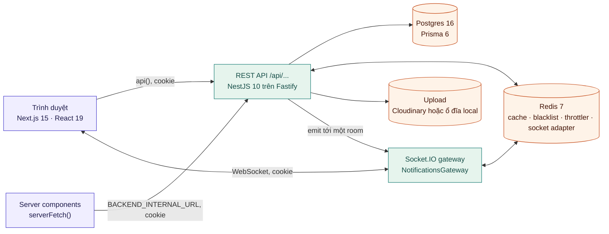
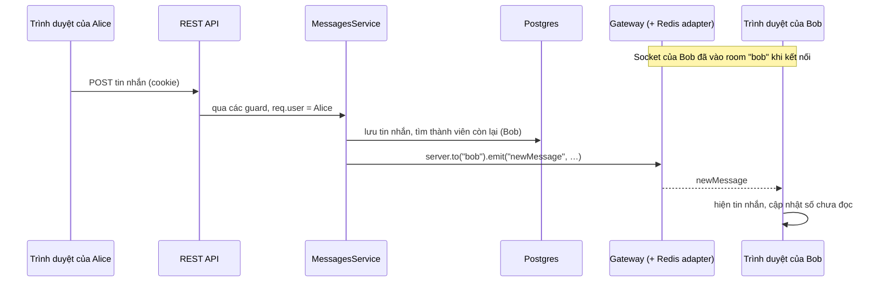

# 12 · Nền tảng và lớp real-time

[Sổ tay hướng dẫn](../Guidance-Manual.md) · [English](../en/12-platform-and-real-time.md) · Tiếng Việt

**Đọc xong bạn sẽ:** vẽ được toàn bộ hệ thống Breadit, không chỉ đường đi của feed; theo được một request qua các guard; giải thích một socket được gắn với một user ra sao và một tin nhắn đến người nhận ngay lập tức thế nào; nói được vì sao cache dùng số version thay vì xoá key; và nói được mỗi loại test chứng minh điều gì. Đây là kiến thức nền của Chương 4, 5 và 8 của thesis, và của cụm "real-time hybrid social networking platform" trong tên đề tài.

Nguồn: code (`apps/backend/src/auth/`, `notifications/`, `messages/`, `admin/`, `cache/`, `block/`, `apps/backend/test/it/`), `CLAUDE.md` (mục "Architecture"), `.docs/Bugs Report.md` (finding S1, S5 và bảng kiểm kê hệ thống). Sơ đồ: [System_Architecture.md](../../System_Architecture.md). Thuật ngữ: [09 Bảng thuật ngữ](09-glossary.md). Riêng đường đi của feed nằm ở [08](08-system-and-feed.md).

**Trạng thái.** Mọi mục mô tả code ngày 2026-11-19. Số lượng test lấy từ `verify.sh` của ngày đó.

---

## 1. Toàn bộ nền tảng trong một hình

Breadit là nền tảng của đóng góp C1 (kiến trúc) và C3 (lớp real-time). Cả hai đến từ pre-thesis và được giữ nguyên. Phần mới của thesis, C2, nằm bên trong feed (tài liệu 08).

Ba điều cần thấy trong hình:
- **Frontend không có database.** Mọi dữ liệu đều đến từ backend qua `/api/...`. Server component gọi backend kèm cookie của request đang đến; client component gọi từ trình duyệt.
- **REST API và gateway là cùng một tiến trình backend.** Một service thay đổi dữ liệu (một tin nhắn mới, một lần ban) cũng đẩy một sự kiện qua gateway.
- **Redis có bốn việc**: JSON cache, danh sách token đã logout (blacklist), bộ giới hạn tần suất (rate limiter), và Socket.IO adapter để chia sẻ room giữa các tiến trình backend.

**Nền tảng làm được gì.** Bài viết có ảnh, like, comment, repost, lưu bài, follow, community (tham gia, đăng bài, kiểm duyệt), tin nhắn riêng, thông báo, tìm kiếm, hashtag và mention, chặn người dùng, và trang quản trị. Backend có 13 controller và 72 route REST, cộng một Socket.IO gateway (Bugs Report, bảng kiểm kê hệ thống). Đây là chữ "hybrid" trong tên đề tài: timeline theo follow kiểu X và community theo chủ đề kiểu Reddit trong cùng một trang.

## 2. Một request đi qua backend

Lấy ví dụ "like một bài": `POST /api/posts/:id/like`.

1. **Các bước chung** (`main.ts`, `app.module.ts`). Bộ giới hạn tần suất (`ThrottlerGuard`, đếm trong Redis) kiểm tra request. `ValidationPipe` với `whitelist: true` bỏ mọi field trong body không có decorator `class-validator` trong DTO. Mọi lỗi được đưa về một dạng JSON qua `AllExceptionsFilter`.
2. **Guard của route**, theo thứ tự viết trên route. Route like có `@UseGuards(JwtAuthGuard, BannedUserGuard, EmailVerifiedGuard)` (`interactions.controller.ts`). `JwtAuthGuard` phải đứng đầu, vì nó đọc cookie và gán `req.user`; các guard khác đọc `req.user`:
   - `JwtAuthGuard`: cookie `breadit_session` phải chứa token HS256 hợp lệ (thư viện `jose`) và `jti` của token không nằm trong blacklist ở Redis;
   - `BannedUserGuard`: đọc lại `banned` từ database, vì token có thể đã cũ tới 30 ngày;
   - `EmailVerifiedGuard`: thao tác ghi cần email đã xác minh;
   - `RolesGuard` với `@Roles('ADMIN')`: chỉ có trên route quản trị.
3. **Service** làm việc với Postgres, tăng các version cache mà nó làm thay đổi (Mục 4), và có thể tạo một thông báo (Mục 3).

Các route cho phép khách (chưa đăng nhập) dùng `OptionalJwtAuthGuard`: không có cookie cũng được, và `req.user` để trống. Token sai, hết hạn hoặc đã logout cũng bị xử lý như vậy, tức là như khách (finding S5, phần HTTP). Cả hai guard gọi cùng một hàm, `readSession` (`auth/session.ts`), hàm này kiểm tra token và blacklist.

**Đăng nhập và đăng xuất.** Đăng nhập đặt cookie `breadit_session` (httpOnly, 30 ngày). Đăng xuất ghi `jti` của token vào Redis (`auth:blacklist:<jti>`), nên từ đó token này bị từ chối, kể cả ở socket, và bị coi là khách ở các route công khai. Mã gửi qua email (xác minh, đặt lại mật khẩu) là các dòng của bảng `VerificationToken`, gửi bằng SMTP.

## 3. Lớp real-time

"Real-time" trong thesis này nghĩa là **đẩy (push)**: server gửi một sự kiện tới trình duyệt qua một WebSocket đang mở, và trang cập nhật mà không cần tải lại. Một gateway làm toàn bộ việc này: `apps/backend/src/notifications/notifications.gateway.ts`.

### 3.1 Một socket là của ai

Socket nhận user của nó từ server, không bao giờ từ client:

1. Trình duyệt mở socket kèm cookie (`components/Socket.tsx`, singleton ở `src/socket.ts`).
2. Trước khi kết nối được tạo, một middleware (`server.use`) chạy `authenticate`: đọc `breadit_session` từ handshake, kiểm tra token và blacklist, rồi lưu `{ id, username }` vào `socket.data`. Token thiếu, sai, hết hạn hoặc đã logout đều bị từ chối.
3. Khi kết nối, server đưa socket vào room mang tên **username**. Client vẫn gửi `newUser`, nhưng cái tên nó gửi bị bỏ qua.

Đây là cách sửa finding **S1**. Trước đó client tự chọn room bằng cách gửi một username, nên ai cũng có thể vào room "bob" và đọc tin nhắn của Bob. **S5** (phần socket) thêm bước kiểm tra blacklist, nên token đã logout không kết nối được.

### 3.2 Các sự kiện

| Sự kiện (server → client) | Ai gửi | Tới room nào | Khi nào |
|---|---|---|---|
| `getNotification` | `NotificationsService.emit` | username của người nhận | một like, comment, follow, mention, … |
| `newMessage` | `MessagesService` | username của thành viên còn lại | một tin nhắn riêng được gửi |
| `messageRead` | `MessagesService.markRead` | username của thành viên còn lại | người đọc đánh dấu cuộc trò chuyện là đã đọc |
| `userTyping`, `userStopTyping` | gateway | `conversation:<id>` | một thành viên đang gõ hoặc ngừng gõ |
| `accountBanned` | `AdminService` | username của người bị ban | admin ban tài khoản; trình duyệt tự đăng xuất |

Client gửi `joinConversation` và `leaveConversation`, cùng `startTyping` và `stopTyping`. Một socket chỉ vào được `conversation:<id>` nếu database xác nhận nó là thành viên, và chỉ gửi được tín hiệu gõ vào room nó đã vào. Sự kiện gõ mang username lấy từ phiên đăng nhập, không phải tên do client viết.

**Thông báo được lưu trước, rồi mới đẩy.** `NotificationsService.emit` ghi một dòng `Notification` trước, rồi mới đẩy nó đi. User đang offline sẽ thấy nó sau trong danh sách; user đang online thấy ngay. Thông báo gửi cho chính mình bị bỏ qua.

### 3.3 Một tin nhắn riêng, từng bước

**Vì sao cần Redis adapter.** Với một tiến trình backend, room nằm trong bộ nhớ của nó. Với hai tiến trình trở lên, Bob có thể đang kết nối tới một tiến trình khác với tiến trình đã lưu tin nhắn. Adapter (`@socket.io/redis-adapter`) gửi sự kiện qua Redis tới mọi tiến trình, nên nó đến được Bob dù Bob kết nối ở đâu.

### 3.4 "Real-time" không bao gồm những gì

- **Feed không được đẩy.** Feed được xếp hạng khi user mở hoặc tải lại nó (tài liệu 08). Một feed đang mở không nhận bài mới.
- **Không đo thời gian giao sự kiện.** Thesis cho thấy sự kiện đến nơi (Mục 6), không cho thấy nhanh tới mức nào. Số liệu k6 của pre-thesis không được dùng: chúng đến từ một script cũ và một giới hạn tần suất cũ (super-plan §3).

## 4. Cache: dùng version thay vì xoá

Các endpoint đọc nhiều lưu câu trả lời JSON trong Redis (`src/cache/cache.service.ts`). Key có dạng `prefix:part:part…`, và một phần là **số version**.

- Đường đọc đưa version vào key, ví dụ `cache.getNumber('v:user', [userId])`.
- Đường ghi tăng nó lên: `incrNumber('v:user', [userId])`. Lần đọc sau tạo key mới và không trúng cache, nên đọc dữ liệu mới. Các entry cũ không bao giờ bị xoá; chúng tự hết hạn theo TTL.

Vì sao không xoá key? Một lần ghi có thể làm thay đổi nhiều câu trả lời đã cache (mọi trang của một feed, mọi bộ lọc của một danh sách), và không biết trước key của chúng. Một số version bao được tất cả bằng một lệnh Redis.

Thêm hai điểm:
- `getOrSetJson` thêm một khoá ngắn, nên khi một entry phổ biến hết hạn, chỉ một request dựng lại nó còn các request khác chờ (không bị "stampede").
- `REDIS_HTTP_CACHE_ENABLED=false` tắt JSON cache. Benchmark E7 chạy với cache tắt, để đo phần việc xếp hạng chứ không đo cache.

Các trang feed sống 10 giây, và key của chúng gồm `algo`, version `v:user` và thời điểm as-of (tài liệu 08).

## 5. Quy tắc mà mọi danh sách đều theo

- **Chặn.** `BlockService.getAllBlockedPeerIds` trả về những user bị chặn theo cả hai chiều. Truy vấn bài viết, user, tìm kiếm, thông báo và tin nhắn đều loại họ ra. Một danh sách mới cũng phải làm vậy.
- **Xoá mềm (soft delete).** Bài bị xoá vẫn giữ dòng của nó với `deletedAt` được đặt, và mọi truy vấn đều lọc nó.
- **Bài trong community.** Đăng bài vào community cần là thành viên, và chỉ bài đã duyệt (`isApproved`) mới được hiện.
- **Phân tích khi ghi.** Hashtag được đọc từ nội dung bài lúc lưu; mention từ bài và comment. Cả hai tạo dòng dữ liệu (và thông báo mention), nên khi đọc không bao giờ phải phân tích văn bản.

## 6. Các test và mỗi loại chứng minh điều gì

| Mức | Ở đâu | Số lượng (2026-11-19) | Chứng minh điều gì |
|---|---|---|---|
| Unit test của ranking | `packages/ranking/src/*.spec.ts` | 85 | Mỗi scorer, luật pool và các feature as-of cho đúng giá trị đã tính tay. |
| Unit test của backend | `apps/backend/src/**/*.spec.ts` | 204 | Service và guard tách riêng, ví dụ α và β đã tune bằng đúng run config đã duyệt, các luật của gateway. |
| Integration test (IT) | `apps/backend/test/it/` | 146 | App thật trên Postgres thật (schema `it_test`) và Redis (database 1): route, guard, feed, và socket (`socket.it-spec.ts`). |
| Parity test | `npm run test:parity` | 300 trên 300, hai lần | Thứ tự feed live bằng thứ tự của harness cho 100 cặp (user, thời điểm) lấy mẫu, ở module feed và qua HTTP. |
| Test của eval | `npm run verify -w @breadit/eval` | 432 | Generator, adapter Digg, harness (golden, leakage, double run), thống kê và report. |
| Test của hook | `.claude/hooks/test-hooks.cjs` | 96 | Các luật của quy trình: thư mục đóng băng, code cần duyệt, commit trên `test-app`. |

`bash .claude/hooks/verify.sh` chạy tất cả, trừ parity test (cần một dataset đã nạp) và test của hook.

**Các IT của socket** (`socket.it-spec.ts`) là bằng chứng cho C3. Chúng nối các client Socket.IO thật vào app đang chạy và kiểm tra: một user nhận mình là username khác bằng `newUser` vẫn không nhận được tin nhắn của người đó (S1); một user không bao giờ gửi `newUser` vẫn nhận được tin nhắn của mình (server tự cho vào room); client không thể đẩy thông báo giả; một thông báo follow thật vẫn đến; người không phải thành viên không nhận và không gửi được sự kiện gõ; token đã logout và thiếu cookie đều không kết nối được (S5); `accountBanned` đến được user bị ban.

`scripts/verify-socket.cjs` làm lại các kiểm tra S1 và S5 bằng tay trên một backend đang chạy (được `scripts/verify-bug-sweep.sh` khởi động).

## 7. Phần này nằm ở đâu trong thesis

- **Chương 4 (System Analysis and Design):** hình các component (Mục 1), các sequence của request và tin nhắn (Mục 2 và 3.3), các sự kiện (Mục 3.2) và các quy tắc của danh sách (Mục 5), ở mức thiết kế.
- **Chương 5 (Implementation):** Mục 1 đến 5 được xây dựng ra sao, cùng đường đi của feed ở tài liệu 08 và code mới của C2 (`packages/ranking`, tham số `algo`, `eval/`, lệnh repro).
- **Chương 8 (Test Cases and Demonstration):** bảng test ở Mục 6 và các test socket, làm bằng chứng rằng nền tảng và lớp real-time hoạt động.
- **Chương 1:** nghĩa của "real-time" (Mục 3) và của "hybrid" (Mục 1).

## 8. Tự kiểm tra

1. Vì sao trên một route `JwtAuthGuard` phải đứng trước `BannedUserGuard`, và vì sao `BannedUserGuard` lại phải đọc database?
2. Một client gửi `newUser: "bob"`. Socket của nó rốt cuộc nằm trong room nào, và vì sao?
3. Bob đang offline khi Alice like bài của Bob. Khi quay lại Bob thấy gì, và nó đến từ đâu?
4. Với hai tiến trình backend, vì sao Bob vẫn nhận được tin nhắn của Alice?
5. Một lần ghi làm thay đổi mọi trang feed của một user. Cache làm sao để không trang cũ nào được trả về, mà không xoá key nào?
6. Test nào sẽ fail nếu một người không phải thành viên đọc được sự kiện gõ của một cuộc trò chuyện?
7. "Real-time" trong tên đề tài có nghĩa là feed tự cập nhật không? Nó nghĩa là gì?
