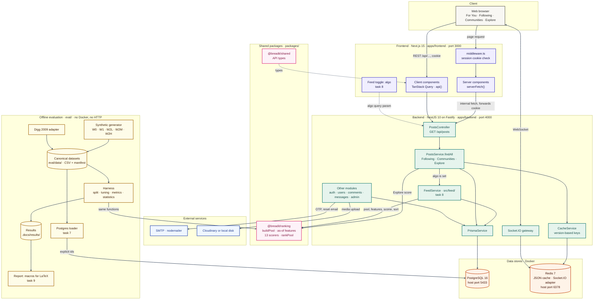
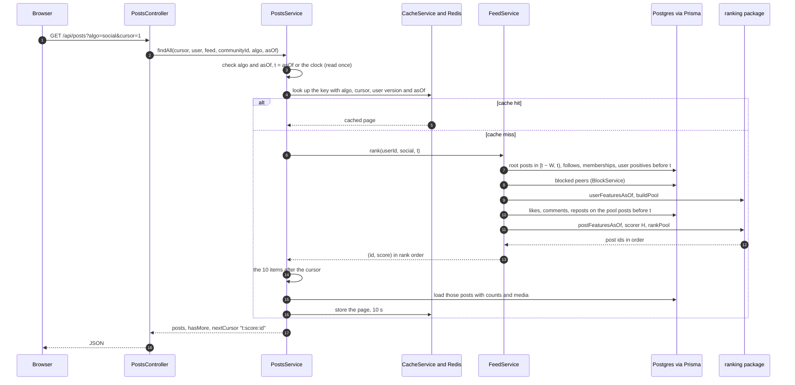
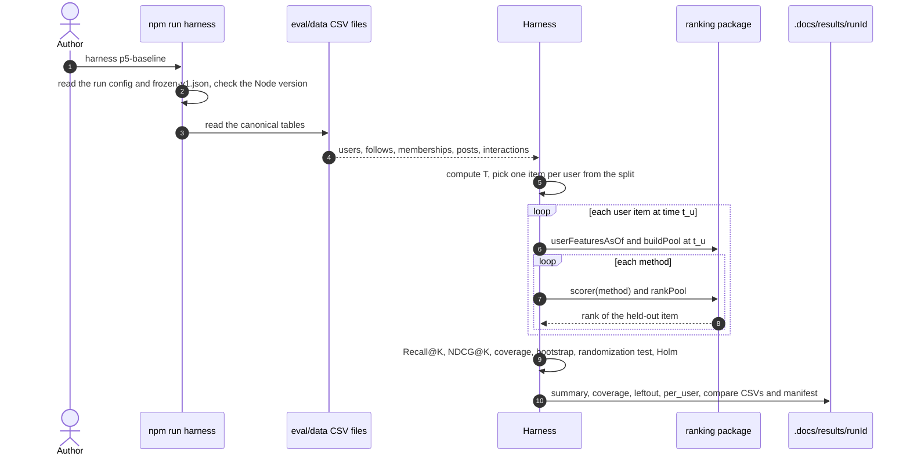
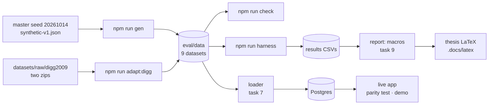

# System Architecture

Version 2.0 · 2026-11-02 · Thesis direction A: Social-Graph-Aware Hybrid "For You" feed

This document describes the system the thesis proposes: the Breadit platform from the pre-thesis, plus a shared ranking package, a personalized "For You" feed and an offline evaluation pipeline. It replaces version 1 of this file, which showed a Python/LightFM batch pipeline that the thesis no longer uses (section 9).

Sources: [super-plan.md](../.docs/super-plan.md) (phases, protocol, the hybrid score, frozen values) and [implementation-plan.md](../.docs/implementation-plan.md) (module map, data contracts, task list). When this document and those two disagree, those two are right.

**Status marks.** ✅ built and tested. 🔜 planned, with the task that builds it. Status on 2026-11-18.

---

## 1. Summary

The thesis adds three parts to the existing platform:

1. **`@breadit/ranking`** (`packages/ranking`) ✅. One pure TypeScript package that holds every ranking rule: the candidate pool, the "as of time t" features, 13 scoring methods (baselines, the hybrid and its ablations) and the final sort. It has no database, cache, clock or randomness.
2. **The social feed in the app** ✅ (task 8, `p6-social-feed`). A thin backend module that loads data from Postgres and calls `@breadit/ranking`. The "For You" feed has an `algo` option: `chrono` (BL0), `engagement` (BL2) or `social` (the hybrid H).
3. **The offline evaluation** (`eval/`, `@breadit/eval`), mostly ✅. It builds datasets (synthetic worlds and Digg 2009), replays the past at each user's test time, ranks with the same package, and measures quality with statistics.

The key idea: **the live app and the evaluation call the same ranking code.** Only the way they load data differs (Prisma in the app, CSV files in the evaluation). So a number measured offline describes the code that serves users. A parity test checks this (section 6.4).

---

## 2. Before and after

| | Pre-thesis (today) | Proposed (after P6–P8) |
|---|---|---|
| "For You" order | posts of you and your followees, newest first | `algo=social`: the hybrid score H, which uses follow trust and community affinity |
| Community posts | not in "For You" or Explore | approved community posts enter the candidate pool |
| A new user with no follows | sees only their own posts | sees posts ranked by engagement, and the social terms grow as they follow and interact |
| Explore score | inside `posts.service.ts`, uses `Date.now()` | `computeExploreScoreFixed` in `@breadit/ranking`, takes the time as an argument |
| Quality measurement | none (only latency and cache hits) | Recall@K, NDCG@K, coverage, paired bootstrap and randomization test with Holm correction |
| Data for evaluation | `seed.ts` (not deterministic), `humans_v1` (0 likes, 0 follows) | seeded synthetic worlds and Digg 2009, in one canonical CSV format |

The default "For You" stays as today. It would become `social` only if hypothesis H1 passed on both main tests and the null-world check H0 passed (super-plan §4, P7 "Default feed rule"). H1 failed on both main tests, so `FEED_DEFAULT_ALGO` stays empty and no code changes (P8). The default is read from an environment variable, so the switch would have changed configuration, not code. `social` stays available with the toggle, with the tuned α and β.

---

## 3. High-level architecture

Dashed boxes are planned (🔜). Everything else exists.



Three rules hold the picture together (implementation-plan §1):
- Nothing imports `eval/`. The backend never depends on evaluation code.
- The harness never touches Postgres, Redis or HTTP. Only the loader writes to Postgres.
- `@breadit/ranking` imports only the Node standard library. No Nest, Prisma, Redis, clock or random numbers.

---

## 4. Components

### 4.1 Frontend (`apps/frontend`)

Unchanged from the pre-thesis, except the feed toggle.

- **Server components** call the backend with `serverFetch()` / `getSession()` (`src/lib/session.ts`) on `BACKEND_INTERNAL_URL` and forward the `breadit_session` cookie by hand.
- **Client components** call `api()` / `apiMultipart()` (`src/lib/api.ts`) on `NEXT_PUBLIC_BACKEND_URL` with `credentials: 'include'`. TanStack Query handles infinite scroll and optimistic updates.
- **`middleware.ts`** only checks that the session cookie exists. The backend does the real check.
- **Feed toggle** ✅ (task 8). On the For You tab, three links ("Chronological", "Engagement", "Social") set `?algo=`. `app/(board)/page.tsx` whitelists `algo` (only when `feed` is not set), and `Feed.tsx` / `InfiniteFeed.tsx` put it in the request and the query key, so each option has its own cache entry. "For you" with no `algo` shows the default feed.
- **Community compose box** ✅ (task 8, D1). A community page shows the compose box only to members. Joining refreshes the page, so the box appears at once.

### 4.2 Backend (`apps/backend`)

The pre-thesis modules stay: auth (JWT in an httpOnly cookie, guards), users, posts, comments, interactions, communities, messages, notifications (Socket.IO with the Redis adapter), search, hashtags, uploads, block, admin, health. The "Architecture" section of `CLAUDE.md` describes them.

What the thesis changes:

- **Explore** ✅. `PostsService` imports `computeExploreScoreFixed` from `@breadit/ranking`. So BL2 in the evaluation is exactly the production code. Since task 8, the 7-day window and the age use one time per request: the clock read once, or the test-only `asOf` (Bugs Report T4). Its ranking did not change.
- **Feed module** ✅ (task 8, `apps/backend/src/feed/`). `FeedService.rank(userId, algo, t)` returns the whole ranked pool as `(id, score)` pairs. It never reads the clock. It loads from Prisma:
  - the root posts created in `[t − W, t)`, community posts included, repost rows left out, with no row limit;
  - the user's follows and memberships with their times;
  - the user's likes, comments and reposts before t, with the author and community of each touched post;
  - the blocked peers (`BlockService.getAllBlockedPeerIds`);
  - after `buildPool`, the likes, comments and reposts on the pool posts.
  
  Then it calls `userFeaturesAsOf`, `buildPool`, `postFeaturesAsOf`, `scorer(...)` and `rankPool`. It has no ranking logic of its own. Follows and memberships are read with their times, not from the cached `getFolloweesIds` / `getCommunityIds`, because the as-of rule needs the times. Comments and reposts count only when not deleted, as in `engagementSelect`.
- **`algo` option** ✅. `GET /api/posts?algo=` with `chrono` (BL0: followee posts first, then newest first), `engagement` (BL2, the Explore score on the shared pool) or `social` (the hybrid H). `algo` works only on the logged-in For You. An unknown value or a mix with `feed`, `user` or `communityId` gives 400, and a guest gets 401. α and β of `social` are the tuned values of P7, α = 1024 and β = 1024, in `feed/feed.constants.ts`. They are the `syn-W2M-M` values of `eval/config/runs/p7-main.json`, and a unit test checks that they are equal to that file. `m`, W and N_max are the §7 values, and a unit test checks them against `eval/config/frozen-v1.json`.
- **Paging.** Pages of 10. The cursor is `t:score:id`: the next page is ranked again at the same time t and starts after that item, so pages never repeat or skip a post. Without `asOf`, a cursor older than 24 h gives 400.
- **Default `algo`** ✅ comes from `FEED_DEFAULT_ALGO`. When it is not set, "For You" behaves exactly as today. A wrong value stops the backend at start. Docker Compose passes it to the backend.
- **Test-only `asOf` parameter** ✅. Unix seconds, accepted only when `FEED_ASOF_ENABLED=true`. The backend refuses to start with the flag on and `NODE_ENV=production`, and Docker Compose never passes it. It lets the parity test ask "what would the feed have been at time t". Only creates can be replayed: a delete or an unlike that happened after t is already gone.
- **Bugs fixed on the way** (task 8):
  - Pending community posts stay out of the pool (R2, the pool part).
  - Followees are counted once (T6).
  - A community ban or delete clears the cached community list and bumps `v:user` (B6).
  - Creating or deleting a post bumps the author's `v:user` (T3).
  - A community post needs membership (D1).

### 4.3 Ranking package (`packages/ranking`, `@breadit/ranking`) ✅

CommonJS, built with `tsc` to `dist/`, tested with Jest (82 unit tests). Build it before the backend and before `eval`.

| File | What it holds |
|---|---|
| `types.ts` | `Post`, `Positive`, `AsOf`, `UserFeatures`, `PostFeatures`, `MethodId`, `Scorer` |
| `asof.ts` | `visibleAt` (the "only the past" rule) and `ageHours` |
| `features.ts` | `userFeaturesAsOf` (followees, communities, past positives by author and by community) and `postFeaturesAsOf` (likes, comments, reposts, which users engaged) |
| `pool.ts` | `buildPool`: root posts, approved, not deleted, created before t, inside window W, not blocked; keep the newest N_max; drop the user's own posts and earlier positives |
| `scorers.ts` | `scorer(method)` for the 13 methods below. Every score is an integer, `floor(x × 100)` |
| `rank.ts` | `rankPool`: sort by `(scoreFixed desc, postId desc)`, a total order |
| `explore.ts` | `computeExploreScoreFixed`, moved unchanged from the backend |

**The "as of" rule.** An event is visible at time `asOf` if its time is before `asOf.t`, or equal to it with a smaller event id. Follows and memberships count only when strictly before `asOf.t`. The live app passes "now"; the harness passes the time of the user's held-out item. So no feature can see the future.

**The 13 methods.**

| Id | Method | Tuned parameter |
|---|---|---|
| BL0 | production "For You": followee posts first, newest first | — |
| BL1 | newest first | — |
| BL2 | production Explore score | — |
| BL2t | BL2 with a tuned age weight | `ageWeight` |
| BL3 | global popularity (likes) | — |
| BL4 | Reddit "hot" | `divisor` |
| BL5 | Hacker News ranking (natural log form) | `gravity` |
| BL6 | engagement + α × number of followees involved (no trust weights) | `alpha` |
| H | the hybrid (section 5) | `alpha`, `beta`, `m` |
| H-follow | H without the community term | `alpha`, `m` |
| H-comm | H without the social term | `beta`, `m` |
| H-noauthor | H without the author part of the social term | `alpha`, `beta`, `m` |
| H-noengager | H without the engaged-followees part | `alpha`, `beta`, `m` |

A missing parameter throws an error. It never falls back to a default.

### 4.4 Offline evaluation (`eval/`, `@breadit/eval`)

ESM. The `.ts` files run directly on the pinned Node 22 (type stripping), tests use `node --test`, and there is no runtime dependency except `@breadit/ranking`.

- **Synthetic generator** ✅ (`src/generator/`). Five stages, each with its own seeded random stream: users (hidden interests, skewed activity), follows, communities and memberships, posts, interactions. Five worlds: W0 (no social influence), W1 (shared tastes, no influence) and W2 at low, middle and high influence. Two sizes: S (200 users, 4,000 posts) and M (1,000 users, 20,000 posts). Parameters are in `config/synthetic-v1.json` and calibrated to Digg where Digg has a number.
- **Digg 2009 adapter** ✅ (`src/adapters/`). Reads the two password-protected zips in memory (its own ZipCrypto reader, nothing is extracted) and writes 336,047 users, 3,553 stories, 3,007,345 likes and 1,729,983 dated follows. Digg has no communities, so the community term is tested on synthetic data only.
- **Checks** ✅ (`src/checks/`). Format, calibration against Digg, the social lift from W0 to W2H, the cut time T and the history bucket table.
- **Harness** ✅ (`src/harness/`, `metrics.ts`, `stats.ts`). Runs a committed run config: picks each user's validation or test item, builds the pool and features as of that item's time, ranks with each method, and records the item's rank. Then it computes Recall@K, NDCG@K and coverage (K = 5, 10, 20), tunes parameters on the validation split, and compares methods with a paired bootstrap and a randomization test (10,000 each) with Holm correction. Since task 9 it also writes `compare.csv` (families F1 and F2 on `syn-W2M-M` and `digg2009`, or rows with no family), `density.csv` (E3), the H1 lines and the H0 gate line. A failed H0 gate stops the command after the files are written. Optional config keys give per-dataset params, a reversed tie-break (E6), the timestamp shuffle (E5) and the comparisons.
- **`rank` command** ✅. Prints one ranking for one user at one time. The parity test uses it.
- **Postgres loader** ✅ (task 7, `src/loader/`). `npm run load` writes a synthetic canonical dataset into its own Postgres schema `eval_load` (never `public`) with explicit ids, so the live app can run on it (parity test, E7, demo). It empties the schema and writes every row in one transaction. A like and a comment keep their `event_id`, and a repost becomes a `Post` row with `rePostId`. `npm run load:check` reads the rows back and checks that the six CSV files equal the manifest. It is the only part of `eval/` that imports `@prisma/client`. A demo-only `--rebase-to <time>` shifts all times by one constant so the last event lands on that time. Experiments never use it.
- **`freeze` command** ✅ (task 9, `src/harness/freeze.ts`). Reads the committed tuning results, checks the tuning rule, and writes the ten P7 test configs with the chosen numbers. `--approve author` adds the author's approval of the test split, and `--check` proves that the configs still equal the tuning.
- **Report** ✅ (task 9, `src/report/`). `npm run report` reads the P7 results folders (each file checked against its run manifest) and writes `.docs/results/p7-report/`: `macros.csv`, `results-macros.tex`, nine LaTeX tables, `results.md` (the same tables in Markdown) and the E3 figure data. Every macro traces to one CSV cell, so the thesis text never contains a typed number.

### 4.5 Data stores and files

| Store | Holds | Used by |
|---|---|---|
| PostgreSQL 16, schema `public` | live app data (dev seed, demo users) | backend |
| PostgreSQL 16, schema `it_test` | integration test data | backend IT tests |
| PostgreSQL 16, schema `eval_load` | a loaded synthetic dataset with explicit ids, emptied and refilled by each `npm run load` (task 7 chose a separate schema) | parity test, E7, demo |
| Redis 7, db 0 | JSON cache, rate limit, Socket.IO adapter, token blacklist | backend |
| Redis 7, db 1 | integration tests | backend IT tests |
| `eval/data/<datasetId>/` | canonical CSVs and `manifest.json` (git-ignored, rebuilt from the seed or the zips) | harness, checks, loader |
| `.docs/results/<runId>/` | committed results CSVs and run manifest | thesis, report |
| `datasets/raw/digg2009/` | the Digg zips (git-ignored, downloaded by hand) | Digg adapter |

**Canonical dataset.** Six CSV tables per dataset: `users`, `follows`, `communities`, `memberships`, `posts`, `interactions` (implementation-plan §2.2). UTF-8, LF, sorted rows, integer ids and integer seconds. A user id becomes `u` plus 10 digits (`u0000000042`) both in `@breadit/ranking` and in the loaded `User.id`, so the app and the harness sort users the same way.

---

## 5. The hybrid score

```
H(p, u, t) = engagement(p, t) + α · social(p, u, t) + β · community(p, u, t)

engagement(p, t)   = likes + 2·comments + 3·reposts − 0.25·ageHours      (as of t, same as BL2)
trust(u, f, t)     = (n_uf + m / |F_u|) / (N_u + m)
social(p, u, t)    = [u follows author(p)] · trust(u, author(p), t)
                   + Σ trust(u, f, t) over followees f who engaged with p before t
community(p, u, t) = (c_u,c(p) + m · [u is a member of c(p)] / |M_u|) / (N_u + m)
```

`n_uf` is u's earlier positives on f's posts, `N_u` is u's total earlier positives, `F_u` is u's followees, `c_u,c` is u's earlier positives in community c, `M_u` is u's communities, and `m` is the prior strength (frozen at 5).

Why this shape (super-plan §6):
- **Smoothing with `m`.** A user with no history gets trust spread equally over their followees and communities, instead of 0/0. This is what lets the social signal help new users, the group RQ1 is about.
- **One curve instead of phases.** The prior's weight `m / (N_u + m)` falls smoothly as the user's history grows. History buckets (0, 1–4, 5–19, 20+) are used only for reporting.
- **The author term.** A new post by a followee counts even before anyone engaged with it.

α and β are tuned on the validation split from the grid 0, 1, 2, 4, …, 1,024 (powers of 2; widened on 2026-11-11, before the test split) and then frozen.

---

## 6. Main workflows

### 6.1 Live "For You" request with `algo=social` ✅ (task 8)



Page 2 sends the cursor back. The pool is ranked again at the same t, and the page starts after the cursor's `(score, id)`. The cache stores whole pages for 10 s. Without `algo` (and with `FEED_DEFAULT_ALGO` unset), `findAll` runs the pre-thesis code paths unchanged.

### 6.2 Offline evaluation run ✅



The test split runs only when the run config says `"testApprovedBy": "author"`, and only once, after tuning is frozen.

### 6.3 Data pipeline



The nine datasets are the eight synthetic ones (five worlds at size M, three at size S) and `digg2009`.

### 6.3.1 One command for every Class D result ✅ (P8)

`npm run thesis:repro` (script `scripts/repro/thesis-repro.mjs`) rebuilds every Class D result and compares every hash with `.docs/results/manifest.json`. It needs Node from `.nvmrc`, `docker compose up db redis -d` and the two Digg zips in `datasets/raw/digg2009/`. It takes about 3 hours (the two Digg runs are the slowest).

1. **Checks** (a few seconds, nothing is written): Node, the merged manifest, no uncommitted change in `.docs/results/` or `eval/config/`, the SHA-256 of both Digg zips, Docker with `db` and `redis` ready. All problems are listed together and the command stops.
2. **Build and clean:** `@breadit/ranking` and the Prisma client are built. Then every Class D folder named in the merged manifest (`.docs/results/<id>/` and `eval/results/<id>/`) and `eval/data/` are deleted, so every file is rebuilt from nothing. `p7-e7` stays.
3. **Data:** `gen`, `adapt:digg`, `check`.
4. **Runs:** `p5-baseline`, the two P7 tuning runs, `freeze --check` (it writes nothing), then the ten approved test configs, `p7-h0` first. The command never tunes and never writes a config.
5. **Parity:** `parity` with α and β read from `p7-main.json`, `load` and `load:check` of `syn-W2M-M`, then `npm run test:parity -w @breadit/backend`.
6. **Report and compare:** `report`, then `npm run results:manifest -w @breadit/eval`. It fails on any difference and names the file.

Each step writes its output to `eval/results/repro/<nn>-<name>.log` (git-ignored). The terminal shows one line per step. The first failing step stops the command, prints the last 30 lines of its log and exits 1.

**The merged manifest** `.docs/results/manifest.json` holds the SHA-256 of the manifest of each of the 16 results folders and of the 9 dataset manifests (`eval/data/<id>/manifest.json`). Each of those manifests lists its files with their SHA-256, so the compare also checks every file, including the git-ignored ones (`per_user.csv`, `orders.csv`). It also finds a file that a manifest does not list. `p7-e7` is marked Class R: latency is repeatable but never byte-equal, so it is a report input and is not compared. The code is `eval/src/repro/merged.ts`. `npm run results:manifest -w @breadit/eval -- --write` makes the file; without `--write` it checks the tree.

### 6.4 Parity test ✅ (task 8)

The parity test proves that the live feed and the harness give the same order.

1. `npm run parity -w @breadit/eval -- --param alpha=1024 --param beta=1024` draws 100 (user, `asOf`) pairs from `syn-W2M-M` with the `parity` random stream, 25 in each history bucket. For each pair and each `algo` (`chrono` = BL0, `engagement` = BL2, `social` = H) it ranks the pool with the harness (`rankAt`, the same path as the `rank` command). It writes the pool size, the SHA-256 of the full order and the top 20 to `.docs/results/p6-parity/` (committed, with a manifest). The full orders go to the git-ignored `eval/results/p6-parity/orders.csv`.
2. `npm run load -w @breadit/eval -- syn-W2M-M` loads the same dataset into the Postgres schema `eval_load`, without `--rebase-to`.
3. `npm run test:parity -w @breadit/backend` starts the app on `eval_load`, with the cache off and the `asOf` flag on. First it checks that the row counts and the first post time equal the parity manifest, and that the backend's α, β, `m` and algo map equal the sample. Then, for each pair and `algo`:
   - (a) `FeedService.rank` must give the same full order (size and SHA-256);
   - (b) the first two pages of `GET /api/posts?algo=…&asOf=…` must equal the harness top 20.

Result on 2026-11-18, with the tuned α = β = 1024: 300 of 300 for (a) and 300 of 300 for (b), in about 33 s. The sample was first drawn on 2026-11-10 with α = β = 1; the draw of the 100 pairs does not read α or β, so `pairs.csv` did not change and only the `social` rows of `expected.csv` did. Live time is Unix seconds and harness time is seconds from the base epoch. Every score uses a time difference or rises with the post time, so the orders are equal; the test compares orders, not score values. When α, β, the dataset or the package changes, run `parity` again and commit its output. `npm run thesis:repro` runs this whole check again (section 6.3.1).

### 6.5 Cost benchmark E7 ✅ (task 10)

E7 asks what each `algo` feed costs: the time of page 1 and the number of Prisma queries per request. It uses the 100 (user, `asOf`) pairs of the parity test, on `syn-W2M-M` in `eval_load`. `npm run bench:e7` does four steps:

1. **Prepare.** A Jest project of the backend (`bench:prepare`) sends each request over Fastify `inject`, counts its Prisma queries and signs the session cookies. It counts twice and stops if one count differs. The pool pings of Prisma (`SELECT 1`) are not counted.
2. **Backend.** The runner starts the backend with `run-safe.sh`: schema `eval_load`, page cache off, `asOf` on, Redis database 3, `THROTTLE_LIMIT=1000000`. With the default limit of 1,000 per minute, k6 would get 429 (bug N6).
3. **k6.** 5 rounds of the three `algo` feeds, in a rotated order. A run is 100 requests, one virtual user, no sleep. Round 1 is warm-up. One failed request stops everything.
4. **Summary.** `npm run e7:summary -w @breadit/eval` writes `.docs/results/p7-e7/`: for each `algo`, the median of the 4 kept run medians with a 95% bootstrap interval, the p95 and the query counts. `npm run report` adds the macros `eSeven*` and the table e7.

Result on one machine (Apple M1, Postgres and Redis in Docker), page cache off, with the tuned α = β = 1024 (E7 was run again on 2026-11-18 with them; the cost does not depend on α and β):

| `algo` | Median (ms) | 95% interval | p95 (ms) | Prisma queries per request |
|---|---:|---|---:|---:|
| `chrono` | 35.851 | 35.615 to 36.005 | 40.011 | 19.650 |
| `engagement` | 35.879 | 34.634 to 36.289 | 40.447 | 19.630 |
| `social` | 35.836 | 34.906 to 36.102 | 39.766 | 19.700 |

The three feeds run the same queries (17 to 21 for a request, by user) and the intervals overlap, so the formula adds little to the cost of loading the pool. The query count is Class D. The latency is Class R: it compares the feeds on one machine and is not absolute speed. The numbers are in `.docs/results/p7-report/` (macros `eSeven*`, table e7).

---

## 7. Determinism

Every number in the thesis must come from a command that gives the same result every time (super-plan §2).

- **Class D, byte-identical:** datasets, features, rankings, metrics, statistics, tables. Each file has a SHA-256 in a manifest, and a re-run must give the same hashes.
- **Class R, repeatable:** latency and throughput (E7). Run 5 times, drop the first, report the median with a confidence interval.

How the code keeps Class D:
- **No clock, no `Math.random()`** in `packages/ranking/` or `eval/`. A test greps for them. Time is always an argument.
- **One seeded generator.** `rng(masterSeed, stage)` is sfc32 seeded from `sha256("<seed>:<stage>")`. Each stage has its own stream.
- **Integer scores** (`floor(score × 100)`) and a total tie-break `(scoreFixed desc, postId desc)`.
- **Canonical files and a pinned environment:** sorted CSV with LF, Node v22.23.4 in `.nvmrc` and in the manifest, Docker images pinned by digest.

---

## 8. Design decisions

**Ranking code in its own package, not inside the backend.** The harness must call exactly the code that serves users, but it must not start Nest, Prisma or Redis. A package that both import is the only way to have one copy of the code with no runtime around it. It also makes the scorers easy to unit test.

**Evaluation outside the backend.** `eval/` reads files, not the database or the API, so a run is fast, has no cache or rate limit in the way, and can be repeated byte for byte. The backend never imports it, so evaluation code can never reach production.

**Scores at request time, not a precomputed table.** The hybrid is a cheap formula over counts the database already has. Computing it per request keeps the feed fresh and needs no batch job or extra table. E7 measured the cost (§6.5): page 1 takes about 36 ms at the median, with about 19.6 to 19.7 Prisma queries, for all three `algo` feeds.

**The live app passes "now" as `asOf`.** It calls the same functions as the evaluation, so the only gap is how the data is loaded, and the parity test covers that gap.

---

## 9. What changed from version 1

Version 1 of this file proposed an offline ML pipeline: export interactions from Postgres, train a Python model (LightFM or matrix factorization), and write top-K recommendations into a `UserRecommendation` table that a `RecommendationService` serves. The thesis does not build it. Reasons:

- The thesis question is whether the **social graph** improves the feed for new users (RQ1, RQ2). A heuristic hybrid answers it directly, and each term can be switched off (ablations, E4). A learned model would hide which signal helped.
- A batch table is stale between runs and needs a second language and runtime.
- The deadline (2026-11-20) leaves no time for a model and its tuning (super-plan §9, out of scope).

The "Trending Service" of version 1 is the existing Explore score, now in `@breadit/ranking` as BL2.

---

## 10. Project directory tree

Folders marked 🔜 do not exist yet. "Git-ignored" folders exist only on the author's machine.

```text
Breadit/
├── apps/
│   ├── frontend/                     # @breadit/frontend · Next.js 15 App Router, React 19, Tailwind (port 3000)
│   │   ├── src/app/
│   │   │   ├── (board)/              # main three-column app (session and ban check in layout.tsx)
│   │   │   │   ├── page.tsx          # home: For You, Explore, Following, Communities tabs · the `algo` toggle on For You
│   │   │   │   ├── @modal/           # parallel route for the compose dialog
│   │   │   │   └── [username]/ c/ communities/ messages/ notifications/ search/ settings/ ...
│   │   │   ├── admin-console/        # admin pages, separate layout
│   │   │   └── sign-in/ sign-up/ verify/ forgot-password/ reset/
│   │   ├── src/components/           # UI · Feed.tsx and InfiniteFeed.tsx carry `algo` in the request and the query key
│   │   ├── src/lib/                  # api.ts (client fetch) · session.ts (serverFetch, getSession)
│   │   ├── src/middleware.ts         # sends to /sign-in when the session cookie is missing
│   │   └── src/socket.ts             # Socket.IO client singleton
│   │
│   └── backend/                      # @breadit/backend · NestJS 10 on Fastify, Prisma 6 (port 4000)
│       ├── prisma/
│       │   ├── schema.prisma         # data model: User, Post, Follow, Like, Comment, Community, ...
│       │   ├── migrations/           # 19 migrations · a committed one never changes
│       │   └── seed.ts               # dev seed: admin + user1–user50 · not deterministic, not for evaluation
│       ├── src/
│       │   ├── posts/                # PostsController, PostsService.findAll (all feeds), Explore via @breadit/ranking
│       │   ├── feed/                 # FeedService (loads from Prisma, calls @breadit/ranking), config, cursor, options
│       │   ├── auth/                 # JWT cookie, guards, OTP and reset email
│       │   ├── cache/                # CacheService: Redis JSON cache, version-based invalidation
│       │   ├── throttle/             # readThrottleLimit: THROTTLE_LIMIT, default 1,000 per 60 s (N6)
│       │   ├── block/                # BlockService: removes blocked peers from every listing
│       │   ├── notifications/        # Socket.IO gateway and notification rows
│       │   └── users/ comments/ interactions/ communities/ messages/ search/ hashtags/ uploads/ admin/ health/ ...
│       ├── test/it/                  # integration tests · Postgres schema it_test, Redis db 1
│       ├── test/parity/              # parity test · reads eval_load (never writes), Redis db 2
│       ├── test/bench/               # E7 prepare step · counts Prisma queries per request, signs session cookies · eval_load, Redis db 2
│       └── Dockerfile                # builds @breadit/ranking first · runs `prisma migrate deploy` on start
│
├── packages/
│   ├── shared/                       # @breadit/shared · API types used by the frontend
│   └── ranking/                      # @breadit/ranking · pure ranking code, CommonJS, built to dist/
│       └── src/
│           ├── types.ts              # Post, Positive, AsOf, UserFeatures, PostFeatures, MethodId
│           ├── asof.ts               # visibleAt, ageHours: the "only the past" rule
│           ├── features.ts           # userFeaturesAsOf, postFeaturesAsOf
│           ├── pool.ts               # buildPool: window W, cap N_max, filters
│           ├── scorers.ts            # scorer(method): BL0–BL6, BL2t, H and its 4 ablations
│           ├── rank.ts               # rankPool: (scoreFixed desc, postId desc)
│           ├── explore.ts            # computeExploreScoreFixed: the production Explore score (= BL2)
│           ├── index.ts              # public exports
│           └── *.spec.ts             # Jest unit tests, one file per module + a determinism test
│
├── eval/                             # @breadit/eval · offline evaluation, ESM, .ts run directly on Node 22
│   ├── config/
│   │   ├── frozen-v1.json            # the frozen values of super-plan §7 (seed, K, grids, T, pool sizes)
│   │   ├── synthetic-v1.json         # generator parameters (SHA-256 frozen 2026-11-02)
│   │   ├── digg2009.json             # Digg zip URLs and SHA-256
│   │   └── runs/                     # one JSON per harness run · p5-baseline, p7-tune-*, the ten P7 test configs
│   ├── src/
│   │   ├── rng.ts                    # rng(masterSeed, stage): seeded sfc32 streams
│   │   ├── frozen.ts                 # loads frozen-v1.json, checks the Node version
│   │   ├── canonical/                # schema of the 6 tables, CSV writer and strict reader, manifest
│   │   ├── generator/                # users, follows, communities, posts, interactions (+ interest, alloc helpers)
│   │   ├── adapters/                 # zip.ts (ZipCrypto reader), digg-parse.ts, digg.ts
│   │   ├── checks/                   # format, calibration, social lift, cut time T and bucket table
│   │   ├── harness/                  # split, index-data, post-features, run, tuning, write, config, commands, compare, shuffle, freeze
│   │   ├── metrics.ts                # Recall@K, NDCG@K, coverage
│   │   ├── stats.ts                  # paired bootstrap, randomization test, Holm
│   │   ├── results-csv.ts            # writes results CSVs and their hashes
│   │   ├── cli/                      # entry points: generate, adapt-digg, check, harness, rank, load, load-check, parity, freeze, report, e7-summary, results-manifest
│   │   ├── loader/                   # writes a synthetic dataset into the Postgres schema eval_load (the only Prisma user here)
│   │   ├── parity/                   # the parity sample: 100 (user, asOf) pairs and the harness orders
│   │   ├── report/                   # task 9 · results CSVs → macros.csv, results-macros.tex, tables, results.md
│   │   ├── repro/                    # task 11 · the merged manifest: hashes every results and dataset manifest, compares the tree
│   │   ├── bench/                    # task 10 · E7 summary: latency median with bootstrap CI, query counts
│   │   └── *.test.ts                 # node --test tests (golden, leakage, double run, scipy cross-check, ...)
│   ├── data/                         # git-ignored · canonical datasets, rebuilt by `gen` and `adapt:digg`
│   └── results/                      # git-ignored · per_user.csv files over 5 MB (hash kept in the manifest)
│
├── datasets/
│   ├── humans_v1.sql                 # pre-thesis demo users human01–human50 (frozen)
│   └── raw/digg2009/                 # git-ignored · the two Digg 2009 zips, downloaded by hand
│
├── .docs/                            # thesis-phase documents
│   ├── super-plan.md                 # the thesis plan: RQs, phases, protocol, hybrid score, frozen values
│   ├── implementation-plan.md        # module map, data contracts, task list
│   ├── Thesis_Orientation.md         # direction A, agreed with the supervisor
│   ├── datasets.md                   # why Digg 2009, how to download it, calibration targets
│   ├── literature.md · related-work.md
│   ├── Bugs Report.md                # known bugs and the task that fixes each
│   ├── results/                      # committed results, one folder per run (p5-baseline/, p6-parity/, p7-*/, p7-report/) · manifest.json is the merged manifest
│   ├── works/                        # one folder per task: design.md + plan.md
│   └── latex/ 🔜                     # P9 · the thesis LaTeX, copied from Latex/
│
├── docs/                             # documents for the supervisor and the defense
│   ├── System_Architecture.md        # this file
│   ├── Guidance-Manual/              # guidance manual
│   └── Pre-thesis/                   # the pre-thesis package: report chapters, diagrams, ADRs, k6 scripts · frozen
├── Latex/                            # pre-thesis report template · not edited
├── .claude/                          # workflow harness: /task, /bugfix, /approve, hooks, rules, templates
├── scripts/                          # verify-bug-sweep.sh, verify-socket.cjs, dataset-humans.ps1, e7/ (E7 k6 script and runner), repro/ (thesis-repro.mjs, `npm run thesis:repro`)
├── docker-compose.yml                # db (Postgres 16), redis (Redis 7), backend, frontend
├── Makefile                          # rebuild, backend-rebuild, frontend-rebuild, logs
├── package.json                      # npm workspaces: apps/*, packages/*, eval
├── .nvmrc · .npmrc                   # Node v22.23.4, engine-strict
└── CLAUDE.md                         # how to build, test and work in this repo
```

---

## 11. Status by component

| Component | Phase · task | Status |
|---|---|---|
| Platform (auth, posts, feeds, real-time, admin) | pre-thesis | ✅ |
| Pinned environment | P0 · task 2 | ✅ |
| Synthetic generator and checks | P3 · task 3 | ✅ |
| Digg 2009 adapter | P4 · task 4 | ✅ |
| `@breadit/ranking`, Explore uses it | P5 · task 5 | ✅ |
| Harness, metrics, statistics, baseline table | P5 · task 6 | ✅ |
| Postgres loader | P3 · task 7 | ✅ |
| Feed module, `algo`, `asOf` flag, parity test, toggle | P6 · task 8 | ✅ |
| Experiments E1–E6, E8, report and macros | P7 · task 9 | ✅ |
| Cost benchmark E7 | P7 · task 10 | ✅ |
| `npm run thesis:repro`, merged manifest, tuned α and β in the app | P8 · task 11 | ✅ |
| Default `algo`: For You stays as it is (H1 failed on both main tests) | P8 · task 11 | ✅ no code change |
| Slides and demo | P10 · task 13 | 🔜 |
