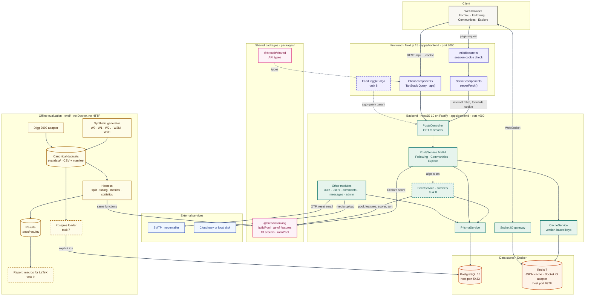
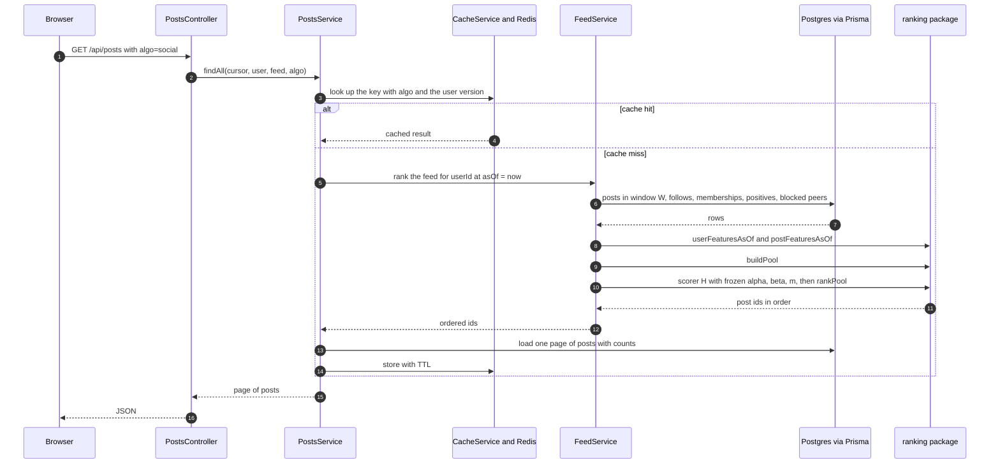
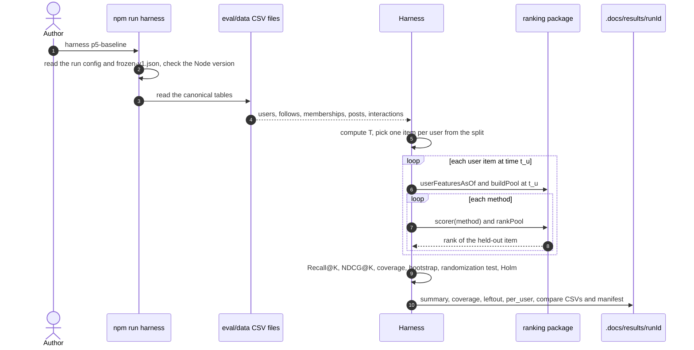
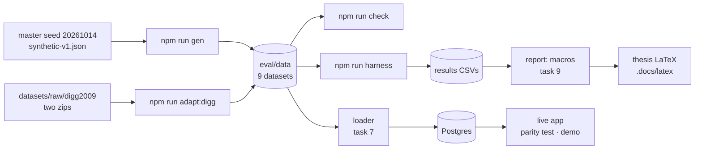

# System Architecture

Version 2.0 · 2026-11-02 · Thesis direction A: Social-Graph-Aware Hybrid "For You" feed

This document describes the system the thesis proposes: the Breadit platform from the pre-thesis, plus a shared ranking package, a personalized "For You" feed and an offline evaluation pipeline. It replaces version 1 of this file, which showed a Python/LightFM batch pipeline that the thesis no longer uses (section 9).

Sources: [super-plan.md](../.docs/super-plan.md) (phases, protocol, the hybrid score, frozen values) and [implementation-plan.md](../.docs/implementation-plan.md) (module map, data contracts, task list). When this document and those two disagree, those two are right.

**Status marks.** ✅ built and tested. 🔜 planned, with the task that builds it. Status on 2026-11-02.

---

## 1. Summary

The thesis adds three parts to the existing platform:

1. **`@breadit/ranking`** (`packages/ranking`) ✅. One pure TypeScript package that holds every ranking rule: the candidate pool, the "as of time t" features, 13 scoring methods (baselines, the hybrid and its ablations) and the final sort. It has no database, cache, clock or randomness.
2. **The social feed in the app** 🔜 (task 8, `p6-social-feed`). A thin backend module that loads data from Postgres and calls `@breadit/ranking`. The "For You" feed gets an `algo` option: `chrono`, `engagement` or `social`.
3. **The offline evaluation** (`eval/`, `@breadit/eval`), mostly ✅. It builds datasets (synthetic worlds and Digg 2009), replays the past at each user's test time, ranks with the same package, and measures quality with statistics.

The key idea: **the live app and the evaluation call the same ranking code.** Only the way they load data differs (Prisma in the app, CSV files in the evaluation). So a number measured offline describes the code that serves users. A parity test checks this (section 6.4).

---

## 2. Before and after

| | Pre-thesis (today) | Proposed (after P6–P8) |
|---|---|---|
| "For You" order | posts of you and your followees, newest first | `algo=social`: the hybrid score H, which uses follow trust and community affinity |
| Community posts | not in "For You" or Explore | approved community posts enter the candidate pool |
| A new user with no follows | sees only their own posts | sees posts ranked by engagement, and the social terms grow as they follow and interact |
| Explore score | inside `posts.service.ts`, uses `Date.now()` | `computeExploreScoreFixed` in `@breadit/ranking`, takes the time as an argument |
| Quality measurement | none (only latency and cache hits) | Recall@K, NDCG@K, coverage, paired bootstrap and randomization test with Holm correction |
| Data for evaluation | `seed.ts` (not deterministic), `humans_v1` (0 likes, 0 follows) | seeded synthetic worlds and Digg 2009, in one canonical CSV format |

The default "For You" stays as today until the experiments are done. It becomes `social` only if hypothesis H1 passes on both main tests and the null-world check H0 passes (super-plan §4, P7 "Default feed rule"). The default is read from an environment variable, so this switch changes configuration, not code.

---

## 3. High-level architecture

Dashed boxes are planned (🔜). Everything else exists.



Three rules hold the picture together (implementation-plan §1):
- Nothing imports `eval/`. The backend never depends on evaluation code.
- The harness never touches Postgres, Redis or HTTP. Only the loader writes to Postgres.
- `@breadit/ranking` imports only the Node standard library. No Nest, Prisma, Redis, clock or random numbers.

---

## 4. Components

### 4.1 Frontend (`apps/frontend`)

Unchanged from the pre-thesis, except the feed toggle.

- **Server components** call the backend with `serverFetch()` / `getSession()` (`src/lib/session.ts`) on `BACKEND_INTERNAL_URL` and forward the `breadit_session` cookie by hand.
- **Client components** call `api()` / `apiMultipart()` (`src/lib/api.ts`) on `NEXT_PUBLIC_BACKEND_URL` with `credentials: 'include'`. TanStack Query handles infinite scroll and optimistic updates.
- **`middleware.ts`** only checks that the session cookie exists. The backend does the real check.
- **Feed toggle** 🔜 (task 8). `app/(board)/page.tsx` adds `algo` to its whitelist of query values, and `Feed.tsx` / `InfiniteFeed.tsx` add it to the query key, so each option has its own cache entry. Cut 5 (super-plan §8) can drop this toggle; the backend option still works without it.

### 4.2 Backend (`apps/backend`)

The pre-thesis modules stay: auth (JWT in an httpOnly cookie, guards), users, posts, comments, interactions, communities, messages, notifications (Socket.IO with the Redis adapter), search, hashtags, uploads, block, admin, health. The "Architecture" section of `CLAUDE.md` describes them.

What the thesis changes:

- **Explore** ✅. `PostsService` now imports `computeExploreScoreFixed` from `@breadit/ranking`. So BL2 in the evaluation is exactly the production code. Explore's results did not change. Its 7-day window still reads `Date.now()`; task 8 makes it take the time as an argument (Bugs Report T4).
- **Feed module** 🔜 (task 8, `apps/backend/src/feed/`). A thin service. It loads from Prisma the candidate posts in the window W, the user's follows, memberships and earlier positives, and the blocked peers (`BlockService.getAllBlockedPeerIds`). Then it calls `userFeaturesAsOf`, `postFeaturesAsOf`, `buildPool`, `scorer(...)` and `rankPool`. It has no ranking logic of its own.
- **`algo` option** 🔜. `GET /api/posts` gets `algo` with values `chrono`, `engagement` and `social`. It goes through `posts.controller.ts` into `findAll` and into the cache key. The planned mapping is `chrono` = today's "For You" order, `engagement` = the Explore score on the same pool, `social` = the hybrid H with the frozen α, β and m. Task 8's design fixes the details.
- **Default `algo`** 🔜 comes from an environment variable. When it is not set, "For You" behaves exactly as today.
- **Test-only `asOf` parameter** 🔜. Enabled by an env flag, never in production. It lets the parity test ask "what would the feed have been at time t".
- **Bugs fixed on the way** (task 8): community posts enter the pool only when approved (R2), followees are counted once (T6), a community ban clears the cached community list (B6), and the cache state for the benchmark (T3).

### 4.3 Ranking package (`packages/ranking`, `@breadit/ranking`) ✅

CommonJS, built with `tsc` to `dist/`, tested with Jest (82 unit tests). Build it before the backend and before `eval`.

| File | What it holds |
|---|---|
| `types.ts` | `Post`, `Positive`, `AsOf`, `UserFeatures`, `PostFeatures`, `MethodId`, `Scorer` |
| `asof.ts` | `visibleAt` (the "only the past" rule) and `ageHours` |
| `features.ts` | `userFeaturesAsOf` (followees, communities, past positives by author and by community) and `postFeaturesAsOf` (likes, comments, reposts, which users engaged) |
| `pool.ts` | `buildPool`: root posts, approved, not deleted, created before t, inside window W, not blocked; keep the newest N_max; drop the user's own posts and earlier positives |
| `scorers.ts` | `scorer(method)` for the 13 methods below. Every score is an integer, `floor(x × 100)` |
| `rank.ts` | `rankPool`: sort by `(scoreFixed desc, postId desc)`, a total order |
| `explore.ts` | `computeExploreScoreFixed`, moved unchanged from the backend |

**The "as of" rule.** An event is visible at time `asOf` if its time is before `asOf.t`, or equal to it with a smaller event id. Follows and memberships count only when strictly before `asOf.t`. The live app passes "now"; the harness passes the time of the user's held-out item. So no feature can see the future.

**The 13 methods.**

| Id | Method | Tuned parameter |
|---|---|---|
| BL0 | production "For You": followee posts first, newest first | — |
| BL1 | newest first | — |
| BL2 | production Explore score | — |
| BL2t | BL2 with a tuned age weight | `ageWeight` |
| BL3 | global popularity (likes) | — |
| BL4 | Reddit "hot" | `divisor` |
| BL5 | Hacker News ranking (natural log form) | `gravity` |
| BL6 | engagement + α × number of followees involved (no trust weights) | `alpha` |
| H | the hybrid (section 5) | `alpha`, `beta`, `m` |
| H-follow | H without the community term | `alpha`, `m` |
| H-comm | H without the social term | `beta`, `m` |
| H-noauthor | H without the author part of the social term | `alpha`, `beta`, `m` |
| H-noengager | H without the engaged-followees part | `alpha`, `beta`, `m` |

A missing parameter throws an error. It never falls back to a default.

### 4.4 Offline evaluation (`eval/`, `@breadit/eval`)

ESM. The `.ts` files run directly on the pinned Node 22 (type stripping), tests use `node --test`, and there is no runtime dependency except `@breadit/ranking`.

- **Synthetic generator** ✅ (`src/generator/`). Five stages, each with its own seeded random stream: users (hidden interests, skewed activity), follows, communities and memberships, posts, interactions. Five worlds: W0 (no social influence), W1 (shared tastes, no influence) and W2 at low, middle and high influence. Two sizes: S (200 users, 4,000 posts) and M (1,000 users, 20,000 posts). Parameters are in `config/synthetic-v1.json` and calibrated to Digg where Digg has a number.
- **Digg 2009 adapter** ✅ (`src/adapters/`). Reads the two password-protected zips in memory (its own ZipCrypto reader, nothing is extracted) and writes 336,047 users, 3,553 stories, 3,007,345 likes and 1,729,983 dated follows. Digg has no communities, so the community term is tested on synthetic data only.
- **Checks** ✅ (`src/checks/`). Format, calibration against Digg, the social lift from W0 to W2H, the cut time T and the history bucket table.
- **Harness** ✅ (`src/harness/`, `metrics.ts`, `stats.ts`). Runs a committed run config: picks each user's validation or test item, builds the pool and features as of that item's time, ranks with each method, and records the item's rank. Then it computes Recall@K, NDCG@K and coverage (K = 5, 10, 20), tunes parameters on the validation split, and compares methods with a paired bootstrap and a randomization test (10,000 each) with Holm correction.
- **`rank` command** ✅. Prints one ranking for one user at one time. The parity test uses it.
- **Postgres loader** 🔜 (task 7, `src/loader/`). Writes a canonical dataset into Postgres with explicit ids, so the live app can run on it (parity test, demo). It is the only part of `eval/` that imports `@prisma/client`. A demo-only `--rebase-to` option shifts all times to today. Experiments never use it.
- **Report** 🔜 (task 9, `src/report/`). Turns the results CSVs into `macros.csv` and `results-macros.tex`, so the thesis text never contains a typed number.

### 4.5 Data stores and files

| Store | Holds | Used by |
|---|---|---|
| PostgreSQL 16, schema `public` | live app data (dev seed, demo users) | backend |
| PostgreSQL 16, schema `it_test` | integration test data | backend IT tests |
| PostgreSQL 16, loaded datasets 🔜 | a canonical dataset with explicit ids | parity test, demo. A separate schema or a separate database is still an open question for task 7 |
| Redis 7, db 0 | JSON cache, rate limit, Socket.IO adapter, token blacklist | backend |
| Redis 7, db 1 | integration tests | backend IT tests |
| `eval/data/<datasetId>/` | canonical CSVs and `manifest.json` (git-ignored, rebuilt from the seed or the zips) | harness, checks, loader |
| `.docs/results/<runId>/` | committed results CSVs and run manifest | thesis, report |
| `datasets/raw/digg2009/` | the Digg zips (git-ignored, downloaded by hand) | Digg adapter |

**Canonical dataset.** Six CSV tables per dataset: `users`, `follows`, `communities`, `memberships`, `posts`, `interactions` (implementation-plan §2.2). UTF-8, LF, sorted rows, integer ids and integer seconds. A user id becomes `u` plus 10 digits (`u0000000042`) both in `@breadit/ranking` and in the loaded `User.id`, so the app and the harness sort users the same way.

---

## 5. The hybrid score

```
H(p, u, t) = engagement(p, t) + α · social(p, u, t) + β · community(p, u, t)

engagement(p, t)   = likes + 2·comments + 3·reposts − 0.25·ageHours      (as of t, same as BL2)
trust(u, f, t)     = (n_uf + m / |F_u|) / (N_u + m)
social(p, u, t)    = [u follows author(p)] · trust(u, author(p), t)
                   + Σ trust(u, f, t) over followees f who engaged with p before t
community(p, u, t) = (c_u,c(p) + m · [u is a member of c(p)] / |M_u|) / (N_u + m)
```

`n_uf` is u's earlier positives on f's posts, `N_u` is u's total earlier positives, `F_u` is u's followees, `c_u,c` is u's earlier positives in community c, `M_u` is u's communities, and `m` is the prior strength (frozen at 5).

Why this shape (super-plan §6):
- **Smoothing with `m`.** A user with no history gets trust spread equally over their followees and communities, instead of 0/0. This is what lets the social signal help new users, the group RQ1 is about.
- **One curve instead of phases.** The prior's weight `m / (N_u + m)` falls smoothly as the user's history grows. History buckets (0, 1–4, 5–19, 20+) are used only for reporting.
- **The author term.** A new post by a followee counts even before anyone engaged with it.

α and β are tuned on the validation split from the grid 0, 1, 2, 4, 8, 16 and then frozen.

---

## 6. Main workflows

### 6.1 Live "For You" request with `algo=social` 🔜 (task 8)



Without `algo`, `findAll` runs the pre-thesis code paths unchanged. The exact cache shape (ids or full page) is decided in task 8.

### 6.2 Offline evaluation run ✅



The test split runs only when the run config says `"testApprovedBy": "author"`, and only once, after tuning is frozen.

### 6.3 Data pipeline



The nine datasets are the eight synthetic ones (five worlds at size M, three at size S) and `digg2009`. `npm run thesis:repro` 🔜 (task 11) runs the whole pipeline again and compares every hash with `.docs/results/manifest.json`.

### 6.4 Parity test 🔜 (task 8)

The parity test proves that the live feed and the harness give the same order.

1. Load a synthetic dataset into Postgres with the loader.
2. Pick 100 (user, `asOf`) pairs with the `parity` random stream.
3. For each pair, get the order from the `rank` command and from `GET /api/posts?algo=social` with the test-only `asOf` parameter, with `REDIS_HTTP_CACHE_ENABLED=false`.
4. The two lists must be equal.

---

## 7. Determinism

Every number in the thesis must come from a command that gives the same result every time (super-plan §2).

- **Class D, byte-identical:** datasets, features, rankings, metrics, statistics, tables. Each file has a SHA-256 in a manifest, and a re-run must give the same hashes.
- **Class R, repeatable:** latency and throughput (E7). Run 5 times, drop the first, report the median with a confidence interval.

How the code keeps Class D:
- **No clock, no `Math.random()`** in `packages/ranking/` or `eval/`. A test greps for them. Time is always an argument.
- **One seeded generator.** `rng(masterSeed, stage)` is sfc32 seeded from `sha256("<seed>:<stage>")`. Each stage has its own stream.
- **Integer scores** (`floor(score × 100)`) and a total tie-break `(scoreFixed desc, postId desc)`.
- **Canonical files and a pinned environment:** sorted CSV with LF, Node v22.23.4 in `.nvmrc` and in the manifest, Docker images pinned by digest.

---

## 8. Design decisions

**Ranking code in its own package, not inside the backend.** The harness must call exactly the code that serves users, but it must not start Nest, Prisma or Redis. A package that both import is the only way to have one copy of the code with no runtime around it. It also makes the scorers easy to unit test.

**Evaluation outside the backend.** `eval/` reads files, not the database or the API, so a run is fast, has no cache or rate limit in the way, and can be repeated byte for byte. The backend never imports it, so evaluation code can never reach production.

**Scores at request time, not a precomputed table.** The hybrid is a cheap formula over counts the database already has. Computing it per request keeps the feed fresh and needs no batch job or extra table. E7 measures the cost.

**The live app passes "now" as `asOf`.** It calls the same functions as the evaluation, so the only gap is how the data is loaded, and the parity test covers that gap.

---

## 9. What changed from version 1

Version 1 of this file proposed an offline ML pipeline: export interactions from Postgres, train a Python model (LightFM or matrix factorization), and write top-K recommendations into a `UserRecommendation` table that a `RecommendationService` serves. The thesis does not build it. Reasons:

- The thesis question is whether the **social graph** improves the feed for new users (RQ1, RQ2). A heuristic hybrid answers it directly, and each term can be switched off (ablations, E4). A learned model would hide which signal helped.
- A batch table is stale between runs and needs a second language and runtime.
- The deadline (2026-11-20) leaves no time for a model and its tuning (super-plan §9, out of scope).

The "Trending Service" of version 1 is the existing Explore score, now in `@breadit/ranking` as BL2.

---

## 10. Project directory tree

Folders marked 🔜 do not exist yet. "Git-ignored" folders exist only on the author's machine.

```text
Breadit/
├── apps/
│   ├── frontend/                     # @breadit/frontend · Next.js 15 App Router, React 19, Tailwind (port 3000)
│   │   ├── src/app/
│   │   │   ├── (board)/              # main three-column app (session and ban check in layout.tsx)
│   │   │   │   ├── page.tsx          # home: For You, Explore, Following, Communities tabs · gets `algo` in task 8
│   │   │   │   ├── @modal/           # parallel route for the compose dialog
│   │   │   │   └── [username]/ c/ communities/ messages/ notifications/ search/ settings/ ...
│   │   │   ├── admin-console/        # admin pages, separate layout
│   │   │   └── sign-in/ sign-up/ verify/ forgot-password/ reset/
│   │   ├── src/components/           # UI · Feed.tsx and InfiniteFeed.tsx get the `algo` query key in task 8
│   │   ├── src/lib/                  # api.ts (client fetch) · session.ts (serverFetch, getSession)
│   │   ├── src/middleware.ts         # sends to /sign-in when the session cookie is missing
│   │   └── src/socket.ts             # Socket.IO client singleton
│   │
│   └── backend/                      # @breadit/backend · NestJS 10 on Fastify, Prisma 6 (port 4000)
│       ├── prisma/
│       │   ├── schema.prisma         # data model: User, Post, Follow, Like, Comment, Community, ...
│       │   ├── migrations/           # 19 migrations · a committed one never changes
│       │   └── seed.ts               # dev seed: admin + user1–user50 · not deterministic, not for evaluation
│       ├── src/
│       │   ├── posts/                # PostsController, PostsService.findAll (all feeds), Explore via @breadit/ranking
│       │   ├── feed/ 🔜              # task 8 · FeedService: loads from Prisma, calls @breadit/ranking
│       │   ├── auth/                 # JWT cookie, guards, OTP and reset email
│       │   ├── cache/                # CacheService: Redis JSON cache, version-based invalidation
│       │   ├── block/                # BlockService: removes blocked peers from every listing
│       │   ├── notifications/        # Socket.IO gateway and notification rows
│       │   └── users/ comments/ interactions/ communities/ messages/ search/ hashtags/ uploads/ admin/ health/ ...
│       ├── test/it/                  # integration tests · Postgres schema it_test, Redis db 1
│       └── Dockerfile                # builds @breadit/ranking first · runs `prisma migrate deploy` on start
│
├── packages/
│   ├── shared/                       # @breadit/shared · API types used by the frontend
│   └── ranking/                      # @breadit/ranking · pure ranking code, CommonJS, built to dist/
│       └── src/
│           ├── types.ts              # Post, Positive, AsOf, UserFeatures, PostFeatures, MethodId
│           ├── asof.ts               # visibleAt, ageHours: the "only the past" rule
│           ├── features.ts           # userFeaturesAsOf, postFeaturesAsOf
│           ├── pool.ts               # buildPool: window W, cap N_max, filters
│           ├── scorers.ts            # scorer(method): BL0–BL6, BL2t, H and its 4 ablations
│           ├── rank.ts               # rankPool: (scoreFixed desc, postId desc)
│           ├── explore.ts            # computeExploreScoreFixed: the production Explore score (= BL2)
│           ├── index.ts              # public exports
│           └── *.spec.ts             # Jest unit tests, one file per module + a determinism test
│
├── eval/                             # @breadit/eval · offline evaluation, ESM, .ts run directly on Node 22
│   ├── config/
│   │   ├── frozen-v1.json            # the frozen values of super-plan §7 (seed, K, grids, T, pool sizes)
│   │   ├── synthetic-v1.json         # generator parameters (SHA-256 frozen 2026-11-02)
│   │   ├── digg2009.json             # Digg zip URLs and SHA-256
│   │   └── runs/                     # one JSON per harness run · p5-baseline.json
│   ├── src/
│   │   ├── rng.ts                    # rng(masterSeed, stage): seeded sfc32 streams
│   │   ├── frozen.ts                 # loads frozen-v1.json, checks the Node version
│   │   ├── canonical/                # schema of the 6 tables, CSV writer and strict reader, manifest
│   │   ├── generator/                # users, follows, communities, posts, interactions (+ interest, alloc helpers)
│   │   ├── adapters/                 # zip.ts (ZipCrypto reader), digg-parse.ts, digg.ts
│   │   ├── checks/                   # format, calibration, social lift, cut time T and bucket table
│   │   ├── harness/                  # split, index-data, post-features, run, tuning, write, config, commands
│   │   ├── metrics.ts                # Recall@K, NDCG@K, coverage
│   │   ├── stats.ts                  # paired bootstrap, randomization test, Holm
│   │   ├── results-csv.ts            # writes results CSVs and their hashes
│   │   ├── cli/                      # entry points: generate, adapt-digg, check, harness, rank
│   │   ├── loader/ 🔜                # task 7 · writes a canonical dataset into Postgres (the only Prisma user here)
│   │   ├── report/ 🔜                # task 9 · results CSVs → macros.csv and results-macros.tex
│   │   └── *.test.ts                 # node --test tests (golden, leakage, double run, scipy cross-check, ...)
│   ├── data/                         # git-ignored · canonical datasets, rebuilt by `gen` and `adapt:digg`
│   └── results/                      # git-ignored · per_user.csv files over 5 MB (hash kept in the manifest)
│
├── datasets/
│   ├── humans_v1.sql                 # pre-thesis demo users human01–human50 (frozen)
│   └── raw/digg2009/                 # git-ignored · the two Digg 2009 zips, downloaded by hand
│
├── .docs/                            # thesis-phase documents
│   ├── super-plan.md                 # the thesis plan: RQs, phases, protocol, hybrid score, frozen values
│   ├── implementation-plan.md        # module map, data contracts, task list
│   ├── Thesis_Orientation.md         # direction A, agreed with the supervisor
│   ├── datasets.md                   # why Digg 2009, how to download it, calibration targets
│   ├── literature.md · related-work.md
│   ├── Bugs Report.md                # known bugs and the task that fixes each
│   ├── results/                      # committed results, one folder per run (p5-baseline/)
│   ├── works/                        # one folder per task: design.md + plan.md
│   └── latex/ 🔜                     # P9 · the thesis LaTeX, copied from Latex/
│
├── docs/                             # documents for the supervisor and the defense
│   ├── System_Architecture.md        # this file
│   ├── Guidance-Manual/              # guidance manual
│   └── Pre-thesis/                   # the pre-thesis package: report chapters, diagrams, ADRs, k6 scripts · frozen
├── Latex/                            # pre-thesis report template · not edited
├── .claude/                          # workflow harness: /task, /bugfix, /approve, hooks, rules, templates
├── scripts/                          # verify-bug-sweep.sh, verify-socket.cjs, dataset-humans.ps1
├── docker-compose.yml                # db (Postgres 16), redis (Redis 7), backend, frontend
├── Makefile                          # rebuild, backend-rebuild, frontend-rebuild, logs
├── package.json                      # npm workspaces: apps/*, packages/*, eval
├── .nvmrc · .npmrc                   # Node v22.23.4, engine-strict
└── CLAUDE.md                         # how to build, test and work in this repo
```

---

## 11. Status by component

| Component | Phase · task | Status |
|---|---|---|
| Platform (auth, posts, feeds, real-time, admin) | pre-thesis | ✅ |
| Pinned environment | P0 · task 2 | ✅ |
| Synthetic generator and checks | P3 · task 3 | ✅ |
| Digg 2009 adapter | P4 · task 4 | ✅ |
| `@breadit/ranking`, Explore uses it | P5 · task 5 | ✅ |
| Harness, metrics, statistics, baseline table | P5 · task 6 | ✅ |
| Postgres loader | P3 · task 7 | 🔜 next |
| Feed module, `algo`, `asOf` flag, parity test, toggle | P6 · task 8 | 🔜 |
| Experiments E1–E6, E8, report and macros | P7 · task 9 | 🔜 |
| Cost benchmark E7 | P7 · task 10 | 🔜 |
| `npm run thesis:repro`, default `algo` | P8 · task 11 | 🔜 |
| Slides and demo | P10 · task 13 | 🔜 |
