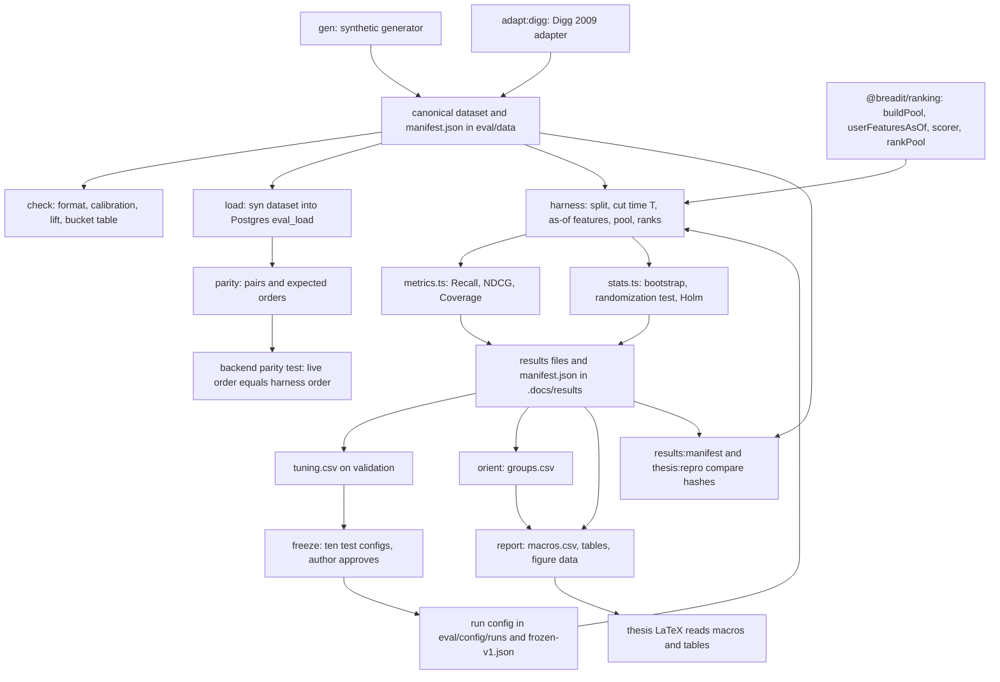

# `eval`: the thesis evaluation (`@breadit/eval`)

Vietnamese version: `README.vi.md` (the same structure, line for line). This English version is the reference.

`eval/` is the npm workspace `@breadit/eval`. It holds all the code that makes the numbers of the thesis: the data generator, the Digg 2009 adapter, the harness that ranks, the metrics, the statistics, the report, and the checks that prove a run can be repeated. This file is a map. It says what each folder and file does, how a number goes from the data to the thesis, and what each metric means. The concepts are explained in the Guidance Manual (`docs/Guidance-Manual/en/`), so this file links to it and does not copy it.

Sections: 1 what `eval` is, 2 commands, 3 the pipeline, 4 folder and file map, 5 data, 6 the protocol in the code, 7 metrics and statistics, 8 results files, 9 determinism and reproduction, 10 how to, 11 where to read more.

## 1. What `eval` is

### 1.1 Its job

`eval` is the offline evaluation of the thesis. It takes a dataset of past events (synthetic worlds or Digg 2009), hides one real interaction per user, ranks the posts with each method, and checks where the hidden post landed. Then it compares the methods with statistics and writes CSV files. The report step turns those files into the macros and tables of the thesis.

The ranking code is not in `eval`. It is in `packages/ranking` (`@breadit/ranking`): `buildPool`, the as-of feature builders, `scorer(method)` and `rankPool`. The backend feed (`apps/backend/src/feed/`) calls the same functions. So the offline numbers describe the live feed, and the parity test (section 3, step 10) checks it. `eval` only loads data, splits it, calls the package, and measures.

### 1.2 Rules

- No Postgres, Redis or HTTP. Only `src/loader/db.ts` writes to Postgres, and only to the schema `eval_load` (or another schema named `eval_...`), never to `public`. `src/imports.test.ts` checks that no other file imports `@prisma/client`.
- Nothing imports `eval`. It imports `@breadit/ranking`, which is CommonJS built to `dist/`, so run `npm run build -w @breadit/ranking` before the tests or any command.
- Node comes from `.nvmrc`. Every CLI script calls `checkNode()` (in `src/frozen.ts`) and stops on another version. The reason: `Math.log2` and `Math.pow` can differ between Node versions. The version is also written in every manifest (key `node`).
- Class D outputs (datasets, features, rankings, metrics, statistics, the data behind tables) must be byte-identical on every run. They never read the clock and never use `Math.random()`. Section 9 has the rules and the tests.
- Frozen values live in one file, `config/frozen-v1.json`. It equals super-plan §7, and `src/frozen.test.ts` checks that. Code reads it with `loadFrozen()`. Only the author changes a frozen value. This README names them and never copies them.
- The test split runs once, after tuning is frozen, and only when the run config holds `"testApprovedBy"`. There is no `--split` flag: the split comes from the config file.

### 1.3 What is in git and what is not

| Place | In git? | What it holds |
|---|---|---|
| `eval/src/`, `eval/config/` | yes | the code and the configs |
| `eval/data/<datasetId>/` | no (git-ignored) | the canonical datasets. They are rebuilt from the seed (synthetic) or from the two Digg zips |
| `datasets/raw/digg2009/` | no (git-ignored) | the two Digg zips, downloaded by hand. Their SHA-256 is in `config/digg2009.json` |
| `eval/results/<id>/` | no (git-ignored) | files too big for git: a `per_user.csv` over 5 MB, the parity `orders.csv`, the E7 raw files, `load-check/` and `repro/` logs |
| `.docs/results/<id>/` | yes | the committed results: small CSV files and one `manifest.json` per folder |

Git-ignored files are still safe, because their SHA-256 is written in the committed manifest of the same run. If the file changes by one byte, a check says so (section 9).

### 1.4 Words used in this file

| Word | Meaning |
|---|---|
| canonical dataset | one folder of six CSV files and a `manifest.json`: the one format the harness reads (section 5) |
| positive | a like, a comment or a repost. The only kind of event that counts as interest |
| item | the one post held out for a user: the test item (after the cut time) or the validation item (at or before it) |
| `T`, cut time | one global time for each dataset. It separates tuning (validation items) from testing (test items) |
| as-of, `asOf` | the time of a prediction. A feature may use only events before it (ties go by event id) |
| history | the number of a user's positives before the item time |
| bucket, group | a history class used only to report results. The labels are names of CSV cells. The edges are frozen values (super-plan §7) |
| pool | the candidate posts of one user at the item time: the newest posts of the window, without own and already touched posts |
| kept, left out | a user is kept when the item post is in the pool. Otherwise the user is left out |
| method | one way to score a post: `BL0` to `BL6`, `BL2t`, `H` and its ablations (section 6) |
| rank `r` | the 1-based position of the item post when the whole pool is sorted by a method |
| run, run id | one execution of one run config. Its id is the file name without `.json`, and its results folder has the same name |
| Class D, Class R | D is byte-identical (all results here). R is repeatable but not identical (latency of E7) |
| manifest | a JSON file next to a set of files: each file with its row count and SHA-256 |
| SHA-256, hash | a 64-character fingerprint of a file. One changed byte gives a new one |
| seed, stream | `rng(masterSeed, stage)` gives one random stream for each stage name (section 9) |

## 2. Commands

### 2.1 Before you start

Run `nvm use` in the repo root first. Run `npm install`, then `npm run build -w @breadit/ranking`. Only the loader needs Docker (`docker compose up db redis -d`). `adapt:digg` needs the two Digg zips in `datasets/raw/digg2009/`. Scripts that read big datasets set `--max-old-space-size=4096`.

### 2.2 Every script of `eval/package.json`

Run each one as `npm run <script> -w @breadit/eval [-- <arguments>]`.

| Script | Arguments | Reads | Writes | Time |
|---|---|---|---|---|
| `test` | none | `src/**/*.test.ts`, the fixtures | nothing | not recorded |
| `typecheck` | none | `src/**/*.ts` | nothing (`tsc --noEmit`) | not recorded |
| `verify` | none | runs `typecheck`, then `test` | nothing | not recorded |
| `gen` | `[outDir [datasetId ...]]` | `config/frozen-v1.json`, `config/synthetic-v1.json` | `eval/data/<id>/` (six CSV files and `manifest.json`), for all eight synthetic ids by default | not recorded |
| `adapt:digg` | `[rawDir [outDir]]` | the two zips in `datasets/raw/digg2009/` (SHA-256 checked first), `config/digg2009.json` | `eval/data/digg2009/` | about 7 s (task p4-digg-adapter) |
| `check` | `[dataDir]` | every folder of `eval/data/` | prints a report. Exit 1 on a failure. Writes no file | not recorded |
| `harness` | `<runId or path> [--out <dir>] [--record-t] [--data-dir <dir>]` | the run config, `frozen-v1.json`, the datasets | `.docs/results/<runId>/` (and `eval/results/<runId>/` for a big `per_user.csv`) | see below |
| `freeze` | `[--approve <name>] [--check] [--results-dir <dir>] [--config-dir <dir>]` | the two tuning runs `p7-tune-main` and `p7-tune-worlds` (each file checked against its manifest) | the ten test configs `eval/config/runs/p7-*.json` | not recorded |
| `rank` | `--dataset <id> --method <m> --user <u> --asof <t> --top <n> [--before-event <id>] [--param name=value] [--config <runId>] [--pool normal or large]` | one dataset in `eval/data/` | prints post ids in rank order | under 1 s on a synthetic dataset |
| `parity` | `--param alpha=<a> --param beta=<b> [--dataset <id>] [--out <dir>]` | `syn-W2M-M` | `.docs/results/p6-parity/` (`pairs.csv`, `expected.csv`, `manifest.json`) and `eval/results/p6-parity/orders.csv` | not recorded |
| `orient` | `[--results-dir <dir>] [--raw-dir <dir>]` | `p7-main/manifest.json` and `per_user.csv` (hash checked) | `.docs/results/p9-orient-groups/` (`groups.csv`, `manifest.json`) | not recorded |
| `report` | `[--results-dir <dir>] [--out <dir>]` | the 14 run folders of `REPORT_RUNS` in `.docs/results/` (each file hash checked, `per_user.csv` never read) | `.docs/results/p7-report/` | not recorded |
| `e7:summary` | `[--raw-dir <dir>] [--out <dir>] [--parity-dir <dir>]` | `eval/results/p7-e7/` (made by `npm run bench:e7`) | `.docs/results/p7-e7/` (Class R) | not recorded |
| `results:manifest` | `[--write]` | every manifest in `.docs/results/` and `eval/data/`, and every file they list | nothing (check mode), or `.docs/results/manifest.json` with `--write` | not recorded |
| `load` | `<datasetId> [--schema eval_x] [--rebase-to YYYY-MM-DDTHH:MM:SSZ]` | `eval/data/<id>/` (synthetic only) | Postgres schema `eval_load`. It empties that schema first | prints its run time |
| `load:check` | `<datasetId> [--schema eval_x] [--out <dir>]` | the Postgres schema | `eval/results/load-check/<id>/`. Exit 1 on any DIFF | not recorded |

Run times of `harness` are known for two runs: `p7-tune-main` took about 4,000 s and `p7-main` about 2,100 s, both because of `digg2009` (task p8-repro; peak memory about 3 GB). Runs on synthetic data only are shorter. `harness --record-t` computes `T` for each dataset of the config, prints it next to the recorded one, and runs no ranking.

### 2.3 Root commands that use `eval`

| Command | What it does |
|---|---|
| `npm run thesis:repro` | deletes every Class D result and `eval/data/`, rebuilds them in 27 steps, and compares every hash (section 9). About 3 hours. Needs Docker `db` and `redis` and the Digg zips |
| `npm run test:parity -w @breadit/backend` | the live feed against the harness order, on `syn-W2M-M` in `eval_load` and Redis database 2 |
| `npm run bench:e7` | the E7 cost benchmark (Class R). Writes `eval/results/p7-e7/`. Then run `e7:summary` |
| `npm run demo:start` | loads `syn-W2M-M` into the schema `eval_demo` with `--rebase-to`, for the demo (`scripts/demo/`) |

### 2.4 A typical session

```bash
nvm use
npm install
npm run build -w @breadit/ranking
npm run gen -w @breadit/eval
npm run check -w @breadit/eval
npm run harness -w @breadit/eval -- p5-baseline
npm run verify -w @breadit/eval
```

## 3. The pipeline end to end



Walk-through, step by step:

1. **Make the data.** `gen` builds the eight synthetic datasets in five stages, each with its own random stream (`generator/generate.ts`). `adapt:digg` converts the two Digg zips (`adapters/digg.ts`). Both write the same canonical format and a manifest with the SHA-256 of every file.
2. **Check the data.** `check` reads only the written files and tests the format, the manifest hashes, the calibration targets, the social lift of each world, and the bucket table (`checks/run.ts`).
3. **Read a run config.** A run config is a JSON file in `eval/config/runs/`. It names the datasets, the split, the methods and their parameters. `harness/config.ts` refuses a bad config before it loads any data.
4. **Split.** For each dataset the harness computes `T` and picks one item per user: the last positive after `T` for the test split, the last one at or before `T` for the validation split (`harness/split.ts`, `checks/buckets.ts`). It stops if its `T` differs from the recorded one.
5. **Build the as-of state.** For each item, at the item time, it builds the history, the bucket and the pool with `buildPool`, and the user and post features with the as-of builders of the package (`harness/run.ts`). A user whose item post is not in the pool is left out.
6. **Rank.** Each method scores the whole pool with its `scorer` and `rankPool` sorts it by `(scoreFixed desc, postId desc)`. The rank `r` of the item post is the result (`scoreItem` in `harness/run.ts`).
7. **Measure.** `metrics.ts` turns the ranks into Recall@K, NDCG@K and Coverage@K for each group. `stats.ts` turns paired per-user differences into a gain, an interval, a p-value and a Holm-adjusted p-value (`harness/compare.ts`).
8. **Write the results.** `harness/write.ts` writes `per_user.csv`, `summary.csv`, `coverage.csv`, `leftout.csv` and `manifest.json`. A run with `compare` also writes `compare.csv`, and with `density` also `density.csv`. A tuning run writes `tuning.csv`.
9. **Tune, freeze, approve, test.** Tuning runs use the validation split only. `freeze` writes the ten test configs from the chosen rows of `tuning.csv`. The author approves them (`--approve`). Then each test run executes once.
10. **Check against the live app.** `parity` draws 100 (user, `asOf`) pairs of `syn-W2M-M` and writes the harness order of each pair. `load` puts that dataset in Postgres. The backend test `test:parity` asks the live feed for the same pairs and compares the orders.
11. **Orient, report.** `orient` computes the exploratory group comparison of the supervisor's Orientation. `report` reads the run folders, checks every file against its manifest, and writes the macros, the tables and the figure data that the thesis LaTeX reads (`.docs/results/p7-report/`).
12. **Prove the chain.** `results:manifest` compares every manifest and every listed file with `.docs/results/manifest.json`. `thesis:repro` deletes the Class D results, rebuilds everything from the raw data, and ends with that compare.

## 4. Folder and file map

### 4.1 Top level of `eval/`

| Path | What it is |
|---|---|
| `package.json` | the scripts (section 2) and two dependencies: `@breadit/ranking` and `@prisma/client` (loader only) |
| `tsconfig.json` | strict TypeScript, `noEmit`, `allowImportingTsExtensions`. Node strips the types at run time, so there is no build step for `eval` |
| `README.md`, `README.vi.md` | this file and its Vietnamese version |
| `config/` | the frozen values, the generator config, the Digg config and the run configs (section 4.5) |
| `src/` | all code and tests (sections 4.2 to 4.4) |
| `data/` | generated canonical datasets (git-ignored): nine folders, eight `syn-...` and `digg2009` |
| `results/` | large and raw results (git-ignored): `load-check/`, `p6-parity/`, `p7-e7/`, `repro/` and the big `per_user.csv` of some runs |

### 4.2 `src/` top level and small folders

| File | What it does | Called by |
|---|---|---|
| `frozen.ts` | `loadFrozen()` reads `config/frozen-v1.json`. `checkNode()` and `pinnedNodeVersion()` stop a run on a Node version that is not `.nvmrc` | almost every file and every CLI |
| `rng.ts` | `rng(masterSeed, stage)`: the one seeded random source (sfc32, seeded from SHA-256). `STAGE_NAMES` lists the allowed stages | generator, `harness/shuffle.ts`, `parity/sample.ts`, `stats.ts`, `bench/e7.ts` |
| `metrics.ts` | `recallAt`, `ndcgAt`, `summarize`, `CoverageTracker`, `f6`, `GROUPS`, `METHOD_ORDER` | `harness/run.ts`, `harness/compare.ts`, `stats.ts`, `orient.ts`, `report/` |
| `stats.ts` | `pairedDifferences`, `pairedBootstrap`, `randomizationTest`, `exactRandomizationTest`, `holm`, `applyHolm`, `compareRow`, `h1Verdict`, `h0Gate`, `writeCompare` | `harness/compare.ts`, `harness/commands.ts`, `orient.ts` |
| `orient.ts` | `orientCommand`, `groupRows`, `orientGroup`: the Orientation group comparison (`p9-orient-groups`) | `cli/orient.ts` |
| `results-csv.ts` | `csvText`, `writeCsv`, `writeCsvText`: the one writer of results CSV files (no comma or line break in a cell) | harness, report, stats, parity, bench, orient |

| File | What it does | Called by |
|---|---|---|
| `canonical/schema.ts` | `SCHEMAS`, `TABLES`: the six tables with their columns, sort keys and empty-able columns | the other `canonical/` files, `checks/format.ts`, the generator, the adapter |
| `canonical/csv.ts` | `writeTable` (checks, sorts, writes), `readTable` (strict reader), `sha256Hex`, `FileEntry` | all writers and readers of datasets |
| `canonical/dataset.ts` | `loadDataset(dir)`: reads a dataset folder into typed rows (`Dataset`) | `checks/`, `harness/`, `parity/`, loader CLIs |
| `canonical/manifest.ts` | `Manifest`, `canonicalJson` (sorted keys, two spaces, final LF), `writeManifest`, `readManifest` | every writer of a manifest |
| `repro/merged.ts` | `buildMerged`, `checkTree`, `mergedCommand`: the merged manifest `.docs/results/manifest.json` and its compare. `CLASS_R` lists the Class R folders | `cli/results-manifest.ts` |
| `parity/sample.ts` | `drawParityPairs`: draws the (user, `asOf`) pairs with the stream `parity` | `parity/write.ts` |
| `parity/expected.ts` | `expectedOrders`, `orderSha256`, `PARITY_ALGOS`: the harness order of each pair for `chrono` (`BL0`), `engagement` (`BL2`) and `social` (`H`) | `parity/write.ts` |
| `parity/write.ts` | `parityCommand`, `writeParity`: writes `pairs.csv`, `expected.csv`, `orders.csv`, `manifest.json` | `cli/parity.ts` |
| `bench/e7.ts` | pure functions of the E7 summary: `median`, `bootstrapMedian`, `summarizeLatency`, `summarizeQueries`, parsers | `bench/write.ts` |
| `bench/write.ts` | `e7SummaryCommand`: reads the raw E7 files, writes `latency.csv`, `queries.csv`, `runs.csv`, `queries-raw.csv`, `manifest.json` | `cli/e7-summary.ts` |

### 4.3 `src/` folders of data, checks, harness, loader and report

| File | What it does | Called by |
|---|---|---|
| `generator/generate.ts` | `generateDataset(id, outDir)`: runs the five stages, writes the folder. Also `datasetIds`, `datasetDir`, `parseDatasetId` | `cli/generate.ts`, `checks/run.ts`, loader CLIs |
| `generator/config.ts` | loads `synthetic-v1.json`. `makeParams` gives the parameters of one world and size. `configSha256`, `loadTargets` | the generator, `checks/run.ts` |
| `generator/users.ts` | stage `users`: ids, join times, main topic, number of actions, Pareto weights | `generator/generate.ts` |
| `generator/follows.ts` | stage `follows`: who follows whom (homophily weight, returned links) | `generator/generate.ts` |
| `generator/communities.ts` | stage `communities`: one community per topic and the memberships | `generator/generate.ts` |
| `generator/posts.ts` | stage `posts`: authors, times, community posts, ids that grow with time | `generator/generate.ts` |
| `generator/interactions.ts` | stage `interactions`: each action picks a post by one weighted draw (interest, freshness, popularity, social and community influence) | `generator/generate.ts` |
| `generator/interest.ts` | the hidden interest vector and the homophily weight | follows, communities, interactions |
| `generator/alloc.ts` | `allocate`: splits a total into integers by weights (largest remainder) | `generator/follows.ts` |
| `adapters/digg.ts` | `adaptDigg`: checks the zip hashes, reads in memory, `toCanonical` applies the rules, writes the dataset. `loadDiggConfig`, `countsTable` | `cli/adapt-digg.ts` |
| `adapters/digg-parse.ts` | `parseVotes`, `parseFriends`: strict parsers into typed arrays | `adapters/digg.ts` |
| `adapters/zip.ts` | `readEncryptedMember`: reads the one member of a ZipCrypto zip (Node has no reader) | `adapters/digg.ts` |
| `adapters/zip-fixture.ts` | test helper: `buildZip` makes small zips in memory | tests only |
| `checks/run.ts` | `checkAll`, `bucketVerdict`: the `check` command | `cli/check.ts` |
| `checks/format.ts` | `checkFormat`: format rules, manifest hashes, the rules about follows, community posts and events | `checks/run.ts` |
| `checks/calibration.ts` | `measure`, `calibrate`, `withinTolerance`: synthetic data against the Digg targets of `synthetic-v1.json` | `checks/run.ts` |
| `checks/lift.ts` | `computeLift`: social lift (how much more likely an action is on a post a followee showed) | `checks/run.ts` |
| `checks/buckets.ts` | the one place of the `T` rule: `cutTime`, `testItems`, `bucketOf`, `historyCount`, `inPool`, `poolSize`, `bucketReport` | `checks/run.ts`, `harness/split.ts`, `metrics.ts` |
| `checks/fixture.ts` | test helper: `writeFixture` writes a small dataset folder | tests only |
| `harness/config.ts` | `parseRunConfig`, `validateConfig`, `REQUIRED_PARAMS`, `variantsFor`, `resolveParam`: the run config and its guards | `harness/commands.ts`, `run.ts`, `tuning.ts`, `freeze.ts` |
| `harness/split.ts` | `splitItems`, `validationItems`, re-exports `testItems` and `cutTime` | `harness/run.ts` |
| `harness/index-data.ts` | `buildDataIndex`: flat typed-array indexes. `userEventCount`, `postCounts`, `followeeEngagement`, `windowCandidates`, `uid` | `harness/run.ts`, `post-features.ts`, `parity/sample.ts` |
| `harness/post-features.ts` | `fastPostFeatures`, `referencePostFeatures`, `userFeatureData`: the two ways to build features | `harness/run.ts` |
| `harness/run.ts` | `runDataset`, `runConfig`, `prepareItem`, `scoreItem`, `rankAt`, `computeCutTime`, `poolSetting`: the core of one run | `commands.ts`, `compare.ts`, `tuning.ts`, `parity/` |
| `harness/shuffle.ts` | `shuffleWithinPosts`: the timestamp shuffle of E5 | `harness/run.ts` |
| `harness/tuning.ts` | `tuneConfig`, `tuneDataset`, `gridFor`, `pickBest`, `writeTuning`: grid search on validation | `harness/commands.ts`, `freeze.ts` |
| `harness/compare.ts` | `compareRows` (F1, F2 or none), `densityRows`, `verdictLines`, `writeCompareRows`, `writeDensity` | `harness/commands.ts` |
| `harness/write.ts` | `writeResults`, `resultTexts`: the four result files and the run manifest. `PER_USER_COMMIT_LIMIT_BYTES` | `harness/commands.ts` |
| `harness/commands.ts` | `harnessCommand` and `rankCommand`: the logic of the two CLIs, so tests can call it | `cli/harness.ts`, `cli/rank.ts` |
| `harness/freeze.ts` | `freezeCommand`, `TEST_RUNS`, `buildTestConfigs`, `checkTuningRule`, `e8Baseline` | `cli/freeze.ts` |
| `harness/random-data.ts` | test helper: small random datasets with many time ties. Also the `DatasetTables` type | tests. Other files import only its type |
| `loader/db.ts` | the only file that imports `@prisma/client`: `migrate`, `load`, `readBack` | `cli/load.ts`, `cli/load-check.ts` |
| `loader/map.ts` | `toAppRows`, `fromAppRows`, `detectShift`: canonical rows to app rows and back (pure) | `loader/db.ts`, loader CLIs |
| `loader/ids.ts` | `appUserId`, `canonicalUserId`, `repostOffset`: ids of the app rows | `loader/map.ts` |
| `loader/target.ts` | `targetUrl`, `schemaOf`: only a schema named `eval_...` is allowed | `loader/db.ts`, loader CLIs |
| `loader/time.ts` | `toDate`, `fromDate`, `rebaseShift`, `lastEventTime`: times, and the demo-only shift | `loader/map.ts`, loader CLIs |
| `report/report.ts` | `reportCommand`, `REPORT_RUNS`: reads the runs, writes the report folder, checks each macro again | `cli/report.ts` |
| `report/read.ts` | `readRun`, `parseCsv`: reads a run folder and checks each file against the run manifest | `report/`, `orient.ts`, `bench/e7.ts` |
| `report/macros.ts` | `MACRO_SPECS`, `buildMacros`, `verifyMacros`, `macrosCsv`, `macrosTex`, `checkTieChanges` | `report/report.ts` |
| `report/tables.ts` | `buildTables`, `toLatex`, `toMarkdown`, `figE2Rows`, `figE3Rows`, `figE5Rows` | `report/report.ts` |
| `report/round.ts` | `roundDecimal`, `formatP`, `gridValue`: rounding on the decimal text, half away from zero | `report/macros.ts`, `report/tables.ts` |
| `report/fixture.ts` | test helper: a results folder of hand-made numbers for the report tests | tests only |

### 4.4 `src/cli/` and the tests

Each file of `src/cli/` is a thin script: `checkNode()`, one call, print, set the exit code. The logic is in the module named in the second column, so tests can call it.

| CLI file | Script | Calls |
|---|---|---|
| `cli/generate.ts` | `gen` | `generateDataset` |
| `cli/adapt-digg.ts` | `adapt:digg` | `adaptDigg` |
| `cli/check.ts` | `check` | `checkAll` |
| `cli/harness.ts` | `harness` | `harnessCommand` |
| `cli/freeze.ts` | `freeze` | `freezeCommand` |
| `cli/rank.ts` | `rank` | `rankCommand` |
| `cli/parity.ts` | `parity` | `parityCommand` |
| `cli/orient.ts` | `orient` | `orientCommand` |
| `cli/report.ts` | `report` | `reportCommand` |
| `cli/e7-summary.ts` | `e7:summary` | `e7SummaryCommand` |
| `cli/results-manifest.ts` | `results:manifest` | `mergedCommand` |
| `cli/load.ts` | `load` | `toAppRows`, `migrate`, `load` |
| `cli/load-check.ts` | `load:check` | `readBack`, `fromAppRows`, `writeTable` |

The 44 test files sit next to the code they test. They are grouped here by what they guard.

| Group | Files | What they guard |
|---|---|---|
| Golden | `harness/run.test.ts` with `harness/fixtures/golden/` and `golden-expected/` | a tiny dataset with hand-worked ranks. The result CSV files must equal the committed expected files byte for byte |
| Leakage and as-of | `harness/run.test.ts` (leakage tests), `harness/index-data.test.ts`, `harness/post-features.test.ts`, `checks/pool-crosscheck.test.ts` | events after an item must not change that user's rows. The fast path must equal the package function. `buildPool` must equal the P3 pool rule |
| Double run | `generator/generate.test.ts`, `adapters/digg.test.ts`, `harness/write.test.ts`, `harness/commands.test.ts`, `harness/freeze.test.ts`, `parity/write.test.ts`, `orient.test.ts`, `report/report.test.ts`, `repro/merged.test.ts`, `bench/write.test.ts`, `bench/e7.test.ts`, `stats.test.ts` | two runs give the same bytes |
| Determinism and frozen values | `rng.test.ts`, `forbidden.test.ts`, `frozen.test.ts`, `imports.test.ts` | the PRNG known answer, no forbidden pattern in the code, `frozen-v1.json` equals super-plan §7, Prisma only in `loader/db.ts` |
| Contracts of files | `canonical/canonical.test.ts`, `checks/format.test.ts`, `harness/config.test.ts`, `loader/ids.test.ts`, `loader/map.test.ts`, `loader/target.test.ts`, `loader/time.test.ts`, `adapters/zip.test.ts`, `adapters/digg-parse.test.ts` | file formats, column lists, the run config guards, the loader mapping |
| One module | `metrics.test.ts`, `stats.test.ts`, `harness/split.test.ts`, `harness/compare.test.ts`, `harness/tuning.test.ts`, `harness/shuffle.test.ts`, `checks/buckets.test.ts`, `checks/calibration.test.ts`, `checks/lift.test.ts`, `checks/run.test.ts`, `generator/config.test.ts`, `generator/stages.test.ts`, `parity/sample.test.ts`, `parity/expected.test.ts`, `report/macros.test.ts`, `report/round.test.ts` | the behaviour of one module on small hand-made inputs. `stats.test.ts` also compares with a scipy reference computed once |

### 4.5 `config/`

| File | What it holds |
|---|---|
| `frozen-v1.json` | the frozen values the code reads: master seed, base epoch, the K list, the history buckets, the two grids (alpha and beta; the baseline grids), the bootstrap and permutation counts, the confidence and Holm levels, the prior strength, the window and pool cap, the larger pool of E8, the dataset sizes, the cut quantile and the cut time of each dataset. Never copied here: read super-plan §7 or this file |
| `synthetic-v1.json` | the generator config. `params`: each parameter has a `value` and a `kind`, `calibrated` (with `targets` taken from the Digg data) or `chosen`. `worlds`: the three knobs of each world (homophily, social influence, community influence). Its SHA-256 is written in every synthetic manifest |
| `digg2009.json` | the Digg source: the page and citation, the password of the zips, and for each zip its URL, capture time, SHA-256, member name and member size. `choices`: the four adapter choices |
| `runs/<runId>.json` | one run config for each run (below) |

A run config has these keys (`harness/config.ts`, type `RunConfig`). Required: `datasets`, `split` (`validation` or `test`), `methods`, `params`, `pool` (`normal` or `large`), `mode` (`fast` or `reference`). Optional: `testApprovedBy` (needed for `test`), `datasetParams` (numbers per dataset that replace `params`), `tieBreak` (`id-desc` or `id-asc`), `shuffle`, `compare` (`mode` `families` or `none`, and `ref`), `density`, `h0Gate`. A param value is a number, `"grid"` (tuned on validation; not allowed on `test`) or `"frozen"` (only for `m`: the prior strength of `frozen-v1.json`). `fast` is the indexed path. `reference` calls the package functions over all data and is used by tests to prove the fast path is equal.

| Run id | Split | What it is |
|---|---|---|
| `p5-baseline` | validation | the first baselines `BL0` to `BL5` on the three size-S worlds. A sanity run of the harness (task p5-eval-harness) |
| `p7-tune-main` | validation | tuning on `syn-W2M-M` and `digg2009`: the grids of `BL2t`, `BL4`, `BL5`, `BL6` and the alpha and beta of `H`. Writes `tuning.csv` |
| `p7-tune-worlds` | validation | tuning of `H` on the four other size-M worlds |
| `p7-h0` | test | the H0 gate on `syn-W0-M`: `BL2`, `H`, `H-follow` (`h0Gate`) |
| `p7-main` | test | E1, E2, E3 on Digg: the nine methods on `syn-W2M-M` and `digg2009`, families F1 and F2, density bins |
| `p7-e5-worlds` | test | E5 and E3: `BL2` and `H` in the five size-M worlds, with density bins |
| `p7-e4-terms` | test | E4: `BL2`, `H` and the four ablations |
| `p7-e4-m0`, `p7-e4-m2`, `p7-e4-m10` | test | E4 sweep: `BL2` and `H` with the prior strength `m` set to the number in the run id |
| `p7-e6-ties` | test | E6: the nine methods with the reversed tie-break (`tieBreak` `id-asc`) |
| `p7-e8-pool` | test | E8: `BL2`, `BL6`, `H` with the larger pool (`pool` `large`) |
| `p7-e5-shuffle` | test | E5: `BL2` and `H` on timestamps shuffled inside each post (`shuffle`) |

### 4.6 `.docs/results/`

Every folder has a `manifest.json`. All are Class D, except `p7-e7`. Which files a folder holds depends on its run config. Section 8 explains each file.

| Folder | Made by | Experiment | Files |
|---|---|---|---|
| `p5-baseline` | `harness` | first baselines | `per_user`, `summary`, `coverage`, `leftout` |
| `p7-tune-main`, `p7-tune-worlds` | `harness` | tuning | the four files and `tuning.csv` |
| `p7-h0` | `harness` | H0 gate | the four files and `compare.csv` |
| `p7-main` | `harness` | E1, E2, E3 | the four files, `compare.csv` (F1, F2), `density.csv` |
| `p7-e5-worlds` | `harness` | E5, E3 | the four files, `compare.csv`, `density.csv` |
| `p7-e4-terms`, `p7-e4-m0`, `p7-e4-m2`, `p7-e4-m10` | `harness` | E4 | the four files and `compare.csv` |
| `p7-e6-ties` | `harness` | E6 | the four files (no `compare`) |
| `p7-e8-pool`, `p7-e5-shuffle` | `harness` | E8, E5 | the four files and `compare.csv` |
| `p6-parity` | `parity` | P6 parity | `pairs.csv`, `expected.csv`, `manifest.json` |
| `p7-e7` | `e7:summary` | E7 cost (Class R) | `latency.csv`, `queries.csv`, `runs.csv`, `queries-raw.csv` |
| `p9-orient-groups` | `orient` | the Orientation groups | `groups.csv` |
| `p7-report` | `report` | all of the above | `macros.csv`, `results-macros.tex`, `results.md`, `tables/*.tex`, three `fig-*.csv` |

## 5. Data

### 5.1 The canonical dataset

One folder `eval/data/<datasetId>/` holds six CSV files and `manifest.json`. All files are UTF-8, LF, with a header row, a fixed column order and sorted rows. Every id is a non-negative integer. Every time is an integer number of seconds after the epoch named in the manifest. The schema is in `canonical/schema.ts`.

| File | Columns | Sorted by | Notes |
|---|---|---|---|
| `users.csv` | `user_id`, `joined_at` | `user_id` | |
| `follows.csv` | `follower_id`, `followee_id`, `created_at` | `follower_id`, `followee_id` | no self-link, no duplicate pair |
| `communities.csv` | `community_id`, `created_at` | `community_id` | header only for Digg |
| `memberships.csv` | `user_id`, `community_id`, `joined_at` | `user_id`, `community_id` | header only for Digg |
| `posts.csv` | `post_id`, `author_id`, `community_id`, `created_at` | `post_id` | `community_id` is empty for no community. A community post's author is a member at `created_at` (rule D1) |
| `interactions.csv` | `event_id`, `user_id`, `post_id`, `type`, `created_at` | `created_at`, `event_id` | `type` is `like`, `comment` or `repost`. All are positives. Only additions: no unlike, no unfollow |

Facts to keep in mind. A post has one author and is never deleted. Events are additions only (no unlike, no unfollow), so history only grows. `event_id` breaks ties between events with the same time. A higher post id is a newer post in the synthetic data. In the app, a user id is the string `u` plus the integer padded to 10 digits (`u0000000042`). The harness uses the same string inside the package (`uid` in `harness/index-data.ts`), so users sort the same way in both places.

### 5.2 Dataset ids

There are nine datasets. Eight are synthetic and named `syn-<world>-<size>`. One is real: `digg2009`.

| Id | World | Size |
|---|---|---|
| `syn-W0-S`, `syn-W0-M` | W0: the null world | S and M |
| `syn-W1-S`, `syn-W1-M` | W1: homophily only | S and M |
| `syn-W2L-M` | W2, low influence | M |
| `syn-W2M-S`, `syn-W2M-M` | W2, middle influence (the primary cell of H1) | S and M |
| `syn-W2H-M` | W2, high influence | M |

The sizes S and M (users and posts) are the `sizes` key of `frozen-v1.json`, super-plan §7 row "Dataset sizes". The size-S datasets are for quick tests. Size M is for the experiments.

### 5.3 The synthetic generator

`generateDataset(id, outDir)` in `generator/generate.ts` runs five stages in a fixed order. Each uses its own stream `rng(masterSeed, stage)`, so adding a stage never changes another one. The folder is deleted first, so no old file stays. The streams are the same for every dataset, so the worlds are a controlled comparison: `syn-W1-S` and `syn-W2M-S` share users, follows, communities, memberships and posts, and differ only in the interactions.

| Stage | File | What it draws |
|---|---|---|
| `users` | `generator/users.ts` | ids from 1, join times (a share joins during the activity span), a hidden main topic, the number of actions (four activity bins; the tail follows a Pareto law with a cap), and three Pareto weights (follow list length, popularity, posting) |
| `follows` | `generator/follows.ts` | a share of users has a follow list. Followees are drawn without replacement with weight popularity times a homophily term. Some links are returned. Link times fall after both users joined |
| `communities` | `generator/communities.ts` | one community per topic, created at the epoch. Memberships follow the same homophily rule as follows |
| `posts` | `generator/posts.ts` | the author by posting weight, a time inside the span after the author joined, and a share of posts in a community where the author is a member at that time |
| `interactions` | `generator/interactions.ts` | all actions in `(t, user, k)` order. Each action picks one candidate post (in the last days, not own, not touched) with one weighted draw. The weight multiplies interest, freshness, popularity, social exposure and community membership |

The generator never ranks a feed. It uses only `+ - * /` in the weights, so the values are exact on every engine.

### 5.4 The five worlds

A world is three knobs in `synthetic-v1.json`: homophily (similar users follow each other and join the same communities), social influence (posts shown by followees are more likely to be chosen), and community influence (posts in my communities are more likely to be chosen).

| World | Homophily | Social and community influence | Why it exists |
|---|---|---|---|
| W0 | none | none | the null world. Follows are random, so a social method must not win (the H0 gate) |
| W1 | on | none | people with similar interests are connected, but they do not influence each other |
| W2L, W2M, W2H | on | low, middle, high | the three cells of W2. They differ only in the strength of influence. W2M is the primary cell of H1 |

Each parameter of `synthetic-v1.json` is `calibrated` (its `targets` come from the Digg data, for example votes per user, the share of users with one action, the mean follow list length) or `chosen` (decided by the author, for example the number of topics). `check` compares the generated data with the targets, with a tolerance for each. The Guidance Manual 04 §6 explains the difference.

### 5.5 The Digg 2009 adapter

Digg 2009 is real data: votes on stories and a follow graph. `adapters/digg.ts` turns the two zips into the canonical format. The rules are written in `RULES` and in `config/digg2009.json` (`choices`):

- A repeated (voter, story) pair keeps its earliest vote.
- A story's author and `created_at` come from its first vote (a time tie goes to the smaller voter id). That first vote is the post, not a like.
- Every other vote is a `like`. `event_id` is the 1-based rank in `(t, voter_id, story_id)` order.
- A link with date 0 is dropped (`dropZeroDateLinks`). A self-link is dropped. A repeated pair keeps its earliest date. A `mutual` row does not add a reverse link (`addMutualReverse` is false).
- Users are the voters and the ids in kept links. `joined_at` is the earliest time an id appears. The ids are Digg's own.
- The epoch is the Unix epoch. There are no communities and no memberships, and no comments or reposts: Digg has only votes.

Before it reads a row, the adapter checks the SHA-256 of both zips. It reads them in memory (`adapters/zip.ts`) and never writes the raw files. The counts of every dropped row are written in the manifest (`source.counts`). What Digg can and cannot test is in the Guidance Manual 04 §9 and §10.

### 5.6 The dataset manifest and its hashes

`manifest.json` of a dataset has sorted keys. Its keys: `schemaVersion`, `datasetId`, `source`, `masterSeed` (synthetic only), `epoch`, `node` and `files` (each file with `rows` and `sha256`). A synthetic `source` holds `kind`, the config path, `configSha256` (the SHA-256 of `synthetic-v1.json`), the world, the size, `skippedActions` and `activityCap`. A Digg `source` holds `kind`, the page, the zips with their hashes, the `choices`, the `rules` and the `counts`.

There are four levels of hash. (1) The SHA-256 of each CSV file, in `files`. (2) The SHA-256 of the dataset `manifest.json`: a run manifest keeps it for each dataset it read (`source.datasets`). (3) `configSha256`, which `check` compares with the live config. (4) The merged manifest `.docs/results/manifest.json`, which keeps the manifest hash of all nine datasets and all 17 results folders. `load:check` reads a dataset back from Postgres and compares the six file hashes with the manifest.

## 6. The evaluation protocol in the code

The protocol is super-plan §5. The Guidance Manual 05 explains it with examples. This table says where each rule lives.

| Rule | File and function |
|---|---|
| `T` = the time of the event at rank `ceil(q n)` of all positives sorted by `(t, event_id)`. `q` is `cutQuantile` | `cutTime` in `checks/buckets.ts`; `computeCutTime` in `harness/run.ts` |
| the recorded `T` of each dataset is `cutTimes`. The run stops if its own `T` differs | `resolveT` in `harness/run.ts` |
| test item: the user's last positive with `t > T`. An event at exactly `T` is validation | `testItems` in `checks/buckets.ts` |
| validation item: the user's last positive with `t <= T` | `validationItems` in `harness/split.ts` |
| the item post must be one the user did not touch before and not their own. Otherwise the run stops | `prepareItem` in `harness/run.ts` |
| as-of: an event is visible when `e.t < asOf.t`, or `e.t == asOf.t` and `e.id < beforeEventId`. The harness passes the item event id | `visible` in `harness/index-data.ts`; `visibleAt` in `@breadit/ranking` |
| follows and memberships count when their time is strictly before `asOf.t` (they have no event id) | `userFeaturesAsOf` in `@breadit/ranking` |
| history = number of the user's positives visible at `asOf`. Its bucket decides the group | `userEventCount` in `harness/index-data.ts`; `bucketOf` in `checks/buckets.ts` |
| pool: root posts of the window before `asOf.t`, without own and touched posts, newest `maxPosts` kept | `buildPool` in `@breadit/ranking`; `prepareAt` and `poolSetting` in `harness/run.ts` |
| left out: the item post is not in the pool. The count is kept in total and for each group | `runDataset` in `harness/run.ts`; file `leftout.csv` |
| full ranking, no sampled negatives: rank `r` = position of the item in the whole sorted pool | `rankPool` in `@breadit/ranking`; `scoreItem` in `harness/run.ts` |
| scores are integers; the sort is `(scoreFixed desc, postId desc)`. Only E6 reverses the id | `scorer` and `rankPool` in `@breadit/ranking`; `tieBreak` in the run config |
| tuning: every grid point runs on the validation items. The best NDCG@10 over all kept users wins. A tie goes to the smaller value (for `H`, the smaller alpha, then beta) | `tuneDataset`, `pickBest` in `harness/tuning.ts` |
| freeze: the ten test configs are written from the rows with `chosen` = 1. No number is copied by hand | `buildTestConfigs` in `harness/freeze.ts` |
| the author's approval: a `test` config needs `testApprovedBy`. `freeze --approve <name>` writes it | `validateConfig` in `harness/config.ts`; `freezeCommand` |
| H1 and H0 verdicts | `h1Verdict` and `h0Gate` in `stats.ts`; `verdictLines` in `harness/compare.ts` |

### 6.1 The methods

All methods rank the same pool. `scorer(method)` in `packages/ranking/src/scorers.ts` returns one integer score per post. Notation: `eng(w)` = likes + 2 comments + 3 reposts minus `w` times the post age in hours. Scores are floored to a fixed-point integer.

| Method | Idea | Params (the run config key) |
|---|---|---|
| `BL0` | the production For You: posts of followees first, then the rest, newest first in each part | none |
| `BL1` | plain newest first | none |
| `BL2` | the production Explore score as of `asOf` (`computeExploreScoreFixed`), `eng(w)` with the production age weight | none |
| `BL2t` | `BL2` with a tuned age weight | `ageWeight` |
| `BL3` | global popularity: likes as of `asOf` | none |
| `BL4` | Reddit "hot" with likes as upvotes | `divisor` |
| `BL5` | Hacker News ranking (log form), gravity tuned | `gravity` |
| `BL6` | `eng` plus alpha times a count: 1 if you follow the author, plus 1 for each followee who engaged before `asOf`. It is `H-follow` with every trust weight set to 1 | `alpha` |
| `H` | the hybrid: `eng` plus alpha times a social term plus beta times a community term. Trust and community weights are smoothed by the prior strength `m` | `alpha`, `beta`, `m` |
| `H-follow` | `H` without the community term (beta is 0). The H0 gate uses it | `alpha`, `m` |
| `H-comm` | `H` without the social term (alpha is 0) | `beta`, `m` |
| `H-noauthor` | `H` without the "you follow the author" part of the social term | `alpha`, `beta`, `m` |
| `H-noengager` | `H` without the "followees who engaged" part of the social term | `alpha`, `beta`, `m` |

The formula of `H`, the smoothing and a worked example are in the Guidance Manual 03. The ablations are the experiment E4. `REQUIRED_PARAMS` in `harness/config.ts` lists the params each method needs. A missing param stops the run. The grids of the tuned parameters are in `frozen-v1.json` (`alphaBetaGrid`, `baselineGrids`).

### 6.2 Fast and reference mode, and the run options

The harness has two ways to build features. `fast` uses flat typed-array indexes (`harness/index-data.ts`) and keeps only the part of `engagedBy` that the scorers read (the followees). `reference` calls `postFeaturesAsOf` of the package over every positive. They give byte-identical `per_user` rows (a test checks it). Runs always use `fast`.

Four run options exist for the experiments. `datasetParams` gives each dataset its own tuned numbers. `tieBreak` `id-asc` reverses the order of equal scores (E6). `shuffle` mixes who is in which engagement slot of each post, with the stream `shuffle`, and labels the dataset `<id>-shuffled` (E5). `pool` `large` uses the larger window and cap of E8.

## 7. Metrics and statistics, in depth

### 7.1 What is measured, and the shared setting

Each kept user has one item and one rank `r` (1 is the best). All metrics start from `r`. A left-out user has no rank and is not in any mean: it is not counted as a miss. The number of left-out users is in `leftout.csv`, so read a mean together with it.

Why there are no sampled negatives: if you rank the item against only a few random posts, the metric can change which method looks best (Krichene and Rendle 2020, super-plan §5). So the harness ranks the item against the whole pool. A rank can be large (the pool has up to `poolCap` posts), and that is fine: it just scores 0.

The results are the mean over the users of a group. The groups are the four history buckets, the union `0-4` of the two lowest, and `all`. The list is `GROUPS` in `metrics.ts`. `summarize` writes one row for each K and group.

An example used in 7.2 to 7.4. Five users with made-up ranks 1, 3, 8, 14 and 40:

| User | Rank `r` | Recall@10 | NDCG@10 |
|---|---|---|---|
| 1 | 1 | 1 | 1.000000 |
| 2 | 3 | 1 | 0.500000 |
| 3 | 8 | 1 | 0.315465 |
| 4 | 14 | 0 | 0.000000 |
| 5 | 40 | 0 | 0.000000 |
| mean | | 0.600000 | 0.363093 |

### 7.2 Recall@K (= HitRate@K)

- **Definition.** `recallAt(r, K)` is 1 if `r <= K`, else 0. The group value is the mean of these 0 and 1 over its users: the share of users whose item is in the top K.
- **Why it equals HitRate@K.** There is exactly one relevant item per user, so "recall of the relevant items" and "did it appear" are the same number. The thesis says this once.
- **Example (made up).** In the table above, three of five users have `r <= 10`, so Recall@10 = 3/5 = 0.600000.
- **Read it as.** "In 60% of the cases the post the user chose came in the first 10." It does not care whether the post was 1st or 10th.
- **Code.** `recallAt` and `summarize` in `metrics.ts`.
- **Lands in.** `summary.csv`, column `recall` (6 decimals; empty when the group has no user). The group users are counted in `n_users`.

### 7.3 NDCG@K

- **Definition.** `ndcgAt(r, K)` is `1 / log2(r + 1)` if `r <= K`, else 0. With one relevant item the ideal list has the item at rank 1, so the normal division by the ideal score is by 1, and NDCG equals DCG. The group value is the mean over its users.
- **Example (made up).** Ranks 1, 3, 8, 14, 40 give 1, 0.5, 0.315465, 0, 0. The mean is (1 + 0.5 + 0.315465) / 5 = 0.363093 (table in 7.1).
- **Read it as.** Rank 1 gets full credit, rank 3 half, and the credit shrinks slowly down to rank K. After K it is 0. A method that moves the item from rank 8 to rank 2 gains more than one that moves it from 10 to 8.
- **Code.** `ndcgAt` and `summarize` in `metrics.ts`.
- **Lands in.** `summary.csv`, column `ndcg`. `val_ndcg10` in `tuning.csv` is the same number on the validation split. `per_user.csv` keeps `rank`, so a table can be recomputed.

Values of NDCG@10 by rank (computed with `ndcgAt`):

| Rank | 1 | 2 | 3 | 4 | 5 | 6 | 7 | 8 | 9 | 10 | 11 or more |
|---|---|---|---|---|---|---|---|---|---|---|---|
| NDCG@10 | 1.000000 | 0.630930 | 0.500000 | 0.430677 | 0.386853 | 0.356207 | 0.333333 | 0.315465 | 0.301030 | 0.289065 | 0 |

Why NDCG@10 is the main metric. H1 is stated on it (super-plan §1 and §5). It uses the rank, so it sees the difference between a good and a very good ranking, where Recall does not. With one item per user it needs no other choice. And the feed of the app shows 10 posts on a page, so K = 10 is "the first page". Recall and Coverage are reported at every K for context.

### 7.4 Coverage@K

- **Definition.** For one method and one K: the number of distinct posts that appear in any kept user's top-K list, divided by the number of distinct posts in any kept user's pool. It is one number for the run, not a mean over users. Only kept users add to it.
- **Example (made up).** Three users, K = 3, a pool union of 10 distinct posts. Method A shows users the lists [4, 7, 9], [4, 7, 2], [4, 7, 9]: 4 distinct posts, Coverage = 4/10 = 0.400000. Method B shows [4, 5, 6], [1, 2, 3], [7, 8, 9]: 9 distinct posts, Coverage = 0.900000.
- **Read it as.** A method that shows everyone the same few posts (like global popularity) has a low coverage. A personal method spreads out more. It says nothing about whether the posts are right: read it next to NDCG.
- **Code.** `CoverageTracker` in `metrics.ts` (`addPool`, `addTop`, `rows`). `runDataset` feeds it the top of the largest K for each kept user.
- **Lands in.** `coverage.csv`, column `coverage`. One row for each method and K. Empty when no pool was added.

### 7.5 The gain (`mean_diff`)

- **Definition.** For a comparison "method minus reference" on NDCG@K: for each user `d_i = NDCG@K(method) - NDCG@K(ref)`, the users in `user_id` order. The gain is the mean of the `d_i`. It is positive when the method is better. The thesis calls it "gain".
- **Example (made up).** Six users, `H` ranks 1, 2, 15, 4, 30, 3 and `BL2` ranks 3, 2, 12, 9, 30, 10. At K = 10 the differences are 0.500000, 0, 0, 0.129647, 0, 0.210935. The gain is 0.140097. Users with `d = 0` (same rank, or both beyond K) move nothing, which is why most cold-start gains are small: for many users no method puts the item in the top 10.
- **Read it as.** The average change of NDCG@K per user when you replace the reference by the method. Always read it with its interval.
- **Code.** `pairedDifferences`, `compareRow` in `stats.ts`; `compareRows` in `harness/compare.ts`. The pairs come from the `per_user` ranks; both methods must hold the same users.
- **Lands in.** `compare.csv`, column `mean_diff`. In `density.csv`, `mean_diff`. In `groups.csv`, `mean_diff`.

### 7.6 The paired bootstrap interval

- **Definition.** Resample the `n` differences with replacement `B` times (`bootstrapResamples`), taking `n` indices each time from the stream `rng(masterSeed, "bootstrap")`. Take the mean of each resample. The interval is the percentiles `(1 - level) / 2` and `(1 + level) / 2` of those means, with linear interpolation (like numpy). `level` is `confidenceLevel`.
- **Example (made up).** For the six differences above, `pairedBootstrap` gives the interval [0.021608, 0.306764] around the mean 0.140097 (computed with the real function and the frozen settings). The whole interval is above 0.
- **Read it as.** How far the mean could move with other users. If the interval holds 0, the data does not show that the method is better. With few users the bootstrap interval is too narrow, so H1 also needs the p-value (Guidance Manual 06 §5).
- **Code.** `pairedBootstrap` in `stats.ts`. The stream restarts for each comparison, so a row never depends on which other rows were computed first.
- **Lands in.** `compare.csv`, columns `ci_low` and `ci_high`. Also `density.csv` and `groups.csv`. Every row of every comparison has one.

### 7.7 The paired randomization test

- **Definition.** If the two methods were the same, the sign of each `d_i` would be arbitrary. So flip each sign at random, `P` times (`permutations`), and compare the size of the new sum with the observed one. The two-sided p-value is `(1 + count) / (P + 1)`, where `count` is the number of flips with `|sum*| >= |sum_obs|`. The signs come from the stream `permutation` (one 32-bit word gives the signs of 32 users).
- **Example (made up).** For the six differences above only three are not 0. There are 8 sign patterns of those three, and only the two with all signs equal (all plus, all minus) are as large as the observed one. So the exact p is 2/8 = 0.25. The random test with `P` flips gives 0.247275. `exactRandomizationTest` counts all `2^n` patterns and is used for small `n` and for the scipy check.
- **Read it as.** The chance to see a difference this big if the methods were equal. A small p says it is unlikely to be luck.
- **Code.** `randomizationTest` and `exactRandomizationTest` in `stats.ts`.
- **Lands in.** `compare.csv`, column `p_raw`. Empty for a comparison with no family.

### 7.8 The Holm correction

- **Definition.** Many tests make lucky wins likely. Holm (1979) sorts the `m` p-values of one family from smallest to largest (a tie goes by a fixed key). The `j`-th (from 1) is multiplied by `m - j + 1`, capped at 1, and each adjusted value is at least the one before it.
- **Example (made up).** p-values 0.01, 0.04, 0.045, 0.20 (`m = 4`) give 0.04, 0.12, 0.09 and 0.20 before the last step. The third must not be smaller than the second, so it becomes 0.12. The result is 0.04, 0.12, 0.12, 0.20.
- **Read it as.** The adjusted p is compared with the Holm level (`holmLevel`). Holm stays valid when tests overlap, and group `0-4` holds groups `0` and `1-4`.
- **Code.** `holm` and `applyHolm` in `stats.ts`. `applyHolm` works within each pair (dataset, family).
- **Lands in.** `compare.csv`, column `p_holm`. Empty for a comparison with no family.

### 7.9 Families F1 and F2

- **F1 (confirmatory).** `H` against `BL2`, for each K and each group `0`, `1-4`, `0-4`, `5-19`, `20+`. That is 15 rows for each dataset.
- **F2 (secondary).** `H` against each of `BL0`, `BL1`, `BL2t`, `BL3`, `BL4`, `BL5`, `BL6`, for each K and the groups `0-4`, `5-19`, `20+`, `all`. That is 84 rows for each dataset.
- **No family.** Everything else (the other worlds, the ablations, E6, E8, density bins) gets the bootstrap interval and no p-value. The `family` cell says `none`.
- **Only two datasets.** `syn-W2M-M` and `digg2009` get F1 and F2 (`mode` `families` is refused on any other dataset).
- **Example (made up).** For one dataset, F1 has one row for each pair of K and group: 15 rows, so 15 p-values. Holm sorts them and multiplies the smallest by 15, the next by 14, and so on. F2 has 7 baselines, each K and 4 groups: 84 rows, with its own Holm correction. A p-value of F1 is never mixed with one of F2.
- **Code.** `compareRows` in `harness/compare.ts` builds the rows. Holm runs inside each (dataset, family), so F1 has its own correction and F2 its own.
- **Lands in.** `compare.csv`, column `family` (`F1`, `F2`, `none`).

### 7.10 The verdicts H1 and H0

- **H1.** Passes on a dataset when, on the F1 row `H` minus `BL2`, NDCG@10, group `0-4`, the Holm-adjusted p is below the Holm level and `ci_low` is above 0. `h1Verdict` in `stats.ts` checks it, and `verdictLines` prints `H1 <dataset>: pass` or `fail`, with the two numbers. H1 is tested on `syn-W2M-M` and on `digg2009`, each on its own.
- **H0 gate.** On `syn-W0-M`, the interval of `H-follow` minus `BL2` (NDCG@10, `all`) must not lie above 0. The gate uses `H-follow`, not `H`, because the community term of `H` carries topic interest even in W0 (amendment 1, super-plan §1). `h0Gate` checks it. If it fails, the harness writes every file, then throws, so no other test result can be used by mistake.
- **Example (made up).** An F1 row with `p_holm` 0.001 and `ci_low` 0.004 passes. A row with `p_holm` 0.20 and `ci_low` -0.01 fails, even if its `mean_diff` is positive. For the gate, a row with `ci_low` -0.02 and `ci_high` 0.01 passes (the interval is not above 0), and a row with `ci_low` 0.002 stops the project.
- **Where it lands.** The verdict is printed after the run. The numbers it reads are in `compare.csv`.

### 7.11 Density bins (E3)

- **Definition.** Same as the gain, but the users are grouped by how many followees they had at the item time (`n_followees` in `per_user.csv`) in the four bins of the history buckets (`bucketOf`). It compares `H` with the reference on NDCG@10, so the table has no `k` column.
- **Example (made up).** Three users have `n_followees` 0, 3 and 25. They fall in bins `0`, `1-4` and `20+`. On Digg, a user with no followee has a social term of 0, and the community term is always 0 (Digg has no communities), so `H` and `BL2` give the same order and the gain of bin `0` is exactly 0. In the synthetic worlds the community term can still lift `H` in bin `0`.
- **Read it as.** Does the gain grow when the user follows more people (the hypothesis H2)? A bin with no user has `n` = 0 and empty cells.
- **Code.** `densityRows` and `writeDensity` in `harness/compare.ts`. The run config key is `density`.
- **Lands in.** `density.csv`, columns `density_bin`, `n`, `mean_diff`, `ci_low`, `ci_high`. No p-value.

### 7.12 The Orientation groups (`orient`)

- **Definition.** The supervisor's Orientation asks for two groups by history: 5 or fewer earlier interactions (group label `0-5`) and more than 20 (`21+`). Users with 6 to 20 are in neither group. These bounds are not the frozen buckets, and they were chosen after the test run, so the result is exploratory: a mean for `H` and for `BL2`, the gain, and a bootstrap interval. No p-value. It is computed for Recall@10 and NDCG@10.
- **Example (made up).** Four users in group `0-5`, `H` ranks 2, 20, 9, 1 and `BL2` ranks 5, 20, 9, 3. NDCG@10 of `H`: 0.630930, 0, 0.301030, 1, mean 0.482990. Of `BL2`: 0.386853, 0, 0.301030, 0.5, mean 0.296971. The gain is 0.186019.
- **Read it as.** A look at two groups, not a test. The bounds overlap the frozen buckets at 5 and drop users with 6 to 20 events, so do not mix it with F1.
- **Code.** `orientGroup`, `groupRows` and `orientCommand` in `orient.ts`. It reads `per_user.csv` of `p7-main` after checking its SHA-256 against the run manifest.
- **Lands in.** `.docs/results/p9-orient-groups/groups.csv`, columns `dataset`, `group`, `metric`, `k`, `n`, `h`, `bl2`, `mean_diff`, `ci_low`, `ci_high`.

## 8. Results files

All are CSV: UTF-8, LF, a header row, a fixed column order, sorted rows, metrics with 6 decimals, no comma or line break inside a cell (`csvText` throws). Each run folder also has `manifest.json`.

| File | Columns | One row per |
|---|---|---|
| `per_user.csv` | `dataset`, `split`, `method`, `user_id`, `bucket`, `n_history`, `n_followees`, `test_post_id`, `rank` | method and kept user. `bucket` is the history bucket. `test_post_id` is the item post. `rank` is 1-based in the full pool |
| `summary.csv` | `dataset`, `split`, `method`, `k`, `bucket`, `n_users`, `recall`, `ndcg` | method, K and group (the four buckets, `0-4` and `all`) |
| `coverage.csv` | `dataset`, `split`, `method`, `k`, `coverage` | method and K |
| `leftout.csv` | `dataset`, `split`, `bucket`, `n_test_users`, `n_left_out` | group. `n_test_users` counts the users that have an item (the name stays the same for the validation split) |
| `tuning.csv` | `dataset`, `method`, `param`, `value`, `val_ndcg10`, `chosen` | grid point. `param` and `value` join two values with `/` for alpha and beta. `chosen` is 1 for the winner, else 0 |
| `compare.csv` | `dataset`, `family`, `method`, `ref`, `k`, `bucket`, `n`, `mean_diff`, `ci_low`, `ci_high`, `p_raw`, `p_holm` | comparison: method against `ref`, for one K and one group. `n` is the number of paired users |
| `density.csv` | `dataset`, `density_bin`, `method`, `ref`, `n`, `mean_diff`, `ci_low`, `ci_high` | dataset and density bin (NDCG@10) |
| `groups.csv` | `dataset`, `group`, `metric`, `k`, `n`, `h`, `bl2`, `mean_diff`, `ci_low`, `ci_high` | dataset, Orientation group and metric (`recall`, `ndcg`) |

The other files:

| File | Columns | One row per |
|---|---|---|
| `p6-parity/pairs.csv` | `pair`, `user_id`, `as_of`, `as_of_unix`, `bucket`, `n_history`, `n_followees`, `n_communities`, `pool_size` | parity pair (100) |
| `p6-parity/expected.csv` | `pair`, `algo`, `method`, `pool_size`, `order_sha256`, `top20` | pair and `algo` (`chrono`, `engagement`, `social`) |
| `p6-parity/orders.csv` (`eval/results/`) | `pair`, `algo`, `order` | the whole order, to find the first difference of a mismatch |
| `p7-e7/latency.csv` | `algo`, `runs`, `median_ms`, `ci_low_ms`, `ci_high_ms`, `p95_ms` | `algo`. Class R |
| `p7-e7/queries.csv` | `algo`, `requests`, `mean`, `min`, `max` | `algo`: Prisma queries per request (Class D) |
| `p7-e7/runs.csv`, `queries-raw.csv` | `round`, `algo`, `warmup`, `requests`, `failed`, `min_ms`, `median_ms`, `p95_ms`, `max_ms`; and `pair`, `user_id`, `as_of_unix`, `algo`, `status`, `posts_on_page`, `queries` | k6 run; request |
| `p7-report/macros.csv` | `name`, `value`, `file`, `row_key`, `column` | macro. `file` is `<runId>/<file>`. `row_key` joins the key cells with `\|` |
| `p7-report/fig-e2-history.csv`, `fig-e3-density.csv` | `dataset`, `bin`, `n`, `mean_diff`, `ci_low`, `ci_high` | the H1 figure (F1 row, NDCG@10, per group); the E3 figure (density bins) |
| `p7-report/fig-e5-worlds.csv` | `dataset`, `variant`, `n`, `mean_diff`, `ci_low`, `ci_high` | the E5 figure (gain by world, the H0 gate, the topic signal, the shuffle) |

`p7-report/` also holds `results-macros.tex` (one `\newcommand` for each macro), `results.md` (the tables in Markdown), `tables/*.tex` (twelve tables: `tuning`, `leftout`, `e1` to `e8`, `orient`, `recall-coverage`) and its own `manifest.json`.

The run manifest (`harness/write.ts`, type `RunManifest`) has: `schemaVersion`, `runId`, `masterSeed`, `node`, `source` (`configSha256`, the SHA-256 of the run config text, and `datasets`, the SHA-256 of each dataset manifest), `files` (each file with `rows` and `sha256`) and, when a file is not in the folder, `external`.

The `per_user.csv` rule. If the file is below `PER_USER_COMMIT_LIMIT_BYTES` (5 MiB) it is written to `.docs/results/<runId>/`. If not, it is written to `eval/results/<runId>/` (git-ignored). Its hash and row count stay in the committed manifest, and the manifest lists its name in `external`. Tools that need it (`orient`, `results:manifest`) look in `eval/results/` for a name listed in `external`. The report never reads `per_user.csv`.

Class D and Class R. Class D files are the same bytes on every run, and the merged manifest compares them. Class R is only `p7-e7`: latency depends on the clock and the machine. Its hash is recorded and never compared (`CLASS_R` in `repro/merged.ts`). The thesis says "repeatable", not "identical", for those numbers.

## 9. Determinism and reproduction

The rules are in `.claude/rules/determinism.md` and super-plan §2. The Guidance Manual 07 explains them. A hook reports forbidden patterns after each edit, and `forbidden.test.ts` fails the tests on one.

- **One seeded PRNG.** `rng(masterSeed, stage)` in `rng.ts` is sfc32, seeded from the SHA-256 of `"<masterSeed>:<stage>"`. The stages are fixed: `users`, `follows`, `communities`, `posts`, `interactions`, `bootstrap`, `permutation`, `parity`, `shuffle`, `bootstrap-median`. An unknown name throws. A new stage gets a new name, and names are never reused. One stream for each stage means a new stage cannot change the old ones. `int(n)` has no modulo bias.
- **No clock, no `Math.random()`.** Time is always an argument (`asOf`, integer seconds). Forbidden: `Date.now()`, `new Date()` with no argument, `performance.now()`, `Math.random()`, `crypto.randomUUID()`, `.sort()` with no compare function, `localeCompare`, `Intl`. A line can opt out with `// harness-allow: <reason>` (used for printed run times only).
- **Fixed-point scores.** A score is `Math.floor(score * 100)`, an integer, so no float comparison decides a rank. Sums run in a fixed order (sorted by id).
- **Total sort order.** `(scoreFixed desc, postId desc)`. Never the database row order. E6 reverses only the id part.
- **Canonical files.** CSV, UTF-8, LF, sorted rows, fixed column order, metrics with 6 decimals. `canonicalJson` writes sorted keys. Rounding in the report works on the decimal text (`report/round.ts`), so a table and a macro never disagree.
- **Hashes.** Every output folder has a `manifest.json` with the SHA-256 of each file and the Node version. Every reader of a results file checks that hash first (`readRun`, `orient`, `freeze`).
- **The tests that prove it.** Golden (tiny dataset, hand-worked ranks, committed expected CSV files), leakage (change events after an item: same rows), double run (two runs: same bytes), a PRNG known-answer vector (`rng.test.ts`), the scipy cross-check of `stats.ts`, and the parity test of the backend. Section 4.4 lists the files.
- **Pinned environment.** `.nvmrc`, `npm ci`, the Node version in each manifest, and Docker images by digest.

`npm run results:manifest -w @breadit/eval` compares the tree with `.docs/results/manifest.json`. It reads every results manifest, every dataset manifest and every file they list, and prints one line for each difference (a changed byte, a missing file, a file that is not listed). `-- --write` makes the merged manifest, and only from a tree that equals its own manifests.

`npm run thesis:repro` (root, `scripts/repro/thesis-repro.mjs`) does the whole chain. First it checks, without writing: Node version, the merged manifest, no uncommitted change in `.docs/results/` and `eval/config/`, the Digg zips and their SHA-256, Docker with `db` and `redis`, and enough memory. Then it runs 27 steps and writes one log for each to `eval/results/repro/`:

1. `build-ranking`, `prisma-generate`, `clean` (deletes every Class D folder named in the merged manifest, and `eval/data/`; `p7-e7` stays).
2. `gen`, `adapt-digg`, `check`.
3. `harness-p5-baseline`, `harness-p7-tune-worlds`, `harness-p7-tune-main`, `freeze-check` (compares the committed configs with the ones rebuilt from the tuning; it never writes a config), then the ten approved test runs, `p7-h0` first because a failed gate stops everything.
4. `parity`, `load`, `load-check`, `test-parity`.
5. `orient`, `report`, `compare` (`results:manifest`; its exit code is the exit code of the command).

It stops at the first step that fails and prints the last 30 lines of its log. It takes about 3 hours, uses the schema `eval_load` and Redis database 2, and runs nothing from the app except the parity test.

## 10. How to ...

### 10.1 Print one ranking

```bash
npm run rank -w @breadit/eval -- --dataset syn-W2M-M --method H --user 414 --asof 21751197 --before-event 19076 --top 5 --config p7-main
```

It prints the first five post ids of user 414 at that time, one per line, with the same code path as the harness. `--config` takes the params of the method from a run config. `--param name=value` sets or overrides one (`"frozen"` means the prior strength). For `digg2009`, give the tuned numbers with `--param`, because `--config` reads the top-level `params`, not `datasetParams`. This example is the user of the Guidance Manual 11 §12.

### 10.2 Trace a number of the thesis back to its source

1. The thesis uses a macro, for example `\eTwoWTwoMNdcgTenZeroFourGain`. Find its row in `.docs/results/p7-report/macros.csv`. The row names the file, the key of the row and the column.

```
eTwoWTwoMNdcgTenZeroFourGain,0.023,p7-main/compare.csv,syn-W2M-M|F1|H|BL2|10|0-4,mean_diff
```

2. Open `.docs/results/p7-main/compare.csv` and find the row `syn-W2M-M,F1,H,BL2,10,0-4`. Read the cell of `mean_diff` (the macro is that cell rounded to 3 decimals).
3. For the per-user ranks behind the row, open `per_user.csv` of the run (in `.docs/results/p7-main/`, or in `eval/results/p7-main/` when `manifest.json` lists it in `external`). Recompute the mean of the paired NDCG@10.
4. Check the file hash: `sha256sum` of the file must equal the entry in `.docs/results/p7-main/manifest.json`. That manifest has its own hash in `.docs/results/manifest.json`.
5. The command that made it is in the run config and the manifest: `npm run harness -w @breadit/eval -- p7-main`. `npm run thesis:repro` rebuilds it from raw data.

The Guidance Manual 11 §12 follows one number through all these steps.

### 10.3 Add a method or a run

A new run (same methods):

1. Write `eval/config/runs/<runId>.json`. `parseRunConfig` rejects an unknown key, a missing param and a bad value before it loads any data.
2. Use `"split": "validation"` while you work. A `test` run needs `testApprovedBy`: the code refuses a test config without it, and the author decides.
3. Run `npm run harness -w @breadit/eval -- <runId>`. The results go to `.docs/results/<runId>/`.
4. If the report must show it, add the run id to `REPORT_RUNS` in `report/report.ts`, the macros to `report/macros.ts` and the table to `report/tables.ts`, and run the report tests.
5. The folder must enter the merged manifest (`results:manifest -- --write`) and `thesis:repro` (the `steps` list in `scripts/repro/thesis-repro.mjs`).

A new method:

1. Write its scorer in `packages/ranking/src/scorers.ts` (pure, one integer, params read with `param(ctx, name)`), add its id to `MethodId` in `packages/ranking/src/types.ts`, and add tests there. The ranking logic never goes in the backend or in `eval`.
2. Add the id to `METHOD_ORDER` in `metrics.ts` (it sets the sort order of every results file) and its params to `REQUIRED_PARAMS` in `harness/config.ts`. If it has a tuned param, add a grid to `gridFor` in `harness/tuning.ts` and to `frozen-v1.json`.
3. Rebuild the package (`npm run build -w @breadit/ranking`), then run `npm run verify -w @breadit/eval`.

Two things need the author. A frozen value (seed, epoch, K, buckets, grids, cut times, counts): it changes only on his request, with a line in the super-plan change log, and `frozen.test.ts` must keep equal to §7. The test split: no one runs it without his approval.

### 10.4 Read a failing check

| You see | It means | What to do |
|---|---|---|
| `Node vX is not the version in .nvmrc` | wrong Node | `nvm use` |
| `T of dataset <id> is ..., but cutTimes says ...` | the dataset or the `T` rule changed | check the dataset (`check`, `harness --record-t`). Only the author changes `cutTimes` |
| `split "test" needs "testApprovedBy"` | the test split is not approved | ask the author. Do not add the key yourself |
| `no recorded T for dataset <id>` | `cutTimes` has no entry | run `harness <run> --record-t`, then the author freezes it |
| `<file> differs from its run manifest` or `... has SHA-256 ..., but ... lists ...` | a results file changed after its run | restore it from git, or run the harness again. Never edit a result by hand |
| `H0 gate failed: the files are written` | `H-follow` beats `BL2` where follows are random | look for a bug or a leak. Use no other test result |
| `item of user ... is on post ..., which the user touched before` | the data breaks the item rule | the dataset is wrong. Run `check` |
| a `forbidden.test.ts` failure | a forbidden pattern in `eval/src` | remove it, or add `// harness-allow: <reason>` only for a real reason |
| a `frozen.test.ts` failure | `frozen-v1.json` and super-plan §7 differ | do not fix by editing one side. Ask the author |
| `results:manifest` prints a file name | that file differs from the merged manifest | read the line: changed, missing, or not listed. Rebuild it, or check `git status` |
| `Cannot find module '@breadit/ranking'` | the package is not built | `npm run build -w @breadit/ranking` |

## 11. Where to read more

- Guidance Manual (`docs/Guidance-Manual/en/`, same files in `vi/`): 02 recommender basics (metrics, leakage, baselines), 03 the hybrid score and the baselines, 04 the data (worlds, generator, Digg), 05 the evaluation protocol, 06 statistics, 07 determinism, 11 the experiments and what the results mean.
- Super-plan (`.docs/super-plan.md`): §2 the determinism contract (Class D and R), §5 the protocol, §6 the hybrid score, §7 the frozen values, and the status line of each phase P3 to P9 in §4.
- Implementation blueprint (`.docs/implementation-plan.md`): §2 the contracts (canonical dataset, manifest, PRNG, ranking signatures, results files §2.7, macros §2.8, parity §2.9), §3 the cut time rule and the Holm families.
- Datasets (`.docs/datasets.md`): the Digg zips, their SHA-256 and the calibration targets.
- Task folders (`.docs/works/`): `2026-11-02-p3-synthetic-generator`, `2026-11-02-p4-digg-adapter`, `2026-11-02-p5-eval-harness`, `2026-11-02-p5-ranking-package`, `2026-11-10-p3-postgres-loader`, `2026-11-10-p6-social-feed`, `2026-11-11-p7-offline-experiments`, `2026-11-12-p7-cost-benchmark`, `2026-11-18-p8-repro`, `2026-11-19-p9-figure-data`, `2026-11-19-p9-report-macros`, `2026-11-25-p9-orientation-metrics`. Each `design.md` has the reasons behind the code.
- `docs/System_Architecture.md` for the whole system, and `packages/ranking/src/` for the scorers.
