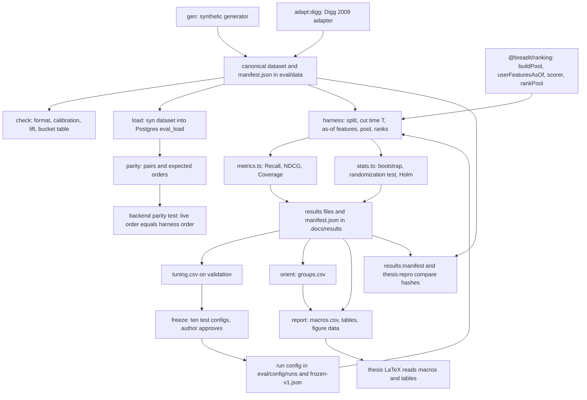

# `eval`: phần đánh giá của luận văn (`@breadit/eval`)

Bản tiếng Việt của `README.md`. Bản tiếng Anh là bản chuẩn; nếu hai bản khác nhau, sửa bản tiếng Việt.

`eval/` là npm workspace `@breadit/eval`. Nó chứa toàn bộ code tạo ra các con số của luận văn: bộ sinh dữ liệu, adapter cho Digg 2009, harness (bộ chạy xếp hạng), các metric, phần thống kê, phần report, và các bước kiểm tra chứng minh một lần chạy có thể lặp lại. File này là một tấm bản đồ. Nó nói mỗi thư mục và mỗi file làm gì, một con số đi từ dữ liệu đến luận văn như thế nào, và mỗi metric có nghĩa gì. Các khái niệm đã được giải thích trong Guidance Manual (`docs/Guidance-Manual/en/`), nên file này chỉ dẫn link và không chép lại. Bản tiếng Việt của Guidance Manual nằm ở thư mục cùng cấp tên vi.

Các mục: 1 `eval` là gì, 2 các lệnh, 3 đường ống từ đầu đến cuối, 4 bản đồ thư mục và file, 5 dữ liệu, 6 giao thức đánh giá trong code, 7 metric và thống kê chi tiết, 8 các file kết quả, 9 tính tất định và tái lập, 10 cách làm, 11 đọc thêm ở đâu.

## 1. `eval` là gì

### 1.1 Nhiệm vụ

`eval` là phần đánh giá offline của luận văn. Nó lấy một dataset gồm các sự kiện trong quá khứ (các thế giới tổng hợp hoặc Digg 2009), giấu đi một tương tác thật của mỗi người dùng, xếp hạng các bài viết bằng từng phương pháp, rồi xem bài bị giấu rơi vào vị trí nào. Sau đó nó so sánh các phương pháp bằng thống kê và ghi ra các file CSV. Bước report biến các file đó thành các macro và bảng của luận văn.

Code xếp hạng không nằm trong `eval`. Nó nằm trong `packages/ranking` (`@breadit/ranking`): `buildPool`, các hàm dựng feature as-of, `scorer(method)` và `rankPool`. Feed của backend (`apps/backend/src/feed/`) gọi đúng các hàm này. Vì vậy các con số offline mô tả đúng feed đang chạy, và parity test (mục 3, bước 10) kiểm tra điều đó. `eval` chỉ nạp dữ liệu, chia dữ liệu, gọi package, và đo.

### 1.2 Quy tắc

- Không dùng Postgres, Redis hay HTTP. Chỉ `src/loader/db.ts` ghi vào Postgres, và chỉ vào schema `eval_load` (hoặc một schema khác tên `eval_...`), không bao giờ vào `public`. `src/imports.test.ts` kiểm tra rằng không file nào khác import `@prisma/client`.
- Không có gì import `eval`. Nó import `@breadit/ranking`, là CommonJS được build ra `dist/`, nên hãy chạy `npm run build -w @breadit/ranking` trước khi chạy test hay bất kỳ lệnh nào.
- Node lấy từ `.nvmrc`. Mọi CLI script gọi `checkNode()` (trong `src/frozen.ts`) và dừng nếu Node là phiên bản khác. Lý do: `Math.log2` và `Math.pow` có thể cho kết quả khác nhau giữa các phiên bản Node. Phiên bản này cũng được ghi trong mọi manifest (khóa `node`).
- Output Class D (dataset, feature, bảng xếp hạng, metric, thống kê, dữ liệu đứng sau các bảng) phải giống nhau từng byte ở mọi lần chạy. Chúng không bao giờ đọc đồng hồ và không bao giờ dùng `Math.random()`. Mục 9 có các quy tắc và các test.
- Các giá trị đã đóng băng (frozen) nằm trong một file duy nhất, `config/frozen-v1.json`. Nó bằng super-plan §7, và `src/frozen.test.ts` kiểm tra điều đó. Code đọc nó bằng `loadFrozen()`. Chỉ tác giả được đổi một giá trị frozen. README này gọi tên chúng và không bao giờ chép giá trị.
- Test split chỉ chạy một lần, sau khi tuning đã đóng băng, và chỉ khi run config có `"testApprovedBy"`. Không có cờ `--split`: split lấy từ file config.

### 1.3 Cái gì nằm trong git và cái gì không

| Nơi | Có trong git? | Chứa gì |
|---|---|---|
| `eval/src/`, `eval/config/` | có | code và các config |
| `eval/data/<datasetId>/` | không (git-ignored) | các canonical dataset. Chúng được dựng lại từ seed (tổng hợp) hoặc từ hai file zip Digg |
| `datasets/raw/digg2009/` | không (git-ignored) | hai file zip Digg, tải về bằng tay. SHA-256 của chúng nằm trong `config/digg2009.json` |
| `eval/results/<id>/` | không (git-ignored) | các file quá lớn cho git: `per_user.csv` trên 5 MB, `orders.csv` của parity, các file thô của E7, log trong `load-check/` và `repro/` |
| `.docs/results/<id>/` | có | các kết quả được commit: các file CSV nhỏ và một `manifest.json` cho mỗi thư mục |

Các file bị git-ignore vẫn an toàn, vì SHA-256 của chúng được ghi trong manifest đã commit của cùng lần chạy. Nếu file đổi dù một byte, một bước kiểm tra sẽ báo (mục 9).

### 1.4 Các từ dùng trong file này

| Từ | Nghĩa |
|---|---|
| canonical dataset | một thư mục gồm sáu file CSV và một `manifest.json`: định dạng duy nhất mà harness đọc (mục 5) |
| positive | một like, một comment hoặc một repost. Đây là loại sự kiện duy nhất được tính là sự quan tâm |
| item | bài viết duy nhất bị giấu của một người dùng: test item (sau thời điểm cắt) hoặc validation item (tại hoặc trước thời điểm cắt) |
| `T`, cut time (thời điểm cắt) | một thời điểm chung cho mỗi dataset. Nó tách tuning (validation item) khỏi kiểm tra (test item) |
| as-of, `asOf` | thời điểm của một dự đoán. Một feature chỉ được dùng các sự kiện trước thời điểm đó (nếu bằng nhau thì xét theo event id) |
| history (lịch sử) | số positive của một người dùng trước thời điểm của item |
| bucket, group (nhóm) | một lớp lịch sử chỉ dùng để báo cáo kết quả. Các nhãn là tên của các ô CSV. Các mốc biên là giá trị frozen (super-plan §7) |
| pool | các bài viết ứng viên của một người dùng tại thời điểm của item: các bài mới nhất trong cửa sổ, trừ bài của chính họ và bài họ đã tương tác |
| kept, left out | một người dùng là kept (được giữ) khi bài của item nằm trong pool. Nếu không thì người đó là left out (bị loại) |
| method (phương pháp) | một cách chấm điểm bài viết: `BL0` đến `BL6`, `BL2t`, `H` và các ablation của nó (mục 6) |
| rank `r` | vị trí tính từ 1 của bài item khi toàn bộ pool được sắp theo một phương pháp |
| run, run id | một lần thực thi một run config. Id của nó là tên file bỏ `.json`, và thư mục kết quả của nó có cùng tên |
| Class D, Class R | D là giống nhau từng byte (mọi kết quả ở đây). R là lặp lại được nhưng không giống hệt (độ trễ của E7) |
| manifest | một file JSON nằm cạnh một tập file: mỗi file kèm số dòng và SHA-256 |
| SHA-256, hash | một dấu vân tay 64 ký tự của một file. Đổi một byte là ra dấu vân tay mới |
| seed, stream | `rng(masterSeed, stage)` cho một dòng số ngẫu nhiên riêng cho mỗi tên stage (mục 9) |

## 2. Các lệnh

### 2.1 Trước khi bắt đầu

Chạy `nvm use` ở thư mục gốc của repo trước. Chạy `npm install`, rồi `npm run build -w @breadit/ranking`. Chỉ loader cần Docker (`docker compose up db redis -d`). `adapt:digg` cần hai file zip Digg trong `datasets/raw/digg2009/`. Các script đọc dataset lớn đặt `--max-old-space-size=4096`.

### 2.2 Mọi script của `eval/package.json`

Chạy mỗi script bằng `npm run <script> -w @breadit/eval [-- <arguments>]`.

| Script | Tham số | Đọc | Ghi | Thời gian |
|---|---|---|---|---|
| `test` | không có | `src/**/*.test.ts`, các fixture | không ghi gì | chưa ghi lại |
| `typecheck` | không có | `src/**/*.ts` | không ghi gì (`tsc --noEmit`) | chưa ghi lại |
| `verify` | không có | chạy `typecheck`, rồi `test` | không ghi gì | chưa ghi lại |
| `gen` | `[outDir [datasetId ...]]` | `config/frozen-v1.json`, `config/synthetic-v1.json` | `eval/data/<id>/` (sáu file CSV và `manifest.json`), mặc định cho cả tám id tổng hợp | chưa ghi lại |
| `adapt:digg` | `[rawDir [outDir]]` | hai file zip trong `datasets/raw/digg2009/` (kiểm tra SHA-256 trước), `config/digg2009.json` | `eval/data/digg2009/` | khoảng 7 s (task p4-digg-adapter) |
| `check` | `[dataDir]` | mọi thư mục của `eval/data/` | in một báo cáo. Exit 1 khi có lỗi. Không ghi file | chưa ghi lại |
| `harness` | `<runId or path> [--out <dir>] [--record-t] [--data-dir <dir>]` | run config, `frozen-v1.json`, các dataset | `.docs/results/<runId>/` (và `eval/results/<runId>/` cho `per_user.csv` lớn) | xem bên dưới |
| `freeze` | `[--approve <name>] [--check] [--results-dir <dir>] [--config-dir <dir>]` | hai lần chạy tuning `p7-tune-main` và `p7-tune-worlds` (mỗi file được kiểm tra với manifest của nó) | mười test config `eval/config/runs/p7-*.json` | chưa ghi lại |
| `rank` | `--dataset <id> --method <m> --user <u> --asof <t> --top <n> [--before-event <id>] [--param name=value] [--config <runId>] [--pool normal or large]` | một dataset trong `eval/data/` | in post id theo thứ tự xếp hạng | dưới 1 s trên dataset tổng hợp |
| `parity` | `--param alpha=<a> --param beta=<b> [--dataset <id>] [--out <dir>]` | `syn-W2M-M` | `.docs/results/p6-parity/` (`pairs.csv`, `expected.csv`, `manifest.json`) và `eval/results/p6-parity/orders.csv` | chưa ghi lại |
| `orient` | `[--results-dir <dir>] [--raw-dir <dir>]` | `p7-main/manifest.json` và `per_user.csv` (kiểm tra hash) | `.docs/results/p9-orient-groups/` (`groups.csv`, `manifest.json`) | chưa ghi lại |
| `report` | `[--results-dir <dir>] [--out <dir>]` | 14 thư mục run của `REPORT_RUNS` trong `.docs/results/` (mỗi file được kiểm tra hash, không bao giờ đọc `per_user.csv`) | `.docs/results/p7-report/` | chưa ghi lại |
| `e7:summary` | `[--raw-dir <dir>] [--out <dir>] [--parity-dir <dir>]` | `eval/results/p7-e7/` (do `npm run bench:e7` tạo ra) | `.docs/results/p7-e7/` (Class R) | chưa ghi lại |
| `results:manifest` | `[--write]` | mọi manifest trong `.docs/results/` và `eval/data/`, và mọi file chúng liệt kê | không ghi gì (chế độ check), hoặc `.docs/results/manifest.json` khi có `--write` | chưa ghi lại |
| `load` | `<datasetId> [--schema eval_x] [--rebase-to YYYY-MM-DDTHH:MM:SSZ]` | `eval/data/<id>/` (chỉ dataset tổng hợp) | schema Postgres `eval_load`. Nó làm rỗng schema đó trước | tự in thời gian chạy |
| `load:check` | `<datasetId> [--schema eval_x] [--out <dir>]` | schema Postgres | `eval/results/load-check/<id>/`. Exit 1 khi có DIFF | chưa ghi lại |

Thời gian chạy của `harness` đã biết cho hai lần chạy: `p7-tune-main` mất khoảng 4,000 s và `p7-main` khoảng 2,100 s, cả hai do `digg2009` (task p8-repro; bộ nhớ đỉnh khoảng 3 GB). Các lần chạy chỉ có dữ liệu tổng hợp thì ngắn hơn. `harness --record-t` tính `T` cho từng dataset của config, in nó cạnh giá trị đã ghi, và không chạy xếp hạng nào.

### 2.3 Các lệnh ở thư mục gốc có dùng `eval`

| Lệnh | Làm gì |
|---|---|
| `npm run thesis:repro` | xóa mọi kết quả Class D và `eval/data/`, dựng lại chúng qua 27 bước, và so sánh mọi hash (mục 9). Khoảng 3 giờ. Cần Docker `db` và `redis` và các file zip Digg |
| `npm run test:parity -w @breadit/backend` | so feed đang chạy với thứ tự của harness, trên `syn-W2M-M` trong `eval_load` và Redis database 2 |
| `npm run bench:e7` | benchmark chi phí E7 (Class R). Ghi `eval/results/p7-e7/`. Sau đó chạy `e7:summary` |
| `npm run demo:start` | nạp `syn-W2M-M` vào schema `eval_demo` với `--rebase-to`, cho buổi demo (`scripts/demo/`) |

### 2.4 Một phiên làm việc điển hình

```bash
nvm use
npm install
npm run build -w @breadit/ranking
npm run gen -w @breadit/eval
npm run check -w @breadit/eval
npm run harness -w @breadit/eval -- p5-baseline
npm run verify -w @breadit/eval
```

## 3. Đường ống từ đầu đến cuối



Đi qua từng bước:

1. **Tạo dữ liệu.** `gen` dựng tám dataset tổng hợp qua năm stage, mỗi stage có dòng số ngẫu nhiên riêng (`generator/generate.ts`). `adapt:digg` chuyển hai file zip Digg (`adapters/digg.ts`). Cả hai ghi cùng một định dạng canonical và một manifest có SHA-256 của mọi file.
2. **Kiểm tra dữ liệu.** `check` chỉ đọc các file đã ghi và kiểm tra định dạng, các hash trong manifest, các target calibration, social lift của từng thế giới, và bảng bucket (`checks/run.ts`).
3. **Đọc một run config.** Run config là một file JSON trong `eval/config/runs/`. Nó nêu tên các dataset, split, các phương pháp và tham số của chúng. `harness/config.ts` từ chối một config sai trước khi nạp bất kỳ dữ liệu nào.
4. **Chia split.** Với mỗi dataset, harness tính `T` và chọn một item cho mỗi người dùng: positive cuối cùng sau `T` cho test split, positive cuối cùng tại hoặc trước `T` cho validation split (`harness/split.ts`, `checks/buckets.ts`). Nó dừng nếu `T` của nó khác giá trị đã ghi.
5. **Dựng trạng thái as-of.** Với mỗi item, tại thời điểm của item, nó dựng history, bucket và pool bằng `buildPool`, và dựng feature của người dùng và bài viết bằng các hàm as-of của package (`harness/run.ts`). Người dùng có bài item không nằm trong pool bị loại (left out).
6. **Xếp hạng.** Mỗi phương pháp chấm điểm toàn bộ pool bằng `scorer` của nó và `rankPool` sắp theo `(scoreFixed desc, postId desc)`. Rank `r` của bài item là kết quả (`scoreItem` trong `harness/run.ts`).
7. **Đo.** `metrics.ts` biến các rank thành Recall@K, NDCG@K và Coverage@K cho từng nhóm. `stats.ts` biến các hiệu ghép cặp theo từng người dùng thành gain, một khoảng tin cậy, một p-value và một p-value đã hiệu chỉnh Holm (`harness/compare.ts`).
8. **Ghi kết quả.** `harness/write.ts` ghi `per_user.csv`, `summary.csv`, `coverage.csv`, `leftout.csv` và `manifest.json`. Một lần chạy có `compare` còn ghi `compare.csv`, và có `density` còn ghi `density.csv`. Một lần chạy tuning ghi `tuning.csv`.
9. **Tune, freeze, duyệt, test.** Các lần chạy tuning chỉ dùng validation split. `freeze` ghi mười test config từ các dòng được chọn của `tuning.csv`. Tác giả duyệt chúng (`--approve`). Sau đó mỗi lần chạy test thực thi đúng một lần.
10. **Kiểm tra với app đang chạy.** `parity` rút 100 cặp (user, `asOf`) của `syn-W2M-M` và ghi thứ tự của harness cho từng cặp. `load` đưa dataset đó vào Postgres. Test của backend `test:parity` hỏi feed đang chạy cùng các cặp đó và so sánh các thứ tự.
11. **Orient, report.** `orient` tính phép so sánh nhóm mang tính khám phá của bản Orientation của thầy. `report` đọc các thư mục run, kiểm tra từng file với manifest của nó, và ghi các macro, bảng và dữ liệu hình mà LaTeX của luận văn đọc (`.docs/results/p7-report/`).
12. **Chứng minh cả chuỗi.** `results:manifest` so sánh mọi manifest và mọi file được liệt kê với `.docs/results/manifest.json`. `thesis:repro` xóa các kết quả Class D, dựng lại mọi thứ từ dữ liệu thô, và kết thúc bằng phép so sánh đó.

## 4. Bản đồ thư mục và file

### 4.1 Cấp cao nhất của `eval/`

| Đường dẫn | Là gì |
|---|---|
| `package.json` | các script (mục 2) và hai dependency: `@breadit/ranking` và `@prisma/client` (chỉ loader dùng) |
| `tsconfig.json` | TypeScript strict, `noEmit`, `allowImportingTsExtensions`. Node bỏ phần kiểu lúc chạy, nên `eval` không có bước build |
| `README.md`, `README.vi.md` | file này và bản tiếng Việt của nó |
| `config/` | các giá trị frozen, config của bộ sinh, config của Digg và các run config (mục 4.5) |
| `src/` | toàn bộ code và test (các mục 4.2 đến 4.4) |
| `data/` | các canonical dataset được sinh ra (git-ignored): chín thư mục, tám `syn-...` và `digg2009` |
| `results/` | các kết quả lớn và thô (git-ignored): `load-check/`, `p6-parity/`, `p7-e7/`, `repro/` và `per_user.csv` lớn của một số lần chạy |

### 4.2 Cấp cao nhất của `src/` và các thư mục nhỏ

| File | Làm gì | Được gọi bởi |
|---|---|---|
| `frozen.ts` | `loadFrozen()` đọc `config/frozen-v1.json`. `checkNode()` và `pinnedNodeVersion()` dừng một lần chạy nếu Node không phải phiên bản trong `.nvmrc` | gần như mọi file và mọi CLI |
| `rng.ts` | `rng(masterSeed, stage)`: nguồn ngẫu nhiên có seed duy nhất (sfc32, seed lấy từ SHA-256). `STAGE_NAMES` liệt kê các stage được phép | generator, `harness/shuffle.ts`, `parity/sample.ts`, `stats.ts`, `bench/e7.ts` |
| `metrics.ts` | `recallAt`, `ndcgAt`, `summarize`, `CoverageTracker`, `f6`, `GROUPS`, `METHOD_ORDER` | `harness/run.ts`, `harness/compare.ts`, `stats.ts`, `orient.ts`, `report/` |
| `stats.ts` | `pairedDifferences`, `pairedBootstrap`, `randomizationTest`, `exactRandomizationTest`, `holm`, `applyHolm`, `compareRow`, `h1Verdict`, `h0Gate`, `writeCompare` | `harness/compare.ts`, `harness/commands.ts`, `orient.ts` |
| `orient.ts` | `orientCommand`, `groupRows`, `orientGroup`: phép so sánh nhóm của Orientation (`p9-orient-groups`) | `cli/orient.ts` |
| `results-csv.ts` | `csvText`, `writeCsv`, `writeCsvText`: bộ ghi duy nhất của các file CSV kết quả (không có dấu phẩy hay ký tự xuống dòng trong một ô) | harness, report, stats, parity, bench, orient |

| File | Làm gì | Được gọi bởi |
|---|---|---|
| `canonical/schema.ts` | `SCHEMAS`, `TABLES`: sáu bảng với các cột, khóa sắp xếp và các cột được phép để trống | các file khác của `canonical/`, `checks/format.ts`, generator, adapter |
| `canonical/csv.ts` | `writeTable` (kiểm tra, sắp xếp, ghi), `readTable` (bộ đọc nghiêm ngặt), `sha256Hex`, `FileEntry` | mọi nơi ghi và đọc dataset |
| `canonical/dataset.ts` | `loadDataset(dir)`: đọc một thư mục dataset thành các dòng có kiểu (`Dataset`) | `checks/`, `harness/`, `parity/`, các CLI của loader |
| `canonical/manifest.ts` | `Manifest`, `canonicalJson` (khóa đã sắp, hai dấu cách, LF cuối), `writeManifest`, `readManifest` | mọi nơi ghi manifest |
| `repro/merged.ts` | `buildMerged`, `checkTree`, `mergedCommand`: manifest gộp `.docs/results/manifest.json` và phép so sánh của nó. `CLASS_R` liệt kê các thư mục Class R | `cli/results-manifest.ts` |
| `parity/sample.ts` | `drawParityPairs`: rút các cặp (user, `asOf`) bằng stream `parity` | `parity/write.ts` |
| `parity/expected.ts` | `expectedOrders`, `orderSha256`, `PARITY_ALGOS`: thứ tự của harness cho từng cặp với `chrono` (`BL0`), `engagement` (`BL2`) và `social` (`H`) | `parity/write.ts` |
| `parity/write.ts` | `parityCommand`, `writeParity`: ghi `pairs.csv`, `expected.csv`, `orders.csv`, `manifest.json` | `cli/parity.ts` |
| `bench/e7.ts` | các hàm thuần của bản tóm tắt E7: `median`, `bootstrapMedian`, `summarizeLatency`, `summarizeQueries`, các parser | `bench/write.ts` |
| `bench/write.ts` | `e7SummaryCommand`: đọc các file thô của E7, ghi `latency.csv`, `queries.csv`, `runs.csv`, `queries-raw.csv`, `manifest.json` | `cli/e7-summary.ts` |

### 4.3 Các thư mục `src/` về dữ liệu, kiểm tra, harness, loader và report

| File | Làm gì | Được gọi bởi |
|---|---|---|
| `generator/generate.ts` | `generateDataset(id, outDir)`: chạy năm stage, ghi thư mục. Còn có `datasetIds`, `datasetDir`, `parseDatasetId` | `cli/generate.ts`, `checks/run.ts`, các CLI của loader |
| `generator/config.ts` | nạp `synthetic-v1.json`. `makeParams` cho tham số của một thế giới và một kích thước. `configSha256`, `loadTargets` | generator, `checks/run.ts` |
| `generator/users.ts` | stage `users`: id, thời điểm tham gia, chủ đề chính, số hành động, các trọng số Pareto | `generator/generate.ts` |
| `generator/follows.ts` | stage `follows`: ai theo dõi ai (trọng số homophily, link được theo dõi lại) | `generator/generate.ts` |
| `generator/communities.ts` | stage `communities`: một community cho mỗi chủ đề và các membership | `generator/generate.ts` |
| `generator/posts.ts` | stage `posts`: tác giả, thời điểm, bài trong community, id tăng theo thời gian | `generator/generate.ts` |
| `generator/interactions.ts` | stage `interactions`: mỗi hành động chọn một bài bằng một lần rút có trọng số (interest, độ mới, độ phổ biến, ảnh hưởng xã hội và community) | `generator/generate.ts` |
| `generator/interest.ts` | vector interest ẩn và trọng số homophily | follows, communities, interactions |
| `generator/alloc.ts` | `allocate`: chia một tổng thành các số nguyên theo trọng số (phần dư lớn nhất) | `generator/follows.ts` |
| `adapters/digg.ts` | `adaptDigg`: kiểm tra hash của zip, đọc trong bộ nhớ, `toCanonical` áp dụng các quy tắc, ghi dataset. `loadDiggConfig`, `countsTable` | `cli/adapt-digg.ts` |
| `adapters/digg-parse.ts` | `parseVotes`, `parseFriends`: các parser nghiêm ngặt vào mảng có kiểu | `adapters/digg.ts` |
| `adapters/zip.ts` | `readEncryptedMember`: đọc member duy nhất của một zip ZipCrypto (Node không có bộ đọc) | `adapters/digg.ts` |
| `adapters/zip-fixture.ts` | helper cho test: `buildZip` tạo các zip nhỏ trong bộ nhớ | chỉ test |
| `checks/run.ts` | `checkAll`, `bucketVerdict`: lệnh `check` | `cli/check.ts` |
| `checks/format.ts` | `checkFormat`: các quy tắc định dạng, hash trong manifest, các quy tắc về follow, bài trong community và sự kiện | `checks/run.ts` |
| `checks/calibration.ts` | `measure`, `calibrate`, `withinTolerance`: dữ liệu tổng hợp so với các target Digg của `synthetic-v1.json` | `checks/run.ts` |
| `checks/lift.ts` | `computeLift`: social lift (một hành động có khả năng xảy ra trên bài mà người được theo dõi đã cho thấy cao hơn bao nhiêu) | `checks/run.ts` |
| `checks/buckets.ts` | nơi duy nhất của quy tắc `T`: `cutTime`, `testItems`, `bucketOf`, `historyCount`, `inPool`, `poolSize`, `bucketReport` | `checks/run.ts`, `harness/split.ts`, `metrics.ts` |
| `checks/fixture.ts` | helper cho test: `writeFixture` ghi một thư mục dataset nhỏ | chỉ test |
| `harness/config.ts` | `parseRunConfig`, `validateConfig`, `REQUIRED_PARAMS`, `variantsFor`, `resolveParam`: run config và các chốt chặn của nó | `harness/commands.ts`, `run.ts`, `tuning.ts`, `freeze.ts` |
| `harness/split.ts` | `splitItems`, `validationItems`, xuất lại `testItems` và `cutTime` | `harness/run.ts` |
| `harness/index-data.ts` | `buildDataIndex`: các index phẳng bằng mảng có kiểu. `userEventCount`, `postCounts`, `followeeEngagement`, `windowCandidates`, `uid` | `harness/run.ts`, `post-features.ts`, `parity/sample.ts` |
| `harness/post-features.ts` | `fastPostFeatures`, `referencePostFeatures`, `userFeatureData`: hai cách dựng feature | `harness/run.ts` |
| `harness/run.ts` | `runDataset`, `runConfig`, `prepareItem`, `scoreItem`, `rankAt`, `computeCutTime`, `poolSetting`: lõi của một lần chạy | `commands.ts`, `compare.ts`, `tuning.ts`, `parity/` |
| `harness/shuffle.ts` | `shuffleWithinPosts`: phép xáo timestamp của E5 | `harness/run.ts` |
| `harness/tuning.ts` | `tuneConfig`, `tuneDataset`, `gridFor`, `pickBest`, `writeTuning`: tìm trên lưới ở validation | `harness/commands.ts`, `freeze.ts` |
| `harness/compare.ts` | `compareRows` (F1, F2 hoặc none), `densityRows`, `verdictLines`, `writeCompareRows`, `writeDensity` | `harness/commands.ts` |
| `harness/write.ts` | `writeResults`, `resultTexts`: bốn file kết quả và manifest của run. `PER_USER_COMMIT_LIMIT_BYTES` | `harness/commands.ts` |
| `harness/commands.ts` | `harnessCommand` và `rankCommand`: logic của hai CLI, để test có thể gọi | `cli/harness.ts`, `cli/rank.ts` |
| `harness/freeze.ts` | `freezeCommand`, `TEST_RUNS`, `buildTestConfigs`, `checkTuningRule`, `e8Baseline` | `cli/freeze.ts` |
| `harness/random-data.ts` | helper cho test: các dataset ngẫu nhiên nhỏ có nhiều thời điểm trùng nhau. Còn có kiểu `DatasetTables` | test. Các file khác chỉ import kiểu của nó |
| `loader/db.ts` | file duy nhất import `@prisma/client`: `migrate`, `load`, `readBack` | `cli/load.ts`, `cli/load-check.ts` |
| `loader/map.ts` | `toAppRows`, `fromAppRows`, `detectShift`: dòng canonical sang dòng của app và ngược lại (thuần) | `loader/db.ts`, các CLI của loader |
| `loader/ids.ts` | `appUserId`, `canonicalUserId`, `repostOffset`: id của các dòng app | `loader/map.ts` |
| `loader/target.ts` | `targetUrl`, `schemaOf`: chỉ cho phép schema tên `eval_...` | `loader/db.ts`, các CLI của loader |
| `loader/time.ts` | `toDate`, `fromDate`, `rebaseShift`, `lastEventTime`: thời gian, và độ lệch chỉ dùng cho demo | `loader/map.ts`, các CLI của loader |
| `report/report.ts` | `reportCommand`, `REPORT_RUNS`: đọc các run, ghi thư mục report, kiểm tra lại từng macro | `cli/report.ts` |
| `report/read.ts` | `readRun`, `parseCsv`: đọc một thư mục run và kiểm tra từng file với manifest của run | `report/`, `orient.ts`, `bench/e7.ts` |
| `report/macros.ts` | `MACRO_SPECS`, `buildMacros`, `verifyMacros`, `macrosCsv`, `macrosTex`, `checkTieChanges` | `report/report.ts` |
| `report/tables.ts` | `buildTables`, `toLatex`, `toMarkdown`, `figE2Rows`, `figE3Rows`, `figE5Rows` | `report/report.ts` |
| `report/round.ts` | `roundDecimal`, `formatP`, `gridValue`: làm tròn trên chuỗi thập phân, nửa thì làm tròn ra xa số không | `report/macros.ts`, `report/tables.ts` |
| `report/fixture.ts` | helper cho test: một thư mục kết quả với các số tự bịa để test report | chỉ test |

### 4.4 `src/cli/` và các test

Mỗi file của `src/cli/` là một script mỏng: `checkNode()`, một lời gọi, in ra, đặt exit code. Logic nằm trong module nêu ở cột thứ hai, để test có thể gọi.

| File CLI | Script | Gọi |
|---|---|---|
| `cli/generate.ts` | `gen` | `generateDataset` |
| `cli/adapt-digg.ts` | `adapt:digg` | `adaptDigg` |
| `cli/check.ts` | `check` | `checkAll` |
| `cli/harness.ts` | `harness` | `harnessCommand` |
| `cli/freeze.ts` | `freeze` | `freezeCommand` |
| `cli/rank.ts` | `rank` | `rankCommand` |
| `cli/parity.ts` | `parity` | `parityCommand` |
| `cli/orient.ts` | `orient` | `orientCommand` |
| `cli/report.ts` | `report` | `reportCommand` |
| `cli/e7-summary.ts` | `e7:summary` | `e7SummaryCommand` |
| `cli/results-manifest.ts` | `results:manifest` | `mergedCommand` |
| `cli/load.ts` | `load` | `toAppRows`, `migrate`, `load` |
| `cli/load-check.ts` | `load:check` | `readBack`, `fromAppRows`, `writeTable` |

44 file test nằm cạnh code mà chúng kiểm tra. Ở đây chúng được gộp theo điều chúng bảo vệ.

| Nhóm | File | Chúng bảo vệ điều gì |
|---|---|---|
| Golden | `harness/run.test.ts` cùng `harness/fixtures/golden/` và `golden-expected/` | một dataset nhỏ có rank tính tay. Các file CSV kết quả phải bằng các file expected đã commit từng byte |
| Leakage và as-of | `harness/run.test.ts` (các test leakage), `harness/index-data.test.ts`, `harness/post-features.test.ts`, `checks/pool-crosscheck.test.ts` | các sự kiện sau một item không được đổi các dòng của người dùng đó. Đường nhanh phải bằng hàm của package. `buildPool` phải bằng quy tắc pool của P3 |
| Double run | `generator/generate.test.ts`, `adapters/digg.test.ts`, `harness/write.test.ts`, `harness/commands.test.ts`, `harness/freeze.test.ts`, `parity/write.test.ts`, `orient.test.ts`, `report/report.test.ts`, `repro/merged.test.ts`, `bench/write.test.ts`, `bench/e7.test.ts`, `stats.test.ts` | hai lần chạy cho cùng các byte |
| Tính tất định và giá trị frozen | `rng.test.ts`, `forbidden.test.ts`, `frozen.test.ts`, `imports.test.ts` | vector đáp án đã biết của PRNG, không có mẫu bị cấm trong code, `frozen-v1.json` bằng super-plan §7, Prisma chỉ trong `loader/db.ts` |
| Hợp đồng của các file | `canonical/canonical.test.ts`, `checks/format.test.ts`, `harness/config.test.ts`, `loader/ids.test.ts`, `loader/map.test.ts`, `loader/target.test.ts`, `loader/time.test.ts`, `adapters/zip.test.ts`, `adapters/digg-parse.test.ts` | định dạng file, danh sách cột, các chốt chặn của run config, phép ánh xạ của loader |
| Một module | `metrics.test.ts`, `stats.test.ts`, `harness/split.test.ts`, `harness/compare.test.ts`, `harness/tuning.test.ts`, `harness/shuffle.test.ts`, `checks/buckets.test.ts`, `checks/calibration.test.ts`, `checks/lift.test.ts`, `checks/run.test.ts`, `generator/config.test.ts`, `generator/stages.test.ts`, `parity/sample.test.ts`, `parity/expected.test.ts`, `report/macros.test.ts`, `report/round.test.ts` | hành vi của một module trên các đầu vào nhỏ tự làm. `stats.test.ts` còn so với một kết quả tham chiếu scipy tính một lần |

### 4.5 `config/`

| File | Chứa gì |
|---|---|
| `frozen-v1.json` | các giá trị frozen mà code đọc: master seed, base epoch, danh sách K, các history bucket, hai lưới (alpha và beta; các lưới của baseline), số lần bootstrap và permutation, mức tin cậy và mức Holm, prior strength, cửa sổ và giới hạn pool, pool lớn hơn của E8, kích thước dataset, cut quantile và cut time của từng dataset. Không chép ở đây: hãy đọc super-plan §7 hoặc file này |
| `synthetic-v1.json` | config của bộ sinh. `params`: mỗi tham số có một `value` và một `kind`, là `calibrated` (với `targets` lấy từ dữ liệu Digg) hoặc `chosen`. `worlds`: ba núm của mỗi thế giới (homophily, ảnh hưởng xã hội, ảnh hưởng community). SHA-256 của nó được ghi trong mọi manifest tổng hợp |
| `digg2009.json` | nguồn Digg: trang và trích dẫn, mật khẩu của các zip, và với mỗi zip là URL, thời điểm chụp, SHA-256, tên member và kích thước member. `choices`: bốn lựa chọn của adapter |
| `runs/<runId>.json` | một run config cho mỗi run (bên dưới) |

Một run config có các khóa sau (`harness/config.ts`, kiểu `RunConfig`). Bắt buộc: `datasets`, `split` (`validation` hoặc `test`), `methods`, `params`, `pool` (`normal` hoặc `large`), `mode` (`fast` hoặc `reference`). Tùy chọn: `testApprovedBy` (cần cho `test`), `datasetParams` (các số riêng cho từng dataset thay `params`), `tieBreak` (`id-desc` hoặc `id-asc`), `shuffle`, `compare` (`mode` là `families` hoặc `none`, và `ref`), `density`, `h0Gate`. Giá trị của một param là một số, `"grid"` (được tune ở validation; không cho phép ở `test`) hoặc `"frozen"` (chỉ cho `m`: prior strength của `frozen-v1.json`). `fast` là đường có index. `reference` gọi các hàm của package trên toàn bộ dữ liệu và được test dùng để chứng minh đường nhanh cho kết quả bằng nhau.

| Run id | Split | Nó là gì |
|---|---|---|
| `p5-baseline` | validation | các baseline đầu tiên `BL0` đến `BL5` trên ba thế giới cỡ S. Một lần chạy kiểm tra thử harness (task p5-eval-harness) |
| `p7-tune-main` | validation | tuning trên `syn-W2M-M` và `digg2009`: các lưới của `BL2t`, `BL4`, `BL5`, `BL6` và alpha, beta của `H`. Ghi `tuning.csv` |
| `p7-tune-worlds` | validation | tuning của `H` trên bốn thế giới cỡ M còn lại |
| `p7-h0` | test | cổng H0 trên `syn-W0-M`: `BL2`, `H`, `H-follow` (`h0Gate`) |
| `p7-main` | test | E1, E2, E3 trên Digg: chín phương pháp trên `syn-W2M-M` và `digg2009`, các family F1 và F2, các density bin |
| `p7-e5-worlds` | test | E5 và E3: `BL2` và `H` trong năm thế giới cỡ M, kèm các density bin |
| `p7-e4-terms` | test | E4: `BL2`, `H` và bốn ablation |
| `p7-e4-m0`, `p7-e4-m2`, `p7-e4-m10` | test | E4 quét giá trị: `BL2` và `H` với prior strength `m` đặt bằng số trong run id |
| `p7-e6-ties` | test | E6: chín phương pháp với tie-break đảo ngược (`tieBreak` là `id-asc`) |
| `p7-e8-pool` | test | E8: `BL2`, `BL6`, `H` với pool lớn hơn (`pool` là `large`) |
| `p7-e5-shuffle` | test | E5: `BL2` và `H` trên timestamp đã xáo trong từng bài (`shuffle`) |

### 4.6 `.docs/results/`

Mỗi thư mục có một `manifest.json`. Tất cả là Class D, trừ `p7-e7`. Thư mục chứa những file nào phụ thuộc vào run config của nó. Mục 8 giải thích từng file.

| Thư mục | Tạo bởi | Thí nghiệm | File |
|---|---|---|---|
| `p5-baseline` | `harness` | các baseline đầu tiên | `per_user`, `summary`, `coverage`, `leftout` |
| `p7-tune-main`, `p7-tune-worlds` | `harness` | tuning | bốn file đó và `tuning.csv` |
| `p7-h0` | `harness` | cổng H0 | bốn file đó và `compare.csv` |
| `p7-main` | `harness` | E1, E2, E3 | bốn file đó, `compare.csv` (F1, F2), `density.csv` |
| `p7-e5-worlds` | `harness` | E5, E3 | bốn file đó, `compare.csv`, `density.csv` |
| `p7-e4-terms`, `p7-e4-m0`, `p7-e4-m2`, `p7-e4-m10` | `harness` | E4 | bốn file đó và `compare.csv` |
| `p7-e6-ties` | `harness` | E6 | bốn file đó (không có `compare`) |
| `p7-e8-pool`, `p7-e5-shuffle` | `harness` | E8, E5 | bốn file đó và `compare.csv` |
| `p6-parity` | `parity` | parity của P6 | `pairs.csv`, `expected.csv`, `manifest.json` |
| `p7-e7` | `e7:summary` | chi phí E7 (Class R) | `latency.csv`, `queries.csv`, `runs.csv`, `queries-raw.csv` |
| `p9-orient-groups` | `orient` | các nhóm của Orientation | `groups.csv` |
| `p7-report` | `report` | tất cả những thứ trên | `macros.csv`, `results-macros.tex`, `results.md`, `tables/*.tex`, ba file `fig-*.csv` |

## 5. Dữ liệu

### 5.1 Canonical dataset

Một thư mục `eval/data/<datasetId>/` chứa sáu file CSV và `manifest.json`. Mọi file đều UTF-8, LF, có dòng header, thứ tự cột cố định và các dòng đã sắp xếp. Mọi id là số nguyên không âm. Mọi thời gian là một số nguyên giây sau epoch được nêu trong manifest. Schema nằm trong `canonical/schema.ts`.

| File | Cột | Sắp theo | Ghi chú |
|---|---|---|---|
| `users.csv` | `user_id`, `joined_at` | `user_id` | |
| `follows.csv` | `follower_id`, `followee_id`, `created_at` | `follower_id`, `followee_id` | không có link tự theo dõi, không có cặp trùng |
| `communities.csv` | `community_id`, `created_at` | `community_id` | chỉ có header với Digg |
| `memberships.csv` | `user_id`, `community_id`, `joined_at` | `user_id`, `community_id` | chỉ có header với Digg |
| `posts.csv` | `post_id`, `author_id`, `community_id`, `created_at` | `post_id` | `community_id` để trống nếu không có community. Tác giả của một bài trong community là thành viên tại `created_at` (quy tắc D1) |
| `interactions.csv` | `event_id`, `user_id`, `post_id`, `type`, `created_at` | `created_at`, `event_id` | `type` là `like`, `comment` hoặc `repost`. Tất cả đều là positive. Chỉ có thêm vào: không có unlike, không có unfollow |

Những điều cần nhớ. Một bài có một tác giả và không bao giờ bị xóa. Các sự kiện chỉ được thêm vào (không có unlike, không có unfollow), nên history chỉ tăng. `event_id` phân định thứ tự giữa các sự kiện có cùng thời gian. Trong dữ liệu tổng hợp, post id cao hơn là bài mới hơn. Trong app, user id là chuỗi `u` cộng với số nguyên được đệm đủ 10 chữ số (`u0000000042`). Harness dùng cùng chuỗi đó bên trong package (`uid` trong `harness/index-data.ts`), nên người dùng được sắp xếp giống nhau ở cả hai nơi.

### 5.2 Các dataset id

Có chín dataset. Tám cái là tổng hợp và đặt tên `syn-<world>-<size>`. Một cái là dữ liệu thật: `digg2009`.

| Id | Thế giới | Kích thước |
|---|---|---|
| `syn-W0-S`, `syn-W0-M` | W0: thế giới rỗng (null) | S và M |
| `syn-W1-S`, `syn-W1-M` | W1: chỉ có homophily | S và M |
| `syn-W2L-M` | W2, ảnh hưởng thấp | M |
| `syn-W2M-S`, `syn-W2M-M` | W2, ảnh hưởng trung bình (ô chính của H1) | S và M |
| `syn-W2H-M` | W2, ảnh hưởng cao | M |

Các kích thước S và M (số người dùng và số bài) là khóa `sizes` của `frozen-v1.json`, super-plan §7 dòng "Dataset sizes". Các dataset cỡ S dùng để test nhanh. Cỡ M dùng cho các thí nghiệm.

### 5.3 Bộ sinh dữ liệu tổng hợp

`generateDataset(id, outDir)` trong `generator/generate.ts` chạy năm stage theo thứ tự cố định. Mỗi stage dùng stream riêng `rng(masterSeed, stage)`, nên thêm một stage không bao giờ đổi stage khác. Thư mục bị xóa trước, nên không file cũ nào còn lại. Các stream giống nhau cho mọi dataset, nên các thế giới là một phép so sánh có kiểm soát: `syn-W1-S` và `syn-W2M-S` dùng chung users, follows, communities, memberships và posts, và chỉ khác nhau ở interactions.

| Stage | File | Nó rút cái gì |
|---|---|---|
| `users` | `generator/users.ts` | id từ 1, thời điểm tham gia (một phần người dùng tham gia trong khoảng hoạt động), một chủ đề chính ẩn, số hành động (bốn bin hoạt động; phần đuôi theo luật Pareto có giới hạn), và ba trọng số Pareto (độ dài danh sách follow, độ nổi tiếng, mức đăng bài) |
| `follows` | `generator/follows.ts` | một phần người dùng có danh sách follow. Người được theo dõi được rút không hoàn lại với trọng số độ nổi tiếng nhân một số hạng homophily. Một số link được theo dõi lại. Thời điểm link rơi sau khi cả hai người đã tham gia |
| `communities` | `generator/communities.ts` | một community cho mỗi chủ đề, tạo tại epoch. Các membership theo cùng quy tắc homophily như follows |
| `posts` | `generator/posts.ts` | tác giả theo mức đăng bài, một thời điểm trong khoảng hoạt động sau khi tác giả tham gia, và một phần bài đăng trong community mà tác giả là thành viên tại thời điểm đó |
| `interactions` | `generator/interactions.ts` | mọi hành động theo thứ tự `(t, user, k)`. Mỗi hành động chọn một bài ứng viên (trong vài ngày gần nhất, không phải của mình, chưa tương tác) bằng một lần rút có trọng số. Trọng số nhân interest, độ mới, độ phổ biến, mức phơi bày xã hội và tư cách thành viên community |

Bộ sinh không bao giờ xếp hạng một feed. Nó chỉ dùng `+ - * /` trong các trọng số, nên giá trị chính xác trên mọi engine.

### 5.4 Năm thế giới

Một thế giới là ba núm trong `synthetic-v1.json`: homophily (những người dùng giống nhau theo dõi nhau và vào cùng community), ảnh hưởng xã hội (bài do người được theo dõi cho thấy có nhiều khả năng được chọn hơn), và ảnh hưởng community (bài trong community của tôi có nhiều khả năng được chọn hơn).

| Thế giới | Homophily | Ảnh hưởng xã hội và community | Vì sao nó tồn tại |
|---|---|---|---|
| W0 | không | không | thế giới rỗng (null). Follow là ngẫu nhiên, nên một phương pháp xã hội không được thắng (cổng H0) |
| W1 | có | không | những người cùng sở thích được nối với nhau, nhưng họ không ảnh hưởng lẫn nhau |
| W2L, W2M, W2H | có | thấp, trung bình, cao | ba ô của W2. Chúng chỉ khác nhau ở độ mạnh của ảnh hưởng. W2M là ô chính của H1 |

Mỗi tham số của `synthetic-v1.json` là `calibrated` (các `targets` của nó lấy từ dữ liệu Digg, ví dụ số vote mỗi người, tỷ lệ người dùng có đúng một hành động, độ dài trung bình của danh sách follow) hoặc `chosen` (do tác giả quyết định, ví dụ số chủ đề). `check` so sánh dữ liệu đã sinh với các target, với một ngưỡng sai số cho từng cái. Guidance Manual 04 §6 giải thích sự khác nhau.

### 5.5 Adapter cho Digg 2009

Digg 2009 là dữ liệu thật: các vote cho story và một đồ thị follow. `adapters/digg.ts` biến hai file zip thành định dạng canonical. Các quy tắc được viết trong `RULES` và trong `config/digg2009.json` (`choices`):

- Một cặp (voter, story) lặp lại giữ vote sớm nhất.
- Tác giả và `created_at` của một story lấy từ vote đầu tiên của nó (nếu cùng thời điểm thì chọn voter id nhỏ hơn). Vote đầu tiên đó là bài đăng, không phải like.
- Mọi vote khác là một `like`. `event_id` là thứ hạng tính từ 1 theo thứ tự `(t, voter_id, story_id)`.
- Link có ngày 0 bị bỏ (`dropZeroDateLinks`). Link tự theo dõi bị bỏ. Một cặp lặp lại giữ ngày sớm nhất. Một dòng `mutual` không thêm link ngược (`addMutualReverse` là false).
- Người dùng là các voter và các id trong link được giữ. `joined_at` là thời điểm sớm nhất một id xuất hiện. Các id là id gốc của Digg.
- Epoch là Unix epoch. Không có community và membership, và không có comment hay repost: Digg chỉ có vote.

Trước khi đọc một dòng, adapter kiểm tra SHA-256 của cả hai zip. Nó đọc chúng trong bộ nhớ (`adapters/zip.ts`) và không bao giờ ghi các file thô. Số lượng của mọi dòng bị bỏ được ghi trong manifest (`source.counts`). Digg có thể và không thể kiểm tra điều gì nằm trong Guidance Manual 04 §9 và §10.

### 5.6 Manifest của dataset và các hash của nó

`manifest.json` của một dataset có các khóa đã sắp. Các khóa của nó: `schemaVersion`, `datasetId`, `source`, `masterSeed` (chỉ dữ liệu tổng hợp), `epoch`, `node` và `files` (mỗi file kèm `rows` và `sha256`). `source` của dữ liệu tổng hợp chứa `kind`, đường dẫn config, `configSha256` (SHA-256 của `synthetic-v1.json`), thế giới, kích thước, `skippedActions` và `activityCap`. `source` của Digg chứa `kind`, trang, các zip cùng hash của chúng, các `choices`, các `rules` và các `counts`.

Có bốn mức hash. (1) SHA-256 của từng file CSV, trong `files`. (2) SHA-256 của `manifest.json` của dataset: manifest của một run giữ nó cho mỗi dataset mà run đã đọc (`source.datasets`). (3) `configSha256`, mà `check` so với config hiện tại. (4) Manifest gộp `.docs/results/manifest.json`, giữ hash manifest của cả chín dataset và cả 17 thư mục kết quả. `load:check` đọc một dataset ngược từ Postgres và so sáu hash file với manifest.

## 6. Giao thức đánh giá trong code

Giao thức là super-plan §5. Guidance Manual 05 giải thích nó kèm ví dụ. Bảng này nói mỗi quy tắc nằm ở đâu.

| Quy tắc | File và hàm |
|---|---|
| `T` = thời điểm của sự kiện ở thứ hạng `ceil(q n)` trong mọi positive sắp theo `(t, event_id)`. `q` là `cutQuantile` | `cutTime` trong `checks/buckets.ts`; `computeCutTime` trong `harness/run.ts` |
| `T` đã ghi của mỗi dataset là `cutTimes`. Lần chạy dừng nếu `T` của chính nó khác | `resolveT` trong `harness/run.ts` |
| test item: positive cuối cùng của người dùng có `t > T`. Một sự kiện đúng tại `T` thuộc validation | `testItems` trong `checks/buckets.ts` |
| validation item: positive cuối cùng của người dùng có `t <= T` | `validationItems` trong `harness/split.ts` |
| bài của item phải là bài người dùng chưa tương tác trước đó và không phải của chính họ. Nếu không, lần chạy dừng | `prepareItem` trong `harness/run.ts` |
| as-of: một sự kiện là nhìn thấy được khi `e.t < asOf.t`, hoặc `e.t == asOf.t` và `e.id < beforeEventId`. Harness truyền event id của item | `visible` trong `harness/index-data.ts`; `visibleAt` trong `@breadit/ranking` |
| follow và membership được tính khi thời gian của chúng nhỏ hơn hẳn `asOf.t` (chúng không có event id) | `userFeaturesAsOf` trong `@breadit/ranking` |
| history = số positive của người dùng nhìn thấy được tại `asOf`. Bucket của nó quyết định nhóm | `userEventCount` trong `harness/index-data.ts`; `bucketOf` trong `checks/buckets.ts` |
| pool: các bài gốc của cửa sổ trước `asOf.t`, trừ bài của chính họ và bài đã tương tác, giữ `maxPosts` bài mới nhất | `buildPool` trong `@breadit/ranking`; `prepareAt` và `poolSetting` trong `harness/run.ts` |
| left out: bài item không nằm trong pool. Số lượng được giữ cho tổng và cho từng nhóm | `runDataset` trong `harness/run.ts`; file `leftout.csv` |
| xếp hạng toàn bộ, không có negative lấy mẫu: rank `r` = vị trí của item trong toàn bộ pool đã sắp | `rankPool` trong `@breadit/ranking`; `scoreItem` trong `harness/run.ts` |
| điểm là số nguyên; thứ tự sắp là `(scoreFixed desc, postId desc)`. Chỉ E6 đảo phần id | `scorer` và `rankPool` trong `@breadit/ranking`; `tieBreak` trong run config |
| tuning: mỗi điểm của lưới chạy trên các validation item. NDCG@10 tốt nhất trên mọi người dùng kept thắng. Nếu bằng nhau thì chọn giá trị nhỏ hơn (với `H`, alpha nhỏ hơn, rồi beta) | `tuneDataset`, `pickBest` trong `harness/tuning.ts` |
| freeze: mười test config được ghi từ các dòng có `chosen` = 1. Không có số nào được chép tay | `buildTestConfigs` trong `harness/freeze.ts` |
| sự duyệt của tác giả: một config `test` cần `testApprovedBy`. `freeze --approve <name>` ghi nó | `validateConfig` trong `harness/config.ts`; `freezeCommand` |
| các phán quyết H1 và H0 | `h1Verdict` và `h0Gate` trong `stats.ts`; `verdictLines` trong `harness/compare.ts` |

### 6.1 Các phương pháp

Mọi phương pháp xếp hạng cùng một pool. `scorer(method)` trong `packages/ranking/src/scorers.ts` trả về một điểm số nguyên cho mỗi bài. Ký hiệu: `eng(w)` = likes + 2 comments + 3 reposts trừ `w` nhân tuổi bài tính bằng giờ. Điểm được làm tròn xuống thành số nguyên fixed-point.

| Phương pháp | Ý tưởng | Tham số (khóa trong run config) |
|---|---|---|
| `BL0` | For You của production: bài của người được theo dõi trước, rồi phần còn lại, mỗi phần mới nhất trước | không có |
| `BL1` | chỉ mới nhất trước | không có |
| `BL2` | điểm Explore của production tại `asOf` (`computeExploreScoreFixed`), `eng(w)` với trọng số tuổi của production | không có |
| `BL2t` | `BL2` với trọng số tuổi được tune | `ageWeight` |
| `BL3` | độ phổ biến toàn cục: số like tại `asOf` | không có |
| `BL4` | "hot" của Reddit với like là upvote | `divisor` |
| `BL5` | xếp hạng của Hacker News (dạng log), gravity được tune | `gravity` |
| `BL6` | `eng` cộng alpha nhân một số đếm: 1 nếu bạn theo dõi tác giả, cộng 1 cho mỗi người được theo dõi đã tương tác trước `asOf`. Nó là `H-follow` với mọi trọng số trust đặt bằng 1 | `alpha` |
| `H` | phương pháp lai: `eng` cộng alpha nhân một số hạng xã hội cộng beta nhân một số hạng community. Các trọng số trust và community được làm mượt bằng prior strength `m` | `alpha`, `beta`, `m` |
| `H-follow` | `H` không có số hạng community (beta bằng 0). Cổng H0 dùng nó | `alpha`, `m` |
| `H-comm` | `H` không có số hạng xã hội (alpha bằng 0) | `beta`, `m` |
| `H-noauthor` | `H` không có phần "bạn theo dõi tác giả" của số hạng xã hội | `alpha`, `beta`, `m` |
| `H-noengager` | `H` không có phần "người được theo dõi đã tương tác" của số hạng xã hội | `alpha`, `beta`, `m` |

Công thức của `H`, phép làm mượt và một ví dụ tính tay nằm trong Guidance Manual 03. Các ablation là thí nghiệm E4. `REQUIRED_PARAMS` trong `harness/config.ts` liệt kê các param mỗi phương pháp cần. Thiếu một param thì lần chạy dừng. Các lưới của các tham số được tune nằm trong `frozen-v1.json` (`alphaBetaGrid`, `baselineGrids`).

### 6.2 Chế độ fast và reference, và các tùy chọn của run

Harness có hai cách dựng feature. `fast` dùng các index phẳng bằng mảng có kiểu (`harness/index-data.ts`) và chỉ giữ phần của `engagedBy` mà các scorer đọc (những người được theo dõi). `reference` gọi `postFeaturesAsOf` của package trên mọi positive. Chúng cho các dòng `per_user` giống nhau từng byte (một test kiểm tra điều đó). Các lần chạy luôn dùng `fast`.

Có bốn tùy chọn của run cho các thí nghiệm. `datasetParams` cho mỗi dataset các số đã tune riêng của nó. `tieBreak` `id-asc` đảo thứ tự của các điểm bằng nhau (E6). `shuffle` trộn xem ai nằm ở khe tương tác nào của mỗi bài, bằng stream `shuffle`, và gắn nhãn dataset là `<id>-shuffled` (E5). `pool` `large` dùng cửa sổ và giới hạn lớn hơn của E8.

## 7. Metric và thống kê chi tiết

### 7.1 Đo cái gì, và bối cảnh chung

Mỗi người dùng kept có một item và một rank `r` (1 là tốt nhất). Mọi metric đều bắt đầu từ `r`. Người dùng left out không có rank và không nằm trong mean nào: họ không bị tính là một lần trượt. Số người dùng left out nằm trong `leftout.csv`, nên hãy đọc một mean cùng với nó.

Vì sao không có negative lấy mẫu: nếu bạn xếp hạng item chỉ với vài bài ngẫu nhiên, metric có thể làm đổi phương pháp nào trông tốt nhất (Krichene và Rendle 2020, super-plan §5). Vì vậy harness xếp hạng item với toàn bộ pool. Một rank có thể lớn (pool có tối đa `poolCap` bài), và điều đó không sao: nó chỉ được 0 điểm.

Kết quả là mean trên các người dùng của một nhóm. Các nhóm là bốn history bucket, hợp `0-4` của hai bucket thấp nhất, và `all`. Danh sách là `GROUPS` trong `metrics.ts`. `summarize` ghi một dòng cho mỗi K và nhóm.

Một ví dụ dùng ở 7.2 đến 7.4. Năm người dùng với các rank tự bịa 1, 3, 8, 14 và 40:

| Người dùng | Rank `r` | Recall@10 | NDCG@10 |
|---|---|---|---|
| 1 | 1 | 1 | 1.000000 |
| 2 | 3 | 1 | 0.500000 |
| 3 | 8 | 1 | 0.315465 |
| 4 | 14 | 0 | 0.000000 |
| 5 | 40 | 0 | 0.000000 |
| mean | | 0.600000 | 0.363093 |

### 7.2 Recall@K (= HitRate@K)

- **Định nghĩa.** `recallAt(r, K)` bằng 1 nếu `r <= K`, ngược lại bằng 0. Giá trị của nhóm là mean của các số 0 và 1 này trên các người dùng của nó: tỷ lệ người dùng có item nằm trong top K.
- **Vì sao nó bằng HitRate@K.** Mỗi người dùng có đúng một item liên quan, nên "recall của các item liên quan" và "nó có xuất hiện không" là cùng một con số. Luận văn nói điều này một lần.
- **Ví dụ (tự bịa).** Trong bảng ở trên, ba trong năm người dùng có `r <= 10`, nên Recall@10 = 3/5 = 0.600000.
- **Cách đọc.** "Trong 60% trường hợp, bài người dùng đã chọn nằm trong 10 bài đầu." Nó không quan tâm bài đó đứng thứ 1 hay thứ 10.
- **Code.** `recallAt` và `summarize` trong `metrics.ts`.
- **Rơi vào.** `summary.csv`, cột `recall` (6 chữ số thập phân; để trống khi nhóm không có người dùng nào). Số người dùng của nhóm được đếm trong `n_users`.

### 7.3 NDCG@K

- **Định nghĩa.** `ndcgAt(r, K)` bằng `1 / log2(r + 1)` nếu `r <= K`, ngược lại bằng 0. Với một item liên quan, danh sách lý tưởng có item ở rank 1, nên phép chia thông thường cho điểm lý tưởng là chia cho 1, và NDCG bằng DCG. Giá trị của nhóm là mean trên các người dùng của nó.
- **Ví dụ (tự bịa).** Các rank 1, 3, 8, 14, 40 cho 1, 0.5, 0.315465, 0, 0. Mean là (1 + 0.5 + 0.315465) / 5 = 0.363093 (bảng ở 7.1).
- **Cách đọc.** Rank 1 được điểm đầy đủ, rank 3 được một nửa, và điểm giảm dần chậm cho đến rank K. Sau K thì bằng 0. Một phương pháp đưa item từ rank 8 lên rank 2 được lợi nhiều hơn một phương pháp đưa nó từ 10 lên 8.
- **Code.** `ndcgAt` và `summarize` trong `metrics.ts`.
- **Rơi vào.** `summary.csv`, cột `ndcg`. `val_ndcg10` trong `tuning.csv` là cùng con số đó trên validation split. `per_user.csv` giữ `rank`, nên một bảng có thể được tính lại.

Giá trị của NDCG@10 theo rank (tính bằng `ndcgAt`):

| Rank | 1 | 2 | 3 | 4 | 5 | 6 | 7 | 8 | 9 | 10 | 11 trở lên |
|---|---|---|---|---|---|---|---|---|---|---|---|
| NDCG@10 | 1.000000 | 0.630930 | 0.500000 | 0.430677 | 0.386853 | 0.356207 | 0.333333 | 0.315465 | 0.301030 | 0.289065 | 0 |

Vì sao NDCG@10 là metric chính. H1 được phát biểu trên nó (super-plan §1 và §5). Nó dùng rank, nên thấy được sự khác nhau giữa một bảng xếp hạng tốt và một bảng rất tốt, điều mà Recall không thấy. Với một item cho mỗi người dùng, nó không cần thêm lựa chọn nào khác. Và feed của app hiển thị 10 bài trên một trang, nên K = 10 là "trang đầu tiên". Recall và Coverage được báo cáo ở mọi K để làm bối cảnh.

### 7.4 Coverage@K

- **Định nghĩa.** Với một phương pháp và một K: số bài khác nhau xuất hiện trong danh sách top-K của bất kỳ người dùng kept nào, chia cho số bài khác nhau trong pool của bất kỳ người dùng kept nào. Nó là một con số cho cả lần chạy, không phải mean trên các người dùng. Chỉ người dùng kept mới đóng góp.
- **Ví dụ (tự bịa).** Ba người dùng, K = 3, hợp của các pool có 10 bài khác nhau. Phương pháp A cho người dùng xem các danh sách [4, 7, 9], [4, 7, 2], [4, 7, 9]: 4 bài khác nhau, Coverage = 4/10 = 0.400000. Phương pháp B cho xem [4, 5, 6], [1, 2, 3], [7, 8, 9]: 9 bài khác nhau, Coverage = 0.900000.
- **Cách đọc.** Một phương pháp cho mọi người xem cùng vài bài (như độ phổ biến toàn cục) có coverage thấp. Một phương pháp cá nhân hóa trải rộng hơn. Nó không nói gì về việc các bài có đúng hay không: hãy đọc nó cạnh NDCG.
- **Code.** `CoverageTracker` trong `metrics.ts` (`addPool`, `addTop`, `rows`). `runDataset` đưa vào nó phần đầu của K lớn nhất cho mỗi người dùng kept.
- **Rơi vào.** `coverage.csv`, cột `coverage`. Một dòng cho mỗi phương pháp và K. Để trống khi không có pool nào được thêm vào.

### 7.5 Gain (`mean_diff`)

- **Định nghĩa.** Với một phép so sánh "phương pháp trừ reference" trên NDCG@K: với mỗi người dùng `d_i = NDCG@K(method) - NDCG@K(ref)`, các người dùng theo thứ tự `user_id`. Gain là mean của các `d_i`. Nó dương khi phương pháp tốt hơn. Luận văn gọi nó là "gain".
- **Ví dụ (tự bịa).** Sáu người dùng, rank của `H` là 1, 2, 15, 4, 30, 3 và rank của `BL2` là 3, 2, 12, 9, 30, 10. Tại K = 10, các hiệu là 0.500000, 0, 0, 0.129647, 0, 0.210935. Gain là 0.140097. Người dùng có `d = 0` (cùng rank, hoặc cả hai đều vượt quá K) không làm dịch chuyển gì, đó là lý do vì sao hầu hết các gain ở nhóm khởi đầu lạnh đều nhỏ: với nhiều người dùng, không phương pháp nào đưa item vào top 10.
- **Cách đọc.** Mức thay đổi trung bình của NDCG@K cho mỗi người dùng khi bạn thay reference bằng phương pháp. Luôn đọc nó cùng khoảng tin cậy của nó.
- **Code.** `pairedDifferences`, `compareRow` trong `stats.ts`; `compareRows` trong `harness/compare.ts`. Các cặp lấy từ các rank của `per_user`; cả hai phương pháp phải có cùng tập người dùng.
- **Rơi vào.** `compare.csv`, cột `mean_diff`. Trong `density.csv`, `mean_diff`. Trong `groups.csv`, `mean_diff`.

### 7.6 Khoảng tin cậy bootstrap ghép cặp

- **Định nghĩa.** Lấy mẫu lại `n` hiệu có hoàn lại `B` lần (`bootstrapResamples`), mỗi lần lấy `n` chỉ số từ stream `rng(masterSeed, "bootstrap")`. Lấy mean của mỗi lần lấy mẫu. Khoảng tin cậy là các percentile `(1 - level) / 2` và `(1 + level) / 2` của các mean đó, nội suy tuyến tính (như numpy). `level` là `confidenceLevel`.
- **Ví dụ (tự bịa).** Với sáu hiệu ở trên, `pairedBootstrap` cho khoảng [0.021608, 0.306764] quanh mean 0.140097 (tính bằng hàm thật và các thiết lập frozen). Cả khoảng nằm trên 0.
- **Cách đọc.** Mean có thể dịch chuyển bao xa với những người dùng khác. Nếu khoảng chứa 0, dữ liệu không cho thấy phương pháp tốt hơn. Với ít người dùng, khoảng bootstrap quá hẹp, nên H1 còn cần p-value (Guidance Manual 06 §5).
- **Code.** `pairedBootstrap` trong `stats.ts`. Stream được khởi động lại cho mỗi phép so sánh, nên một dòng không bao giờ phụ thuộc vào việc các dòng khác được tính trước hay không.
- **Rơi vào.** `compare.csv`, các cột `ci_low` và `ci_high`. Cũng có ở `density.csv` và `groups.csv`. Mọi dòng của mọi phép so sánh đều có một khoảng.

### 7.7 Kiểm định randomization ghép cặp

- **Định nghĩa.** Nếu hai phương pháp là như nhau, dấu của mỗi `d_i` là tùy ý. Vì vậy hãy lật ngẫu nhiên từng dấu, `P` lần (`permutations`), và so độ lớn của tổng mới với tổng quan sát được. P-value hai phía là `(1 + count) / (P + 1)`, trong đó `count` là số lần lật có `|sum*| >= |sum_obs|`. Các dấu lấy từ stream `permutation` (một từ 32 bit cho dấu của 32 người dùng).
- **Ví dụ (tự bịa).** Với sáu hiệu ở trên chỉ có ba hiệu khác 0. Có 8 mẫu dấu của ba hiệu đó, và chỉ hai mẫu có mọi dấu bằng nhau (toàn cộng, toàn trừ) là lớn bằng giá trị quan sát. Vậy p chính xác là 2/8 = 0.25. Kiểm định ngẫu nhiên với `P` lần lật cho 0.247275. `exactRandomizationTest` đếm cả `2^n` mẫu và được dùng cho `n` nhỏ và cho phép kiểm tra với scipy.
- **Cách đọc.** Khả năng thấy một sai khác lớn thế này nếu hai phương pháp bằng nhau. Một p nhỏ nói rằng khó có thể là do may mắn.
- **Code.** `randomizationTest` và `exactRandomizationTest` trong `stats.ts`.
- **Rơi vào.** `compare.csv`, cột `p_raw`. Để trống với phép so sánh không có family.

### 7.8 Hiệu chỉnh Holm

- **Định nghĩa.** Nhiều phép kiểm định làm cho những chiến thắng do may mắn dễ xảy ra. Holm (1979) sắp `m` p-value của một family từ nhỏ đến lớn (nếu bằng nhau thì xét theo một khóa cố định). Giá trị thứ `j` (tính từ 1) được nhân với `m - j + 1`, chặn trên ở 1, và mỗi giá trị đã hiệu chỉnh không nhỏ hơn giá trị đứng trước nó.
- **Ví dụ (tự bịa).** Các p-value 0.01, 0.04, 0.045, 0.20 (`m = 4`) cho 0.04, 0.12, 0.09 và 0.20 trước bước cuối. Giá trị thứ ba không được nhỏ hơn giá trị thứ hai, nên nó thành 0.12. Kết quả là 0.04, 0.12, 0.12, 0.20.
- **Cách đọc.** P đã hiệu chỉnh được so với mức Holm (`holmLevel`). Holm vẫn đúng khi các phép kiểm định chồng lên nhau, và nhóm `0-4` chứa các nhóm `0` và `1-4`.
- **Code.** `holm` và `applyHolm` trong `stats.ts`. `applyHolm` làm việc trong từng cặp (dataset, family).
- **Rơi vào.** `compare.csv`, cột `p_holm`. Để trống với phép so sánh không có family.

### 7.9 Các family F1 và F2

- **F1 (xác nhận).** `H` so với `BL2`, cho mỗi K và mỗi nhóm `0`, `1-4`, `0-4`, `5-19`, `20+`. Đó là 15 dòng cho mỗi dataset.
- **F2 (thứ cấp).** `H` so với từng phương pháp `BL0`, `BL1`, `BL2t`, `BL3`, `BL4`, `BL5`, `BL6`, cho mỗi K và các nhóm `0-4`, `5-19`, `20+`, `all`. Đó là 84 dòng cho mỗi dataset.
- **Không có family.** Mọi thứ khác (các thế giới khác, các ablation, E6, E8, các density bin) chỉ có khoảng bootstrap và không có p-value. Ô `family` ghi `none`.
- **Chỉ hai dataset.** `syn-W2M-M` và `digg2009` có F1 và F2 (`mode` là `families` bị từ chối trên mọi dataset khác).
- **Ví dụ (tự bịa).** Với một dataset, F1 có một dòng cho mỗi cặp K và nhóm: 15 dòng, tức 15 p-value. Holm sắp chúng và nhân p nhỏ nhất với 15, p kế tiếp với 14, và cứ thế. F2 có 7 baseline, mỗi K và 4 nhóm: 84 dòng, với hiệu chỉnh Holm riêng. Một p-value của F1 không bao giờ bị trộn với một p-value của F2.
- **Code.** `compareRows` trong `harness/compare.ts` dựng các dòng. Holm chạy bên trong mỗi (dataset, family), nên F1 có hiệu chỉnh riêng và F2 có hiệu chỉnh riêng.
- **Rơi vào.** `compare.csv`, cột `family` (`F1`, `F2`, `none`).

### 7.10 Các phán quyết H1 và H0

- **H1.** Đạt trên một dataset khi, ở dòng F1 `H` trừ `BL2`, NDCG@10, nhóm `0-4`, p đã hiệu chỉnh Holm nhỏ hơn mức Holm và `ci_low` lớn hơn 0. `h1Verdict` trong `stats.ts` kiểm tra điều đó, và `verdictLines` in `H1 <dataset>: pass` hoặc `fail`, kèm hai con số. H1 được kiểm tra trên `syn-W2M-M` và trên `digg2009`, mỗi cái riêng.
- **Cổng H0.** Trên `syn-W0-M`, khoảng tin cậy của `H-follow` trừ `BL2` (NDCG@10, `all`) không được nằm trên 0. Cổng dùng `H-follow`, không dùng `H`, vì số hạng community của `H` mang thông tin sở thích theo chủ đề ngay cả trong W0 (amendment 1, super-plan §1). `h0Gate` kiểm tra điều đó. Nếu nó thất bại, harness ghi mọi file, rồi ném lỗi, để không ai dùng nhầm một kết quả test khác.
- **Ví dụ (tự bịa).** Một dòng F1 có `p_holm` 0.001 và `ci_low` 0.004 là đạt. Một dòng có `p_holm` 0.20 và `ci_low` -0.01 là không đạt, dù `mean_diff` của nó dương. Với cổng, một dòng có `ci_low` -0.02 và `ci_high` 0.01 là qua (khoảng không nằm trên 0), và một dòng có `ci_low` 0.002 làm dự án dừng lại.
- **Rơi vào đâu.** Phán quyết được in sau lần chạy. Các con số mà nó đọc nằm trong `compare.csv`.

### 7.11 Density bin (E3)

- **Định nghĩa.** Giống gain, nhưng các người dùng được nhóm theo số người họ theo dõi tại thời điểm của item (`n_followees` trong `per_user.csv`) trong bốn bin của các history bucket (`bucketOf`). Nó so `H` với reference trên NDCG@10, nên bảng không có cột `k`.
- **Ví dụ (tự bịa).** Ba người dùng có `n_followees` là 0, 3 và 25. Họ rơi vào các bin `0`, `1-4` và `20+`. Trên Digg, một người dùng không theo dõi ai có số hạng xã hội bằng 0, và số hạng community luôn bằng 0 (Digg không có community), nên `H` và `BL2` cho cùng một thứ tự và gain của bin `0` đúng bằng 0. Trong các thế giới tổng hợp, số hạng community vẫn có thể nâng `H` lên trong bin `0`.
- **Cách đọc.** Gain có tăng khi người dùng theo dõi nhiều người hơn không (giả thuyết H2)? Một bin không có người dùng nào có `n` = 0 và các ô để trống.
- **Code.** `densityRows` và `writeDensity` trong `harness/compare.ts`. Khóa trong run config là `density`.
- **Rơi vào.** `density.csv`, các cột `density_bin`, `n`, `mean_diff`, `ci_low`, `ci_high`. Không có p-value.

### 7.12 Các nhóm của Orientation (`orient`)

- **Định nghĩa.** Bản Orientation của thầy yêu cầu hai nhóm theo history: có 5 tương tác trước đó hoặc ít hơn (nhãn nhóm `0-5`) và nhiều hơn 20 (`21+`). Người dùng có từ 6 đến 20 không thuộc nhóm nào. Các mốc này không phải các bucket frozen, và chúng được chọn sau lần chạy test, nên kết quả mang tính khám phá: một mean cho `H` và cho `BL2`, gain, và một khoảng bootstrap. Không có p-value. Nó được tính cho Recall@10 và NDCG@10.
- **Ví dụ (tự bịa).** Bốn người dùng trong nhóm `0-5`, rank của `H` là 2, 20, 9, 1 và rank của `BL2` là 5, 20, 9, 3. NDCG@10 của `H`: 0.630930, 0, 0.301030, 1, mean 0.482990. Của `BL2`: 0.386853, 0, 0.301030, 0.5, mean 0.296971. Gain là 0.186019.
- **Cách đọc.** Một cái nhìn vào hai nhóm, không phải một phép kiểm định. Các mốc chồng lên các bucket frozen ở 5 và bỏ các người dùng có 6 đến 20 sự kiện, nên đừng trộn nó với F1.
- **Code.** `orientGroup`, `groupRows` và `orientCommand` trong `orient.ts`. Nó đọc `per_user.csv` của `p7-main` sau khi kiểm tra SHA-256 của nó với manifest của run.
- **Rơi vào.** `.docs/results/p9-orient-groups/groups.csv`, các cột `dataset`, `group`, `metric`, `k`, `n`, `h`, `bl2`, `mean_diff`, `ci_low`, `ci_high`.

## 8. Các file kết quả

Tất cả là CSV: UTF-8, LF, một dòng header, thứ tự cột cố định, các dòng đã sắp, metric có 6 chữ số thập phân, không có dấu phẩy hay ký tự xuống dòng trong một ô (`csvText` ném lỗi). Mỗi thư mục run còn có `manifest.json`.

| File | Cột | Một dòng cho mỗi |
|---|---|---|
| `per_user.csv` | `dataset`, `split`, `method`, `user_id`, `bucket`, `n_history`, `n_followees`, `test_post_id`, `rank` | phương pháp và người dùng kept. `bucket` là history bucket. `test_post_id` là bài item. `rank` tính từ 1 trong toàn bộ pool |
| `summary.csv` | `dataset`, `split`, `method`, `k`, `bucket`, `n_users`, `recall`, `ndcg` | phương pháp, K và nhóm (bốn bucket, `0-4` và `all`) |
| `coverage.csv` | `dataset`, `split`, `method`, `k`, `coverage` | phương pháp và K |
| `leftout.csv` | `dataset`, `split`, `bucket`, `n_test_users`, `n_left_out` | nhóm. `n_test_users` đếm các người dùng có một item (tên giữ nguyên cho validation split) |
| `tuning.csv` | `dataset`, `method`, `param`, `value`, `val_ndcg10`, `chosen` | điểm của lưới. `param` và `value` nối hai giá trị bằng `/` cho alpha và beta. `chosen` là 1 cho người thắng, ngược lại là 0 |
| `compare.csv` | `dataset`, `family`, `method`, `ref`, `k`, `bucket`, `n`, `mean_diff`, `ci_low`, `ci_high`, `p_raw`, `p_holm` | phép so sánh: phương pháp so với `ref`, cho một K và một nhóm. `n` là số người dùng được ghép cặp |
| `density.csv` | `dataset`, `density_bin`, `method`, `ref`, `n`, `mean_diff`, `ci_low`, `ci_high` | dataset và density bin (NDCG@10) |
| `groups.csv` | `dataset`, `group`, `metric`, `k`, `n`, `h`, `bl2`, `mean_diff`, `ci_low`, `ci_high` | dataset, nhóm Orientation và metric (`recall`, `ndcg`) |

Các file khác:

| File | Cột | Một dòng cho mỗi |
|---|---|---|
| `p6-parity/pairs.csv` | `pair`, `user_id`, `as_of`, `as_of_unix`, `bucket`, `n_history`, `n_followees`, `n_communities`, `pool_size` | cặp parity (100) |
| `p6-parity/expected.csv` | `pair`, `algo`, `method`, `pool_size`, `order_sha256`, `top20` | cặp và `algo` (`chrono`, `engagement`, `social`) |
| `p6-parity/orders.csv` (`eval/results/`) | `pair`, `algo`, `order` | toàn bộ thứ tự, để tìm chỗ khác nhau đầu tiên khi không khớp |
| `p7-e7/latency.csv` | `algo`, `runs`, `median_ms`, `ci_low_ms`, `ci_high_ms`, `p95_ms` | `algo`. Class R |
| `p7-e7/queries.csv` | `algo`, `requests`, `mean`, `min`, `max` | `algo`: số truy vấn Prisma cho mỗi request (Class D) |
| `p7-e7/runs.csv`, `queries-raw.csv` | `round`, `algo`, `warmup`, `requests`, `failed`, `min_ms`, `median_ms`, `p95_ms`, `max_ms`; và `pair`, `user_id`, `as_of_unix`, `algo`, `status`, `posts_on_page`, `queries` | lần chạy k6; request |
| `p7-report/macros.csv` | `name`, `value`, `file`, `row_key`, `column` | macro. `file` là `<runId>/<file>`. `row_key` nối các ô khóa bằng `\|` |
| `p7-report/fig-e2-history.csv`, `fig-e3-density.csv` | `dataset`, `bin`, `n`, `mean_diff`, `ci_low`, `ci_high` | hình của H1 (dòng F1, NDCG@10, theo nhóm); hình của E3 (các density bin) |
| `p7-report/fig-e5-worlds.csv` | `dataset`, `variant`, `n`, `mean_diff`, `ci_low`, `ci_high` | hình của E5 (gain theo thế giới, cổng H0, tín hiệu chủ đề, phép xáo) |

`p7-report/` còn chứa `results-macros.tex` (một `\newcommand` cho mỗi macro), `results.md` (các bảng bằng Markdown), `tables/*.tex` (mười hai bảng: `tuning`, `leftout`, `e1` đến `e8`, `orient`, `recall-coverage`) và `manifest.json` riêng của nó.

Manifest của run (`harness/write.ts`, kiểu `RunManifest`) có: `schemaVersion`, `runId`, `masterSeed`, `node`, `source` (`configSha256`, SHA-256 của nội dung run config, và `datasets`, SHA-256 của manifest từng dataset), `files` (mỗi file kèm `rows` và `sha256`) và, khi một file không nằm trong thư mục, `external`.

Quy tắc của `per_user.csv`. Nếu file nhỏ hơn `PER_USER_COMMIT_LIMIT_BYTES` (5 MiB) thì nó được ghi vào `.docs/results/<runId>/`. Nếu không, nó được ghi vào `eval/results/<runId>/` (git-ignored). Hash và số dòng của nó vẫn nằm trong manifest đã commit, và manifest liệt kê tên nó trong `external`. Các công cụ cần nó (`orient`, `results:manifest`) tìm trong `eval/results/` các tên được liệt kê trong `external`. Report không bao giờ đọc `per_user.csv`.

Class D và Class R. Các file Class D là cùng các byte ở mọi lần chạy, và manifest gộp so sánh chúng. Class R chỉ là `p7-e7`: độ trễ phụ thuộc vào đồng hồ và máy. Hash của nó được ghi lại và không bao giờ được so sánh (`CLASS_R` trong `repro/merged.ts`). Luận văn nói "lặp lại được" (repeatable), không nói "giống hệt" (identical), cho các con số đó.

## 9. Tính tất định và tái lập

Các quy tắc nằm trong `.claude/rules/determinism.md` và super-plan §2. Guidance Manual 07 giải thích chúng. Một hook báo các mẫu bị cấm sau mỗi lần sửa, và `forbidden.test.ts` làm test thất bại khi gặp một mẫu.

- **Một PRNG có seed duy nhất.** `rng(masterSeed, stage)` trong `rng.ts` là sfc32, seed lấy từ SHA-256 của `"<masterSeed>:<stage>"`. Các stage là cố định: `users`, `follows`, `communities`, `posts`, `interactions`, `bootstrap`, `permutation`, `parity`, `shuffle`, `bootstrap-median`. Một tên không biết sẽ ném lỗi. Một stage mới có tên mới, và tên không bao giờ được dùng lại. Một stream cho mỗi stage nghĩa là một stage mới không thể làm đổi các stage cũ. `int(n)` không có thiên lệch modulo.
- **Không đồng hồ, không `Math.random()`.** Thời gian luôn là một đối số (`asOf`, số nguyên giây). Bị cấm: `Date.now()`, `new Date()` không có đối số, `performance.now()`, `Math.random()`, `crypto.randomUUID()`, `.sort()` không có hàm so sánh, `localeCompare`, `Intl`. Một dòng có thể được miễn bằng `// harness-allow: <reason>` (dùng chỉ để in thời gian chạy).
- **Điểm fixed-point.** Một điểm là `Math.floor(score * 100)`, một số nguyên, nên không phép so sánh số thực nào quyết định một rank. Các tổng chạy theo thứ tự cố định (sắp theo id).
- **Thứ tự sắp toàn phần.** `(scoreFixed desc, postId desc)`. Không bao giờ dùng thứ tự dòng của cơ sở dữ liệu. E6 chỉ đảo phần id.
- **File canonical.** CSV, UTF-8, LF, các dòng đã sắp, thứ tự cột cố định, metric có 6 chữ số thập phân. `canonicalJson` ghi các khóa đã sắp. Việc làm tròn trong report làm việc trên chuỗi thập phân (`report/round.ts`), nên một bảng và một macro không bao giờ khác nhau.
- **Hash.** Mỗi thư mục output có một `manifest.json` với SHA-256 của từng file và phiên bản Node. Mọi nơi đọc một file kết quả đều kiểm tra hash đó trước (`readRun`, `orient`, `freeze`).
- **Các test chứng minh điều đó.** Golden (dataset nhỏ, rank tính tay, các file CSV expected đã commit), leakage (đổi các sự kiện sau một item: các dòng giữ nguyên), double run (hai lần chạy: cùng các byte), một vector đáp án đã biết của PRNG (`rng.test.ts`), phép kiểm tra chéo scipy của `stats.ts`, và parity test của backend. Mục 4.4 liệt kê các file.
- **Môi trường được ghim.** `.nvmrc`, `npm ci`, phiên bản Node trong mỗi manifest, và các image Docker theo digest.

`npm run results:manifest -w @breadit/eval` so cây thư mục với `.docs/results/manifest.json`. Nó đọc mọi manifest kết quả, mọi manifest dataset và mọi file chúng liệt kê, và in một dòng cho mỗi khác biệt (một byte đổi, một file thiếu, một file không được liệt kê). `-- --write` tạo manifest gộp, và chỉ từ một cây bằng với các manifest của chính nó.

`npm run thesis:repro` (ở thư mục gốc, `scripts/repro/thesis-repro.mjs`) làm cả chuỗi. Đầu tiên nó kiểm tra, không ghi gì: phiên bản Node, manifest gộp, không có thay đổi chưa commit trong `.docs/results/` và `eval/config/`, các zip Digg và SHA-256 của chúng, Docker với `db` và `redis`, và đủ bộ nhớ. Sau đó nó chạy 27 bước và ghi một log cho mỗi bước vào `eval/results/repro/`:

1. `build-ranking`, `prisma-generate`, `clean` (xóa mọi thư mục Class D được nêu trong manifest gộp, và `eval/data/`; `p7-e7` được giữ lại).
2. `gen`, `adapt-digg`, `check`.
3. `harness-p5-baseline`, `harness-p7-tune-worlds`, `harness-p7-tune-main`, `freeze-check` (so các config đã commit với các config dựng lại từ tuning; nó không bao giờ ghi một config), rồi mười lần chạy test đã được duyệt, `p7-h0` trước vì một cổng thất bại sẽ dừng mọi thứ.
4. `parity`, `load`, `load-check`, `test-parity`.
5. `orient`, `report`, `compare` (`results:manifest`; exit code của nó là exit code của lệnh).

Nó dừng ở bước đầu tiên thất bại và in 30 dòng cuối của log. Nó mất khoảng 3 giờ, dùng schema `eval_load` và Redis database 2, và không chạy gì từ app ngoài parity test.

## 10. Cách làm ...

### 10.1 In một bảng xếp hạng

```bash
npm run rank -w @breadit/eval -- --dataset syn-W2M-M --method H --user 414 --asof 21751197 --before-event 19076 --top 5 --config p7-main
```

Nó in năm post id đầu của người dùng 414 tại thời điểm đó, mỗi dòng một id, bằng đúng đường code của harness. `--config` lấy các param của phương pháp từ một run config. `--param name=value` đặt hoặc ghi đè một param (`"frozen"` nghĩa là prior strength). Với `digg2009`, hãy đưa các số đã tune bằng `--param`, vì `--config` đọc `params` cấp cao nhất, không đọc `datasetParams`. Ví dụ này là người dùng của Guidance Manual 11 §12.

### 10.2 Lần ngược một con số của luận văn về nguồn của nó

1. Luận văn dùng một macro, ví dụ `\eTwoWTwoMNdcgTenZeroFourGain`. Tìm dòng của nó trong `.docs/results/p7-report/macros.csv`. Dòng đó nêu file, khóa của dòng và cột.

```
eTwoWTwoMNdcgTenZeroFourGain,0.023,p7-main/compare.csv,syn-W2M-M|F1|H|BL2|10|0-4,mean_diff
```

2. Mở `.docs/results/p7-main/compare.csv` và tìm dòng `syn-W2M-M,F1,H,BL2,10,0-4`. Đọc ô của `mean_diff` (macro là ô đó làm tròn đến 3 chữ số thập phân).
3. Để xem các rank của từng người dùng đứng sau dòng đó, mở `per_user.csv` của run (trong `.docs/results/p7-main/`, hoặc trong `eval/results/p7-main/` khi `manifest.json` liệt kê nó trong `external`). Tính lại mean của NDCG@10 ghép cặp.
4. Kiểm tra hash của file: `sha256sum` của file phải bằng mục trong `.docs/results/p7-main/manifest.json`. Manifest đó có hash riêng trong `.docs/results/manifest.json`.
5. Lệnh đã tạo ra nó nằm trong run config và manifest: `npm run harness -w @breadit/eval -- p7-main`. `npm run thesis:repro` dựng lại nó từ dữ liệu thô.

Guidance Manual 11 §12 đi theo một con số qua tất cả các bước này.

### 10.3 Thêm một phương pháp hoặc một run

Một run mới (cùng các phương pháp):

1. Viết `eval/config/runs/<runId>.json`. `parseRunConfig` từ chối một khóa không biết, một param thiếu và một giá trị sai trước khi nạp bất kỳ dữ liệu nào.
2. Dùng `"split": "validation"` trong lúc bạn làm việc. Một run `test` cần `testApprovedBy`: code từ chối một test config không có nó, và tác giả quyết định.
3. Chạy `npm run harness -w @breadit/eval -- <runId>`. Kết quả vào `.docs/results/<runId>/`.
4. Nếu report phải hiển thị nó, thêm run id vào `REPORT_RUNS` trong `report/report.ts`, các macro vào `report/macros.ts` và bảng vào `report/tables.ts`, rồi chạy các test của report.
5. Thư mục phải đi vào manifest gộp (`results:manifest -- --write`) và `thesis:repro` (danh sách `steps` trong `scripts/repro/thesis-repro.mjs`).

Một phương pháp mới:

1. Viết scorer của nó trong `packages/ranking/src/scorers.ts` (thuần, một số nguyên, các param đọc bằng `param(ctx, name)`), thêm id của nó vào `MethodId` trong `packages/ranking/src/types.ts`, và thêm test ở đó. Logic xếp hạng không bao giờ nằm trong backend hay trong `eval`.
2. Thêm id vào `METHOD_ORDER` trong `metrics.ts` (nó đặt thứ tự sắp của mọi file kết quả) và các param của nó vào `REQUIRED_PARAMS` trong `harness/config.ts`. Nếu nó có một param được tune, thêm một lưới vào `gridFor` trong `harness/tuning.ts` và vào `frozen-v1.json`.
3. Build lại package (`npm run build -w @breadit/ranking`), rồi chạy `npm run verify -w @breadit/eval`.

Hai việc cần tác giả. Một giá trị frozen (seed, epoch, K, bucket, lưới, cut time, các số đếm): nó chỉ đổi khi tác giả yêu cầu, kèm một dòng trong change log của super-plan, và `frozen.test.ts` phải giữ bằng §7. Test split: không ai chạy nó nếu không có sự đồng ý của tác giả.

### 10.4 Đọc một bước kiểm tra thất bại

| Bạn thấy | Nghĩa là | Cần làm gì |
|---|---|---|
| `Node vX is not the version in .nvmrc` | sai phiên bản Node | `nvm use` |
| `T of dataset <id> is ..., but cutTimes says ...` | dataset hoặc quy tắc `T` đã đổi | kiểm tra dataset (`check`, `harness --record-t`). Chỉ tác giả đổi `cutTimes` |
| `split "test" needs "testApprovedBy"` | test split chưa được duyệt | hỏi tác giả. Đừng tự thêm khóa đó |
| `no recorded T for dataset <id>` | `cutTimes` không có mục nào | chạy `harness <run> --record-t`, rồi tác giả đóng băng nó |
| `<file> differs from its run manifest` hoặc `... has SHA-256 ..., but ... lists ...` | một file kết quả đã đổi sau lần chạy của nó | khôi phục từ git, hoặc chạy lại harness. Không bao giờ sửa kết quả bằng tay |
| `H0 gate failed: the files are written` | `H-follow` thắng `BL2` ở nơi follow là ngẫu nhiên | tìm một lỗi hoặc một leak. Không dùng kết quả test nào khác |
| `item of user ... is on post ..., which the user touched before` | dữ liệu vi phạm quy tắc item | dataset sai. Chạy `check` |
| một lỗi của `forbidden.test.ts` | một mẫu bị cấm trong `eval/src` | xóa nó, hoặc thêm `// harness-allow: <reason>` chỉ khi có lý do thật |
| một lỗi của `frozen.test.ts` | `frozen-v1.json` và super-plan §7 khác nhau | đừng sửa bằng cách chỉnh một bên. Hỏi tác giả |
| `results:manifest` in ra một tên file | file đó khác với manifest gộp | đọc dòng đó: đã đổi, thiếu, hoặc không được liệt kê. Dựng lại nó, hoặc xem `git status` |
| `Cannot find module '@breadit/ranking'` | package chưa được build | `npm run build -w @breadit/ranking` |

## 11. Đọc thêm ở đâu

- Guidance Manual (`docs/Guidance-Manual/en/`, các file tương ứng trong `vi/`): 02 kiến thức nền về recommender (metric, leakage, baseline), 03 điểm lai và các baseline, 04 dữ liệu (thế giới, bộ sinh, Digg), 05 giao thức đánh giá, 06 thống kê, 07 tính tất định, 11 các thí nghiệm và ý nghĩa của kết quả.
- Super-plan (`.docs/super-plan.md`): §2 hợp đồng về tính tất định (Class D và R), §5 giao thức, §6 điểm lai, §7 các giá trị frozen, và dòng trạng thái của từng phase P3 đến P9 trong §4.
- Implementation blueprint (`.docs/implementation-plan.md`): §2 các hợp đồng (canonical dataset, manifest, PRNG, chữ ký của ranking, file kết quả §2.7, macro §2.8, parity §2.9), §3 quy tắc cut time và các family Holm.
- Datasets (`.docs/datasets.md`): các zip Digg, SHA-256 của chúng và các target calibration.
- Các thư mục task (`.docs/works/`): `2026-11-02-p3-synthetic-generator`, `2026-11-02-p4-digg-adapter`, `2026-11-02-p5-eval-harness`, `2026-11-02-p5-ranking-package`, `2026-11-10-p3-postgres-loader`, `2026-11-10-p6-social-feed`, `2026-11-11-p7-offline-experiments`, `2026-11-12-p7-cost-benchmark`, `2026-11-18-p8-repro`, `2026-11-19-p9-figure-data`, `2026-11-19-p9-report-macros`, `2026-11-25-p9-orientation-metrics`. Mỗi `design.md` có các lý do đứng sau code.
- `docs/System_Architecture.md` cho toàn hệ thống, và `packages/ranking/src/` cho các scorer.
